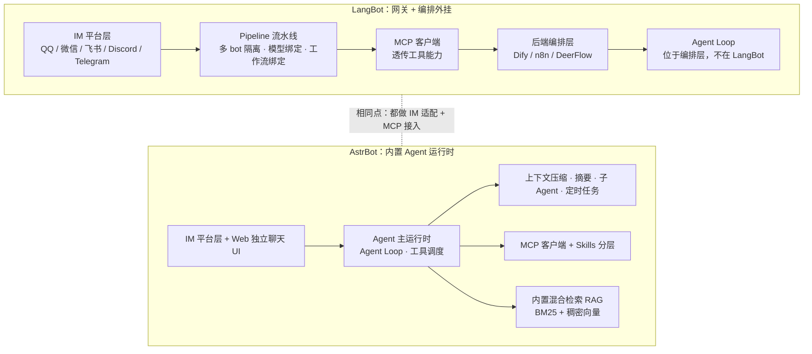
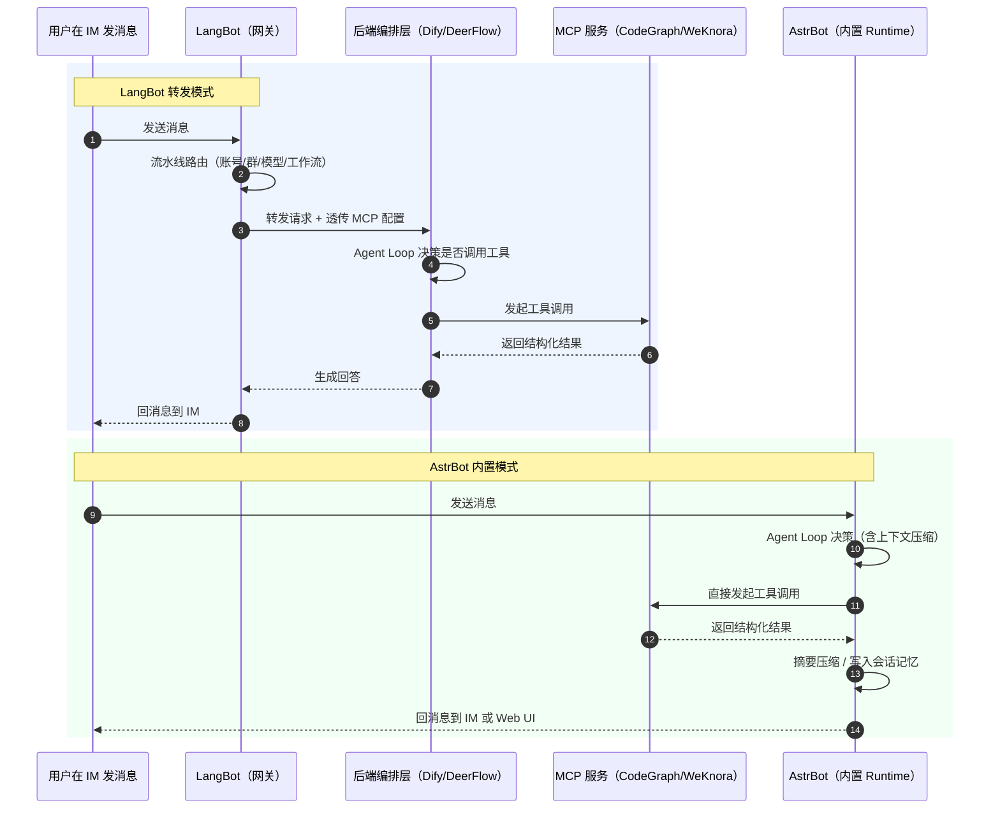
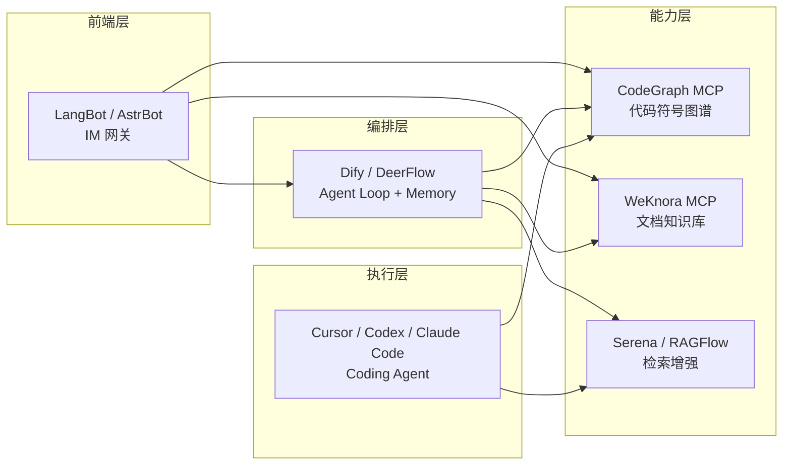

# LangBot vs AstrBot 全维度对比

> 定位一句话：两者都是 **IM 消息层 Agent 网关**，把大模型 + MCP 工具 + 知识库接到 QQ / 飞书 / Telegram / Discord 等聊天软件。
> - 不是编码 Agent Harness（Pi / Orca / Ruflo / OpenMausBot）
> - 不是纯 RAG 知识库底座（WeKnora / RAGFlow / MaxKB）
>
> 信息口径：仓库、协议、架构范式、MCP / 上下文管理 / 插件生态 / IM 覆盖等均取自官方仓库 README、文档与源码结构；Star 数与单实例性能指标未在本轮逐项核实，故不写入表格，避免臆测。

## 目录

1. [主对比表](#1-主对比表)
2. [架构差异图解](#2-架构差异图解)
3. [MCP 调用链路对比](#3-mcp-调用链路对比)
4. [选型结论](#4-选型结论)
5. [与你既有技术栈的挂载关系](#5-与你既有技术栈的挂载关系)

---

## 1. 主对比表

| 维度 | LangBot | AstrBot |
|---|---|---|
| **仓库** | `langbot-app/LangBot` | `AstrBotDevs/AstrBot` |
| **开源协议** | Apache-2.0 ✅ 商用友好，修改不要求开源 | AGPL-3.0 ⚠️ 对外提供商用服务须开源修改部分 |
| **核心定位** | 多流水线、生产级 IM 机器人平台；偏向「消息网关 + 前端」，把 Dify / n8n / DeerFlow 等编排层挂载到 IM | 一站式内置 Agent 运行时；偏向「独立 Agent 本体」，自带 sub-agent、定时任务、上下文压缩，不强依赖外部编排平台 |
| **架构范式** | Pipeline 流水线架构：一个实例跑多条独立 Bot 流水线，不同群 / 不同账号绑定不同模型、不同工作流，天然多租户隔离 | 单实例以「单 Agent 主运行时」为核心，围绕 Agent Loop 组织工具、记忆、任务；另带 Web 独立聊天 UI（类 OpenWebUI），不依赖 IM 也能对话 |
| **Agent Loop 归属** | 不在 LangBot 内部，透传给后端编排层（Dify / DeerFlow 等） | 在 AstrBot 内部，Agent 循环、工具调度、记忆管理由自身完成 |
| **MCP 支持** | ✅ MCP 客户端（stdio + http），接入 CodeGraph、RAGFlow、WeKnora 等 MCP 服务；同时 LangBot 自身也可对外暴露 MCP 接口供其他 Agent 调用 | ✅ 原生 MCP 客户端，MCP + Skills 分层：MCP 负责外部工具，Skills 负责内置任务流程 |
| **上下文管理 / Token 控制** | 基础多轮，**无内置自动摘要 / 滑动窗口淘汰**，一般交由后端编排层处理；后端若不做截断，长会话同样会直接撞窗口上限 | ✅ 内置自动上下文压缩、消息摘要、子 Agent 隔离、可中断任务、定时 cron 任务，支持 steer 式注入 prompt |
| **记忆机制** | 以会话与消息为主，长期记忆依赖后端编排层或外部知识库 | 内置会话管理与压缩，具备跨会话的上下文沉淀能力；记忆与压缩一体 |
| **知识库 / RAG** | 内置向量库，可外接 RAGFlow、WeKnora；检索能力基础 | 内置混合检索（BM25 + 稠密向量），MarkItDown 文档解析，中文文档友好 |
| **插件生态** | 插件跨进程隔离、热插拔；插件数量偏少，偏工程化、企业自动化方向 | 插件数量极多（千级），社区繁荣，大量 QQ 群管理、娱乐、小游戏类插件 |
| **IM 平台覆盖** | 最全：QQ、微信、企业微信、飞书、钉钉、Discord、Telegram、Slack、LINE、KOOK、Matrix | 主流国内 + 海外：QQ、企业微信、飞书、钉钉、Telegram、Discord、Slack；少部分小众平台未覆盖 |
| **代码沙箱** | 内置代码沙箱，安全隔离 | 内置 Agent 隔离沙箱，支持 shell、代码执行，会话资源隔离 |
| **客户端 / 部署形态** | 服务端部署为主，面向企业多 bot 场景；偏工程化 | 支持一键启动、桌面端包、Web 独立聊天界面；轻量化上手快 |
| **多租户 / 多实例** | 强项：一条实例多条流水线，账号 / 群 / 模型 / 工作流互相独立 | 单实例偏向单 Agent 主运行时，多租户能力弱于 LangBot |
| **上手难度** | 偏高，适合企业、多 Bot、多工作流场景 | 偏低，个人 / 小群可快速搭建 |
| **适合场景** | 后端已有 DeerFlow / Dify 编排流，只需稳定的多平台、商用友好的 IM 接入层，多 bot 隔离 | 想在飞书 / QQ 群里直接调 CodeGraph、WeKnora 等 MCP，且不想自己写上下文摘要与会话管理 |
| **主要短板** | 无内置上下文压缩；Agent 能力依赖后端；插件生态偏薄 | AGPL 商用限制；多租户 / 多流水线隔离弱；平台覆盖略少于 LangBot |

---

## 2. 架构差异图解



**关键差异提炼**

1. **Agent Loop 的位置**：LangBot 在外部（编排层），AstrBot 在内部（自身运行时）。这一条决定了两者几乎所有其他差异。
2. **上下文责任归属**：AstrBot 自己管 token（压缩、摘要、淘汰）；LangBot 把这件事交出去，后端不做就没有兜底——这正是你此前那条 `prompt (311709 tokens) leaves no room to answer` 报错的典型成因结构。
3. **隔离粒度**：LangBot 是「实例 → 多条流水线」的工程级隔离；AstrBot 是「会话 → 子 Agent」的运行级隔离。

---

## 3. MCP 调用链路对比



**读图要点**

| 环节 | LangBot | AstrBot |
|---|---|---|
| 谁决策调工具 | 后端编排层 | AstrBot 自身 Agent Loop |
| MCP 调用发起方 | 编排层（LangBot 只透传配置） | AstrBot 运行时 |
| 上下文压缩在哪 | 编排层（若有） | AstrBot 内置 |
| 链路跳数 | 多一跳（网关 → 编排层） | 更短，网关与 Runtime 合一 |

---

## 4. 选型结论

| 你的目标 | 建议选择 | 理由 |
|---|---|---|
| 想稳定把已有 DeerFlow / Dify 工作流接到 QQ / 飞书 / Discord，多 bot、多业务隔离，且要商用 | **LangBot** | Apache-2.0 商用友好；流水线天然多租户；IM 覆盖最全 |
| 想直接在群里调 CodeGraph / WeKnora 等 MCP，不想自研上下文摘要与会话管理 | **AstrBot** | 内置 Agent Loop + 上下文压缩 + 混合检索 RAG，一步到位 |
| 个人 / 小团队快速搭一个能用的群机器人 | **AstrBot** | 一键启动、插件生态庞大、上手成本低 |
| 后续要对外商业化提供服务，且会修改代码 | **LangBot** | AGPL 会强制开源修改部分，商业闭环风险高 |

---

## 5. 与你既有技术栈的挂载关系



- **LangBot 路径**：IM 前端 → 编排层（DeerFlow / Dify）→ MCP 能力层，LangBot 本身不接管 Agent Loop。
- **AstrBot 路径**：IM / Web → 自身 Agent Loop → 直接挂 MCP，可省掉中间编排层。
- 两者都能挂载同一份 MCP 配置，示例：

```json
{
  "mcpServers": {
    "codegraph": {
      "command": "codegraph",
      "args": ["serve", "--mcp"]
    }
  }
}
```

AstrBot 在 WebUI 中直接粘贴该配置；LangBot 则在流水线中绑定 MCP 服务并透传给后端 Agent。
