# LongHorizon-Harness 架构设计

> **文档定位：** 一份按系统责任与运行生命周期组织的架构设计，不是历史文档拼接。源码逐函数解读留在 [SOURCE.md](SOURCE.md)；早期分卷保存在 `archive/legacy/`。
>
> **源码基线：** `b498162fc1b96ff469146f04a698c829c89e3eab`，2026-10-15 核对。本文区分 **当前实现**、**边界推论**、**演进建议**；建议并不表示能力已经实现。运行时源码未修改，源码仓库已有的 `doc-sn/ARCHITECTURE_PART1.md` 改动保持不动。

## 读者与阅读路线

| 读者 | 建议路线 | 应能回答的问题 |
|---|---|---|
| 架构/产品评审 | 1–3 → 7 → 12–15 | 完成由谁授权，系统能保证到哪里？ |
| 后端开发 | 2–11 → SOURCE.md | 模块如何组合，状态、异常和控制如何传递？ |
| 运维/集成 | 6 → 8–11 → 13–14 | 如何停止、恢复、定位故障和验证部署？ |
| 扩展开发 | 4、6、7 → 15 | 新后端/证据字段需要同时改哪些边界？ |

## 总目录

1. [项目定位、目标与架构约束](#scope)
2. [系统上下文、分层与部署](#architecture)
3. [领域模型、状态与任务契约](#domain)
4. [配置、发现与依赖组装](#assembly)
5. [编排内核：信息流与 Round 控制](#orchestration)
6. [执行后端、Environment 与插件](#execution)
7. [审计管道与完成授权](#verification)
8. [持久化、轨迹与恢复一致性](#persistence)
9. [Supervisor：运行所有权与生命周期](#supervision)
10. [人工控制、ControlBus 与门禁](#control)
11. [Web API、事件协议与前端投影](#web)
12. [信任边界、安全与验收可执行性](#security)
13. [预算、停滞与重试治理](#resources)
14. [测试策略、评测与运维验收](#validation)
15. [架构演进、贯穿案例与总结](#evolution)

- [附录：源码导航](#source-map)

## 核心结论

LHH 不替换 Claude Code、Codex 等外部 Agent 的内部 Tool Loop，而是在外层固定 **Manager 规划 → Executor 执行 → Auditor 验收 → 更新可信状态** 的闭环。Manager 再次请求完成时，最新有效审计须同时 `complete ∧ clean ∧ aligned`；Executor 自报完成、工具成功和进程退出 0 都不能替代这道门禁。

“只保留验过的进度”约束的是决策上下文，**不意味着回滚未通过审计的文件修改、GUI 操作或远程副作用**。


<a id="scope"></a>

## 1. 项目定位、目标与架构约束

先明确系统承诺什么、不承诺什么。以下完成门禁和角色隔离属于当前行为；证据版本化、全局资源治理等增强会单独标为建议。


### 1.1 问题与解决方式

LHH 解决的是外部 Agent 长程执行时的目标保持、验收可信度与运行托管问题。它不训练模型，也不替换各后端的内部 Tool Loop；因此设计重点是外环协议及其跨模块不变量。

#### 失败模式 → 对策

| 单 Agent 长跑常见失败 | LHH 对策（代码落点） |
|----------------------|----------------------|
| 上下文爆掉，忘记目标 | 每角色 `run_episode` 全新进程；跨轮只传 `task` + 压缩后的 state/报告 |
| 自报完成但桌面/文件未达标 | `Next: done` 必须 `_latest_auditor_is_clean_complete` |
| 执行口述被当成进度 | Manager prompt **不含** raw trajectory；只含 auditor 报告 |
| GUI/CLI 混用状态乱 | `next: gui\|cli` 分绑不同 adapter/budget/auditor |
| Worker 崩溃无终态 | `manager.run` 异常护栏尝试写 terminal `report.json`；Supervisor 检查缺失证据 |

#### 五条公理（操作化）

1. **原始 `task` 不变**——每轮 Manager 都重新看见它。
2. **可信中间状态 = Auditor 自然语言报告**（再加 Manager 维护的 `task_state`/`task_contract`）。
3. **完成权威 = Manager 路由 + 干净审计**，权威字段写在 `report.json` 的 `completion_authority`。
4. **Harness 反馈 ≠ 审计**——invalid plan/completion 进 `harness_feedback`，prompt 里单独一节标明。
5. **落盘先于信任 UI**——Supervisor/Web 读文件与进程身份，不读内存里的「我觉得完成了」。


### 1.2 可靠长程任务的四个目标

1. **目标连续性：** 任务拆分、上下文刷新、续跑后，原始要求仍可逐项追溯。
2. **证据连续性：** 每项可信进度有来源、适用范围和失效条件，而不是只保留一句总结。
3. **副作用可解释性：** 崩溃后能区分“没有执行”和“可能已执行但没有记录”。
4. **资源可控性：** 在预算或风险边界处停止，而不是靠无限轮次掩盖失败。

当前源码直接支撑角色闭环、落盘、轮级续跑等基础；后两项的完整保证还需要工程协议。


### 1.3 架构不变量

| 编号 | 不变量 | 当前情况 / 建议 |
|---|---|---|
| I1 | Executor 自称完成不能成为完成授权 | 现有完成门禁支撑 |
| I2 | 最新有效审计不通过，不能退回更旧的通过审计 | 当前 `_latest_auditor_is_clean_complete` 在首个有效非空报告处返回；需保持此行为 |
| I3 | 契约或产物版本变化，相关通过结论失效 | 建议增加版本绑定；当前门禁未显式比较版本 |
| I4 | 账本完整性未知时，不能依据缺损历史宣布完成 | 建议补充恢复完整性检查 |
| I5 | 取消后没有新动作获授权；已发出的动作必须对账 | 建议明确授权截点；取消不能撤销已发生的副作用 |
| I6 | Final response 只能解释终态，不能制造完成证据 | 现有职责应保持；见源码校准 |
| I7 | 同一共享可写环境同一时刻只有一个动作授权主体 | 建议增加 workspace/desktop 级所有权；run 级幂等不能替代它 |
| I8 | 不可信任务数据不能修改验收门禁或控制账本 | 建议按权限边界保证，不能仅靠 Prompt |


### 1.4 非目标与保证上限

- MEA 不是模型正确性的证明；Auditor 也可能遗漏、误判或被注入。
- 全新 episode 不是全新世界：文件、浏览器登录态、桌面进程、远程服务仍然共享。
- 轮级 resume 不是指令级回放，也不表示从上一次 GUI 点击精确继续。
- `events.jsonl` 可观察，不自动等于完整的事件溯源系统。
- “只保留验过的进度”是**认知状态**纪律，不意味着撤销未通过审计的物理改动。

最后一条尤其重要：Executor 做坏了文件、发送了消息或改变了远程状态，审计失败不会自动把真实世界恢复到上一轮。


<a id="architecture"></a>

## 2. 系统上下文、分层与部署

按入口、组合根、编排内核、执行环境、进程监督和展示面划分责任。CLI 与 Web 共用同一编排内核；部署形式改变运行所有权，不改变 MEA 业务门禁。


### 2.1 六层职责与进程边界

#### 六层职责：入口、组装、编排、执行、监督、展示

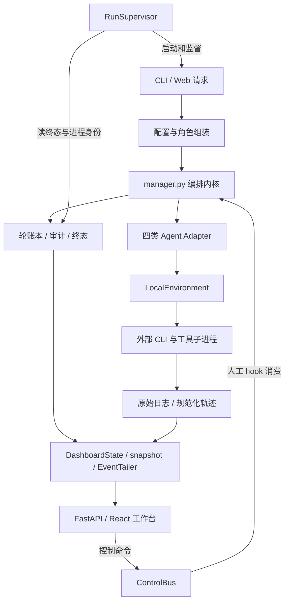

图中不是简单的层层调用：Supervisor 与编排内核是**两个不同责任中心**。前者决定哪个 worker 活着、谁有权控制它；后者决定本轮做什么、审计是否可接受。UI 只投影，不能替代任一中心。

#### 独立 Web 模式的进程边界

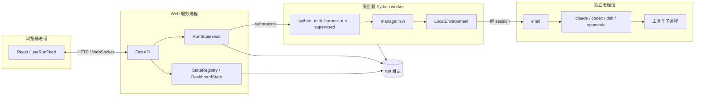

来源：`supervisor/service.py::_worker_command/_launch_worker`、`environment/local.py::exec`、`webapi/server.py::create_app`。

#### 同样是 Dashboard，所有权可能不同

| 模式 | 谁启动任务 | Web 能力边界 |
|---|---|---|
| 普通 CLI | CLI 本进程进入 `manager.run` | 不强制启动 Web |
| `run --dashboard` | CLI 已启动当前任务，再附着控制能力 | 附着模式不应任意创建/重启自己无法拥有的 worker |
| 独立 `web` 工作台 | Supervisor 启动受监督 worker | 可以按能力暴露 create、resume、stop 等 |
| 历史日志查看 | 不启动 worker | 只读投影，不能因为看得到日志就取得控制权 |

`can_control`、run scope、`attached_only` 和 `/api/meta` capabilities 共同限制行为。**能读文件不等于拥有进程**，这是多入口不互相误杀的基础。


### 2.2 一次执行轮的端到端协作

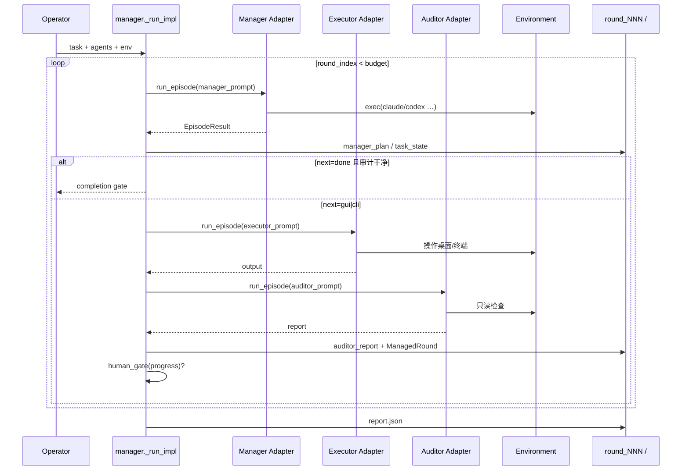


<a id="domain"></a>

## 3. 领域模型、状态与任务契约

区分 OS 命令、Agent episode、审计报告和 run 终态，才能避免把“进程成功退出”升级成“任务完成”。先定义现有对象，再讨论契约应如何版本化。


### 3.1 当前领域对象与转换

#### 核心领域对象类图

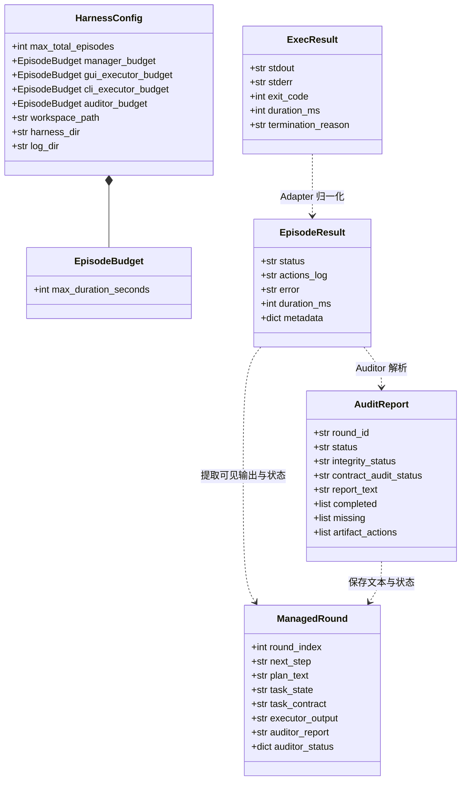

这是字段节选，不是完整类型声明；箭头分别表示组合和数据转换，**不表示 `ManagedRound` 实际持有一个 `AuditReport` 对象**。它存的是审计文本和状态字典，完成门禁会再解析文本。

#### 三种 result 不能混用

| 对象 | 产生者 → 消费者 | 成功语义 |
|---|---|---|
| `ExecResult` | Environment → Adapter | shell/进程退出信息；0 不等于任务完成 |
| `EpisodeResult` | Adapter → Manager/Auditor 逻辑 | 一次 Agent episode 的 done/timeout/error/cancelled |
| `AuditReport` | 审计解析器 → 编排决策 | 结果是否 complete、integrity 是否 clean、contract 是否 aligned |

此外还有 `_final_report` 返回的字典：它聚合整次 run 的完成授权与终态。Supervisor 再将该结果与进程退出状态合并，得到公开 lifecycle status。

#### 存储模型为什么值得单独解释

`ManagedRound` 通过 `asdict` 落入 JSONL；恢复时再经过字段清洗重建。这样兼容自由文本和可读日志，但弱点是 metadata 字典、审计文本与终态字段可能出现语义重复。后续若增加版本化证据，优先扩展**统一中间对象与兼容解析**，而不是在 UI、Manager 和 Supervisor 各自解析一套新字段。


### 3.2 可信状态如何跨轮传递

```text
原始 task（不变）
  + current_task_state / task_contract（从 Manager 计划抽取，跨轮保留）
  + rounds[].auditor_report（仅被引用的报告进 Executor/Auditor 上下文）
  + harness_feedback（无效完成 / 无效计划 / 运行时失败）
  ≠ Executor raw trajectory（Manager 刻意不看）
```

磁盘侧每轮还有完整轨迹供人审；**编排决策面**刻意收窄。


### 3.3 建议：版本化任务与验收契约

**现有：** `current_task_state` 和 `current_task_contract` 从 Manager 文本提取并跨轮传递。文本灵活，但缺少机器可比较的需求覆盖与版本关系。

**建议：** 原始任务保持不变；另建需求条目和授权变更记录，Manager 可以提出契约修订，却不能通过改写文本降低验收标准。

```json
{
  "schema_version": 1,
  "contract_id": "C-001",
  "revision": 2,
  "original_task_digest": "sha256:<task-bytes>",
  "requirements": [
    {
      "id": "R-001",
      "description": "交付可在目标环境打开的最终文件",
      "acceptance": "存在、格式有效、目标应用成功打开",
      "verification_methods": ["file_check", "application_open_check"],
      "risk": "normal"
    }
  ],
  "authorized_change_refs": ["H-003"]
}
```

这是示意契约，不是现有 `HarnessConfig` 或 `AuditReport` 字段。摘要算法应对确定的编码和规范化规则计算；仅记录摘要不能证明内容真实。

#### 总任务契约与本轮子任务契约分层

- **总任务契约**：包含所有要求、允许动作、禁止动作和终态验收条件。
- **本轮契约**：本轮要改变哪些对象、前置条件、成功观察、可用工具、失败处理。
- **审计范围**：本轮通过不等于全局完成，必须标明 `subtask` 或 `global`。

最终审计需要覆盖所有 R-id；存在 `unknown`、未执行或证据过期的条目时，不应 complete。

#### 契约变更的失效规则

1. 人工追加要求形成新 revision，并保留旧要求与变更来源。
2. 对发生变化的要求、依赖它的产物和审计结论标记 `stale`。
3. Manager 重新规划必要工作，Auditor 重新验收受影响条目。
4. 未受影响的证据可复用，但必须给出复用理由。

反例：旧任务“生成 PDF”已通过，用户追加“每页加水印”，Manager 直接 `done`。旧审计只验证了旧契约，不能支撑新任务完成。


<a id="assembly"></a>

## 4. 配置、发现与依赖组装

CLI 是组合根，Manager 接收已经选好的 Adapter 与 Environment。注册、探测、模型候选发现和真实调用成功是不同阶段的事实。


### 4.1 配置到运行实例

#### 组装中心在 CLI，不在 Manager

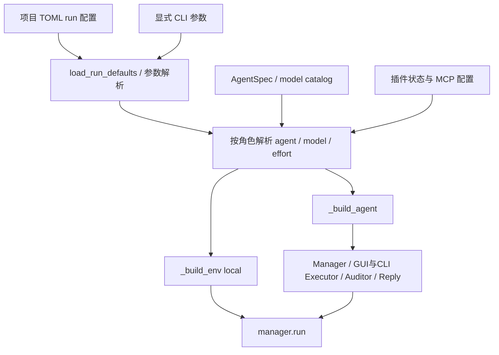

`config.py::_flatten_run_table` 把 `[run.roles.<role>]` 的嵌套项变为参数默认值；未知根字段、角色、timeout 字段会报错，不静默接受拼写错误。显式参数再参与 `_resolve_role_option/_resolve_role_model/_resolve_role_reasoning_effort` 的角色解析。

`manager._run_impl` 负责缺省 Adapter fallback 和编排，不负责每轮重新发现二进制或重建 CLI 配置。该设计把“入口配置变化”与“状态机变化”隔开。

#### 注册、探测、模型发现是三种事实

| 模块/对象 | 回答什么 | 不回答什么 |
|---|---|---|
| `AgentSpec` | 已知后端 ID、二进制名、默认模型、声明能力 | 此机器当前是否可运行 |
| `AgentProbe` / `probe_agents` | usable / found_but_broken / missing | 该模型账户一定有权限 |
| `discover_model_catalog` | 候选模型、发现来源、配置推理选项 | 下一次真实请求一定成功 |
| Adapter + provider error | 运行时是否被后端接受 | 声明 capability 就能代替真实权限测试 |

“PATH 能找到”与“可用”分成三态是已有设计价值：例如一个可解析路径可能不是可执行的真实 CLI。模型候选表也可能来自本地缓存或声明，不应把下拉框选项当成已验证的调用权限。

#### 推理强度是后端特性，不是通用字符串语义

- Claude：注册表声明 CLI flag 传输，实际 `--effort`；未知值可能被 CLI 警告后忽略，不能显示成“已验证生效”。
- Codex：通过 `-c model_reasoning_effort=...` 传输；模型目录记录 per-model 选项。
- DeepSeek 集成：当前不支持该配置；不应静默吞掉。
- OpenCode：`--variant`，语义随 provider；声明选项不等于统一强度刻度。

这些是本项目基线的适配策略，不是对任意最新 CLI 版本的永久保证。


### 4.2 启动顺序与扩展点

启动顺序为：解析 task/workspace/log_dir → 合并配置与显式参数 → 探测后端和模型 → 解析角色选项 → 构建 Environment/Adapter → 可选接入 human_hook → 调用 `manager.run`。

`doctor / plugin / init` 属于安装和能力准备；不能把 doctor 成功当成模型账户、GUI 任务或审计权限已经验证。Web worker 也复用这一组装路径，不在 HTTP handler 中另建业务循环。


<a id="orchestration"></a>

## 5. 编排内核：信息流与 Round 控制

本章只讲“下一步做什么”：输入裁剪、Manager 路由、执行轮和异常分支。验收与完成授权集中在第 7 章；人机暂停和续跑集中在第 10 章，避免同一状态机在多处重复定义。


### 5.1 三角色的信息可见性

#### 职责表（带「禁止」）

| 角色 | 负责 | 允许看见 | **禁止看见/做** |
|------|------|----------|-----------------|
| **Manager** | 恢复目标、维护契约、选下一步 | 原始 task、task_state/contract、历史 auditor 报告、harness_feedback、轮次预算 | Executor/Auditor 的 raw JSONL 轨迹；替用户「假装验收」 |
| **Executor** | 只做一项边界明确的子任务 | 本轮 plan、state/contract、**Manager 点名的** related reports、workspace | 全局改规划；把 harness 日志当交付物 |
| **Auditor** | 独立检查真实环境 | 子任务契约、executor 可见输出、related reports | 默认写改工作区；无控制头的胡言当 complete |

#### 代码如何强制「Manager 不看轨迹」

构造 Manager prompt 时显式组装的块（英文路径，`role_prompts.py`）：

源码定位：`src/lh_harness/role_prompts.py`（节选，行号不作为当前定位）。

```python
        return f"""\
{MANAGER_INSTRUCTIONS[lang].strip()}

Original task:
{task.rstrip()}
...
Previous current-task state:
{task_state.strip() or "(No maintained state yet. ...)"}

Historical auditor reports by round (authority for trusted intermediate state):
{auditor_reports or "(No auditor reports yet.)"}

Harness management feedback (not an audit; only for protocol/completion correction):
{harness_feedback or "(No harness feedback.)"}

Round budget:
- Current management round: {round_index}
...
Output only the next management result.
"""
```

`auditor_reports` 来自 `format_verified_intermediate_context(rounds, ...)`——只抽取过去 round 里存下的 **auditor_report 文本**，不是 `*_raw_trajectory.jsonl`。

轨迹仍会通过 `_save_role_result` 落盘供人审 / Dashboard，但 **不进入下一轮 Manager 的决策输入**。这是「操作员面」与「决策面」分离。

#### Executor 只拿「点名」的报告

源码定位：`src/lh_harness/manager.py`（节选，行号不作为当前定位）。

```python
        # Task prompts receive the manager-maintained state plus only the
        # auditor reports explicitly referenced by the current subtask contract.
        executor_prompt = build_role_executor_prompt(
            ...
            related_auditor_reports=related_auditor_reports,
            ...
        )
```

`related_report_refs` 从 Manager 计划里解析；`format_related_auditor_reports` 按 round id 裁剪。
**未引用的历史报告默认不进 Executor**——防止上下文膨胀，也防止「随便翻旧报告当新证据」。


### 5.2 Round 的统一控制流

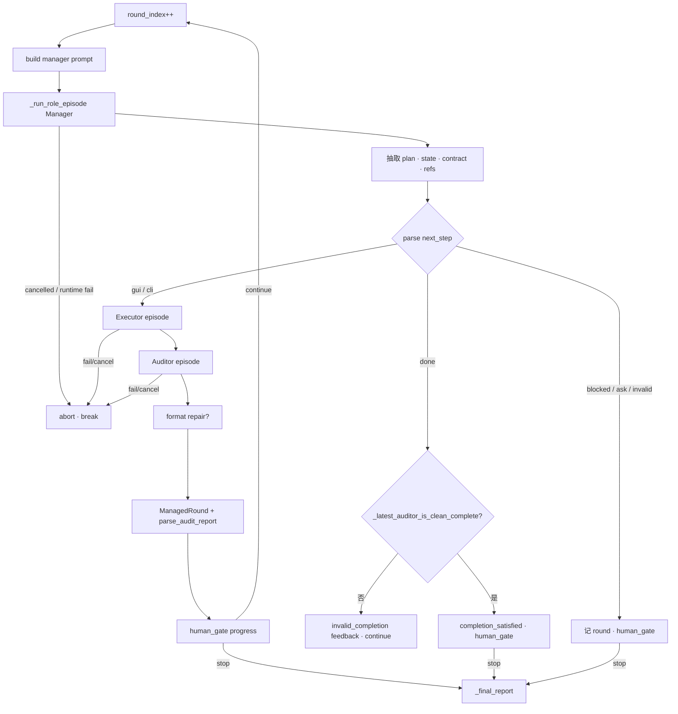

对应源码主循环：`manager.py::_run_impl`（当前定位以符号为准）。
取消与 provider 失败在 **每个角色阶段** 都有对称分支（写 `ManagedRound`、events、`abort_reason`/`failure_reason`）。


### 5.3 Next 控制协议

#### 合法取值

| 解析结果 | Manager 意图 | 编排行为 |
|----------|--------------|----------|
| `gui` | 需要桌面/视觉操作 | GUI executor + GUI auditor |
| `cli` | 需要终端/文件/代码 | CLI executor + CLI auditor |
| `done` | 宣称总任务完成 | **仅当**存在干净 complete 审计才收工 |
| `blocked` | 无法继续 | human_gate；无 hook 则停 |
| `ask` | 必须问人 | 抽 question/choices；无 hook → `needs_human_input` |
| `invalid` | 控制行不合规 | 注入 `_invalid_plan_feedback`，作为 Harness 管理反馈（不作为 Auditor 审计） |

#### 解析器行为（严格）

源码定位：`src/lh_harness/role_prompts.py`（节选，行号不作为当前定位）。

```python
def parse_role_manager_next_step(text: str) -> RoleNextStep:
    for line in str(text or "").splitlines():
        normalized = ...
        normalized = re.split(r"(?:—|–|--|//|#|[（(])", normalized, maxsplit=1)[0]
        ...
    return MANAGER_NEXT_INVALID
```

- `Next: done — all passed` → **done**（破折号后当注释）
- `Next: done later` → **invalid**（later 不是 delimited 后缀）
- 中英同义集合（`下一步:完成` / `next:complete` 等）

架构含义：控制面靠 **行级协议**，不是靠 LLM JSON schema。代价是脆弱 → 用 invalid + harness_feedback 闭环修正，而不是静默猜。


<a id="execution"></a>

## 6. 执行后端、Environment 与插件

Adapter 负责如何调用外部 Agent，Environment 负责命令实际在哪里运行。统一 Python Protocol 只统一调用形状，不保证四后端具有相同权限、流式输出和取消语义。


### 6.1 后端能力和权限矩阵

#### 后端继承与协议关系

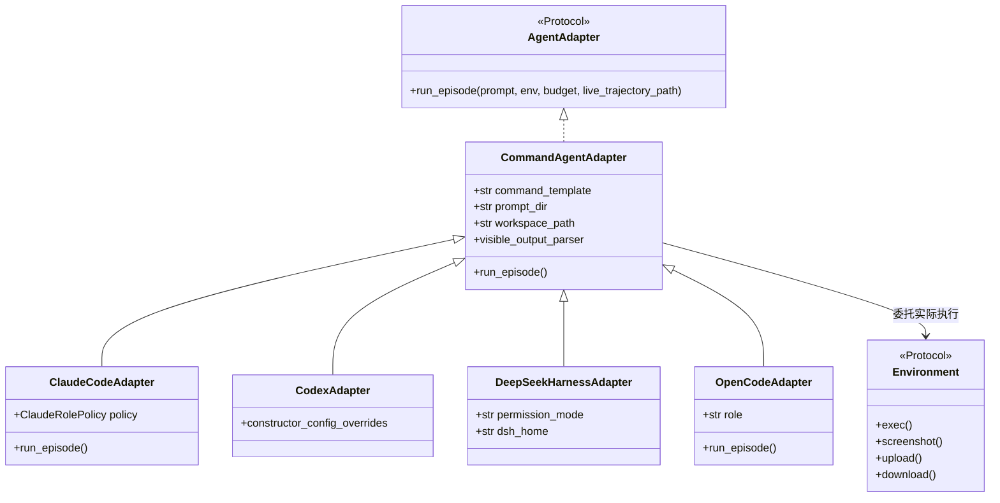

`AgentAdapter` 是结构协议，不要求显式继承；虚线表示满足接口。四类具体 Adapter 共用命令执行管道，但权限、日志格式和配置生成不等价。

#### 实际后端矩阵

| 维度 | ClaudeCodeAdapter | CodexAdapter | DeepSeekHarnessAdapter | OpenCodeAdapter |
|---|---|---|---|---|
| 启动方式 | `claude --print` 流式 JSON | `codex exec --json` | Python runner → `dsh --profile headless` | `opencode run --format json` |
| Prompt 传入 | stdin 文件重定向 | stdin 文件重定向 | runner 读文件，再传给 dsh | stdin 文件重定向 |
| 角色策略 | `ClaudeRolePolicy` deny-list | 构造器可收 sandbox_mode；当前 `_build_agent` 不传 role/sandbox_mode | role → read-only / workspace-write | 保存 role 标签；当前此类未生成角色级 deny-list |
| 默认自动授权 | 跳过交互权限，叠加 deny-list | 未指定 sandbox 时 bypass approvals/sandbox | 通过 DSH_PERMISSION_MODE 约束 | `--yolo` |
| Auditor 文件变化检测 | 前后 workspace snapshot | 本类无同等 snapshot 守卫 | 本类无同等 snapshot 守卫 | 本类无同等 snapshot 守卫 |
| 配置/端点 | 环境变量，Anthropic URL 处理 | provider TOML overrides，Responses URL 处理 | 隔离 DSH_HOME + 模型 patch | provider 端点 JSON 文件 |
| GUI/MCP | 支持按策略加载 MCP | MCP TOML overrides / 插件 | 注册能力当前仅 CLI | 注册能力当前仅 CLI |
| 额外目录 | 角色隔离下拒绝 | 支持 add-dir | 当前拒绝 | 本组装路径未传额外目录 |

**重要：** 默认 bypass 是当前源码事实，不是本章建议用户开启的部署方案。尤其不能因为源码注释假定“外层环境已隔离”，就推导 `LocalEnvironment` 自身提供了 OS 沙箱；它并没有创建容器或虚拟机。

#### 三个具体实现细节

1. **Claude 权限是 deny-list，不是 native sandbox。** `policy_for_role` 的 docstring 已明确这一点。Manager/Final response 禁 Bash、写工具、Agent 和 MCP；Auditor 禁写工具与 Agent，但为了验收仍允许其他观察/执行能力，再通过快照检测文件变化。
2. **Codex CLI 工厂存在角色语义缺口。** `_build_agent` 接收 role，却不向 CodexAdapter 传 role；该构造器本身也没有该参数。修改时必须区分“库调用者手工指定 sandbox_mode”和“默认 CLI 路径”。
3. **DeepSeek runner 是协议桥，不是普通透传。** 它生成模型 YAML patch，调用 dsh 后包装为 `dsh.result`；stdout 是进程结束后集中包装，不应向读者承诺与其他后端同等细粒度的实时轨迹。它还把读取后的 Prompt 作为 dsh 命令参数传递，因此不能把通用 stdin 路径的进程表隐私性质类推到该 runner。


### 6.2 Episode 与进程生命周期

#### 一次 Episode 的真实调用链

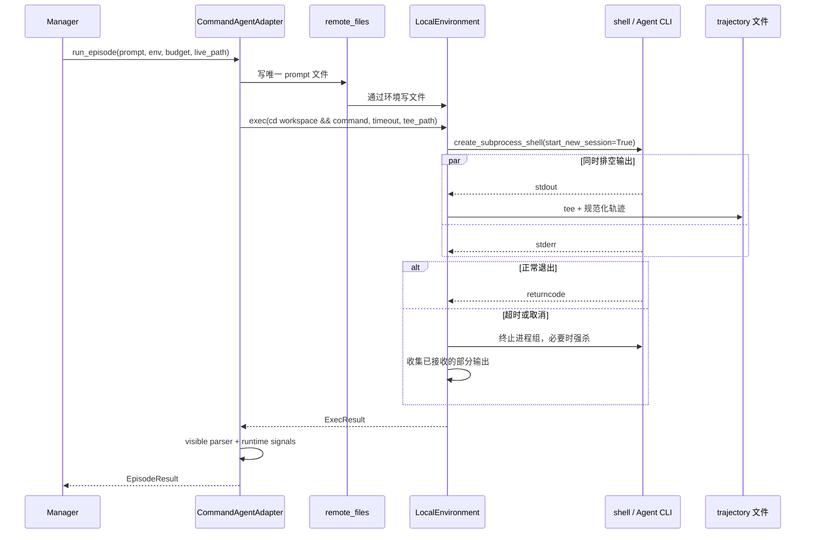

#### 实现中的可靠性选择

- 每集唯一 Prompt 文件名防止并发互相覆盖；不是复用一个 `prompt.md`。
- 模板替换用 `.replace`，避免 CLI 内联 TOML 大括号被 `.format` 误解析。
- workspace 与 Prompt 路径做 shell quoting；模板本身仍应是受信配置。
- stdout/stderr 并发排空，避免某一管道塞满后子进程卡死。
- 超时保留已读输出，返回 `termination_reason="timeout"`；取消/异常先清理进程再向上抛。
- 进程组分离后 Ctrl+C 不会自然传递给子进程，所以 cleanup 不能遗漏异常路径。
- `LH_HARNESS_WEB_TOKEN` 从 Agent 子进程环境移除，避免控制面凭据泄入执行面。

#### Environment 的实际边界

`Environment` 定义 exec、screenshot、upload、download；当前 `_build_env` 只接受 `local`。它提供适配面，并不意味着远程机器、容器、检查点恢复已经实现。

本地 screenshot 有平台实现与失败条件；不能将接口方法存在解释为所有操作系统均有可用 GUI。跨机器扩展还要处理远程文件、CLI 可执行位置、日志传输和进程身份，而不仅新增一个 hostname。


### 6.3 日志视图与失败归一化

#### 一份原始日志，四种消费视图

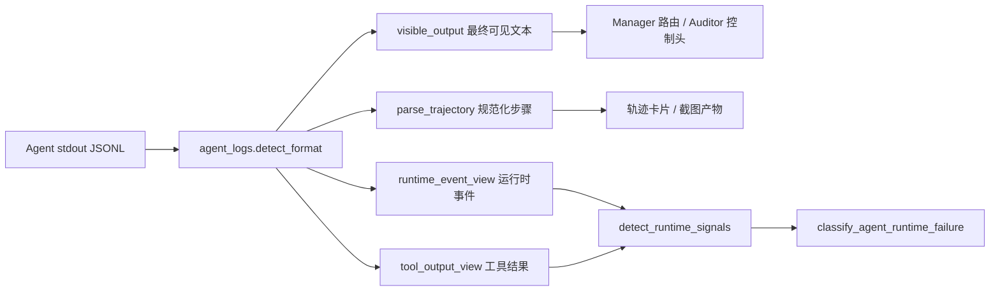

这解释了为什么不能直接把整个 stdout 当 Manager 的决策文本：其中混有工具输出、图片、错误事件和非最终 assistant 消息。`actions_log_diagnostics_only` 也用于避免“解析不到最终回答时就拿原始诊断日志当回答”。

#### 失败分类不是搜索任意 Error 字符串

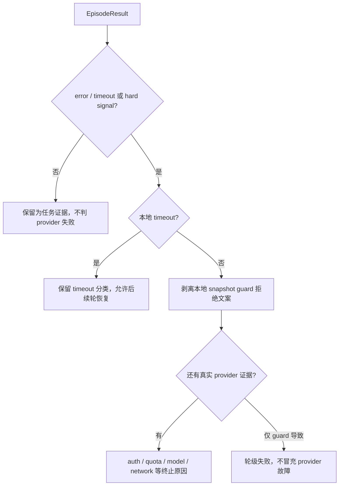

工具运行 Python 抛 Traceback，可以是需要 Executor 修复的任务错误；Agent provider 身份验证失败，则继续同一个任务 Prompt 通常没有意义。`runtime_signals.py` 区分 runtime 与 tool view，`provider_errors.py` 再分类，Manager 据类型选择恢复或终止。

**仍有边界：** 该分类包含文本模式匹配，依赖后端输出约定；新版本 CLI 的错误形状必须用 fixture 补测试，而不是认为统一类型已经消灭兼容风险。


### 6.4 Computer-use 插件的能力装配

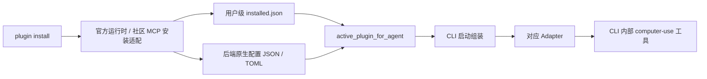

`plugins/state.py` 将安装状态置于用户级 plugins 目录，可由 `LH_HARNESS_STATE_ROOT` 调整。多个已安装插件按优先级选择，Codex 官方插件优先；Claude 无法使用该官方路径时走适用的社区插件。生成后端原生配置，减少每次运行时格式翻译。

不要把 `plugins/` 理解为可以随意插入新 Manager 状态转换的业务插件框架；当前它主要解决 computer-use 的安装、激活、配置、状态查询与卸载。


### 6.5 建议：后端语义契约与一致性测试

**现有：** Protocol 让编排依赖统一的 `run_episode` 与环境操作，但 Python 签名兼容并不保证“done”“timeout”“只读”在不同 CLI 中语义一致。

建议每个 Adapter 声明能力，启动时根据角色需求校验：

| 能力 | 启动前需要回答的问题 |
|---|---|
| 结果归一化 | 哪些后端字段代表真实退出？流中最后一条是不是最终结果？ |
| 生命周期 | 超时/取消是否收回整个子进程树？如何证明没有残留？ |
| 权限 | 可否禁止工作区外写入、读控制账本、外网或 GUI 写动作？ |
| 使用量 | usage 是实测、估算还是 unavailable？ |
| 轨迹与脱敏 | 哪些 channel 会保存？是否可能在脱敏前 tee 到磁盘？ |
| computer-use | GUI 是否真可用？会不会仅 CLI 可用却路由到 GUI？ |
| CLI 兼容性 | 测试了哪些版本、输出格式和配置参数？不支持如何报错？ |

契约测试使用 fake CLI/fixture，而不是必须消耗真实模型调用：覆盖空输出、乱码、流截断、多结果、非零退出、超时、取消、provider 错误、含秘密日志、并发 prompt 文件隔离和子进程残留。

Environment 的后续演进应先承认文件、GUI、网络的差异，再增加可选能力（状态探测、隔离验证、回执查询）；不要仅向通用 `exec` 添加更多含糊约定。


<a id="verification"></a>

## 7. 审计管道与完成授权

任务内容验收、Auditor 自身完整性和 Manager 的完成路由是三个不同判断。任何一个缺失，都不能仅凭 Executor 的成功叙述或进程退出码宣布完成。


### 7.1 审计解析、只读守卫与删除对账

#### 两条不同的验证管道

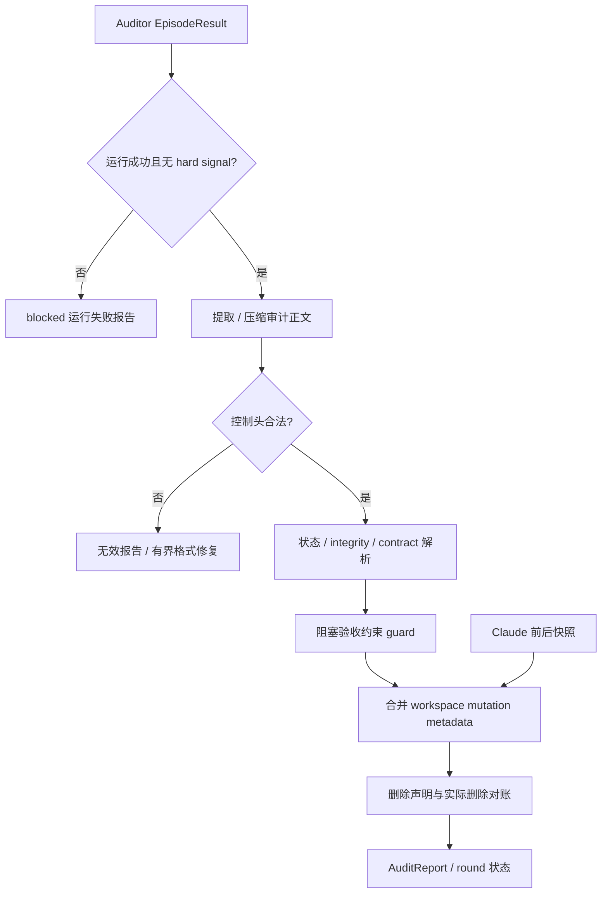

**内容验收**回答任务是否满足；**只读守卫**回答 Auditor 是否改变了被验证对象。两个维度相互独立：报告说 complete 但写坏产物，仍不能成为可信完成。

#### 快照的精确覆盖

`claude_permissions.py::snapshot_workspace` 对工作区遍历，记录文件类型、mode、size、mtime、符号链接目标；小文件计算内容摘要。`_small_file_digest` 只对不超过 **4 MiB** 的文件算 SHA-256，较大文件的摘要为 None。

因此本机制不是“全工作区所有文件内容的完整哈希”。大文件仍有元数据比较，但若内容变化未体现在比较字段，检测能力有限。`hidden_paths` 与 `guard_exclude_paths` 也不同：前者参与角色可见性限制；后者仅排除快照扫描，**不会因此禁止 Agent 访问**。

#### 删除账本与例外不能泛化为写授权

`auditor_agent.py` 有候选产物路径、删除原因提取、允许删除路径计算和实际删除对账。用途是将特殊清理行为显式记入审计并核对，不能把“报告里声明删除”当成删除已发生，也不能把例外解释为 Auditor 可任意修复工作区。

新增后端时，若只实现可见文本解析，不提供相同 metadata 与守卫语义，则统一 Auditor 解析器也无法凭空检测其写副作用。


### 7.2 控制头、约束降级与格式修复

#### 控制头（前三行协议）

典型要求（中英）：状态行、完整性行、契约审计行。
`_parse_status_control_header` 只看第一非空行；缺头 → 整份作废为「格式错误」类报告，触发 manager 的 format repair。

#### Acceptance guard

源码定位：`src/lh_harness/auditor_agent.py`（节选，行号不作为当前定位）。

```python
def _apply_acceptance_constraint_guard(...):
    if status != "complete" or not _has_blocking_acceptance_constraints(report_text):
        return report_text, status, contract_audit_status
    # 降级为 incomplete，并可能撤销 aligned
```

防止模型一边写「还有 blocking acceptance」，一边控制头标 `complete`。

#### Format repair（manager）

主 Auditor episode 后 `_auditor_report_with_format_repair`：

- 判定是否需要修（`_should_repair_auditor_format`）
- 再用（默认同）auditor adapter 跑 `build_role_auditor_format_repair_prompt`
- 缩短预算 `_format_repair_budget`
- 仍失败则带着不合格文本继续——下一轮 Manager 会看见不干净状态，不会误 complete


### 7.3 当前完成谓词与拒绝路径

#### 干净审计判定

源码定位：`src/lh_harness/manager.py`（节选，行号不作为当前定位）。

```python
def _latest_auditor_is_clean_complete(rounds, *, language="en") -> bool:
    for item in reversed(rounds):
        if item.auditor_status.get("invalid_completion") or item.auditor_status.get("invalid_plan"):
            continue
        if not item.auditor_report.strip():
            continue
        report = parse_audit_report(item.auditor_report, item.round_index, language=language)
        return (
            report.status == "complete"
            and report.integrity_status == "clean"
            and report.contract_audit_status == "aligned"
        )
    return False
```

三条件缺一不可：`complete` ∧ `clean` ∧ `aligned`。
跳过「伪完成/伪计划」合成轮，避免用 harness_feedback 冒充审计。

#### 伪完成路径

当 `next_step == done` 但判定失败：写入 `_invalid_completion_feedback`，`ManagedRound.next_step = invalid`，带 `auditor_status.invalid_completion=True`，然后 `human_gate("progress")` 并 **continue** 下一轮。

**Manager 不能单方面结束任务。**


### 7.4 Final response：解释终态，不制造证据

当前实现另有 Final response 角色，将多角色协议文本转成面向用户的答复；它不取代独立审计，也不改变 `completion_satisfied`。源码 `_write_final_response` 的失败降级为空回复，不应因此丢失 run report；取消生成则由调用方转为 run 级取消。

若人工继续后进入新轮，旧发布回复可由 `_discard_final_response` 撤销，避免 UI 展示过期结论。不要把“最终回复已生成”当成完成证据提交。具体代码见 [SOURCE.md](SOURCE.md#当前源码校准与验证索引)。


### 7.5 建议：证据适用性与更强完成条件

#### 建议完成谓词

```text
eligible(audit, current) =
    valid_schema(audit)
    AND audit.status == complete
    AND audit.integrity == clean
    AND audit.contract_alignment == aligned
    AND audit.scope == global
    AND audit.contract_revision == current.contract_revision
    AND every_requirement_has_valid_pass_evidence(audit)
    AND evidence_subjects_match_current_artifacts(audit, current)
    AND no_unreconciled_side_effects(current)

complete = manager_requests_done AND eligible(latest_applicable_audit, current)
```

`latest_applicable` 不能解释为“跳过较新失败，找到旧通过”；较新失败或相关环境变化必须撤销旧结论。无可用证据时降级，不凭模型推断补齐。

#### 时效不是统一 TTL

| 证据 | 推荐有效性判据 |
|---|---|
| 本地文件格式/内容 | 内容摘要、路径身份、必要依赖一致 |
| 测试通过 | 代码/依赖/配置版本一致；测试对象范围明确 |
| GUI 窗口或页面观察 | 目标应用/文档身份 + 观察时间；相关动作发生后重查 |
| 远程对象上传成功 | 服务端对象 ID、版本、内容查询；不能只看客户端日志 |
| 发消息/提交订单等副作用 | 服务端回执 + 动作意图绑定；未知状态须对账 |

“所有证据有效 10 分钟”会同时过严和过松：不变文件可以长期复用，远程易变状态可能立即失效。

#### 审计格式修复不能升级事实

**现有：** format repair 用于把报告修成可解析格式。

**建议：** 将“格式转换”与“重新验证”标成不同事件。纯转换必须保留原始证据引用、范围和结论，不能把 `unknown` 修成 `pass`。如果 repair Agent 重新运行验证，则记录新的验证来源与预算，不再将它统计成纯格式修复。

#### 审计到完成之间的竞态窗口

即使审计绑定了摘要，验证后再次修改产物仍可能使它失效。建议在最终验收阶段获取目标资源的独占授权，核对版本并提交完成；Final response 使用只读能力，不能在解释结果时又修改交付物。

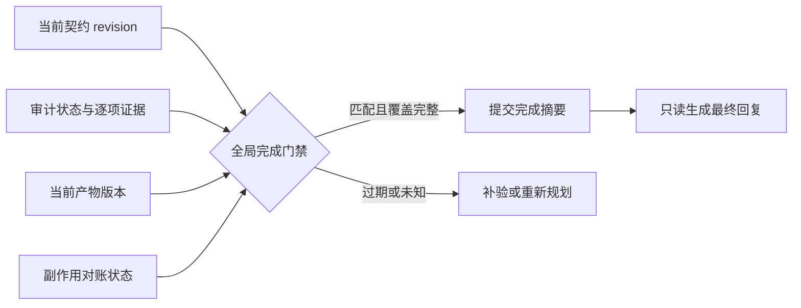

独占只能约束参与协议的写者；外部服务仍可能被其他用户修改，因此远程结论需注明“在何时、对哪个版本验证成立”。需要持续保证时另设监测，不把一次完成验收包装成永不失效的承诺。


<a id="persistence"></a>

## 8. 持久化、轨迹与恢复一致性

本地账本、Environment 侧镜像、实时事件和外部世界不是同一事务。先说明保存什么及如何续读，再说明尚未解决的提交窗口和副作用对账。


### 8.1 Run 目录与事件消费者

#### 目录树（单 run）

```text
{log_dir}/                          # 常在 ~/.lh-harness/... 或 ./.lh-harness/runs/<id>
  report.json                       # Supervisor/评测读的终态
  role_orchestration/
    events.jsonl                    # 实时事件（role_start/done、cancel、runtime_failed）
    report.json                     # 同终态副本
    orchestration_transcript.txt
    rounds/round_001/
      manager_input.txt             # 决策面输入（可审计「Manager 看见了什么」）
      manager_plan.txt
      task_state.txt / task_contract.txt
      executor_prompt.txt / executor_output.txt
      auditor_input.txt / auditor_report.txt
      harness_feedback.txt          # 可选
      {role}_raw_trajectory.jsonl   # 操作员面；决策面不用
      {role}_metadata.json
      screenshots / artifacts…
  manager_episodes/ …
```

#### `_save_role_result` 的轨迹语义

注释写明：超时取消时 stdout 可能空，但 live tee 已写入 JSONL——优先 **保留 live 更长前缀**，避免擦掉已刷轨迹。
另：`persist_trajectory_artifacts` 抽截图清单；GUI 还可挂 final screenshot。

#### 事件流

`_append_event(events_path, event, payload)` → JSONL。
关键 event：`role_harness_start`、`manager_round_*`、`executor_role_*`、`auditor_role_*`、`agent_runtime_failed`、`role_harness_cancelled`、`role_harness_done`、`human_instructions_injected`。

`progress` 回调与 events **并行**：CLI 打印用人话；机器跟跑用 JSONL。


### 8.2 Raw、规范化轨迹与截图

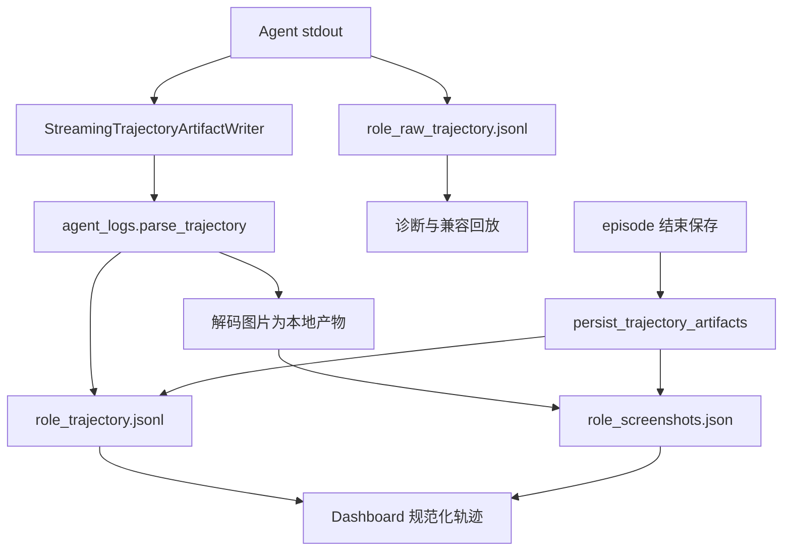

writer 按 tool ID 去重工具调用，避免 Codex started/completed 两条记录产生两张工具调用卡片；结果记录仍保留。图片提取有步数、大小等限制，manifest 描述可用截图，避免把巨大 base64 反复塞进页面状态。

展示产物不能当成验收证据本身：规范化器会裁剪、去重、去内联图片，用途是观察与调试；需要原始依据时仍应检查 raw 和真实任务产物。


### 8.3 恢复与提交边界

#### 当前可恢复什么

**现有：** `resume=True` 读取 `role_orchestration/rounds.jsonl`，恢复 `rounds`、最后计划、task state、task contract 和轮号；新的轮次从已有历史继续。配置中的轮次预算在 resume 时作为**新增预算**使用。

**不应夸大：** 这不恢复 CLI 内部上下文、浏览器 DOM、桌面窗口布局，也不把远程动作回滚。历史干净审计可以参与恢复后的完成判定；是否仍适用需要 完成授权（第7章） 的证据规则。

#### 事实源必须有明确优先级

| 对象 | 建议角色 | 不应承担的角色 |
|---|---|---|
| round ledger | 轮级编排事实源 | 外部服务实际成功的唯一证明 |
| 产物与服务端回执 | 任务结果事实源 | 自动授权完成 |
| events | 实时投影、诊断、因果关联 | 缺完整提交协议时替代 ledger |
| `report.json` | 可重建的终态摘要 | 凭单个文件覆盖互相矛盾的执行证据 |
| UI 状态 | 只读投影 | 修改审计或完成条件 |

**现有：** `_record_round` 先追加本地 ledger，再写环境侧 `round.json`，再发事件。这几个步骤不能仅因“都写文件”就视为原子事务。

#### 必须覆盖的崩溃窗口

| 崩溃位置 | 已知状态 | 恢复策略建议 |
|---|---|---|
| 动作未启动前 | 无副作用 | 重建规划并执行 |
| 动作运行中 | 副作用未知 | 先探测，禁止直接重复不可逆动作 |
| 动作成功、审计前 | 可能有产物，无验收 | 重新审计产物，不默认重做执行 |
| 审计成功、ledger 提交前 | 有审计文件，提交状态未知 | 检查文件完整性与版本，再对账提交 |
| ledger 已写、远程镜像或事件失败 | 本地已有记录，其他投影缺口 | 从事实源补齐投影，不再执行动作 |
| 终态生成后、回复或 UI 更新前 | 任务状态与展示分离 | 重建回复/展示，不改变验收事实 |
| 账本损坏、缺轮、重复轮或被截断 | 恢复历史不完整 | 标记 degraded；保留诊断，不默认 complete |

源码读账本会跳过部分不合法记录；这有容错收益，但“读取到合法行”不等于“完整恢复了历史”。建议记录跳过数量、重复索引、截断情况，并禁止在恢复完整性未知时复用旧完成授权。

#### 最小提交协议，而非立即上分布式系统

建议先采用单写者、本地 manifest 和版本化记录：

```text
prepared → executor_finished → audit_finished → committed
               ↓ 副作用未知
          reconciliation_required
```

- 每轮有 `run_id/round_id/attempt_id`；retry 是新 attempt，不覆盖原始证据。
- 完成产物文件先写临时路径，再原子替换；若要求掉电持久性，还需明确文件/目录同步策略。
- `committed` manifest 指向已写完的输入、产物和审计摘要；重建时先验证引用。
- `events` 和终态摘要允许重建；canonical ledger 丢失或篡改则 fail-closed。
- 停止、续跑、重试保存同一因果链，不能用新进程 PID 替代逻辑身份。

以上是演进建议；原子替换单个文件也不能使多个文件与远程服务成为同一事务。

#### 外部副作用采用意图—回执—对账

```text
Intent(action_id, target, payload_digest, approval_ref)
  → Execute
  → Receipt(remote_id, status, observed_at)
  → Reconcile
```

支持幂等键的服务可传 `action_id`；不支持时先查询目标状态或要求人工确认。只能提供至少一次执行时，应说明重复风险，不能宣称跨 GUI、文件系统和网络实现 exactly-once。

例：点击“发送”后机器断电。恢复先查询已发送记录与目标收件人；不知道是否发送就停在 `reconciliation_required`，而不是让新 Executor 再点一次。


<a id="supervision"></a>

## 9. Supervisor：运行所有权与生命周期

Supervisor 管 worker 的启动、身份、终态投影和 resume 代次，不解析 Manager 计划。run 级幂等、控制命令幂等和远程业务动作幂等必须分别处理。


### 9.1 进程监督与 resume epoch

#### 创建 run 的事务边界

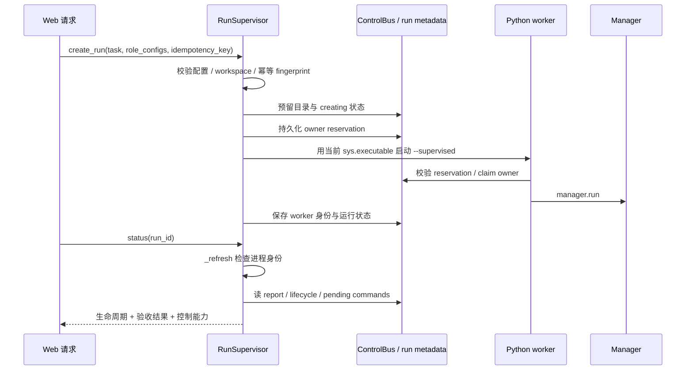

上图是协作概览；具体 owner 提升与子进程退出存在竞态，代码用 launch 失败落盘、身份检查和 refresh 协调，不应解释为跨进程原子数据库事务。

#### 公开生命周期与 resume epoch

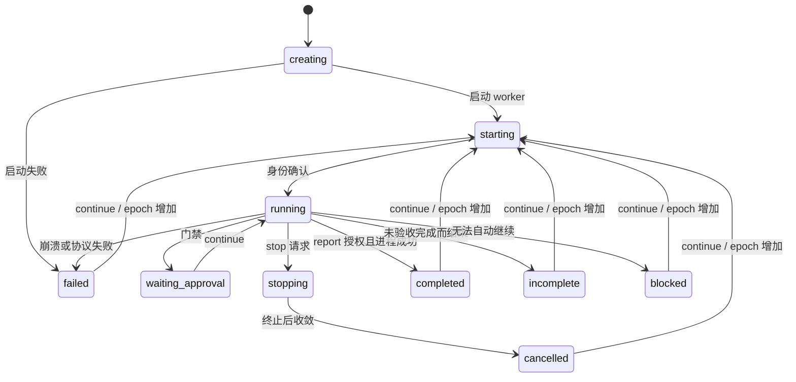

这是根据生命周期词汇整理的说明图，不是源码内存在同名状态机类。各入口还会校验是否 alive、是否拥有控制权、是否 attached-only、是否达到 resume 次数上限。

#### 四个容易忽略的正确性机制

1. **当前解释器启动 worker：** 避免 PATH 上旧 console script 不理解私有 supervised 协议。
2. **参数采用 `--key=value`：** 防止 HTTP 传入以 `-` 开头的值被 argparse 解析为新选项。
3. **进程身份不只 PID：** PID 复用时不能误杀其他程序，需结合启动时间/命令身份。
4. **终态不只 returncode：** 退出 0 但 report 缺失，或 claimed completed 缺 `completion_satisfied is True`，都不能报成功。

`continue` 重用目录和账本、增加 epoch；`retry` 新建 run。两者是不同产品语义，也有不同的幂等记录处理。


### 9.2 终态报告与进程退出如何合并

`manager.run` 的异常护栏尝试生成 terminal report；这不是对磁盘故障、宿主被强杀或断电的无条件写入保证。Supervisor 不能只把 exit code 0 映射成 complete，还要检查 report 中的完成证据与当前进程身份；缺失证据必须进入异常/降级路径。

业务状态与 Supervisor lifecycle 是两层：前者回答验收是否满足，后者回答 worker 是否运行、等待或退出。`report.json` 中 `completion_authority` 为 `manager_with_role_auditors`，不能由最后一条 Executor 文本替代。

源码定位：`src/lh_harness/manager.py::_final_report`（业务终态核心映射节选，不是 Supervisor 的完整 lifecycle 枚举）。

```python
    status = (
        "complete" if completion_satisfied
        else "cancelled" if abort_reason == "user_cancelled"
        else "failed" if abort_reason.startswith("provider_")
        else "blocked" if abort_reason == "manager_blocked"
        else "incomplete"
    )
```

`completion_authority: "manager_with_role_auditors"` 写死在报告里——评测/Supervisor 应读这个字段，而不是读最后一轮 Executor 自称。


<a id="control"></a>

## 10. 人工控制、ControlBus 与门禁

人工指令是下一轮规划输入，而不是审计报告的写权限。当前 ControlBus 已实现持久命令、幂等、revision 和 receipt；下一步需澄清的是消费确认、实际应用与外部副作用之间的粒度。


### 10.1 有无 human_hook 的行为

`_GateContext` 打包：hook、rounds、budget、carryover、final_response、failure_reason…

`_human_gate` 返回 `True` = **停止** while：

| 场景 | 无 `human_hook` | 有 hook |
|------|-----------------|---------|
| 已 `completion_satisfied` | 停 | hook 可 continue 再开 |
| `blocked` | abort=`manager_blocked`，停 | 可注入指令后 continue |
| `ask` | abort=`needs_human_input`，停 | 答案写入 carryover |
| 达 max rounds | abort=`max_rounds_exhausted` | 可 `extra_rounds` 延期 |
| 普通 progress | **不停**（return False） | hook 决定 |

Carryover 在 **下一轮 Manager prompt 开头**以高优先级注入（中英不同 heading），并写入 `human_instructions.txt` + event。

无 Dashboard 的纯 CLI：progress 轮连续跑到 done/blocked/max；ask 会硬停——因为没有答题通道。


### 10.2 持久控制协议、送达时序与优先级

#### 已实现的持久控制模型

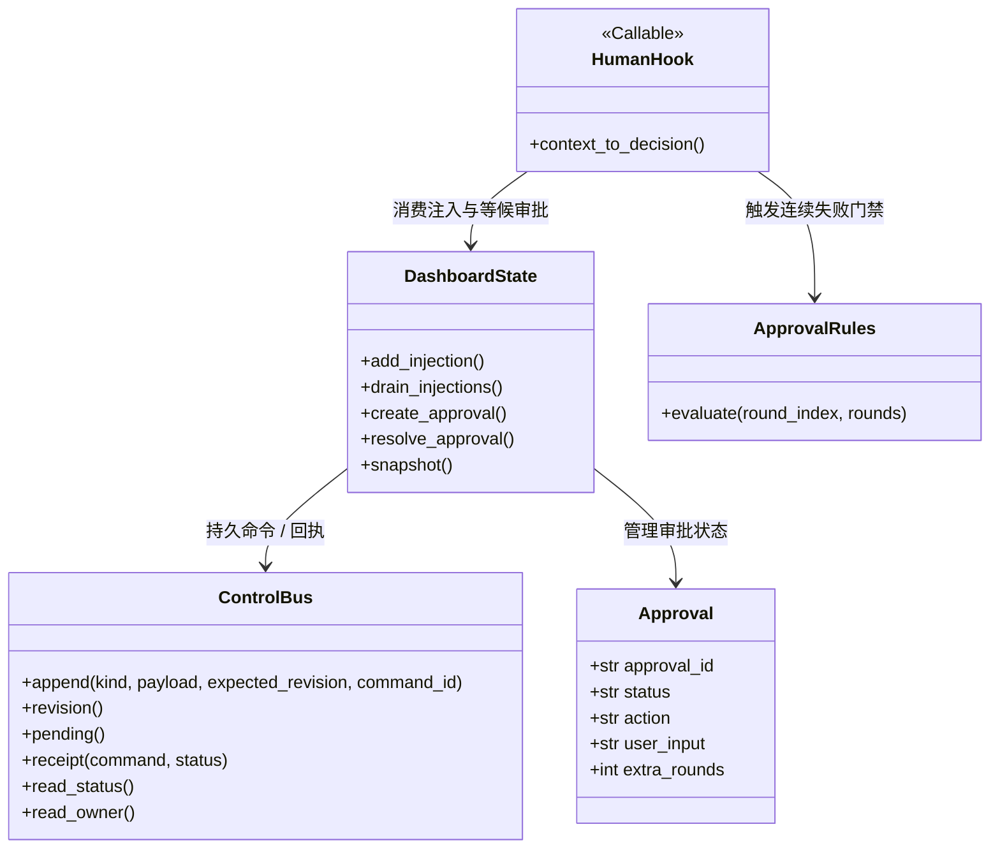

#### 指令送达时序

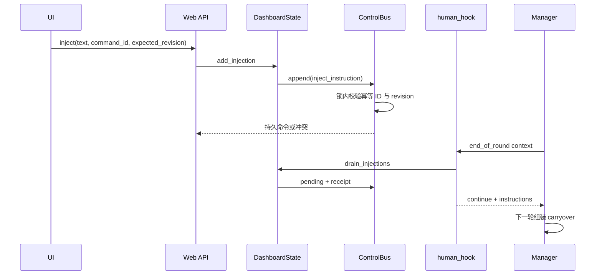

锁内的检查顺序有意义：同 command_id 同 kind/payload 的重试复用旧命令；同 ID 不同内容报 CommandConflict；新命令才检查 expected_revision 并分配下一 revision。receipt 也按 command_id 幂等。

**语义边界：** receipt 证明这个控制命令被控制层消费/处理，不等于追加要求已完成、已通过审计。它也不是远程上传、发消息等**任务副作用**的回执；恢复一致性（第8章） 的外部对账依然是独立缺口。

#### 门禁优先级和连续失败

`dashboard/gate.py::_classify` 的顺序是：

```text
completed → ask → reached_max → blocked → repeated_failure → 普通 progress
```

这保证最后一轮即使同时 blocked，也优先告诉用户“预算耗尽，可增加轮次”。`rule_repeated_failure` 从后往前数连续失败：invalid plan、invalid completion、executor/auditor/repair 的 error/timeout。默认阈值来自环境变量，缺省为 3。

因此“停滞检测完全没有”是不准确的；当前已有**错误连续性检测**。但反复输出合法计划、审计总 incomplete、没有实际进展，未必触发此规则，仍需要 资源治理（第13章） 的 verified progress 判定。


<a id="web"></a>

## 11. Web API、事件协议与前端投影

浏览器消费受控状态与产物，不直接解释原始 Agent 日志。REST snapshot、事件 replay 和 WebSocket delta 的竞态由统一 reducer 处理，缺口有显式重同步语义。


### 11.1 受控 API 与 feed 重建

#### API 不直接把所有磁盘文件暴露给浏览器

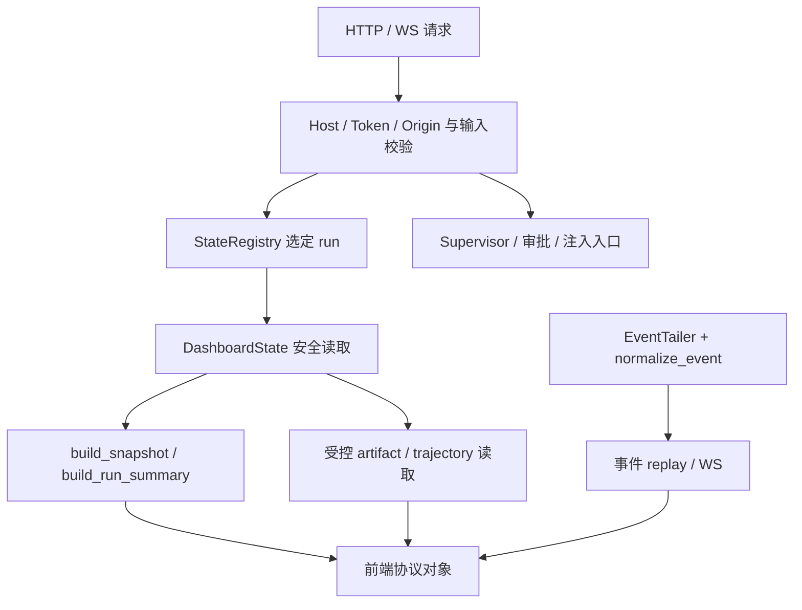

来源：`webapi/server.py`、`snapshot.py`、`events.py`、`dashboard/state.py`。

#### 后端能力与安全边界

| 机制 | 当前作用 | 注意点 |
|---|---|---|
| `/api/meta` | api/protocol 版本、运行能力、后端与模型信息 | UI 应按能力而不是按钮位置假设可控 |
| HTTP Bearer token | 配置 token 后保护 API，包括产物读取 | 不是内建多租户 RBAC 系统 |
| Host 检查 | loopback 绑定时拒绝不匹配的 Host | 不代替对外部署的边界防护 |
| JSON content type / body 上限 | 控制命令请求先校验再解析 | 输入限额与 Agent 总预算不同 |
| WebSocket auth / Origin | 独立握手校验 | 不能假设 HTTP middleware 自动覆盖 WS |
| run/path 检查 | 产物只能从受控 run/round 中解析 | 文件下载也属于权限面 |

#### 事件缺口已经有协议，不只是未来建议

`EventTailer` 有大小/条数上限、坏行诊断、event_id 去重、cursor_gap 和 resync_required。找不到 after cursor 时，不把它当成“从头读就行”。日志过大时用 retained tail 并发出告警；ID 还可能基于文件 offset 生成，**不能用字符串大小比较游标新旧**。

```mermaid
sequenceDiagram
    participant U as useRunFeed
    participant R as REST snapshot/replay
    participant W as WebSocket
    participant F as reduceRunFeed
    U->>R: 并行请求 snapshot 与 replay
    U->>W: 建立实时订阅
    R-->>U: snapshot / events
    W-->>U: snapshot / delta
    U->>F: 按 run_id 合并并去重
    alt cursor gap / resync
      U->>U: feedEpoch 增加，旧请求失效
      U->>F: reset
      U->>R: 获取新 snapshot
      R-->>U: 最新 snapshot
      U->>F: 重建投影
    else 正常续流
      U->>F: 累积有限事件与最新状态
    end
```

#### 前端 reducer 的架构价值

`frontend/core/src/runFeed.ts` 不只是展示工具，它解决 REST/WS 的竞争：

- run guard 防止旧 run 响应污染新选择。
- event 去重与有界缓冲，避免长任务浏览器无限增长。
- resume epoch 新的一代可以覆盖旧 terminal status。
- 相同 cursor 的较稀疏快照不能抹掉已取得的角色输出、审批决定和最终回复。
- approvals、operator_messages 等持久交互并不完全由事件条数决定；event_count 不是单调版本号。
- `useRunFeed` 用本地 feedEpoch 废弃缺口重同步前的异步返回。

注意区分 **服务端 resume epoch** 和 **浏览器 feedEpoch**：前者是 worker 生命周期代次；后者是当前订阅的数据请求代次，不是同一个字段。


### 11.2 建议：诊断关联与数据留存

#### 从“日志很多”变成“能定位原因”

建议事件共用：`run_id/round_id/episode_id/attempt_id/parent_event_id`、事件序号、角色、schema version、持续时间、失败分类、证据引用。跨机器时间戳用于展示，因果排序以序号和父关系为准。

关键指标：

- **完成可靠性：** completion rejection、失效证据使用、独立复验不通过。
- **收敛效率：** 每个有效通过需求的费用/时间、停滞轮比例、repair 比例。
- **恢复质量：** 对账耗时、重复副作用、ledger gap、恢复后再次审计失败。
- **操作体验：** 指令接受到应用的延迟、停止到进程退出的延迟、待审批时长。

GUI 用户数据、路径、任务文本不宜直接作为高基数 metric label。需要诊断时通过受控 trace 引用。

UI 重连建议带 cursor；出现事件序列缺口时取 snapshot 重建。投影必须幂等，允许补发，不得因为事件重复而启动第二个动作。

#### 数据留存是长程运行的一部分

建议为 Prompt、审计证据、trajectory、截图分别规定保存期限、容量上限、访问者和删除方式。优先保留可复验交付物及必要回执；体积很大的 raw trajectory 可按策略归档，但不能删掉门禁唯一引用的证据后仍保持“可复验”的声明。人工导出和共享也应脱敏；删除策略须能解释会失去哪些诊断或复验能力。


### 11.3 前端资源的打包与部署

`pyproject.toml` 通过 hatchling 打包 Python；`_frontend/web/dist` 作为构建产物进入 wheel/sdist。源码安装缺少构建资源时不代表后端本身无法安装，但工作台静态资源可用性需要单独检查。部署问题应区分“API 能启动”和“前端资源已正确构建”。


<a id="security"></a>

## 12. 信任边界、安全与验收可执行性

Prompt 中不提供轨迹，是信息流收窄；限制文件、进程、网络和 GUI 副作用，才是权限隔离。系统已有多处硬化设施，但不能将它们合称完整沙箱或安全审计通过。


### 12.1 信任模型与独立 Auditor 的保证上限

#### 两种隔离必须分开描述

**现有：** Prompt 构建器不把 raw trajectory 装入下一轮 Manager 输入，Executor 只接收点名的历史报告。这是输入组装约束。

**推论：** 如果 Adapter 仍能读取同一个磁盘，Prompt 中“看不到”不代表 OS 权限上“读不到”。隐藏路径、工具限制、文件权限应单独核对。角色名称、三个独立 episode、三个不同模型，也都不能单独保证安全独立性。

建议将“谁看见什么”解释为**默认 Prompt 信息流**；真正权限保证采用以下矩阵，逐个后端验证，不从一个后端类推其他后端：

| 对象 | Manager | Executor | Auditor | Supervisor |
|---|---|---|---|---|
| 原始任务与冻结契约 | 读 | 读相关部分 | 读完整验收要求 | 读 |
| 工作区产物 | 默认限制，只用于规划必要观察 | 授权范围内写 | 默认只读；动态验证用隔离副本 | 不作为任务执行者 |
| raw trajectory | 操作员可查，不装入默认决策输入 | 不作为事实授权 | 仅作待核验线索 | 展示/存档 |
| canonical ledger / completion 字段 | 不直接写 | 不直接写 | 不直接写 | 编排内核与监督协议负责 |
| 人工控制指令 | 通过受控输入接收 | 经 Manager 分配 | 不改验收事实 | 鉴权、记录、送达 |
| 外部网络与桌面状态 | 按需最小授权 | 逐类动作授权 | 默认拒绝写副作用 | 不继承任务任意权限 |

该表是目标权限设计，**不是当前全部后端已经满足的清单**。

#### 审计报告应是“带来源的断言”

建议将一条事实表示为：

```text
Assertion = requirement_id + verdict + evidence_refs
          + subject_version + verification_method
          + observed_at + validity_conditions
```

三类内容不能混为一谈：

- Executor 输出：“我已上传” → **待核验声明**。
- Auditor 观察：“服务端列表存在对应对象，内容摘要匹配” → **有范围的验证结论**。
- Manager 总结：“下一轮可以做发布说明” → **规划派生状态**。

可信状态的层级应是：原始要求/授权变更 → 可重查证据 → 审计结论 → 规划摘要。摘要可以压缩，证据引用和未满足项不应在压缩中丢失。

#### “独立 Auditor”的真实收益与上限

收益来自执行与验收解耦：执行者不负责裁定自己的输出。但二者可能共享模型偏见、任务材料、机器环境和提示注入入口。因此不能把多个角色误当成多个统计独立的验证器。

建议优先增加**验证方法多样性**：结构校验、测试、文件内容摘要、服务端状态查询、GUI 观察，最后才是追加一个 LLM 意见。通过多个来源也应标注共享依赖，避免同一份错误输出被重复引用后看起来“证据很多”。


### 12.2 威胁、快照与动态验证冲突

#### 威胁模型

| 入口 | 风险 | 建议控制 |
|---|---|---|
| 网页、文档、日志、依赖说明 | Prompt injection，诱导改契约或泄露凭据 | 标为不可信数据；控制面和任务内容分区 |
| 共享工作区 | Executor 改写测试、验收脚本或审计报告 | 可信验证器置于独立只读区；校验摘要 |
| CLI 模板和配置 | 命令注入、错误权限继承 | 明确模板可信来源；新增配置先校验再运行 |
| 控制目录与 run 路径 | 链接置换、越权读取/写入 | 延续 nofollow 硬化；按用户与 run 鉴权 |
| 远程动作和 GUI | 删除、发送、提交等不可逆副作用 | 动作级授权与回执；关键动作人工审批 |
| trajectory、截图与 Prompt | 凭据/个人信息进入日志 | 源头最小化、脱敏、访问控制、留存期限 |

现有脱敏和路径硬化是基础；不能从“用了 redact”推导所有截图、编码秘密和文件内容均已安全。

#### 快照是检测，不是阻止

**现有：** Claude Auditor 路径在 episode 前后采集 workspace snapshot，并将变化放入 metadata；异常和违规进入审计失败路径。

**边界：** 文件前后差异未必覆盖工作区外文件、浏览器状态、远程服务、副作用发生后又恢复原样等情况。实际覆盖应按 snapshot 实现与配置验证，不能据此宣称 Auditor 对整台机器只读。

建议按风险分级：本机受信 Agent → 工具权限 + 快照检测；不可信输入 → 更强 OS 隔离；远程写风险 → 代理策略和网络权限。不可撤销动作不应只依赖事后发现。

#### Auditor 要运行测试，怎么办？

测试、编译、打开文档可能写缓存或生成输出，完全拒绝写可能让验收不可执行。建议提供 **ValidationEnvironment**：

- 原始交付物保持只读，在临时副本/隔离环境执行动态验证。
- 显式列出可写 scratch、缓存目录和允许网络范围。
- 验证前后对原始产物做身份检查，验证输出作为单独证据保存。
- 只能观察本机 GUI 的任务标注验证限制，不能假装与文件副本验证等价。


### 12.3 现有安全设施的源码归属

| 边界 | 主要源码 | 设计理由 |
|---|---|---|
| workspace/run/round 路径身份 | `utils/run_boundary.py` | 文件读与进程控制均需受目录范围约束 |
| 锁、nofollow、原子 JSON 与控制目录 | `supervisor/control_bus.py` | 降低符号链接置换与并发写冲突 |
| owner、PID identity、scope | `supervisor/service.py` | 防止不拥有的 worker 被接管或误杀 |
| shell 与子进程树 | `environment/local.py`、`utils/process_group.py` | timeout/cancel 后收尾 |
| 后端工具能力 | 各 Adapter、`claude_permissions.py` | 角色语义需实际后端执行 |
| HTTP/WS 访问 | `webapi/server.py` | 网络入口独立防护 |
| 产物下载 | `dashboard/state.py` + API artifact 路由 | 展示通道不能变任意文件读取 |

这些是已读代码中的机制，不是完整安全审计结论。OS 隔离、敏感图像脱敏、外部动作对账不能靠这些模块名称自动成立。


<a id="resources"></a>

## 13. 预算、停滞与重试治理

角色超时和最大轮数是已有运行限制；跨 resume 的累计预算、验证进度与振荡检测是后续增强。治理不能把“消耗更多轮”误当作“可信进度增加”。


### 13.1 资源与收敛策略

#### 当前预算的边界

**现有：** `EpisodeBudget` 按角色限制时间，运行受轮次预算约束，可由 human gate 增加轮次。它们是基本运行限制，不等同于全局费用、Token、磁盘或总墙钟预算。

**建议：** 设置四层预算，使用逻辑 run 累计值，不能被 resume 重置：

1. 角色 episode 时间/Token/费用上限。
2. 单 round 的合计资源上限，包含 repair 和重试。
3. 整个 run 的累计时间、费用、动作数、日志容量上限。
4. 共享机器的并发、桌面占用、磁盘余量和后台进程上限。

后端没有 usage 时记录 `unknown`；估算费用不能冒充服务商真实账单。

#### 明确 round 与 episode 的区别

一轮可能含 Manager、Executor、Auditor、format repair；完成或阻塞门禁还可能生成 Final response。只用轮数比较成本会漏计这些调用。`max_total_episodes` 的名字尤其容易误导，应在外部配置说明中标出其实际轮次语义，并计划兼容迁移到 `max_rounds` 等明确名称。

设路由执行轮有 N 轮、管理/终态轮有 D 轮、修复调用 F 次、最终回复调用 Q 次，则基本角色调用近似为 `3N + D + F + Q`，不包括额外重试；各角色费用必须分别累计，而不能乘一个平均每轮价格。

#### 停滞检测以验证结果为依据

建议定义 verified progress vector：`(有效通过需求集合, 未解决阻塞集合, 产物版本, 重复失败签名)`。

- 文本 plan/state 改变不算实质进度。
- 同一缺口重复出现时减少盲目 retry，要求改变执行或验证策略。
- 若产物反复修改又回退，识别振荡，而不是只看“有修改”。
- 使用可配置观察窗口；窗口阈值是待实验的策略，不在文档里伪装成普适常数。

不要为满足“单调进度”把已失效的通过条目锁死；相关产物变化后撤销通过才是正确行为。

#### 重试必须分类

| 失败类型 | 推荐策略 |
|---|---|
| 格式错误 | 限次格式修复；不改变事实 |
| 临时网络错误/限流 | 有界退避；先判断副作用是否已发生 |
| 密钥错误/权限不足 | 停止并请求行动；避免重复消耗 |
| Executor timeout | 保留部分结果，下一轮先查实际环境 |
| Auditor timeout | 没有通过证据；可补审计，不默认重做执行 |
| 审计发现契约缺口 | 重规划，不能只重试同一 Prompt |
| 快照/账本完整性失败 | 降级或阻塞，不回退到“相信执行者” |


<a id="validation"></a>

## 14. 测试策略、评测与运维验收

测试应分别验证编排正确性、异常恢复和端到端任务效果。仓库历史的自动测试记录与本次文档重组检查分开报告；论文或评测成绩不是本文重新复现的结论。


### 14.1 评测目录与产品边界

```text
LongHorizon-Harness/src/lh_harness   ← 产品内核
eval/WeaveBench-harness              ← 基准 + 可能独立 cua_harness 变体
eval/OSWorldv2-harness
eval/TB-harness
```

读评测 README 时拆开：

- **任务定义 / 评分**（基准自有）
- **编排是否复用本仓 manager**（有的嵌套了类似 MEA 的 cua_harness）

评测结论需要核对具体实现、模型、后端和预算是否一致；不能仅由目录名称或 MEA 叙事推出外环增益。本文未重新核验在线论文或复现其成绩。


### 14.2 主张、对照预算与故障注入

#### 主张与观测对应

| 主张 | 必须观测 | 对照/消融 |
|---|---|---|
| 外环提升真实成功率 | 独立外部验收，不以自身 Auditor 为唯一评分器 | 同模型同任务、原生 Agent vs MEA |
| 上下文刷新改善长程任务 | 完成率、遗忘要求、上下文成本 | 保留历史 vs 新 episode |
| Auditor 减少伪完成 | 假阳性、假阴性和独立复验结果 | 无 Auditor / 同角色自验 / 独立 Auditor |
| 可信状态压缩减少漂移 | 原始需求覆盖、失效证据、复用正确率 | 全轨迹 / 审计摘要 / 带证据引用摘要 |
| 续跑节省成本 | 恢复后成功率、增量成本、重复副作用 | 从头重跑 vs ledger resume |

不将 README 或论文中的数字当作本地已复现实验。具体成绩应注明原始来源、任务数、模型/后端版本、环境和预算；本次补充未复现论文结果。

#### 两种公平预算都要报告

- **等资源预算：** 限定总 Token/费用/墙钟资源，检验收益是否仍存在。
- **等任务目标：** 允许各方案跑到终态，但报告总成本、尾延迟和失败风险。

MEA 多调用几次模型可能本身提高成功率；只比较“同模型”而不控制预算，不能把所有增益归因于外环。

建议报告：任务成功率、假完成率、每任务费用/时间、成功任务条件成本、恢复成功率、重复副作用率、P50/P95 时延。成本须同时包含失败任务，避免只展示成功任务而低估成本。

统计时以任务/环境条件作为分层，做配对比较并给出不确定性区间；评测重复次数和排除规则事先登记。使用固定任务版本、独立验收脚本和隔离机器状态，防止前一次运行污染后一次。

#### 最低故障注入矩阵

1. 在 Executor 返回后、Auditor 启动前终止 worker。
2. 在审计完成与 ledger 提交之间终止 worker。
3. 截断 JSONL 尾行、插入重复轮号、移走已引用产物。
4. 在 resume 前修改交付文件或追加用户要求。
5. 令 Auditor 写原文件、写工作区外文件、修改远程对象，检查检测范围。
6. 同一 run 重复 stop/resume；两个 run 竞争同一 desktop/workspace。
7. 最终回复生成失败、事件推送失败、report 两份副本不一致。
8. 上传/发送请求超时但服务端实际成功，恢复不允许盲目重发。

每项明确期望终态、禁止行为、证据位置与预算；缺少执行证据则记录“未验证”，不能通过读代码宣布测试通过。


### 14.3 故障联排入口

| 症状 | 决策面 | 执行面 | 运营面 |
|------|--------|--------|--------|
| 一直跑不完 | next_step 是否总 gui/cli；max_rounds | executor 是否 timeout | budget / extra_rounds |
| 误报完成 | clean complete 三条件 | — | Supervisor 是否忽略 evidence |
| 审计总 blocked | 控制头/repair | Auditor mutation | — |
| Web 停不掉 | — | 进程组 | `_signal` / pid identity |
| 注入无效 | carryover 是否进 manager_input.txt | — | Bus 是否写入该 run |


### 14.4 验证证据与本轮范围

此前源码核对记录报告：基线 `b498162fc1b96ff469146f04a698c829c89e3eab` 上，两批后端测试共 **303 passed, 1 skipped**。使用 pyenv Python 3.12.11；跳过项需要已构建 Web bundle。该记录的命令与范围保存在 [README.md](README.md) 和 [SOURCE.md](SOURCE.md#模块源码精读与注释)。

本次为结构重组，**没有重新运行上述测试**，也没有执行真实 LLM/GUI、插件安装、前端构建或论文评测。只重新检查源码 HEAD、关键符号、文档目录/引用/围栏与 diff。Mermaid 未逐图渲染；通过文本检查不代表图形渲染验证。


<a id="evolution"></a>

## 15. 架构演进、贯穿案例与总结

优先投资任务证据与实际世界的绑定，而不是再造已有 Supervisor、ControlBus 或 Web 重同步。变更应跨 Manager、审计、终态和展示同时维护同一语义。


### 15.1 当前基础与待补齐契约

现有系统已具备 MEA 编排、独立审计、运行监督和持久控制协议。下面按跨模块契约评估增强优先级：已有的消息确认、revision 和事件重同步应复用，不应再造第二套协议。

| 优先级 | 现有基础 | 建议增强 | 要防范的失效模式 | 关联章节 |
|---|---|---|---|---|
| P0 | `complete/clean/aligned` 门禁 | 将审计绑定到任务、产物版本和环境观察 | 用旧证据支持新完成声明 | [任务契约](#domain)、[完成授权](#verification) |
| P0 | `rounds.jsonl` + resume | 执行后、记账前崩溃的外部副作用对账 | 重发消息、重复提交、重复上传 | [持久化与恢复](#persistence) |
| P0 | Auditor 权限与快照检查 | 明确各后端隔离等级，补齐检测覆盖 | 将事后检测误称为安全沙箱 | [执行后端](#execution)、[信任边界](#security) |
| P1 | 最大轮次、角色超时 | 跨 resume 累计预算、停滞判定和分类重试 | 能一直跑，却不能经济地收敛 | [资源治理](#resources) |
| P1 | 持久控制、回执与 Web 重同步 | 补充账本—消息—UI 的跨边界一致性验收 | 页面投影与执行事实分裂 | [恢复](#persistence)、[控制](#control)、[Web](#web) |
| P1 | 多后端 Protocol | 后端语义能力矩阵与契约测试 | 接口相同但权限或结果语义不同 | [后端语义契约](#execution) |
| P1 | 基准入口 | 等预算对照、假阳性测量与消融 | 把额外计算带来的收益归因于外环 | [评测与验收](#validation) |
| P2 | 模块职责与事件接口 | ADR、阶段验收和数据留存策略 | 决策失去上下文或数据不可控增长 | [观测与留存](#web)、[演进决策](#evolution) |

P0/P1/P2 是设计评审的建议顺序，不是已经复现的漏洞严重性分级；各项验收条件见相应章节。

### 15.2 跨模块变更影响矩阵

| 新需求 | 主改点 | 必须联查 | 不应绕过 |
|---|---|---|---|
| 新 Agent 后端 | registry + Adapter + `_build_agent` | config choices、模型发现、日志解析、Web meta、测试 | 只给 UI 增加一个选项 |
| 更强 Auditor 权限 | Adapter/role policy | snapshot/metadata、动态验证 scratch、测试 | 仅在 Prompt 写“只读” |
| 新事件 | Manager/事件生产者 + normalize_event | EventEnvelope、snapshot、frontend core reducer | 直接让 React 解析原始 CLI JSON |
| 新人工门禁 | dashboard gate/rules/state | ControlBus revision、审批 receipt、UI 文案 | 手改 auditor_report |
| 新 resume 行为 | Supervisor + lifecycle + Manager 恢复 | epoch、终态覆盖、指令队列、预算 | 把 retry 偷换成 continue |
| 新完成证据字段 | types + Auditor + Manager gate | final report、Supervisor、Web snapshot、frontend status | 只改页面 completed 文案 |
| 远程 Environment | Environment 实现与入口 | 文件传输、执行身份、GUI、日志、取消清理 | 假定 local 路径远端同样有效 |


### 15.3 分阶段路线与待定决策

#### 分阶段落地，不一口气重写内核

| 阶段 | 交付 | 验收门槛 |
|---|---|---|
| A：校准与回归 | 准确状态语义、源码定位、Adapter 契约测试 | 当前行为不变；现有回归测试仍通过 |
| B：证据绑定 | 需求 ID、契约 revision、产物引用、失效规则 | 变契约/变产物后旧 complete 被拒绝；不相关证据可复用 |
| C：恢复对账 | 轮级 manifest、attempt、恢复完整性、外部动作意图 | 崩溃窗口测试；重复副作用检测；坏账本不得 complete |
| D：经济性与运营 | 全局预算、停滞检测、能力矩阵、控制确认 | resume 不重置累计预算；停止与指令应用可追踪 |
| E：评测 | 等预算对照、消融与故障注入报告 | 可复现数据，收益与代价同时呈现 |

B/C 是值得优先投入的核心增强；增加更多 Agent 角色或更长 Prompt 并不能替代它们。

#### 建议形成 ADR 的选择

以下全部为 **Proposed**，不是已经通过的架构决策：

| 议题 | 推荐方向 | 替代方案与代价 |
|---|---|---|
| 文本控制 vs 结构化控制 | 保留文本兼容；引入带版本的结构化中间对象 | 强制所有后端 JSON 会增加适配与迁移成本 |
| 文件 ledger vs 数据库 | 先补单写者与一致性协议；达到并发需求后再评估数据库 | 立即上数据库也无法事务化 GUI/远程副作用 |
| 审计权限 | 隔离验证副本 + 最小授权 | 仅 Prompt 限制便宜但弱；绝对只读可能使测试不可运行 |
| 完成证据 | 按需求、契约、产物版本绑定 | 固定 TTL 简单但不符合不同证据的失效条件 |
| 状态压缩 | 可再生摘要 + 持久证据引用 | 纯自然语言省上下文，但容易丢范围和未满足项 |
| 并行 Executor | 暂保串行 MEA；独立资源时才引入并行 | 同桌面或共享可写产物并行会放大审计竞态 |

每份正式 ADR 应补充负责人、约束、迁移方案、撤销条件和验收测试。只有明确接受后，才写成“项目决定”。


### 15.4 贯穿案例：PDF 生成、上传与契约变更

任务：生成报告 PDF，上传到指定远程目录，追加要求后继续修改。

| 步骤 | 环境事实 | 可信状态与下一步 |
|---|---|---|
| 1. Manager 分配生成 | 无产物 | R1 未满足；本轮契约只覆盖生成 |
| 2. Executor 生成 PDF | 本地文件存在 | 执行声明待验；不能 global complete |
| 3. Auditor 检查内容与打开 | 版本 H1 通过 R1 | 保存 R1 的证据，R2 上传仍未满足 |
| 4. Executor 上传后超时 | 服务端可能已接受 | 记录 intent，状态未知；恢复先查询 |
| 5. 对账获得服务端对象 U1 | U1 内容与 H1 匹配 | R2 通过，global audit 才有机会完成 |
| 6. 用户追加水印要求 | 契约 v2 | 旧 global audit 失效；上传旧对象不能满足新版本 |
| 7. 新 PDF H2 重新验收/更新上传 | U2 与 H2 匹配 | R1/R2 在 v2 下重新验证 |
| 8. Manager done | 最新有效全局审计通过 | 完成；Final response 引用 H2/U2，不再执行任务 |

当前闭环提供执行与审计骨架；版本绑定、上传对账、全局证据覆盖属于本章建议的增强。该案例的价值是把“长程可靠”展开成可以逐步实现、逐步测试的协议，而不是把它当作口号。


### 15.5 设计结论与关键取舍

| 选择 | 得到 | 付出 |
|------|------|------|
| 外环三角色 | 长程可恢复、验收独立 | 每轮 2–3 次完整 Agent 启动，成本高 |
| 自然语言控制头 | 任意后端只要能出文本 | 解析脆弱 → format repair / invalid 路径 |
| 文件系统账本 | 崩溃可查、Supervisor 可判终态 | 路径/权限/符号链接需硬化 |
| Adapter 薄封装 | 保留原生 Agent 能力 | 依赖外部 CLI 版本与权限模型 |

LHH 的核心是：**将外部 Agent 的执行能力包进可审计的 MEA 外环；用信息裁剪维持长程目标，用独立审计约束可信进度，用 Supervisor/ControlBus/Web 维护可运营性。**

当前边界也必须保留：独立 episode 不隔离真实世界，统一 Adapter 不统一权限，轮级 resume 不等于动作事务，当前干净审计不自动证明新版本产物仍满足任务。下一阶段应补证据绑定、外部动作对账和累计资源收敛。


<a id="source-map"></a>

## 附录：源码导航

| 设计问题 | 主源码 | 本文位置 |
|---|---|---|
| 配置和角色如何组装 | `cli.py`、`config.py`、`agent_registry.py`、`model_catalog.py` | 第4章 |
| 一轮何时路由/终止 | `manager.py`、`role_prompts.py` | 第5、7章 |
| 后端与执行环境如何适配 | `adapters/`、`environment/local.py`、`utils/process_group.py` | 第6章 |
| 审计文本如何成为可信状态 | `auditor_agent.py`、`claude_permissions.py` | 第7、12章 |
| 账本恢复和终态如何生成 | `manager.py` 的 record/restore/final-report 路径 | 第8–9章 |
| worker 如何归属和续跑 | `supervisor/service.py`、`supervisor/lifecycle.py` | 第9章 |
| 人工指令如何送达 | `supervisor/control_bus.py`、`dashboard/` | 第10章 |
| 事件缺口如何恢复 | `webapi/`、`frontend/core/src/runFeed.ts`、`useRunFeed` | 第11章 |
| 产物怎样受控暴露 | `dashboard/state.py`、轨迹工具和 API 路由 | 第8、11章 |

源码根为 `/Users/gqli/work/deepagents/LongHorizon-Harness/src/lh_harness/`。上述路径是阅读导航，不表示每个模块有唯一责任；具体函数、带注释代码和测试见 [SOURCE.md · 模块源码精读](SOURCE.md#模块源码精读与注释)。


设计取舍集中见第15.5节，避免在源码导航中维护第二套结论。
