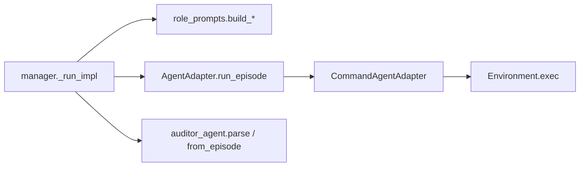
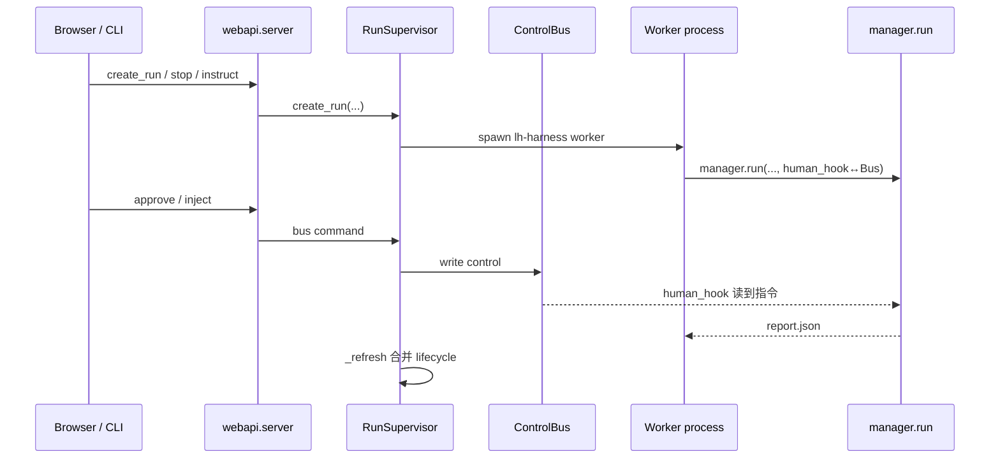
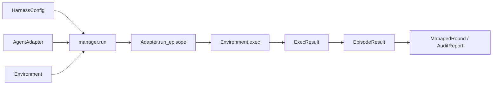
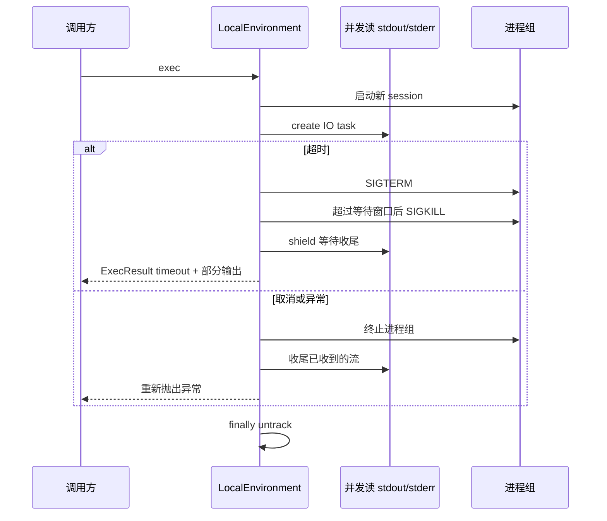
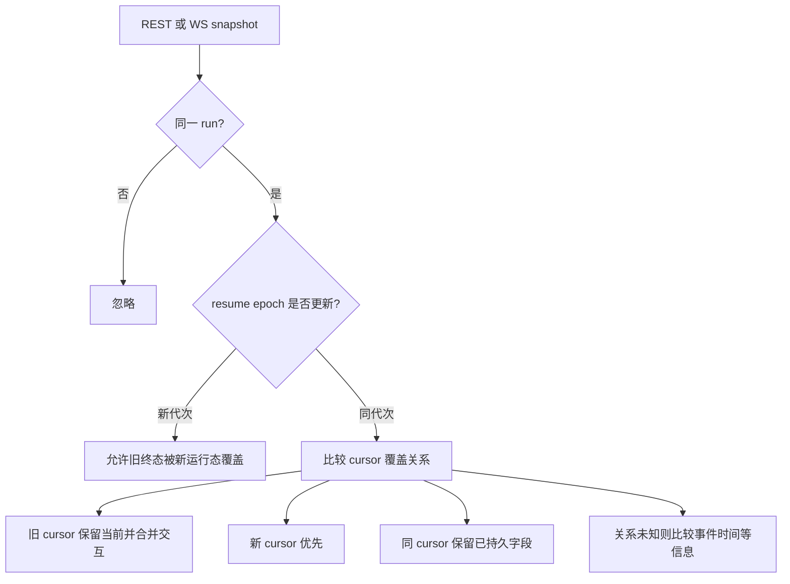

# LongHorizon-Harness 源码走读

> 对照 `src/lh_harness/`。设计图在 [LONGHORIZON.md](LONGHORIZON.md)。  
> 下面三章是历史原文全文；当前版本差异与验证范围见 [源码校准](#当前源码校准与验证索引)。

## 目录

1. [Manager 闭环](#原文--01-manager-loopmd) — `manager.run` / `_run_impl`  
2. [Adapter、环境、Auditor](#原文--02-adapters-env-auditormd)  
3. [Supervisor 与 Web](#原文--03-supervisor-webmd)
4. [当前源码校准与验证索引](#当前源码校准与验证索引) — resume、Final response、门禁边界与测试地图
5. [模块源码精读与注释](#模块源码精读与注释) — 类型、工厂、Adapter、清理、审计、总线、恢复与轨迹


---

# 原文 · 01-manager-loop.md

> 原文 `source/01-manager-loop.md` 全文并入，Mermaid 与表格未改。

# 01 — `manager` 编排闭环源码走读

> 文件：`src/lh_harness/manager.py`（约 2241 行）  
> 入口：`async def run` → `async def _run_impl`

---

## 0. 两个入口的分工

```117:151:src/lh_harness/manager.py
async def run(*args: Any, **kwargs: Any) -> dict[str, Any]:
    """Run the management loop and always leave a durable terminal record.
    ...
    """
    task = str(kwargs.get("task") or "")
    config = kwargs.get("config")
    try:
        return await _run_impl(*args, **kwargs)
    except asyncio.CancelledError as exc:
        return _write_terminal_failure(..., status="cancelled", ...)
    except BaseException as exc:
        return _write_terminal_failure(..., status="failed", ...)
```

**设计意图（注释原文）**：历史上只有 happy path 写 `report.json`，异常时 Supervisor 会误判「已完成」。  
因此：

- **内核**在 `_run_impl`  
- **`run` 是唯一崩溃/取消护栏**：任何 `BaseException`（含 `KeyboardInterrupt`）都落盘终端失败记录  

调试「worker 没 report」时先看是否绕过了 `run()`。

---

## 1. `_run_impl` 签名：角色绑定

```154:222:src/lh_harness/manager.py
async def _run_impl(
    *,
    task: str,
    env: Environment,
    config: HarnessConfig,
    agent: AgentAdapter | None = None,
    auditor_agent: AgentAdapter | None = None,
    manager_agent: AgentAdapter | None = None,
    gui_executor_agent: AgentAdapter | None = None,
    cli_executor_agent: AgentAdapter | None = None,
    gui_auditor_agent: AgentAdapter | None = None,
    cli_auditor_agent: AgentAdapter | None = None,
    ...
    human_hook: Callable[[dict[str, Any]], Awaitable[dict[str, Any]]] | None = None,
    progress: Callable[[str, dict[str, Any]], None] | None = None,
) -> dict[str, Any]:
```

启动时 **一次解析** fallback：

```text
manager_agent     = manager_agent or agent
gui/cli_executor  = … or agent
gui/cli_auditor   = … or auditor_agent or agent
```

缺任一角色且无 default `agent` → `ValueError`。  
主循环里不再做 adapter 回退——注释：*loop stays focused on state transitions*。

### 回调语义

| 回调 | 时机 | 失败策略 |
|------|------|----------|
| `progress(event, payload)` | 同步状态行（CLI 打印） | try/except 吞掉，**绝不**打断 run |
| `human_hook(context)` | 每轮结束（及完成/阻塞/询问） | 返回 `continue`/`stop` + 可选 instructions / extra_rounds |

---

## 2. 落盘布局（循环开始前）

```232:283:src/lh_harness/manager.py
    log_dir = Path(config.log_dir).expanduser().resolve(strict=False)
    role_dir = log_dir / "role_orchestration"
    rounds_dir = role_dir / "rounds"
    events_path = role_dir / "events.jsonl"
    ...
    await _ensure_remote_layout(env, config)
    _append_event(events_path, "role_harness_start", {...})
    rounds: list[ManagedRound] = []
    current_task_state = ""
    current_task_contract = ""
    gate = _GateContext(...)
```

| 路径 | 用途 |
|------|------|
| `role_orchestration/events.jsonl` | 编排事件流（start/role/done/cancel） |
| `rounds/round_NNN/` | 该轮全部输入输出文本 + 轨迹 |
| `*_episodes/` | 按角色归档的 episode 产物 |
| `report.json` | 终态（log_dir 与 role_dir 各一份） |

`log_dir` **强制 resolve**：相对路径在不同 cwd 下否则会撞 event id（注释说明）。

---

## 3. while 主循环骨架

```285:289:src/lh_harness/manager.py
    while round_index < gate.round_budget:
        round_index += 1
        round_dir = rounds_dir / f"round_{round_index:03d}"
```

`gate.round_budget` 可被 human_hook 的 `extra_rounds` 拉长；初始来自 `config.max_total_episodes`。

### 3.1 Manager 阶段（每轮必跑）

```291:338:src/lh_harness/manager.py
        manager_prompt = build_role_manager_prompt(
            task=task,
            rounds=rounds,
            round_index=round_index,
            task_state=current_task_state,
            task_contract=current_task_contract,
            round_budget=gate.round_budget,
            language=config.prompt_language,
            max_history_chars=config.role_history_chars,
        )
        # carryover_instructions 注入（dashboard）
        manager_result = await _run_role_episode(
            manager_agent, manager_prompt, env, manager_budget,
            live_trajectory_path=str(round_dir / "manager_raw_trajectory.jsonl"),
        )
```

**信息隔离（注释）**：

> Manager sees original task, maintained task state, and auditor reports.  
> **It never receives raw trajectories or previous full prompts.**

随后：

1. `cancelled` → 记 abort，`break`  
2. `classify_agent_runtime_failure` → 合成 `Next: blocked` 的 `ManagedRound`，`break`  
3. `extract_role_manager_plan_text` → 空则合成 blocked  
4. 抽取并持久化：`task_state` / `task_contract` / `related_report_refs`  
5. `parse_role_manager_next_step(plan_text)` → 路由

### 3.2 路由分支（源码顺序）

| `next_step` | 行为 | 关键守卫 |
|-------------|------|----------|
| `done` | 若 `_latest_auditor_is_clean_complete` → `completion_satisfied` + human_gate | **否则**写入 `_invalid_completion_feedback`，当 `invalid` 续跑 |
| `blocked` | 记 round → human_gate(`blocked`) | |
| `ask` | 抽 question/choices → human_gate(`ask`) | 答案进下一轮 carryover |
| `invalid` | `_invalid_plan_feedback` → 当审计反馈 | |
| `gui` / `cli` | 进 Executor → Auditor | |

伪完成路径（必须读注释）：

```446:484:src/lh_harness/manager.py
        if next_step == MANAGER_NEXT_DONE:
            if _latest_auditor_is_clean_complete(rounds, language=config.prompt_language):
                gate.completion_satisfied = True
                ...
                if await _human_gate(gate, "completed", ...):
                    break
                continue
            # Completion is not accepted unless grounded in previous clean auditor report
            repair_report = _invalid_completion_feedback(...)
            record = ManagedRound(..., next_step=MANAGER_NEXT_INVALID, harness_feedback=repair_report, ...)
```

**公理落地**：没有干净审计，Manager 自称完成无效。

### 3.3 Executor 阶段

```546:588:src/lh_harness/manager.py
        executor_agent, executor_budget = _executor_binding(next_step=..., ...)
        auditor_for_step = gui_auditor_agent if next_step == GUI else cli_auditor_agent
        related_auditor_reports = format_related_auditor_reports(
            rounds, related_report_refs, max_chars=config.role_verified_context_chars, ...
        )
        executor_prompt = build_role_executor_prompt(
            task, plan_text, next_step, task_state, task_contract,
            related_auditor_reports, workspace_path, ...
        )
        executor_result = await _run_role_episode(executor_agent, ...)
```

- GUI 结束后可 `_capture_environment_screenshot`  
- 失败/取消与 Manager 对称：写 feedback、event、可选 `break`  
- 成功：`executor_output` 写入磁盘与 remote

**上下文边界**：Executor 只拿 Manager 点名的 related auditor reports，不是全历史。

### 3.4 Auditor 阶段

```694:890:src/lh_harness/manager.py
        auditor_prompt = build_role_auditor_prompt(
            task, plan_text, executor_output, next_step, task_state, task_contract,
            related_auditor_reports, workspace_path,
            max_executor_output_chars=config.auditor_output_chars, ...
        )
        auditor_result = await _run_role_episode(auditor_for_step, ...)
        auditor_report, auditor_status = await _auditor_report_with_format_repair(...)
        record = ManagedRound(..., auditor_report=auditor_report, ...)
        rounds.append(record)
        await _record_round(...)
        audit = parse_audit_report(auditor_report, round_index, ...)
        if await _human_gate(gate, "progress", ...):
            break
```

要点：

- Auditor **只审刚结束的子任务**（注释）  
- 报告自然语言 → 结构化靠 `auditor_agent` / format repair  
- 每轮正常进度路径末尾都过 human_gate（dashboard 可注入指令而不停）

---

## 4. `_run_role_episode`：取消归一化

```1104:1127:src/lh_harness/manager.py
async def _run_role_episode(agent, prompt, env, budget, *, live_trajectory_path=None) -> EpisodeResult:
    try:
        return await agent.run_episode(prompt, env, budget, live_trajectory_path=...)
    except asyncio.CancelledError:
        return EpisodeResult(status="cancelled", error="Execution cancelled by operator", ...)
```

Adapter 抛 `CancelledError` 与返回 `status=cancelled` **统一成 EpisodeResult**，主循环用同一套分支处理。

---

## 5. 循环结束：终态报告

```892:928:src/lh_harness/manager.py
    final = _final_report(
        task=task, rounds=rounds,
        completion_satisfied=gate.completion_satisfied,
        abort_reason=gate.abort_reason,
        last_plan=last_plan, task_state=..., task_contract=...,
        max_rounds=..., elapsed_seconds=..., final_response=gate.final_response,
        failure_reason=gate.failure_reason,
    )
    _write_local(role_dir / "report.json", ...)
    _write_local(log_dir / "report.json", ...)
    ...
    _append_event(events_path, "role_harness_done", final)
    return final
```

另写 `orchestration_transcript.txt`、合并 episode logs、远程 harness_dir 镜像。

---

## 6. 一次成功 gui 轮的调用栈

```text
run()
  _run_impl()
    while:
      build_role_manager_prompt
      _run_role_episode(manager) → AgentAdapter.run_episode → env.exec(claude/codex)
      parse_role_manager_next_step → "gui"
      build_role_executor_prompt
      _run_role_episode(gui_executor)
      build_role_auditor_prompt
      _run_role_episode(gui_auditor)
      _auditor_report_with_format_repair
      ManagedRound append + _record_round
      _human_gate("progress")
    _final_report + report.json
```

---

## 7. `_human_gate` 续跑语义（源码）

```1057:1088:src/lh_harness/manager.py
    if action == "stop":
        ...
        return True

    # continue: reopen / extend the budget when we were about to finish.
    if ctx.final_response:
        ctx.final_response = ""
        await _discard_final_response(ctx)
    if outcome == "completed":
        ctx.completion_satisfied = False
    if reached_max or outcome in ("completed", "blocked"):
        extra = int(decision.get("extra_rounds") or ctx.config.max_total_episodes or 1)
        ctx.round_budget = round_index + max(1, extra)
        _append_event(..., "human_continue_after_finish", ...)
    return False
```

要点：

1. **先写 final_response 再问人**（ending 场景）：操作员看到的是真实答复，不是空白。  
2. **continue 会丢掉刚写的 final_response**——因为 run 不再结束，答复会过期。  
3. **continue after completed** 会把 `completion_satisfied` 打回 `False`——必须再跑出干净完成。  
4. **延期**：`round_budget = round_index + extra`，不是简单 `+= max_total`。

无 hook 时：`progress` 返回 False（不停）；`completed/blocked/ask/max` 返回 True。

---

## 8. Format repair 完整路径

```1142:1209:src/lh_harness/manager.py
    raw_report = auditor_report_text_from_episode_result(primary_result)
    if not _should_repair_auditor_format(...):
        return _auditor_report_text(primary_result, ...), status
    repair_prompt = build_role_auditor_format_repair_prompt(...)
    repair_result = await _run_role_episode(format_repair_agent, ...)
    if repair_valid:
        corrected = EpisodeResult(..., actions_log=repair_raw_report, metadata=primary_result.metadata)
        return _auditor_report_text(corrected, ...), status
    return _auditor_report_text(repair_result, ...), status
```

- 修的是 **格式/控制头**，不是让模型改口「其实完成了」。  
- 接受 repair 时 **保留 primary metadata**（含 mutation 标志）——防止 format 修复洗掉只读违规。  
- 拒绝 repair 仍返回文本，交给后续 `parse_audit_report`；不会假 complete。

---

## 9. `_final_report` 字段字典

| 字段 | 含义 |
|------|------|
| `schema_version` | 2 |
| `status` | complete / cancelled / failed / blocked / incomplete |
| `completion_satisfied` | 门禁布尔 |
| `completion_authority` | 恒为 `manager_with_role_auditors` |
| `abort_reason` | user_cancelled / manager_blocked / max_rounds… / provider_* |
| `failure_reason` | 给 UI 的供应商原文 |
| `rounds` | 全量 `ManagedRound` asdict |
| `latest_auditor_report` | 最近一份报告文本 |
| `final_response` | 自然语言收尾（若已写） |

Supervisor 应优先信这些字段，而不是 worker exit code。

---

## 10. 调试断点

| 现象 | 看 |
|------|-----|
| 自称完成却继续跑 | `MANAGER_NEXT_DONE` + `_latest_auditor_is_clean_complete` 三条件 |
| Manager 看到轨迹 | `build_role_manager_prompt` 是否被改串了 actions_log |
| 轮次超预算 | `gate.round_budget` / `human_continue_after_finish` |
| 无 report.json | 是否调用了 `run` 而非裸 `_run_impl` |
| 角色超时 | 对应 `EpisodeBudget`；tee 是否保留 |
| continue 后仍显示旧答复 | `_discard_final_response` 是否跑到 |
| repair 洗掉 mutation | repair 是否错误清空了 metadata |

下一篇：[Adapter、环境、Auditor](#原文--02-adapters-env-auditormd)


---

# 原文 · 02-adapters-env-auditor.md

> 原文 `source/02-adapters-env-auditor.md` 全文并入，Mermaid 与表格未改。

# 02 — Adapter / Environment / Auditor / 路由解析

> `adapters/base.py` · `cli_agent.py` · `claude_code.py` · `codex.py`  
> `environment/base.py` · `local.py`  
> `role_prompts.py` · `auditor_agent.py`

---

## 1. 两个 Protocol：可替换边界

### 1.1 `AgentAdapter`

```9:17:src/lh_harness/adapters/base.py
@runtime_checkable
class AgentAdapter(Protocol):
    async def run_episode(
        self,
        prompt: str,
        env: Environment,
        budget: EpisodeBudget,
        live_trajectory_path: str | None = None,
    ) -> EpisodeResult: ...
```

**一集 = 一次全新上下文的 Agent 运行**（对外部 CLI 而言通常是一次进程）。  
Harness 不调用模型 API；只塞 prompt、收 `EpisodeResult`。

### 1.2 `Environment`

```8:21:src/lh_harness/environment/base.py
@runtime_checkable
class Environment(Protocol):
    async def exec(self, command: str, timeout: int = 30, tee_path: str | None = None) -> ExecResult: ...
    async def screenshot(self) -> bytes: ...
    async def upload(self, local_path: str, remote_path: str) -> None: ...
    async def download(self, remote_path: str, local_path: str) -> None: ...
```

本地实现：`environment/local.py`（进程组、tee 轨迹、截图等）。  
评测仓可换 Docker/SSH（见 `eval/*/cua-harness`），**编排内核不改**。

---

## 2. `CommandAgentAdapter.run_episode`（通用 CLI 路径）

Claude Code / Codex 适配器都建立在「写 prompt 文件 + 拼命令 + `env.exec`」模式上。核心在 `cli_agent.py`：

```47:80:src/lh_harness/adapters/cli_agent.py
    async def run_episode(self, prompt, env, budget, live_trajectory_path=None) -> EpisodeResult:
        start = time.monotonic()
        prompt_path = posixpath.join(
            self.prompt_dir,
            f"{_episode_prompt_label(live_trajectory_path)}_{uuid.uuid4().hex[:12]}.md",
        )
        await write_remote_text(env, prompt_path, prompt + _hidden_paths_notice(self.hidden_paths))
        command_body = self.command_template
        for placeholder, value in (
            ("{prompt_path}", shlex.quote(prompt_path)),
            ("{timeout}", str(budget.max_duration_seconds)),
        ):
            command_body = command_body.replace(placeholder, value)
        command = f"cd {shlex.quote(self.workspace_path)} && {command_body}"
        result = await env.exec(
            command,
            timeout=budget.max_duration_seconds,
            tee_path=live_trajectory_path,
        )
```

### 源码级要点

| 细节 | 原因 |
|------|------|
| **每集唯一 prompt 文件名**（uuid） | 防并发 harness / 角色互相覆盖（注释） |
| **`str.replace` 而非 `format`** | Codex `-c` 内联 TOML 含 `{}`，format 会炸 |
| **`cd workspace && …`** | 任务作用在启动目录（与 `DEFAULT_WORKSPACE_PATH` 一致） |
| **`tee_path`** | 本地把 stdout 镜像到 `*_raw_trajectory.jsonl`，Dashboard 直播 |
| **`redact_secrets`** | 日志/可见输出脱敏 API key 等 |

返回前通常：解析可见输出、`detect_runtime_signals`、填 `EpisodeResult.metadata`。

`claude_code.py` / `codex.py`：组装具体 `command_template`、权限、模型、computer-use 插件参数；**不**实现第二套编排循环。

---

## 3. Manager 路由解析（控制面契约）

```481:499:src/lh_harness/role_prompts.py
def parse_role_manager_next_step(text: str) -> RoleNextStep:
    for line in str(text or "").splitlines():
        normalized = line.strip().strip("*").replace(" ", "").replace("　", "").lower()
        normalized = re.split(r"(?:—|–|--|//|#|[（(])", normalized, maxsplit=1)[0]
        if normalized in {..., "next:gui"}: return "gui"
        if normalized in {..., "next:cli"}: return "cli"
        if normalized in {..., "next:ask"}: return "ask"
        if normalized in {..., "next:done", "next:complete"}: return "done"
        if normalized in {..., "next:blocked"}: return "blocked"
    return "invalid"
```

**故意严格**：

- 只扫「像控制行」的行  
- `Next: done later` → **invalid**（`later` 不算 delimited 后缀）  
- `Next: done — rationale` → **done**（破折号后当注释）

配套抽取：

- `extract_role_task_state` / `extract_role_task_contract`  
- `extract_related_report_refs` → 决定 Executor/Auditor 能看到哪些历史报告  
- `build_role_*_prompt` → 中英模板 + 字数裁剪（`role_history_chars` 等）

---

## 4. Auditor：文本到 `AuditReport`

### 4.1 `audit_report_from_episode_result`

```182:215:src/lh_harness/auditor_agent.py
def audit_report_from_episode_result(result, round_index, *, language="en") -> AuditReport:
    hard_runtime_signals = hard_signal_labels(result.metadata.get("runtime_signals"))
    if result.status != "done" or hard_runtime_signals:
        return AuditReport(status="blocked", report_text=_runtime_failure_report(...), ...)
    report_text = compact_auditor_report_text(extract_auditor_report_text(...))
    if not _has_valid_control_header(report_text):
        report_text = _invalid_control_header_report(...)
    status = infer_report_status(report_text)
    integrity_status, integrity_findings = infer_integrity_findings(report_text)
    contract_audit_status = infer_contract_audit_status(report_text)
    # workspace mutation / delete ledger reconciliation ...
```

### 控制头与状态

Auditor 输出需带结构化控制头（状态 / integrity / contract）。缺失 → 合成 invalid header 报告。  

| 字段 | 含义 |
|------|------|
| `status` | `complete` / `incomplete` / `blocked` |
| `integrity_status` | `clean` / `suspect` / `violation` |
| `contract_audit_status` | 与任务契约对齐度 |
| `artifact_actions` | 删除类动作账本（violation 时） |

**只读约束**：若 metadata 标 `verifier_workspace_mutation_detected` 且非允许删除路径 → 强制 violation + blocked，并附恢复说明。这是「Auditor 不可偷偷改世界」的硬门。

### 4.2 Format repair（manager 内）

`_auditor_report_with_format_repair`：主报告格式不合格时，再用同一（或指定）auditor adapter 跑 repair prompt；取消则整轮 cancelled。  
预算用 `_format_repair_budget` 收紧，避免无限修。

---

## 5. 类型：一轮在内存里长什么样

```90:103:src/lh_harness/types.py
@dataclass
class ManagedRound:
    round_index: int
    next_step: RoleNextStep
    plan_text: str
    executor_output: str = ""
    auditor_report: str = ""
    harness_feedback: str = ""
    task_state: str = ""
    task_contract: str = ""
    related_report_refs: list[str] = field(default_factory=list)
    manager_status / executor_status / auditor_status: dict
```

`HarnessConfig`：每角色 `EpisodeBudget`、workspace、log/harness 路径、prompt 语言、各上下文字数上限、`max_total_episodes`（默认 25，硬顶 `MAX_ROUNDS=1000`）。

---

## 6. 调用关系图



---

## 7. Claude Auditor 只读：从 snapshot 到 AuditReport

```text
ClaudeCodeAdapter.run_episode(role=*auditor*)
  before = snapshot_workspace(workspace, hidden_paths)
  super().run_episode(...)           # 真正跑 claude CLI
  after = snapshot_workspace(...)
  diff = workspace_snapshot_diff(before, after)
  metadata |= diff
  if snapshot_errors: status = error   # 查不了就 fail-closed

manager
  → auditor_report_with_format_repair
  → parse_audit_report / audit_report_from_episode_result
       if verifier_workspace_mutation_detected:
            非允许删除路径 → integrity=violation, status=blocked
            文案要求 Executor 修复
```

**允许删除**走 `_allowed_auditor_delete_paths` + `_reconcile_deletion_actions`：声明与确认路径对齐才进 artifact ledger。  
这不是「提示词要求只读」——是 **前后快照差分**，提示词撒谎也挡得住。

---

## 8. `build_role_executor_prompt` 里的语义边界（摘录）

Executor 英文模板明确：

- Durable files 属于 workspace，**不是** harness run-record 目录  
- 必须报告 **可被 Auditor 独立验证** 的路径与可见状态  
- harness prompts/trajectories/logs **不是**成功证据  
- 只完成子任务；缺上下文则 stop，不要全局重规划  

这些句子与 PART1「决策面/操作员面」分离是同一设计的 Prompt 侧表达。

---

## 9. LocalEnvironment.exec 硬化（与 Adapter 的交接）

| 机制 | 作用 |
|------|------|
| stdout/stderr 有界尾 | 防巨型 tool 结果 OOM |
| tee `O_NOFOLLOW` + 私有 regular file | 防 symlink 把轨迹导出 run |
| process group | Supervisor stop 可杀干净 |
| StreamingTrajectoryArtifactWriter | 直播抽截图给 Dashboard |

Adapter 不关心这些；它只传 `tee_path`。换 SSH Environment 时需自行保证等价安全属性。

---

## 10. 调试

| 现象 | 查 |
|------|-----|
| prompt 互相覆盖 | uuid 文件名是否还在 |
| Codex 命令炸 | 是否误用 `.format` |
| 路由总 invalid | 缺 `Next:` 行；`done later` 类散文 |
| Auditor 总 blocked | 控制头；runtime_signals；mutation diff |
| 快照 error | 权限/隐藏路径导致 inspect 失败 |
| 截图空 | `screenshot()` 平台权限；GUI 角色是否调用 |

下一篇：[Supervisor 与 Web](#原文--03-supervisor-webmd)


---

# 原文 · 03-supervisor-web.md

> 原文 `source/03-supervisor-web.md` 全文并入，Mermaid 与表格未改。

# 03 — Supervisor / Web / CLI 进程边界

> `supervisor/service.py`（`RunSupervisor`）· `control_bus.py` · `lifecycle.py`  
> `webapi/server.py` · `cli.py`（run / web / attach）

---

## 0. 为什么需要 Supervisor？

`manager.run` 是 **单进程编排内核**。Web / 多任务需要：

- 为每个 run 建目录、spawn worker  
- stop / abort / resume / 审批注入  
- 崩溃后根据磁盘产物判断终态（不能只看「进程还在不在」）  
- 幂等创建，避免双点产生两个 worker  

`RunSupervisor` 管 **进程与控制面**；**不**重写 MEA 循环。

---

## 1. 分层



---

## 2. `RunSupervisor` 关键方法（行为级）

| 方法 | 做什么 |
|------|--------|
| `create_run` | 校验、幂等键、写 task、spawn `_worker_command` |
| `attach_run` | 附着已有 run 目录（CLI attach） |
| `status` / `list_run_items` | 读 status + 存活探测 |
| `stop` / `abort` | 信号进程组（`_signal`） |
| `resume` | 在安全条件下重启 worker |
| `shutdown` | 优雅停所有 |
| `_refresh` | 合并进程存活、report.json、pending approval |

`_terminal_status_for_exit` / `_merge_lifecycle_status`：把 exit code、report 字段、是否缺 completion evidence 合成对外 status——对应 manager 的「必须有 terminal record」契约。

### 身份与安全

- `_validate_run_id`、`_assert_run_scope`：路径穿越防护  
- `_process_identity` / pid start time：防 PID 复用误杀  
- `IdempotencyConflict`：同键不同指纹冲突  

---

## 3. ControlBus 与 human_hook

Dashboard 审批 / 追问 / 注入指令不直接调 manager 内部函数，而是：

1. API 写入 ControlBus（按 run）  
2. worker 里 `human_hook`（见 cli `_run_with_attached_control`）轮询/等待总线  
3. 返回 `{"action":"continue"|"stop", "instructions":..., "extra_rounds":...}`  
4. `_human_gate` 更新 `_GateContext`（carryover、budget、final_response）

这与 manager 文档中的 end-of-round gate 一一对应。

---

## 4. CLI 入口（概念）

`cli.py`（约 2k 行）职责：

- `run`：组装 adapters（claude/codex）、LocalEnvironment、调用 `manager.run`  
- `web`：起 FastAPI + 静态前端  
- `doctor` / `plugin` / `init`：环境与 computer-use 插件  
- attach 控制：与 Supervisor 共用总线语义  

Worker 命令由 Supervisor `_worker_command` 拼出，保证 Web 创建的 run 与 CLI 同内核。

---

## 5. WebAPI 事件

`webapi/events.py` / `snapshot.py`：把 `events.jsonl`、轨迹 tee、status 投影成前端 `runFeed` 可消费的帧。  
前端：`frontend/core`（纯 TS 视图模型）+ `frontend/web`（Vite UI）。

**真源仍在磁盘**；浏览器是投影。刷新应能从 run 目录重建。

---

## 6. 与内核的契约清单

| Supervisor 期望 | Manager 保证 |
|-----------------|--------------|
| 终态有 `report.json` | `run()` 崩溃护栏 + 正常 `_final_report` |
| events 可跟随进度 | `_append_event` / `progress` |
| 可取消 | `CancelledError` → episode cancelled / abort_reason |
| 完成可信 | `completion_satisfied` 仅在干净审计后 |

若改 manager 终态字段，必须同步 `_terminal_status_for_exit` 与前端 statusView。

---

## 7. create_run → worker → report 证据链

```text
UI/API create_run(task, role configs, idempotency_key)
  RunSupervisor._create_run_once
    写 run 目录 / task 文件 / 初始 status
    spawn _worker_command  →  子进程进入 cli 组装 → manager.run
manager.run
  成功 → report.json + role_harness_done
  异常 → _write_terminal_failure → 仍有 report.json
Supervisor._refresh
  读 pid 存活 + report 字段 + pending approval
  _merge_lifecycle_status → 对外 status
```

若 worker 被 `kill -9` 且来不及写 report：Supervisor 只能报「异常退出/无证据」类状态——这正是「exit code 不够」的场景；产品上应避免硬杀，走 `stop`/`abort` 让 CancelledError 路径落盘。

---

## 8. 与 PART1 完成门禁的衔接

| Manager 写出 | Supervisor 应如何读 |
|--------------|---------------------|
| `completion_satisfied: true` | 才可对外 complete |
| `abort_reason: provider_*` | 映射 failed + 展示 `failure_reason` |
| `abort_reason: manager_blocked` | blocked |
| 有 complete 外观但缺审计证据 | `_missing_completion_evidence` 降级 |

改 `_latest_auditor_is_clean_complete` 时，同步检查 Supervisor 与前端 statusView。

---

## 9. 调试

| 现象 | 查 |
|------|-----|
| Web 显示 completed 但任务失败 | report 是否缺失；`_missing_completion_evidence` |
| stop 杀错进程 | pid identity / process group |
| 注入指令无效 | Bus → human_hook → `human_instructions.txt` / manager_input |
| 双 worker | idempotency fingerprint |
| attach 后无控制 | `can_control` / run scope |

返回：[设计文档](LONGHORIZON.md) · [本篇目录](#目录)


---

# 当前源码校准与验证索引

> **基线：** `/Users/gqli/work/deepagents/LongHorizon-Harness`，提交 `b498162fc1b96ff469146f04a698c829c89e3eab`，2026-10-15 核对。以下用于修正历史走读的遗漏和定位漂移；历史引用保留，不应把旧行号当成当前文件行号。设计缺口与建议见 [设计深化](LONGHORIZON.md#设计深化与工程边界)。
>
> 本次只做源码/测试静态核对，没有运行项目测试，也没有执行真实 Agent/GUI 任务。列出测试表示“已有该用例”，不表示本次验证通过。

## S1. 原文需要校准的五处

| 原文表述 | 当前源码事实 | 正确理解 |
|---|---|---|
| `manager.py` 约 2241 行，完成门禁约 L1397 | 当前文件新增 Final response、resume 等路径；门禁在 L1522 | 按函数名查找，行号只服务于固定版本 |
| 三角色闭环 | MEA 是主闭环，另有 Final response 输出角色 | 回复生成不负责验收；也需统计其资源消耗 |
| 每轮 2–3 次 Agent 启动 | 正常执行轮有三角色，修复、回复、重试可能增加调用 | round 数不等于 episode 数 |
| `max_total_episodes` 默认 25 | `types.py` 有 `DEFAULT_MAX_ROUNDS=25`，但 `HarnessConfig.max_total_episodes=4` | 入口/默认常量/类型默认不应混写；具体默认需核对组装入口 |
| 全路径崩溃均有 report | `run` 尝试捕获并写失败终态 | SIGKILL、掉电、磁盘故障不能由 Python 异常护栏保证落盘 |

`EpisodeResult.status == "done"` 只说明这个后端 episode 的归一化运行结果，不说明用户任务 complete。任务完成必须经 Manager + Auditor 门禁。

## S2. 当前关键符号定位

以下行号均针对本次基线；升级后先按符号检索。

| 决策/边界 | 文件与符号 | 当前起始行 |
|---|---|---|
| 异常与取消终态护栏 | `manager.py::run` | 128 |
| 编排入口，含 `resume`、`pending_instructions` | `manager.py::_run_impl` | 168 |
| 恢复轮次、状态、契约及增量预算 | `manager.py::_run_impl` 内恢复分支 | 269 |
| 计划抽取与状态落盘，随后判断 done | `manager.py::_run_impl` | 485 |
| 人工门禁及重新打开任务 | `manager.py::_human_gate` | 1079 |
| 审计格式修复 | `manager.py::_auditor_report_with_format_repair` | 1250 |
| 最终回复生成 | `manager.py::_write_final_response` | 1356 |
| 撤回重新打开前的已发布回复 | `manager.py::_discard_final_response` | 1464 |
| 最新有效审计完成谓词 | `manager.py::_latest_auditor_is_clean_complete` | 1522 |
| 终态摘要构建 | `manager.py::_final_report` | 1537 |
| 异常终态保留已完成轮 | `manager.py::_write_terminal_failure` | 1628 |
| 恢复历史账本 | `manager.py::_recorded_rounds` | 2266 |
| 不可信字段归一化 | `manager.py::_managed_round_from_dict` | 2303 |
| 本地 ledger → 环境镜像 → event | `manager.py::_record_round` | 2332 |
| 路由控制头解析 | `role_prompts.py::parse_role_manager_next_step` | 481 |
| Final response 输入组装 | `role_prompts.py::build_role_final_response_prompt` | 345 |

源码目录：`/Users/gqli/work/deepagents/LongHorizon-Harness/src/lh_harness/`。

## S3. 轮级 resume 的完整语义

```text
resume=True
  → _recorded_rounds(role_dir)
  → 最新 round_index / plan / task_state / task_contract
  → round_budget = restored_index + configured_increment
  → 重新构建 Manager Prompt
  → 从下一轮继续，不恢复旧 CLI 的内部对话
```

读取规则：

- 读取 `role_orchestration/rounds.jsonl`；缺失、不可读或超过代码的账本容量限制时返回空历史。
- 不合法 JSON、非对象、不合法轮号会跳过；合法字段再经过 `_managed_round_from_dict`。
- 同轮号多次记账是允许的，**最后一条有效记录覆盖此前记录**；这是支持晚到 gate 决策的当前语义，不应直接把重复轮号都当作损坏。
- 最终按轮号排序。容错读取与完整性验证是两回事；当前读取返回值本身不携带所有跳过原因。
- 非 resume 时已有账本不会被作为规划历史加载。

Supervisor 测试还区分：`continue` 重用 run 并把 resume 传给 worker；`retry` 创建另一个 run；续跑增加 epoch，避免旧终态冻结新一代 worker。设计增强应复用这套生命周期，不应误认为完全没有 generation 基础。

**关键边界：** 恢复的是已记录轮的编排上下文。尚未记账的一次远程操作是否成功，不能从恢复历史里推断，需要查真实环境。

## S4. Final response 是第四种输出职责，不是第四种验收权

`_human_gate` 在完成、阻塞或预算耗尽等 ending 上调用 `_write_final_response`，再让操作员决定接受结果还是继续。无 hook 的 ask 也会形成需要人工输入的终态回复。

`_write_final_response`：

1. 根据已有 `completion_satisfied` / ending 构造状态。
2. 使用任务、轮历史、task state、operator instructions 生成回复 Prompt。
3. 调用 response Agent，保存 input、trajectory、metadata 和回复。
4. 回复调用异常时记失败事件，不通过回复文本给任务授予 complete。
5. 若调用归一化为 cancelled，通知 gate 走取消逻辑。

操作员 continue 后，旧的已发布回复会被撤回；相关历史输入和轨迹仍保留。若 outcome 是 completed，gate 会将 `completion_satisfied` 重置为 False，重新开放运行。

这解释了三个状态为何应分开：**任务是否通过验收、是否成功生成可读回复、用户是否又重新打开任务**。

## S5. 完成证据的调用边界

当前函数签名：

```python
_latest_auditor_is_clean_complete(rounds, *, language="en") -> bool
```

它按逆序跳过 synthetic invalid completion/plan 轮和空报告；在第一个可用报告上返回三条件判断。它不会因为较新的有效报告失败就继续向前找一个成功报告。

当前 `done` 分支在调用前已经从新 Manager plan 更新了 task state/contract，但门禁函数不显式接收这些当前字段或环境版本。这只能证明存在符合文本状态条件的审计，不能单凭此函数证明该审计适用于刚更新的契约或已变化的产物。

这是设计增强的定位依据，不是本次已复现漏洞。优先补的回归场景为：人工增加要求后 Manager done、resume 前修改产物、审计完成后共享工作区被改写。

## S6. 已有测试与新增测试的边界

测试目录：`/Users/gqli/work/deepagents/LongHorizon-Harness/tests/`。

| 已有文件 | 静态核对到的覆盖点 | 不能据此推出 |
|---|---|---|
| `test_resume_manager_loop.py` | 轮号续接、历史进入 Prompt、恢复审计可支持 done、停前消息进入下一轮、追加账本、续跑预算 | GUI 恢复、契约版本匹配、外部副作用幂等 |
| `test_resume.py` | 重复轮最后值、截断尾行、字段归一化、continue/retry 区别、resume epoch | 账本被损坏或伪造后仍具有可信完成授权 |
| `test_manager_hardening.py` | nofollow 终态、超时保留输出、Auditor timeout、晚崩溃保留轮次、旧回复撤回 | 掉电必有 report、快照覆盖全机器状态 |
| `test_role_prompts.py` | Prompt / 路由等协议用例入口 | 自然语言断言的事实正确性 |
| `test_codex_adapter.py` 等后端测试 | 后端配置与结果适配用例入口 | 所有 CLI 版本和所有权限模式等价 |

### 建议新增的验证用例（尚未实现）

| 用例 | 期望行为 | 对应设计 |
|---|---|---|
| clean audit 后改 contract revision | 旧审计不能支持新 done | D4/D5 |
| clean audit 后改已验收文件内容 | 相关 requirement 失效，触发重验 | D5 |
| ledger 尾损坏且尾部可能包含最新失败 | 恢复标 degraded；不靠旧 complete 结束 | D6 |
| Executor 已发出远程动作但结果超时 | 查询回执/对象，未知时不盲目重发 | D6 |
| ledger 提交后 event 发布失败 | 补投影，不再次执行 | D6/D9 |
| 两 run 竞争同一桌面 | 只允许一个动作授权主体 | D2/D8 |
| Auditor 动态验证产生缓存 | 写隔离 scratch；原交付物身份不变 | D8 |
| format repair 把 unknown 改成 complete | 拒绝语义升级，或明确记录新的验证 | D5 |
| resume 多次且总资源已耗尽 | 累计预算仍有效 | D7 |

如后续实施，先用 fake Adapter/Environment 做确定性故障注入，再在隔离环境做真实 CLI/GUI 集成验收。本次文档补充只确立可验证设计，不改变当前运行时。

---

# 模块源码精读与注释

> **本章大纲：** 入口组装 → Adapter → Environment → 失败分类 → 审计守卫 → ControlBus → Supervisor → Web 投影 → 截图产物 → 缺口定位 → 验证记录。
>
> 所有文件相对路径以 `/Users/gqli/work/deepagents/LongHorizon-Harness/` 为根；定位基线仍为 `b498162fc1b96ff469146f04a698c829c89e3eab`。新增注释只写在文档代码块中，没有修改真实源码。标为“节选”的代码保留相关逻辑、略去无关字段；标为“等价流程”的伪代码用于教学，不可当成可直接替换的补丁。
>
> 上文 S1–S6 的“未运行测试”描述的是上一轮静态评审。本轮另外执行了本地自动测试，实际结果见 C12；不回写或删除历史验证声明。

## 本章目录

1. [C1 类型与依赖注入](#c1-类型与依赖注入)
2. [C2 CLI 工厂与配置流](#c2-cli-工厂与配置流)
3. [C3 CommandAgentAdapter 的命令管道](#c3-commandagentadapter-的命令管道)
4. [C4 LocalEnvironment 的超时与清理](#c4-localenvironment-的超时与清理)
5. [C5 失败分类的证据边界](#c5-失败分类的证据边界)
6. [C6 Auditor 快照和完成谓词](#c6-auditor-快照和完成谓词)
7. [C7 ControlBus 的并发与幂等](#c7-controlbus-的并发与幂等)
8. [C8 Supervisor 的终态与恢复](#c8-supervisor-的终态与恢复)
9. [C9 Web 事件与前端状态竞争](#c9-web-事件与前端状态竞争)
10. [C10 轨迹与截图的流式物化](#c10-轨迹与截图的流式物化)
11. [C11 缺口与源码落点](#c11-缺口与源码落点)
12. [C12 验证范围与本轮总结](#c12-验证范围与本轮总结)

## C1. 类型与依赖注入

`adapters/base.py::AgentAdapter` 和 `environment/base.py::Environment` 是两个正交协议：前者解释“如何启动 Agent”，后者解释“在哪里、如何执行命令或读写文件”。



协议节选并加注释：

```python
# adapters/base.py：结构协议，fake Agent 也可直接满足，不要求继承具体 CLI 类。
class AgentAdapter(Protocol):
    async def run_episode(
        self,
        prompt: str,
        env: Environment,
        budget: EpisodeBudget,
        live_trajectory_path: str | None = None,
    ) -> EpisodeResult: ...
```

为什么 `env` 每次传入，而不是所有 Adapter 自己创建本地子进程？编排层需要替换运行环境，测试也需要捕获命令而不启动真实模型。为什么 budget 是对象？调用者以同一结构给不同角色分配预算，而不用修改各后端状态机。

**限制：** 当前 `EpisodeBudget` 只有 `max_duration_seconds`，不能因为名字是 Budget 就假定已包含 Token、费用或总 run 上限。`EpisodeResult.metadata` 是后端扩展面，也是类型约束较弱的区域；读字段时需要检查类型和缺省值。

## C2. CLI 工厂与配置流

### C2.1 后端不是 Manager 在运行时随意选择的类名

`cli.py::_run_command` 做路径预留、配置解析、角色绑定、插件选择，再调用 `_build_agent`。工厂关键节选：

```python
# cli.py::_build_agent，节选；kwargs 的公共字段省略。
if name == "codex":
    kwargs = dict(
        api_key=api_key,
        base_url=base_url,
        workspace_path=workspace_path,
        prompt_dir=prompt_dir,
        mcp_config=mcp_config,
        add_dirs=mcp_add_dirs,
        hidden_paths=hidden_paths,
        reasoning_effort=reasoning_effort,
    )
    # 注意：这里并未把 role 或 sandbox_mode 传给 CodexAdapter。
    # 所以不能从工厂参数含 role 推导每个后端都有角色权限隔离。
    if model is not None:
        kwargs["model"] = model
    return CodexAdapter(**kwargs)
```

对比 Claude 分支明确传入 `role` 与 `guard_exclude_paths`；DeepSeek 也传 role；OpenCode 保存 role，但实际权限处理要继续读类实现。架构图应区分“参数传递”和“权限生效”，否则看到同名 role 字段很容易误判。

### C2.2 配置校验不是 YAML/TOML 反序列化后直接展开

`config.py::_flatten_run_table` 对根、角色和 timeouts 都做 allow-list 校验。节选：

```python
unknown_role_keys = set(values) - {"agent", "model", "reasoning_effort"}
if unknown_role_keys:
    raise ProjectConfigError(
        f"unknown [run.roles.{role}] key(s): {_names(unknown_role_keys)}"
    )
# 例如角色模型被扁平化成 manager_model 等参数默认值。
# 这让 argparse 和后续角色解析复用一个输入形状。
```

设计价值：把配置拼写错误提前变成启动失败，而不是运行若干轮后发现某个角色一直用默认模型。验证配置成功仍不代表 provider 接受模型；后者由实际 episode 结果和错误分类处理。

## C3. CommandAgentAdapter 的命令管道

来源：`adapters/cli_agent.py::CommandAgentAdapter.run_episode`。

### C3.1 Prompt 唯一化与安全替换

```python
# 节选：原逻辑加解释性注释。
prompt_path = posixpath.join(
    self.prompt_dir,
    f"{_episode_prompt_label(live_trajectory_path)}_{uuid.uuid4().hex[:12]}.md",
)
# 每次 episode 单独文件，避免一个角色读取时被另一个覆盖。
await write_remote_text(env, prompt_path, prompt + _hidden_paths_notice(self.hidden_paths))

command_body = self.command_template
for placeholder, value in (
    ("{prompt_path}", shlex.quote(prompt_path)),
    ("{timeout}", str(budget.max_duration_seconds)),
):
    # 不用 str.format：Codex 内联 TOML 本身含有大括号。
    command_body = command_body.replace(placeholder, value)
command = f"cd {shlex.quote(self.workspace_path)} && {command_body}"
result = await env.exec(
    command,
    timeout=budget.max_duration_seconds,
    tee_path=live_trajectory_path,
)
```

`hidden_paths` notice 只是 Prompt 提示的一部分。对 Claude 还会生成工具 deny rules；其他后端不能仅因附带了同一 notice 就认为已阻止文件访问。

### C3.2 两套状态与两套输出

```python
if result.termination_reason == "timeout":
    status = "timeout"   # 优先保存真实超时语义，不只依据退出码 -1。
else:
    status = "done" if result.exit_code == 0 else "error"

stdout_log = result.stdout
# actions_log 保存原始流；不能直接替代最终 assistant 回答。
actions_log = stdout_log
visible_output = (
    self.visible_output_parser(stdout_log).strip()
    if self.visible_output_parser is not None
    else ""
)
runtime_signals = detect_runtime_signals(stdout_log)
```

可见文本被放在 metadata 的 `assistant_visible_output`。`command` 和 stderr tail 有文本脱敏，但 `actions_log = stdout_log` 与环境直接 tee 的事实意味着不能承诺所有 raw 日志都经过相同脱敏。敏感截图也不是正则文本脱敏能解决的。

## C4. LocalEnvironment 的超时与清理

来源：`environment/local.py::exec/_terminate/_communicate_streaming`、`utils/process_group.py`。

### C4.1 子进程启动与控制面凭据边界

```python
child_env = os.environ.copy()
# API Bearer 凭据只用于控制平面，不该交给更低信任级的 Agent 工具。
child_env.pop("LH_HARNESS_WEB_TOKEN", None)
proc = await asyncio.create_subprocess_shell(
    command,
    stdout=asyncio.subprocess.PIPE,
    stderr=asyncio.subprocess.PIPE,
    start_new_session=True,  # 后续按进程组收尾，不只杀 shell PID。
    env=child_env,
    limit=64 * 1024 * 1024,  # 单条 JSON 可能含 base64 截图，超过默认行缓冲。
)
track_process_group(proc.pid)
```

较大的 reader limit 是单行流读取设置，不是整个任务磁盘/内存预算。实现还对保留尾部与产物容量设置边界；不能只因某处有 64 MiB 就声称所有日志总量都按该数字限制。

### C4.2 时序上的关键不是“用了 finally”



`_terminate` 用 shield 防止取消传播再次打断收尾；二次取消还会 fallback 到阻塞式 kill sweep。`untrack` 不是“完成清理”的动作本身，真正清理必须发生在它之前。

**测试重点：** 子进程是否残留、stdout/stderr 是否死锁、超时前输出是否保存。并非只检查返回 status 等于 timeout。

## C5. 失败分类的证据边界

来源：`runtime_signals.py::detect_runtime_signals`、`provider_errors.py::classify_agent_runtime_failure`。

```python
# 节选：先判断失败通道，而不是无条件对所有文本做 regex。
metadata = result.metadata if isinstance(result.metadata, dict) else {}
hard_signals = hard_signal_labels(metadata.get("runtime_signals"))
if result.status not in {"error", "timeout"} and not hard_signals:
    return None

candidates = _failure_messages(result, metadata)
guard_rejected = bool(metadata.get("verifier_workspace_snapshot_errors"))
if guard_rejected:
    # 本地快照走查失败不等于 provider 服务宕机。
    candidates = _strip_guard_rejection(candidates)

kind = "timeout" if result.status == "timeout" else "provider_error"
# 显式 timeout 不再被泛用网络错误正则覆盖。
# 随后的 classifier 只在非 timeout 路径匹配 auth/model/quota/network 等。
```

业务含义：

- Agent 成功执行了一个失败的测试命令 → 任务证据，下一轮可以修。
- Agent 本身认证失败/模型不可用 → provider 级故障，需要停止或用户处理。
- 预算超时 → 可能有部分结果；下一轮要先观察环境。
- 只有快照 guard 导致本地拒绝 → 审计不可接受，但不要误报 provider 故障。

`hard_signal_labels` 不把工具 Traceback 计入 hard runtime failure；这可以避免工具脚本本来就需要修复时，整个长任务被误判成后端崩溃。

## C6. Auditor 快照和完成谓词

### C6.1 快照摘要的真实上限

来源：`adapters/claude_permissions.py::_small_file_digest`。

```python
def _small_file_digest(path: Path, size: int) -> str | None:
    if size > 4 * 1024 * 1024:
        return None  # 大文件不计算内容摘要，依靠快照中的其他元数据。
    digest = hashlib.sha256()
    with path.open("rb") as fh:
        while chunk := fh.read(128 * 1024):
            digest.update(chunk)
    return digest.hexdigest()
```

这不是实现缺陷复现，但确实限制可宣称的保证。对大文件、快照排除路径、工作区外状态和远程副作用，不能从这段代码推出完整防篡改能力。读取前后也不是文件系统一致性快照，其他进程同时写入可能制造误报或不一致观察。

### C6.2 完成谓词不是“寻找任意一份通过报告”

来源：`manager.py::_latest_auditor_is_clean_complete`，带注释节选：

```python
for item in reversed(rounds):
    if item.auditor_status.get("invalid_completion") or item.auditor_status.get("invalid_plan"):
        continue  # 合成反馈不是 Auditor 真实验收。
    if not item.auditor_report.strip():
        continue
    report = parse_audit_report(item.auditor_report, item.round_index, language=language)
    return (
        report.status == "complete"
        and report.integrity_status == "clean"
        and report.contract_audit_status == "aligned"
    )  # 在第一个有效非空报告处返回；不能绕过较新的失败寻找旧通过。
return False
```

缺失的是**当前契约与产物版本参数**，而不是“忘了检查 clean”。新增约束时应保留现有最新报告优先语义，也同步 Supervisor/snapshot/statusView，防止后端拒绝后页面仍显示 completed。

## C7. ControlBus 的并发与幂等

来源：`supervisor/control_bus.py::ControlBus.append/receipt`。

### C7.1 命令 ID 与 revision 解决的是不同问题

```python
# append 中锁内关键节选。command 构造、基础类型/长度校验省略。
with self._locked():
    if requested_id:
        for existing in self._commands_unlocked():
            if existing.get("command_id") == requested_id:
                if (
                    existing.get("run_id") != command["run_id"]
                    or existing.get("kind") != command["kind"]
                    or (existing.get("payload") or {}) != (command.get("payload") or {})
                ):
                    raise CommandConflict(
                        f"command id {requested_id!r} was already used for a different command"
                    )
                # 同一请求重试复用旧命令，不再分配 revision 或重复执行副作用。
                return {**existing, "_idempotent_replay": True} if _return_replay else existing
    current_revision = self._current_revision_unlocked()
    if expected_revision is not None and expected_revision != current_revision:
        raise RevisionConflict(expected_revision, current_revision)
    command["revision"] = current_revision + 1
    _append_jsonl(self.commands_path, command)
```

- `command_id` 保证请求重试身份；不同内容不能复用同一 ID。
- `expected_revision` 做乐观并发控制；不是完成证据版本号。
- `receipt` 记录消费/处理结果；第一次持久回执后重复调用返回原记录。
- 文件锁确保上述读—检查—写在参与同一协议的进程间串行。
- nofollow 与目录 fd 锚定避免检查路径后被换成符号链接；仅给最后一层 O_NOFOLLOW 不够。

### C7.2 回执消费与 Manager 应用仍要区分

`DashboardState.drain_injections` 消费待处理的 inject_instruction；hook 将其返回给 Manager，Manager 下一轮组装 carryover。回执不能证明某条用户要求已被执行，更不能证明审计通过。若未来需要“应用到第几轮”的强确认，应在已有 command_id 因果链上增加状态，而不是再建平行指令文件系统。

## C8. Supervisor 的终态与恢复

### C8.1 退出 0 不是 complete 的捷径

来源：`supervisor/service.py::_terminal_status_for_exit`。

```python
# 关键节选，canonical 状态转换省略。
if action in {"stop", "abort", "cancel"}:
    return "cancelled", report_status
if returncode is None:
    return "running", report_status
if returncode != 0:
    return "failed", report_status
if _missing_completion_evidence(report, report_status):
    return "failed", report_status
if report_status in TERMINAL_STATUSES:
    return report_status, report_status
return "failed", report_status  # 无报告的正常退出也是协议失败。
```

这里保留 `report_status`，是因为“进程被取消”和“此前审计结果怎样”是两个维度。不能只把最后一个字符串显示出来就抹掉诊断证据。

### C8.2 三种幂等身份

| 身份 | 使用点 | 保护什么 |
|---|---|---|
| create/resume 的 idempotency key + fingerprint | Supervisor | HTTP 重试不重复创建/续跑，异内容冲突 |
| ControlBus command_id | 控制命令 | stop/注入/审批重试不重复消费 |
| resume_epoch + lifecycle command ID | 生命周期 | 上一代 stop receipt 不会阻止本代 stop |

它们都不是任务上传/发送的 action_id。混用会错误地以为“API 幂等了，所以 Agent 外部动作也幂等”。

### C8.3 恢复入口不应绕过私有握手

`_worker_command` 使用当前解释器、`--supervised`、run id、任务文件引用和 `--no-dashboard`。worker 在读取受监督任务前先验证 reservation，之后 claim owner。这样不能随意拼一个 `--supervised --task=@任意路径` 就让 worker 代读文件。

`_continue_run_in_place` 校验附着模式、epoch 上限、agent、role_configs、workspace 安全性；恢复不是简单把旧命令字符串重新 `Popen`。

## C9. Web 事件与前端状态竞争

### C9.1 后端 EventTailer 明确区分空结果和缺口

来源：`webapi/events.py::EventTailer.read`，以下为**等价流程伪代码**：

```python
records, truncated = read_bounded_log()
valid_events = normalize_complete_records(records)
# 去重、限制保留窗口，并记录坏行/超大行等诊断。
if after_cursor:
    if after_cursor in retained_event_ids:
        return events_after(after_cursor)
    diagnostics.cursor_gap = True
    diagnostics.resync_required = True
    # 不能悄悄把另一个 run 的 cursor 或已轮转 cursor 当作“从头开始”。
return retained_events_with_diagnostics
```

真实代码在截断日志时会调整 fallback ID 生成策略。snapshot、REST replay、WebSocket 要共享 event identity，否则相同事件会被页面当作三条不同事实。

### C9.2 前端处理“旧快照迟到”的位置

来源：`frontend/core/src/runFeed.ts::preferSnapshot` 和 `frontend/web/src/useRunFeed.ts`。



相同 cursor 不代表内容完全相同：审批结果、角色轨迹、最终回复可能通过其他文件投影更新。`mergeEqualCursorSnapshot` 保留有意义字段，防止一份稀疏快照抹掉完整响应。

订阅 resync 时 `feedEpoch += 1`，异步 REST 回调只在捕获的 epoch 仍有效时 dispatch。没有这一步，即使 reducer 能正确合并事件，旧请求仍可能在 reset 后恢复陈旧状态。

## C10. 轨迹与截图的流式物化

来源：`trajectory_artifacts.py::StreamingTrajectoryArtifactWriter.consume_line`。

```python
for source_step in parse_trajectory(raw):
    if self.step_count >= _MAX_NORMALIZED_STEPS:
        break
    if source_step.get("kind") == "tool_use":
        tool_id = str(source_step.get("id") or "").strip()
        if tool_id and tool_id in self.seen_tool_ids:
            continue  # started/completed 均带 tool call 时，只物化一次调用。
        if tool_id:
            self.seen_tool_ids.add(tool_id)
    self.step_count += 1
    # 下游把图像转成本地产物，并将规范化 step 追加到角色轨迹。
    # 有新图像时更新 screenshots manifest，不反复传输整块 base64。
```

“去重 tool_use”不代表丢弃 tool_result；二者仍是不同 kind。文档图要展示调用与结果的关联，而不是简单每行日志一张卡片。

`DashboardState` 按角色读取规范化轨迹与 manifest，并提供受限的 artifact 路径解析。需要解释原始格式差异时查 `agent_logs.py`，需要解释图片数/大小限制时查 `trajectory_artifacts.py`，不要在 React 层再实现一份后端流解析器。

## C11. 缺口与源码落点

以下是本次源码阅读得到的**待建设项定位**；不是已经复现的安全漏洞报告。

| 缺口 | 已观察依据 | 建议实现起点 | 必须新增的验证 |
|---|---|---|---|
| Codex 默认 CLI 角色权限未分化 | `_build_agent` 不传 role/sandbox，构造器默认 bypass | CLI 组装 + 后端角色策略 | 各角色真实 argv/工具权限；不能只测 metadata |
| OpenCode role 主要是标签 | 当前构造器使用 yolo，未见角色 deny-list 生成 | Adapter 与配置能力 | Manager/Auditor 是否能写入；不支持则明确拒绝 |
| 快照非全内容覆盖 | 大文件 digest 为 None，存在排除目录 | snapshot policy 或隔离验证环境 | 大文件变更、并发写、排除目录与副作用范围 |
| 完成证据未绑定当前版本 | completion helper 仅接受 rounds/language | types / contract / AuditReport / gate | 任务或产物变更后的旧报告失效 |
| Ledger 容错不等于完整恢复 | 坏行跳过，同轮最新覆盖 | 恢复诊断 + manifest | 缺损尾部恰好含失败时不得靠旧通过结束 |
| 连续错误不等于停滞 | rules 仅识别特定失败状态 | ApprovalRules 的进度策略 | 合法但无进度、进度回退、环境振荡 |
| 原始日志可能携带敏感内容 | stdout tee 和 actions_log 未统一全量脱敏 | 流处理与访问/留存策略 | 文本、图像、秘密变形和日志导出 |
| 副作用未知状态缺独立对象 | 当前核心类型无 action intent/receipt 对象 | 受控动作与恢复对账层 | 操作成功但客户端超时，恢复不得盲重发 |

建议实施顺序：先补**角色策略契约测试**和**证据版本失效测试**，再决定结构性改造；不要为补文档立即重写 2k 行 Manager 或 Supervisor。

## C12. 验证范围与本轮总结

### C12.1 静态核对

本轮读过并定位：入口/配置、注册与模型目录、四个 Adapter、DeepSeek runner、Claude 权限与快照、Environment、日志归一化、失败分类、Auditor、Supervisor、ControlBus、Dashboard gate/rules/state、Web server/events/snapshot/protocol、前端 runFeed/useRunFeed、插件状态与激活入口、轨迹产物与打包配置。

“核对”不代表逐行审计了仓库所有文件，也不代表所有运行路径已有动态覆盖。

### C12.2 自动验证

实际命令、用例数量与结果在 [README.md · 本轮验证记录](README.md#本轮验证记录) 汇总。测试关闭 pytest cache，并设置 `PYTHONDONTWRITEBYTECODE=1`，避免为文档评审向源码目录写缓存。

本次不启动真实模型、不操作桌面、不安装插件、不改全局 CLI 配置；自动测试通过也不证明实际账户可调用特定模型或任意系统的 GUI 可用。

### C12.3 本轮新增价值

1. 由“函数清单”补成“输入—决策—执行—状态—投影”的完整后端调用链。
2. 用真实工厂与 Adapter 对比纠正跨后端权限类推。
3. 还原 revision、command_id、receipt、resume epoch 的分工，避免重复设计已有协议。
4. 解释日志视图、部分输出、失败分类、截图物化，补齐 runtime 可观察性。
5. 给每一项真实设计缺口提供源码落点和验证条件，而不仅提出抽象建议。
