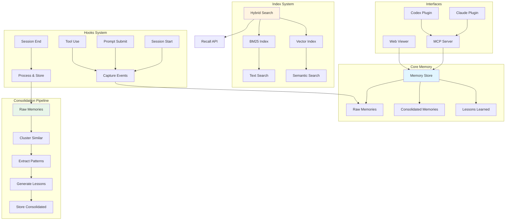
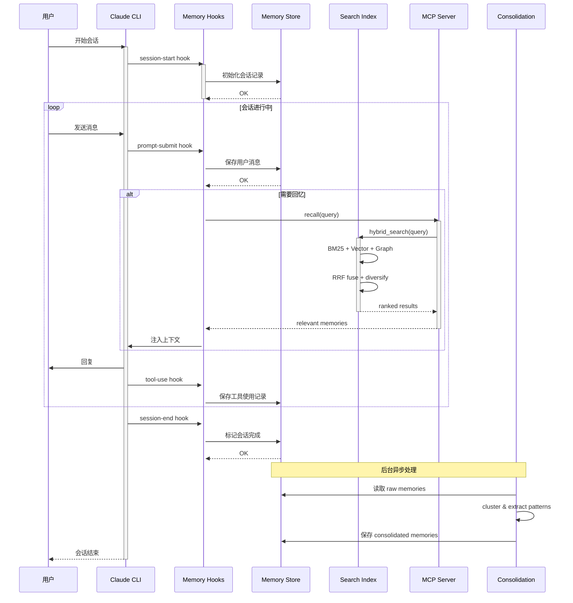
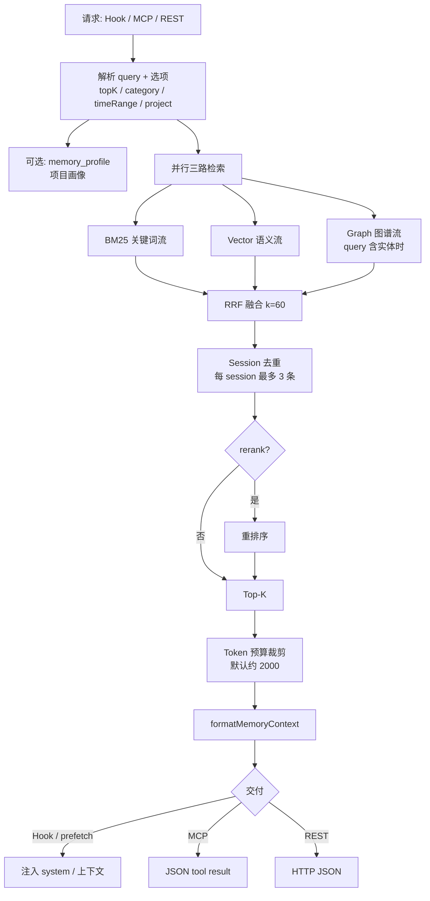
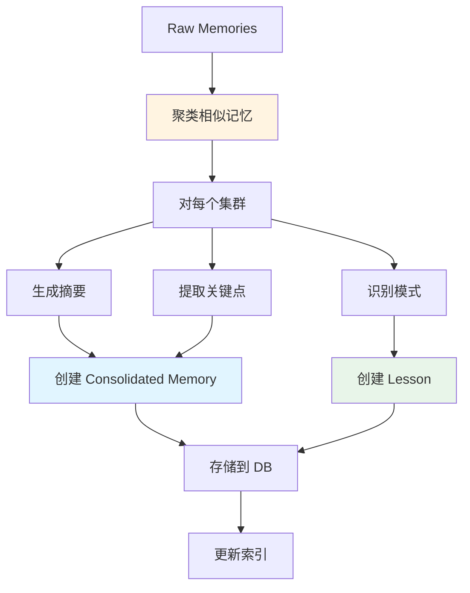
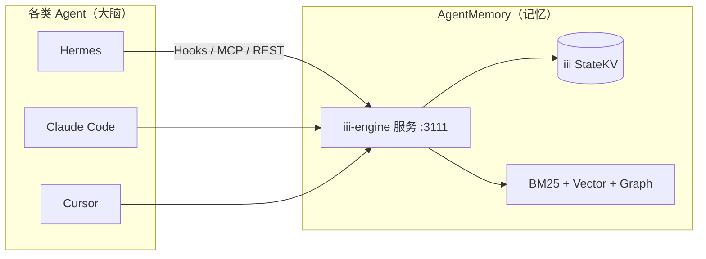
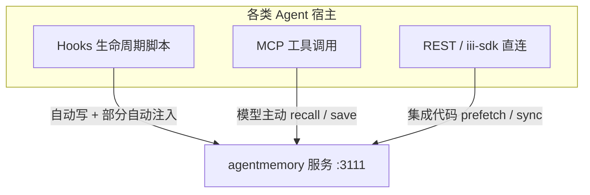
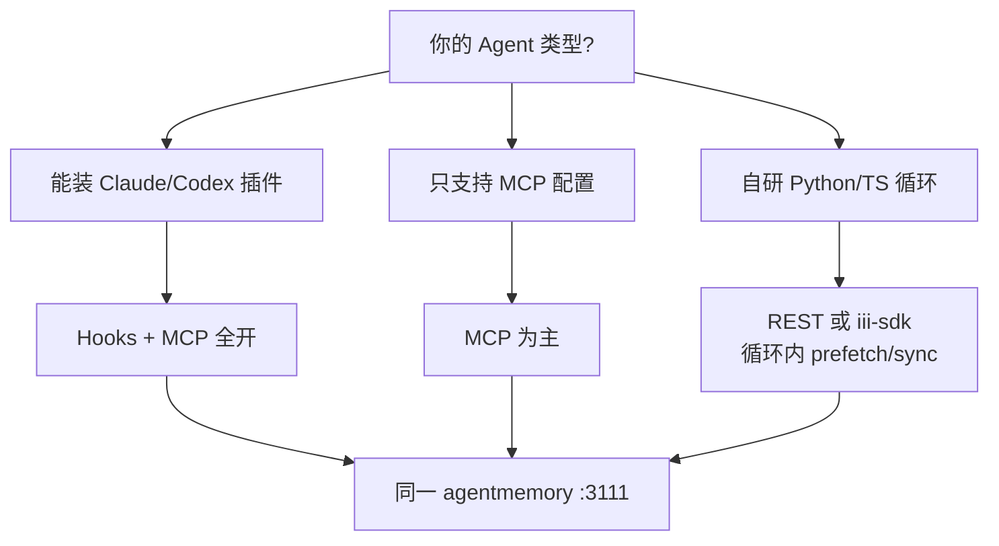
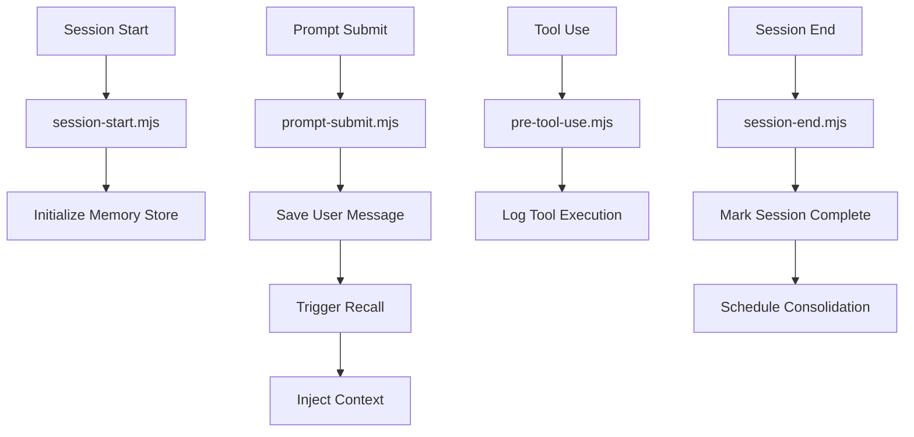

# AgentMemory 工程架构与实现总览

> **文档定位**：本文是 `agent-memory` 目录的工程架构主文档，覆盖运行时、Memory Store、事件 Hook、混合检索、Consolidation、MCP、插件、Viewer、安全、评估和部署。Memory 的四层模型、完整样例、冲突更新和生命周期规则见同目录的《AgentMemory Memory 分层、固化与检索设计》。
>
> **源码基线**：`/Users/gqli/work/deepagents/agentmemory`；本文中的实现描述以仓库源码为准。当前包元数据为 `@agentmemory/agentmemory` `0.9.30`，Node.js >= 20，运行时依赖 iii-engine/iii-sdk。旧文档中的“SQLite/better-sqlite3”“FlexSearch”“Next.js”只在对应历史设计示例中成立，不能当作当前实现的唯一事实。

## 文档边界

本目录只保留两份文档，并按以下边界维护：

| 文档 | 负责回答的问题 |
|---|---|
| `ARCHITECTURE.md` | 服务如何运行、源码如何组织、Agent 如何接入、检索和运维如何实现 |
| `MEMORY_LAYERS.md` | 一条事件如何成为 Working/Episodic/Semantic/Procedural Memory，以及固化、冲突、衰减、回溯和检索语义 |

本文优先描述当前源码；分层文档优先描述记忆语义。两文档不重复维护完整实体定义，涉及四层 Memory 的字段契约时以 `MEMORY_LAYERS.md` 为准。

## 目录

1. [系统定位与运行时架构](#1-系统定位与运行时架构)
2. [Memory Store、事件捕获与数据流](#2-memory-store事件捕获与数据流)
3. [Search & Retrieval：BM25、向量与图检索](#3-search--retrievalbm25向量与图检索)
4. [Consolidation、索引维护与后台任务](#4-consolidation索引维护与后台任务)
5. [MCP Server 与对外接口](#5-mcp-server-与对外接口)
6. [Plugin、Hook 与 Agent 集成](#6-pluginhook-与-agent-集成)
7. [Web Viewer、流式更新与运维可视化](#7-web-viewer流式更新与运维可视化)
8. [隐私、安全、隔离与审计](#8-隐私安全隔离与审计)
9. [评估、测试与质量指标](#9-评估测试与质量指标)
10. [部署、配置与故障边界](#10-部署配置与故障边界)
11. [源码地图与修改入口](#11-源码地图与修改入口)
12. [设计取舍与适用边界](#12-设计取舍与适用边界)

---

## 1. 系统定位与运行时架构

### 1.1 项目定位

**AgentMemory** 是一个智能体长期记忆系统，提供：

1. ✅ **自动记忆** - 会话中自动捕获和存储重要信息
2. ✅ **混合检索** - BM25 + 向量检索的混合搜索
3. ✅ **记忆整合** - 定期将原始记忆提炼为结构化知识
4. ✅ **MCP Server** - Model Context Protocol 接口
5. ✅ **Plugin 集成** - Claude/Codex/OpenClaw 插件支持
6. ✅ **可视化界面** - Web Viewer 查看和管理记忆

---

### 1.2 核心模块架构



---

### 1.3 关键组件关系

| 组件 | 位置 | 职责 |
|------|------|------|
| `State / Memory Store` | `src/state/`、`src/state/kv.ts`、`src/state/schema.ts` | iii-engine `StateKV` 与记忆 schema；默认 file backend，也支持 Redis |
| `Capture / Hooks` | `src/capture/`、`src/functions/capture.ts`、`src/hooks/` | 生命周期事件捕获、幂等、脱敏、spool 和重试 |
| `BM25 Index` | `src/state/search-index.ts` | 关键词检索索引 |
| `Vector Index` | `src/state/vector-index.ts` | embedding 向量索引 |
| `Hybrid Search` | `src/state/hybrid-search.ts`、`src/functions/smart-search.ts` | BM25 + Vector + Graph、RRF、分散和可选 rerank |
| `Consolidation` | `src/functions/consolidation-pipeline.ts`、`src/functions/consolidate.ts` | 观察压缩、摘要、事实/流程固化和派生对象维护 |
| `MCP Server` | `src/mcp/` | MCP 协议服务器 |
| `Viewer` | `src/viewer/` | Web 可视化界面 |
| `Plugin Hooks` | `plugin/hooks/` | Claude/Codex 钩子 |

---

### 1.4 数据流转全景图



---

---

## 2. Memory Store、事件捕获与数据流

### 2.1 Memory Store 架构

**当前实现位置**: `src/state/kv.ts`、`src/state/schema.ts`、`src/types.ts`。

当前版本没有一个可以直接照抄的 `new MemoryStore()` SQLite 类。记忆通过 iii-engine 的 `StateKV`、函数注册表和 REST/MCP 入口访问；默认状态后端是 file，部署到共享环境时可以配置 Redis。

### 历史设计示例（非当前 API）

下面的 SQLite 代码保留用于说明早期“原始记忆 / 固化记忆 / lessons”边界。它不是当前源码实现，也不应作为集成 API 使用。当前实体和 KV scope 请看 [`MEMORY_LAYERS.md`](./MEMORY_LAYERS.md) 以及第 11 章源码地图。

```typescript
class MemoryStore {
  private db: Database; // SQLite 数据库
  
  constructor(dbPath: string) {
    this.db = new Database(dbPath);
    this.initializeSchema();
  }
  
  private initializeSchema() {
    // Raw memories - 原始会话记录
    this.db.exec(`
      CREATE TABLE IF NOT EXISTS raw_memories (
        id TEXT PRIMARY KEY,
        session_id TEXT NOT NULL,
        timestamp DATETIME DEFAULT CURRENT_TIMESTAMP,
        content TEXT NOT NULL,
        type TEXT CHECK(type IN ('user_message', 'assistant_message', 'tool_use', 'observation')),
        metadata TEXT, -- JSON 元数据
        tags TEXT -- JSON 标签数组
      )
    `);
    
    // Consolidated memories - 整合后的知识
    this.db.exec(`
      CREATE TABLE IF NOT EXISTS consolidated_memories (
        id TEXT PRIMARY KEY,
        created_at DATETIME DEFAULT CURRENT_TIMESTAMP,
        title TEXT NOT NULL,
        summary TEXT NOT NULL,
        details TEXT, -- 详细内容
        category TEXT, -- 分类
        confidence REAL CHECK(confidence >= 0 AND confidence <= 1),
        source_ids TEXT, -- 来源 raw memory IDs
        embeddings TEXT -- JSON 向量数组
      )
    `);
    
    // Lessons learned - 经验教训
    this.db.exec(`
      CREATE TABLE IF NOT EXISTS lessons (
        id TEXT PRIMARY KEY,
        created_at DATETIME DEFAULT CURRENT_TIMESTAMP,
        lesson TEXT NOT NULL,
        context TEXT, -- 适用场景
        priority INTEGER DEFAULT 5, -- 优先级 1-10
        tags TEXT -- JSON 标签
      )
    `);
  }
  
  async addRawMemory(sessionId: string, content: string, type: string, metadata?: object) {
    const id = crypto.randomUUID();
    await this.db.run(
      `INSERT INTO raw_memories (id, session_id, content, type, metadata)
       VALUES (?, ?, ?, ?, ?)`,
      [id, sessionId, content, type, JSON.stringify(metadata || {})]
    );
    return id;
  }
  
  async getRawMemories(sessionId?: string, limit = 100) {
    if (sessionId) {
      return await this.db.all(
        `SELECT * FROM raw_memories WHERE session_id = ? ORDER BY timestamp DESC LIMIT ?`,
        [sessionId, limit]
      );
    }
    return await this.db.all(
      `SELECT * FROM raw_memories ORDER BY timestamp DESC LIMIT ?`,
      [limit]
    );
  }
}
```

**存储结构**：
```
memory-store.db
├── raw_memories (原始会话记录)
│   ├── id (UUID)
│   ├── session_id (会话ID)
│   ├── timestamp (时间戳)
│   ├── content (内容)
│   ├── type (类型: user/assistant/tool)
│   ├── metadata (JSON 元数据)
│   └── tags (JSON 标签)
│
├── consolidated_memories (整合知识)
│   ├── id (UUID)
│   ├── title (标题)
│   ├── summary (摘要)
│   ├── details (详细内容)
│   ├── category (分类)
│   ├── confidence (置信度 0-1)
│   ├── source_ids (来源IDs)
│   └── embeddings (向量)
│
└── lessons (经验教训)
    ├── id (UUID)
    ├── lesson (教训内容)
    ├── context (适用场景)
    ├── priority (优先级 1-10)
    └── tags (标签)
```

---

### 2.2 Hooks 系统

**当前实现位置**: `src/capture/`、`src/functions/capture.ts`、`src/hooks/`、`plugin/` 和 `src/cli/connect/`。

> 以下 `onSessionStart` 等代码是生命周期语义的伪代码，不是当前公开 API。当前宿主适配器通过 CLI 连接命令安装对应的 hook/plugin；不要直接创建一个独立的 `MemoryStore` 实例。

#### **Session Start Hook**

```typescript
// src/hooks/session-start.ts
export async function onSessionStart(event: SessionStartEvent) {
  const store = getMemoryStore();
  const sessionId = event.sessionId;
  
  // 创建会话记录
  await store.createSession({
    id: sessionId,
    startedAt: new Date().toISOString(),
    model: event.model,
    workspace: event.workspace,
  });
  
  logger.info(`[Memory] Session started: ${sessionId}`);
}
```

#### **Prompt Submit Hook**

```typescript
// src/hooks/prompt-submit.ts
export async function onPromptSubmit(event: PromptSubmitEvent) {
  const store = getMemoryStore();
  const { sessionId, messages } = event;
  
  // 保存用户消息
  for (const msg of messages) {
    if (msg.role === 'user') {
      await store.addRawMemory(sessionId, msg.content, 'user_message', {
        timestamp: Date.now(),
        tokenCount: estimateTokens(msg.content),
      });
    }
  }
  
  // 自动触发回忆
  const lastUserMessage = messages.filter(m => m.role === 'user').pop();
  if (lastUserMessage) {
    const relevantMemories = await recallRelevant(lastUserMessage.content);
    
    if (relevantMemories.length > 0) {
      // 注入到系统提示
      const contextBlock = formatMemoryContext(relevantMemories);
      injectIntoSystemPrompt(contextBlock);
    }
  }
}
```

#### **Tool Use Hook**

```typescript
// src/hooks/tool-use.ts
export async function onToolUse(event: ToolUseEvent) {
  const store = getMemoryStore();
  const { sessionId, toolName, input, output } = event;
  
  // 记录工具使用
  await store.addRawMemory(sessionId, JSON.stringify({
    tool: toolName,
    input,
    output,
  }), 'tool_use', {
    timestamp: Date.now(),
    success: !output.error,
  });
  
  // 检测重要信息（如文件修改、命令执行结果）
  if (isSignificantTool(toolName, output)) {
    await flagAsImportant(sessionId, {
      type: 'tool_result',
      tool: toolName,
      summary: summarizeToolOutput(output),
    });
  }
}
```

#### **Session End Hook**

```typescript
// src/hooks/session-end.ts
export async function onSessionEnd(event: SessionEndEvent) {
  const store = getMemoryStore();
  const sessionId = event.sessionId;
  
  // 标记会话完成
  await store.completeSession(sessionId, {
    endedAt: new Date().toISOString(),
    messageCount: await store.getSessionMessageCount(sessionId),
    duration: calculateDuration(sessionId),
  });
  
  // 触发后台整合
  scheduleConsolidation(sessionId);
  
  logger.info(`[Memory] Session completed: ${sessionId}`);
}
```

**Hook 注册**：
```json
// plugin/hooks/hooks.json
{
  "hooks": [
    {
      "event": "session.start",
      "script": "scripts/session-start.mjs"
    },
    {
      "event": "prompt.submit",
      "script": "scripts/prompt-submit.mjs"
    },
    {
      "event": "tool.use",
      "script": "scripts/pre-tool-use.mjs"
    },
    {
      "event": "session.end",
      "script": "scripts/session-end.mjs"
    }
  ]
}
```

---

### 2.3 记忆捕获策略

```typescript
// src/functions/capture-strategy.ts

interface CaptureConfig {
  minImportance: number;  // 最小重要性阈值 (0-1)
  maxPerSession: number;  // 每会话最大捕获数
  excludedPatterns: RegExp[];  // 排除模式
}

const DEFAULT_CONFIG: CaptureConfig = {
  minImportance: 0.3,
  maxPerSession: 50,
  excludedPatterns: [
    /^hi$/,
    /^hello$/,
    /^thanks?$/i,
    /you're welcome/i,
  ],
};

export function shouldCapture(content: string, context: CaptureContext): boolean {
  // 检查排除模式
  for (const pattern of DEFAULT_CONFIG.excludedPatterns) {
    if (pattern.test(content)) {
      return false;
    }
  }
  
  // 计算重要性分数
  const importance = calculateImportance(content, context);
  
  return importance >= DEFAULT_CONFIG.minImportance;
}

function calculateImportance(content: string, context: CaptureContext): number {
  let score = 0;
  
  // 长度因素（较长的消息通常更重要）
  if (content.length > 100) score += 0.2;
  if (content.length > 500) score += 0.2;
  
  // 包含代码块
  if (content.includes('```')) score += 0.3;
  
  // 包含文件路径
  if (/\/[\w.-]+\/[\w.-]+/.test(content)) score += 0.2;
  
  // 包含命令
  if (/^(git|npm|pip|docker|kubectl)\s/.test(content)) score += 0.3;
  
  // 问题标记
  if (content.includes('?')) score += 0.1;
  
  // 上下文增强
  if (context.isFollowUp) score += 0.1;
  if (context.hasCodeChanges) score += 0.2;
  
  return Math.min(score, 1.0);
}
```

---

---

## 3. Search & Retrieval：BM25、向量与图检索

### 3.1 检索流程总览

检索的**主入口**是 `mem::smart-search`（REST `:3111`）与 MCP `memory_smart_search`；`memory_recall` 偏原始 observation，profile/file_history 等为专项查询。以下描述以 **smart-search 全管道** 为准。

#### 3.1.1 何时触发检索

| 触发时机 | 入口 | Query 来源 |
|----------|------|------------|
| 会话开始 | `SessionStart` Hook、`prefetch()` | 工作区路径；可选首条用户意图 |
| 用户发消息 | `UserPromptSubmit`、`PreCompact` | 最新 user prompt |
| 模型主动 | MCP `memory_smart_search` / `memory_recall` | 模型构造的搜索句 |
| 应用代码 | REST、`iii-sdk` `mem::smart-search` | 宿主显式传入 |

#### 3.1.2 端到端流程



#### 3.1.3 写入侧：可被检索的数据从哪来

检索能命中，依赖写入管道已建索引（与第 1 章 Memory Pipeline 对称）：

```txt
PostToolUse / observe
  → SHA-256 去重 → 隐私过滤
  → 存 raw / consolidated
  → LLM 压缩 → facts + concepts + narrative
  → embedding → Vector 索引
  → 全文 → BM25 索引
  →（可选）SessionEnd 实体抽取 → 知识图谱
```

#### 3.1.4 两条典型路径

**路径 A — 自动注入（Hooks / Hermes `prefetch`）**

```txt
SessionStart → createSession →（可选）memory_profile
用户消息 / 每轮 LLM 前 → smart-search → token 裁剪 → 注入 system（不占 tool 轮次）
```

**路径 B — 模型主动查（MCP）**

```txt
模型调用 memory_smart_search → 同上 hybrid 管道 → JSON 返回 → 模型引用
```

#### 3.1.5 工具分工（避免混淆）

| 能力 | 作用 |
|------|------|
| `memory_smart_search` | **主检索**：BM25 + Vector + Graph → RRF |
| `memory_recall` | 偏 **past observations**（原始观察） |
| `memory_profile` | **预聚合项目画像**，常与 search 在 SessionStart 组合 |
| `memory_file_history` | 按 **文件路径** 查历史 |
| `memory_graph_query` | **专用图谱遍历**，不替代 smart-search 三流融合 |

---

### 3.2 Hybrid Search（三流 + RRF）

**位置**: `src/functions/smart-search.ts`

生产实现采用 **三路并行检索 + Reciprocal Rank Fusion（RRF, k=60）**，而非对 BM25/向量原始分数做加权求和（量纲不同，加权易偏一路）。图谱流在 query 中 **识别到实体** 时参与（需 `GRAPH_EXTRACTION_ENABLED` 等配置在 SessionEnd 建图）。

```typescript
const RRF_K = 60;

async function hybridSearch(query: string, options: SearchOptions): Promise<Memory[]> {
  const { topK = 10 } = options;
  const overFetch = topK * 2;

  // 三路并行（图谱流按实体检测结果可选启用）
  const [bm25Ranked, vectorRanked, graphRanked] = await Promise.all([
    bm25Search(query, { topK: overFetch }),
    vectorSearch(query, { topK: overFetch }),
    graphSearch(query, { topK: overFetch }), // 无实体时返回 []
  ]);

  // RRF：按各流排名融合，不直接比绝对分
  const merged = reciprocalRankFusion(
    [bm25Ranked, vectorRanked, graphRanked],
    { k: RRF_K },
  );

  // 同一会话最多保留 3 条，避免单次长会话占满 Top-K
  const diversified = sessionDiversify(merged, { maxPerSession: 3 });

  const reranked = options.rerank
    ? await rerankResults(query, diversified)
    : diversified;

  return applyTokenBudget(reranked.slice(0, topK), options.tokenBudget ?? 2000);
}

function reciprocalRankFusion(
  rankedLists: SearchResult[][],
  { k }: { k: number },
): SearchResult[] {
  const scores = new Map<string, number>();

  for (const list of rankedLists) {
    list.forEach((item, rank) => {
      const rrf = 1 / (k + rank + 1);
      scores.set(item.id, (scores.get(item.id) ?? 0) + rrf);
    });
  }

  return [...scores.entries()]
    .sort((a, b) => b[1] - a[1])
    .map(([id, score]) => ({ id, score, /* hydrate content */ }));
}
```

**三路职责**：

| 流 | 职责 | 典型场景 |
|----|------|----------|
| **BM25** | 分词 + 同义词扩展后的关键词匹配 | 文件名、`auth.py`、命令、错误码 |
| **Vector** | query embedding 余弦相似度 | 跨表述语义相似（「上次 Docker 怎么配」） |
| **Graph** | 实体匹配 + 图谱 BFS | 模块/概念关联、上下游依赖 |

**后处理**：RRF → session diversify → 可选 rerank → Top-K → **token 预算**（注入场景默认约 2000 tokens）。

---

### 3.3 BM25 Index 实现

**当前实现位置**: `src/state/search-index.ts`。下方 FlexSearch 示例属于历史实现示意。

> 历史设计示例：当前版本的索引由 iii-engine state 和 `src/state/*-index.ts` 管理，包中没有要求用户直接实例化 `BM25Index`。

```typescript
class BM25Index {
  private index: any; // FlexSearch 或自定义实现
  private documents: Map<string, string> = new Map();
  
  constructor() {
    this.index = new FlexSearch({
      tokenize: 'forward',
      encode: 'icase',
      resolution: 9,
    });
  }
  
  async addDocument(id: string, text: string) {
    this.documents.set(id, text);
    await this.index.add(id, text);
  }
  
  async removeDocument(id: string) {
    this.documents.delete(id);
    await this.index.remove(id);
  }
  
  async search(query: string, topK = 10): Promise<SearchResult[]> {
    const results = await this.index.search(query, topK);
    
    return results.map(({ id, score }) => ({
      id,
      content: this.documents.get(id) || '',
      score,
      method: 'bm25',
    }));
  }
  
  async rebuild(memories: Memory[]) {
    this.index = new FlexSearch({ /* config */ });
    this.documents.clear();
    
    for (const memory of memories) {
      await this.addDocument(memory.id, memory.content);
    }
    
    logger.info(`[BM25] Index rebuilt with ${memories.length} documents`);
  }
}
```

**配置选项**：
```typescript
interface BM25Config {
  k1: number;      // Term frequency saturation (默认 1.2)
  b: number;       // Length normalization (默认 0.75)
  tokenize: string; // Tokenization strategy
  encode: string;   // Text encoding
}
```

---

### 3.4 Vector Index 实现

**当前实现位置**: `src/state/vector-index.ts`。下方示例只解释向量索引的抽象，不代表当前 API。

```typescript
class VectorIndex {
  private embeddings: EmbeddingProvider;
  private store: VectorStore;
  private dimension: number;
  
  constructor(embeddings: EmbeddingProvider, store: VectorStore) {
    this.embeddings = embeddings;
    this.store = store;
    this.dimension = embeddings.dimension;
  }
  
  async addMemory(id: string, text: string, metadata?: object) {
    // Step 1: 生成嵌入向量
    const embedding = await this.embeddings.encode(text);
    
    // Step 2: 存储到向量数据库
    await this.store.insert({
      id,
      embedding,
      metadata: {
        text,
        ...metadata,
        timestamp: Date.now(),
      },
    });
  }
  
  async search(query: string, topK = 10, threshold = 0.7): Promise<SearchResult[]> {
    // Step 1: 查询嵌入
    const queryEmbedding = await this.embeddings.encode(query);
    
    // Step 2: 向量相似度搜索
    const results = await this.store.search({
      vector: queryEmbedding,
      topK,
      threshold,
    });
    
    return results.map(({ id, score, metadata }) => ({
      id,
      content: metadata.text,
      score,
      method: 'vector',
    }));
  }
  
  async updateMemory(id: string, newText: string) {
    const embedding = await this.embeddings.encode(newText);
    await this.store.update(id, { embedding, metadata: { text: newText } });
  }
  
  async deleteMemory(id: string) {
    await this.store.delete(id);
  }
}
```

> 以下向量实现代码、模型和数据库列表属于历史设计草图。当前可用 provider、模型下载和 fallback 以源码配置与项目 README 为准；当前索引入口是 `src/state/vector-index.ts`。

**历史设计中讨论过的 Embedding 模型**：
- ✅ **Xenova Transformers** - 本地运行（默认）
- ✅ **OpenAI** - `text-embedding-3-small/large`
- ✅ **Cohere** - `embed-english-v3.0`
- ✅ **Jina** - `jina-embeddings-v2`

**历史设计中讨论过的向量数据库**：
- ✅ **FAISS** - Facebook AI Similarity Search
- ✅ **Chroma** - 轻量级向量数据库
- ✅ **LanceDB** - 高性能向量数据库
- ✅ **SQLite vec0** - SQLite 扩展

---

### 3.5 Recall MCP 工具

**位置**: `src/mcp/tools/recall.ts`

```typescript
import { McpServer } from '@modelcontextprotocol/sdk/server/mcp.js';

export function registerRecallTools(server: McpServer) {
  server.tool(
    'recall',
    'Search long-term memory for relevant information',
    {
      query: z.string().describe('Search query'),
      topK: z.number().optional().default(10).describe('Number of results'),
      category: z.string().optional().describe('Filter by category'),
      timeRange: z.object({
        from: z.string().optional(),
        to: z.string().optional(),
      }).optional(),
    },
    async ({ query, topK, category, timeRange }) => {
      try {
        const memories = await hybridSearch(query, {
          topK,
          filters: { category, timeRange },
        });
        
        return {
          content: [
            {
              type: 'text',
              text: JSON.stringify(memories, null, 2),
            },
          ],
        };
      } catch (error) {
        return {
          content: [
            {
              type: 'text',
              text: `Error recalling memories: ${error.message}`,
            },
          ],
          isError: true,
        };
      }
    }
  );
  
  server.tool(
    'remember',
    'Manually save important information to memory',
    {
      content: z.string().describe('Content to remember'),
      category: z.string().optional().describe('Category tag'),
      tags: z.array(z.string()).optional().describe('Additional tags'),
    },
    async ({ content, category, tags }) => {
      const store = getMemoryStore();
      const id = await store.addConsolidatedMemory({
        title: generateTitle(content),
        summary: content,
        category,
        tags,
        confidence: 1.0, // Manual entries have high confidence
      });
      
      return {
        content: [
          {
            type: 'text',
            text: `✅ Saved to memory (ID: ${id})`,
          },
        ],
      };
    }
  );
  
  server.tool(
    'forget',
    'Remove specific memories',
    {
      ids: z.array(z.string()).describe('Memory IDs to forget'),
      reason: z.string().optional().describe('Reason for forgetting'),
    },
    async ({ ids, reason }) => {
      const store = getMemoryStore();
      
      for (const id of ids) {
        await store.deleteMemory(id);
        logger.info(`[Memory] Forgot: ${id} (reason: ${reason || 'unspecified'})`);
      }
      
      return {
        content: [
          {
            type: 'text',
            text: `✅ Forgot ${ids.length} memories`,
          },
        ],
      };
    }
  );
}
```

**使用示例**：
```typescript
// Claude 调用 recall 工具
const result = await claude.callTool('recall', {
  query: "How do I configure Docker for Python projects?",
  topK: 5,
});

// 返回的记忆会自动注入到对话上下文
```

---

---

## 4. Consolidation、索引维护与后台任务

### 4.1 Consolidation Pipeline

**位置**: `src/functions/consolidate.ts`

```typescript
async function consolidateMemories(sessionIds?: string[]): Promise<ConsolidationResult> {
  const store = getMemoryStore();
  
  // Step 1: 获取原始记忆
  const rawMemories = await store.getRawMemories(sessionIds);
  
  if (rawMemories.length < 10) {
    logger.info('[Consolidation] Not enough memories to consolidate');
    return { consolidated: 0, lessons: 0 };
  }
  
  // Step 2: 聚类相似记忆
  const clusters = await clusterMemories(rawMemories);
  
  logger.info(`[Consolidation] Found ${clusters.length} clusters`);
  
  // Step 3: 提取模式和洞察
  const consolidated: ConsolidatedMemory[] = [];
  const lessons: Lesson[] = [];
  
  for (const cluster of clusters) {
    // 3.1 生成摘要
    const summary = await generateSummary(cluster.memories);
    
    // 3.2 提取关键信息
    const keyPoints = await extractKeyPoints(cluster.memories);
    
    // 3.3 识别模式
    const patterns = await identifyPatterns(cluster.memories);
    
    // 3.4 创建整合记忆
    consolidated.push({
      title: generateTitle(summary),
      summary,
      details: keyPoints.join('\n'),
      category: categorize(cluster.memories),
      confidence: calculateConfidence(cluster),
      sourceIds: cluster.memories.map(m => m.id),
    });
    
    // 3.5 生成经验教训
    if (patterns.length > 0) {
      lessons.push({
        lesson: patterns[0].description,
        context: patterns[0].context,
        priority: patterns[0].priority,
        tags: extractTags(cluster.memories),
      });
    }
  }
  
  // Step 4: 存储整合结果
  for (const memory of consolidated) {
    await store.addConsolidatedMemory(memory);
  }
  
  for (const lesson of lessons) {
    await store.addLesson(lesson);
  }
  
  logger.info(`[Consolidation] Created ${consolidated.length} memories, ${lessons.length} lessons`);
  
  return {
    consolidated: consolidated.length,
    lessons: lessons.length,
  };
}
```

**工作流程**：


---

### 4.2 记忆聚类

```typescript
async function clusterMemories(memories: Memory[]): Promise<MemoryCluster[]> {
  // Step 1: 生成所有记忆的嵌入向量
  const embeddings = await Promise.all(
    memories.map(m => embeddingProvider.encode(m.content))
  );
  
  // Step 2: 计算相似度矩阵
  const similarityMatrix = computeSimilarityMatrix(embeddings);
  
  // Step 3: 层次聚类（Hierarchical Clustering）
  const clusters = hierarchicalClustering(similarityMatrix, {
    threshold: 0.7,  // 相似度阈值
    minClusterSize: 2,
    maxClusterSize: 20,
  });
  
  // Step 4: 过滤小集群
  return clusters.filter(c => c.members.length >= 2);
}

function hierarchicalClustering(
  similarityMatrix: number[][],
  options: ClusteringOptions
): MemoryCluster[] {
  // 使用 AGNES (Agglomerative Nesting) 算法
  const n = similarityMatrix.length;
  const clusters = Array.from({ length: n }, (_, i) => [i]);
  
  while (clusters.length > 1) {
    // 找到最相似的两个集群
    let maxSim = -1;
    let mergeI = -1;
    let mergeJ = -1;
    
    for (let i = 0; i < clusters.length; i++) {
      for (let j = i + 1; j < clusters.length; j++) {
        const sim = averageLinkage(clusters[i], clusters[j], similarityMatrix);
        if (sim > maxSim) {
          maxSim = sim;
          mergeI = i;
          mergeJ = j;
        }
      }
    }
    
    // 如果最高相似度低于阈值，停止合并
    if (maxSim < options.threshold) break;
    
    // 合并两个集群
    clusters[mergeI] = [...clusters[mergeI], ...clusters[mergeJ]];
    clusters.splice(mergeJ, 1);
  }
  
  // 转换为 MemoryCluster 格式
  return clusters
    .filter(c => c.length >= options.minClusterSize && c.length <= options.maxClusterSize)
    .map(indices => ({
      members: indices.map(i => memories[i]),
      centroid: computeCentroid(indices, embeddings),
    }));
}
```

---

### 4.3 摘要生成

```typescript
async function generateSummary(memories: Memory[]): Promise<string> {
  const llm = getLLMProvider();
  
  // 构建提示
  const prompt = `
You are an expert at summarizing information. Please create a concise summary of the following related memories:

${memories.map((m, i) => `[${i + 1}] ${m.content}`).join('\n\n')}

Requirements:
- Keep it under 200 words
- Focus on key facts and insights
- Remove redundancies
- Use clear, professional language

Summary:
`;
  
  const response = await llm.generate(prompt, {
    temperature: 0.3,
    maxTokens: 300,
  });
  
  return response.text.trim();
}
```

---

### 4.4 模式识别

```typescript
async function identifyPatterns(memories: Memory[]): Promise<Pattern[]> {
  const llm = getLLMProvider();
  
  const prompt = `
Analyze these memories and identify recurring patterns, best practices, or lessons learned:

${memories.map(m => `- ${m.content}`).join('\n')}

For each pattern you find, provide:
1. Description: What is the pattern?
2. Context: When does it apply?
3. Priority: How important is it? (1-10)

Format as JSON array:
[
  {
    "description": "...",
    "context": "...",
    "priority": 8
  }
]
`;
  
  const response = await llm.generate(prompt, {
    temperature: 0.2,
    responseFormat: 'json',
  });
  
  return JSON.parse(response.text);
}
```

---

### 4.5 调度整合任务

```typescript
// src/triggers/consolidation-trigger.ts

import cron from 'node-cron';

// 每天凌晨 2 点执行整合
cron.schedule('0 2 * * *', async () => {
  logger.info('[Scheduler] Starting daily consolidation...');
  
  try {
    const result = await consolidateMemories();
    logger.info(`[Scheduler] Consolidation complete: ${result.consolidated} memories, ${result.lessons} lessons`);
  } catch (error) {
    logger.error('[Scheduler] Consolidation failed:', error);
  }
});

// 或在会话结束时触发
export function scheduleConsolidation(sessionId: string) {
  // 延迟 5 分钟执行，避免阻塞会话结束
  setTimeout(async () => {
    try {
      await consolidateMemories([sessionId]);
    } catch (error) {
      logger.error('[Consolidation] Failed:', error);
    }
  }, 5 * 60 * 1000);
}
```

---

---

## 5. MCP Server 与对外接口

### 5.1 MCP Server 架构

**位置**: `src/mcp/`

#### **Server启动流程**

```typescript
import { McpServer } from '@modelcontextprotocol/sdk/server/mcp.js';
import { StdioServerTransport } from '@modelcontextprotocol/sdk/server/stdio.js';

class AgentMemoryMCPServer {
  private server: McpServer;
  
  constructor() {
    this.server = new McpServer({
      name: 'agentmemory',
      version: packageJson.version,
    });
    
    // 注册工具
    this.registerTools();
    
    // 注册资源
    this.registerResources();
    
    // 注册Prompts
    this.registerPrompts();
  }
  
  private registerTools() {
    // Recall工具
    this.server.tool(
      'recall',
      {
        query: z.string(),
        topK: z.number().optional().default(10),
      },
      async ({ query, topK }) => {
        const memories = await hybridSearch(query, { topK });
        return {
          content: [{ type: 'text', text: JSON.stringify(memories) }],
        };
      }
    );
    
    // Remember工具
    this.server.tool(
      'remember',
      {
        content: z.string(),
        category: z.string().optional(),
      },
      async ({ content, category }) => {
        const id = await store.addMemory({ content, category });
        return {
          content: [{ type: 'text', text: `✅ Saved (ID: ${id})` }],
        };
      }
    );
    
    // Forget工具
    this.server.tool(
      'forget',
      {
        ids: z.array(z.string()),
      },
      async ({ ids }) => {
        await Promise.all(ids.map(id => store.deleteMemory(id)));
        return {
          content: [{ type: 'text', text: `✅ Forgot ${ids.length} memories` }],
        };
      }
    );
  }
  
  async start() {
    const transport = new StdioServerTransport();
    await this.server.connect(transport);
    
    logger.info('AgentMemory MCP Server started');
  }
}

// 启动
const server = new AgentMemoryMCPServer();
server.start().catch(console.error);
```

---

### 5.2 Resource 订阅机制

```typescript
// 注册可订阅的资源
this.server.resource(
  'recent-memories',
  'memory://recent',
  async (uri) => {
    const memories = await store.getRecentMemories(10);
    
    return {
      contents: [{
        uri: uri.href,
        mimeType: 'application/json',
        text: JSON.stringify(memories, null, 2),
      }],
    };
  }
);

// 客户端订阅
const client = new Client(transport);
await client.connect();

// 订阅资源变更
client.subscribe('memory://recent');

// 接收更新通知
client.onnotification('notifications/resources/updated', (notification) => {
  console.log('Resource updated:', notification.params.uri);
});
```

---

---

## 6. Plugin、Hook 与 Agent 集成

> 本章回答两个常见问题：**AgentMemory 独立部署后，为什么除了 MCP 还要 Hooks？** 以及 **为什么不给每个 Agent 框架发一个官方 SDK？**

### 6.1 定位：记忆侧车，不是 Agent 本体

**AgentMemory 是「编程 Agent 的长期记忆后端」，不是推理 Agent 本身。**

| 角色 | 职责 |
|------|------|
| **宿主 Agent**（Hermes、Claude Code、Cursor、Deep Agents 等） | 推理、工具执行、多轮对话 |
| **AgentMemory**（`:3111` + iii-engine） | 自动记录、混合检索、整合提炼、跨会话共享 |



独立部署的意义：**多个 Agent 连接同一记忆服务**，Claude 里记的 observation，Hermes 用 MCP 也能查到。

---

### 6.2 三条接入通道

独立部署后，对外并非「只有 MCP 用来查」，而是 **三层接口分工**：



| 通道 | 谁触发 | 典型动作 | 深度 |
|------|--------|----------|------|
| **Hooks** | 宿主在固定时机 **自动** 执行脚本 | 每句话、每次工具 → 写入；SessionStart → 注入 recall | 自动采集 + 部分自动注入 |
| **MCP** | **LLM 决定** 调用 `memory_*` 工具 | `memory_smart_search`、`memory_save`、治理删除 | 主动查 / 主动存 |
| **REST / iii-sdk** | **应用代码** 显式调用 | Hermes `prefetch()`、`curl smart-search` | 与 Agent 循环深度绑定 |

**结论：MCP 与 Hooks 不是二选一，而是分工协作。**

---

### 6.3 为什么需要 Hooks（不能只用 MCP）

#### （1）采集：模型不调工具 = 记忆丢失

若 **只靠 MCP**：

- 用户长时间改代码，模型从未调用 `memory_save` → 库中无记录。
- 工具入参/输出、失败栈等细粒度事件，难以依赖模型「想起来记」。

**Hooks** 在 `PostToolUse`、`UserPromptSubmit` 等时刻 **无 LLM 参与** 即写入（见第 1 章 Memory Pipeline）：

```txt
PostToolUse → SHA-256 去重 → 隐私过滤 → 存 observation → 压缩/向量化 → 建索引
SessionEnd  → 会话摘要 → 图谱抽取 → 触发 consolidate
```

这是相对「手写 `add()`」或「只靠 MCP 自觉 `memory_save`」的核心差异：**零人工、零依赖模型记笔记**。

#### （2）注入：Session 开始时的 recall 不应占一轮 tool

会话开始需将 Top-K 记忆注入上下文（默认约 2000 tokens）。

| 方式 | 问题 |
|------|------|
| **仅 MCP** | 需额外一轮让模型调用 `memory_recall` → 延迟、多 token、可能不调 |
| **Hook / Memory Provider** | `SessionStart` 或 `prefetch()` 在首条用户消息 **之前** 注入 → 用户无感 |

#### （3）与宿主产品形态绑定

Claude Code / Codex 提供官方 **Plugin + hooks.json**，并无「每次 tool 后自动调 MCP」的内建机制。AgentMemory 选择 **顺应宿主 Hook 扩展点**，而非要求修改 Claude/Cursor 内核。

#### （4）后台管道

`SessionEnd` 触发的摘要、consolidation、图谱抽取是 **副作用管道**，不适合完全依赖模型在对话中调用 `memory_consolidate`。Hooks 在会话结束时 **best-effort 调 REST**，不占用对话轮次。

#### 何时「只用 MCP」即可？

| 场景 | 建议 |
|------|------|
| 仅需「需要时搜记忆」 | MCP only 足够 |
| 长期编码、要强自动记账 | Hooks 或 Memory Provider（如 Hermes 插件） |
| 自研 Python Agent，可控循环 | REST / iii-sdk 在 `run` 前后 `prefetch` / `sync_turn`，通常比 MCP 更稳 |

---

### 6.4 程序化接口：REST、iii-sdk、MCP

AgentMemory **已提供程序化访问**，只是未统一打包为 `agentmemory-python-sdk` 品牌名：

| 形式 | 说明 |
|------|------|
| **REST API** | `:3111` 上约 124 个端点（`smart-search`、`observe` 等） |
| **iii-sdk** | Python / Rust / Node，经 `ws://localhost:49134` 调用 `mem::*` 函数 |
| **MCP（`@agentmemory/mcp`）** | 面向支持 MCP 的客户端；**有运行中 server 时** 代理完整工具面（50+），无 server 时 shim 约 7 个本地工具 |
| **宿主插件** | 如 `integrations/hermes/` = 面向 Hermes 的 Python 适配层 |

**Python 直连 iii-engine 示例**（摘自官方 README）：

```python
from iii import register_worker

iii = register_worker("ws://localhost:49134")
iii.connect()

iii.trigger({
    "function_id": "mem::smart-search",
    "payload": {"project": "demo", "query": "how do tokens refresh"},
})
```

对 **Deep Agents / 自研 Python Agent**，更自然的是在 loop 内调 **REST 或 iii-sdk**（与 Hermes Memory Provider 等价），而非让 LLM 每轮走 MCP tool。

**MCP 常用工具（有 server 时）**：

| 工具 | 用途 |
|------|------|
| `memory_recall` / `memory_smart_search` | 混合检索 |
| `memory_save` | 显式保存结论/模式 |
| `memory_sessions` / `memory_timeline` | 浏览会话与时间线 |
| `memory_file_history` | 某文件相关历史 |
| `memory_profile` | 项目画像 |
| `memory_consolidate` | 触发整合管道 |

**Hooks vs MCP 分工**：

| | Hooks | MCP |
|--|-------|-----|
| **触发** | 事件驱动，自动 | 模型 `tool_call` |
| **典型场景** | 每句话、每次工具写入 | 「查上周 auth 相关决策」 |
| **是否进 prompt** | 部分 Hook 自动 inject recall | 工具结果由模型决定如何用 |
| **存储** | 与 MCP **同一 Memory Store** | 同左 |

---

### 6.5 为何不维护「各框架官方 SDK」

产品/架构上的取舍：

1. **单一事实来源** — 一个 iii-engine + StateKV；多 Agent 连同一端口才能实现跨 Agent 共享。若各框架嵌不同版本 SDK，易出现双写与 schema 漂移。

2. **MCP 已是协议层「通用 SDK」** — Cursor、Claude、Hermes、Gemini CLI 等只需配置 `mcp_servers`，无需为每个框架维护 PyPI 包。

3. **Hooks 是「零改 Agent 源码」的集成** — Claude Code 用户 `plugin install agentmemory` 即可，比要求改 agent 代码更简单。

4. **深度集成 = 薄适配** — Hermes 的 `prefetch` / `sync_turn` 等是对 REST 的薄包装；复杂逻辑留在 server 侧 `mem::*` 函数。

5. **维护面** — 53 MCP 工具 + 124 REST + 12 hooks；再维护 LangChain / OpenAI Agents / Deep Agents 三套官方 SDK，公开 API 表面会爆炸（见仓库 `AGENTS.md` 一致性规则）。

更准确表述：

> **AgentMemory 的「SDK」= REST + iii-sdk + MCP；框架专用逻辑放在 `integrations/*` 插件，而非统一命名的多语言 SDK  monorepo。**

---

### 6.6 各 Agent 集成选型



| Agent / 框架 | 推荐集成 | 说明 |
|--------------|----------|------|
| **Claude Code** | 官方 Plugin + 12 Hooks + MCP | 自动采集最全 |
| **Codex CLI** | Plugin + 6 Hooks + MCP | 与 Claude 共享 hook 脚本 |
| **Hermes** | MCP（轻）或 `integrations/hermes` 插件（深） | `memory.provider: agentmemory` + 可选 6-hook Provider |
| **Cursor / OpenCode 等** | MCP（需先起 server） | 配置 `AGENTMEMORY_URL=http://localhost:3111` |
| **Deep Agents SDK** | REST / iii-sdk 或 MCP | 无宿主 hooks；在 `Runner.run` 前后注入/同步 |
| **OpenAI Agents SDK** | REST 或 MCP | 同上 |
| **Aider 等** | REST `curl` | 直接调 `smart-search` |
| **LiveKit + Hermes** | Hermes Provider 同步 **文本轮次** | LiveKit 管音频；记忆在 Hermes 文本层 prefetch/sync |

#### Hermes 两档集成（`integrations/hermes/README.md`）

**轻量 — 仅 MCP：**

```yaml
 # ~/.hermes/config.yaml
mcp_servers:
  agentmemory:
    command: npx
    args: ["-y", "@agentmemory/mcp"]
memory:
  provider: agentmemory
```

**深度 — Memory Provider 插件：**

```bash
cp -r integrations/hermes ~/.hermes/plugins/agentmemory
npx @agentmemory/agentmemory   # 先起 :3111
```

| Provider 方法 | 作用 |
|---------------|------|
| `prefetch()` | 每轮 LLM 前注入相关记忆 |
| `sync_turn()` | 每轮对话后台写入 agentmemory |
| `on_session_end()` | 会话结束，触发摘要/整合 |
| `on_pre_compress()` | 上下文压缩前再注入 |
| `on_memory_write()` | `MEMORY.md` 写入时镜像到 agentmemory |
| `system_prompt_block()` | 会话开始注入项目 profile |

**与 Hermes 内置记忆的关系**：

| Hermes 内置 | AgentMemory 补充 |
|-------------|------------------|
| `MEMORY.md` 扁平文本 | 结构化 observation、facts、文件关联 |
| `USER.md` | 项目 profile、模式统计 |
| Hermes 内置本地检索 | 跨会话 BM25 + 向量 + 图检索 |
| 单 Agent | 经 MCP/REST 与 Claude/Cursor 等同库 |

#### 推荐实践（自研 Agent）

- **写入**：`sync_turn` / REST `observe`，**不依赖**模型每轮调 `memory_save`。
- **读取**：`prefetch` 注入 system prompt；需要时再开放 MCP `memory_smart_search` 供模型主动查。
- **不要**在 LiveKit 音频层直连 agentmemory；在 **文本轮次**（Hermes `run_conversation`）前后对接即可。

---

### 6.7 Claude Plugin Hooks（历史示例与实现说明）

**位置**: `plugin/hooks/`

#### **Hook生命周期**



**Hook实现示例**：

```javascript
// plugin/hooks/scripts/prompt-submit.mjs

export default async function onPromptSubmit(event) {
  const { sessionId, messages } = event;
  
  // 保存用户消息
  for (const msg of messages) {
    if (msg.role === 'user') {
      await memoryStore.addRawMemory({
        sessionId,
        content: msg.content,
        type: 'user_message',
        timestamp: Date.now(),
      });
    }
  }
  
  // 触发回忆
  const lastUserMsg = messages.filter(m => m.role === 'user').pop();
  
  if (lastUserMsg) {
    const relevant = await recallRelevant(lastUserMsg.content, { topK: 5 });
    
    if (relevant.length > 0) {
      // 注入到系统提示
      const contextBlock = formatContext(relevant);
      
      // 通过Claude API修改系统提示
      await claude.updateSystemPrompt(
        claude.systemPrompt + '\n\n' + contextBlock
      );
    }
  }
}
```

---

### 6.8 OpenClaw Plugin

**位置**: `integrations/openclaw/`

```json
{
  "name": "agentmemory",
  "version": "1.0.0",
  "hooks": {
    "message.received": "./plugin.mjs#onMessageReceived",
    "message.sent": "./plugin.mjs#onMessageSent"
  }
}
```

```javascript
// integrations/openclaw/plugin.mjs

export async function onMessageReceived(event) {
  const { message, conversationId } = event;
  
  // 保存消息
  await memoryStore.addMemory({
    conversationId,
    content: message.text,
    role: 'user',
  });
  
  // 回忆相关上下文
  const context = await recallRelevant(message.text);
  
  if (context.length > 0) {
    // 附加到消息
    message.context = context;
  }
}
```

---

---

## 7. Web Viewer、流式更新与运维可视化

### 7.1 Viewer架构

**位置**: `src/viewer/`。当前 Viewer 是随 CLI/worker 提供的静态页面和实时流，不是独立的 Next.js App Router 工程。

> 历史设计示例：下面的 Next.js 组件和 API route 仅用于说明界面职责，不能直接代表当前目录结构或启动方式。

```typescript
// Next.js App Router
// app/page.tsx

export default function MemoryViewer() {
  const [memories, setMemories] = useState([]);
  const [searchQuery, setSearchQuery] = useState('');
  
  // 加载记忆
  useEffect(() => {
    loadMemories();
  }, []);
  
  const loadMemories = async () => {
    const response = await fetch('/api/memories');
    const data = await response.json();
    setMemories(data);
  };
  
  // 搜索
  const handleSearch = async (query: string) => {
    setSearchQuery(query);
    
    const response = await fetch(`/api/search?q=${encodeURIComponent(query)}`);
    const results = await response.json();
    setMemories(results);
  };
  
  return (
    <div className="container mx-auto p-4">
      <h1 className="text-2xl font-bold mb-4">AgentMemory Viewer</h1>
      
      {/* 搜索框 */}
      <SearchBar onSearch={handleSearch} />
      
      {/* 记忆列表 */}
      <MemoryList memories={memories} />
      
      {/* 统计信息 */}
      <StatsPanel memories={memories} />
    </div>
  );
}
```

**API路由**：

```typescript
// app/api/memories/route.ts

export async function GET() {
  const store = getMemoryStore();
  const memories = await store.getAllMemories({ limit: 100 });
  
  return Response.json(memories);
}

// app/api/search/route.ts

export async function GET(request: Request) {
  const { searchParams } = new URL(request.url);
  const query = searchParams.get('q');
  
  if (!query) {
    return Response.json({ error: 'Query required' }, { status: 400 });
  }
  
  const results = await hybridSearch(query, { topK: 20 });
  
  return Response.json(results);
}
```

---

### 7.2 可视化组件

```typescript
// components/MemoryCard.tsx

interface MemoryCardProps {
  memory: Memory;
  onDelete?: (id: string) => void;
}

export function MemoryCard({ memory, onDelete }: MemoryCardProps) {
  return (
    <div className="border rounded-lg p-4 mb-2 hover:shadow-md transition">
      <div className="flex justify-between items-start">
        <div>
          <h3 className="font-semibold">{memory.title || 'Untitled'}</h3>
          <p className="text-sm text-gray-600 mt-1">{memory.summary}</p>
          
          <div className="mt-2 flex gap-2">
            {memory.tags?.map(tag => (
              <span key={tag} className="px-2 py-1 bg-blue-100 text-blue-800 text-xs rounded">
                {tag}
              </span>
            ))}
          </div>
        </div>
        
        <button
          onClick={() => onDelete?.(memory.id)}
          className="text-red-500 hover:text-red-700"
        >
          🗑️
        </button>
      </div>
      
      <div className="mt-2 text-xs text-gray-500">
        Created: {new Date(memory.createdAt).toLocaleString()}
        {memory.confidence && (
          <span className="ml-2">
            Confidence: {(memory.confidence * 100).toFixed(0)}%
          </span>
        )}
      </div>
    </div>
  );
}
```

---

---

## 8. 隐私、安全、隔离与审计

### 8.1 数据加密

> 当前安全边界以状态后端、secret、scope、脱敏、审计和治理删除为主。下方 AES-256-CBC 类是历史概念示例，不是当前 `agentmemory` 的默认存储 API；不要据此判断当前系统会自动为所有字段加密。

```typescript
import crypto from 'crypto';

class EncryptedMemoryStore {
  private encryptionKey: Buffer;
  
  constructor(key: string) {
    this.encryptionKey = crypto.scryptSync(key, 'salt', 32);
  }
  
  async addMemory(content: string): Promise<string> {
    // 加密内容
    const iv = crypto.randomBytes(16);
    const cipher = crypto.createCipheriv('aes-256-cbc', this.encryptionKey, iv);
    
    let encrypted = cipher.update(content, 'utf8', 'hex');
    encrypted += cipher.final('hex');
    
    const encryptedData = iv.toString('hex') + ':' + encrypted;
    
    // 存储加密后的数据
    const id = await this.db.insert('memories', {
      content: encryptedData,
      created_at: new Date(),
    });
    
    return id;
  }
  
  async getMemory(id: string): Promise<string | null> {
    const row = await this.db.get('memories', id);
    
    if (!row) return null;
    
    // 解密
    const parts = row.content.split(':');
    const iv = Buffer.from(parts[0], 'hex');
    const encrypted = parts[1];
    
    const decipher = crypto.createDecipheriv('aes-256-cbc', this.encryptionKey, iv);
    
    let decrypted = decipher.update(encrypted, 'hex', 'utf8');
    decrypted += decipher.final('utf8');
    
    return decrypted;
  }
}
```

---

### 8.2 访问控制

```typescript
class AccessControlManager {
  async checkAccess(userId: string, memoryId: string): Promise<boolean> {
    const memory = await store.getMemory(memoryId);
    
    if (!memory) return false;
    
    // 检查所有权
    if (memory.ownerId === userId) return true;
    
    // 检查共享权限
    const sharedWith = await store.getSharedWith(memoryId);
    
    return sharedWith.includes(userId);
  }
  
  async shareMemory(memoryId: string, withUserId: string): Promise<void> {
    await store.shareMemory(memoryId, withUserId);
  }
  
  async revokeAccess(memoryId: string, fromUserId: string): Promise<void> {
    await store.revokeAccess(memoryId, fromUserId);
  }
}
```

---

---

## 9. 评估、测试与质量指标

### 9.1 LongMemEval

**位置**: `benchmark/longmemeval-bench.ts`

```typescript
interface LongMemEvalTask {
  id: string;
  question: string;
  expectedAnswer: string;
  relevantMemoryIds: string[];
}

class LongMemEvalBenchmark {
  private tasks: LongMemEvalTask[];
  
  constructor() {
    this.tasks = loadTasksFromJSON('benchmark/data/longmemeval_tasks.json');
  }
  
  async evaluate(system: MemorySystem): Promise<EvaluationResult> {
    const results: TaskResult[] = [];
    
    for (const task of this.tasks) {
      // Step 1: 插入相关记忆
      for (const memId of task.relevantMemoryIds) {
        const memory = await loadMemory(memId);
        await system.addMemory(memory);
      }
      
      // Step 2: 查询
      const retrieved = await system.recall(task.question, { topK: 10 });
      
      // Step 3: 评估召回率
      const recalledIds = retrieved.map(r => r.id);
      const relevantSet = new Set(task.relevantMemoryIds);
      
      const truePositives = recalledIds.filter(id => relevantSet.has(id)).length;
      const recall = truePositives / task.relevantMemoryIds.length;
      
      results.push({
        taskId: task.id,
        recall,
        retrievedCount: retrieved.length,
      });
    }
    
    // 计算平均召回率
    const avgRecall = results.reduce((sum, r) => sum + r.recall, 0) / results.length;
    
    return {
      taskResults: results,
      avgRecall,
      totalTasks: results.length,
    };
  }
}
```

**评估指标**：

| 指标 | 公式 | 说明 |
|------|------|------|
| **Recall@K** | TP / Total Relevant | 前K个结果中相关记忆的比例 |
| **Precision@K** | TP / K | 前K个结果中相关的比例 |
| **MRR** | 1/rank of first relevant | 第一个相关结果的排名倒数 |
| **NDCG** | 归一化折扣累积增益 | 考虑排名位置的指标 |

### 9.2 项目 README 基准快照

以下数字来自源码仓库 README 的已发布基准，不是本次文档整理重新运行的结果；运行环境、模型、数据集和配置变化后不能直接横向比较：

| 基准 | 结果 |
|---|---:|
| `coding-agent-life-v1` hybrid `P@5` | 0.240 |
| `coding-agent-life-v1` hybrid `R@5` | 1.000 |
| `coding-agent-life-v1` top-5 hit rate | 15/15 |
| `coding-agent-life-v1` p50 latency | 14 ms |
| LongMemEval-S `R@5` | 95.2% |
| LongMemEval-S `R@10` | 98.6% |
| LongMemEval-S `MRR` | 88.2% |

README 同时报告了约 92% 的上下文 token 节省；这类数字受 corpus、token budget、embedding provider 和压缩策略影响，应作为方向性指标。正式回归应使用源码中的 `eval/`、`benchmark/` 和 `test/`，并记录 provider、版本、数据集和配置。

---

---

## 10. 部署、配置与故障边界

### 10.1 Docker部署

**位置**: `deploy/coolify/Dockerfile`

```dockerfile
FROM node:20-alpine AS builder

WORKDIR /app
COPY package*.json ./
RUN npm ci

COPY . .
RUN npm run build

FROM node:20-alpine

WORKDIR /app
COPY --from=builder /app/dist ./dist
COPY --from=builder /app/node_modules ./node_modules
COPY --from=builder /app/package.json ./

EXPOSE 3000

CMD ["node", "dist/index.js"]
```

**Docker Compose**：

```yaml
version: '3.8'

services:
  agentmemory:
    build: .
    ports:
      - "3000:3000"
    environment:
      - DATABASE_URL=file:/data/memory.db
      - ENCRYPTION_KEY=${ENCRYPTION_KEY}
    volumes:
      - memory_data:/data
    healthcheck:
      test: ["CMD", "curl", "-f", "http://localhost:3000/health"]
      interval: 30s
      timeout: 10s
      retries: 3

volumes:
  memory_data:
```

---

### 10.2 Cloud Deployment

#### **Fly.io部署**

```toml
# fly.toml
app = "agentmemory"
primary_region = "sjc"

[build]
  dockerfile = "deploy/fly/Dockerfile"

[env]
  DATABASE_URL = "file:/data/memory.db"

[mounts]
  source = "memory_data"
  destination = "/data"

[[services]]
  protocol = "tcp"
  internal_port = 3000
  
  [[services.ports]]
    port = 443
    handlers = ["tls", "http"]
```

#### **Railway部署**

```json
{
  "$schema": "https://railway.app/railway.schema.json",
  "build": {
    "builder": "DOCKERFILE",
    "dockerfilePath": "deploy/railway/Dockerfile"
  },
  "deploy": {
    "startCommand": "node dist/index.js",
    "healthcheckPath": "/health",
    "healthcheckTimeout": 100
  }
}
```

---


## 11. 源码地图与修改入口

### 11.1 关键目录

| 领域 | 主要源码位置 | 说明 |
|---|---|---|
| 入口与 CLI | `src/index.ts`、`src/cli.ts`、`src/cli/` | 启动服务、命令行、连接不同 Agent |
| 类型与 KV schema | `src/types.ts`、`src/state/schema.ts`、`src/state/kv.ts` | Session、RawObservation、CompressedObservation、Memory、Semantic/Procedural 类型和命名空间 |
| 捕获 | `src/capture/`、`src/functions/capture.ts`、`src/hooks/` | event id、spool、prompt ledger、Hook 事件接收与幂等 |
| 检索 | `src/state/hybrid-search.ts`、`src/state/search-index.ts`、`src/state/vector-index.ts`、`src/functions/smart-search.ts` | BM25、向量、图扩展、RRF、session diversification、可选 rerank |
| 固化 | `src/functions/consolidation-pipeline.ts`、`src/functions/consolidate.ts` | working/episodic/semantic/procedural 的整合、衰减和版本演进 |
| MCP | `src/mcp/server.ts`、`src/mcp/tools-registry.ts`、`packages/mcp/` | tools、resources、prompts、standalone/proxy |
| 图 | `src/functions/graph-*.ts`、`src/state/graph-*.ts` | entity/edge、时间边、图检索和快照压缩 |
| Viewer | `src/viewer/`、`src/triggers/viewer-streams.ts` | 管理界面、SSE/流式状态和健康页 |
| 插件 | `plugin/`、`integrations/`、`src/cli/connect/` | Claude/Codex/Cursor/Hermes/OpenClaw 等适配 |
| 测试 | `test/`、`benchmark/`、`eval/` | 单测、集成测试、负载和 LongMemEval/coding-life |

### 11.2 修改前检查

1. 这次改动影响 RawObservation、CompressedObservation、SessionSummary、Memory、SemanticMemory、ProceduralMemory 还是图/lesson/insight 派生对象？
2. 是否同时覆盖 Hook 写入、MCP/REST 写入、replay/import 和恢复路径？
3. project、session、agent scope、team shared/private 是否保持一致？
4. 索引更新、vector backfill、graph snapshot 和 viewer stream 是否需要重建？
5. consolidation 失败时原始事件是否仍保留，版本/来源是否仍可追溯？
6. 是否增加 LLM、embedding、reranker 成本或改变 fallback？
7. 是否需要更新 docs、skills、plugin packaging、OpenAPI/工具 schema 和测试？

### 11.3 推荐阅读顺序

1. `src/types.ts` 与 `src/state/schema.ts`；
2. `src/functions/working-memory.ts`、`src/functions/remember.ts`；
3. `src/state/hybrid-search.ts` 与 `src/functions/smart-search.ts`；
4. `src/functions/consolidation-pipeline.ts`、`src/functions/consolidate.ts`；
5. `src/mcp/tools-registry.ts`、`src/mcp/server.ts`；
6. `src/hooks/`、`src/cli/connect/` 与 `plugin/`；
7. `test/`、`benchmark/`、`eval/`。

## 12. 设计取舍与适用边界

### 12.1 优点

- 对编码 Agent 的工具调用、文件事件和会话生命周期有自动捕获能力；
- BM25、向量和图三路检索对标识符、文件名和自然语言问题互补；
- Working/episodic/semantic/procedural 分层降低长期使用的上下文成本；
- MCP、REST、iii-sdk、插件和 Hook 允许从零代码到深度接入逐级选择；
- 本地优先、agent scope、team shared/private、审计和 Viewer 适合个人/团队开发环境。

### 12.2 代价与边界

- 依赖 iii-engine/iii-sdk，系统不是无状态的纯检索库；
- 大量 Hook 捕获、embedding、图维护和 LLM 固化会带来存储、CPU、网络和模型成本；
- file state backend 适合单机；共享部署需显式配置 Redis，并验证隔离、持久化和恢复；
- 自动衰减、删除、compact 和旧版本策略会影响长期 provenance，强审计场景需要调整保留和导出策略；
- `Memory` 的版本演进、`isLatest`、`parentId`、`supersedes` 与 SemanticMemory 的原地更新语义不同，不能用一个“置信度字段”概括全部层级。

---

## 附录 A：快速开始（以当前源码为准）

```bash
# 首次安装、启动服务并进入交互式配置
npx -y @agentmemory/agentmemory@latest

# 另一个终端：写入演示数据并验证检索
npx -y @agentmemory/agentmemory@latest demo

# 健康检查与查看运行状态
curl -fsS http://localhost:3111/agentmemory/livez
curl -fsS http://localhost:3111/agentmemory/health
npx -y @agentmemory/agentmemory@latest status

# 连接宿主 Agent；也可用 --all 或 --dry-run
agentmemory connect codex
agentmemory connect cursor

# 独立 MCP 客户端（需要服务端时通过 AGENTMEMORY_URL 代理）
npx -y @agentmemory/agentmemory@latest mcp
```

默认端口为 REST/MCP HTTP `3111`、iii streams `3112`、Viewer `3113`、engine WebSocket `49134`。可通过 `--port` 或 `--instance` 改变端口组；多实例必须使用独立 data directory。默认状态后端是 file，共享服务可配置 `AGENTMEMORY_STATE_BACKEND=redis` 与 `AGENTMEMORY_REDIS_URL`。无 LLM provider 时，BM25 和显式保存仍可用；向量检索需配置 embedding provider。

支持的连接适配器由 `src/cli/connect/index.ts` 注册，当前包括 Claude Code、Codex、Cursor、GitHub Copilot CLI、Gemini CLI、OpenCode、OpenClaw、Hermes、pi 等。Hook 能力取决于宿主；不支持 hooks 的客户端使用 MCP，能编程接入的 Agent 可使用 REST 或 iii-sdk。

运行前提与常见问题：

- Node.js >= 20；macOS/Linux 自动安装 iii-engine 还需要 `curl`、POSIX `sh` 和 `tar`；Windows 使用 WSL2、Docker Desktop 或手动安装匹配版本的 engine。
- 无 provider 时可以使用 BM25、显式保存和基础 recall；向量召回需要配置 embedding provider。`EMBEDDING_PROVIDER=local` 可使用本地模型，但首次运行会下载模型。
- LLM provider 本身不会自动打开 LLM-written compression；需要同时配置 `AGENTMEMORY_AUTO_COMPRESS=true`。Consolidation 是否开启由 provider 和 `CONSOLIDATION_ENABLED` 等配置共同决定。
- 端口被占用时先执行 `agentmemory stop`，再用 `lsof -i :3111,3112,3113,49134` 或系统等价命令检查残留进程；不要让多个实例共享同一个 data directory 或 Redis 实例空间。
- `agentmemory mcp` 是独立 MCP 入口；有运行中的服务时通过 `AGENTMEMORY_URL` 连接 REST/MCP HTTP。宿主已有 `mcpServers` 配置时只合并 `agentmemory` 条目，不要覆盖整个配置文件。

## 附录 B：历史设计示例的使用规则

旧版架构材料包含 `MemoryStore`、`better-sqlite3`、`FlexSearch`、Next.js App Router、`node-cron` 和 AES-256-CBC 的示例代码。这些代码保留在本章相应位置用于表达历史设计，不应直接当作当前源码 API；当前实现的真实入口是本文第 11 章列出的模块、`package.json` 和 CLI `--help`。

## 附录 C：AgentMemory、Hindsight 与 TencentDB-Agent-Memory 的选型对比

这不是说两者存在兼容实现，而是帮助设计长期记忆系统时明确取舍。

| 维度 | AgentMemory | Hindsight | TencentDB-Agent-Memory |
|---|---|---|
|---|---|---|---|
| 分层哲学 | Working / Episodic / Semantic / Procedural 四类功能层，可并存 | 以原始证据为基础逐层抽象，强调可审计证据链 | ChatMemory L0-L3 证据金字塔 + Session/Skills/Wiki/CodeGraph 资产平面 |
| 原始事件 | Hook 发生即捕获，允许保留中间事件 | 通常在 Agent step 闭环后提交较干净的事实/经验 | 完整 Agent step 闭环后写入 L0，避免半截工具调用成为事实 |
| 固化触发 | 会话生命周期、配置和恢复任务驱动；可选 LLM/provider | 更强调证据增量后的持续归纳与反思 | L1 增量、L2 聚合、L3 低频蒸馏；Wiki/Graph/Skill 独立更新 |
| 失败边界 | Working 先持久化；高层固化失败可稍后恢复，具体取决于 recovery/spool | 原始证据与已完成高层版本通常独立保留 | L0 与资产版本独立保留；未闭环 step 依赖 Proxy spool/replay |
| 检索 | BM25 + Vector + Graph，RRF `k=60`，可选 rerank；有 session diversification | 常见做法是分层召回、时间/图信号、RRF 后再精排 | 多资产召回，权限过滤、层级优先、token 编排和按需钻取 |
| 版本和溯源 | `Memory` 支持 `version` / `parentId` / `supersedes`；SemanticMemory 可能原地更新 | 更偏 immutable evidence/version chain | L0 refs、L1-L3 来源链、Wiki/CodeGraph/Skill 资产版本 |
| 接入 | Hooks、MCP、REST、iii-sdk | HTTP/MCP/集成 API，核心是 Retain/Recall/Reflect | MemoryProxy 透明代理、插件、SDK、Hub/Panel 配装 |
| 适合 | 本地编码 Agent、多宿主共享、低接入成本和自动 Hook | 强审计、长期证据保全、复杂反思和高精度生产知识库 | 企业多 Agent 团队共享会话、文档、代码图谱和 SOP |
| 代价 | 依赖 iii-engine；自动捕获和 LLM 固化需要治理成本 | 存储、归纳、精排和证据链成本更高 | Core/Knowledge/Proxy/Hub 组件多，权限、图谱和 Skill 治理成本高 |

具体的“一个 ClickHouse 方案后来切换 MySQL”示例、每层 JSON 和冲突处理见 [`MEMORY_LAYERS.md`](./MEMORY_LAYERS.md) 第 4、9 章；TencentDB-Agent-Memory 的四类资产和三方统一比较见 [`TencentDB-Agent-Memory.md`](../hindsight-architecture/TencentDB-Agent-Memory.md)。不要把本表的设计比较误读为 AgentMemory 已实现 Hindsight 的全部能力。
