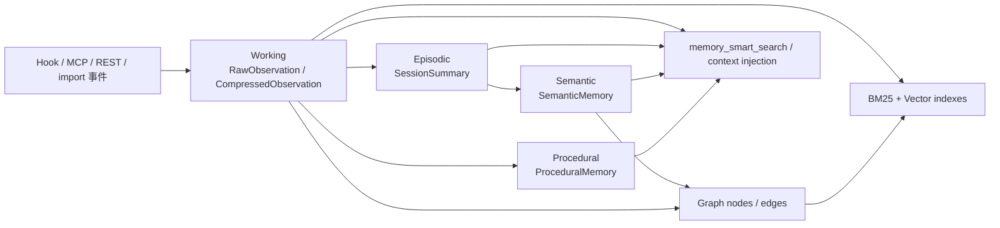
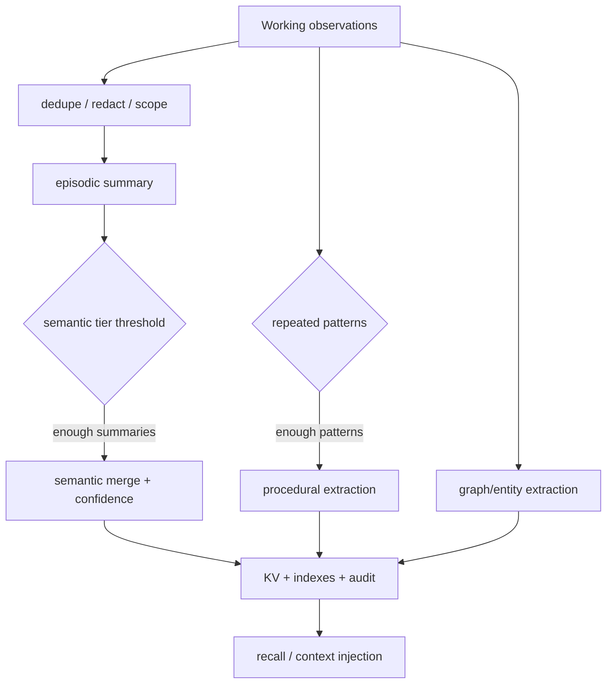

# AgentMemory Memory 分层、固化与检索设计

> **文档定位**：本文只回答一个问题：AgentMemory 如何把编码 Agent 的事件变成可用的长期 Memory，以及四类记忆分别何时产生、存在哪里、如何衰减、怎样检索和如何回溯。
>
> **源码基线**：`/Users/gqli/work/deepagents/agentmemory`，包版本 `@agentmemory/agentmemory` `0.9.30`。关键实现：`src/types.ts`、`src/state/schema.ts`、`src/functions/working-memory.ts`、`src/functions/consolidation-pipeline.ts`、`src/functions/consolidate.ts`、`src/state/hybrid-search.ts`、`src/functions/smart-search.ts`。
>
> **重要校正**：Working / Episodic / Semantic / Procedural 是四类认知功能层，不是“每条记忆严格逐层升级后原对象消失”的线性证据链。Working 和 Episodic 主要描述发生过什么，Semantic 描述稳定事实，Procedural 描述可复用做法；它们可以并存，且实际 KV namespace 不同。

## 目录

1. [分层总览](#1-分层总览)
2. [从 Hook 事件到四类记忆](#2-从-hook-事件到四类记忆)
3. [四层的物理形态与契约](#3-四层的物理形态与契约)
4. [完整业务例子：ClickHouse 到 MySQL](#4-完整业务例子clickhouse-到-mysql)
5. [Consolidation 固化管线](#5-consolidation-固化管线)
6. [Recall：三流混合检索](#6-recall三流混合检索)
7. [衰减、冲突、版本与删除](#7-衰减冲突版本与删除)
8. [分层设计规则与常见误区](#8-分层设计规则与常见误区)
9. [与 Hindsight 的设计对比](#9-与-hindsight-的设计对比)

---

## 1. 分层总览

### 1.1 一张图看清四类记忆



### 1.2 四层不是四张“同构表”

| 层级 | 回答的问题 | 当前源码类型 | KV namespace | 生成方式 | 主要生命周期 |
|---|---|---|---|---|---|
| Working | 刚刚发生了什么？ | `RawObservation`、`CompressedObservation` | `mem:obs:{sessionId}`、`mem:sessions` | Hook 即时捕获；可压缩、脱敏、去重 | 会话内热数据；可被 session sweep/eviction 管理 |
| Episodic | 这一轮/这次会话发生了什么？ | `SessionSummary` | `mem:summaries` | SessionEnd 或恢复路径的摘要 | 跨会话保留，按 session/project 关联 |
| Semantic | 项目长期知道什么？ | `SemanticMemory` | `mem:semantic` | 多个 summary 达到阈值后由 LLM 合并 | 由 access、reinforcement、decay 管理 |
| Procedural | 下次应该怎样做？ | `ProceduralMemory`，以及 `Memory(type=workflow/pattern)` | `mem:procedural`、`mem:memories` | 从重复 pattern/行为中提取 | 随频率、strength 和使用情况演进 |

### 1.3 旁路派生对象

四层之外，源码还有不能塞进“四层”表格的对象：

- `GraphNode` / `GraphEdge`：实体、关系、原因、依赖、修复和时间边；来源是 observation IDs；为图检索和关系查询服务。
- `Memory`：`fact`、`preference`、`architecture`、`bug`、`workflow`、`pattern` 等可版本化高层记忆，带 `parentId`、`supersedes`、`isLatest`、`sourceObservationIds`。
- `Lesson` / `Insight` / `Crystal`：后续治理和经验提炼对象；它们不是 SemanticMemory 的别名。
- `EnrichedChunk`、latent embedding、facets、retention score：检索、压缩和运营辅助数据。

因此，“四层”是理解 Memory 的主轴，不代表全部 KV scope。

---

## 2. 从 Hook 事件到四类记忆

### 2.1 原始事件先进入 Working

Hook 会捕获 `session_start`、`prompt_submit`、`pre_tool_use`、`post_tool_use`、`post_tool_failure`、`pre_compact`、subagent、notification、task、stop、`session_end` 等事件。每条 `RawObservation` 至少包含：

```ts
interface RawObservation {
  id: string;
  sessionId: string;
  timestamp: string;
  hookType: HookType;
  toolName?: string;
  toolInput?: unknown;
  toolOutput?: unknown;
  userPrompt?: string;
  assistantResponse?: string;
  eventId?: string;
  origin?: { channel: "user" | "agent" | "tool" | "import" | "shared" };
}
```

系统在写入边界做几件事：

1. 用 `eventId` / `captureKey` 做幂等和重放去重；
2. 对 secrets、token 和敏感字段进行过滤/脱敏；
3. 保留 `origin`，让后续 Semantic/Procedural 继承信任来源；
4. 按 session/project/agent scope 写入；
5. 写入失败时使用 capture inbox/spool 和 retry，避免 Hook 阻塞宿主 Agent。

### 2.2 Working 的压缩形态

`CompressedObservation` 会把原始事件变成适合索引和上下文注入的结构：

```ts
interface CompressedObservation {
  id: string;
  sessionId: string;
  timestamp: string;
  type: ObservationType;
  title: string;
  facts: string[];
  narrative: string;
  concepts: string[];
  files: string[];
  importance: number;
  confidence?: number;
  source?: ObservationSource;
  origin?: Origin;
}
```

Working 不只是“对话文本”。它同时覆盖工具输入/输出、文件读写、命令和错误。`importance` 是事件重要性；`strength` 是长期记忆保留/访问强度，两者不能混写。

### 2.3 事件时序

```mermaid
sequenceDiagram
  participant A as Coding Agent
  participant H as Hook adapter
  participant C as Capture inbox/spool
  participant S as iii-engine KV
  participant X as BM25/Vector/Graph index
  participant T as SessionEnd trigger

  A->>H: prompt / pre-tool / post-tool / error
  H->>C: eventId + payload + origin
  C->>S: dedupe + redact + persist observation
  S->>X: index or enqueue index update
  A->>H: session_end / stop
  H->>T: trigger consolidation
  T-->>A: best effort; 不阻塞主回答
```

---

## 3. 四层的物理形态与契约

### 3.1 Working Memory

Working 是高频写入层。保留完整原始事件和一份可检索/可注入的压缩观察。它适合回答“刚才哪个工具失败”“本轮改了哪些文件”，不适合直接当作稳定项目规则。

关键字段：`sessionId`、`hookType`、`timestamp`、`toolName`、`files`、`concepts`、`importance`、`origin`、`eventId`、`source`。

一个真实事件在 Working 中通常同时有原始记录和压缩记录。下面是同一条 `PostToolUse` 事件的示意；字段名以当前类型定义为准：

```json
{
  "rawObservation": {
    "id": "obs_001",
    "sessionId": "sess_01",
    "timestamp": "2026-10-01T10:00:00Z",
    "hookType": "post_tool_use",
    "toolName": "bash",
    "toolInput": { "command": "mysql --version" },
    "toolOutput": { "stdout": "mysql  Ver 8.0.36", "exitCode": 0 },
    "eventId": "evt_01",
    "origin": { "channel": "tool" },
    "project": "project:openbackend:dev"
  },
  "compressedObservation": {
    "id": "obs_001_compressed",
    "sessionId": "sess_01",
    "timestamp": "2026-10-01T10:00:00Z",
    "type": "tool_result",
    "title": "确认 MySQL 8.0 已安装",
    "facts": ["运行环境使用 MySQL 8.0.36"],
    "narrative": "Agent 检查数据库运行时版本，命令成功。",
    "concepts": ["MySQL", "运行环境"],
    "files": [],
    "importance": 6,
    "confidence": 0.99,
    "origin": { "channel": "tool" }
  }
}
```

`rawObservation` 用于恢复、审计和重新固化；`compressedObservation` 用于全文/向量索引和有限 token 的上下文注入。脱敏、去重和 scope 判断必须发生在持久化边界，不能只在检索结果展示时做。

### 3.2 Episodic Memory

`SessionSummary` 按 session 组织：

```ts
interface SessionSummary {
  sessionId: string;
  project: string;
  createdAt: string;
  title: string;
  narrative: string;
  keyDecisions: string[];
  filesModified: string[];
  concepts: string[];
  observationCount: number;
}
```

它是会话级故事快照，记录“发生了什么”和关键决策；不是逐事件审计表，也不是 Semantic fact。SessionEnd 失败时，Working 仍是最重要的恢复依据；恢复/eviction 路径可再次处理未完成会话。

### 3.3 Semantic Memory

`SemanticMemory` 记录跨会话稳定事实：

```ts
interface SemanticMemory {
  id: string;
  fact: string;
  confidence: number;
  sourceSessionIds: string[];
  sourceMemoryIds: string[];
  accessCount: number;
  lastAccessedAt: string;
  strength: number;
  createdAt: string;
  updatedAt: string;
  lastDecayedAt?: string;
}
```

Semantic 的 `confidence` 是事实置信度，`strength` 是访问/时间衰减强度。当前固化实现对完全相同事实会提高已有 confidence/access；它不是带完整不可变历史的证据系统。

### 3.4 Procedural Memory

`ProceduralMemory` 记录“遇到触发条件时怎样做”：

```ts
interface ProceduralMemory {
  id: string;
  name: string;
  steps: string[];
  triggerCondition: string;
  expectedOutcome?: string;
  frequency: number;
  sourceSessionIds: string[];
  sourceObservationIds?: string[];
  strength: number;
}
```

它不等价于“所有 workflow 类型的 Memory”。一部分 workflow/pattern 以 `Memory` 对象形式存储，并通过 `isLatest`、版本和父子关系演进；一部分过程规则以 `ProceduralMemory` 存储。

### 3.5 四层对象的完整对应关系

以下 JSON 把同一个“指标存储选型”过程中的四类对象放在一起。它们不是同一个对象被原地改名，而是通过来源 ID 和项目 scope 关联：

```json
{
  "working": {
    "namespace": "mem:obs:sess_01",
    "items": [
      {
        "id": "obs_001",
        "sessionId": "sess_01",
        "content": "ClickHouse 适合高吞吐日志写入，但团队没有运维经验。",
        "importance": 8,
        "concepts": ["ClickHouse", "指标存储", "运维"],
        "origin": { "channel": "tool" }
      },
      {
        "id": "obs_002",
        "sessionId": "sess_01",
        "content": "团队先决定采用 ClickHouse。",
        "importance": 9,
        "concepts": ["技术选型", "ClickHouse"],
        "origin": { "channel": "user" }
      },
      {
        "id": "obs_003",
        "sessionId": "sess_01",
        "content": "运维评估后切换为 MySQL 8.0。",
        "importance": 10,
        "concepts": ["技术选型变更", "MySQL"],
        "origin": { "channel": "user" }
      }
    ]
  },
  "episodic": {
    "namespace": "mem:summaries",
    "sessionId": "sess_01",
    "project": "project:openbackend:dev",
    "title": "指标日志存储选型变更",
    "narrative": "团队评估 ClickHouse 后，因运维经验和事务更新约束切换到 MySQL 8.0。",
    "keyDecisions": ["当前指标日志使用 MySQL 8.0", "暂停 ClickHouse 引入"],
    "sourceObservationIds": ["obs_001", "obs_002", "obs_003"]
  },
  "semantic": {
    "namespace": "mem:semantic",
    "id": "sem_001",
    "fact": "项目当前的指标日志存储使用 MySQL 8.0。",
    "confidence": 0.85,
    "sourceSessionIds": ["sess_01"],
    "sourceMemoryIds": ["obs_003"],
    "accessCount": 0,
    "strength": 1.0
  },
  "procedural": {
    "namespace": "mem:procedural",
    "id": "proc_001",
    "name": "指标存储变更验证",
    "triggerCondition": "修改指标存储后准备合并或部署",
    "steps": ["确认当前架构事实", "运行吞吐与延迟压测", "检查迁移、监控和回滚", "记录决策与结果"],
    "frequency": 3,
    "sourceSessionIds": ["sess_01", "sess_02", "sess_03"],
    "strength": 0.8
  }
}
```

这也解释了为什么不能简单说“Working 升级后删除”：Working 可能因为恢复、证据展开或重新固化继续存在；Episodic 是 session 快照；Semantic 和 Procedural 是跨 session 的派生知识。

---

## 4. 完整业务例子：ClickHouse 到 MySQL

场景：`project:openbackend:dev` 中，Agent 为指标日志选择存储方案。这个例子用来说明：原始事件、会话摘要、语义事实和过程记忆如何并存，以及冲突如何影响检索。

### 4.1 Session 01：Working 事件

| ID | 事件 | 类型 | importance | 来源 |
|---|---|---|---:|---|
| `obs_001` | 查阅 ClickHouse 文档：适合高吞吐写入，不适合高频事务更新 | `web_fetch` / `discovery` | 8 | tool |
| `obs_002` | 团队决定先采用 ClickHouse | `decision` | 9 | user/agent |
| `obs_003` | 运维评估后切换到 MySQL 8.0 | `decision` | 10 | user |
| `obs_004` | MySQL 压测通过，资源转向 MySQL 调优 | `task` / `discovery` | 8 | tool |

这些事件全部先进入 `mem:obs:sess_01`。它们不是四条“最终事实”，而是四个带时间、来源和工具上下文的观测。

### 4.2 SessionSummary：Episodic

```json
{
  "sessionId": "sess_01",
  "project": "project:openbackend:dev",
  "title": "指标日志存储选型变更",
  "narrative": "团队评估 ClickHouse 后，因运维经验和事务更新约束切换到 MySQL 8.0；压测已通过。",
  "keyDecisions": ["当前指标日志使用 MySQL 8.0", "暂停 ClickHouse 引入"],
  "filesModified": ["docs/storage-decision.md", "infra/mysql/"],
  "concepts": ["ClickHouse", "MySQL", "指标日志", "运维"],
  "observationCount": 4
}
```

Episodic 保留 session 级叙事，引用 `sessionId`，但不应该取代 `obs_001` 至 `obs_004`。

### 4.3 Semantic：稳定事实与冲突

固化后可能产生：

| ID | Semantic fact | confidence | 来源 |
|---|---|---:|---|
| `sem_001` | 指标日志当前使用 MySQL 8.0 | 0.85 | `sess_01` |
| `sem_002` | ClickHouse 适合高吞吐写入，但当前项目暂不采用 | 0.75 | `sess_01` |

如果后来 Session 02 出现“由于吞吐增长重新评估 ClickHouse”：

1. 新事件先写 Working；
2. 新 SessionSummary 记录“重新评估”，不直接抹掉旧摘要；
3. Semantic consolidation 增加新来源并提高/降低相应 confidence；
4. 查询“当前指标存储”时必须优先返回带最新 `updatedAt`、project scope 和更高 strength 的事实，同时保留旧事实作为历史上下文；
5. 当前实现的 Semantic 条目主要是原地更新 confidence/access，不应把它描述成 Hindsight 那种完整 immutable version chain。

### 4.4 Procedural：从重复行为提炼做法

多次观察到类似流程后，可以产生：

```json
{
  "id": "proc_001",
  "name": "指标存储变更验证",
  "triggerCondition": "修改指标存储后准备合并或部署",
  "steps": [
    "确认项目 scope 和当前架构事实",
    "运行写入吞吐与查询延迟压测",
    "检查迁移、监控和回滚方案",
    "把决策和压测结果写入 session summary"
  ],
  "frequency": 3,
  "strength": 0.8
}
```

Procedural 是“下次怎么做”的可复用规则，不是某一次 SessionSummary 的复述。

---

## 5. Consolidation 固化管线

### 5.1 总体流程



### 5.2 当前实现的固化边界

当前源码把固化拆成不同 tier/函数，而不是一次必然成功的全链路事务：

- `working`：衰减和原始/压缩观察维护；
- `episodic`：按会话生成摘要；
- `semantic`：通常需要足够的 summary 才合并事实；
- `reflect`：可选的模式/洞察反思；
- `procedural`：从重复 pattern 提取流程；
- graph relation、lessons、insights、crystals 可由独立函数/任务维护。

Consolidation 是否开启取决于配置和 provider；LLM/provider 不可用时，低层 Working 不应因为高层失败而消失。每个概念的 LLM 调用有超时/数量边界，避免单次任务无限放大。

### 5.3 时序

```mermaid
sequenceDiagram
  participant A as Coding Agent
  participant H as Hook
  participant K as iii KV
  participant T as SessionEnd/worker
  participant L as LLM provider
  A->>H: tool/message event
  H->>K: write Working observation
  Note over H,K: only capture-time dedupe/redaction
  A->>H: session_end or recovered session
  H->>T: schedule consolidation
  T->>K: read observations/summaries
  T->>L: summarize / semantic merge / procedural extraction
  L-->>T: structured result
  T->>K: write derived tier + strength/history fields
  T-->>A: best-effort status; main turn not blocked
```

### 5.4 异步失败语义

- 原始事件写入成功不代表 summary、semantic、procedural 已完成；
- session end 崩溃时，Working 是恢复输入，不能宣称“所有高层记忆都丢失”；是否能恢复取决于 session sweep、recovery 和 spool 状态；
- Semantic 与 `Memory` versioned objects 的更新语义不同；前者可能原地更新，后者可生成新版本并标记旧版本非 latest；
- 失败结果要进入 diagnostics/audit/status，不能以空摘要覆盖旧知识。

---

## 6. Recall：三流混合检索

### 6.1 memory_smart_search 的真实路径

```mermaid
sequenceDiagram
  participant A as Agent/MCP
  participant M as mem::smart-search
  participant B as BM25 index
  participant V as Vector index
  participant G as GraphRetrieval
  participant R as optional reranker
  participant K as KV
  A->>M: query, limit, project/session/agent filters
  M->>B: keyword candidates
  M->>V: query embedding + vector candidates
  M->>G: entity expansion + graph candidates (best effort)
  B-->>M: ranked stream
  V-->>M: ranked stream
  G-->>M: ranked stream
  M->>M: weighted RRF + agreement bonus
  M->>M: session diversification (max 3/session)
  M->>K: hydrate observations or Memory records
  opt RERANK_ENABLED=true
    M->>R: rerank top window
  end
  M-->>A: compact hits + source IDs; expandIds returns details
```

### 6.2 三路和排序规则

1. BM25/关键词：文件名、函数名、错误码、技术术语；
2. Vector：embedding 语义相似度；provider 不可用时可退化为 BM25-only；
3. Graph：实体查询和从 top vector observations 的一跳扩展，属于 best effort；
4. weighted RRF：`RRF_K=60`，按配置权重融合；多流命中有小幅 agreement bonus；
5. session diversification：默认每 session 最多 3 条，避免一个会话占满结果；
6. optional rerank：仅在 `RERANK_ENABLED=true` 时对头部窗口重排，失败回退 fused results；
7. smart-search 可按 project、agent scope、session 和 includeLessons 过滤；结果可通过 `expandIds` 下钻完整观察。

### 6.3 四类记忆如何进入检索

基础 hybrid index 主要命中 observation/Memory 记录；`memory_smart_search` 还可以并行召回 lessons。SessionSummary、SemanticMemory、ProceduralMemory 是否进入某一入口取决于对应函数和索引注册，不应简单宣称“四层都永远在同一个池中”。

---

## 7. 衰减、冲突、版本与删除

### 7.1 strength 与 confidence 不同

- `importance`：单个事件在捕获时的重要性；
- `confidence`：Semantic 或压缩结果对内容正确性的判断；
- `strength`：访问、时间和固化策略影响的保留强度；
- `frequency` / `reinforcements`：过程、lesson、insight 被重复观察或强化的次数。

当前 `applyDecay` 会按 `decayDays` 计算周期衰减，并把 strength 下限限制在 0.1；访问和重复命中可强化某些对象。不要把 strength 当作事实真伪证明。

### 7.2 冲突处理

冲突检测通常发生在 consolidation，而不是每个 Hook 写入时。对 SemanticMemory，当前实现可能找到相同 fact 后更新 `accessCount`、`lastAccessedAt`、`confidence`、`strength`；这不是完整的 candidate/verified/rejected 分支系统。对 `Memory` 对象，`version`、`parentId`、`supersedes`、`isLatest` 提供更明显的演进链。

### 7.3 删除与审计

forget、session delete、eviction、auto-forget 和导入替换会影响 observation、索引、图来源和派生对象。删除前应：

1. 记录 audit；
2. 标记 capture event 已删除，防止同一 event replay 再写入；
3. 从 observation/session index、BM25/vector pending、graph source IDs 清理或重建；
4. 检查 Memory、Lesson、Insight、Procedural 的 source IDs；
5. 更新 health/status，确认没有 stale index。

---

## 8. 分层设计规则与常见误区

### 8.1 五条设计规则

1. **先保存事件，再生成知识**：高层固化失败不能吞掉 Working；
2. **四层并行，不要伪造线性升级**：Episodic 不会让 Working 自动不存在；
3. **来源优先**：每个 summary/fact/procedure 都应保留 session、observation、project 或 graph source；
4. **scope 必须显式**：project、session、agent、team shared/private 不应依赖 prompt 约束；
5. **检索分层输出**：compact 结果用于快速注入，expand 用于需要证据时的下钻。

### 8.2 常见误区

- 把 `Memory`、`SemanticMemory`、`ProceduralMemory` 当作同一个表；
- 把 `importance`、`confidence`、`strength` 当作同一个“置信度”；
- 把 session_end 说成必然成功的单个全局事务；
- 把 hybrid search 的 RRF 说成必然有 CrossEncoder；当前 rerank 是可选配置；
- 把 file state backend 简化成“SQLite better-sqlite3”，忽略 iii-engine file/Redis 选择；
- 把自动捕获等同于“全部内容都适合长期记忆”；事件仍需脱敏、scope 和 retention 治理；
- 把删除一个 observation 说成只删一条 KV，实际还会影响索引、图和 provenance。

## 9. 与 Hindsight 的设计对比

本节是选型和边界说明，不表示 AgentMemory 兼容或实现了 Hindsight 的全部机制。

| 维度 | AgentMemory | Hindsight |
|---|---|---|
| 记忆组织 | Working / Episodic / Semantic / Procedural 四类功能层并行存在 | 更强调原始证据到高层抽象的证据链 |
| 写入时机 | Hook 事件发生即捕获，允许中间事件进入 Working | 常在 Agent step 闭环后提交客观事实/经验 |
| 固化策略 | 会话生命周期、恢复任务和配置驱动；可选 LLM/provider | 更偏证据增量后的持续归纳与反思 |
| 检索 | BM25 + Vector + Graph，weighted RRF `k=60`、session diversification、可选 rerank | 常见设计是分层召回，叠加时间/图信号，RRF 后精排 |
| 证据保留 | 原始 observation 可受 retention/eviction 影响；Memory 提供来源 ID 和部分版本链 | 通常把原始证据和抽象版本作为长期可审计对象 |
| 冲突更新 | SemanticMemory 可能原地更新 confidence/access；`Memory` 可用 `supersedes` 演进 | 更强调生成新版本、保留旧版本和证据链 |
| 适用场景 | 本地编码 Agent、多 Agent 共享、低接入成本、自动 Hook | 强审计、长期证据保全、复杂反思和高精度生产知识库 |

一句话选择：AgentMemory 优先降低编码 Agent 的接入和实时采集成本；Hindsight 优先保证证据链、增量反思和长期可审计性。两者的“分层”名称相似，但对象边界、固化触发和保留语义不能互换。

## 附录：一页速查

```text
Hook event
  → RawObservation / CompressedObservation (Working)
  → SessionSummary (Episodic)
  → SemanticMemory (stable fact)
  → ProceduralMemory / Memory workflow (reusable method)
  → BM25 + Vector + Graph + optional rerank
  → compact search result
  → expandIds for source evidence
```
