# AgentScope 架构与设计（完整版）

| 项 | 说明 |
|----|------|
| **文档类型** | 单一 canonical 设计规格（本文） |
| **源码** | `agentscope/src/agentscope/` |
| **版本** | AgentScope v2 `main` |
| **ReMe** | 另读 [REME_ARCHITECTURE.md](./REME_ARCHITECTURE.md)（不在本文） |
| **架构图集** | 速览 [ARCHITECTURE_DIAGRAMS.md](./ARCHITECTURE_DIAGRAMS.md)；**完整模块设计图+时序图** [MODULE_ARCHITECTURE_ATLAS.md](./MODULE_ARCHITECTURE_ATLAS.md) |
| **v2 边界** | 子 Agent / LTM / 持久化 → 本文 [Part · Agent 边界](#part-ltm) + Memory §15 |

---

## 怎么读（只看这一份即可）

1. 先看 **[模块架构全集](./MODULE_ARCHITECTURE_ATLAS.md)**（§0 清单核对 + 每模块设计图/时序图，含 **MessageBus** §C4）；速览见 [ARCHITECTURE_DIAGRAMS.md](./ARCHITECTURE_DIAGRAMS.md)。  
2. 再点 **[全局类图与 reply 全景](#architecture-map)**（对象词典 + 类图 + `reply` 细时序）。  
3. 读 **[总览](#part-overview)** 分层与三条数据平面。  
4. 做 Agent / SDK：**[库内核](#part-kernel)** §4 ReAct + **[Memory](#part-memory)** §7–§9。  
5. 做服务 / 飞书 / SSE：**[App](#part-app)** 全文。  
6. Skill / SOP / 语音 / A2A：**[扩展模块](#part-extensions)**。  
7. 其余 Part 按需查表。

**仓库里不要再找** `ARCHITECTURE.md`、`MEMORY_SYSTEM.md` 等——已全部并入本文；目录说明见 [README.md](./README.md)。

## 总目录

- [**模块架构全集**](./MODULE_ARCHITECTURE_ATLAS.md) — 全覆盖清单 + 设计图/时序图（含 MessageBus）
- [架构图速览](./ARCHITECTURE_DIAGRAMS.md) — 一页摘要 + 链到全集
- [Part · 总览（先看）](#part-overview) — 入口：[全局类图与 reply 全景](#architecture-map) · [图集 §1–§3](./ARCHITECTURE_DIAGRAMS.md#global-context)
- [Part · 库内核与模块](#part-kernel)
- [Part · Session · Message · Memory](#part-memory)
- [Part · Middleware（Hook）](#part-middleware)
- [Part · App · Channel · 生产运行时](#part-app)
- [Part · Workspace 与沙箱](#part-workspace)
- [Part · RAG 与知识库](#part-rag)
- [Part · GoalPipeline 编排](#part-pipeline)
- [Part · 扩展模块（Skill / Team / SOP / 语音 / A2A…）](#part-extensions)
- [Part · Agent 边界与长期记忆](#part-ltm)
- [**主题地图与文档缺口**](./TOPICS_AND_GAPS.md) — Loop / 队列 / steer / Plan / Goal / 多 Agent 等与主文档对照
- [**运行时送模文案**](./PROMPTS_CATALOG.md) — 中文示例 messages 正文
- [附录 · 实现参考全文](#附录-reference-full)（类图检索，日常可跳过）

---

## Part · 总览 {#part-overview}

> **图**：[全集 §A](./MODULE_ARCHITECTURE_ATLAS.md#a-global) · [§0 清单](./MODULE_ARCHITECTURE_ATLAS.md#module-inventory)

### 分层

| 层 | 包 | 职责 |
|----|-----|------|
| **库** | `agentscope/`（无 `app`） | 单 `Agent` ReAct、`AgentState`、Tool、Permission、Middleware |
| **App** | `agentscope.app/` | `ChatService.run`、Storage、MessageBus、Channel、Team |
| **应用** | 你的产品代码 | GoalPipeline、RAG 策略、ReMe 集成 |

### 三条数据平面

| 平面 | 载体 | 真源？ |
|------|------|--------|
| 推理 | `context` + `summary` + system | turn 内内存；turn 末写入 `SessionRecord.state` |
| 持久 | Storage 消息 + state | 断点续聊、历史列表 |
| 观测 | MessageBus → SSE | 仅进度；可丢 |

---
## 全局一张图（摘要）

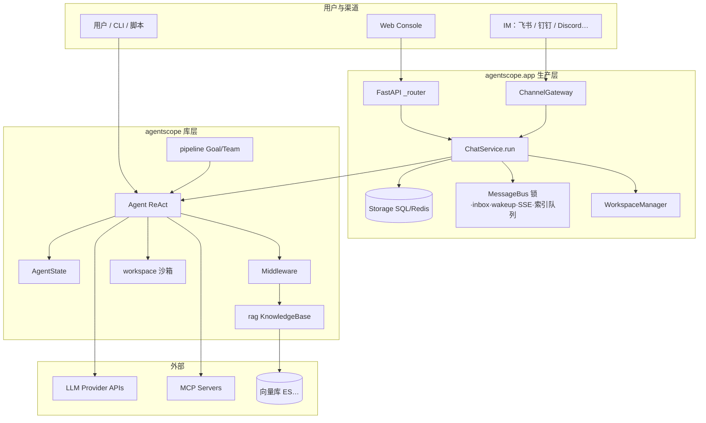

### 全局类图与 reply 全景 {#architecture-map}

> 读其它章节前先过本节：**每个类干什么**、**一次 `reply()` 谁调谁**、**和 App 怎么叠在一起**。

#### A. 对象词典（库层 · 运行时）

| 对象 | 包 | 干什么 | 生命周期 |
|------|-----|--------|----------|
| **`Agent`** | `agent` | 唯一 ReAct 调度器；对外 `reply` / `reply_stream` | 进程内实例，不自动序列化 |
| **`AgentState`** | `state` | 可持久化的「记忆」：`context`、`summary`、`reply_context`、权限/工具/任务上下文 | 随 Storage 或 `model_dump_json` |
| **`Msg`** | `message` | 一条消息；`content` 里是 `TextBlock` / `ToolCallBlock` / `ToolResultBlock` / `DataBlock`… | 在 `state.context` 里累积 |
| **`ChatModelBase`** | `model` | 调 LLM：`__call__(messages, tools)` 流式返回 `ChatResponse` | Agent 构造时注入 |
| **`Toolkit`** | `tool` | 注册工具、MCP、Skill 组；`call_tool` 执行 | Agent 构造时注入 |
| **`ToolBase`** | `tool` | 单个工具（内置 / MCP 代理 / 函数包装） | 挂在 Toolkit |
| **`PermissionEngine`** | `permission` | 对每次 tool call 判 ALLOW / DENY / ASK | 读 `state.permission_context` |
| **`MiddlewareBase`** | `middleware` | 在 reply / reasoning / acting 等点插逻辑（RAG、ReMe、TTS…） | 列表挂在 Agent |
| **`AgentEvent`** | `event` | 流式观测：Thinking、Text、ToolCall、HITL、ReplyEnd… | **不**当记忆真源 |
| **`Offloader` / `WorkspaceBase`** | `workspace` | 大内容落盘、沙箱文件系统 | 可选挂在 Agent |
| **`PipelineProtocol`** | `pipeline` 等 | 也实现 `reply_stream` 的编排器（Goal、Team、SOP） | 替代「单个 Agent」入口 |

**没有**独立的 `Session` / `Memory` 类：会话 = **`AgentState` +（可选）App `SessionRecord`**。

#### B. 库层核心类图（组合关系）

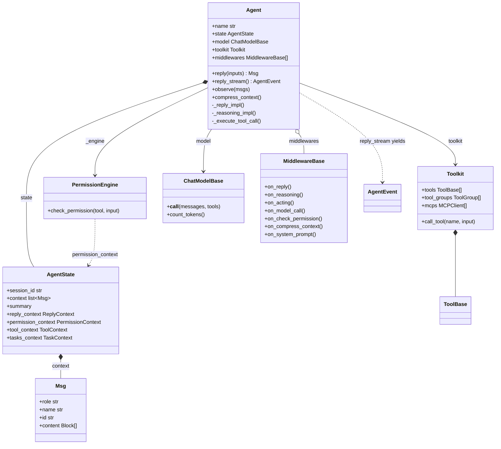

#### C. `Agent` 内部：方法分层（读源码时的地图）

| 层级 | 方法 | 作用 |
|------|------|------|
| **公开** | `reply` / `reply_stream` | 入口；`reply` = 消费完整 `_reply` 流，取最终 `Msg` |
| **公开** | `observe` | 只 `_handle_incoming_messages` 写 `context`，不跑 ReAct → [Memory §6.2.2](#observe-when) |
| **公开** | `compress_context` | token 超限则 LLM 摘要 → 写入 `summary`，旧 Msg 从 context 删除 |
| **Middleware 壳** | `_reply` | 洋葱包装 `on_reply`，再进 `_reply_impl` |
| **主循环** | `_reply_impl` | 处理输入事件 → `ReplyStart` → while `cur_iter < max_iters` |
| **分支** | `_check_next_action` | 返回 **reasoning** / **acting** / **exit**（有挂起 tool 则 exit） |
| **推理** | `_reasoning_impl` | `on_reasoning` → 压缩 → `_prepare_model_input` → `on_model_call` → 解析 tool_calls 写入 context |
| **行动** | `_acting_impl` / `_execute_tool_call` | `on_check_permission` → `on_acting` → `Toolkit.call_tool` → ToolResult 写入 context |
| **送模** | `_prepare_model_input` | `SystemMsg` + `summary` + `context`（system 不进 context 列表） |

配置对象（非循环主体）：`ReActConfig`（`max_iters`）、`ContextConfig`（压缩阈值）、`ModelConfig`（重试/fallback）、`InjectionConfig`（时间/tasks 注入）。

#### D. 一次 `reply(UserMsg)` 时序（默认 + Middleware）

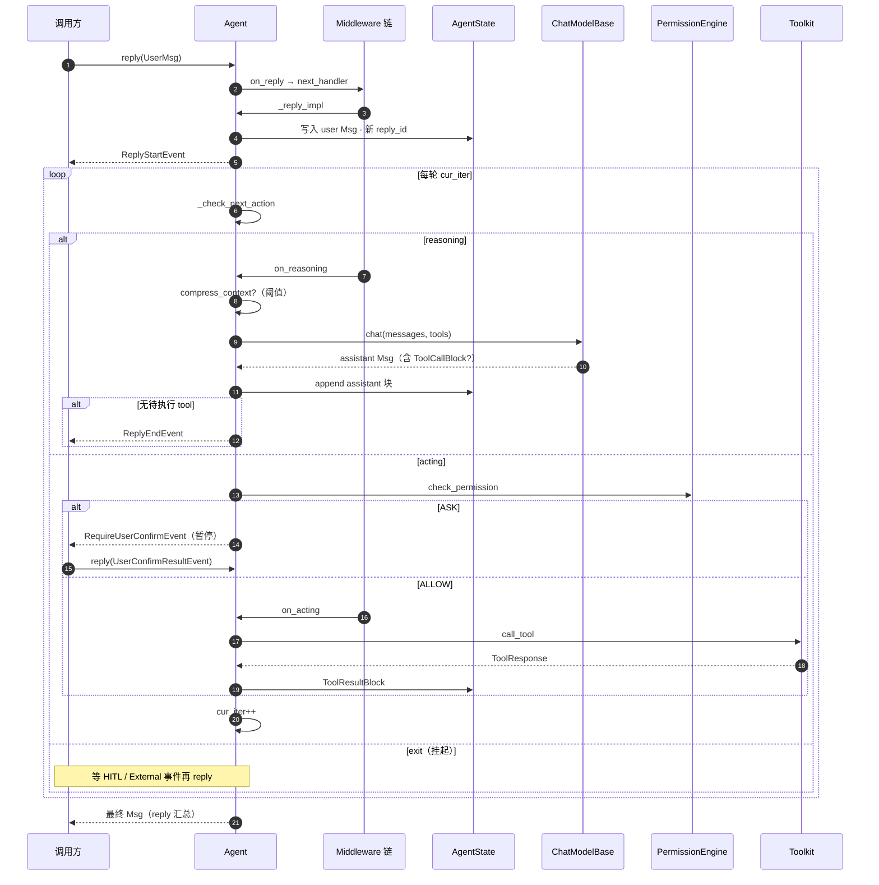

HITL / 外部工具：reply **暂停**在 `exit`；用 **`UserConfirmResultEvent`** 或 **`ExternalExecutionResultEvent`** 再次调用 `reply`，从同一 `reply_id` 继续。

#### E. 叠加 App 生产路径（类 + 流程）

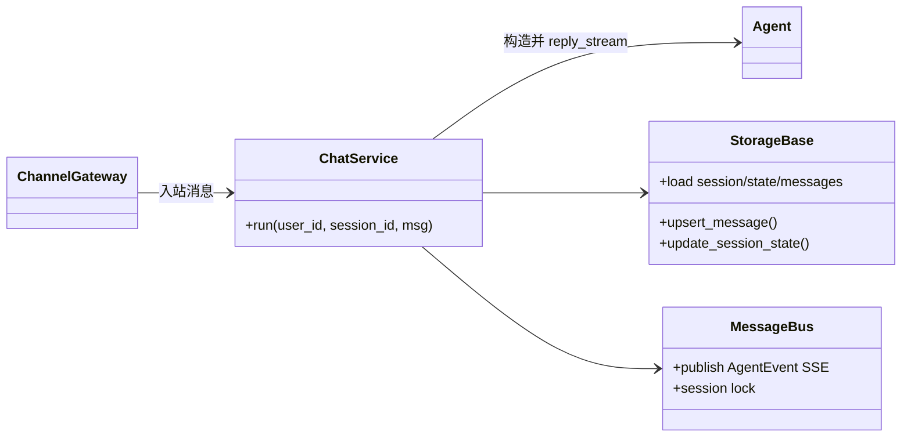

```text
Channel/HTTP → ChatService.run
  → Storage 加载 SessionRecord + 历史 Msg → 灌入 agent.state
  → agent.reply_stream(user_msg) → MessageBus（SSE，可丢）
  → turn 结束 _persist：upsert_message + update_session_state
```

细节：[Part · App](#part-app) §4–§5；记忆边界：[Part · Memory](#part-memory) §15。

#### F. 和文档其它章节的对应

| 想深挖 | 章节 |
|--------|------|
| ReAct 分支表、送模 L 投影 | [库内核 §4](#part-kernel) |
| `context` 逐步变化实例 | [Memory §8](#part-memory) |
| 压缩 / Offloader | [Memory §9–§12](#part-memory) |
| Middleware 清单 | [Middleware](#part-middleware) |
| Team / SOP / 语音 | [扩展模块](#part-extensions) |

#### G. 架构图集（全局 + 分模块）

类图与时序以本节 A–E 为准；**系统级与各模块完整设计图/时序图** 见 **[MODULE_ARCHITECTURE_ATLAS.md](./MODULE_ARCHITECTURE_ATLAS.md)**（[速览](./ARCHITECTURE_DIAGRAMS.md)）：

| 图 | 内容 |
|----|------|
| [§0 模块清单](./MODULE_ARCHITECTURE_ATLAS.md#module-inventory) | 库 + App 全覆盖核对表 |
| [§A 全局/E2E](./MODULE_ARCHITECTURE_ATLAS.md#a-global) | 上下文、嵌入 vs App、数据平面 |
| [§B 库层](./MODULE_ARCHITECTURE_ATLAS.md#b-lib) | message…pipeline、扩展 |
| [§C App](./MODULE_ARCHITECTURE_ATLAS.md#c-app) | ChatService、**MessageBus §C4**、Channel、Team… |
| [§D LTM](./MODULE_ARCHITECTURE_ATLAS.md#d1-ltm) | 窗口 vs ReMe |

---

### 本文内阅读路径

| 你要设计… | 读 Part |
|-----------|---------|
| 整体 + Loop + 模块 | kernel |
| Session / Message / Memory / 压缩 | memory |
| Hook | middleware |
| HITL | kernel §6 + memory §7 + app §4 |
| App / Channel / SSE | app |
| 沙箱 / RAG / 验收环 | workspace · rag · pipeline |
| Skill / SOP / 语音 / A2A | [扩展模块](#part-extensions) |

### 源码包与文档覆盖（`agentscope/src/agentscope/`）

| 包 | 文档 Part |
|----|-----------|
| `agent`（含 `RealtimeAgent`）、`message`、`state`、`event`、`model`、`formatter`、`credential`、`tool`、`permission`、`mcp` | 库内核 · Memory |
| `middleware`、`workspace`、`rag`、`embedding` | Middleware · Workspace · RAG |
| `pipeline` | [Pipeline](#part-pipeline) + [扩展 §2–3](#part-extensions) |
| `skill`、`sop`、`classifier`、`realtime`、`tts`、`asr`、`console`、`tui`、`A2AAgent` | [扩展模块](#part-extensions) |
| `app` | [App](#part-app) |
| ReMe（独立产品） | [REME_ARCHITECTURE.md](./REME_ARCHITECTURE.md) |
| `exception` / `types` / `_utils` | 读源码即可 |

`app/` 子目录（`storage`、`channel`、`hub`、`rag`、`workspace_manager`、`access` 等）在 [App §3 模块地图](#part-app) 有表；不必与顶层包一一同名。

---

## Part · 库内核与模块 {#part-kernel}

> 定位、包结构、ReAct、Model、Tool、Permission、构造与 AgentEvent  
> **图**：[全集 §B2](./MODULE_ARCHITECTURE_ATLAS.md#b2-agent-react)

### 1. 一句话

AgentScope v2 = **消息驱动、全异步** 的单 `Agent` ReAct 框架：`AgentState` 承载记忆，`ChatModelBase` 直接吃 `list[Msg]`，横切靠 **Middleware + Permission + AgentEvent 流**。

---

### 2. 设计定位

| 维度 | 选择 |
|------|------|
| **核心循环** | 单一 `Agent`，`reply` / `reply_stream` 内 reasoning ↔ acting |
| **状态** | `AgentState`：`context` + `summary` + `permission` + `tool` + `tasks` |
| **模型** | `ChatModelBase`；无 v0.x Memory→Formatter 链 |
| **工具** | `Toolkit` + `ToolGroup` + `MCPClient` + Skill |
| **横切** | `MiddlewareBase`（7 钩子）+ `PermissionEngine` |
| **可观测** | `AgentEvent` 流（Thinking/Text/ToolCall/HITL…） |
| **生产部署** | 库本身无 Server → [`app.create_app`](#part-app) 或自建循环 |

---

### 3. 包结构（main 分支）

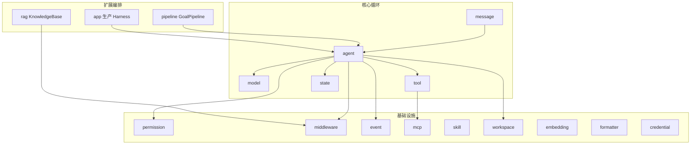

| 模块 | 职责 | 深潜 |
|------|------|------|
| `agent` | ReAct、`compress_context` | 本文 §4 |
| `message` | `Msg` + ContentBlock | 归档 §10 |
| `model` | 多 Provider LLM | 本文 §5 |
| `tool` | 注册、执行、分组 | 本文 §6 |
| `state` | `AgentState` | [Part · Memory](#part-memory) |
| `middleware` | 钩子 + RAG/LTM/TTS… | [MIDDLEWARE_CATALOG](#part-middleware) |
| `workspace` | 沙箱、Offloader | [Part · Workspace](#part-workspace) |
| `pipeline` | `GoalPipeline` | [Part · GoalPipeline](#part-pipeline) |
| `rag` | `KnowledgeBase` | [Part · RAG](#part-rag) |
| `app` | HTTP/Channel/Team | [APP_ARCHITECTURE](#part-app) |

**已移除（v0.x）**：`memory.MemoryBase`、`session.JSONSession`、`pipeline.MsgHub` — 见 [_archive](#附录-reference-full) 历史章节。

---

### 4. ReAct 主循环

#### 4.1 流程

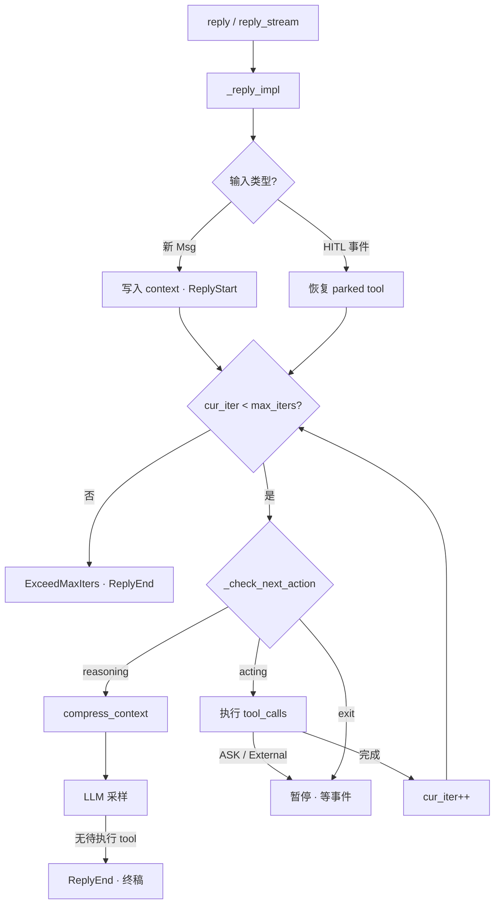

#### 4.2 `_check_next_action`

| 未完成 tool_call | 下一步 |
|------------------|--------|
| 有可执行 (PENDING/ALLOWED) | **acting** |
| 仅等待 (ASKING/SUBMITTED) | **exit**（暂停 reply） |
| 无 | **reasoning** |

#### 4.3 送模输入（L 投影）

逻辑层：`SystemMsg` + 可选 `UserMsg(summary)` + `context` 顺序 extend + `tools`（激活组）。Formatter 再转成 Provider JSON。完整三层说明见 **[Memory §13 送模投影](#model-input-projection)**。

→ 压缩算法：[Part · Memory](#part-memory) §9

#### 4.4 公开 API

| API | 用途 |
|-----|------|
| `await agent(msg)` | 等价 `reply`，返回终稿 `Msg` |
| `agent.reply_stream(...)` | 流式 `AgentEvent \| Msg` |
| `structured_schema=` | 强制结构化终稿（`GoalPipeline` 用） |

源码锚点：`agent/_agent.py` — `_reply_impl`、`_check_next_action`、`_reasoning_impl`、`_execute_tool_call`

---

### 5. Model 模块（设计级）

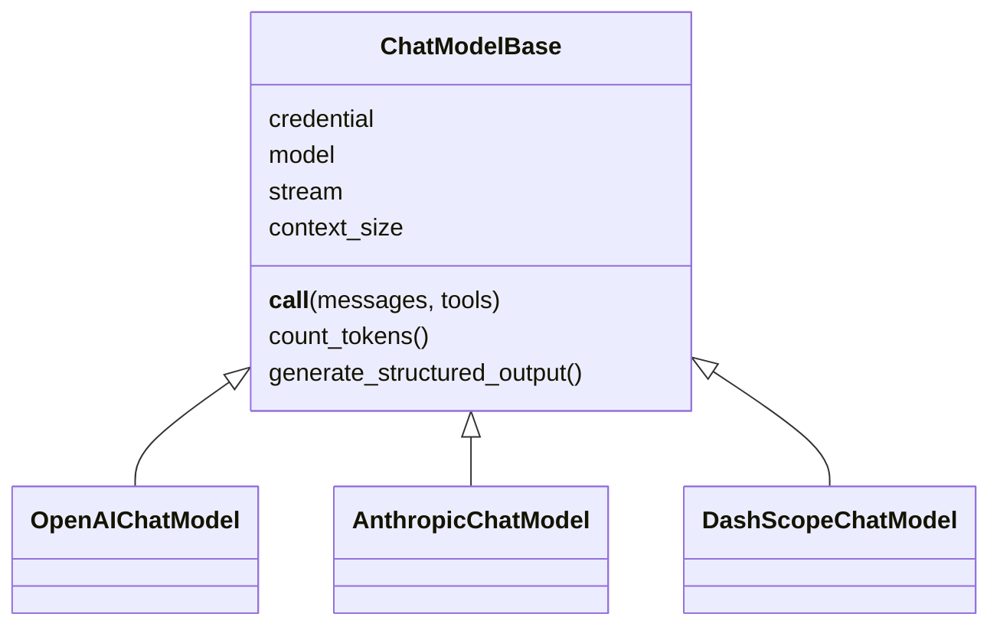

| 能力 | 说明 |
|------|------|
| **流式** | `ChatResponse` chunk → Agent 转为 Block 事件 |
| **Token 计数** | `count_tokens` 驱动 `compress_context` |
| **结构化输出** | `generate_structured_output` / reply 参数 |
| **Credential** | `credential/` 解耦密钥 |

Provider 列表与 YAML 配置：归档 [_archive/ARCHITECTURE.md §5](#附录-reference-full)

---

### 6. Tool · MCP · Permission

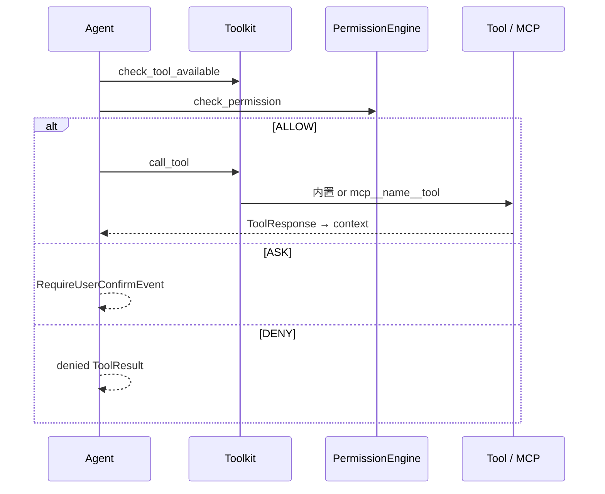

| 主题 | 要点 |
|------|------|
| **注册** | `Toolkit(tools=[...], mcps=[...], tool_groups=[...])` |
| **MCP 命名** | `mcp__{client}__{tool}` |
| **ToolGroup** | `activated_groups` 控制可见工具面 |
| **权限模式** | `DEFAULT` / `EXPLORE` / `ACCEPT_EDITS` / `BYPASS` / `DONT_ASK` |
| **HITL** | `ASK` → `UserConfirmResultEvent`；外部执行 → `ExternalExecutionResultEvent` |
| **Backend** | 内置 Bash/Read/Write/Grep/Glob 走 `BackendBase`（≠ Workspace 本身）→ [§2.1](#workspace-backend-roles) |

---

### 7. Middleware

7 个钩子：洋葱式 `on_reply` / `on_reasoning` / `on_acting` / `on_model_call` / `on_check_permission` / `on_compress_context`；流水线式 `on_system_prompt`。

专用中间件（RAG、LTM、Budget、TTS、Tracing）及 App 层 Inbox/Team：**不重复列举** → [MIDDLEWARE_CATALOG.md](#part-middleware)

---

### 8. 启动与构造（无 `agentscope.init()`）

```python
from agentscope import setup_logger
from agentscope.agent import Agent
from agentscope.model import OpenAIChatModel
from agentscope.credential import OpenAICredential
from agentscope.tool import Toolkit, Bash, Read, Write

setup_logger(level="INFO")

agent = Agent(
    name="Friday",
    system_prompt="You are a helpful assistant.",
    model=OpenAIChatModel(
        credential=OpenAICredential(api_key="..."),
        model="gpt-4o",
        stream=True,
        context_size=128000,
    ),
    toolkit=Toolkit(tools=[Bash(), Read(), Write()]),
)

async for event in agent.reply_stream(user_msg):
    ...
```

| v0.x | v2 |
|------|-----|
| `agentscope.init()` | `setup_logger()` |
| `InMemoryMemory` | `AgentState.context` 自动追加 |
| `JSONSession` | `AgentState.model_validate_json` 或 **app/storage** |
| `Formatter` 组装 | Model 内部处理 `Msg` |

---

### 9. 多 Agent（库层边界）

| 方式 | 机制 | 文档 |
|------|------|------|
| **手动编排** | `await a2.reply(await a1.reply(msg))` / `asyncio.gather` | — |
| **GoalPipeline** | executor + verifier 结构化环 | [Part · GoalPipeline](#part-pipeline) |
| **Team / 子 Agent** | `AgentCreate`、独立 session | [APP_ARCHITECTURE](#part-app) §7 |

核心 `Agent` **无** `children` / `delegate` → [Part · Agent 边界](#part-ltm)

---

### 10. 持久化

```python
## 保存
json_str = agent.state.model_dump_json()

## 恢复
state = AgentState.model_validate_json(json_str)
agent = Agent(..., state=state)
```

- 至少持久化：`context`、`summary`、`session_id`  
- 使用 `Offloader` 时同步拷贝 workspace 目录  
- 生产多实例：**不要**只写本地文件 → `app/storage`  

---

### 11. AgentEvent 与消费者

| 类别 | 例子 |
|------|------|
| **Reply 生命周期** | `ReplyStartEvent`、`ReplyEndEvent` |
| **模型流** | `ThinkingBlock*`、`TextBlock*`、`ToolCall*`、`ModelCallEndEvent` |
| **工具** | `ToolResult*` |
| **HITL** | `RequireUserConfirmEvent`、`RequireExternalExecutionEvent` |
| **提示** | `HintBlockEvent` |

`reply_stream` 消费者：CLI、测试、**App SSE**（经 MessageBus 转发）。

---

### 12. 端到端场景

| 场景 | 路径 |
|------|------|
| 最小 ReAct | 本文 §8 + §4 |
| 带 MCP | §6 + `MCPClient` connect |
| 带压缩 | [Part · Memory](#part-memory) |
| 带 RAG | [Part · RAG](#part-rag) |
| 带沙箱 | [Part · Workspace](#part-workspace) |
| 质量验收环 | [Part · GoalPipeline](#part-pipeline) |
| 飞书/HTTP 服务 | [APP_ARCHITECTURE](#part-app) |
| 语音 Realtime | [扩展 §7](#part-extensions)；深潜 [_archive/REALTIME…](./_archive/REALTIME_AGENT_ARCHITECTURE.md) |

---

### 13. 设计法则

1. **Msg 是一等公民** — 模型、存储、事件都围绕 `Msg` / Block。  
2. **压缩在 reasoning 前** — `compress_context` 每次 reasoning 前调用。  
3. **权限默认经 PE** — 不要绕过 `PermissionEngine` 直接调 tool。  
4. **HITL 是事件** — resume 用 `UserConfirmResultEvent`，不是新 UserMsg 冒充。  
5. **Middleware 可吞 ReplyEnd** — 强制多轮时先理解 `on_reply` 语义。  
6. **库与 App 分层** — Team/Channel/Scheduler 不在 `agent/` 里找。

---

### 14. 深潜与历史

| 需求 | 读哪里 |
|------|--------|
| 完整时序、类图、v0.x A2A/MsgHub/Evaluate | [_archive/ARCHITECTURE.md](#附录-reference-full) |
| Memory 权威 | [Part · Memory](#part-memory) |
| 官方教程 | `docs/tutorial/` · https://doc.agentscope.io/ |

---

## Part · Session · Message · Memory {#part-memory}

> AgentState、压缩、截断、Offloader、持久化  
> **图**：[全集 §B1](./MODULE_ARCHITECTURE_ATLAS.md#b1-message-state)

### 目录

- [1. 三分钟心智模型](#1-三分钟心智模型)
- [2. v2 有什么、没有什么](#2-v2-有什么没有什么)
- [3. 与传统压缩策略对比](#3-与传统压缩策略对比)
- [4. 短期 / 长期 / 外部存储](#4-短期--长期--外部存储)
- [5. MEMORY.md、USER.md、Session？](#5-memorymdusermdsession)
- [6. 数据模型](#6-数据模型)（含 [`AgentState`](#agent-state) 字段与 HITL）
- [7. 端到端流程：reply() 时间线](#7-端到端流程reply-时间线)
- [8. 完整实例：state 属性逐步变化](#8-完整实例state-属性逐步变化)
- [9. 上下文压缩算法](#9-上下文压缩算法)
- [10. summary 固定格式](#10-summary-固定格式)
- [11. 工具结果截断](#11-工具结果截断)
- [12. Offloader 落盘](#12-offloader-落盘)
- [13. 送模投影：`context` → LLM 输入](#model-input-projection)
- [14. 配置与调参](#14-配置与调参)
- [15. 会话持久化](#15-会话持久化)
- [16. 长期记忆与 RAG 扩展](#16-长期记忆与-rag-扩展)
- [17. 反模式](#17-反模式)
- [18. 与 v0.x 的差异](#18-与-v0x-的差异)
- [19. 源码索引与 Middleware](#19-源码索引与-middleware)
- [20. 相关文档](#20-相关文档)

---

### 1. 三分钟心智模型

AgentScope v2 **没有独立的 `memory/` 子包**。所有「记忆」都是 **`Agent` 运行时状态 `AgentState`** 的一部分：

```text
LLM 每次看到的输入 =
    system_prompt（固定，不进 context）
  + summary（可选，压缩后的旧历史）
  + context（当前会话完整近期对话）
  + tool schemas
```

**三件事记住即可**：

1. **当前对话** → 自动写入 `agent.state.context`，无需手动 `memory.add()`。
2. **对话太长** → `compress_context()` 把**头部旧消息**压进 `summary`，**尾部近期**留在 `context`。
3. **断点续聊** → 序列化整个 `AgentState`（至少 `context` + `summary` + `session_id`）。

压缩策略一句话：**去头（压成固定格式 summary）+ 保尾（留近期 context）**，不是传统的「去头去尾、中间压缩」。

---

### 2. v2 有什么、没有什么

#### 2.1 内置能力

| 机制 | 载体 | 解决什么问题 |
|------|------|----------------|
| 对话上下文（短期） | `AgentState.context: list[Msg]` | 用户输入、Assistant 输出、tool_call / tool_result |
| 压缩摘要（中期） | `AgentState.summary` | 被压缩掉的旧历史，结构化续写文本 |
| 上下文压缩 | `ContextConfig` + `compress_context()` | token 超阈值时 LLM 摘要并**物理删除**旧 context |
| 工具结果截断 | `ContextConfig.tool_result_limit` | 防止单次 tool result 撑爆 context |
| 上下文卸载（可选） | `Offloader`（如 `LocalWorkspace`） | 被删/被截断内容落盘，路径写入 summary 或 tool 提醒 |
| 状态序列化 | `AgentState.model_dump_json()` | 应用层自行持久化 |

#### 2.2 已迁出内核的能力（在别的包/Part）

| 能力 | v2 位置 |
|------|---------|
| 生产 Session / 消息历史 | `app/storage` → [Part · App](#part-app) |
| Mem0 / ReMe / Agentic LTM | `middleware/_longterm_memory/` → [Part · Middleware](#part-middleware) |
| 知识库 RAG | `agentscope.rag` → [Part · RAG](#part-rag) |
| v0 `MemoryBase`、mark 过滤 | 已移除；用 `AgentState` + Middleware |

库内**无** Hermes 式 `USER.md` 原语；`AgenticMemoryMiddleware` 可维护工作区 `MEMORY.md` 索引。

---

### 3. 与传统压缩策略对比

很多框架采用 **sliding window** 或 **三段式**：

```text
传统三段式：
[删掉最老 N 条] + [保留最近 M 条] + [中间段 LLM 自由摘要]
或：只保留尾部，头部直接丢弃（无摘要）
```

AgentScope v2 的策略：

```text
context 时间线：
|---- msgs_to_compress（头部旧消息）----|==== 分界 ====|---- msgs_to_reserve（尾部近期）----|
         ↓ LLM 结构化摘要
    state.summary（固定五段格式，覆盖写入）
         ↓ 物理删除
context = msgs_to_reserve only
```

| 维度 | AgentScope v2 | 常见传统方案 |
|------|---------------|--------------|
| 保留段 | **尾部** `reserve_ratio`（默认约 10% context） | 常保留头+尾，或只留尾 |
| 压缩段 | **头部**旧消息 | 常压「中间」或直接丢弃 |
| 压缩产物 | **固定 schema** 的 `summary` 字符串 | 常为自由文本或多段摘要 |
| 旧消息 | 从 `context` **物理删除** | 有的只打 `compressed` mark 仍留 storage |
| 完整备份 | 可选 `Offloader` 写 JSONL | 视框架而定 |

---

### 4. 短期 / 长期 / 外部存储

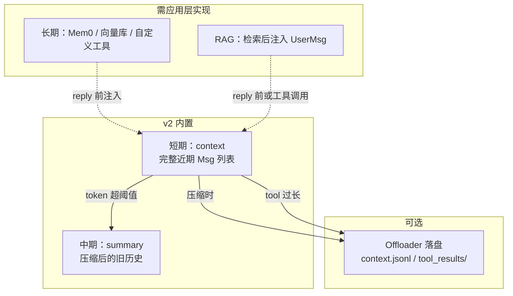

| 类型 | 载体 | 生命周期 | 谁维护 |
|------|------|----------|--------|
| **短期记忆** | `state.context` | 当前会话 | `reply()` 自动 `_save_to_context` |
| **压缩记忆** | `state.summary` | 跨多轮直到下次覆盖 | `compress_context()` 自动 |
| **卸载备份** | workspace 文件 | 磁盘持久 | `Offloader`（可选） |
| **长期记忆** | Middleware（Mem0/ReMe/Agentic） | 跨会话 | [Part · Middleware](#part-middleware) §2 |
| **RAG** | `rag/` + App 索引 | 跨文档 | [Part · RAG](#part-rag) |

**没有「短期类 + 长期类」两个独立子系统**——只有 `AgentState` 上的 context/summary 两层，长期能力需自己接。

---

### 5. MEMORY.md、USER.md、Session？

| 概念 | AgentScope v2 | 说明 |
|------|---------------|------|
| 工作区 `MEMORY.md` | 可选 | `AgenticMemoryMiddleware` 索引注入 |
| `USER.md` 原语 | ❌ | 无内置用户画像文件 |
| `system_prompt` | ✅ | 构造 `Agent` 时传入，**不进 `context`**，每次 reasoning 由 `_get_system_prompt()` 注入 |
| `session_id` | ✅ | `AgentState` 字段；生产会话见 `app/storage` 的 `SessionRecord` |
| v0 `JSONSession` 包 | ❌ | 库层用 `model_dump_json()`；服务用 [Part · App](#part-app) Storage |
| 外部存储 | 可选 | `Offloader` / workspace 备份大内容 |

持久化：仅用库 → 自行序列化 `AgentState`；走 App → `ChatService` turn 末 `_persist`（见 §15）。

---

### 6. 数据模型

#### 6.1 `AgentState` {#agent-state}

**位置**：`agentscope/state/_state.py`（嵌套类型同文件：`ReplyContext`、`ToolContext`、`TaskContext`；`PermissionContext` 在 `permission/_context.py`）。

**定位**：一个 Session 里、一个 Agent 的 **可序列化运行时快照**。库内「记忆 / 进行到哪一轮 / 工具卡在哪 / 权限规则」都挂在这棵树上。走 App 时挂在 `SessionRecord.state`，每轮 `ChatService.run` 收尾 **`update_session_state`** 写回 Storage（见 [§15.1](#151-仅用库-vs-走-app)）。**HITL 挂起与跨进程 resume 的真源也是 `AgentState`**（尤其是 `reply_context` + `context` 尾部），不是 MessageBus/SSE。

```text
AgentState
├── session_id
├── summary                    # 压缩掉的旧历史
├── context: list[Msg]         # 未压缩对话真源（含 tool / Hint）
├── reply_context              # 当前这一轮 reply 的元数据（含 reply_id）
├── permission_context         # 工具权限 mode + allow/deny/ask 规则
├── tool_context               # Read 缓存、activated_groups
├── tasks_context              # 规划类 Task 列表
└── middle_context             # Middleware 跨 reply 的 KV（随 state 持久化）
```

`reply_id`、`cur_iter` 存于 **`reply_context`**，在 `AgentState` 上通过 `@property` 暴露；旧版快照顶层的 `reply_id`/`cur_iter` 加载时会迁入 `reply_context`。

##### 6.1.1 顶层字段

| 字段 | 参与 LLM？ | 作用 |
|------|------------|------|
| **`context`** | ✅（经 `_prepare_model_input`） | **未压缩的近期对话真源**：`UserMsg` 独立一行；同一轮 reply 的 assistant 为 **`id == reply_id` 的一条 `AssistantMsg`**，`content[]` 叠 text / thinking / tool_call / tool_result / `HintBlock` 等。 |
| **`summary`** | ✅（合成额外用户侧摘要） | `compress_context()` 从 `context` **头部删掉**的旧消息压成的结构化摘要（§9）。 |
| **`session_id`** | ❌ | 会话标识；Offloader 路径、日志；与 App `SessionRecord.id` 对齐（run 内会再赋）。 |
| **`reply_context`** | ❌（决定 reply 边界） | 见 §6.1.2；resume 时 `get_message(..., agent.state.reply_id)` 与此处 `reply_id` 一致。 |
| **`permission_context`** | ❌（决定工具能否执行、是否 HITL） | `PermissionEngine`：`mode`、`working_directories`、按工具名的 allow/deny/ask 规则；用户确认后可追加 rule。 |
| **`tool_context`** | ❌（间接） | Read/Write/Edit **文件 LRU 缓存**（按 mtime 失效）、**`activated_groups`**（已打开的工具组）。 |
| **`tasks_context`** | ❌ | `tasks: list[Task]`（subject、状态、依赖等），供任务规划工具。 |
| **`middle_context`** | ❌ | **Middleware 私有** `dict`（如 Budget 按 `reply_id` 累计 token）；**跨 HITL 暂停仍保留**（随 state persist）。 |

##### 6.1.2 `ReplyContext`（挂起 / 续跑）

| 字段 | 作用 |
|------|------|
| **`reply_id`** | 当前进行中的 assistant 回复 ID；= **`context` 里该轮 `AssistantMsg.id`**、Storage **`upsert_message` 主键**、SSE / `UserConfirmResultEvent.reply_id`。新用户 turn 才换新 id。 |
| **`cur_iter`** | 本轮 reply 内 ReAct 已跑拍数；配合 `max_iters`、结构化输出 grace 等。 |
| **`structured_schema`** | 若要求结构化输出，存 Pydantic 模型（持久化为 JSON schema）。 |
| **`structured_output`** | 本轮已产出的结构化 dict；满足后可正常 `ReplyEnd`。 |

挂起时 Agent 以 `Exit(exit_events=None)` 结束（无 `ReplyEnd`），**不**清 `reply_context`、**不**换 `reply_id`；`context` 尾部 assistant 里留有 **`ToolCallState.ASKING`** 或 **`SUBMITTED` 且无 tool_result** 的 call。

##### 6.1.3 嵌套上下文（简表）

| 子对象 | 要点 |
|--------|------|
| **`ToolContext`** | `read_file_cache` + `max_cache_files` / `max_cache_bytes`；`activated_groups`。 |
| **`TaskContext`** | `Task`：`pending` / `in_progress` / `completed`，`blocked_by` 等。 |
| **`PermissionContext`** | `allow_rules` / `deny_rules` / `ask_rules`；**ask → tool 进 `ASKING` → 写入 `context`**。 |

##### 6.1.4 实例方法（写入与 HITL 探测）

| 方法 | 作用 |
|------|------|
| **`append_context(name, blocks)`** | 块挂到 **本 agent、当前 `reply_id`** 的 tail `AssistantMsg`；无则新建 `AssistantMsg(id=reply_id, …)`。Hint、runtime 注入等多走此路。 |
| **`get_awaiting_tool_calls(name)`** | 最后一条本 agent 的 assistant：`ASKING`，或 `SUBMITTED` 且尚无 `tool_result` 的 tool_call。用于 park 判定、跳过 idle wake、App `SessionStatus.AWAITING_*`。 |
| **`has_awaiting_tool_calls(name)`** | 上式布尔封装。 |
| **`get_unfinished_tool_calls(name)`** | 当前 `reply_id` 对应 assistant 上尚无 `tool_result` 的 call（不限状态），供 ReAct 内「本轮还有哪些 call 未收口」。 |

##### 6.1.5 与 Storage 消息表、HITL 续跑 {#agent-state-hitl}

| 存什么 | 载体 | 关系 |
|--------|------|------|
| **推理用轨迹** | **`AgentState.context` + `summary`** | run 开始从 Storage 加载；run 内 Agent 只改内存 state；收尾 **`update_session_state`**。 |
| **列表 / API 展示** | **`upsert_message` 消息行** | 用户一行、assistant 一行（`content` JSON 含 tool/hint）；**`message.id == reply_id`** 的行 = Case B `get_message` 续写对象。 |

理想情况两者同构；**压缩后** `context` 变短而消息表可能仍更长（§8.5.1）。**续跑 / HITL 以 `AgentState` 为准**，不要用 `list_messages` 反推 `context`。

**挂起记什么**：`context[-1]`（本 agent 的 assistant，`id=reply_id`）内 **`ASKING` / `SUBMITTED`** 的 tool_call + **`reply_context.reply_id` 不变**；一并 persist 的还有 `permission_context`、`tool_context`、`middle_context` 等。

**resume 怎么找**：

1. 新 run 持锁 → `get_session` → `Agent(..., state=session_record.state)`。  
2. 输入 `UserConfirmResultEvent` / `ExternalExecutionResultEvent`（带 `reply_id`、tool_call id）。  
3. **Case B**：`get_message(user_id, session_id, agent.state.reply_id)` → `append_event` → 同 `reply_id` 的合成 `ReplyStartEvent` → `reply_stream`（不新建 `reply_context`）。  

App 侧逐步说明：[§4.7 Case B](#chat-service-run) · 队列 [§4.2.2](#inbox-hintblock-example) · park 时跳过 idle wake：`_skip_parked_wakeup`（`app/_service/_chat.py`）。

#### 6.2 `context` 写入规则

| 来源 | 写入方式 |
|------|----------|
| 用户输入 | `_handle_incoming_messages` → `context.append(msg)` |
| 模型输出 | `_save_to_context` → 追加到最后一条同名 `AssistantMsg.content` |
| 工具结果 | acting 完成后 `_save_to_context([ToolResultBlock])` |

**同一 reply 周期**：`AssistantMsg.id == state.reply_id`，thinking / text / tool_call / tool_result 都在同一 `AssistantMsg.content` 列表中。

**输入限制**：仅接受 `role` 为 `user` 或 `assistant` 的 `Msg`，且不得含 `tool_call` / `tool_result` / `thinking` 块（这些由框架内部写入）。

#### 6.2.1 完整示例：一轮带工具调用的 `reply` 后 `context` 长什么样 {#context-weather-single-reply}

下面用 Agent `name="Friday"`、用户问「北京今天天气？」、模型先调 `get_weather` 再给文字总结，说明 **`context` 列表**如何一步步变（`summary` 仍为空；`system_prompt` **不在** `context` 里）。

**调用**

```python
await agent.reply(UserMsg("北京今天天气怎么样？"))
# 内部：新 reply_id = "r-001"，cur_iter 从 0 递增
```

**步骤 0 — `reply` 开始前**

```text
state.context = []
state.reply_id = "r-001"   # 位于 reply_context
```

**步骤 1 — `_handle_incoming_messages`（用户输入）**

规则：合法 `UserMsg` **整条 append** 为新列表元素（独立一条 `Msg`）。

```text
state.context = [
  UserMsg(id="u-1", content=[TextBlock("北京今天天气怎么样？")]),
]
```

**步骤 2 — 第 1 次 reasoning（`_reasoning_impl`）**

模型流式产出 `ThinkingBlock`、一段 `TextBlock`、一个 `ToolCallBlock`；每次 `_save_to_context` 走 `AgentState.append_context`：

- 若最后一条不是「本 agent、本 `reply_id`」的 assistant → **新建** `AssistantMsg(id=reply_id, name="Friday", …)`
- 否则 → **往该条的 `content` 里 extend**

```text
state.context = [
  UserMsg(...),
  AssistantMsg(
    id="r-001",
    name="Friday",
    content=[
      ThinkingBlock("需要先查天气 API…"),
      TextBlock("我先查一下北京的天气。"),
      ToolCallBlock(id="tc-1", name="get_weather", input={"city": "北京"}, state=PENDING),
    ],
  ),
]
```

**步骤 3 — acting（`_execute_tool_call`）**

权限 ALLOW 后执行工具；结果通过 `_save_to_context([ToolResultBlock(...)])` **追加到同一条** `AssistantMsg.content`（仍在 `id="r-001"` 上）。

```text
state.context = [
  UserMsg(...),
  AssistantMsg(
    id="r-001",
    name="Friday",
    content=[
      ThinkingBlock(...),
      TextBlock("我先查一下北京的天气。"),
      ToolCallBlock(id="tc-1", ..., state=FINISHED),
      ToolResultBlock(id="tc-1", name="get_weather", output="晴，12°C"),
    ],
  ),
]
```

**步骤 4 — 第 2 次 reasoning（无新 tool）**

模型只输出最终 `TextBlock`；仍 **extend 同一** `AssistantMsg`，不新建 user/assistant 行。

```text
state.context = [
  UserMsg(...),
  AssistantMsg(
    id="r-001",
    name="Friday",
    content=[
      ThinkingBlock(...),
      TextBlock("我先查一下北京的天气。"),
      ToolCallBlock(...),
      ToolResultBlock(...),
      TextBlock("北京今天晴，气温约 12°C，适合外出。"),
    ],
  ),
]
```

**步骤 5 — `ReplyEnd`**

`reply()` 返回的终稿 `Msg` 通常是这条 `AssistantMsg`（或其中最后一段文本的视图）。**本轮只有 2 条顶层 `Msg`**：1 user + 1 assistant（assistant 的 `content` 里有多类 block）。

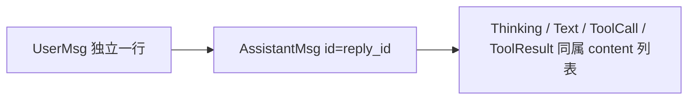

#### 6.2.2 `observe()`：写什么、何时用 {#observe-when}

**定义**（`agent/_agent.py`）：`observe(msgs)` 只调用 `_handle_incoming_messages`，**不**进入 `_reply_impl`——不调模型、不分配新 `reply_id`、不产生 `AssistantMsg`。

| | `reply(UserMsg)` | `observe(UserMsg)` |
|---|------------------|---------------------|
| 写 `context` | ✅ 用户行 append | ✅ 同样规则 append |
| 跑 ReAct | ✅ | ❌ |
| 新 `reply_id` / assistant 行 | ✅ | ❌ |
| 消耗 LLM | ✅ | ❌ |

**写入形状**：与 `reply` 开头相同——合法 `UserMsg`（或不含 tool/thinking 的 `assistant` 行）作为 **新的顶层列表项**，**不会**写入上一条 `AssistantMsg.content`。

**示例：先聊完一轮，再观测一条，再提问**

```text
# 已执行 await agent.reply(UserMsg("北京天气？")) 之后
context = [ UserMsg("北京天气？"), AssistantMsg(id=r-001, ...) ]

await agent.observe(UserMsg("【系统】用户已切换到北京时区"))

context = [
  UserMsg("北京天气？"),
  AssistantMsg(id=r-001, ...),
  UserMsg("【系统】用户已切换到北京时区"),   # 第 3 行，独立 user
]

await agent.reply(UserMsg("那现在适合出门吗？"))  # 第 4 行 user + 新的 AssistantMsg(r-002)
```

**什么时候用 `observe`**

| 场景 | 做法 |
|------|------|
| **多 Agent 手写编排** | A `reply` 完后，把要给 B 看的结论用 `observe` 写入 B 的 `context`，再 `B.reply(用户话)` |
| **环境/状态批量推送** | 多次 `observe` 更新上下文，**不**每次推送都触发推理（省 token、避免自言自语） |
| **预灌历史** | 从外部恢复会话：循环 `observe` 历史 user/assistant 纯对话，再 `reply` |
| **测试** | 构造特定 `context` 形状后再 `reply` |

```python
await agent.observe(UserMsg("同事 Alice：方案已定稿 v3"))
await agent.observe(UserMsg("系统：当前用户在北京"))
await agent.reply(UserMsg("根据上面信息，帮我写邮件"))
```

**什么时候通常不用**

| 场景 | 更常见的做法 |
|------|----------------|
| App **`ChatService` 用户发一句** | 直接 `reply_stream(user_msg)`（用户输入即本轮 trigger，无需先 `observe`） |
| Team / 渠道 inbox | 下一轮 `run` 时由 **inbox** 注入输入，而非对内存 Agent 调 `observe` |
| RAG / ReMe | **Middleware** 注入（Hint、`on_reasoning`） |
| 需要立刻 assistant 回复 | **`reply` / `reply_stream`** |

**和 `A2AAgent.observe` 的区别**：远程 `A2AAgent` 的 `observe` **不写** `context`，而是追加到 **`A2AAgentState.observed_context`**，在 **下一次** `reply` 时与输入一并发给远端，发送后清空。语义仍是「先记着、下次再推理」，但存储位置不同（见 [扩展 §5](#part-extensions)）。

**判断口诀**：要 **马上** 出 assistant（含工具）→ `reply`；只让 **以后的** `reply` 多读几条 user/assistant 行、现在不调模型 → `observe`。

**错误用法（会 `ValueError`）**

```python
# ❌ 手工构造带 tool_call 的「用户消息」塞进 reply
await agent.reply(UserMsg(content=[ToolCallBlock(...)]))

# ❌ 在 reply 里塞 system
await agent.reply(SystemMsg("你是助手"))
```

**Middleware 注入**：`ReMeMiddleware` 自动检索用 **`HintBlock`**（`on_reasoning` → 顶层 `name="memory"`）；**QwenPaw** 用 **`on_model_call` 合成 `memory_search` tool 轨迹**、不进 `context` —— 见 [REME §9.1–9.2](./REME_ARCHITECTURE.md#91-agentscope-集成读写时机与-rememiddleware)。Hint 与送模见 **[§13.8](#hintblock-生产者与送模)**、**[§13.9](#on-model-call-transient-messages)**。

#### 6.3 `ContextConfig` 默认值

**位置**: `agent/_config.py`

```python
class ContextConfig(BaseModel):
    trigger_ratio: float = 0.8      # 0 < x < 0.9
    reserve_ratio: float = 0.1        # 0 < x < 0.9
    compression_prompt: str = ...
    summary_template: str = ...
    summary_schema: dict = SummarySchema.model_json_schema()
    tool_result_limit: int = 3000
```

| 字段 | 默认 | 含义 |
|------|------|------|
| `trigger_ratio` | `0.8` | `count_tokens` ≥ 该比例 × `model.context_size` 时触发压缩 |
| `reserve_ratio` | `0.1` | 压缩时从**尾部**保留约该比例的 context token |
| `tool_result_limit` | `3000` | 单条 tool result 最大 token |
| `summary_schema` | `SummarySchema` | 压缩 LLM 结构化输出 schema |

- `trigger_ratio` 上限 **0.9**：为压缩 LLM 调用预留至少约 10% context。
- `reserve_ratio` 过大导致「无消息可压缩」时，源码 **fallback 到 0** 并打 warning。

#### 6.4 架构全景

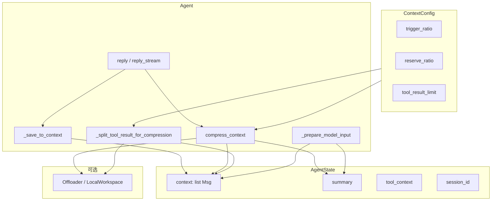

---

### 7. 端到端流程：reply() 时间线

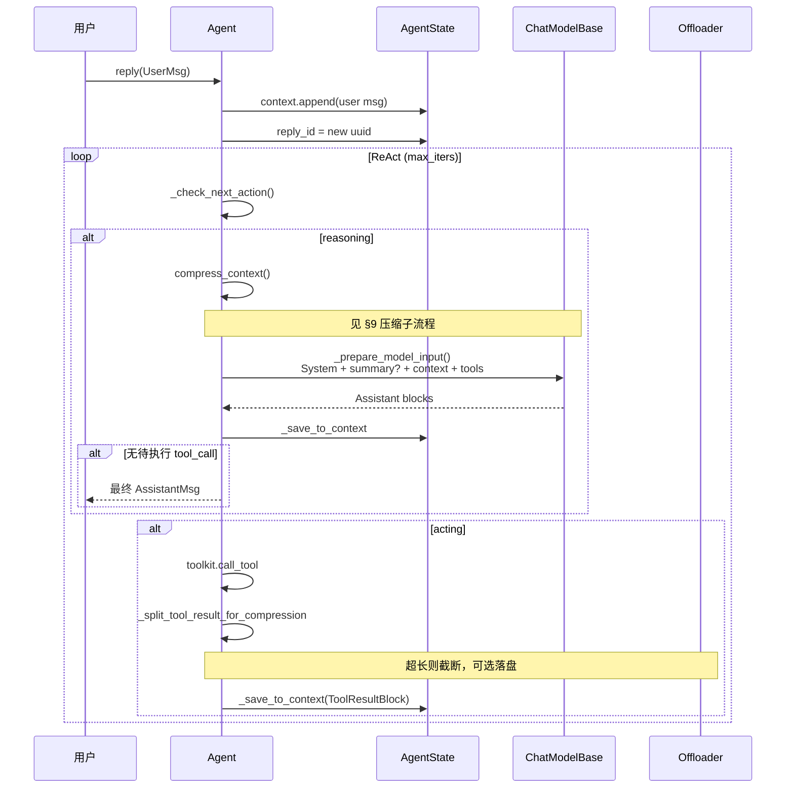

**关键点**：

1. 用户消息在 ReAct 循环**前**写入 `context`。
2. **每次 reasoning 前**调用 `compress_context()`（非 reply 开头一次性检查）。
3. 压缩后旧消息**不再保留**在 `context` 中，信息沉淀在 `summary`（及可选 offloaded 文件）。

#### 7.1 压缩子流程

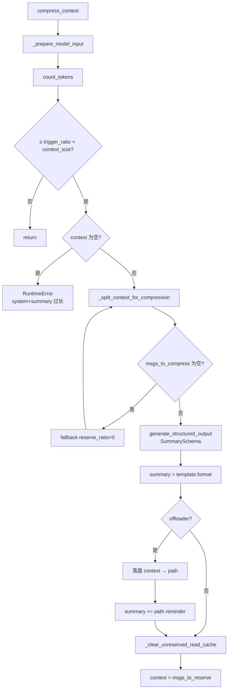

---

### 8. 完整实例：state 属性逐步变化

以下用**虚构 token 数**说明属性如何变；实际阈值由 `model.count_tokens()` 决定。

**假设**：`context_size = 100_000`，`trigger_ratio = 0.8`，`reserve_ratio = 0.1`，已配置 `LocalWorkspace`。

#### 8.1 初始状态

```python
AgentState(
    session_id="sess-001",
    summary="",
    context=[],
    reply_id="",
    cur_iter=0,
)
```

#### 8.2 Turn 1 — 用户：「读 config.yaml」

```python
await agent(UserMsg(name="user", content="读 config.yaml"))
```

| 步骤 | `context` | `summary` | `reply_id` |
|------|-----------|-----------|------------|
| 用户消息入队后 | `[UserMsg("读 config.yaml")]` | `""` | `"uuid-aaa"` |
| reasoning：token 50k < 80k，不压缩 | 不变 | 不变 | 不变 |
| LLM 返回 `tool_call: read_file` | `+ AssistantMsg(id=uuid-aaa, [ToolCallBlock])` | 不变 | 不变 |
| acting：read 返回 5k token | `+ ToolResultBlock(yaml...)` 追加到同一 AssistantMsg | 不变 | 不变 |

#### 8.3 Turn 2 — 用户：「把 debug 改成 true」

| 步骤 | `context` | `summary` | `reply_id` |
|------|-----------|-----------|------------|
| 新用户消息 | `+[UserMsg("把 debug 改成 true")]` | 不变 | `"uuid-bbb"` |
| 多轮 tool 后 context 约 85k token | 15 条 Msg | `""` | — |
| **compress_context 触发** | 见下表 | **覆盖写入** | — |

**压缩瞬间**（`_split_context_for_compression`）：

```text
msgs_to_compress = context[0:10]   # 头部旧消息，约 75k token
msgs_to_reserve  = context[10:]    # 尾部近期，约 10k token
```

| 属性 | 压缩前 | 压缩后 |
|------|--------|--------|
| `summary` | `""` | `"<system-info>\nTask Overview: 用户要修改 config.yaml 的 debug 字段\nCurrent State: 已读取 config.yaml，debug=false\n...\n</system-info>\n<system-reminder>...context.jsonl...</system-reminder>"` |
| `context` | 15 条 Msg | **5 条**（仅 `msgs_to_reserve`） |
| 磁盘 | — | `agent_workspace/sessions/sess-001/context.jsonl` 追加 10 条完整 Msg |

#### 8.4 压缩后送模长什么样

压缩后 `context` 变短、`summary` 变长；**下一次 reasoning** 时 `_prepare_model_input` 组出的 `messages` 顺序与字段说明见 **[§13](#model-input-projection)**。模型**看不到**被删的 10 条原文，只能靠 `summary`、尾部 context、或 Read offloaded 文件。

#### 8.5 Turn 3 — 断点续聊

```python
## 保存
with open("sess-001.json", "w") as f:
    f.write(agent.state.model_dump_json(indent=2))

## 恢复（需同步拷贝 agent_workspace/ 若用了 Offloader）
state = AgentState.model_validate_json(open("sess-001.json").read())
agent = Agent(name="Friday", system_prompt="...", model=model, state=state)
```

恢复后 `context` + `summary` 与保存时一致；**不会**自动做语义检索或合并其他会话记忆。

#### 8.5.1 会话模型：快照真源，而非 append-only 全量 transcript

从 §8.5 的伪代码可以读出 AgentScope **没有** DeepSeek Harness / OpenHands 那种「仅追加、不可变的事件日志 = 唯一真源」的设计；也 **不是**「永远只增不减、靠 replay 消息列表恢复推理状态」。

| 维度 | AgentScope v2 | 对比（事件溯源类 harness） |
|------|---------------|---------------------------|
| **推理时手里的对话** | 内存 `AgentState.context: list[Msg]` + `summary` | 由 event log 投影出 messages |
| **单进程内怎么变** | turn 内向 `context` **追加** Msg / block；压缩时 **删掉** 头部 Msg、**覆盖** `summary` | 压缩多表现为新 event，旧 event 仍在 log |
| **§8.5 嵌入模式怎么落盘** | **整份** `AgentState.model_dump_json()` **快照覆盖写** | 常是 session 文件逐 event append |
| **断点续聊读什么** | `model_validate_json` → 直接 `Agent(..., state=state)` | 从 log 重新 fold |
| **「完整对话历史」指什么** | **当前工作集**：快照里的 `context` + `summary`（+ Offloader 文件）；**不是**从第一句到末句永不删除的原文 | 磁盘上可保留逐步全量审计 |

要点：

1. **有对话历史，但是「状态里的列表」**，不是独立、只追加的 message 仓库。压缩后（§8.3）被移出 `context` 的 Msg **不会**出现在下一次快照里；模型侧靠 `summary`、尾部 `context`、`context.jsonl` 等补上下文。
2. **持久化单位是快照**：每次保存/恢复的是「此刻的 `AgentState`」，不是「从 offset=0 开始 replay 每条 message」。
3. **走 App 时**（见 [§15.1](#151-仅用库-vs-走-app)）：`ChatService` 每 turn 还会 `upsert_message`（按 `Msg.id` 追加或 **原地更新** 本轮 assistant 行），供会话列表 / API 展示；但 **组装 Agent、续聊推理读的是 `SessionRecord.state`**，仍以 **`update_session_state` 写入的快照** 为准，message 列表 **不是** 重建 `context` 的真源。
4. **MessageBus / SSE** 仍是观测轨，崩溃未 persist 则内存增量丢失（与 §15 一致）。

若产品需要「用户可见 transcript 与模型所见永远一致、且永不删行」，要在 App 层自建审计库或事件 log；内核默认优化的是 **可恢复的当前 Agent 状态**，不是 immutable 全量 message 流。

跨框架术语与六族对照见 monorepo [`21-session-message-architecture.md`](../框架对比/framework-comparison/21-session-message-architecture.md)（AgentScope 标为 **族 F**：`AgentState` 真源 + `AgentEvent` 观测轨）；DeepSeek Harness 等为 **族 B**（`SessionEvent` append-only，LLM messages 派生）。

#### 8.5.2 续聊 vs 重塑场景：两种设计各能做什么

「从会话恢复」在工程里常混成两件事，AgentScope 默认只覆盖第一件。

| 诉求 | 含义 | AgentScope v2 默认 | 事件 log 类 harness（如 DSH、OpenHands SDK） |
|------|------|-------------------|---------------------------------------------|
| **断点续聊** | 加载上次 persist 的状态，下一轮继续 ReAct | ✅ `AgentState` 快照 / App `SessionRecord.state` | ✅ 从 log 派生当前 View |
| **HITL / 外部工具挂起** | 跨进程带上未完成的 tool 状态 | ✅ `reply_context`、context 内 tool 状态写入 state 后 persist | ✅ 事件记录 step/turn |
| **压缩后原文** | 模型曾看过的全文是否还在真源里 | ⚠️ 已从 `context` 删除；摘要 + `context.jsonl` / tool offload **补上下文**，非同构 replay | ✅ 旧 event 仍在；compaction 多为新 event |
| **逐步审计** | 「第 N 步送模的 messages 长什么样」 | ❌ 仅最后一版工作集；中间态无一等持久化（MessageBus/SSE 非真源、可丢） | ✅ 按 seq 回放 |
| **时间旅行 / fork** | 从 Turn k 分叉、删掉后续再跑 | ❌ 需自建多快照或外部 log | ✅ 截断 log 或 alternate projection |
| **UI transcript ≡ 模型所见** | 列表与 L 严格一致 | ⚠️ App `list_messages` 与 `state.context` 压缩后可能 **不同构** | 可统一从 log 投影 U 与 L |
| **评测 / 反事实 replay** | 固定输入重放整条 tool 链 | ❌ 需自建审计 | ✅ 天然适合 |

**AgentScope 能恢复的**：**「断点处的 Agent 脑子」**——`context` + `summary` +（可选）Offloader 路径；恢复后继续 `_prepare_model_input()` 即可。

**默认不能等价做的（常说的「重塑场景」）**：任意历史时刻 **重投影** 送模输入、**反事实** 重跑、与 UI 逐行一致的 **immutable transcript**；除非在框架外追加 append-only 记录或多版本快照。

```text
事件 log：存「发生了什么」 → 可多次 fold 出不同 View（L / U / 审计）
AgentScope 快照：存「下一轮该怎么跑」 → 简单、与内存 ReAct 一致；压缩即改账本
```

**为何框架选快照**：嵌入成本低（`model_dump_json`）、`Agent` 与 `AgentState` 同构；流式交互走 `AgentEvent` 旁路，不把全套 `SessionEventMap` + message projection 强加给库用户。

**若产品要强复盘 / 分身 / 合规**，在 AgentScope 之上常见扩展（内核不内置）：

| 做法 | 说明 |
|------|------|
| **Turn 级 audit NDJSON** | 每 turn 追加：用户输入、assistant 终稿 `Msg`、`summary` 版本号、送模 `messages` 哈希或快照 |
| **并行 event 服务** | state 只当运行缓存；真 transcript 写自建 log（可参考 DSH `packages/core/session` 模型） |
| **定期 state 快照 + 版本号** | 支持粗粒度 fork，仍不如 event 细 |
| **禁止压缩或外置压缩** | 自定义 `on_compress_context`，审计库只 append |

#### 8.6 超长 tool result 示例

`read_file` 返回 8000 token，`tool_result_limit=3000`：

```text
acting 阶段：
  _split_tool_result_for_compression
    → reserved: 前 3000 token 等价内容 + <<<TRUNCATED>>> 提醒
    → offload: 剩余部分写入 sessions/{session_id}/tool_result-{id}.txt；路径写在 reserved 的 TextBlock 提醒里
  仅 reserved 进入 context
```

---

### 9. 上下文压缩算法

**入口**: `compress_context()` → `_compress_context_impl()`（可被 `on_compress_context` 中间件包裹）

#### 9.1 触发条件

```python
kwargs = await self._prepare_model_input()
estimated_tokens = await self.model.count_tokens(**kwargs)
threshold = cfg.trigger_ratio * self.model.context_size
if estimated_tokens < threshold:
    return  # 不压缩
```

计 token 时已包含 `system_prompt + summary + context + tools`。

#### 9.2 拆分：`_split_context_for_compression`

输入：`to_reserved_tokens = reserve_ratio * context_size`

1. 从 `context` **尾部**向前扫描，找到保留段 token ≥ `to_reserved_tokens` 的分界 `msg_index`。
2. 对分界消息内的 **content blocks** 再细粒度拆分，避免 reserved 段出现**孤立的 tool_result**（无对应 tool_call）。
3. 返回 `(msgs_to_compress, msgs_to_reserve)`。

若 `msgs_to_compress` 为空，**fallback**：`reserve_ratio → 0` 重试。

#### 9.3 生成摘要

1. 组装压缩输入：`system_prompt + 旧 summary? + msgs_to_compress + compression_prompt`。
2. 调用 `model.generate_structured_output(..., structured_model=summary_schema)`。
3. 若输入超长，**逐条丢弃** `msgs_to_compress` 最旧消息直到 token 低于 `context_size * trigger_ratio`，再重试。

#### 9.4 写回状态

```python
self.state.summary = cfg.summary_template.format(**res.content)

if self.offloader:
    path = await self.offloader.offload_context(session_id, msgs_to_compress)
    self.state.summary += f"\n<system-reminder>... '{path}' ...</system-reminder>"

await self._clear_unreserved_read_cache(msgs_to_reserve)
self.state.context = msgs_to_reserve  # 旧消息物理删除
```

#### 9.5 失败场景

| 条件 | 行为 |
|------|------|
| `context` 为空但 token 仍超阈值 | `RuntimeError`：system prompt（± summary）过长 |
| 压缩 LLM 失败且非 overflow | 异常向上抛出 |
| overflow 且丢弃全部可压缩消息后仍失败 | 异常向上抛出 |

---

### 10. summary 固定格式

压缩 LLM 必须输出 `SummarySchema` 五字段，再套入 `summary_template`：

| 字段 | 含义 |
|------|------|
| `task_overview` | 用户核心请求与成功标准 |
| `current_state` | 已完成工作与产出 |
| `important_discoveries` | 约束、决策、错误与修复 |
| `next_steps` | 待办与阻塞 |
| `context_to_preserve` | 偏好、领域细节、承诺 |

默认渲染结果形如：

```text
<system-info>
Task Overview: ...
Current State: ...
Important Discoveries: ...
Next Steps: ...
Context to Preserve: ...
</system-info>
```

- 每次压缩**覆盖** `state.summary`（不是 append 多段）。
- 可自定义 `compression_prompt`、`summary_template`、`summary_schema` 适配领域。
- 有 `offloader` 时末尾追加文件路径 `<system-reminder>`。

---

### 11. 工具结果截断

**入口**: acting 完成、`ToolResponse` 转 `ToolResultBlock` 之后

```python
reserved, offload = await self._split_tool_result_for_compression(tool_result)
```

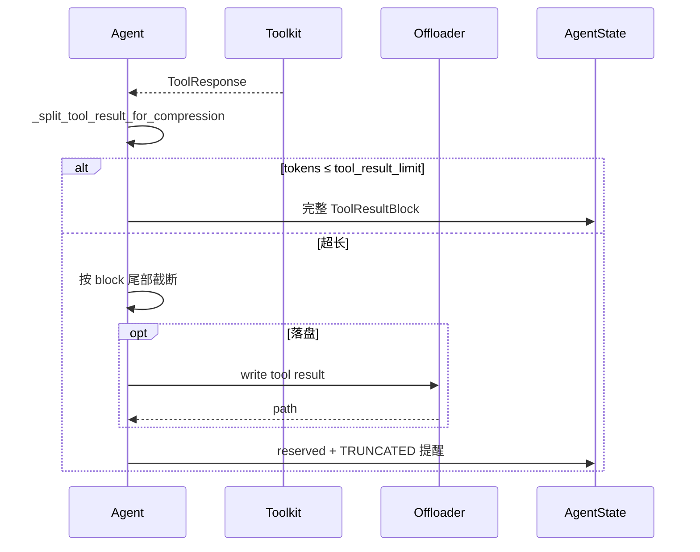

#### 11.1 算法概要

1. 对 `tool_result.output` 计 token；若 ≤ `tool_result_limit`，原样保留。
2. 否则按 **content block** 从尾部向前找边界；对边界 `TextBlock` 按比例截断文本。
3. 返回 `(reserved_block, offload_block | None)`。

#### 11.2 提醒格式与路径落点

**什么进 `context`**：仅 **`reserved`** 经 `_save_to_context` 写入 `AgentState.context`。**`offload` 半段不会作为 `ToolResultBlock` 留在记忆里**；若配置了 `Offloader`，完整 offload 内容只写在磁盘文件中。

**路径写在哪**：文件路径 **不会** 出现在 offload 侧的 `TextBlock` 里（因为 offload 不进 context）。路径只拼在 **reserved** 侧，由 `_handle_tool_call` 在 split 之后追加：

| 条件 | 行为 |
|------|------|
| `reserved.output` 为 `str` | 在字符串末尾追加提醒 |
| 最后一个 block 是 `TextBlock` | 在 **`output[-1].text` 末尾**追加提醒（常见） |
| 否则 | 新建一个只含提醒的 `TextBlock` |

提醒正文：

```text
<<<TRUNCATED>>>
<system-reminder>The remaining content has been omitted for limited context.
[ You can refer to the file in '{path}' for the truncated content if needed. ]
</system-reminder>
```

方括号内一段 **仅当** `self.offloader` 非空且 `offload_tool_result` 返回 `path` 时出现；**无 Offloader** 时仍有 `<<<TRUNCATED>>>` 与「内容被省略」说明，但 **不含** 文件路径——模型无法从 context 里直接读到被切掉的全文，除非工具本身写了路径或后续再读盘。

**源码**：`agent/_agent.py`（split 之后追加 reminder）→ `offloader.offload_tool_result(session_id, offload_tool_result_block)`。

---

### 12. Offloader 落盘

**协议**: `workspace/_offload_protocol.py`

```python
class Offloader(Protocol):
    async def offload_context(self, session_id: str, msgs: list[Msg]) -> str: ...
    async def offload_tool_result(self, session_id: str, tool_result: ToolResultBlock) -> str: ...
```

**`LocalWorkspace` 实现**:

| 方法 | 输出路径 |
|------|----------|
| `offload_context` | `{workdir}/sessions/{session_id}/context.jsonl`（JSONL 追加） |
| `offload_tool_result` | `{workdir}/sessions/{session_id}/tool_result-{id}.txt`（同 id 冲突时 `tool_result-{id}(1).txt` …） |

大数据 `DataBlock`（base64）会先转为 workspace 内文件引用再写入 JSONL。

Agent 可在后续轮次通过 **Read 工具**读取 offloaded 文件（路径出现在 `summary` 或 tool result 的 `<system-reminder>` 中）。

---

### 13. 送模投影：`context` → LLM 输入 {#model-input-projection}

> **核心区分**：`AgentState.context` 是 **持久化真源**（怎么记账）；每次 reasoning 前 `_prepare_model_input()` 再 **投影** 成 `messages` + `tools` 交给 `ChatModelBase`；模型内部的 **Formatter** 再把 `list[Msg]` 转成 OpenAI / Anthropic 等 **HTTP JSON**。三层不要混成一层。

#### 13.1 何时调用

| 时机 | 调用方 | 用途 |
|------|--------|------|
| 每次 **reasoning**（`_reasoning_impl`） | `_prepare_model_input()` → `model(...)` | 真正送模 |
| **`compress_context()`** 判阈值 | 同上 + `count_tokens(**kwargs)` | 估算是否该压缩（含 system + summary + context + tools） |
| **结构化压缩摘要** | 单独拼消息调 `generate_structured_output` | 见 §9（不是普通 reply 那条链） |

在 `compress_context` 与 `_reasoning` 之间，若开启 `InjectionConfig.inject_runtime_state`，会先 **`_inject_runtime_state()`** 把 `HintBlock` **append 进 `context`**（持久化，非 ephemeral），因此 **紧接着** 的 `_prepare_model_input` 已经包含这些 hint。  
**运行时送模文案（中文示例）**：[PROMPTS_CATALOG.md](./PROMPTS_CATALOG.md)。

#### 13.2 第一层投影：`_prepare_model_input()`（`agent/_agent.py`）

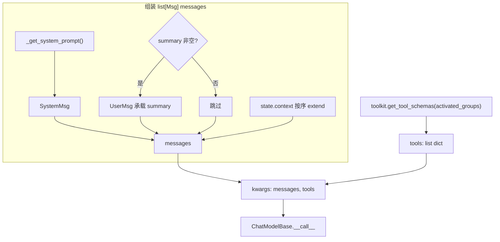

源码等价逻辑：

```python
messages = [SystemMsg(name="system", content=await self._get_system_prompt())]
if self.state.summary:
    messages.append(UserMsg(name="user", content=self.state.summary))
messages.extend(self.state.context)  # 引用同一批 Msg 对象，顺序不变
tools = await self.toolkit.get_tool_schemas(self.state.tool_context.activated_groups)
return {"messages": messages, "tools": tools}
```

| 片段 | 是否在 `context` 里？ | 说明 |
|------|----------------------|------|
| **System** | ❌ | 每次 reasoning **现拼**；不占 `context` 行 |
| **Summary** | ✅ 存在 `state.summary`，送模时 **复制为一条 UserMsg** | 故意用 `user` 角色承载压缩摘要，便于 formatter 与多模型兼容 |
| **`context[i]`** | ✅ | **原样 extend**，顶层几条 `Msg` 顺序 = 对话时间顺序 |
| **tools** | ❌ | 独立参数；只含 **已激活 ToolGroup** 的工具 JSON Schema |

**`_get_system_prompt()` 里还有什么**（仍全部进 **SystemMsg**，不进 `context`）：

1. 构造 Agent 时的 `system_prompt` 字符串  
2. `toolkit.get_skill_instructions(activated_groups)`（Skill 目录说明）  
3. `offloader.get_instructions()`（若 offloader 是 `WorkspaceBase`）  
4. 依次经过 `on_system_prompt` 中间件（字符串变换，利于 **prompt cache**）

动态信息（当前时间、任务列表、临近压缩提醒）**故意不进 system**，而用 §13.4 的 `HintBlock` 写入 `context`，避免整段 system 每次变导致缓存失效。

#### 13.3 第二层投影：Formatter（`model.formatter`）

`ChatModelBase` 在发 HTTP 前执行 `await formatter.format(messages)`。规则因 Provider 而异，共性如下：

| `Msg` / `ContentBlock` | 典型 API 形态 |
|------------------------|----------------|
| `SystemMsg` | `role: system` |
| `UserMsg` / 用户 `TextBlock` | `role: user` |
| `AssistantMsg` + `TextBlock` | `role: assistant` |
| `ToolCallBlock` | `assistant.tool_calls[]` |
| `ToolResultBlock` | `role: tool` + `tool_call_id` |
| **`HintBlock`** | **拆成额外的 `role: user` 文本**（OpenAI formatter 在遇 Hint 时先 flush 当前 assistant 再插 user） |
| **`ThinkingBlock`** | 依模型/formatter：部分模型单独字段或折叠进 assistant |
| assistant 上的 **音频 `DataBlock`** | 写入 context 时已被 `_save_to_context` **过滤**，formatter 一般见不到 |

因此：**存储上** ReMe 记忆可以是 `AssistantMsg + HintBlock`；**送模时** 模型往往看到的是 **多出来的 user 行**，而不是 assistant 里的 hint 块。

Middleware 的 `on_model_call` 还可以在 **formatter 之前或之后** 改 `messages` / 重试（见 [Middleware](#part-middleware)）。

#### 13.4 reasoning 前对 `context` 的额外写入（仍参与下一次投影）

在 `_prepare_model_input` **之前**、同一轮 reasoning 内还可能：

| 步骤 | 写入 `context`？ | 送模影响 |
|------|------------------|----------|
| `compress_context()` | 删旧 Msg、改 `summary` | 下一次 prepare 变短 |
| `_inject_runtime_state()` | append `HintBlock` 到 **当前 assistant 行** | 下一次 prepare 多 hint（formatter → user） |
| Middleware `on_reasoning` | 可读/改传入的 messages 副本或改 state | 视实现而定（ReMe 直接 append 顶层 Msg） |

#### 13.5 完整例子：对齐 §6.2.1 天气对话 {#projection-weather-example}

Agent `name="Friday"`，工具 `get_weather(city)`。下面分三种情形：**单轮**（与 [§6.2.1](#context-weather-single-reply) 终态一致）、**多轮 + 单轮内多次 tool**、**压缩后有 `summary` 的下一轮 reasoning**。

##### 13.5.1 单轮结束：`summary=""`（§6.2.1 步骤 5）

**`state`（存储真源）**

```text
state.summary = ""
state.context = [
  [0] UserMsg(id="u-1", content=[Text("北京今天天气怎么样？")]),
  [1] AssistantMsg(
        id="r-001", name="Friday",
        content=[
          ThinkingBlock("需要先查天气 API…"),
          TextBlock("我先查一下北京的天气。"),
          ToolCallBlock(id="tc-1", name="get_weather", input={"city": "北京"}),
          ToolResultBlock(id="tc-1", output=[TextBlock("晴，12°C")]),
          TextBlock("北京今天晴，气温约 12°C，适合外出。"),
        ],
      ),
]
```

**`_prepare_model_input()` → 逻辑层 `messages`（3 项）**

```text
[0] SystemMsg(content=<system_prompt + skill + workspace>)
[1] UserMsg(...)                    ← context[0]，真用户输入
[2] AssistantMsg(id=r-001, ...)     ← context[1]，整块 extend
```

**Formatter → 概念上的 OpenAI 风格 API 序列**

```text
system:   <system_prompt…>
user:     北京今天天气怎么样？
assistant: (Text「我先查一下…」) + tool_calls: [{id: tc-1, name: get_weather, …}]
tool:     (tc-1) "晴，12°C"
assistant: (Text「北京今天晴…」)
```

`ThinkingBlock` 是否出现在 API 取决于模型/formatter；**存储**上 tool 结果在 assistant `content` 里，**送模**时由 formatter 拆成 `tool` 角色行。

##### 13.5.2 多轮对话 + 第二轮再次调工具

Turn 1 已结束（§6.2.1）。用户再问「上海呢？」，新 `reply_id="r-002"`。

**Turn 2 结束后 `state.context`（4 条顶层 Msg）**

```text
state.summary = ""
state.context = [
  [0] UserMsg(id="u-1", …),                    # Turn 1 用户
  [1] AssistantMsg(id="r-001", …),             # Turn 1 助手（含 tc-1 / 结果 / 结语）
  [2] UserMsg(id="u-2", content=[Text("上海呢？")]),
  [3] AssistantMsg(
        id="r-002", name="Friday",
        content=[
          TextBlock("查一下上海。"),
          ToolCallBlock(id="tc-2", name="get_weather", input={"city": "上海"}),
          ToolResultBlock(id="tc-2", output=[TextBlock("多云，18°C")]),
          TextBlock("上海今天多云，约 18°C。"),
        ],
      ),
]
```

**下一次 reasoning 的 `_prepare_model_input()`（5 项）**

```text
[0] SystemMsg
[1] UserMsg          ← context[0]
[2] AssistantMsg     ← context[1]（Turn 1 整段 content，formatter 内再拆 tool 对）
[3] UserMsg          ← context[2]
[4] AssistantMsg     ← context[3]（Turn 2；若本轮尚未结束，可能尚无最终 Text）
```

**Formatter 概念序列（两轮 tool 各一对）**

```text
system: <…>
user:   北京今天天气怎么样？
assistant: … + tool_calls[tc-1]
tool:   (tc-1) 晴，12°C
assistant: …北京今天晴…
user:   上海呢？
assistant: … + tool_calls[tc-2]
tool:   (tc-2) 多云，18°C
assistant: …上海今天多云…
```

##### 13.5.3 同一 `reply` 内连续两次 tool（多段 acting）

用户：「对比北京和上海的天气。」单轮 `reply_id="r-003"`，模型在同一 `AssistantMsg` 上 **两次** tool call（中间无新 `UserMsg`）。

**`state.context`（仍为 2 条顶层 Msg：1 user + 1 assistant）**

```text
state.context = [
  UserMsg(id="u-3", content=[Text("对比北京和上海的天气。")]),
  AssistantMsg(
    id="r-003", name="Friday",
    content=[
      TextBlock("分别查询两地。"),
      ToolCallBlock(id="tc-a", name="get_weather", input={"city": "北京"}),
      ToolResultBlock(id="tc-a", output=[TextBlock("晴，12°C")]),
      ToolCallBlock(id="tc-b", name="get_weather", input={"city": "上海"}),
      ToolResultBlock(id="tc-b", output=[TextBlock("多云，18°C")]),
      TextBlock("北京晴 12°C，上海多云 18°C。"),
    ],
  ),
]
```

**逻辑层 `messages`**：`SystemMsg` + 上述 2 条 `context`（共 3 项）。

**Formatter 概念序列**（两轮 tool 在同一 assistant 行里 **按 content 顺序** 展开）：

```text
user:     对比北京和上海的天气。
assistant: (Text) + tool_calls[tc-a]
tool:     (tc-a) 晴，12°C
assistant: tool_calls[tc-b]          # 第二次 call 常再开一条 assistant（依 formatter）
tool:     (tc-b) 多云，18°C
assistant: (对比总结 Text)
```

##### 13.5.4 压缩后带 `summary`：下一轮 reasoning 的存储与投影

假设 Turn 1–2（§13.5.2）已发生 **compress_context**：头部 Msg 进摘要并 **从 `context` 删除**；旧文可能在 `context.jsonl`。压缩后用户又问「北京这周哪天适合跑步？」，新 `reply_id="r-004"`；本轮第一次 reasoning 前 `_inject_runtime_state` 可能在 **当前 assistant 行** 追加 `HintBlock`（略）。

**`state`（压缩后、Turn 3 第一次 reasoning 前）**

```text
state.summary = """<system-info>
Task Overview: 用户问过北京、上海天气，已分别查询。
Current State: 北京晴 12°C，上海多云 18°C。
Important Discoveries: get_weather 对「北京」「上海」均可用。
Next Steps: 按用户新问题继续。
Context to Preserve: 用户关心天气与出行。
</system-info>
<system-reminder>Earlier messages were offloaded to '…/sessions/sess-001/context.jsonl'.</system-reminder>"""

state.context = [
  UserMsg(id="u-4", content=[Text("北京这周哪天适合跑步？")]),
  AssistantMsg(
    id="r-004", name="Friday",
    content=[
      HintBlock(source='{"label":"System","sublabel":"Runtime State"}',
                hint="<system-reminder>…<current-time>2026-10-13T20:00:00</current-time>…</system-reminder>"),
      # 以下 block 在第一次 reasoning 之后才陆续 append（ToolCall / ToolResult / Text）
    ],
  ),
]
```

> 说明：压缩后 **磁盘上不再有** `u-1/r-001/u-2/r-002` 四条顶层行；模型对它们的了解主要来自 **`summary` 伪 User 行** 与 offload 路径，而不是 `context` 里的原文。

**`_prepare_model_input()` → 逻辑层 `messages`（4 项）**

```text
[0] SystemMsg(content=<system_prompt + skill + workspace>)   # 仍不进 context
[1] UserMsg(content=state.summary)                           # 压缩摘要，role=user，非真人输入
[2] UserMsg("北京这周哪天适合跑步？")                        # context[0]
[3] AssistantMsg(id=r-004, content=[HintBlock, …])         # context[1]
```

**Formatter 概念序列（含 Hint → 额外 user 行）**

```text
system:   <system_prompt…>
user:     <system-info>…</system-info>…          ← summary 整条
user:     北京这周哪天适合跑步？
user:     <system-reminder>…current-time…</system-reminder>   ← HintBlock 拆出
assistant: (若已有 Text) …
assistant: + tool_calls[…]   # 若模型决定再调 get_weather / 其它工具
tool:     …
assistant: (回答)
```

**对照表（三层一眼看清）**

| 层 | 本例中有什么 | 没有什么 |
|----|--------------|----------|
| **`state.context`** | 近期 `UserMsg` + 当前 `AssistantMsg`（含 Hint / tool blocks） | 已被压缩删掉的 Turn 1–2 顶层 Msg |
| **`state.summary`** | 结构化 `<system-info>` + offload 提醒 | 不替代 system_prompt |
| **逻辑层 `messages`** | System + **一条 summary UserMsg** + `extend(context)` | System 不在 context 里 |
| **API（formatter 后）** | 可能比逻辑层 **多几条 user**（每个 HintBlock 一条） | 与 UI 消息列表不一定逐行同构（见 §8.5.2） |

Thinking / 多 provider 细节仍以 formatter 为准；**token 计数**与真实送模共用同一套 `_prepare_model_input()` 输出（§13.6）。

#### 13.6 与持久化、观测的关系

| 平面 | 内容 |
|------|------|
| **Storage / `model_dump`** | 只存 `AgentState`（`context` + `summary` + …），**不存** 每次拼出来的 System 行 |
| **SSE / `AgentEvent`** | 流式 Thinking、ToolCall 事件；**不是** 送模 JSON 的副本 |
| **token 计数** | `count_tokens(messages, tools)` 与真实送模同一套 `kwargs` |

#### 13.7 真源字段速查

| 部分 | 在 `AgentState`？ | 可压缩？ |
|------|-------------------|----------|
| `system_prompt`（及 skill/workspace 说明） | ❌ Agent 属性 + 每次 `_get_system_prompt` | 开发者控制长度 |
| `summary` | ✅ | 再压缩时与旧 summary 一起参与 |
| `context` | ✅ | 超阈值头部压入 summary 并 **物理删除** |
| `tools` schema | ❌ Toolkit 运行时 | 随激活组变化 |

#### 13.8 `HintBlock`：生产者与送模 {#hintblock-生产者与送模}

`HintBlock`（`message/_block.py`）是挂在 **`AssistantMsg.content`** 里的提醒块；**Formatter 通常把它变成额外的 `user` 消息**，以便 **system prompt 保持可缓存**。送模 API 里虽是 user 行，**账本**上仍与顶层 `UserMsg` 不同——见 **[§4.2.2 · 3.1–3.3](#inbox-hintblock-example)**（`context` / Storage / `list_messages` 完整示例）。

**记账的两种写法**

| 写法 | API | 典型场景 |
|------|-----|----------|
| `state.append_context(agent.name, [hint])` | 合并到 **本 agent + 本 `reply_id`** 的 assistant 行 | 运行时状态、ReAct `Reasoning(hint=…)`、RAG（部分） |
| `state.context.append(AssistantMsg(..., [HintBlock]))` | **多一条顶层 Msg** | **`ReMeMiddleware` 自动记忆**（`name="memory"`） |

**谁在产 Hint（库 / App）**

| 来源 | 钩子 | 进 `context`？ |
|------|------|----------------|
| `_inject_runtime_state` | 每次 `Reasoning` 前 | ✅ 当前 assistant 行 |
| ReAct `_next_action` | 迭代上限 / 结构化输出 | ✅ 同上 |
| **`ReMeMiddleware`**（`static_control` / `both`） | `on_reasoning` | ✅ 顶层 `memory` + **HintBlock**（非 tool） |
| `RAGMiddleware` | `on_reasoning` | ✅；`persist_hint=false` 时可事后删掉 |
| `InboxMiddleware` | `on_reasoning` | ✅ Team / 定时 / 渠道正忙侧信（[§4.2.2](#inbox-hintblock-example)） |
| `_limit_context_images` | 压缩前 | ✅ 图片位换成 Hint 或 Text |
| **QwenPaw ReMe 自动检索** | — | ❌ **不用 HintBlock**（见 [REME §9.2](./REME_ARCHITECTURE.md#92-qwenpaw-集成memorymiddleware--reme-light非-rememiddleware)） |

**ReMe 官方读记忆：Hint 还是 tool？**

| 方式 | 形态 |
|------|------|
| 自动检索 | **`HintBlock`**（`agent_control` 模式无自动检索） |
| 模型主动 | 真 **`memory_search`** 工具（`agent_control` / `both`） |

#### 13.9 仅当次 HTTP 的 `messages`：`on_model_call` {#on-model-call-transient-messages}

部分宿主（**QwenPaw `MemoryMiddleware`**）在 **`on_model_call`** 里修改 **`input_kwargs["messages"]`**，**不**写 `state.context`。链路：

```text
_prepare_model_input() → messages
  → on_model_call 中间件（可插入合成 Msg、改列表顺序）
  → formatter → HTTP
```

因此会出现：**模型当次请求里多了一段 tool 轨迹，但 `AgentState.context` / Storage 快照里没有**。与 `ReMeMiddleware` 把记忆 **append 进 `context` 的 HintBlock** 是不同产品选择。实现细节见 [REME §9.2.1](./REME_ARCHITECTURE.md#921-自动检索假-tool-怎么做on_model_call)。

---

### 14. 配置与调参

#### 14.1 最小可用

```python
import agentscope
from agentscope.agent import Agent
from agentscope.message import UserMsg
from agentscope.model import OpenAIChatModel

agentscope.init(project="demo")

agent = Agent(
    name="Friday",
    system_prompt="You are a helpful assistant.",
    model=OpenAIChatModel(model_name="gpt-4.1", api_key="..."),
)

reply = await agent(UserMsg(name="user", content="你好"))
## agent.state.context 已包含本轮对话
```

- `await agent(msg)` 等价于 `await agent.reply(msg)`。
- 流式：`async for event in agent.reply_stream(msg)`，context 更新逻辑相同。
- 传入 `state=AgentState(...)` 可恢复已有会话。

#### 14.2 启用压缩

```python
from agentscope.agent import Agent, ContextConfig

agent = Agent(
    name="Coder",
    system_prompt="You are a coding assistant.",
    model=model,
    context_config=ContextConfig(
        trigger_ratio=0.75,
        reserve_ratio=0.15,
        tool_result_limit=2500,
    ),
)
```

| 场景 | `trigger_ratio` | `reserve_ratio` | 说明 |
|------|-----------------|-----------------|------|
| 短对话 / 低成本 | `0.85`–`0.9` | `0.1` | 少压缩，延迟低 |
| 长工具链 / coding | `0.7`–`0.8` | `0.1`–`0.15` | 更早压缩，留足近期 tool 对 |
| 超大 system prompt | 降低 `trigger_ratio` | 降低 `reserve_ratio` | 否则可能「无消息可压缩」而抛错 |

#### 14.3 手动触发压缩

```python
await agent.compress_context()
await agent.compress_context(context_config=ContextConfig(trigger_ratio=0.6))
```

适合在长工具批处理前主动释放 context。

#### 14.4 配置 Offloader

```python
from agentscope.workspace import LocalWorkspace

workspace = LocalWorkspace(workdir="./agent_workspace")

agent = Agent(
    name="Friday",
    system_prompt="...",
    model=model,
    offloader=workspace,
)
```

---

### 15. 会话持久化

v2 无 `JSONSession` 子包。推荐直接持久化 `AgentState`：

```python
from agentscope.state import AgentState

## 保存
path = f"./sessions/{agent.state.session_id}.json"
with open(path, "w", encoding="utf-8") as f:
    f.write(agent.state.model_dump_json(indent=2))

## 恢复
with open(path, encoding="utf-8") as f:
    state = AgentState.model_validate_json(f.read())

agent = Agent(name="Friday", system_prompt="...", model=model, state=state)
```

**建议一并持久化**：

| 字段 | 必要性 | 说明 |
|------|--------|------|
| `context` + `summary` | 必需 | 对话连续性 |
| `session_id` | 推荐 | Offloader 路径、多租户 |
| `tool_context` | 可选 | 依赖 Read 缓存时 |
| `permission_context` | 可选 | 有未完成 ASK 工具时 |

**注意**：持久化的是**状态快照**，不会做历史语义检索；迁移时需同步拷贝 workspace / Offloader 附件。

#### 15.1 仅用库 vs 走 App

| 场景 | 谁落盘 | 写什么 |
|------|--------|--------|
| 仅 `agent.reply()` | 默认**不写**；自行 `model_dump_json()` | `AgentState` 字段 |
| `ChatService.run` | turn 末 `_persist()`（shield + 会话锁） | `upsert_message` + `update_session_state` |

`MessageBus` / SSE **不是**对话真源。未 persist 前进程崩溃：**内存 `context` 增量丢失**；HITL 挂起若未写入 `state`，跨进程无法 `resume`，需 `UserConfirmResultEvent` + 一致 `reply_context`（见 [Part · App](#part-app)）。

---

### 16. 长期记忆与 RAG（v2 落点）

v2 **没有** v0.x 的 `memory.LongTermMemoryBase` 包；跨会话与知识库走 **Middleware + `rag/` + App**：

| 需求 | 首选 | 详见 |
|------|------|------|
| 跨会话向量记忆 | `Mem0Middleware` / `ReMeMiddleware` | [Part · Middleware](#part-middleware) §2 |
| 工作区 Markdown 记忆 | `AgenticMemoryMiddleware` | 同上 |
| 知识库检索 | `agentscope.rag` + App 索引 worker | [Part · RAG](#part-rag) |
| 产品级 PKB / ReMe | 独立服务 | [REME_ARCHITECTURE.md](./REME_ARCHITECTURE.md) |
| 完全自控 | Toolkit 记忆工具或自定义 `on_reply` | 下文 16.1 |

#### 16.1 自定义记忆工具（可选）

```python
from agentscope.tool import Toolkit, ToolResponse

store: dict[str, str] = {}

async def save_memory(key: str, content: str) -> ToolResponse:
    store[key] = content
    return ToolResponse(content=f"Saved {key}")

async def search_memory(query: str) -> ToolResponse:
    hits = [f"[{k}] {v}" for k, v in store.items() if query.lower() in v.lower()]
    return ToolResponse(content="\n".join(hits) or "No matches.")

toolkit = Toolkit()
toolkit.register_tool_function(save_memory)
toolkit.register_tool_function(search_memory)

agent = Agent(..., toolkit=toolkit)
```

#### 16.2 多 Agent 与 state

每个 `Agent` 默认独立 `AgentState`；Team worker 用 App 侧独立 `SessionRecord`。共享记忆：编排转发 `Msg`、共用 Storage，或挂 LTM Middleware（见 [Part · Agent 边界](#part-ltm)）。

---

### 17. 反模式

| 反模式 | 原因 | 建议 |
|--------|------|------|
| 自建 `list` 存消息，不用 `AgentState` | 与 `_save_to_context` / 压缩 / tool 对逻辑脱节 | 始终通过 `agent(msg)` 驱动 |
| 向 `context` 直接 append 含 `tool_call` 的 Msg | `_handle_incoming_messages` 会拒绝 | 仅传入 user/assistant 纯对话 Msg |
| `trigger_ratio` 设过低 | 频繁 LLM 压缩，延迟与成本上升 | 结合日志实测 |
| 超大 system prompt + 高 `reserve_ratio` | 可能 `RuntimeError: cannot be compressed` | 缩短 system prompt 或降低 reserve |
| 在 `memory/` 包找 LTM | v2 无此包 | `middleware/_longterm_memory/` 或 [Part · RAG](#part-rag) |
| 压缩后仍假设旧消息在 context | v2 物理删除旧 Msg | 依赖 `summary` 或 offloaded 文件 |
| 只持久化 context 不持久化 summary | 恢复后丢失压缩历史 | 两者一起序列化 |

---

### 18. 与 v0.x 的差异

| 旧版概念 | v2 对应 |
|----------|---------|
| `MemoryBase` / `InMemoryMemory` | `AgentState.context` |
| `ReActAgent.CompressionConfig` | 独立 `ContextConfig` |
| `_compressed_summary` + mark `COMPRESSED` | `summary` + 旧消息从 context **物理删除** |
| `memory.get_memory()` → Formatter | `_prepare_model_input()` |
| `JSONSession` / `RedisSession` | `app/storage` + `AgentState`；库层 `model_dump_json()` |
| `LongTermMemoryBase` / Mem0 | `Mem0Middleware` / `ReMeMiddleware` |
| `rag.KnowledgeBase`（v0 编排） | `agentscope.rag` + [Part · RAG](#part-rag) |
| mark 过滤 | ❌ 多份 state 或过滤 context |

---

### 19. 源码索引与 Middleware

#### 19.1 类关系

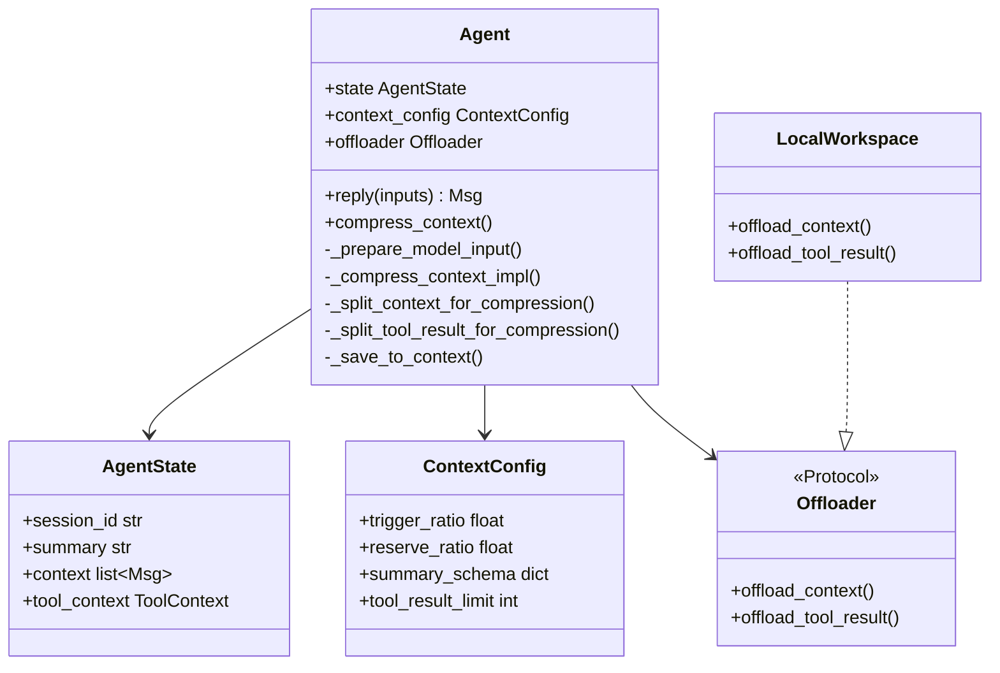

#### 19.2 Middleware 钩子

| 钩子 | 与 Memory 的关系 |
|------|------------------|
| `on_compress_context` | 包裹 `compress_context()`，可记录指标或强制压缩 |
| `on_reply` / `on_reasoning` / `on_acting` | 可观测 context 变化；勿与内置 `_save_to_context` 冲突 |
| `on_system_prompt` | 修改 system 内容（不计入 `context`） |

---

### 20. 本文件内跳转

| 主题 | Part |
|------|------|
| ReAct、Tool、Permission | [库内核](#part-kernel) |
| Middleware、LTM | [Middleware](#part-middleware) |
| ChatService、Storage、Team | [App](#part-app) |
| v0.x 长文检索 | [附录 · 实现参考](#附录-reference-full) |

---

**最后更新**: 2026-10-13

---

## Part · Middleware（Hook） {#part-middleware}

> 七钩子与库/App 中间件目录  
> **图**：[全集 §B6](./MODULE_ARCHITECTURE_ATLAS.md#b6-middleware-lib) · [App §C12](./MODULE_ARCHITECTURE_ATLAS.md#c12-app-middleware)

### 1. 钩子模型（库层）

`MiddlewareBase` 提供 **7 个可选钩子**（`middleware/_base.py`）：

| 钩子 | 模式 | 典型用途 |
|------|------|----------|
| `on_reply` | 洋葱 | 整段 reply 包裹；可吞 `ReplyEndEvent` 强制多轮 |
| `on_reasoning` | 洋葱 | 每步推理前/后；注入 context |
| `on_acting` | 洋葱 | 单 tool 执行前后 |
| `on_check_permission` | 洋葱 | 改写 ALLOW/ASK/DENY |
| `on_model_call` | 洋葱 | 原始 LLM API 前后 |
| `on_compress_context` | 洋葱 | 压缩前后 |
| `on_system_prompt` | **流水线** | 顺序变换 system 字符串 |

运行时检测 `is_implemented(hook_name)` — 只链接已实现的钩子。


---

### 2. 库级专用 Middleware

| 类 | 钩子 | 作用 |
|----|------|------|
| **`AgenticMemoryMiddleware`** | `on_system_prompt`, `on_reasoning` | 工作区 Markdown 记忆库；`MEMORY.md` 索引注入；异步检索 topic 文件 → `HintBlock` |
| **`Mem0Middleware`** | 同族 | 接 Mem0 外部记忆服务 |
| **`ReMeMiddleware`** | 同族 | 接 ReMe 外部记忆服务 |
| **`RAGMiddleware`** | `on_reasoning`, `list_tools` | KB 检索：`static` 自动注入 / `agentic` 暴露 `search_knowledge` 工具 |
| **`ReplyBudgetControlMiddleware`** | `on_reasoning`, `on_model_call` | 单 reply token 预算；超限注入 hint + `tool_choice=none` |
| **`TTSMiddleware`** | `on_reasoning` | 文本块 → `DATA_BLOCK_*` 音频事件 |
| **`TracingMiddleware`** | `on_reply`, `on_model_call`, `on_acting` | OpenTelemetry span（LLM / tool / agent） |

导出：`middleware/__init__.py`

#### 2.1 AgenticMemory（要点）

- 记忆目录：workspace 内 Markdown + frontmatter（`user` / `feedback` / `project` / `reference`）  
- **索引进 system**，正文 **on-demand** 检索注入  
- 依赖 `BackendBase` 读写记忆文件  

#### 2.2 RAGMiddleware（要点）

| 模式 | 行为 |
|------|------|
| `static` | `cur_iter==0` 时用用户 query 检索，注入 `HintBlock` |
| `agentic` | 注册 `search_knowledge` 工具，模型自选何时查 |

支持多 KB、不同 embedding 模型并存；可选 rerank。  
**不负责索引** — 见 [Part · RAG §2](#rag-mental-model)。

#### 2.3 ReplyBudgetControl

- 状态在 `agent.state.middle_context`（HITL resume 可续）  
- `ReplyEndEvent` 时清理  
- 加权：`input_token_weight * in + output_token_weight * out`

---

### 3. App 级 Middleware

由 `ChatService` 每轮装配（`app/middleware/`）：

| 类 | 钩子 | 作用 |
|----|------|------|
| **`InboxMiddleware`** | `on_reasoning` | drain `MessageBus` inbox → `HintBlock` 进 context + `HintBlockEvent` |
| **`StateChangeMiddleware`** | 状态同步 | Session 持久化触发 |
| **`ToolOffloadMiddleware`** | `on_acting` | tool 超时 → 后台任务 + inbox 占位 + wakeup |
| **`TeamMemberLoopMiddleware`** | `on_reply` | worker 必须以 `TeamSay(leader)` 成功结束 |
| **`AGUIProtocolMiddleware`** | 协议 | AG-UI 事件投影 |

#### 3.1 Inbox + ToolOffload 协作

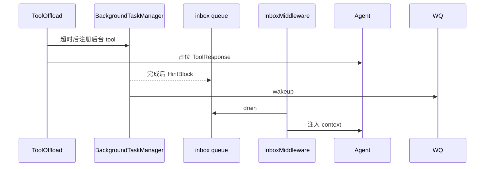

与 [APP_ARCHITECTURE.md](#part-app) §5–§7 一致：Team 消息、调度任务、渠道忙时 hint 均走 **inbox**。

---

### 4. ChatService 装配顺序（概念）

每轮 `ChatService._run_impl` 大致：

1. **App 固定**：`InboxMiddleware` → `StateChangeMiddleware` → `ToolOffloadMiddleware`  
2. **Team worker**：`TeamMemberLoopMiddleware`  
3. **Session 配置**：`TTSMiddleware`、`RAGMiddleware`（若配置 KB/TTS）  
4. **用户自定义**：`AgentMiddlewareFactory` 注入  

库级 middleware 在构造 `Agent(..., middlewares=[...])` 时传入。

---

### 5. 选型表

| 需求 | 选用 |
|------|------|
| 跨会话 Markdown 记忆 | `AgenticMemoryMiddleware` |
| 已有 Mem0/ReMe 投资 | `Mem0Middleware` / `ReMeMiddleware` |
| 知识库问答 | `RAGMiddleware` |
| 控费 / 防无限 tool | `ReplyBudgetControlMiddleware` |
| 语音播报 | `TTSMiddleware` + `tts/` 模型 |
| 可观测 | `TracingMiddleware` |
| 生产 IM/调度/Team | App `InboxMiddleware` + `ToolOffloadMiddleware`（随 `create_app`） |

---

### 6. 设计法则

1. **App middleware 依赖 MessageBus** — 仅 `create_app` 场景；脚本嵌入用库级即可。  
2. **Inbox 用 HintBlock** — 统一跨 turn 注入形态。  
3. **Budget 状态放 middle_context** — 不要放 middleware 实例字段。  
4. **RAG static 只首轮** — 避免每 iter 重复检索。  
5. **Tracing 最外层** — 通常 `middlewares` 列表靠前注册（先包 on_reply）。

---

### 7. 源码索引

| 路径 | 内容 |
|------|------|
| `middleware/_base.py` | 钩子定义 |
| `middleware/_longterm_memory/` | Agentic / Mem0 / ReMe |
| `middleware/_rag.py` | RAG |
| `middleware/_budget.py` | Token 预算 |
| `middleware/_tts_middleware.py` | TTS |
| `middleware/_tracing/` | OTel |
| `app/middleware/` | Inbox、Team、ToolOffload、AG-UI |

---

## Part · App · Channel · 生产运行时 {#part-app}

> ChatService、Storage、Bus、SSE、Channel、Team、Scheduler  
> **总览**：[§2.1 运行时架构](#app-architecture-overview) · [**§2.2 包结构类图**](#app-package-diagrams) · [**§6 Channel（IM）**](#part-channel)  
> **图**：[§4 触发→SSE](#app-trigger-to-sse) · [**MessageBus §C4**](./MODULE_ARCHITECTURE_ATLAS.md#c4-message-bus) · [全集 §C App](./MODULE_ARCHITECTURE_ATLAS.md#c-app)

### 1. 一句话

**库（`agent/`）管一轮 ReAct；App（`app/`）管「谁触发、存哪、怎么推给前端/飞书、多成员怎么协作」。**  
所有运行路径最终汇入 **`ChatService.run`**。

---

### 2. 库层 vs App 层

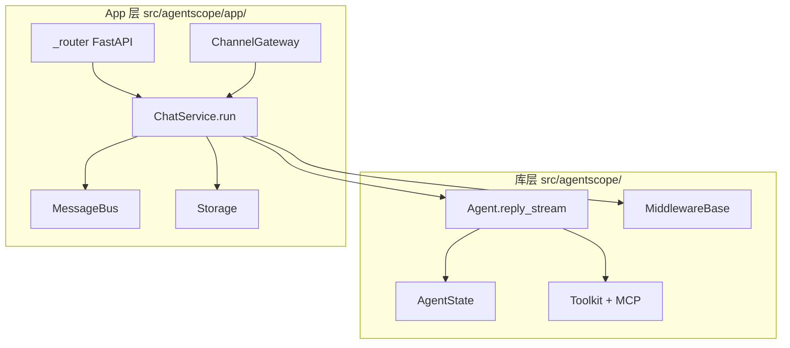

| 问题 | 库层 | App 层 |
|------|------|--------|
| 一次 turn 怎么跑 | `Agent` | 装配 Agent + 调 `reply_stream` |
| 会话存哪 | 应用自行 `model_dump_json` | `StorageBase`（SQL / Redis） |
| 前端怎么收事件 | `AsyncGenerator[AgentEvent]` | SSE `GET /sessions/{id}/stream` |
| IM 怎么接入 | 无 | `channel/` + `ChannelGateway` |
| 子 Agent | 无内置 | `AgentCreate` / `AgentInvite` + Team |

---

### 2.1 App 整体架构与设计 {#app-architecture-overview}

> **本节**：App 包「长什么样」、进程怎么起来、消息怎么进怎么出。  
> 细节时序与 MessageBus 三格：[§4 触发→SSE](#app-trigger-to-sse) · [图集 §C](./MODULE_ARCHITECTURE_ATLAS.md#c-app)。

#### 设计原则（先记住四条）

| 原则 | 含义 |
|------|------|
| **单入口执行** | 凡是「跑一轮 Agent」，最终都进 **`ChatService.run`**（HTTP、飞书、定时、SOP、Wakeup 队列同一套）。 |
| **Storage 是真源** | 用户/助手消息行、`AgentState`、Agent/Session 配置 — **崩了靠库恢复**；Bus 不替代数据库。 |
| **Bus 管协调** | 跨进程/跨标签页的 **开工排队、便签 inbox、SSE 直播缓存、session 分布式锁** — 见 [§4.2 三格](#app-trigger-to-sse)。 |
| **库与 App 分界** | `Agent` 只管 ReAct；App 管 **谁触发、拼 toolkit、落盘、推事件、渠道出站**。 |

#### 整体架构图（六层 + Bus）

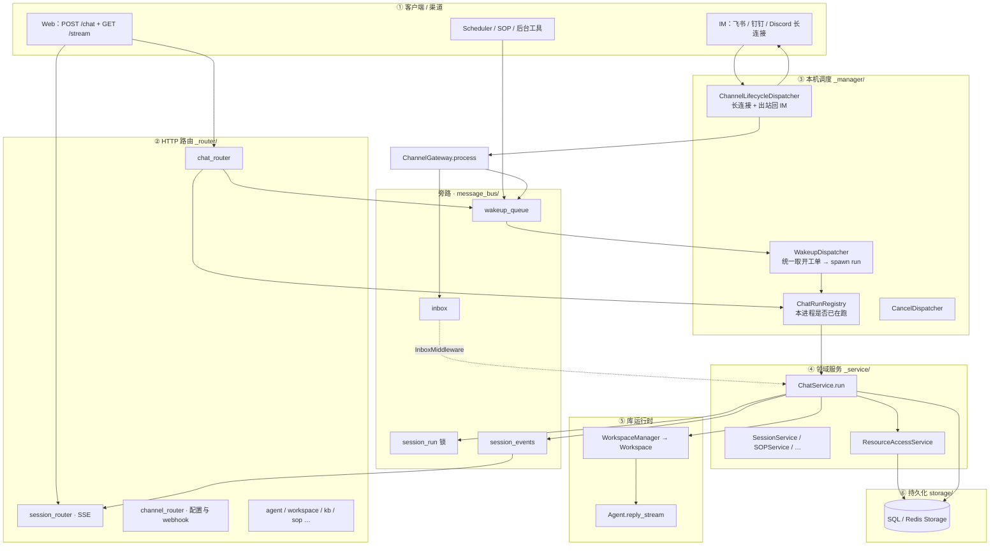

**目录与上图的对应**

| 层 | 包路径 | 典型类 |
|----|--------|--------|
| 路由 | `app/_router/` | `chat_router`、`session_router`、`channel_router` |
| 调度 | `app/_manager/` | `WakeupDispatcher`、`ChatRunRegistry`、`SchedulerManager` |
| 服务 | `app/_service/` | `ChatService`、`SessionService`、`SOPService`、`get_toolkit` |
| 渠道 | `app/channel/` | `ChannelGateway`、`ChannelLifecycleDispatcher`、各 `*Channel` |
| 协调 | `app/message_bus/` | `RedisMessageBus` / `InMemoryMessageBus` |
| 持久化 | `app/storage/` | `SessionRecord`、`AgentRecord`、消息历史 |
| 装配辅助 | `app/middleware/`、`app/_tool/`、`app/deps.py` | `InboxMiddleware`、`TeamCreate`、FastAPI `Depends` |

---

#### 启动与注册流程 {#app-startup-registration}

分 **两阶段**：`create_app()`（同步，建 FastAPI）与 **`lifespan`**（异步，连外部资源并起后台任务）。

**阶段 A · `create_app()`（`app/_app.py`）**

```mermaid
sequenceDiagram
    participant Dev as 部署代码
    participant CA as create_app
    participant APP as FastAPI app.state

    Dev->>CA: storage, message_bus, workspace_manager, …
    CA->>CA: 注册 extra_credentials
    CA->>APP: 挂载 storage / bus / workspace / KB / hubs
    CA->>APP: ChannelTypeRegistry(channels[])
    CA->>APP: custom_subagent_templates、policy、ICE…
    CA->>CA: include_router × N<br/>(chat, session, agent, channel, sop…)
    CA-->>Dev: FastAPI 实例（尚未连 Redis/SQL）
```

**阶段 B · `lifespan` 启动（`app/_lifespan.py`，uvicorn startup）**

```mermaid
sequenceDiagram
    participant UV as uvicorn
    participant LF as lifespan
    participant STG as Storage
    participant BUS as MessageBus
    participant WD as WakeupDispatcher

    UV->>LF: startup
    LF->>STG: __aenter__
    LF->>BUS: __aenter__
    LF->>LF: workspace_manager / blob / KB / hubs
    LF->>LF: BackgroundTaskManager
    LF->>LF: ChatRunRegistry
    LF->>LF: SchedulerManager（可选单主）
    LF->>LF: ResourceAccessService
    opt channels 非空
        LF->>LF: ChannelClients + ChannelService
        LF->>LF: ChannelLifecycleDispatcher + Gateway
    end
    LF->>LF: ChatService / SessionService / SOPService / Realtime…
    LF->>WD: 订阅 wakeup_signal，后台 drain 队列
    LF->>LF: CancelDispatcher
    opt enable_index_worker
        LF->>LF: IndexTaskConsumer + IndexSweeper
    end
    LF-->>UV: 可接 HTTP / IM
```

**注册了什么（清单）**

| 类别 | 内容 |
|------|------|
| **HTTP 路由** | `agent`、`chat`、`session`（含 SSE）、`channel`、`schedule`、`workspace`、`hub`、`mcp`、`skill`、`sop`、`knowledge_base`、`model`、`realtime`、`health`、`credential`… |
| **`app.state` 服务** | `chat_service`、`session_service`、`sop_service`、`workspace_service`、`channel_service`、`scheduler_manager`、`chat_run_registry`、`background_task_manager`… |
| **后台协程** | `WakeupDispatcher`（**唯一**从队列 spawn `ChatService.run` 的入口）、`CancelDispatcher`、渠道 reconcile/heartbeat/outbound、索引 consumer |
| **可选拆分部署** | `enable_channel_worker=False` → 本进程不持 IM 长连接；`enable_scheduler=False` → 本进程不跑 cron 触发；`enable_index_worker=False` → 索引由独立 worker 进程消费 Bus |

本地最小启动（概念）：

```python
from agentscope.app import create_app
from agentscope.app.message_bus import InMemoryMessageBus
from agentscope.app.storage import ...
from agentscope.app.workspace_manager import LocalWorkspaceManager

app = create_app(
    storage=...,
    message_bus=InMemoryMessageBus(),
    workspace_manager=LocalWorkspaceManager(...),
    channels=[FeishuChannel],  # 不用渠道可省略
)
# uvicorn agentscope.app:app 或 uvicorn your_module:app
```

---

#### 收发消息：两条轨 + 三种入口 {#app-message-flow}

**再次强调**：浏览器要 **两条 HTTP** — `POST /chat` **点火**，`GET /sessions/{id}/stream` **看直播**；响应 body 里没有打字流。

| 轨 | 方向 | 载体 | 落盘？ |
|----|------|------|--------|
| **执行轨** | 用户 → Agent | `UserMsg` / HITL 事件 / inbox `HintBlock` | **是** → Storage |
| **观测轨** | Agent → UI | `session_events`（SSE） | **否**（有界缓存 + replay） |
| **渠道出站轨** | Agent → IM | `ChannelLifecycleDispatcher` 订阅 run 事件 | 正文仍先经 Storage；渠道侧再发消息 |

**入口 1 · Web `POST /chat`（用户发一句）**

```mermaid
sequenceDiagram
    participant UI as 前端
    participant CH as chat_router
    participant REG as ChatRunRegistry
    participant CS as ChatService
    participant BUS as MessageBus
    participant STG as Storage
    participant SSE as GET /stream

    UI->>SSE: 长连订阅（可先连）
    UI->>CH: POST /chat {session_id, message}
    alt 本进程已有 run
        CH-->>UI: 409 Conflict
    else 新 run
        CH->>REG: try_register(session)
        REG->>CS: asyncio.create_task(run)
        CH-->>UI: started
        CS->>BUS: session_run 锁
        CS->>STG: load Session + Agent
        CS->>CS: 拼 Agent + middleware + toolkit
        loop reply_stream
            CS->>BUS: publish_session_event
            BUS-->>SSE: SSE 推送
            CS->>STG: upsert_message / update_state
        end
    end
```

**入口 2 · HITL / 审批 / SOP 续跑**

不抢 `ChatRunRegistry` 的「新 run」槽位：把 **`UserConfirmResultEvent`** 等写入 **格子 A `wakeup_queue`（kind=resume）**，由 **`WakeupDispatcher`** 统一 spawn，避免与正在跑的 session 双开冲突（锁忙则短退避重入队）。

**入口 3 · 渠道入站（`ChannelGateway.process`）**

```mermaid
flowchart LR
    IM["平台 webhook / 长连接"] --> DISP["ChannelLifecycleDispatcher"]
    DISP --> GW["ChannelGateway"]
    GW --> ROUTE["resolve → agent_id + session_id"]
    ROUTE --> IDLE{session 正忙?}
    IDLE -->|否| WQ["enqueue_run_trigger<br/>用户话进 run"]
    IDLE -->|是| INB["deliver_to_inbox<br/>HintBlock 下轮并入上下文"]
    WQ --> WD["WakeupDispatcher"]
    WD --> CS["ChatService.run"]
```

- **出站**：Gateway **不负责**把回复发回群；`ChatService` 跑时 `publish_session_event`，**持有该 channel 长连接的进程**里 `ChannelLifecycleDispatcher` 把助手文本/卡片 **推到 IM**（定时任务、后台 run 也走同一路，不只入站消息）。

**`ChatService.run` 一轮里与「消息」相关的几步（缩写）**

1. `message_bus.session_run(session_id)` 拿 **分布式锁**。  
2. 从 **Storage** 读 `SessionRecord.state`（`AgentState`）与 Agent 配置。  
3. `get_toolkit` + workspace + channel 工具 + schedule 工具 + Team 工具…  
4. 默认 App middleware：`InboxMiddleware`（drain **格子 B**）、`ToolOffloadMiddleware`、`StateChangeMiddleware`…  
5. `agent.reply_stream(input)`；每个 `AgentEvent` → **`publish_session_event`（格子 C）**。  
6. turn 结束 **`_persist`**：`upsert_message` + **`update_session_state`**（真源）。

更细的格子 A/B/C 表、409 规则、inbox 与 `HintBlock` 示例：[§4.2 起](#app-trigger-to-sse)。

---

### 2.2 App 包结构：组件架构图与类图 {#app-package-diagrams}

> 与 [§2.1](#app-architecture-overview) 互补：§2.1 偏 **运行时数据流**；本节偏 **`agentscope.app` 目录与类型依赖**（实现真源 `agentscope/src/agentscope/app/`）。  
> 图集副本：[MODULE_ARCHITECTURE_ATLAS · §C0](./MODULE_ARCHITECTURE_ATLAS.md#c0-app-package)。

#### 组件架构图（按包划分）

```mermaid
flowchart TB
    subgraph entry ["入口与装配"]
        APP["_app.create_app"]
        LIFE["_lifespan"]
        DEP["deps.py"]
    end

    subgraph router ["_router FastAPI"]
        RT_CHAT["chat_router"]
        RT_SESS["session_router"]
        RT_AGENT["agent_router"]
        RT_CH["channel_router"]
        RT_MORE["schedule workspace sop kb hub …"]
    end

    subgraph service ["_service 领域服务"]
        CS["ChatService"]
        SS["SessionService"]
        SOP["SOPService"]
        RTS["RealtimeService"]
        RAS["ResourceAccessService"]
        TK["get_toolkit"]
        KB_SVC["KnowledgeBaseService"]
        WS_SVC["WorkspaceService"]
        CH_SVC["ChannelService"]
    end

    subgraph mgr ["_manager 后台"]
        WD["WakeupDispatcher"]
        CD["CancelDispatcher"]
        REG["ChatRunRegistry"]
        SCH["SchedulerManager"]
        BG["BackgroundTaskManager"]
    end

    subgraph channel ["channel IM"]
        GW["ChannelGateway"]
        CLD["ChannelLifecycleDispatcher"]
        CLN["ChannelClients"]
    end

    subgraph infra ["基础设施"]
        STG["storage.StorageBase"]
        BUS["message_bus.MessageBus"]
        WM["workspace_manager"]
        OPS["_bus_ops"]
    end

    subgraph applib ["App 扩展"]
        AMW["app.middleware"]
        ATOOL["_tool Team SOP"]
        HUB["hub MCP Skill"]
        ARAG["rag KB manager blob"]
        ACC["access policy"]
    end

    subgraph kernel ["库 agentscope"]
        AG["Agent"]
    end

    APP --> LIFE
    APP --> router
    DEP --> router
    router --> CS
    router --> SS
    router --> SOP
    WD --> CS
    WD --> REG
    WD --> BUS
    CD --> REG
    SCH --> BUS
    CLD --> GW
    GW --> OPS
    OPS --> BUS
    CS --> STG
    CS --> BUS
    CS --> WM
    CS --> RAS
    CS --> SCH
    CS --> BG
    CS --> TK
    CS --> AG
    CS --> AMW
    TK --> ATOOL
    TK --> HUB
    TK --> WM
    SOP --> CS
    SS --> STG
    SS --> BUS
    KB_SVC --> ARAG
    RAS --> STG
    RAS --> ACC
```

**读图**：HTTP/渠道只碰 **router + manager**；**唯一执行核**仍是 `ChatService` → 库 `Agent`；**Storage / MessageBus / WorkspaceManager** 在 `create_app` 注入，经 `lifespan` 连接。

#### 核心类图（App 层类型关系）

```mermaid
classDiagram
    direction TB

    class FastAPI {
        state storage
        state message_bus
        state chat_service
        state chat_run_registry
        state scheduler_manager
    }

    class create_app {
        <<factory>>
    }
    create_app ..> FastAPI : 构建

    class StorageBase {
        <<abstract>>
        get_session()
        upsert_message()
        update_session_state()
    }
    class MessageBus {
        <<abstract>>
        session_run()
        session_publish_event()
        queue_push()
        log_append()
    }
    class WorkspaceManagerBase {
        <<abstract>>
        get()
    }
    class ResourceAccessPolicyBase {
        <<abstract>>
    }

    class InMemoryMessageBus
    class RedisMessageBus
    MessageBus <|-- InMemoryMessageBus
    MessageBus <|-- RedisMessageBus

    class ChatService {
        run()
        _run_impl()
        _persist()
    }
    class SessionService {
        derive_parked_status()
    }
    class SOPService {
        run()
        _advance()
    }
    class ResourceAccessService
    class RealtimeService
    class ChannelService
    class KnowledgeBaseService
    class WorkspaceService
    class SchedulerManager
    class BackgroundTaskManager
    class WakeupDispatcher
    class CancelDispatcher
    class ChatRunRegistry
    class ChannelGateway
    class ChannelLifecycleDispatcher
    class ChannelClients
    class SessionSOPStep
    class Agent {
        <<library>>
        reply_stream()
    }

    FastAPI --> StorageBase
    FastAPI --> MessageBus
    FastAPI --> ChatService
    FastAPI --> WakeupDispatcher

    ChatService --> StorageBase
    ChatService --> MessageBus
    ChatService --> WorkspaceManagerBase
    ChatService --> ResourceAccessService
    ChatService --> SchedulerManager
    ChatService --> BackgroundTaskManager
    ChatService --> Agent
    ChatService --> ChannelClients

    ResourceAccessService --> StorageBase
    ResourceAccessService --> ResourceAccessPolicyBase

    SessionService --> StorageBase
    SessionService --> MessageBus

    SOPService --> ChatService
    SOPService --> SessionService
    SOPService --> StorageBase
    SessionSOPStep --> ChatService

    WakeupDispatcher --> ChatService
    WakeupDispatcher --> ChatRunRegistry
    WakeupDispatcher --> MessageBus
    WakeupDispatcher --> StorageBase

    CancelDispatcher --> ChatRunRegistry
    CancelDispatcher --> MessageBus

    ChannelGateway --> StorageBase
    ChannelGateway --> MessageBus
    ChannelGateway --> WorkspaceManagerBase
    ChannelLifecycleDispatcher --> ChannelGateway

    SchedulerManager --> StorageBase
    SchedulerManager --> MessageBus
```

| 类型 | 职责一句话 |
|------|------------|
| **`StorageBase`** | 持久真源：Agent/Session/消息行/Team/Schedule/Channel/SOP Run… |
| **`MessageBus`** | 协调：session 锁、wakeup 队列、inbox、SSE replay、取消广播 |
| **`ChatService`** | 拼 Agent、跑 `reply_stream`、发事件、落盘 |
| **`WakeupDispatcher`** | 进程内 **唯一** 从 wakeup 队列 spawn `ChatService.run` |
| **`ChatRunRegistry`** | 本进程 run 任务登记 → 同 Pod 连点 **409**（非集群锁；见 [§4.3.1](#app-registry-vs-session-lock)） |
| **`ChannelGateway`** | IM **入站**路由；出站由 `ChannelLifecycleDispatcher` 消费 run 事件 |
| **`SOPService` + `SessionSOPStep`** | SOP Run 驱动；每半步委托 `ChatService.run` |
| **`ResourceAccessService`** | 跨 owner 读 credential/agent/KB（策略在 `access/`） |

Record 模型（`SessionRecord`、`AgentRecord`、`SOPRunRecord`…）见 `storage/_model/`；路由与 `Depends` 见 `deps.py`。

---

### 3. 模块地图

| 目录 | 职责 |
|------|------|
| **`_app.py`** | `create_app()` 工厂，注册路由与 lifespan |
| **`_lifespan.py`** | 启动 `WakeupDispatcher`、`SchedulerManager`、`ChannelLifecycleDispatcher` 等 |
| **`_service/`** | 业务核心：`ChatService`、`SessionService`、`get_toolkit`、KB 服务 |
| **`_router/`** | FastAPI：chat、session（SSE）、agent、channel、schedule、workspace、hub… |
| **`message_bus/`** | 运行时协调：锁、队列、pub/sub、事件 replay（**非**持久化真源） |
| **`storage/`** | 持久化：`Session` / `Team` / `Agent` / `Schedule` / `Channel` / 消息历史 |
| **`channel/`** | 飞书 / 钉钉 / Discord 适配；`ChannelGateway` 入站路由 |
| **`_manager/`** | `WakeupDispatcher`、`ChatRunRegistry`、`BackgroundTaskManager`、`SchedulerManager` |
| **`workspace_manager/`** | 每 session 工作区隔离（local / Docker / E2B / K8s…） |
| **`_tool/`** | Team 工具：`TeamCreate`、`AgentCreate`、`AgentInvite`、`TeamSay`… |
| **`middleware/`**（app） | `InboxMiddleware`、`TeamMemberLoopMiddleware`、`StateChangeMiddleware`… |
| **`hub/`** | 外部 MCP / Skill 注册表 |
| **`rag/`**（app） | `KnowledgeBaseManager`、索引 worker、blob store（配合库级 `rag.KnowledgeBase`） |
| **`access/`** | 跨用户资源访问策略 |

入口：`agentscope.app.create_app(storage, message_bus, workspace_manager, ...)`

---

### 4. 主流程：从触发到 SSE {#app-trigger-to-sse}

本节建议阅读顺序：**§4.1 图 1 分层** → **§4.2 格子总表 + 图 2 入格一览（对照图 1）** → §4.3 以后是路由细节与时序。

#### 4.1 运行时对象与角色

读表前先看 **口语对照**（源码里常出现的词）：

| 黑话 | 人话 |
|------|------|
| **spawn** | 在本进程里 **起一个后台异步任务**，里面跑 `ChatService.run(...)`，不阻塞 HTTP 立刻返回 |
| **drain（排空队列）** | 把 Redis/内存队列里 **已经排好的条目一条条取出来处理**；取完就从队列里删掉，不会重复处理 |
| **enqueue / 入队** | **往队列末尾塞一张开工单**，等专门的工人来取 |
| **run** | 一次完整的「帮这个 session 跑一轮 Agent」：`ChatService.run` 从头到尾（拼 Agent → 调模型 → 写库） |
| **replay** | SSE 连接时 **先把最近一段历史进度事件读出来**，避免你刚连上时错过开头 |
| **pub/sub** | **广播门铃**：不存正文，只通知「有东西了，快来取」 |

**谁是谁（按「你在产品里会碰到谁」排序）**

| 你关心的 | 代码里叫什么 | 它实际干什么 |
|----------|--------------|--------------|
| 用户点发送 | `POST /chat` | 只回答「这一轮跑不跑、怎么排队」；**响应里不带** Agent 打字流 |
| 页面上的流式字 | `GET .../stream` | 浏览器 **长连接**，专门收「正在生成」的进度；**不会**因为连上了就自动开跑 |
| 真正干活的 | `ChatService.run` | 唯一标准路径：读会话、拼 Agent、跑 ReAct、**把聊天记录写进数据库**、把进度推到 Bus 给 SSE |
| 聊天记录数据库 | `Storage` | 用户话、助手最终回复、`AgentState`；**崩了重启靠它恢复** |
| 本机「正在跑」登记表 | `ChatRunRegistry` | 同 Pod 连点 → **409**（非集群锁；与 `session_lock` 分工见 [§4.3.1](#app-registry-vs-session-lock)） |
| 开工单工人 | `WakeupDispatcher` | 后台一直盯着 **开工单队列**：有单子就 **取出来（drain）**，再 **起任务（spawn）** 去跑 `ChatService.run`；HITL 点确认、飞书部分场景都走这里，避免和「挂起未结束」的任务打架 |
| 跨机器的协调柜 | `MessageBus` | 放 **开工单、便签 inbox、直播弹幕 session_events、session 锁**；**不是**聊天记录本身 |
| 往柜子里塞东西的助手 | `_bus_ops` 里几个函数 | `enqueue_run_trigger`＝交开工单；`deliver_to_inbox`＝贴便签；`publish_session_event`＝发直播弹幕 |
| 飞书/钉钉入站 | `ChannelGateway` | 消息进系统：Agent 闲着 → 交开工单；Agent 正忙 → **只贴便签**，不打断当前这一轮 |
| 模型与工具循环 | `Agent`（库） | 只负责 ReAct；**不直接连 SSE**，事件由上面的 `ChatService` 转发 |

**先建立画面：前端要开两条 HTTP，不是一条**

很多人下意识以为：`POST /chat` 的响应里会流式返回 Agent 打字——**v2 App 不是这样**。  
正确用法是：

1. **长线**：`GET /sessions/{id}/stream` 一直挂着 → 只看 Agent **正在说什么**（增量字、工具状态）。  
2. **短线**：`POST /chat` 只说一句「请开始跑这一轮」→ 立刻返回，**响应 body 里没有事件流**。

所以不是「一个 HTTP 里用队列传消息」，而是 **「点火」和「看直播」两条独立的请求**；MessageBus 只是把 **直播信号** 和 **开工排队条** 放在 Redis/内存里，方便多进程、多标签页对齐同一个 session。

```text
  浏览器                         服务端
  ───────                        ───────

  GET /stream  ───────────────►  订阅 session_events（像连上直播间）
       │                              │
       │                         ChatService.run 跑起来后
       │                         不断 publish_session_event
       ◄────────────────────────  （打字、工具调用…）
       │
  POST /chat   ───────────────►  只负责「启动/排队一次 run」
  （用户发话）                      真正干活的是 ChatService + Storage
       ◄── started                 （对话正文最后写在数据库里）
```

**「两条轨」用一句话区分**

| 轨 | 问的问题 | 谁发起 | 数据最后落在哪 |
|----|----------|--------|----------------|
| **执行轨** | 要不要、何时跑 `ChatService.run`？ | `POST /chat`、飞书入站、`WakeupDispatcher` | **Storage**（用户/助手消息、`AgentState`） |
| **观测轨** | UI 怎么实时刷新？ | 只有 `GET /stream` 在读 | **不存正文**；Bus 里是一段有上限的「直播缓存」，刷新页面仍以 Storage 为准 |

执行轨会用到 Bus 的 **格子 A 或 B**（何时开工 / 忙时插话）；观测轨 **只读格子 C**。三者不是一根管道，见下文 **§4.2 格子总整理**。

**图 1 · 分层总览（自上而下读：请求从 ① 进来，真源在 ④ Storage，协调在 ⑤ Bus）**

```mermaid
flowchart TB
    subgraph L1["① 浏览器 / IM"]
        UI_SSE["长连：GET /stream"]
        UI_POST["点击：POST /chat"]
        IM["飞书 / 钉钉入站"]
    end

    subgraph L2["② HTTP / 渠道入口"]
        R_STREAM["SessionRouter · stream"]
        R_CHAT["ChatRouter · chat"]
        R_GW["ChannelGateway"]
    end

    subgraph L3["③ 本机调度（防连点 + 取开工单）"]
        REG["ChatRunRegistry<br/>本 session 是否已有后台任务"]
        WD["WakeupDispatcher<br/>取开工单 → 起后台任务"]
    end

    subgraph L4["④ 执行与持久化（真正干活）"]
        CS["ChatService.run"]
        AG["Agent · reply_stream"]
        STG[("Storage<br/>聊天记录 + AgentState 真源")]
    end

    subgraph L5["⑤ MessageBus（协调柜，不是聊天记录）"]
        WQ[("格子 A · 开工单<br/>wakeup_queue")]
        INB[("格子 B · 便签<br/>inbox / session")]
        EV[("格子 C · 弹幕<br/>session_events")]
        LOCK["session 锁"]
    end

    UI_POST --> R_CHAT
    UI_SSE --> R_STREAM
    IM --> R_GW

    R_CHAT -->|"新用户话 / None"| REG
    R_CHAT -->|"HITL 确认"| WQ
    REG -->|"spawn 成功"| CS
    REG -->|"本机已在跑"| HTTP409["HTTP 409<br/>不进 A/B/C"]
    R_GW -->|"发文字·空闲"| WQ
    R_GW -->|"发文字·正忙"| INB
    R_GW -->|"点审批卡片"| WQ

    WQ --> WD --> REG
    CS --> LOCK
    CS --> AG
    CS --> STG
    INB -.->|"InboxMiddleware 并入上下文"| CS

    CS -->|"publish_session_event"| EV
    EV --> R_STREAM
    R_STREAM --> UI_SSE
```

**图 2 · 入格一览（对照图 1：什么情况进什么格子）**

三个格子再记一遍：**A 开工单**（安排「再跑一轮」）、**B 便签**（Agent 已在跑，话先贴着）、**C 弹幕**（页面流式进度，不是聊天记录）。

**先记两条最容易混的**

- **网页里连点发送**：上一轮还在跑 → 接口直接 **409**，**不会**把话塞进便签 B。  
- **飞书里 Agent 还在回上一条**：你又 **发了一条文字** → **贴便签 B**（不是 409）。  
- **飞书/钉钉点审批卡片**（批准/拒绝）和 **网页 HITL** 是同一类事：都进 **A 开工单**，不是发普通消息，也 **不是** B。

IM 上通常有两条入口：**发文字**（上表「发消息」两行）和 **点工具审批卡片**（`ChannelGateway` 走 `resume`，与 `POST /chat` 带 HITL 事件同队列）。飞书会在 run 挂起时把卡片推到群里/私聊里（`RequireUserConfirmEvent` → 审批卡）。

下面「进哪格」列用 **A / B / C / 不进格** 标；对应图 1 里是 `POST /chat`、`ChannelGateway` 还是 `GET /stream`。

| 你从哪操作 | 当时什么情况 | 进哪格 | 接下来会怎样（人话） |
|------------|--------------|--------|----------------------|
| **网页点发送** | 上一轮已经跑完（或没在跑） | **不进格** | 后台直接开一轮 Agent；字在 **SSE** 里往外冒（写 **C**），说完 **落数据库** |
| **网页点发送** | 上一轮 **还在跑**（连点、双提交） | **不进格** | 立刻 **409**，话 **不会被排队**（和飞书「正忙贴便签」不是一回事） |
| **网页点「批准/拒绝」等**（HITL） | 工具在等用户确认 | **A 开工单** | 先排队，由 **开工单工人** 取单后再跑一轮，把确认结果喂给 Agent |
| **飞书/钉钉点审批卡片**（批准/拒绝） | 上一轮已 **park** 在待确认工具上 | **A 开工单** | 与上一行相同：`enqueue_run_trigger(resume)`；卡片可原地变灰/已处理，避免连点重复生效 |
| **飞书/钉钉发文字** | 这个会话 **没在跑** | **A 开工单** | 取单后开一轮，把这条 IM 当用户话处理 |
| **飞书/钉钉发文字** | 这个会话 **正在跑**（`session_lock` 占用） | **B 便签** | 见 **§4.2.2 `InboxMiddleware`**：贴便签 → 下次 **推理前** 吃进上下文 |
| **队长 TeamSay 等同理插话** | 对方 Agent 多半在跑 | **B 便签** | 同上（`deliver_to_inbox`） |
| **定时任务 / 后台唤醒** | 会话闲着，但便签里可能有货 | **A 开工单**（空跑一轮） | 开跑 mainly 为了 **清空便签** |
| **页面开着 SSE** | 只想看进度 | **只读 C** | **不会**因此多跑 Agent |
| **任意一轮正在跑** | Agent 每输出一点 | **写 C** | 连着 SSE 的页面实时动；**整句说完**才写入数据库 |

**和图 1 怎么对**：网页发送走图 1 的 `ChatRouter`；飞书走 `ChannelGateway`；直播走 `SessionRouter · stream`。  
**只有进了 A 开工单** 的才会经过「开工单工人」取队；**网页正常发送成功** 和 **409** 都 **不先经过 A**。

（查代码：上表「A」≈ `wakeup_queue`，「B」≈ `inbox(session_id)`，「C」≈ `session_events`。）

#### 4.2.2 格子 B + `InboxMiddleware`：便签怎么挂、怎么吃、何时再开 A {#inbox-hintblock-example}

飞书正忙、TeamSay 等走的是 **`deliver_to_inbox`**（进格子 B），真正「吃掉」便签的是 **`InboxMiddleware`**（`app/middleware/_inbox_middleware.py`）。每个 `ChatService.run` 都会挂上它。

##### 1. 排队消息怎么被处理？（`InboxMiddleware`）

| 步骤 | 谁 | 做什么 |
|------|-----|--------|
| ① 贴便签 | `deliver_to_inbox` | 在 `inbox_lock` 下 `queue_push` 到 `inbox(session_id)`，载荷一般是序列化后的 **`HintBlock`**（渠道文字、Team 侧信等） |
| ② 登记「有人在吃便签」 | `ChatService.run` 开跑后 | `register_inbox_consumer`：在 Bus 上打标 **本 session 当前 run 负责消费 inbox**（租约与 chat run 同级，进程死了会过期） |
| ③ 吃进模型 | **`InboxMiddleware.on_reasoning`**（**每一次**进入 reasoning 之前） | `queue_drain(inbox)`：取出便签（读出即从队列删掉）→ 反序列化成 `HintBlock` → 挂到 `context` 里**最后一条 assistant 消息**的 `content` 上（没有则新建一条 assistant） |
| ④ 页面也能看见 | 同上 | 每个 `HintBlock` 再 `yield HintBlockEvent` → 经 `publish_session_event` 进格子 C，SSE 可渲染 |
| ⑤ 一轮说完还要不要再跑 | `ChatService` 内层循环末尾 | `has_pending_inbox_or_release`：若 run 期间又贴了新便签，**同一次锁内**再跑一轮（`input_msg=None`），直到便签清空或 Agent **park 在 HITL**（park 时不能空跑，便签留到 resume 后的下一次 reasoning） |

**人话**：便签不是「打断当前 run」，而是 **在下一轮思考开始前** 由 `InboxMiddleware` **批量 drain** 进上下文，模型当 Hint 看见；前端通过 `HintBlockEvent` 也能看到。

```mermaid
sequenceDiagram
    participant IM as 飞书 / TeamSay
    participant Ops as deliver_to_inbox
    participant B as 格子 B inbox
    participant CS as ChatService.run
    participant Mid as InboxMiddleware
    participant AG as Agent 推理

    IM->>Ops: 正忙时插话
    Ops->>B: queue_push HintBlock
    Note over CS: 当前 run 已 register_inbox_consumer
    CS->>AG: 进入下一拍 reasoning
    AG->>Mid: on_reasoning（最先执行）
    Mid->>B: queue_drain
    Mid->>AG: HintBlock 写入 context
    Mid-->>CS: HintBlockEvent → 格子 C
```

##### 2. 怎么知道「没人跑」、要再开格子 A？

这里 **不是** 看「便签里有没有货」，而是看 **`inbox_consumer` 登记在不在**（与 `session_lock` 故意分开设计：run 已结束但在写库时锁可能还在，consumer 已撤，新便签不能假设「还有人会自动 drain」）。

| 时机 | 逻辑 |
|------|------|
| **贴便签时** `deliver_to_inbox` | `queue_push` 后读 `inbox_consumer`：**若为空的** → 说明 **没有 run 声明自己在吃便签** → 立刻 `enqueue_run_trigger(kind=wake)` 进 **格子 A**，让 Dispatcher 起一轮（常为 `input=None`，专门把 inbox 吃掉） |
| **贴便签时 consumer 有值** | **只 push，不开 A** → 相信 **当前 run** 会在下一次 `on_reasoning` 或 turn 末尾 `has_pending_inbox_or_release` 里处理 |
| **run 正常结束** | `has_pending_inbox_or_release`：临时 drain 看一眼；**若空** → `registry_del` consumer，run 可结束；**若还有货** → 把 payload 推回队列，返回 true，**同锁内再 loop 一轮** |
| **run 异常结束**（中断、取消） | `abandon_inbox_consumer`：若便签还有剩 → 删掉 consumer 登记并 **wake 进 A**，避免便签烂在队列里 |

**和飞书 Gateway 的配合**：`ChannelGateway` 用 **`session_lock` 是否占用** 决定「空闲 → 格子 A `message`」还是「正忙 → `deliver_to_inbox`（格子 B）」；进 B 之后，**要不要额外开 A** 完全由上面的 **consumer 有无** 决定，在 `deliver_to_inbox` 里一次性算完。

##### 3. 为什么 inbox 用 `HintBlock`，不用 `UserMsg`？（送模都是 user 行时差在哪）

你说得对一半：**调用大模型 API 时**，OpenAI 等 Formatter 会把 `HintBlock` **也变成 `role: user` 的一条（或一段）内容**（见 [§13.3 投影表](#model-input-projection)）。所以「模型眼里是不是 user 消息」**不能**用来区分——**能区分的是 `AgentState.context` 怎么存、Storage 怎么落库、算不算新开一轮 reply**。

| 维度 | 正经 **`UserMsg`**（如飞书空闲首条、`POST /chat`） | **`HintBlock`（inbox / RAG / ReMe…）** |
|------|--------------------------------------------------|----------------------------------------|
| **`context` 形状** | **顶层**一条 `UserMsg` | 挂在 **当前 `AssistantMsg.content[]`** 里（或少数 Middleware 顶层 `memory` 行） |
| **是否新开 reply** | 是：新的用户 turn → 新的 `reply_stream` / 新 `reply_id`（Case A） | 否：**同一 `reply_id` 进行中** 插入旁路信息 |
| **Storage 消息表** | `upsert_message` **单独一行用户消息** | 一般 **不**为侧信单独插 User 行；随 **当前 assistant `Msg`** 在 turn 末一起 `upsert` |
| **送模 API 数组** | 多一条 user（来自 `UserMsg`） | 也多一条 user（Formatter **从 assistant 里拆出** Hint） |
| **SSE / 产品气泡** | `UserMsg` + 正常用户气泡 | **`HintBlockEvent`**，可按 channel/team 样式渲染 |

**对比渠道路径**：会话 **空闲** 飞书首条仍是 **`UserMsg` + 格子 A**；**正忙** 才是 **HintBlock + 格子 B**。忙/闲分流，不是 IM 永远不用 `UserMsg`。

##### 3.1 完整示例：同一句话，两种路径

**场景**：Session 里用户已发过「帮我写周报」；Agent **正在跑** `reply_id=r-002`（已发出 `ToolCall`，还没写完终稿）。此时飞书又来一句：「顺便订明天下午会议室」。

---

**路径 A（实际代码 · 正忙 · 格子 B + `InboxMiddleware`）**

1. `ChannelGateway` → `deliver_to_inbox`，队列里是：

```json
{ "type": "hint", "hint": "顺便订明天下午会议室", "source": "{\"label\":\"channel\",\"sublabel\":\"张三\"}" }
```

2. 下一次 `on_reasoning` 前，`InboxMiddleware` drain → **`context` 真源**变为：

```text
state.context = [
  [0] UserMsg(id="u-1", content=[Text("帮我写周报")]),
  [1] AssistantMsg(
        id="r-002", name="Friday",
        content=[
          TextBlock("我先整理周报结构…"),
          ToolCallBlock(id="tc-1", name="read_file", …),
          HintBlock(hint="顺便订明天下午会议室", source=…),   ← 插在「同一条 assistant」里
        ],
      ),
]
```

3. **`_prepare_model_input` → Formatter 后，送给 API 的 messages（示意）**——这里会出现 **user 行**，但来自 **Hint 拆分**，不是顶层 `UserMsg`：

```text
user:      帮我写周报
assistant: 我先整理周报结构… + tool_calls: [read_file…]
user:      顺便订明天下午会议室          ← Formatter 从 HintBlock 拆出
```

4. **turn 结束后 Storage**（消息列表 API）：通常仍是 **1 条 user + 1 条 assistant**（assistant 的 JSON 里含 HintBlock）；**没有**为飞书那句话单独多一行 `UserMsg`。

5. **SSE**：侧信到达时还可先看到 `HintBlockEvent`，不必伪装成「用户又发了一条气泡」。

---

**路径 B（假设错误地用 `UserMsg` 塞进正忙 session · 框架并不这么做）**

若强行在 run 中途 `upsert_message(UserMsg("顺便订…"))` 并 append 到 `context`：

```text
state.context = [
  [0] UserMsg("帮我写周报"),
  [1] AssistantMsg(r-002, …未完成…),
  [2] UserMsg("顺便订明天下午会议室"),   ← 顶层第二条用户话
]
```

送模 API 同样可能是：

```text
user: 帮我写周报
assistant: …未完成…
user: 顺便订明天下午会议室
```

**但语义和工程后果不同**：

- 产品/审计上像 **用户又开了一轮**，而 `r-002` **还没 `ReplyEnd`**，历史时间线与「单 reply 多步 ReAct」不一致。
- `ChatService` Case A 会对 **新 `UserMsg` 先 `upsert_message`**；与「当前 reply 未结束」并发写库，列表 API 易出现 **两条 user 夹一条未完成 assistant**。
- 不会走 `HintBlockEvent`；与 inbox、ReMe、runtime hint **两套模型**。

---

**路径 C（飞书 · session 空闲 · 对比用）**

同一句「顺便订…」若 **没有 run 在跑** → `enqueue_run_trigger(kind=message)`，输入是 **`UserMsg(name=channel_user_id, …)`**，新开一轮，Storage **单独一行 user**，这是正经用户 turn，不是 inbox。

##### 3.2 三层对照：`context` · 送模 API · `GET …/messages`（路径 A vs B vs C）

同一业务场景下，三层 **可以** 在 API 里都出现「两条 user 文本」，但 **账本与消息行数** 不同：

| 层 | 看什么 | 路径 A（Hint inbox） | 路径 B（假 UserMsg 插队） | 路径 C（空闲 `UserMsg` turn） |
|----|--------|----------------------|---------------------------|-------------------------------|
| **`AgentState.context`** | 内存真源 | 1×User + 1×Assistant（内含 HintBlock） | 2×User + 1×Assistant 未完成 | 多一轮：新 User + 新 Assistant |
| **送模 `messages[]`** | 当次 LLM HTTP | user + assistant + **user（Hint 拆出）** | user + assistant + user | 新一轮自己的投影 |
| **Storage 消息行** | `list_messages` / 刷新历史 | **2 行**（user + assistant，Hint 在 assistant `content` 里） | **3 行**（user、assistant 半截、user）易乱序 | **+2 行**（新 user + 新 assistant） |

**路径 A · turn 结束后 `GET /sessions/{id}/messages` 示意**（字段简化，与 `Msg.model_dump()` 同构）：

```json
[
  {
    "id": "u-1",
    "role": "user",
    "name": "user",
    "content": [{ "type": "text", "text": "帮我写周报" }]
  },
  {
    "id": "r-002",
    "role": "assistant",
    "name": "Friday",
    "content": [
      { "type": "text", "text": "我先整理周报结构…" },
      { "type": "tool_use", "id": "tc-1", "name": "read_file", "input": { "path": "…" } },
      { "type": "tool_result", "id": "tc-1", "output": [ … ] },
      { "type": "text", "text": "…终稿…" },
      {
        "type": "hint",
        "hint": "顺便订明天下午会议室",
        "source": "{\"label\":\"channel\",\"sublabel\":\"张三\"}"
      }
    ],
    "finished_reason": "completed"
  }
]
```

- 飞书侧信 **没有** `id: "u-2"` 的独立 user 行；UI 若要把 Hint 单独展示，应消费 **`HintBlockEvent`（格子 C）** 或解析 assistant `content` 里的 `type: "hint"`。
- 刷新页面后历史 **仍以 Storage 为准**；格子 C 的弹幕可丢，不影响上表。

**路径 B · 若误用 `UserMsg` 插队，`list_messages` 可能变成**（框架默认不会出现）：

```json
[
  { "id": "u-1", "role": "user", "content": [ … "帮我写周报" … ] },
  { "id": "r-002", "role": "assistant", "content": [ … 未收口的 tool … ] },
  { "id": "u-2", "role": "user", "content": [ … "顺便订…" … ] }
]
```

→ 像「用户连续发了两句，assistant 卡在中间」，与 **单 `reply_id` 多步 ReAct** 不一致；这也是 inbox **不**在正忙时 `upsert UserMsg` 的原因。

**路径 C · 空闲飞书首条**（新开 turn，`r-003`）在列表里再 **多一对** user/assistant；侧信在 **该 turn 的 user 行**里，而不是 Hint：

```json
{ "id": "u-3", "role": "user", "name": "feishu_user_id", "content": [ … "顺便订…" … ] }
```

##### 3.3 小结（回答「送模不也是 user 吗？」）

- **是**：Formatter 会把 `HintBlock` 拆成 **API 的 user 行**。  
- **仍然用 Hint**：因为在 **`context` / Storage / reply 边界 / SSE 事件** 上，侧信是 **挂在进行中的 assistant reply 里**，不是 **顶层第二条 `UserMsg` turn**。  
- **Web `POST /chat` 正忙**：连 Hint 路径都没有，直接 **409**（见 [§4.2.3](#web-chat-no-steer-queue)）。

---

更多投影规则：[§13.8 HintBlock](#hintblock-生产者与送模) · OpenAI Formatter 遇 Hint 先 flush assistant 再插 user（`formatter/_openai_formatter.py`）。

源码锚点：`app/_bus_ops.py`（`deliver_to_inbox`、`register_inbox_consumer`、`has_pending_inbox_or_release`、`abandon_inbox_consumer`）；`app/middleware/_inbox_middleware.py`；`app/channel/_gateway.py` `_handle_message`；`app/_service/_chat.py` 中 `register_inbox_consumer` 与 inbox 循环。

#### 4.2.3 Web `POST /chat` 与 Cursor 式「对话队列 / steer」 {#web-chat-no-steer-queue}

**结论（默认 App 行为）**：**网页 `POST /chat` 不支持**「Agent 还在跑时，把用户新话排进队列、下一轮自动接着发」这种 **Cursor 式对话队列**；也 **没有** 名为 `steer` 的 API 把新指令 **并入当前这一轮** 正在进行的 model 调用。

| 能力 | Cursor 类产品常见做法 | AgentScope App 默认 |
|------|----------------------|---------------------|
| **运行中再发一条用户话** | 进 FIFO，当前 turn 结束或 steer 后处理 | **`409`**，话 **不落库、不进 Bus**（见 [图 2](#app-trigger-to-sse)） |
| **steer / 改口** | 注入当前 loop，改变下一步模型输入 | **无一等 API**；见 [TOPICS · steer](./TOPICS_AND_GAPS.md)、[框架对比 §14](../框架对比/framework-comparison/14-loop-interjection.md) |
| **interrupt** | 停掉当前生成 | 有 **`UserInterruptEvent` / cancel**（打断 run，不是排队） |
| **侧信 / IM 第二条** | 有的产品当 queue，有的当 steer | **仅 Channel/Team 等** → 格子 **B** + `HintBlock`（**不是** Web POST 队列） |
| **改「当次」送模 messages** | 部分宿主 steer | 仅 **`Middleware.on_model_call`** 可改 **下一次** LLM 请求的 messages（库能力；Web 默认未做成用户 steer） |

AgentScope 里的 **「队列」** 主要指 **运行时控制面**：`wakeup_queue`（何时 spawn run）、`inbox`（便签）、**不是**「用户聊天 FIFO」。Web 产品若要做 Cursor 式队列，需要 **自建**：例如在 409 时由前端排队，或在网关层把 POST 转成 `deliver_to_inbox`（语义会变成 Hint 插话，**仍不是**真 steer），或 fork 路由逻辑——**均非现成 `POST /chat` 契约**。

---

#### 4.2 格子 A / B / C 总整理（对照图 1 + 图 2 入格表）

##### 先答三个常问

**是不是两个队列？**  
不是两个，是 **三个格子**。**A、B 都是队列**（塞进 → drain 取出 → 从队列删掉）；**C 不是开工队列**，是 **UI 弹幕**（有上限的 replay + 实时推送），**不决定**要不要跑 Agent。

**A、B 两个队列分别干什么？**

| | **格子 A · 开工单** | **格子 B · 便签 inbox** |
|--|---------------------|-------------------------|
| **问的问题** | **什么时候**再跑一次 `ChatService.run`？ | **已在跑**时，侧信 **先存哪**？ |
| **Bus 键** | 全局 `wakeup_queue`（+ 门铃 `wakeup_signal`） | 每 session 一条 `inbox(session_id)` |
| **典型内容** | HITL 结果、渠道空闲新消息、`wake`… | TeamSay、飞书第二条…（`HintBlock`） |
| **谁 drain** | `WakeupDispatcher` → **spawn** 后台任务 | **当前 run** 的 `InboxMiddleware` → 进模型 |
| **图 1 / 图 2 从哪进** | `R_CHAT` HITL；`R_GW` 空闲；wake | `R_GW` 正忙；`TeamSay`（**非** POST 409） |

**格子 C**：只走 **观测轨**；`ChatService` 写、`GET /stream` 读。

##### 一张总表

| 格子 | 底层类型 | 轨 | 写入 | 读取 |
|------|----------|-----|------|------|
| **A** | drain 队列 + 门铃 | 执行 | `enqueue_run_trigger` | `WakeupDispatcher` |
| **B** | drain 队列（按 session） | 执行（插话） | `deliver_to_inbox` | `InboxMiddleware`；无人收 → **wake 进 A** |
| **C** | replay + live | 观测 | `publish_session_event` | `GET /stream` |

**不进格子的两条 HTTP 路径**：`POST` 新话成功 → 直接 `Registry`（图 1 `R_CHAT→REG`）；`POST` 连点 → **409**（图 1 `REG→409`）。**Channel 正忙进 B** 是另一条产品语义，不要和 409 混为一谈。

##### 入格路由（与图 2 表同构）

```mermaid
flowchart TD
    subgraph entry["图1 ② 层入口"]
        E1[POST /chat]
        E2[ChannelGateway]
    end

    E1 --> T1{input？}
    T1 -->|HITL| A[格子 A]
    T1 -->|新 Msg / None| T1b{Registry<br/>已有 task？}
    T1b -->|是| E409[HTTP 409<br/>不进 Bus]
    T1b -->|否| REG[spawn → run]

    E2 --> T2{session 忙？}
    T2 -->|空闲| A
    T2 -->|正忙| B[格子 B]

    B --> B2{inbox 消费者在？}
    B2 -->|是| MID[InboxMiddleware]
    B2 -->|否| A

    A --> D[WakeupDispatcher]
    D --> S[spawn → run]

    REG --> RUN[ChatService.run]
    MID --> RUN
    S --> RUN

    RUN --> C[格子 C]
    RUN --> STG[(Storage)]
    C --> SSE[GET /stream]
```

门铃 `wakeup_signal` **不是第四格**，只用于「快来 drain **格子 A**」。

#### 4.2.1 与 Storage 的关系 · 配图 3–5

**和 Storage 最容易混的一点**

- **用户原话、助手最终回复**：turn 结束时写 **Storage** → 历史消息 API、刷新页面都从这里读。  
- **session_events**：给 **已经打开 SSE 的页面** 看「进行中」的动画；可以截断，**不能**当对话真源（Memory §15）。

**三种格子从哪进（记三个函数名即可）**

| 你想做的事 | 调用 | 进的格子 |
|------------|------|----------|
| HITL 点确认、渠道空闲时的新消息 | `enqueue_run_trigger` | 开工单 |
| 飞书来了但 Agent 还在跑 | `deliver_to_inbox` | 便签 inbox |
| Agent 跑了一步要给前端看 | `publish_session_event` | 弹幕 session_events |

**图 3 · 三个格子：谁写 → 放哪 → 谁读（横向一张表）**

```mermaid
flowchart LR
    subgraph write["写入方"]
        W1["HITL 确认<br/>渠道空闲新消息"]
        W2["IM 正忙<br/>TeamSay"]
        W3["ChatService<br/>每步进度"]
    end

    subgraph grid["MessageBus 三个格子"]
        G1[("A 开工单<br/>wakeup_queue")]
        G2[("B 便签<br/>inbox(sid)")]
        G3[("C 弹幕<br/>session_events")]
    end

    subgraph read["读取方"]
        R1["WakeupDispatcher<br/>取出 → 起 run"]
        R2["InboxMiddleware<br/>变成 Hint 给模型"]
        R3["GET /stream<br/>重放 + 实时"]
    end

    W1 -->|"enqueue_run_trigger"| G1 --> R1
    W2 -->|"deliver_to_inbox"| G2 --> R2
    W3 -->|"publish_session_event"| G3 --> R3
```

**图 4 · 格子 A 专用：开工单 + 门铃（看清 drain / spawn）**

```mermaid
sequenceDiagram
    participant Src as 写入方<br/>Chat / Channel
    participant Ops as _bus_ops
    participant Q as 格子 A 开工单队列
    participant Bell as 门铃 wakeup_signal
    participant D as WakeupDispatcher
    participant Reg as ChatRunRegistry
    participant CS as ChatService.run

    Src->>Ops: enqueue_run_trigger
    Ops->>Q: 塞一张单子（session、kind、可选 input）
    Ops->>Bell: publish 按门铃（不带业务内容）
    Bell->>D: 后台工人被叫醒
    D->>Q: drain 取出一张（队列里删掉，不重复处理）
    D->>Reg: spawn 起本机后台任务
    Reg->>CS: 执行 run(...)
    Note over Q,CS: 新用户话多数不走本图，<br/>POST 直接 spawn，见 §4.5
```

**图 5 · 格子 B/C 与执行同屏（便签不替代弹幕，弹幕不写库）**

```mermaid
flowchart TB
    subgraph during["ChatService.run 运行中"]
        CS[ChatService.run]
        MID[InboxMiddleware]
        AG[Agent]
    end

    INB[("格子 B 便签")]
    EV[("格子 C 弹幕")]
    STG[("Storage")]
    SSE[GET /stream]

    INB -->|"drain 便签"| MID --> AG
    AG --> CS
    CS -->|"每步 publish"| EV --> SSE
    CS -->|"turn 结束"| STG

    NoteB["便签：插话、侧信，进模型上下文"]
    NoteC["弹幕：只给 UI 动画；刷新靠 Storage"]
```

仍抽象时：对照 **§4.5 / §4.6** 时序；源码 Mode 命名（drain 队列 / replay log / pub/sub）见 `message_bus/_base.py`。

#### 4.3 触发路由（流程图）

```mermaid
flowchart TD
    IN{入口}
    IN -->|POST /chat<br/>Msg 或 None| TRY[ChatRunRegistry.spawn]
    IN -->|POST /chat<br/>UserConfirm / ExternalResult| ENQ[enqueue_run_trigger<br/>kind=resume]
    IN -->|Channel 且 session 空闲| MSG[enqueue_run_trigger<br/>kind=message]
    IN -->|Channel 且 session 忙| BOX[deliver_to_inbox]
    IN -->|GET /stream| OBS[仅订阅 session_events<br/>不 spawn]

    TRY -->|本进程已有 task| E409[HTTP 409]
    TRY --> RUN[ChatService.run]

    ENQ --> PUSH[queue_push wakeup_queue]
    MSG --> PUSH
    BOX -->|无 inbox consumer| WAKE[enqueue_run_trigger kind=wake]
    WAKE --> PUSH
    PUSH --> PUB[publish wakeup_signal]
    PUB --> WD[WakeupDispatcher.queue_drain]
    WD -->|session_lock 占用<br/>且 kind 带 input| RETRY[延迟 re-queue]
    WD -->|可 spawn| SP[registry.spawn → run]
    SP --> RUN
    RETRY --> PUSH
```

**不对称设计**（`_router/_chat.py` 文件头注释）：

- **新用户消息 / `None` 续跑**：**直接 spawn** → 409 = 双提交护栏  
- **HITL resume**：**只入 wakeup 队列** → 由 `WakeupDispatcher` **串行 spawn**，避免与「已 park 但未释放 registry」的 run 竞态  

Channel 新消息在 HTTP 层不走 409，而是 `kind=message` 入队；session 仍由 **`session_lock`** 保证集群内单 run。

#### 4.3.1 ChatRunRegistry 与 session 锁：409 是否多余？ {#app-registry-vs-session-lock}

**结论先说**：从 **数据正确性**（同一 session 不要并发写 Storage / `AgentState`）看，**`session_lock` 已经足够**；`ChatRunRegistry` 的 **409 不是第二把分布式锁**，而是 **本机调度 + HTTP 体验** 上的选择。多实例下 409 **防不住**跨 Pod 连点，集群仍靠锁（且需 **`RedisMessageBus`**，`InMemoryMessageBus` 锁不跨进程）。

##### 各管什么

| | **`session_lock`（MessageBus）** | **`ChatRunRegistry` → HTTP 409** |
|--|----------------------------------|-----------------------------------|
| 范围 | 集群（Redis 等） | **仅当前 Python 进程** |
| 冲突时 | **等锁**（轮询直到 `acquire_lock` 成功） | **拒绝**：不 `create_task`，`POST /chat` → **409** |
| 主要目的 | `_run_impl` 整段在锁内，**串行**读写 session | 本机「同一 session 已有一个未结束的 `ChatService.run` Task」时 **快速失败** |
| 真源 | `ChatService._run_impl` 入口：`acquire_lock(MessageBusKeys.session_lock(session_id), …)` | `chat_router` 对新 `Msg` / `None`：`registry.spawn(chat_service.run(...))` |

##### 若没有 409、只靠锁，会怎样？

- **仍然可以是对的**：第二个请求也可以 `spawn`，Task 在 `acquire_lock` 外排队，**不会两个 run 同时进临界区**。
- **差异**：
  - 同 Pod **连点**：不再 409，而是两次都 `200 started`，背后可能挂 **两个等锁的 asyncio Task**（占协程、日志像「双 run」）。
  - 第一台跑完、第二台拿到锁后，若两次 POST **都带了同一条用户消息**，可能 **顺序执行两轮**（与 **跨实例双点** 同类问题）——锁防 **并发**，不防 **重复入队的顺序多轮**。

##### 为什么还要保留 409（实现动机，非正确性必需）

1. **快失败**：同实例连点时立刻告诉前端「已在跑」，而不是长时间阻塞在锁上的后台 Task。  
2. **`CancelDispatcher`**：本机通过 `registry.get(session_id)` 找到 Task 再 `.cancel()`（取消路径仍依赖 Bus 广播，Registry 是本机句柄）。  
3. **与 HITL 路径分工**：Resume **不入 Registry 直接 spawn**，只进 **`wakeup_queue`**，由 **`WakeupDispatcher` 串行 spawn**，避免与「已 park 但未释放 registry 槽位」的 run 竞态；**新用户消息**仍走直接 spawn + 409，表示产品把 409 当 **「新 turn 防连点」**，不是集群幂等。

##### 多实例注意

| 场景 | 行为 |
|------|------|
| 两次 `POST /chat` 打到 **同一 Pod** | 第二个常被 **409** 拦住。 |
| 打到 **不同 Pod** | 两边都可能 `spawn` 成功；**同时**只有一个持锁执行；**先后**可能跑两轮（若都带用户话）。 |
| 部署 | 多副本必须用 **共享 Bus**（如 `RedisMessageBus`），否则 session 锁无效。 |

##### 若产品要「全集群也只认一次发送」

单靠 409 或单靠锁都不够，需要额外设计，例如：**客户端防抖**、**会话粘滞**（同 session 打同一实例）、**幂等键**（当前 `POST /chat` 无内置）、或 **新用户消息也统一 `enqueue_run_trigger`**（语义接近 Channel / resume，需评估与 409、inbox 的差异）。源码锚点：`_manager/_chat_run_registry.py`、`_service/_chat.py`（`_run_impl` 锁）、`_router/_chat.py`（不对称触发注释）。

#### 4.4 类关系（实现锚点）

```mermaid
classDiagram
    class ChatRouter {
        +POST /chat/
    }
    class SessionRouter {
        +GET /sessions/id/stream
    }
    class ChatRunRegistry {
        +spawn(coro, session_id)
        +get(session_id) Task
    }
    class WakeupDispatcher {
        +drain wakeup_queue
        +dispatch_one(kind)
    }
    class ChatService {
        +run(user_id, session_id, agent_id, input_msg)
    }
    class MessageBus {
        queue_push/drain
        log_append/read
        publish/subscribe
        acquire_lock
    }
    class StorageBase {
        get_session()
        upsert_message()
        update_session_state()
    }
    class bus_ops {
        publish_session_event()
        enqueue_run_trigger()
        deliver_to_inbox()
    }
    class ChannelGateway {
        +process(inbound)
    }
    class Agent {
        +reply_stream()
    }

    ChatRouter --> ChatRunRegistry : 新 Msg 直接 spawn
    ChatRouter --> bus_ops : HITL enqueue
    ChannelGateway --> bus_ops : inbox / wakeup
    WakeupDispatcher --> ChatRunRegistry : 队列路径 spawn
    WakeupDispatcher --> MessageBus : drain + lock 探测
    ChatRunRegistry --> ChatService : asyncio.Task 包装 run
    ChatService --> Agent
    ChatService --> StorageBase : 持久真源
    ChatService --> bus_ops : 每事件 + 锁
    bus_ops --> MessageBus
    SessionRouter --> MessageBus : 只读 replay+subscribe
```

#### 4.5 时序：新用户消息 + 并行 SSE（看清队列边界）

**前提**：浏览器通常 **先** `GET /stream`，再 `POST /chat`（或两者并行）。两条 HTTP **没有**共享响应通道。

```mermaid
sequenceDiagram
    autonumber
    participant UI as 前端
    participant SR as SessionRouter
    participant CR as ChatRouter
    participant REG as ChatRunRegistry
    participant CS as ChatService
    participant B as MessageBus
    participant S as Storage
    participant A as Agent

    UI->>SR: GET /stream（长连）
    SR->>B: subscribe(session_events)
    SR->>B: log_read(session_events) 重放
    SR-->>UI: SSE 历史 + 心跳

    UI->>CR: POST /chat（UserMsg）
    Note over CR,REG: 不经过 wakeup_queue
    CR->>REG: spawn(chat_service.run(...))
    REG->>CS: asyncio.Task 启动
    CS->>B: acquire session_lock
    CS->>S: load session + state
    CS->>A: reply_stream
    loop 每个 AgentEvent
        A-->>CS: event
        CS->>B: log_append + publish(session_events)
        B-->>SR: live pub/sub
        SR-->>UI: SSE 帧
    end
    CS->>S: upsert_message + update_session_state
    CS->>B: release session_lock
```

#### 4.6 时序：HITL / Channel 经 wakeup 队列（看清 spawn 唯一化）

```mermaid
sequenceDiagram
    autonumber
    participant CR as ChatRouter 或 Channel
    participant OPS as _bus_ops
    participant B as MessageBus
    participant WD as WakeupDispatcher
    participant REG as ChatRunRegistry
    participant CS as ChatService

    CR->>OPS: enqueue_run_trigger(kind=resume|message|wake)
    OPS->>B: queue_push(wakeup_queue, payload)
    OPS->>B: publish(wakeup_signal)
    B->>WD: subscribe 收到信号
    WD->>B: queue_drain(wakeup_queue)
    alt session_lock 仍被 park 的 run 持有
        WD->>OPS: re-queue（resume/message 不丢）
    else 可启动
        WD->>REG: spawn(chat_service.run(...))
        REG->>CS: run(input 来自 payload)
        CS->>B: session_lock + publish_session_event...
    end
    Note over CR,WD: POST 新 Msg 不走本图<br/>见 §4.5 直接 spawn
```

#### 4.7 `ChatService.run` 里到底发生了什么 {#chat-service-run}

`ChatService.run` 是 App 里 **真正干活的函数**：不管是 `POST /chat` 直接起的任务，还是 `WakeupDispatcher` 从队列里拉出来的任务，最后都调用它。  
它做三件事：**把这一轮需要的 Agent 拼好 → 跑完 ReAct → 把结果写进数据库并把进度推给 SSE**。  
HTTP 和队列只是「谁叫醒它」不同，**里面走的逻辑是同一条**。

##### 为什么要先拿「session 锁」？

同一个 `session_id` 在全集群里 **同一时间只能有一个 run 在改这份会话**。  
`run` 一进来就在 Bus 上占 `session_lock`（默认租约约 10 分钟，跑的时候会续），占着锁期间别人不能再对同一会话开第二个 run。  
这样不会出现：A 进程还在写 `AgentState`，B 进程已经按旧快照又跑了一轮。

锁 **释放之前** 必须把本轮的 assistant 消息和 `AgentState` 写完 Storage——否则下一个 run 会读到过期状态。源码里用 `finally` + 受保护的 `_persist()` 保证这一点。

##### 三个阶段（人话版）

```mermaid
flowchart TD
    A[拿到 session_lock] --> B[阶段 1：准备]
    B --> C[阶段 2：跑 Agent]
    C --> D[阶段 3：收尾写盘]
    D --> E[释放 session_lock]

    B --> B1[读会话配置和记忆快照]
    B --> B2[拼沙箱、工具、中间件、模型]
    B --> B3[new 一个 Agent 实例]

    C --> C1[注册：本 run 负责消费 inbox]
    C --> C2[agent.reply_stream]
    C2 --> C3[每个 AgentEvent 推到 Bus<br/>前端 SSE 立刻能看到]

    D --> D1[assistant 消息 + AgentState 写入 Storage]
    D --> D2[可选：自动会话标题、通知 Team 队长]
```

**阶段 1 — 准备（还没调用 LLM）**

1. **确认你有权用这个 Agent、这个 Session**（共享 Agent、跨用户资源也在这里判）。  
2. **从 Storage 读出**：Agent 配置（名字、system prompt、模型配置）、Session（`AgentState` 快照、是否绑了飞书群、是否 Team 成员会话等）。  
3. **弄清 Team 身份**：是队长会话还是队员会话？队员跑挂了他要通知队长（走 leader 的 inbox，不是 TeamSay）。  
4. **拉起本 session 的沙箱**（`WorkspaceManager`），把工作目录写进权限上下文，后面 bash/read 都限制在这里。  
5. **若是渠道会话**（飞书/钉钉等）：挂上该渠道的工具，并在 system 里说明「你正在服务哪个群/私聊」。  
6. **挂上中间件**（每次 run 现拼，不是全局单例）：  
   - `InboxMiddleware`：把 Bus 里 `inbox` 队列里的侧信变成 `HintBlock`；  
   - `StateChangeMiddleware`：状态变化也推 SSE；  
   - `ToolOffloadMiddleware`：超长后台工具走后台任务；  
   - 队员再加 `TeamMemberLoopMiddleware`；有 SOP 步骤时加 `SOPStepSubmitMiddleware`；  
   - 会话配置了 TTS / 知识库则再加语音、RAG。  
7. **拼 Toolkit**：沙箱工具 + 定时任务 + Team 工具（队长能 `AgentCreate`，队员 mostly `TeamSay`）+ 你通过工厂注入的自定义工具。  
8. **解析聊天模型**（含 fallback），用上面的 state 快照 **构造一个 `Agent` 对象**。

若准备阶段就报错（例如模型没配置、Session 不存在），会在锁内合成一条「失败的回复」事件推到 SSE，并尽量通知 Team 队长，然后结束——用户不会看到「流突然断掉却没有任何说明」。

**阶段 2 — 跑 Agent（SSE 在这段时间更新）**

先向 Bus 登记：**这个 session 当前有一个 run 正在消费 inbox**（避免侧信没人收）。

然后按 **输入类型** 分两路（和库层 `reply` 一致）：

| 输入 | 含义 | 行为 |
|------|------|------|
| **Case A**：`Msg` / 多条 `Msg` / `None` | 新的一轮用户话，或「空唤醒」只为 drain inbox | 先把用户消息 **写入 Storage**（若有），再 `reply_stream` 开一条 **新 assistant 回复** |
| **Case B**：`UserConfirmResultEvent` / `ExternalExecutionResultEvent` 等 | 用户点了批准、或外部工具结果回来了 | 从 Storage **取出挂起的那条 assistant 回复**，把事件贴上去，再 `reply_stream` **接着跑**（SSE 同 `reply_id` continuation；挂起真源见 [§6.1.5](#agent-state-hitl)） |

在 `async for event in agent.reply_stream(...)` 里，**每一个** `AgentEvent`（打字增量、工具调用、结束等）都会：

1. 累加到内存里的 `reply_msg`；  
2. 调用 `publish_session_event` → Bus 的 replay log + 实时 pub/sub → **正在连 `GET /stream` 的页面马上收到**；  
3. 必要时把事件「投影」到别的 session（例如子 Agent 的 HITL 卡片显示在队长界面）。

若是 **渠道会话**，run 开始后还会通过 REST 把回复流式发回 IM（不经过 Bus 传正文）。

一轮 `reply_stream` 结束后，如果 inbox 里 **还有** 在跑的过程中新塞进来的消息，且 Agent **没有** 停在「等用户点确认」上，run 会用 `input_msg=None` **再跑一轮**（同一次锁内连续处理），避免侧信漏掉。

**阶段 3 — 收尾（仍在锁内，写完才放行）**

1. 取消 inbox 消费者登记；若还有未处理的 inbox 条目，会触发一次 `wake` 让别的 run 来收。  
2. **持久化**：本轮所有 assistant `Msg` + 更新后的 `AgentState` 写入 Storage；更新 SSE 的 checkpoint cursor，并 trim 已落盘过的 Bus 事件（减轻 replay 体积）。  
3. **善后**：首轮用户话可触发 **自动会话标题**；队员若 ERROR/INTERRUPTED 且没 `TeamSay`，给队长 inbox 塞一条系统提醒。

##### 和 §4.1–§4.6 怎么对上号？

- **锁**：就是 §4.2 里「执行协调」里的 `session_lock`；和 `wakeup_queue` / `inbox` 不是同一条通道。  
- **SSE 数据**：阶段 2 的 `publish_session_event`；Storage 里的消息是阶段 3 才成为「刷新页面仍能看见」的真源。  
- **409**：发生在 **进 `run` 之前** 的本机 `ChatRunRegistry`；`run` 内部靠分布式锁防多进程重复。

实现细节与分支（SOP dispatch、中断、`log_trim` 等）：`agentscope/app/_service/_chat.py` 的 `run` → `_run_impl`。

---

### 5. MessageBus 与 SSE

**完整设计图 + 时序图**（三种消费模式、键全表、SSE / inbox / wakeup / 索引队列）：[MODULE_ARCHITECTURE_ATLAS · §C4](./MODULE_ARCHITECTURE_ATLAS.md#c4-message-bus)。

**Storage 与 MessageBus 分工**（`create_app` 允许 SQL 存盘 + Redis 总线）：

| 层 | 典型后端 | 存什么 |
|----|----------|--------|
| **Storage** | Postgres / Redis hash | Session、消息历史、Team、Schedule… |
| **MessageBus** | Redis / InMemory | 锁、inbox、wakeup 队列、事件流、pub/sub |

#### 5.1 关键键（`MessageBusKeys`）

| 键 | 用途 |
|----|------|
| `session_events(sid)` | 事件 replay + SSE 订阅 |
| `session_lock(sid)` | 分布式 run 锁（TTL） |
| `inbox(sid)` | 跨 turn 投递（TeamSay、调度、忙时 hint） |
| `wakeup_queue()` / `wakeup_signal()` | 统一 run 触发队列 |
| `projection_namespace(sid)` | 跨 session UI 投影（如子 Agent HITL 卡片） |
| `index_tasks_queue()` | KB 索引异步管道 |

Wakeup 种类：`wake`（空闲唤醒 drain inbox）· `resume`（HITL 续跑）· `message`（新用户 turn）

#### 5.2 SSE 路径

`GET /sessions/{session_id}/stream`（`_router/_session.py`）：

1. `log_read(session_events)` — 重放已缓冲事件  
2. 注入 `SessionProjection` 上的子 Agent HITL 卡片  
3. `subscribe(session_events)` — 实时流  
4. 30s 心跳  

客户端应 **长连 SSE**；`POST /chat/` 仅触发，**不**再返回事件流。

---

### 6. Channel（IM 渠道）{#part-channel}

**一句话**：把飞书 / 钉钉 / Discord 等平台消息 **归一成 `ChannelEvent`**，经 **`ChannelGateway` 入站** 触发 `ChatService`；**出站** 由跑 Agent 的节点用 **`ChannelClients.deliver`** 读 `session_events` 流并调平台 REST **发回聊天**。  
**长连接** 只在 **`ChannelLifecycleDispatcher`**（或独立 **channel worker**）里；API 副本通常 **不持连接**，但仍用 **`ChannelClients`** 发回复。

#### 6.1 架构图（组件分工）

```mermaid
flowchart TB
    subgraph register ["注册与配置"]
        CA["create_app channels=FeishuChannel..."]
        REG["ChannelTypeRegistry"]
        API_CH["channel_router + ChannelService CRUD"]
        STG_CH[("Storage ChannelRecord")]
    end

    subgraph inbound_conn ["入站长连接 可选独立进程"]
        DISP["ChannelLifecycleDispatcher"]
        ADP["ChannelBase 子类 start_listening"]
        GW["ChannelGateway.process"]
    end

    subgraph exec ["执行与出站 任意跑 Agent 的节点"]
        WD["WakeupDispatcher"]
        CS["ChatService.run"]
        CLN["ChannelClients"]
        REST["ChannelBase.send_response REST"]
    end

    subgraph bus ["MessageBus"]
        LIFE["channel_lifecycle pub"]
        WQ["wakeup_queue"]
        INB["inbox"]
        EV["session_events"]
        LOCK["session_lock"]
    end

    IM["IM 平台"] --> ADP
    CA --> REG
    API_CH --> STG_CH
    API_CH --> LIFE
    LIFE --> DISP
    DISP --> ADP
    ADP --> GW
    GW --> ROUTE["resolve 路由"]
    GW --> LOCK
    GW -->|空闲| WQ
    GW -->|正忙| INB
    GW -->|卡片| WQ
    WQ --> WD --> CS
    CS --> EV
    CS --> CLN
    CLN --> REST --> IM
    GW --> STG_CH
    CS --> STG_CH
```

**设计要点**（源码模块头注释一致）：

| 组件 | 持长连接？ | 干什么 |
|------|------------|--------|
| **`ChannelTypeRegistry`** | — | `create_app(channels=[...])` 登记 **允许的平台类型**；生成前端表单 Schema、构造实例 |
| **`ChannelService`** | 否 | **CRUD** `ChannelRecord`；改完 **`publish(channel_lifecycle)`** 通知各节点 reconcile |
| **`ChannelLifecycleDispatcher`** | **是**（每 channel 一个 `start_listening` task） | 对账 Storage 里 `enabled` 记录 → 启停监听器；心跳 **`channel_liveness`** 到 Bus |
| **`ChannelGateway`** | 否 | **入站编排**：路由 session、忙/闲分流、建 session、**不**收集回复 |
| **`ChannelClients`** | 否（仅 REST 客户端） | **出站**：`open_reply_stream` + `send_response`；缓存实例按 `updated_at` 轮换 |
| **`ChatService`** | 否 | 渠道 session 在 `run` 开头 **`channel_clients.deliver`**，与 `reply_stream` 并行 |

#### 6.2 类图（核心类型）

```mermaid
classDiagram
    direction TB

    class ChannelBase {
        <<abstract>>
        channel_type
        start_listening(emit)
        send_response(event, events)
    }
    class FeishuChannel
    class DingTalkChannel
    class DiscordChannel
    ChannelBase <|-- FeishuChannel
    ChannelBase <|-- DingTalkChannel
    ChannelBase <|-- DiscordChannel

    class ChannelTypeRegistry {
        register(cls)
        create_channel(...)
        list_schemas()
    }
    class ChannelService {
        create update delete
        get_status()
    }
    class ChannelGateway {
        process(event)
    }
    class ChannelLifecycleDispatcher {
        reconcile()
        lifespan()
    }
    class ChannelClients {
        get(channel_id)
        deliver(...)
    }
    class ChannelEvent
    class ChannelConfirmationResultEvent

    ChannelTypeRegistry --> ChannelBase : 按类型构造
    ChannelLifecycleDispatcher --> ChannelGateway
    ChannelLifecycleDispatcher --> ChannelBase : start_listening
    ChannelBase ..> ChannelGateway : emit 回调
    ChannelGateway --> ChannelEvent
    ChannelClients --> ChannelBase
    ChannelService --> ChannelTypeRegistry
```

#### 6.3 注册：类型 vs 实例

**① 平台类型注册（进程能力）**

```python
app = create_app(
    ...,
    channels=[FeishuChannel, DingTalkChannel, DiscordChannel],
    enable_channel_worker=True,  # 见 6.4
)
```

- 写入 `app.state.channel_type_registry`（`ChannelTypeRegistry`）。
- 未出现在列表里的 `channel_type`，Storage 里有记录也 **无法** `create_channel`。
- 每个 `ChannelBase` 子类自带：`channel_type`、`display_name`、`Credentials` / `Config` Pydantic 模型 → HTTP **`GET /channels/types`** 给控制台渲染表单。

**② 渠道实例注册（用户数据）**

- `ChannelService.create` → `ChannelRecord` 落 **Storage**（routing、session 策略、credentials、enabled…）。
- 同一 `platform_bot_id` 全局唯一（防一个机器人绑两个 channel）。
- 每次 create/update/delete/enable → **`MessageBusKeys.channel_lifecycle()`** 广播 → 各节点 **`reconcile()`**。

**③ 会话与渠道绑定（无 channel→session 映射表）**

- 入站 `ChannelEvent` + `ChannelRecord.routing.bindings` → **`resolve()`** 确定性算出 `(agent_id, session_id)`（`uuid5(channel, agent, scope_key)`）。
- `ChannelGateway._ensure_session` 幂等创建带 **`ChannelOrigin`** 的 `SessionRecord`（ChatService 装配时追加 `<system-notification>` 与渠道工具）。

#### 6.4 启停：谁拉长连接

| 部署 | `enable_channel_worker` | 长连接在哪 | API 进程还有什么 |
|------|-------------------------|------------|------------------|
| **嵌入式**（单进程 / 小部署） | `True`（默认，且 `channels` 非空） | 本进程 `ChannelLifecycleDispatcher.lifespan()` | `ChannelClients` + `ChannelGateway`（lifespan 内构造） |
| **拆分**（多 API 副本） | `False` | 独立进程 `python -m agentscope.app.channel.worker` | 只有 CRUD + `ChannelClients` 出站；**不** `start_listening` |

**`ChannelLifecycleDispatcher` 生命周期**（`channel/_dispatcher.py`）：

1. **`lifespan` 入口**：`reconcile()` → 启动 `_listen`（订阅 `channel_lifecycle`）+ `_periodic`（每 ~10s reconcile + 心跳）。
2. **`reconcile`**：Storage `list_all_channels()` 中 `enabled=true` 的 id 集合 = 期望集；本地多出来的 **`_stop`**；少了或 `updated_at` 变了或 listener task 已死 → **`_start`**。
3. **`_start`**：`type_registry.create_channel(...)` → `asyncio.create_task(channel.start_listening(gateway.process))`。
4. **`_stop`**：cancel listener task；从 Bus **`channel_liveness`** 删掉本节点条目。
5. **退出 lifespan**：cancel 后台 task，**stop 全部** channel。

`ChannelService.set_enabled(false)` / delete → 通知 reconcile → 对应 listener 被停掉。

#### 6.5 入站流程（收消息）

```mermaid
sequenceDiagram
    participant IM as IM 平台
    participant CH as ChannelBase
    participant GW as ChannelGateway
    participant STG as Storage
    participant B as MessageBus
    participant WD as WakeupDispatcher
    participant CS as ChatService

    IM->>CH: 平台原始消息
    CH->>CH: 归一化为 ChannelEvent
    CH->>GW: await emit(event)
    GW->>STG: get_channel + resolve(agent, session)
    alt 仅图片/文件无文字
        GW->>B: channel_media_buffer 暂存
    else 有文字
        GW->>B: 合并缓冲媒体
        alt session_lock 已占用
            GW->>B: deliver_to_inbox HintBlock
            Note over GW: 不打断当前 run
        else 空闲
            GW->>STG: ensure_session ChannelOrigin
            GW->>B: enqueue_run_trigger kind=message
            B->>WD: drain
            WD->>CS: spawn run UserMsg
        end
    end
```

**审批卡片点击**（`ChannelConfirmationResultEvent`）：

- `Gateway._handle_decision` → `resume_after_decision` → 与 Web HITL 相同，走 **`wakeup_queue` `kind=resume`**（不经 `ChatRunRegistry` 直接 spawn 的路径）。

#### 6.6 出站流程（发回复）

**边界**：`ChannelGateway` / `ChannelLifecycleDispatcher` **只入站**；把助手输出送回群聊或私聊，全程在 **`ChatService.run` → `ChannelClients` → `ChannelBase.send_response`**（平台 **REST**，不经过入站长连接）。

##### 6.6.1 何时触发、在哪台机器上跑

| 条件 | 说明 |
|------|------|
| `SessionRecord.origin` 为 **`ChannelOrigin`** | 含 `channel_id`、`chat_id`（及可选 `chat_name`、`channel_user_id`）；入站首条消息或 `_ensure_session` 时写入，**定时/后台 wakeup 无入站消息也能出站** |
| 本进程有 **`ChannelClients`** | `create_app` 在注册了 `channels=[...]` 时总会构造；与是否 `enable_channel_worker` **无关** |
| 一次 **`ChatService._run_impl`** | 在 **session_lock 已持有**、Agent 装配完成之后、进入 `reply_stream` **之前** 调 **一次** `deliver`（`while` 多轮 inbox 仍共用这一次 delivery，除非整次 `run` 结束后再起新 `run`） |

**执行节点**：**谁跑 Agent，谁 deliver**。与「哪台机器拉着 IM 长连接」解耦——worker 只 `start_listening`，出站 REST 在 **抢到 `session_lock` 的 API/worker 进程** 上用 `ChannelClients.get()` 建的无连接实例完成。

同一 `channel_id` 在进程内可能同时存在两类实例：

| 实例来源 | `start_listening` | 用途 |
|----------|-------------------|------|
| `ChannelLifecycleDispatcher._start` | **有** | 入站 `emit → Gateway.process` |
| `ChannelClients.get` / `deliver` | **无** | 出站 `send_response`、本 turn 的 `list_tools` |

凭证轮换：`ChannelRecord.updated_at` 变化后 `get()` 会换缓存实例；正在 deliver 的旧实例 **retire 不立刻 close**，避免 turn 中途 HTTP 客户端被关掉。

##### 6.6.2 端到端步骤（单次 run）

```mermaid
sequenceDiagram
    participant CS as ChatService
    participant STG as Storage
    participant CLN as ChannelClients
    participant B as MessageBus
    participant AG as Agent.reply_stream
    participant CH as ChannelBase
    participant IM as IM 平台

    Note over CS: session_lock 内，Agent 已 build
    CS->>CLN: deliver(session_id, channel_id, chat_id, agent_id)
    CLN->>STG: get_channel（enabled）
    CLN->>CLN: create_channel（无 listening）
    CLN->>CLN: 合成 ChannelEvent target（metadata 含 session/agent）
    CLN->>B: open_reply_stream(session_id)
    Note over CLN,B: 先 subscribe，再读 checkpoint cursor
    CLN->>CLN: create_task send_response(target, events)
    CLN-->>CS: deliver 立即返回（不 await 平台）

    CS->>AG: reply_stream(inputs)
    loop 每个 AgentEvent
        AG-->>CS: event
        CS->>STG: upsert_message（逐步）
        CS->>B: publish_session_event → log_append + publish
        B-->>CH: send_response 异步消费同一 session_events
        CH->>IM: REST 流式卡片 / 文本 / 图片文件
    end

    Note over CS: run 结束 persist
    CS->>B: registry_set checkpoint + log_trim
```

1. **`deliver`**（`channel/_clients.py`）  
   - `get(channel_id)`：disabled / 类型未注册 → 打 error log，**不阻塞** Agent。  
   - 构造 **合成 `ChannelEvent`**：`chat_id` 来自 `ChannelOrigin`；`metadata` 带 `session_id`、`agent_id`，供审批卡片点击后 **精确 resume**（无需再 resolve 路由）。  
   - **`open_reply_stream`**：在 Agent 发第一个事件 **之前** 订阅 `session_events`，避免丢事件。  
   - `asyncio.create_task(_run)`：`send_response(target, events)`；task 挂在 `ChannelClients._deliveries`，进程 shutdown 时 cancel。

2. **`reply_stream` 循环**（`ChatService._run_impl` §7）  
   - 每个事件：`publish_session_event` → **replay log `log_append`** + **live `publish`**（与 Web SSE 同源）。  
   - `StateChangeMiddleware` 等也会往同一 log 写 `state_updated` / `team_updated`（渠道侧 `_render` 通常只展示 reply 正文，是否展示 thinking/tool 由各平台 `Config` 决定）。

3. **`open_reply_stream`**（`channel/_stream.py`）  
   - 读 `session_event_checkpoint` 的 **cursor**，从 log **replay `since=cursor`**，再接 live queue；按 `entry_id` 去重。  
   - 读到 **终止事件** 即结束本轮 reader：`REPLY_END`、`REQUIRE_USER_CONFIRM`、`REQUIRE_EXTERNAL_EXECUTION`（**park 不发 `REPLY_END`**，所以 reader 在审批/外部执行处停下，由 `send_response` 发卡片）。  
   - 作用：新 run 不会把 **上一轮** 留在 log 里的事件当成当前回复（与 `GET /messages` 返回的 `event_cursor` 同一套 checkpoint；run 结束 persist 后会 **trim** 旧 log）。

4. **`send_response`**（各 `ChannelBase` 子类，如飞书 CardKit）  
   - `async for raw in events`：`Msg.append_event` 累积；按配置 `_render` 成 `TextBlock` / `DataBlock`。  
   - **流式**：节流 push 卡片或分片文本（平台相关）。  
   - **`RequireUserConfirmEvent`**：跳出事件循环 → `_present_confirm` 发交互卡片（点击走入站 `ChannelConfirmationResultEvent` → `wakeup kind=resume`）。  
   - **`ReplyEndEvent`**：收尾关流、补发图片/文件（`send_image_to` / `send_file_to`）。  
   - 全程 **REST**；与 Dispatcher 上的 WebSocket/长轮询无关。

##### 6.6.3 与 Web 出站「同总线、不同消费者」

| | Web 控制台 | Channel IM |
|--|------------|------------|
| 事件源 | `publish_session_event` | **相同** |
| 消费者 | 浏览器 `GET /{session_id}/stream`（SSE，可带 `after=cursor`） | `ChannelClients.deliver` → `open_reply_stream` → `send_response` |
| 呈现 | 前端按 event 类型渲染 | 平台卡片/消息 API |
| 用户看「进行中」 | SSE 实时 | IM 里看卡片流式更新 |

Gateway **从不**订阅 `session_events` 出站。

##### 6.6.4 典型场景

| 场景 | 出站行为 |
|------|----------|
| 用户群里 @ 机器人（空闲入站） | 入站 `wakeup message` → 某节点 `run` → **deliver + reply_stream** |
| 用户连发（session 正忙） | 先入 **inbox**；当前 run 在 lock 内 drain 后再 `reply_stream`；**仍是一次 deliver** 覆盖整段 run 的多轮输出（事件顺序由 bus 保证） |
| 定时任务 / `wakeup wake` | `ChannelOrigin` 仍在 session 上 → 同样 **deliver** |
| 工具审批（HITL） | 本轮 `send_response` 在 `REQUIRE_USER_CONFIRM` 停、发卡片；用户点后 **新一次 `run`** → **再次 `deliver`**，checkpoint 使 stream 从本轮 continuation 的 `REPLY_START` 起读 |
| 渠道凭证在 turn 中轮换 | 新 `get()` 用新实例；已开始的 deliver 仍持有 retire 的旧实例直到 turn 结束 |

##### 6.6.5 失败与生命周期

- `open_reply_stream` / `send_response` 异常：只 **log**，**不**取消 Agent run（用户仍可能在 Storage 里有完整消息，但 IM 可能缺一条）。  
- `ChannelClients.__aexit__`：先 cancel 全部 deliver task，再 `aclose` 缓存/retired 实例。  
- 装配阶段失败（Agent build 异常）：在 lock 内 `_report_failure`，**不会**走到 `deliver`（注释：避免失败事件插进另一条 run 的流里）。

**测试**：`tests/service_chat_channel_delivery_test.py`（deliver 目标 chat、subscribe 早于事件、run 先结束仍能收全流）。

#### 6.7 与 Web 的差异（产品语义）

| | Web `POST /chat` | Channel 入站 |
|--|------------------|----------------|
| Session **正忙** | **409**（同 Pod） | **inbox 便签**，不打断 |
| 新 turn 入队 | 本机 `Registry.spawn` | **`WAKEUP_KIND_MESSAGE`** → `WakeupDispatcher` |
| 看进度 | `GET /stream` SSE | 无 SSE；用户在 IM 里看 **`send_response`** 结果 |

#### 6.8 源码与测试

| 路径 | 内容 |
|------|------|
| `app/channel/_base.py` | `ChannelBase`、`ChannelEvent`、能力位 |
| `app/channel/_gateway.py` | 入站编排 |
| `app/channel/_dispatcher.py` | 启停 reconcile |
| `app/channel/_clients.py` | 出站 deliver |
| `app/channel/_routing.py` | `resolve` |
| `app/channel/_registry.py` | 类型注册 |
| `app/channel/worker/` | 独立 worker 入口 `run_channel_worker` |
| `app/_service/_channel.py` | CRUD + 集群可读 `get_status` |
| `app/_router/_channel.py` | HTTP API |

测试：`tests/channel_gateway_test.py`、`tests/service_chat_channel_delivery_test.py`  
图集：[§C6 Channel](./MODULE_ARCHITECTURE_ATLAS.md#c6-channel)

---

### 7. Team 与子 Agent

核心 `Agent` **无** `children` 字段；Team 在 **App 工具层**实现。

#### 7.1 角色与工具面

| 角色 | 典型工具 |
|------|----------|
| **Leader**（或无 team） | `TeamCreate`、`AgentCreate`、`AgentInvite`、`TeamSay`、`TeamDelete` |
| **Worker** | 仅 `TeamSay` |

由 `get_toolkit(..., team_role=...)` 在每次 run 解析。

#### 7.2 `AgentCreate`（leader）

1. 按 `SubAgentTemplate` 创建 `AgentRecord` + team 作用域 `SessionRecord`（`TeamOrigin`）  
2. `TeamRecord.members` 追加 `role=created`  
3. `deliver_to_inbox` 初始任务 → `enqueue_run_trigger(wake)` 拉起 worker run  

#### 7.3 `AgentInvite`（leader）

借用已有 `AgentRecord`，mint 新 team session，`role=invited`，同样 inbox + wakeup。

#### 7.4 `TeamMemberLoopMiddleware`（worker only）

强制 worker 以成功的 `TeamSay(to=leader)` 结束；最多 nudge 数次，否则以 ERROR 结束 reply。  
与 `TeamSay` 工具（投递路径）互补。

#### 7.5 Leader 看子 Agent HITL

`SubagentHitlProjector` → `projection_namespace(leader_session_id)` → SSE 合并展示。

测试参考：`tests/service_team_tools_test.py`、`tests/service_inbox_handoff_test.py`

---

### 8. 调度（Scheduler）

```mermaid
flowchart LR
    SCH["ScheduleRecord 写入 Storage"] --> NTF["notify schedule_lifecycle"]
    NTF --> SM["SchedulerManager reconcile"]
    SM --> FIRE["cron 触发"]
    FIRE --> INB["deliver_to_inbox scheduled-task"]
    INB --> WQ["wakeup_queue"]
```

- **单节点**跑 APScheduler（`enable_scheduler=True`）  
- 触发后 **不直接**调 `ChatService`——与 Team 消息相同：inbox + wakeup  
- 测试：`tests/service_scheduler_test.py`

---

### 9. Storage 模型（设计级）

| 模型 | 要点 |
|------|------|
| **`SessionRecord`** | `agent_id`、`team_id`、`origin`（User / Schedule / Channel / Team）、`config`（model、KB、workspace）、`state: AgentState` |
| **`TeamRecord`** | `session_id`（leader）、`members[]`（agent_id、session_id、role created/invited） |
| **`AgentRecord`** | `system_prompt`、context/react 配置、`InviteConfig`、`source` user/team |
| **`ScheduleRecord`** | cron、target agent、stateful、enabled |

实现：`RedisStorage`（全量接口）或 `AsyncSQLAlchemyStorage`（可选 SQLAlchemy）。  
测试：`tests/storage_redis_test.py`、`tests/storage_sql_test.py`

---

### 10. 与库级模块的衔接

| App 装配 | 库模块 |
|----------|--------|
| `get_model` / `get_toolkit` | `model/`、`tool/`、`mcp/` |
| `RAGMiddleware` + `KnowledgeBaseManager` | `rag.KnowledgeBase`、`embedding/` |
| `TTSMiddleware` | `tts/` |
| `AgenticMemoryMiddleware` 等 | `middleware/` |
| `workspace_manager` | `workspace/`（Docker、E2B、K8s…） |
| `Offloader` / 工具落盘 | `workspace.Offloader` |

→ RAG 专题：[Part · RAG](#part-rag)  
→ Workspace：[Part · Workspace](#part-workspace)  
→ Middleware：[MIDDLEWARE_CATALOG.md](#part-middleware)

---

### 11. 设计法则

1. **`ChatService.run` 是唯一执行真源** — HTTP、渠道、调度、Team 工具都汇入此处。  
2. **Storage ≠ MessageBus** — 持久化与 live 协调分离，便于 SQL + Redis 组合。  
3. **HITL resume 走 wakeup 队列** — 避免与进行中的 run 409 竞态。  
4. **同 session 单 run** — `ChatRunRegistry` + `session_lock`；忙时 channel 用 inbox 而非硬 interrupt。  
5. **SSE 与 POST 解耦** — 触发异步，订阅收事件。  
6. **子 Agent 在 App 层** — 不要假设核心 `Agent` 有 delegate API。

---

### 12. 源码索引

| 主题 | 路径 |
|------|------|
| App 工厂 | `app/_app.py` |
| Lifespan | `app/_lifespan.py` |
| ChatService | `app/_service/_chat.py` |
| HTTP 触发 | `app/_router/_chat.py` |
| SSE | `app/_router/_session.py` |
| Channel | `app/channel/_gateway.py` |
| Bus 键 | `app/message_bus/_keys.py` |
| Wakeup | `app/_manager/_wakeup_dispatcher.py` |
| Scheduler | `app/_manager/_scheduler/_scheduler_manager.py` |
| AgentCreate | `app/_tool/_agent_create.py` |
| Team middleware | `app/middleware/_team_member_middleware.py` |
| Storage ABC | `app/storage/_base.py` |

---

### 13. 相关文档

| 文档 | 内容 |
|------|------|
| [ARCHITECTURE.md](#part-kernel) | 单 Agent ReAct、Tool、Permission |
| [Part · Memory](#part-memory) | `AgentState`、压缩、Offloader |
| [Part · GoalPipeline](#part-pipeline) | `GoalPipeline` |
| [Part · Workspace](#part-workspace) | 沙箱与 WorkspaceManager |
| [MIDDLEWARE_CATALOG.md](#part-middleware) | 中间件全目录 |
| [Part · RAG](#part-rag) | 知识库与 RAG |

---

## Part · Workspace 与沙箱 {#part-workspace}

> WorkspaceManager、Backend 谱系  
> **图**：[全集 §B7](./MODULE_ARCHITECTURE_ATLAS.md#b7-workspace) · [§C9 Manager](./MODULE_ARCHITECTURE_ATLAS.md#c9-workspace-manager)

### 1. 一句话

**Workspace** = Agent 可见的文件系统根 + Skill/MCP 声明 + **卸载（Offload）** 落盘；**Backend** = bash/read/write 真正执行的位置（本机 / 容器 / 云沙箱）。  
App 层 **`WorkspaceManager`** 按 user/agent/session 策略分配 workspace 实例。

---

### 2. 三层概念

```mermaid
flowchart TB
    subgraph app["App 层"]
        WM["WorkspaceManagerBase"]
        ISO["IsolationPolicy per_session / per_agent / per_user"]
    end
    subgraph lib["库层 workspace/"]
        WS["WorkspaceBase"]
        OFF["Offloader 协议"]
    end
    subgraph tool["库层 tool/"]
        BE["BackendBase"]
        BUILT["Bash/Read/Write/Edit 内置工具"]
    end
    WM --> WS
    WS --> BE
    BUILT --> BE
    WS --> OFF
```

| 层 | 问什么 |
|----|--------|
| **WorkspaceManager** | 哪个用户/会话绑定哪个 workspace id |
| **WorkspaceBase** | 目录布局、MCP 声明、skill 分区、offload 路径 |
| **BackendBase** | 命令与文件 I/O 落在哪 |

#### 2.1 Backend、Workspace、沙箱实例 {#workspace-backend-roles}

**容易记混的两点**：

1. **Backend 不只是「文件读写 tool 的实现」** — 它是内置 **Bash / Read / Write / Edit / Grep / Glob** 共用的环境适配层（`tool/_builtin/_backend.py`）：三原语 `exec_shell`、`read_file`、`write_file`；Grep/Glob 等也经 Backend 在该环境里跑命令或读字节。工具代码 **不** 按 Docker/E2B 分支，只调注入的 `BackendBase`。
2. **Workspace ≠ 某一个沙箱进程/容器本身** — `WorkspaceBase` 是 Agent/App 侧的 **工作区对象**：在 `workdir` 下约定 `skills/`、`sessions/`、`data/`、`.mcp`，实现 **Offloader**，管理 MCP/Skill；并通过 `get_backend()` **持有** 一个 Backend。沙箱型实现（如 `DockerWorkspace`、`SandboxedWorkspaceBase` 子类）还负责 **provision / gateway / close** 等生命周期；Backend 只负责「已经连上的那个环境里怎么 I/O」。

| 职责 | `WorkspaceBase` | `BackendBase` |
|------|-----------------|---------------|
| 目录布局、skill/MCP 分区 | ✅ | — |
| Offload（大 context、tool result、`DataBlock`） | ✅ | — |
| 内置工具的命令与文件 I/O | 经 `get_backend()` 委托 | ✅ |
| 容器/远端沙箱起停（非 Local） | ✅（子类） | — |

**「每种沙箱一种实现」指类型，不是每个 session 一个 Backend 类**：

- **类型配对**：常见为一对 **Workspace 类 + Backend 类**（`LocalWorkspace`+`LocalBackend`，`DockerWorkspace`+`DockerBackend`，`E2BWorkspace`+`E2BBackend`…），对应一种隔离技术。
- **实例**：App 的 **`WorkspaceManager`** 按 `IsolationPolicy`（`per_session` / `per_agent` / `per_user`）分配 **`workspace_id`**，再 resolve/缓存 **具体的 `WorkspaceBase` 实例**（多个 session 可能共用一个 workspace，取决于策略）。因此「当前会话用的那一个目录/容器」≈ **Manager 里缓存的 Workspace 实例**，而不是抽象词 Workspace 本身。

**Local**：`LocalWorkspace` + `LocalBackend` 没有独立 VM/容器，只是主机上的 **`workdir` 根**；隔离靠路径与权限上下文，语义上仍是一套 Workspace+Backend，只是沙箱最弱。

源码锚点：`workspace/_base.py`（Workspace 文档块）、`workspace/_sandboxed_base.py`（网关型沙箱）、`app/workspace_manager/_base.py`（`IsolationPolicy`、`assign_workspace_id`）。

---

### 3. Workspace 目录布局

`WorkspaceBase` 在 `workdir` 下约定（见 `workspace/_base.py` 文档块）：

```text
{workdir}/
├── .mcp          # MCP 声明（按 agent/session 懒连接）
├── data/         # 卸载的多模态 payload
├── skills/       # 按 agent 分区；.seed 为模板
└── sessions/     # 每 session 的 context / tool-result 文件
```

| 能力 | 设计要点 |
|------|----------|
| **MCP** | 声明在 `.mcp`；**按 session 懒实例化**，避免跨 session 状态泄漏 |
| **Skill** | 每 agent 独立分区；首次从 `.seed` 装备 |
| **Offload** | 压缩 context、大 tool result、`DataBlock` base64 → `workspace://` URL |

---

### 4. 实现谱系

#### 4.1 Workspace 实现

| 类 | 场景 |
|----|------|
| `LocalWorkspace` | 开发 / 单机 |
| `DockerWorkspace` | 容器隔离 |
| `E2BWorkspace` | E2B 云沙箱 |
| `DaytonaWorkspace` | Daytona 开发环境 |
| `K8sWorkspace` | K8s Pod |
| `OpenSandboxWorkspace` | OpenSandbox 远端 |
| `AppleContainerWorkspace` | Apple Container（macOS） |
| `BubblewrapWorkspace` | bwrap 轻量隔离 |

导出见 `workspace/__init__.py`。

#### 4.2 Backend 实现

内置工具（`tool/_builtin/_backend.py`）通过 **`BackendBase`** 三原语抽象（详见 [§2.1](#workspace-backend-roles)）：

- `exec_shell` — argv 执行（无 shell；需 shell 时 `sh -c`）；**Bash** 与部分目录操作依赖此项
- `read_file` / `write_file` — **Read / Write / Edit** 及派生逻辑

| Backend | 典型配对 Workspace |
|---------|-------------------|
| `LocalBackend` | `LocalWorkspace`（本机 `workdir`） |
| `DockerBackend` | `DockerWorkspace`（exec / archive API） |
| `E2BBackend` | `E2BWorkspace`（E2B SDK） |
| `K8sBackend` / `DaytonaBackend` / `OpenSandboxBackend` / … | 同名或同族 Workspace 类 |

**原则**：工具代码不分支 workspace 类型，只调 Backend；Workspace 在装配 Agent 时把 `workspace.get_backend()` 注入 toolkit。

---

### 5. Offloader 协议

```python
## workspace/_offload_protocol.py — 协议方法
offload_data_block(block) -> DataBlock      # base64 → workspace://
offload_context(session_id, msgs) -> str    # 压缩删除前的备份
offload_tool_result(session_id, result) -> str
```

与 [Part · Memory](#part-memory) 的关系：

- **压缩物理删除** `context` 前可 offload → summary 里留引用  
- **大 tool result** 截断前 offload → Agent 可用路径再读  

---

### 6. MCP Gateway（沙箱内）

`workspace/_mcp_gateway/_mcp_gateway_app.py`：在 **workspace 环境内** 跑的 FastAPI 网关。

| 设计点 | 说明 |
|--------|------|
| **空启动注册表** | 不读 `.mcp` 文件；由 workspace 按需 `POST /mcps` 注册 |
| **会话隔离** | `?agent_id=&session_id=`；同 MCP 名不同 session 独立 client 状态 |
| **可选 bearer** | 共享 host 网络时防跨 workspace 访问 |
| **端点** | health、list/register MCP、list/call tools |

上游：`workspace/_gateway_client.py`、`_gateway_shim.py`。

---

### 7. App：WorkspaceManager

`app/workspace_manager/_base.py`：

| `IsolationPolicy` | 粒度 |
|-------------------|------|
| `PER_SESSION` | 每会话独立 workspace |
| `PER_AGENT` | 同 agent 多 session 共享（默认） |
| `PER_USER` | 用户级共享 |

- `bind_storage(storage)` — 持久化 workspace id 绑定  
- `get_workspace(user_id, agent_id, session_id)` — ChatService 每轮调用  
- 并发 **bind lock** + `_reserved` — 防双 session 同时 mint 两个 workspace  

`ChatService` 将 workdir 合并进 **permission context**，供工具路径校验。

---

### 8. 选型决策树

```mermaid
flowchart TD
    Q["需要隔离?"] -->|否| LOC["LocalWorkspace + LocalBackend"]
    Q -->|是 Docker| DOC["DockerWorkspace"]
    Q -->|是 托管云| CLD["E2B / Daytona / OpenSandbox"]
    Q -->|是 K8s| K8["K8sWorkspace"]
    Q -->|是 多租户 App| WM["WorkspaceManager PER_SESSION"]
```

| 场景 | 建议 |
|------|------|
| 本地 demo | `LocalWorkspace` |
| Coding Agent 产品 | Docker 或 E2B + `PER_AGENT` |
| 强多租户 | `PER_SESSION` + 远端沙箱 |
| 有状态 MCP（浏览器） | 必须 session 级 MCP 实例 + 可选 in-sandbox gateway |

---

### 9. 设计法则

1. **Backend 与 Workspace 分离** — 换沙箱不换工具实现。  
2. **MCP 懒连接** — 启动成本与 agent 数量解耦。  
3. **Offload 引用进 summary** — 删了还能找回。  
4. **permission context 带 workdir** — 防止路径逃逸。  
5. **Gateway 在沙箱内** — 远端 MCP 不直接暴露宿主机。

---

### 10. 源码索引

| 主题 | 路径 |
|------|------|
| Workspace 抽象 | `workspace/_base.py` |
| Offloader | `workspace/_offload_protocol.py` |
| Local | `workspace/_local_workspace.py` |
| Docker | `workspace/_docker/` |
| MCP Gateway | `workspace/_mcp_gateway/` |
| Backend | `tool/_builtin/_backend.py` |
| App 管理器 | `app/workspace_manager/_base.py` |

---

## Part · RAG 与知识库 {#part-rag}

> KnowledgeBase、RAGMiddleware、KB Manager · 先读 [§2 心智模型](#rag-mental-model)  
> **图**：[全集 §B8](./MODULE_ARCHITECTURE_ATLAS.md#b8-rag-embedding) · [§C10 App RAG](./MODULE_ARCHITECTURE_ATLAS.md#c10-app-rag)

### 1. 一句话

**索引与检索算法**在 `rag.KnowledgeBase`；**何时注入上下文**由 `RAGMiddleware` 决定；**托管多租户 KB 生命周期**在 `app/rag/KnowledgeBaseManager` + 异步 `index_worker`。

> 旧文档「v2 无 KnowledgeBase」已作废。

---

### 2. 心智模型：写入 vs 读取 {#rag-mental-model}

模块按 **两条流水线** 切，不要指望一个类包办「上传 + 存盘 + 聊天检索」。

#### 2.1 两条流水线

| | **建库 / 索引（写入）** | **聊天时检索（读取）** |
|--|-------------------------|------------------------|
| **何时** | 上传文档、后台 worker、自建脚本 `insert_document` | 每次 `reply` / `on_reasoning` |
| **做什么** | 解析 → 切块 → embedding → 写入向量库 | query 搜向量 → 片段交给 Agent |
| **核心** | `Parser` / `Chunker` / `EmbeddingModel` / `VectorStore`；App 侧 `index_worker` | **`KnowledgeBase.search`** + **`RAGMiddleware`** |
| **边界** | Middleware **不** parse PDF | `KnowledgeBase` **不**决定 static 自动注入还是 agentic 工具 |

库层写入链（与 [§3](#rag-layer-diagram) 上图 `ingest` 一致）：

```text
字节 → Parser → Chunker → embed → VectorStore.insert
```

#### 2.2 `KnowledgeBase` 是什么、不是什么

- **是**：一个 **逻辑知识库的运行时句柄**（`rag/_knowledge.py`）——绑 `embedding_model` + `vector_store` + `collection`（+ 可选 `metadata_filter`），对外 `search` / `insert_document` / `delete_document` / `list_documents`；**懒建 collection**，构造时几乎无 I/O。
- **不是**：存 PDF 的「知识库数据库」。**文档元数据**在 App **Storage**（`KnowledgeBaseRecord` / `KnowledgeDocumentRecord`）；**原文件**在 **`blob_store`**；**向量**在 **VectorStore**。Manager 负责对齐后 `get_knowledge(kb_id)` 交出可 `search` 的句柄。

同一 Agent 可挂多个 `KnowledgeBase`（甚至 **不同 embedding 模型**）；`RAGMiddleware` 按 `name` 选库检索。

#### 2.3 App 托管时多出来的三块存储

| 组件 | 职责 |
|------|------|
| **Storage** | KB / Document 记录、索引状态（pending / ready…）、embedding 配置引用 |
| **`blob_store`** | 上传的原始文件（local / S3） |
| **`VectorStore`** | chunk 向量与 payload |
| **`KnowledgeBaseManager`** | KB CRUD、collection 策略、`DimensionPolicy`、`get_knowledge` → 运行时 `KnowledgeBase` |
| **`index_worker`（独立进程）** | drain `index_tasks_queue` → parse/chunk/embed → `insert_document`；**不**跑 sweeper（API 进程负责卡住 pending 的恢复） |

#### 2.4 模块总览（边界）

```mermaid
flowchart LR
  subgraph ingest["写入（重、可异步）"]
    BLOB[blob_store]
    STG[(Storage 元数据)]
    IW[index_worker]
    PAR[rag Parser/Chunker/Embed]
    VDB[(VectorStore)]
    BLOB --> IW
    STG --> IW
    IW --> PAR --> VDB
  end
  subgraph runtime["读取（在 Chat run 内）"]
    KBM[KnowledgeBaseManager.get_knowledge]
    KB[KnowledgeBase.search]
    RM[RAGMiddleware]
    AG[Agent]
    KBM --> KB
    KB --> RM --> AG
  end
  STG -.-> KBM
  VDB -.-> KB
```

#### 2.5 和聊天怎么接上

`ChatService.run` 装配时：Session `config.knowledge_base_ids` → `resolve_knowledge_base` + **`knowledge_base_manager.get_knowledge`** → **`RAGMiddleware(knowledge_bases=[...])`**（见 [§6.3](#rag-chatservice-wire)）。与 Session Memory（`AgentState`）**并行**：RAG 是跨会话文档库，不是 `context` 替代品（[§7](#rag-vs-memory)）。

#### 2.6 常见误解

| 误解 | 实际 |
|------|------|
| `KnowledgeBase` = 文档库本体 | 只是 **向量库 + embedding 的句柄** |
| `RAGMiddleware` 会索引上传文件 | **不会**；索引在 worker 或自建 `insert_document` |
| 检索结果 = 新的 `UserMsg` | static 多为 **`HintBlock`**（见 [Memory §13.8](#hintblock-生产者与送模)） |
| 与 ReMe / LTM 同一套 | RAG = **外部文档检索**；LTM 在 `middleware/_longterm_memory/` |

---

### 3. 两层结构 {#rag-layer-diagram}

```mermaid
flowchart TB
    subgraph ingest["写入路径"]
        UP["上传 / API insert"]
        PAR["Parser PDF/Word/Excel…"]
        CHK["ApproxTokenChunker"]
        EMB["EmbeddingModel"]
        VDB["VectorStore"]
    end
    subgraph runtime["读取路径"]
        KB["KnowledgeBase"]
        RM["RAGMiddleware"]
        AG["Agent.reply_stream"]
    end
    subgraph hosted["App 托管"]
        KBM["CollectionPerKbManager"]
        IW["index_worker"]
        BS["blob_store"]
    end
    UP --> PAR --> CHK --> EMB --> VDB
    KBM --> KB
    IW --> KBM
    KB --> RM --> AG
```

| 层 | 职责 |
|----|------|
| **`KnowledgeBase`** | 单库运行时句柄：`search` / `insert_document` / `delete_document` / `list_documents` |
| **`RAGMiddleware`** | 把检索结果送进 loop（static / agentic） |
| **`KnowledgeBaseManager`** | 记录 CRUD、向量 collection 分配、维度策略、构造 KB 句柄 |
| **`index_worker`** | 消费 `index_tasks_queue`，异步建索引 |

（更细的边界与存储分工见 [§2](#rag-mental-model)。）

---

### 4. KnowledgeBase（库级）

源码：`rag/_knowledge.py`

```python
kb = KnowledgeBase(
    name="handbook",
    description="HR 与 onboarding 文档",
    embedding_model=embedding_model,
    vector_store=vector_store,
    collection="handbook",
    metadata_filter={"tenant_id": "t1"},  # 可选，构造时固定
)
```

| 设计点 | 说明 |
|--------|------|
| **懒建 collection** | 首次操作 `ensure_collection`，部署零配置 |
| **metadata_filter** | 同物理 collection 多逻辑库；search/insert 强制 scope |
| **name/description** | 给 LLM 与前端；agentic 模式靠 description 决定是否检索 |

#### 4.1 组件导出（`rag/__init__.py`）

| 类别 | 类 |
|------|-----|
| **Parser** | `PDFParser`, `WordParser`, `ExcelParser`, `PPTParser`, `TextParser`, `ImageParser` |
| **Chunker** | `ApproxTokenChunker` |
| **VectorStore** | `QdrantStore`, `MilvusLiteStore`, `ElasticsearchStore`, `MongoDBStore` |
| **模型** | `Chunk`, `Section`, `VectorRecord`, `VectorSearchResult`, `DocumentSummary` |

`embedding/` 包提供 `EmbeddingModelBase` 实现，与 KB 绑定。

---

### 5. RAGMiddleware 模式

源码：`middleware/_rag.py`

| 模式 | 行为 | 适用 |
|------|------|------|
| **`static`** | 每 reply 首轮（`cur_iter==0`）用用户 query 检索，合并结果 → `HintBlock` 进 `context` | 问答、助手必带资料 |
| **`agentic`** | 暴露 `search_knowledge` 工具；模型自选 KB 与时机 | 复杂任务、多 KB |

可选：**rerank**（独立 prompt + candidate cap）、`HintBlockEvent` 给前端展示引用。

**非职责**：解析 PDF、chunk、embed、insert — 由调用方或 index worker 完成后再把 `KnowledgeBase` 传给 middleware。

---

### 6. App 托管流程

#### 6.1 KnowledgeBaseManager

`app/rag/knowledge_base_manager/`：

- `KnowledgeBaseManagerBase` — ABC  
- `CollectionPerKbManager` — MVP：每 KB 独立 collection  
- `DimensionPolicy` — embedding 维度校验  

职责：KB 记录持久化、分配 vector store、credential 解析、为 `ChatService` 构造运行时 `KnowledgeBase`。

#### 6.2 异步索引

```mermaid
sequenceDiagram
    participant API as KB HTTP API
    participant STG as Storage
    participant Q as index_tasks_queue
    participant W as index_worker
    participant VDB as VectorStore

    API->>STG: 创建 KB 记录 + blob
    API->>Q: 索引任务
    W->>Q: drain
    W->>W: parse → chunk → embed
    W->>VDB: insert
```

Bus 键：`MessageBusKeys.index_tasks_queue()` / `index_tasks_signal()`（见 [APP_ARCHITECTURE.md](#part-app) §5.1）。

#### 6.3 ChatService 装配 {#rag-chatservice-wire}

Session `config` 指定 `knowledge_base_ids` → `access.resolve_knowledge_base` + `knowledge_base_manager.get_knowledge` → 注入 `RAGMiddleware(knowledge_bases=[...], parameters=SearchConfig(...))`（`app/_service/_chat.py` 装配段）。

---

### 7. 与 Memory 的边界 {#rag-vs-memory}

| | Session Memory | RAG |
|--|----------------|-----|
| **载体** | `AgentState.context/summary` | 向量库 + blob |
| **生命周期** | 单会话为主 | 跨会话文档库 |
| **大结果** | compress + Offloader | chunk + 引用；避免全文进 L |
| **Middleware** | `AgenticMemoryMiddleware` | `RAGMiddleware` |

二者可同时挂载在同一 `Agent` 上。

---

### 8. 端到端（自建脚本，无 App）

```text
1. 配置 EmbeddingModel + VectorStore
2. KnowledgeBase(...) → insert_document(parsed chunks)
3. Agent(..., middlewares=[RAGMiddleware(kbs=[kb], config=SearchConfig(mode="static"))])
4. await agent(user_msg)
```

托管部署改为：HTTP 上传 → manager 建记录 → worker 索引 → session config 绑定 KB。

---

### 9. 设计法则

1. **索引与检索分层** — Middleware 不做 parse。  
2. **metadata_filter 构造时固定** — 防租户串库。  
3. **static 只首轮** — 省 token。  
4. **description 写给模型** — agentic 模式选型靠它。  
5. **大文档走 worker** — 避免阻塞 `ChatService.run`。

---

### 10. 测试与源码

| 路径 | 内容 |
|------|------|
| `tests/rag_parser_test.py` | Parser |
| `rag/_knowledge.py` | KB 算法 |
| `middleware/_rag.py` | Middleware |
| `app/rag/knowledge_base_manager/` | 托管 manager |
| `app/rag/index_worker/` | 异步消费者 |
| `app/rag/blob_store/` | 原始文件存储 |

---

## Part · GoalPipeline 编排 {#part-pipeline}

> executor + verifier · 实现与流程：[§3–§5](#pipeline-vs-agent)  
> **图**：[全集 §B9](./MODULE_ARCHITECTURE_ATLAS.md#b9-pipeline)

### 1. 一句话

v2 的 `pipeline` 包目前核心是 **`GoalPipeline`**：**不继承 `Agent`**，而是 **持有两个 `Agent` 实例**，在它们之间编排 `reply_stream` 调用，用 **结构化输出**（`_ExecutionReport` / `_VerificationResult`）做「干活 → 审稿 → 失败则反馈再干」外环，直到 **pass** / **impossible** / 达 `max_iters`。  
与 App 层 `AgentCreate` Team、与旧版 `MsgHub` 广播 **不是同一机制**；**`create_app` / `ChatService` 默认不挂载 GoalPipeline**（需在脚本或自建 HTTP 层把 `pipeline.reply_stream` 当入口）。

---

### 2. 历史对照

| 机制 | 状态 | 语义 |
|------|------|------|
| **MsgHub / FanoutPipeline** | ❌ main 已移除 | 多 Agent 顺序/并行传 `Msg` |
| **GoalPipeline** | ✅ `pipeline/_goal_pipeline.py` | Executor ↔ Verifier 质量环 |
| **TeamPipeline** | ✅ `pipeline/_team_pipeline.py` | 单进程 Leader + `TeamAssign` 委派成员 |
| **App Team** | ✅ `app/_tool/` | 多 session / Storage 的 Leader–Worker |
| **脚本 `asyncio.gather`** | ✅ 应用自行 | 扁平多 Agent，无框架编排 |

→ **TeamPipeline** 设计见 [扩展模块 §2](#part-extensions)；与 App Team 选型见扩展 §1 表。

---

### 3. 和 `Agent` 是什么关系？{#pipeline-vs-agent}

| 维度 | 单 `Agent` | `GoalPipeline` |
|------|------------|----------------|
| **类型** | `Agent` 类，自带 ReAct、`AgentState` | **普通类**，内部引用 `executor: Agent`、`verifier: Agent` |
| **状态** | 一个 `agent.state` | **两个独立** `AgentState`（各自 context、HITL park、工具权限） |
| **入口** | `agent.reply_stream(inputs)` | `pipeline.reply_stream(inputs)` — 签名与 HITL 事件类型 **与 Agent 对齐** |
| **协议** | — | 实现思路符合 **`PipelineProtocol`**（`pipeline/_base.py`）：「能插在 Agent 的位置上」；TUI `launch` 等可接受 `Agent \| PipelineProtocol` |
| **App 集成** | `ChatService.run` 默认路径 | **无内置**；要自己 `async for event in pipeline.reply_stream(...)` 并处理 SSE/持久化 |

**要点**：Pipeline **不**替换 Agent 的内核循环，而是 **外层调度器**——每一步仍走 Agent 的 `reply_stream`（含工具、Middleware、结构化输出工具 `GenerateStructuredOutput`）。

```text
你的代码 / TUI
    └── GoalPipeline.reply_stream(goal)
            ├── executor.reply_stream(..., structured_schema=_ExecutionReport)
            └── verifier.reply_stream(..., structured_schema=_VerificationResult)
```

---

### 4. 实现：主循环在做什么 {#goal-pipeline-impl}

源码：`pipeline/_goal_pipeline.py`（单文件，~330 行）。逻辑可看成 **while True** 外环，每圈先 **Executor 步**，再 **Verifier 步**（Executor 未 park 且已有 report 时）。

#### 4.1 结构化契约（Pipeline 内建，非用户 Pydantic）

| 阶段 | Schema | 字段 | 如何产出 |
|------|--------|------|----------|
| Executor 收尾 | `_ExecutionReport` | `report: str` | `reply_stream(..., structured_schema=_ExecutionReport, yield_final_msg=True)`；Agent 通过 **`GenerateStructuredOutput` 工具** 写入 `Msg.structured_output` |
| Verifier 收尾 | `_VerificationResult` | `result`: `pass` \| `fail` \| `impossible`；`message: str` | 同上，schema 换为 `_VerificationResult` |

若某步 **COMPLETED 但没有 `structured_output`**，Pipeline **不**算 fail 轮次，而是用 **system `UserMsg`** 提醒再调 `GenerateStructuredOutput`（见 `tests/pipeline_goal_test.py`）。

#### 4.2 首次 goal：缓存与 Executor 提示

输入为 `Msg` / `Msg[]` 时：

1. **`self._iters = 0`**（新 goal 重置 **fail 轮次预算**；与 HITL resume 不同，见 §4.6）。  
2. **`self._goal`** = 用户 content 块列表（支持多模态，verify 重试时会原样带回）。  
3. 给 Executor 输入 deepcopy 后 **追加** `<system-reminder>`：要求 report 里写清路径、入口、环境等，供 Verifier 检查。

#### 4.3 Executor 步

- 调用 `executor.reply_stream(executor_inputs, structured_schema=_ExecutionReport, yield_final_msg=True)`。  
- **透传 yield** 所有中间事件（Thinking、ToolCall、…）。  
- 若 yield 到 **`RequireUserConfirmEvent` / `RequireExternalExecutionEvent`** → **`break_loop`**，**不进入 Verifier**（工作未完成，无 report 可审，`test_a_parked_executor_is_not_verified`）。  
- 若拿到 `structured_output["report"]` → 进入 Verifier 步。

#### 4.4 Verifier 步

- 构造一条 **合成 `UserMsg`**（`name="user"`）：`<goal>` + `self._goal` + `<report>{execution_report}</report>`（均包在 `<system-reminder>` 内）。  
- `verifier.reply_stream(instruction, structured_schema=_VerificationResult, yield_final_msg=True)`。  
- **`result == pass` 或 `impossible`** → 结束外环（`impossible` 只打 log，不再逼 Executor 重试）。  
- **`result == fail`** → `self._iters += 1`；若 `verifier_reset_context`（默认 `True`）则 **`verifier.state.context.clear()`** 且 **`summary = ""`**（工具/task 状态不清，见测试注释）；若 `_iters >= max_iters` → 结束；否则把 `message` 包成 system feedback **`UserMsg`** 作为下一轮 **`executor_inputs`**。

#### 4.5 参数含义（与代码一致）

| 参数 | 默认 | 含义 |
|------|------|------|
| `verifier_reset_context` | `True` | **仅 fail 后**清空 Verifier 的 **对话** context/summary，避免上一轮否决意见污染下一轮独立审稿 |
| `max_iters` | `10` | Verifier 判 **`fail`** 后，Executor **最多再被叫回来几次**（计在 **`GoalPipeline._iters`**，非 Agent 的 `cur_iter`） |
| `max_retries` | `3` | 构造函数保留；**当前 `_goal_pipeline.py` 主循环未读取** — 无效 structured 时靠内层 `while execution_report is None` / `while final_msg is None` **反复 reprompt**，无单独计数 |

#### 4.6 HITL / resume

第二次及以后调用 `pipeline.reply_stream` 可传入：

- `UserConfirmResultEvent` / `ExternalExecutionResultEvent`  
- `UserInterruptEvent`

按 **`inputs.reply_id`** 与 **`executor.state.reply_id` / `verifier.state.reply_id`** 二选一路由；不匹配则 **`ValueError`**。  
Resume **不会**把 `_iters` 清零（`test_resume_keeps_the_iteration_budget`）。  
Interrupt 转给 **当前 park 的一方**（verifier 输入则 verifier，否则 executor）。

App 里 HITL 走 `enqueue_run_trigger` + Storage；**脚本里**你对 Pipeline 再调一次 `reply_stream(confirm_event)` 即可，无需 WakeupDispatcher。

#### 4.7 状态机（简图）

```mermaid
stateDiagram-v2
    [*] --> ExecutorRun: goal Msg
    ExecutorRun --> Parked: RequireUserConfirm / ExternalExec
    Parked --> ExecutorRun: HITL event (matching reply_id)
    ExecutorRun --> VerifyRun: report 就绪
    VerifyRun --> Parked: Verifier HITL
    VerifyRun --> [*]: pass / impossible
    VerifyRun --> ExecutorRun: fail 且 iters < max_iters
    VerifyRun --> [*]: fail 且 iters >= max_iters
```

---

### 5. 完整流程（一轮 pass + 一轮 fail 修正）{#goal-pipeline-flow}

```mermaid
sequenceDiagram
    participant U as 调用方
    participant GP as GoalPipeline
    participant E as executor Agent
    participant V as verifier Agent

    U->>GP: UserMsg(goal)
    Note over GP: _goal 缓存；goal + report 提示给 E
    GP->>E: reply_stream(structured=_ExecutionReport)
    E-->>GP: AgentEvent… + final Msg(report=…)
    GP->>V: 合成 UserMsg(goal+report)
    GP->>V: reply_stream(structured=_VerificationResult)
    V-->>GP: result=fail, message=缺 tests
    Note over GP: _iters++；可选清空 V.context
    GP->>E: system UserMsg(feedback)
    GP->>E: reply_stream(…)
    E-->>GP: 新 report
    GP->>V: 新一轮 verify（V context 已清空则只见本轮材料）
    V-->>GP: result=pass
    Note over GP: break；U 已收到全程 event 流
```

**调用方职责**：与消费单 Agent 相同 — `async for event in pipeline.reply_stream(...)` 订阅 **`AgentEvent` + 最终 `Msg`**；若要 UI，自行映射 `reply_id`（executor 与 verifier **各有一套** `reply_id`）。

---

### 6. 架构图（角色）

```mermaid
flowchart TB
    G["用户 goal (Msg)"] --> EX["Executor Agent"]
    EX -->|structured _ExecutionReport| VR["Verifier Agent"]
    VR -->|pass / impossible| END["结束"]
    VR -->|fail + feedback| EX
    EX -.->|HITL park| HITL["UserConfirm / ExternalExec"]
    HITL --> EX
```

| 角色 | 典型 system prompt | 结构化输出 |
|------|-------------------|------------|
| **Executor** | 写代码、调工具、完成任务 | `report`：可验证交付说明 |
| **Verifier** | 独立审稿、可更苛刻 | `pass` / `fail` / `impossible` + 具体修改点 |

---

### 7. 与单 Agent / App 的差异（清单）

- **`reply_stream` 门面** — 事件类型与 Agent 一致，便于 TUI/自建 SSE。  
- **`_iters` 在 Pipeline 实例上** — HITL resume **不**重置 fail 预算。  
- **双 `reply_id`** — resume 必须带对事件；前端若展示两条 assistant 线，需区分 executor / verifier。  
- **Verifier 默认每 fail 清空对话** — 防「自己证明自己」；要累积审稿记忆可设 `verifier_reset_context=False`。  
- **不进 `ChatService`** — 无 Session Storage 自动 persist；两个 Agent 的 state 需自行序列化或各开逻辑会话。

---

### 8. 何时用 GoalPipeline

| 适合 | 不适合 |
|------|--------|
| 代码/任务需 **客观验收**（测试、lint、文件存在） | 开放式聊天 |
| 同一 workspace 上迭代修错 | 需要 >2 个固定角色 SOP |
| 希望 verifier **独立上下文**（防 executor 自证） | 已有 App Team 分工（用 Team 工具） |

#### 8.1 模块在强调什么？（是不是「最终交付」？）

**大体对，更准确说是「可验收的交付」，不是「聊完了就算完」。**

| 单 `Agent` 聊天 | `GoalPipeline` |
|-----------------|----------------|
| 模型说一句「我已经做好了」就可能 `ReplyEnd` | Executor 必须产出结构化 **`report`**（写了哪些文件、怎么跑、怎么查） |
| 没有框架级第二意见 | **Verifier** 独立审稿，只能输出 `pass` / `fail` / `impossible` |
| 停止 = 模型觉得可以停 | 停止 = **Verifier 判 pass**（或 impossible / 用尽 `max_iters`） |

所以适合 **交付物能写进 report、且 Verifier 能客观核对** 的任务（跑测试、读文件、对规格）。不适合开放式陪聊或「好不好看」这种纯主观目标——除非你把验收标准写进 Verifier 的 system prompt，并接受它仍是 LLM 判断。

#### 8.2 完整示例：写 `hello.py` 直到验收通过 {#goal-pipeline-example}

场景：用户 goal =「在当前 workspace 创建 `hello.py`，运行应打印 `Hello`」。Executor 有 Bash/Read/Write；Verifier 也有读文件/跑命令能力，**system prompt 要求必须自己执行检查**，不能只看 Executor 口述。

```python
import asyncio
from pathlib import Path

from agentscope import setup_logger
from agentscope.agent import Agent
from agentscope.credential import OpenAICredential
from agentscope.message import UserMsg
from agentscope.model import OpenAIChatModel
from agentscope.pipeline import GoalPipeline
from agentscope.tool import Bash, Read, Toolkit, Write
from agentscope.workspace import LocalWorkspace

setup_logger(level="INFO")

WORKDIR = "./goal_pipeline_demo"

async def main():
    Path(WORKDIR).mkdir(parents=True, exist_ok=True)
    workspace = LocalWorkspace(workdir=WORKDIR)
    await workspace.initialize()

    model = OpenAIChatModel(
        credential=OpenAICredential(api_key="..."),
        model="gpt-4o",
        stream=True,
        context_size=128000,
    )
    executor = Agent(
        name="Executor",
        system_prompt=(
            "You implement the user's goal in the workspace. "
            "When done, your structured report must list file paths and "
            "the exact command to verify the result."
        ),
        model=model,
        toolkit=Toolkit(tools=[Bash(), Read(), Write()]),
        offloader=workspace,
    )
    verifier = Agent(
        name="Verifier",
        system_prompt=(
            "You verify the executor's work against the goal. "
            "Use tools to run checks; do not trust the report alone. "
            "Return fail with concrete fixes, or impossible if the goal "
            "cannot be met."
        ),
        model=model,
        toolkit=Toolkit(tools=[Bash(), Read()]),
        offloader=workspace,
    )
    pipeline = GoalPipeline(executor=executor, verifier=verifier, max_iters=5)
    goal = UserMsg(name="user", content="创建 hello.py，运行后应打印 Hello")

    async for event in pipeline.reply_stream(goal):
        # Thinking / ToolCall / RequireUserConfirm / Msg …
        print(type(event).__name__, getattr(event, "type", ""))

asyncio.run(main())
```

**运行时会发生什么**（与 [§5](#goal-pipeline-flow) 一致）：

1. Pipeline 给 Executor 的 goal 加上「请写清 report」的 reminder。  
2. Executor 多轮 ReAct：Write `hello.py` → 调 `GenerateStructuredOutput`，`structured_output={"report": "文件: hello.py；验证: python hello.py"}`。  
3. Pipeline 拼 Verifier 输入：`<goal>…</goal><report>…</report>`。  
4. Verifier 用 Bash 跑 `python hello.py`：  
   - 若输出不对 → `result=fail`，`message` 写明问题 → Pipeline 把 feedback 作为 system `UserMsg` 再打回 Executor（`_iters++`）。  
   - 若通过 → `result=pass` → **外环结束**（全程事件已从 `reply_stream` yield 出去）。  
5. 若 Verifier 判 `impossible`（例如 workspace 禁止写文件）→ **不再**逼 Executor 重试。

**和「最终交付」的关系**：用户可见的「成品」是 workspace 里的文件 + 最后一次 **pass**；框架强制的是 **report + 独立验收** 这道关，而不是 Assistant 最后一条闲聊是否礼貌。

本地可交互试跑：把 `pipeline` 传给 `launch_console`（[扩展 §8](#console-tui)），HITL 时第二次 `reply_stream(confirm_event)` 仍用同一 `pipeline` 实例。

---

### 9. 与 Plan 模式的关系

| | GoalPipeline | Plan（产品语义） |
|--|--------------|------------------|
| **编排** | 双 Agent 外环 | Todo / 只读模式 / Flow |
| **状态** | 两个 `AgentState` | 通常单 Agent |
| **停止条件** | verifier 结构化判定 | 模型自觉或工具门禁 |

→ Harness 对比：[OpenHarness framework-comparison 05-plan-mode](../../OpenHarness/docs/framework-comparison/05-plan-mode.md)

---

### 10. 最小用法（含 HITL resume）

```python
from agentscope.pipeline import GoalPipeline

pipeline = GoalPipeline(executor=executor_agent, verifier=verifier_agent)

async for event in pipeline.reply_stream(goal_user_msg):
    ...  # AgentEvent | Msg；记下 RequireUserConfirm 的 reply_id

# 用户批准后（reply_id 须是 executor 或 verifier 当前 park 的那条）
async for event in pipeline.reply_stream(user_confirm_event):
    ...
```

两个 `Agent` 需事先各自 `Agent(..., toolkit=..., model=...)` 配好；常 **共用同一 `WorkspaceBase`** 以便 Executor 写文件、Verifier 用 Read/Bash 验收。

---

### 11. 设计法则

1. **Verifier 要独立 system prompt** — 不要与 executor 共用「自嗨」上下文。  
2. **Report 必须可验证** — 路径、命令、入口写清楚，否则 fail 循环空转。  
3. **`impossible` 要当真** — 避免无限 executor 重试。  
4. **HITL 时记住 reply_id** — pipeline 靠它区分 executor/verifier resume。  
5. **不要与 Team worker 混用** — Team 是 session 级；GoalPipeline 是单进程双 Agent。

---

### 12. 源码与测试

| 路径 | 内容 |
|------|------|
| `pipeline/_goal_pipeline.py` | `GoalPipeline` 全文 |
| `pipeline/_team_pipeline.py` | `TeamPipeline` |
| `pipeline/_base.py` | `PipelineProtocol` |
| `pipeline/__init__.py` | 导出 |
| `tests/pipeline_goal_test.py` | pass/fail/impossible、HITL、`_iters`、verifier reset |

---

## Part · 扩展模块（Skill / Team / SOP / 语音 / A2A…） {#part-extensions}

> 与「单 Agent + ChatService」并列的库能力：编排变体、SOP、技能包、语音栈、远程 Agent、评测分类器、终端体验。  
> **图**：[全集 §B10](./MODULE_ARCHITECTURE_ATLAS.md#b10-extensions-lib) · [§C13 SOP](./MODULE_ARCHITECTURE_ATLAS.md#c13-sop-app) · [§C14 Realtime](./MODULE_ARCHITECTURE_ATLAS.md#c14-realtime)

### 0. 人话总览：这些模块和 `Agent` 什么关系？

可以记 **三类**，别混成「又一个 Agent 子类」：

| 类型 | 代表 | 和 Agent 的关系 |
|------|------|-----------------|
| **外层编排** | `GoalPipeline`、`TeamPipeline`、`SOPEngine` | **里面还是调** `Agent.reply_stream`（或 App 里等价的 Chat turn）；编排器自己 **没有** ReAct，只有循环/委派/步骤机 |
| **挂边能力** | Skill、`TTSMiddleware`、RAG、LTM | **不改** Agent 主循环；多一个工具或 `on_reasoning` 钩子 |
| **平行 Agent 形态** | `A2AAgent`、`RealtimeAgent` | **对外**也像 `reply_stream`，但背后不是本地 ReAct，而是 **远端 RPC** 或 **实时语音模型** |
| **开发/评测工具** | `console`/`tui`、`Classifier` | **不**进生产 ChatService 主路径；本地试跑或离线打分 |

**`create_app` 默认路径**：单 Session + 一个 `Agent` + 可选 Middleware。**Team / SOP / GoalPipeline / Realtime** 都要你在产品层 **显式选用**（或配 Session/Schedule 触发）。

---

### 1. 选型：用哪种多 Agent / 流程？

| 需求 | 推荐 | 进程 / 会话 |
|------|------|-------------|
| 客观验收（pass/fail 环） | `GoalPipeline` | 单进程，executor + verifier 两个 `AgentState` |
| Leader 委派专家、只看成员最终回复 | `TeamPipeline` | 单进程，成员 **独立** `AgentState` |
| 生产多用户、worker 独立 session、飞书 inbox | App **Team** 工具 | 多 `SessionRecord` + Storage |
| 固定多里程碑、每步 executor/verifier、可跨天 resume | **`sop.SOPEngine`** + App **SOP 运行** | `SOPRunState` 持久化，每步一个 Chat turn |
| 调用远端 A2A Agent | `A2AAgent` | 客户端状态 `A2AAgentState` |
| 复杂操作说明、按需加载 | **Skill** + `SkillViewer` | 挂在 `Toolkit` / `ToolGroup` |
| 语音对话（低延迟双向） | `RealtimeAgent` + `realtime/` | 与文本 `Agent` 并行一套 API |
| 文本 Agent 播报 / 转写 | `TTSMiddleware` + `tts/`；`asr/` 独立模型 | 事件流里 `DataBlock` 音频 |
| 本地试 Agent、HITL 确认 | `console.launch_console` | 无 Server |
| AskUser 外部表单（终端） | `tui`（Textual） | 工具 `AskUser` 的外部执行 UI |

---

### 2. TeamPipeline（库内 Leader 委派）{#team-pipeline}

**人话**：一个 **Leader 模型** 当项目经理，需要专家时调工具 **`TeamAssign(成员名, 任务说明)`**；Pipeline 在后台真的去跑那个成员的 `Agent`，把 **成员最后一段话** 当作工具结果还给 Leader。成员 **不知道** Leader 刚才和用户聊了啥——任务说明里必须写全。

**位置**：`pipeline/_team_pipeline.py`（同样实现 `reply_stream` 门面，见 [GoalPipeline §3](#pipeline-vs-agent)）。

#### 2.1 角色与状态

| 角色 | 是什么 | 状态 |
|------|--------|------|
| **Leader** | 你构造的普通 `Agent` | 一个 `AgentState`；Toolkit 里被 Pipeline 注入 **`TeamAssign`**（`is_external_tool=True`，实际由 Pipeline 执行） |
| **Member** | `TeamMember(agent, description)` | **每人一个** `AgentState`；`description` 会出现在 `TeamAssign` 工具说明里，帮 Leader 选人 |

`reset_members=True` 时，每次 assign 前 **清空该成员 context**（当一次性专家）；`False` 则成员保留多轮 assign 之间的记忆。

#### 2.2 完整流程（一次 assign）

```text
用户 → TeamPipeline.reply_stream(UserMsg)
  → Leader.reply_stream（Leader 可能多轮 ReAct）
  → Leader 发出 ToolCall: TeamAssign(member="coder", prompt="…")
  → Pipeline 拦截（外部工具）→ coder.reply_stream(UserMsg(prompt))  // 成员只见 prompt
  → 成员事件全部 yield 给上层；成员 COMPLETED 后，Pipeline 把最终文本包装成 ToolResult 回到 Leader
  → Leader 继续 ReAct，直到自己 ReplyEnd
```

- **同一轮** Leader 对 **不同成员** 的多个 `TeamAssign`：**并行**跑。  
- **同一成员** 连续两次 assign：**串行**（前一次没跑完—including HITL park—后一次排队）。  
- **HITL**：`reply_id` 路由到 Leader 或 **正在 park 的成员**；`UserInterruptEvent` 可打断所有 park 方（与 GoalPipeline 类似）。

#### 2.3 和 App Team 别混

| | **TeamPipeline（库）** | **App Team（`AgentCreate` 等）** |
|--|------------------------|-----------------------------------|
| 进程 | 通常单进程、内存 Agent | 每 worker **独立 Session** + Storage |
| 通信 | 工具返回值 | `TeamSay`、队长 inbox、飞书 Channel |
| 适合 | 脚本、评测、本地多角色 | 多租户、长时间 worker、IM |

```python
from agentscope.pipeline import TeamPipeline, TeamMember

team = TeamPipeline(
    leader=leader_agent,
    members=[
        TeamMember(agent=coder, description="写代码与跑测试"),
        TeamMember(agent=reviewer, description="代码审查，只返回结论"),
    ],
    reset_members=False,
)
async for event in team.reply_stream(UserMsg("实现 JWT refresh")):
    ...
```

---

### 3. SOP（标准作业程序）{#sop-overview}

#### 3.0 用人话：SOP 是什么？

把一件大事拆成 **固定顺序的几关**（像发布 checklist：写说明 → 跑测试 → 人工签字）。每一关里通常是：

1. **执行者（executor）** 干活，结束时交一份 **交接说明（handover）**——文字里写清路径、结论、下一步要知道的数；**下一关看不到执行者当时的聊天记录和工具输出**，只能看这份说明（App 里若整 run 共用一个 workspace，文件路径可以互相引用）。
2. **验收者（verifier）** 看「本关要证明什么」+ 交接说明，给出 **通过 / 不通过**；不通过则把原因 **原样** 打回执行者，在本关 **再试**（最多 `max_attempts` 次）。
3. 本关 **通过** 才进入下一关；某一关用尽次数则整次 **SOP Run 失败**。

和 **GoalPipeline** 的差别（别混）：

| | GoalPipeline | SOP |
|--|--------------|-----|
| 你在解决什么 | **同一个目标**，执行者和验证者 **来回改**（像结对改 bug 直到测试绿） | **多个里程碑**，**1 → 2 → 3 只能往前**，每关内部才可 E↔V 重试 |
| 状态记在哪 | 两个 Agent 的 context | **`SOPRunState`**（第几关、交稿了吗、验了几次）+ 各 Session 自己的 AgentState |

和 **Skill** 的差别：Skill 是 Agent **按需读的一份手册**；SOP 是 **引擎按定义强制推进的流程**，进度要落盘、可跨天 resume。

---

#### 3.1 例子：三步「上线前检查」（走通脑图）

下面用 **App 存储里的流程定义**（`SOPStepDataV1[]`）讲一遍；库层 `SOP` + `SOPStep` 逻辑相同，只是 Agent 对象在内存里而不是 Session。

**流程定义（示意）**

| 关 | subject | 要证明什么 | 谁干 | 谁验 | 最多重试 |
|----|---------|------------|------|------|----------|
| 1 | 变更说明 | CHANGELOG 已更新且含版本号 | `writer` Agent，session `exec-writer` | `reviewer` Agent，session `verify-1` | 3 |
| 2 | 自动化测试 | `pytest` 全绿 | `coder` Agent，session `exec-coder` | 同上 reviewer | 3 |
| 3 | 发布签字 | 负责人确认可上线 | `coder` Agent，session `exec-coder` | **人**（`HumanVerifier`） | 3 |

**一次 Run 里实际发生什么（时间线）**

```text
用户触发 SOP Run（run_id=run_001）
  │
  ├─ SOPEngine 从第 1 关开始
  │
  ├─【关 1 · 执行】ChatService 在 session exec-writer 里跑 writer 一轮
  │     模型看到：本关 subject/description +（首轮）用户当初触发 SOP 的话
  │     结束时调工具 SubmitHandover(handover="CHANGELOG 已写，版本 1.2.0，路径 …/CHANGELOG.md")
  │     → 写入 SOPRunState.steps[0].submission
  │
  ├─【关 1 · 验收】ChatService 在 session verify-1 里跑 reviewer 一轮
  │     模型看到：验收标准 + 当初交给执行者的 given + <submission>handover 正文</submission>
  │     结束时 SubmitVerdict(passed=false, message="未写迁移步骤")
  │     → 关 1 回到 PENDING，submission 清空，verifications 里多一条失败记录
  │
  ├─【关 1 · 执行 · 第 2 次】writer 再跑一轮
  │     额外看到：Your last attempt was not accepted: 未写迁移步骤
  │     再次 SubmitHandover(…含迁移说明…)
  │
  ├─【关 1 · 验收 · 第 2 次】SubmitVerdict(passed=true) → steps[0] COMPLETED
  │
  ├─【关 2 · 执行】coder 收到的 given 只有：
  │     <handover from="变更说明">…上一关 handover 全文…</handover>
  │     （看不到 writer 会话里的 bash 输出）
  │     …跑测试、SubmitHandover("pytest 42 passed, 报告路径 …")…
  │
  ├─【关 2 · 验收】reviewer 通过 → steps[1] COMPLETED
  │
  ├─【关 3 · 执行】coder 再交 handover（例如「镜像已推 registry …」）
  │
  ├─【关 3 · 验收 · 人】state → AWAITING；UI 问负责人「是否可上线？」
  │     人点通过 → record_verdict → steps[2] COMPLETED
  │
  └─ Run 整体 COMPLETED
```

**中途需要点「批准工具」时**：执行者或验收者 Session 会 **park**（和平时 Chat HITL 一样）；`SOPEngine.reply_stream` **结束**，`SOPRunState` 里该步 `phase=awaiting`。用户批完后 **同一步** 用 `UserConfirmResultEvent` / 再调 `ChatService.run`（带 `sop_dispatch`）接着跑，**不会**偷偷跳过验收。

**库层最小代码形状**（自测脚本、不经过 HTTP）：

```python
from agentscope.message import UserMsg
from agentscope.sop import SOP, SOPStep, SOPEngine

sop = SOP(
    name="release-check",
    description="上线前三步",
    steps=[
        SOPStep("变更说明", "CHANGELOG 含版本与迁移", writer_agent, reviewer_agent),
        SOPStep("自动化测试", "pytest 全绿", coder_agent, reviewer_agent),
        SOPStep("发布签字", "负责人确认", coder_agent, verifier=None),  # 无验收 = 交稿即过关
    ],
)
engine = SOPEngine(sop)
async for event in engine.reply_stream(UserMsg(name="user", content="准备发 1.2.0")):
    ...  # 事件来自各 Agent；park 时循环结束，保存 engine.state 下次再 reply_stream(确认事件)
```

---

#### 3.2 库层（`sop/`）— 步骤机，不绑 HTTP

| 名字 | 你只需记住 |
|------|------------|
| **`SOP`** | 流程说明书：`steps[]` 顺序固定，本身不存进度 |
| **`SOPStep`** | 最常见的一关 = **一个 executor Agent + 一个 verifier Agent**（库内自动：先跑 executor 产出 handover，再跑 verifier 产出 verdict） |
| **`SOPStepBase`** | 自定义一关；**一次 `reply_stream` = 本关里的一次 attempt**（可能只跑完执行的一半就 park） |
| **`SOPEngine`** | 对外也叫 `reply_stream`；按 `SOPRunState` 决定当前第几关；park 就 **停流**，靠持久化的 state 下次续 |
| **`SOPRunState`** | 可 JSON 落盘：每关 `phase`、`submission`、`verifications[]`、`given` |

**重要**：Engine **只恢复 SOP 进度**；executor/verifier 若是 `Agent`，各自的 **对话记忆（AgentState）** 要你在 resume 前从 Storage 加载好（`SOPEngine.__init__` 文档写明）。

```mermaid
flowchart LR
    DEF["SOP 定义"] --> ENG["SOPEngine.reply_stream"]
    ENG --> S1["关1：执行→验收（可重试）"]
    S1 --> S2["关2：handover 传入"]
    S2 --> S3["关3 …"]
    ENG --> ST["SOPRunState 落盘"]
```

---

#### 3.3 App 层 — 每一半步都是一次真实 Chat

线上一般 **不** 让用户线程一直 `async for engine.reply_stream()`，而是 `SOPService` + `SessionSOPStep`（`app/_service/_sop.py`）：

- 一次 **SOP Run** = `SOPRunRecord` + 若干 **子 Session**（`session_key` 如 `exec-writer`、`verify-1`；Session 上带 `SOPOrigin` 表示从哪条 run 来的）。
- 每推进半步，内部调 **`ChatService.run(..., sop_dispatch=run_id:step_index)`**；该步 Agent 的 Toolkit 里会有 **`SubmitHandover` / `SubmitVerdict`**，把结果写进 `SOPRunState`，而不是只留在聊天里。
- `SOPStepSubmitMiddleware`：提醒模型在合适时机调用提交工具（避免「聊完了但没交稿」）。

这样 SOP 复用 App 的 **锁、SSE、渠道、Storage**；代价是概念比裸 Engine 多一层 Session。

#### 3.4 和 GoalPipeline 对照（复习）

| | GoalPipeline | SOP |
|--|--------------|-----|
| 结构 | 单 goal，E↔V **循环** | **多 step 线性**（step 内 E↔V 重试） |
| 状态 | Pipeline 实例 + 两个 AgentState | `SOPRunState` + 每步/每 Agent 自己的 state |
| 典型场景 | 自动修代码直到测试过 | 发布流水线、合规清单、跨角色签字 |

---

### 4. Skill（按需操作手册）{#skill-overview}

**人话**：把 **SKILL.md**（类似 Cursor Skill）放在 workspace 的 `skills/` 分区里；**默认不塞进 system prompt**。Agent 觉得需要时，调内置工具 **`Skill`**（`SkillViewer`）按名字 **读出全文**，再按说明干活。适合部署流程、项目约定、长 SOP——和 **RAG** 的区别：Skill 是 **你点名加载的一份完整文档**，RAG 是 **向量检索片段**。

**位置**：`skill/`（加载器）+ `tool/_builtin/_skill.py`（`SkillViewer`）+ Workspace 目录布局（[Workspace §3](#part-workspace)）。

#### 4.1 流程（从目录到模型眼里）

```text
skills/.seed/ 或 skills/{agent_id}/   ← LocalSkillLoader 扫描 SKILL.md
  → 注册进 ToolGroup（Toolkit 构造或 Workspace.list_skills）
  → Agent 用 ResetTools / 激活工具组 打开 "deploy" 组
  → 模型调用 Skill(skill="release-checklist")
  → SkillViewer 读文件 → ToolResult 进 context（本轮 ReAct）
```

| 组件 | 作用 |
|------|------|
| `LocalSkillLoader` | 发现 `SKILL.md` + 元数据 |
| `ToolGroup` | 一组 skill 路径 + 描述；和 bash/read 等工具组一起开关 |
| **`Skill` 工具** | `is_state_injected=True`：从 **当前激活组** 里取内容 |

**不是**：跨会话记忆（ReMe/LTM）、不是自动 RAG。App 里 skill 分区按 **agent** 隔离，避免互相改文件（Workspace 文档）。

```python
from agentscope.tool import Toolkit, ToolGroup

toolkit = Toolkit(
    tool_groups=[
        ToolGroup(
            name="deploy",
            description="部署与发布相关 skill",
            skills_or_loaders=["./skills/deploy/"],
        ),
    ],
)
```

---

### 5. A2AAgent（远程 Agent 协议）{#a2a-overview}

**人话**：本地没有 ReAct 循环，只有一个 **「长得像 Agent 的客户端」**：`reply_stream` 里把用户消息发给 **远端的 A2A Agent Card**，把对方流式 Part **翻译成** 本地的 `AgentEvent` / `Msg`。你可以把 `A2AAgent` 塞进 `TeamPipeline` 的 member 位，或脚本里直接调。

**位置**：`agent/_a2a_agent.py`（`a2a` SDK）；状态在 **`A2AAgentState`**（远端 task id、上下文映射），**不是** `AgentState`。

```text
本地 UserMsg → A2AAgent.reply_stream → HTTP/RPC → 远端 Agent
  → 流式 Part → 映射 Text/DataBlock/Tool… → 与本地 Agent 相同事件类型
```

**适合**：专家服务已单独部署、工具留在对方沙箱。**不适合**：需要本地 Workspace bash/read 且对方没暴露成 A2A 能力时——应本地 `Agent` 或 App Team worker。

---

### 6. Classifier（结构化判别模型）{#classifier-overview}

**人话**：**另一套「问答题」API**，不是聊天模型。你给它一段 **待判定的文本**（`state`）和若干 **结构化问题**（是/否、多选、打分），它返回 **带概率的答案**。Agent **不会**自动调用 Classifier；评测脚本、路由、质检自己在 turn 结束后调。

**位置**：`classifier/`（与 `model/` 里的 `ChatModelBase` **并列**，别混用）。

| 概念 | 说明 |
|------|------|
| `ClassifierModelBase` | `await clf(state=..., questions={...})` → `ClassifierResponse` |
| 问题类型 | `BinaryQuestion`、`ChoiceQuestion`、`ScoreQuestion`… |
| 实现 | `OpenAIClassifierModel`、`JevClassifierModel` 等 + `credential/` |

```python
from agentscope.classifier import OpenAIClassifierModel, BinaryQuestion

clf = OpenAIClassifierModel(credential=..., model="...")
resp = await clf(
    state="助手是否泄露了密钥？",
    questions={"leak": BinaryQuestion(prompt="是否泄露？", criteria=...)},
)
```

---

### 7. 语音栈：Realtime / TTS / ASR {#voice-overview}

**人话**：这是 **两条产品路径**，不是「给普通 Agent 加个麦克风」这么简单。

| 路径 | 你想做什么 | 用什么 |
|------|------------|--------|
| **A. 还是文字 Agent，但要读出来** | 网页/客户端播语音 | 原 `Agent` + **`TTSMiddleware`** + `tts/` 模型 → SSE 里多 `DataBlock` 音频 |
| **B. 语音对话（低延迟双向）** | 边说边想、模型原生音频 | **`RealtimeAgent`** + `realtime/*` 模型 + Transport/VAD；App 可用 WebRTC（`_webrtc_session.py`） |

**ASR**（`asr/`）= 语音→文字模型包，**没有**默认 Middleware；要么你自己在送模前调，要么走 Realtime 模型内置听写。

#### 7.1 Realtime（路径 B）

```text
麦克风帧 → Transport/VAD → RealtimeModel（OpenAI/Gemini/DashScope…）
  → RealtimeAgent 状态机 → ToolCall / HITL 事件（与文本 Agent 同名事件类型）
```

深度时序：[_archive/REALTIME_AGENT_ARCHITECTURE.md](./_archive/REALTIME_AGENT_ARCHITECTURE.md)（对照 main 源码）。

#### 7.2 TTS（路径 A）

`TTSMiddleware.on_reasoning`：把 Assistant 文本流 **边生成边合成** → `DataBlock` 音频事件；`ChatService` 按 session 配置是否挂载。

#### 7.3 关系图

```mermaid
flowchart TB
    subgraph text["路径 A：文本 Agent + 播报"]
        AG[Agent] --> TTSMW[TTSMiddleware]
        TTSMW --> TTS[tts 模型]
    end
    subgraph voice["路径 B：RealtimeAgent"]
        RA[RealtimeAgent] --> RM[realtime 模型]
        RM --> TR[Transport + VAD]
    end
    ASR[asr 可选] -.-> voice
```

---

### 8. 终端体验：`console` / `tui` {#console-tui}

**人话**：没有 FastAPI、没有 SSE 时，怎么 **在终端里试 Agent** 并点 HITL 确认。`launch_console` 接受 **`Agent` 或任意 `PipelineProtocol`**（GoalPipeline / TeamPipeline / SOPEngine 都行）。

| 入口 | 干什么 |
|------|--------|
| **`ConsoleRenderer`** | 把事件流打印成可读行（测试/脚本嵌入） |
| **`launch_console(target)`** | 循环：读 stdin → `target.reply_stream` → 渲染；遇到 `RequireUserConfirm` 在终端里 y/n；Ctrl+C → `UserInterruptEvent` |
| **`tui.AskUserUI`** | Textual 界面；配 **`AskUser`** 外部工具，填表后合成 `ExternalExecutionResultEvent` |

**不是**飞书/网页 Channel 的替代品；生产 IM 走 [Part · App §6](#part-app)。

```python
from agentscope.console import launch_console

# asyncio.run(launch_console(agent_or_pipeline))
```

---

### 9. 扩展模块源码索引

| 路径 | 内容 |
|------|------|
| `pipeline/_team_pipeline.py` | `TeamPipeline`、`TeamAssign` |
| `sop/_engine.py`, `_schema.py`, `_state.py` | `SOPEngine`、`SOP`、`SOPStep` |
| `app/_service/_sop.py` | `SessionSOPStep`、SOP × ChatService |
| `app/storage/_model/_sop.py` | `SOPRunRecord`、verifier 配置 |
| `skill/`, `tool/_builtin/_skill.py` | Skill 加载与查看 |
| `agent/_a2a_agent.py`, `state/_a2a_state.py` | A2A 客户端 |
| `classifier/` | 判别模型 |
| `agent/_realtime/`, `realtime/` | 实时语音 |
| `tts/`, `middleware/_tts_middleware.py` | 播报 |
| `asr/` | 转写模型 |
| `console/`, `tui/` | 终端 UI |
| `app/_service/_webrtc_session.py` | WebRTC Realtime 服务侧 |

---

## Part · Agent 边界与长期记忆 {#part-ltm}

> **索引页**：回答「多 Agent / 记忆 / 持久化到底落在哪」；细节在 Memory、Middleware、App、RAG、扩展 Part。  
> **图**：[全集 §D1](./MODULE_ARCHITECTURE_ATLAS.md#d1-ltm)

### 0. 人话：v2 没有「一个大一统 Memory 包」

- **对话记住什么** → 几乎都在 **`AgentState.context` + `summary`**（[Memory §6](#agent-state)）。  
- **跨会话记住用户** → **Middleware**（Mem0 / ReMe / Agentic），各自接外部库或 `MEMORY.md`。  
- **公司文档库** → **RAG**（向量库），不是 `context` 的一部分。  
- **多 Agent 怎么协作** → 看场景选 **GoalPipeline / TeamPipeline / App Team / SOP**（[扩展 §1](#part-extensions)），`Agent` 类本身 **没有** `children[]`。

下面两张表是 **导航**，避免在错误目录里找 v0 概念。

### 1. Agent 边界（谁来做多角色）

| 你想做的事 | 用啥 | 一句话 |
|------------|------|--------|
| 单助手 ReAct | `Agent` | 默认；无内置子 Agent |
| 做完要审稿、可 fail 重试 | `GoalPipeline` | 两个 Agent，外环 [§4](#goal-pipeline-impl) |
| Leader 临时叫专家 | `TeamPipeline` | `TeamAssign` 工具 [§2](#team-pipeline) |
| 线上多用户、worker 常驻 | App **Team** 工具 | 多 Session + Storage [App §7](#part-app) |
| 固定多关卡流程 | **SOP** + App | 每步可独立 Session [§3](#sop-overview) |
| 远端已部署的 Agent | `A2AAgent` | RPC 客户端 [§5](#a2a-overview) |
| 自己封装「调另一个 Agent」 | Toolkit 里写工具 | 无框架魔法 |

### 2. 记忆分层（信息放哪）

```mermaid
flowchart TB
    subgraph window["会话窗口（内核）"]
        C[AgentState.context]
        S[AgentState.summary]
    end
    subgraph mw["跨会话（Middleware）"]
        M0[Mem0Middleware]
        RM[ReMeMiddleware]
        AM[AgenticMemoryMiddleware]
    end
    subgraph rag["知识库"]
        KB[agentscope.rag]
    end
    subgraph app["生产持久"]
        ST[app/storage Session + messages]
    end
    C --> ST
    mw --> C
    KB --> C
```

| 层 | 真源 | 不在内核的部分 |
|----|------|----------------|
| 窗口对话 | `context` + `summary` | — |
| 压缩 / 大结果 | `ContextConfig`、`Offloader` | [Part · Memory](#part-memory) §9、§15 |
| LTM | Middleware 外部库 | 无 `memory/` 包 |
| RAG | `rag/` + App 索引 | [Part · RAG](#part-rag) |
| ReMe 产品 | 独立 PKB | [REME_ARCHITECTURE.md](./REME_ARCHITECTURE.md) |

**别混**：RAG 检索片段 **进 Hint/工具结果**；LTM 写回 **context 或外部库**；`list_messages` API **不等于** `AgentState.context`（压缩后可能不同构，[Memory §8.5.1](#part-memory)）。

### 3. 持久化与运行时（重启后什么还在）

| **会落盘 / 可恢复** | **进程没了就没了（要重建）** |
|----------------------|------------------------------|
| `AgentState` 快照（App：`update_session_state`） | `Agent` 对象、`ChatModelBase`、当场拼的 `Toolkit` |
| Storage 消息行、KB 元数据、SOP Run | Middleware 实例、MCP 长连接 |
| 向量库、Mem0/ReMe 后端 | MessageBus SSE 缓冲（观测轨，非对话真源） |

**HITL 续聊**：靠 **`AgentState` + `reply_id`**，不靠 Bus 重放（[§6.1.5](#agent-state-hitl)）。

### 4. 源码索引

| 路径 | 内容 |
|------|------|
| `agent/_agent.py` | `Agent` |
| `state/_state.py` | `AgentState` |
| `middleware/_longterm_memory/` | Mem0 / ReMe / Agentic |
| `rag/` | 解析、分块、向量库 |
| `app/_service/_chat.py` | `_persist` |
| `app/_tool/_agent_create.py` | Team 子 Agent |
| `pipeline/` | `GoalPipeline`、`TeamPipeline` |

---

## 附录 · 实现参考全文 {#附录-reference-full}

> **人话**：上面各 Part 是 **当前 v2 的设计叙事**；本附录是 **旧版合并稿 + 全量类图**，行数多、可能与 main 有滞后。**日常以 Part 为准**，附录只当 Ctrl+F 检索用。

完整文件：[`_archive/ARCHITECTURE_FULL.md`](./_archive/ARCHITECTURE_FULL.md)
