# AgentScope 模块架构全集（设计图 + 时序图）

| 项 | 说明 |
|----|------|
| **用途** | **全覆盖**模块清单；每个模块至少 **1 张架构/组件图** + **1 张时序图**（复杂模块多张） |
| **文字规格** | 行为与字段以 [AGENTSCOPE.md](./AGENTSCOPE.md) 为准 |
| **reply 细类图** | [AGENTSCOPE · architecture-map](./AGENTSCOPE.md#architecture-map) |
| **速览总图** | [ARCHITECTURE_DIAGRAMS.md](./ARCHITECTURE_DIAGRAMS.md)（摘要 + 链到本文各节） |

---

## 0. 模块清单（核对用，勿删行） {#module-inventory}

勾选「图」= 本文有 **§ 锚点** 的架构图 + 时序图。

### 0.1 库层 `agentscope/src/agentscope/`

| 包 / 模块 | 职责摘要 | AGENTSCOPE Part | 全集 § |
|-----------|----------|-----------------|--------|
| `message` | `Msg`、Block、`HintBlock` | Memory §6 | [§B1](#b1-message-state) |
| `state` | `AgentState`、`context`/`summary` | Memory | [§B1](#b1-message-state) |
| `agent` | ReAct、`reply_stream`、压缩入口 | 库内核 §4 | [§B2](#b2-agent-react) |
| `model` | `ChatModelBase`、多 Provider | 库内核 §5 | [§B3](#b3-model-formatter) |
| `formatter` | `context` → Provider messages | Memory §13 | [§B3](#b3-model-formatter) |
| `credential` | API Key / OAuth 凭据解析 | 库内核 §5 | [§B3](#b3-model-formatter) |
| `tool` | `Toolkit`、注册、执行 | 库内核 §6 | [§B4](#b4-tool-mcp-permission) |
| `mcp` | MCP 客户端与工具桥接 | 库内核 §6 | [§B4](#b4-tool-mcp-permission) |
| `permission` | 工具审批、工作目录 | 库内核 §6 | [§B4](#b4-tool-mcp-permission) |
| `event` | `AgentEvent`、HITL 事件类型 | 库内核 §11 | [§B5](#b5-event) |
| `middleware` | `MiddlewareBase` 七钩子 + RAG/LTM/TTS… | Middleware | [§B6](#b6-middleware-lib) |
| `workspace` | 沙箱、`Offloader`、工具面 | Workspace | [§B7](#b7-workspace) |
| `embedding` | 向量嵌入适配 | RAG | [§B8](#b8-rag-embedding) |
| `rag` | `KnowledgeBase` | RAG | [§B8](#b8-rag-embedding) |
| `pipeline` | `GoalPipeline`、`TeamPipeline` | Pipeline + 扩展 | [§B9](#b9-pipeline) |
| `skill` | Skill 包加载 | 扩展 | [§B10](#b10-extensions-lib) |
| `sop` | `SOPEngine`（库） | 扩展 | [§B10](#b10-extensions-lib) |
| `classifier` | 评测 / 分类 | 扩展 | [§B10](#b10-extensions-lib) |
| `realtime` | 实时语音 Agent | 扩展 / archive | [§B10](#b10-extensions-lib) |
| `tts` / `asr` | 语音中间件 | 扩展 | [§B10](#b10-extensions-lib) |
| `console` / `tui` | CLI / 终端 UX | 扩展 | [§B10](#b10-extensions-lib) |
| `A2AAgent` | Agent-to-Agent 远程 | 扩展 | [§B10](#b10-extensions-lib) |

### 0.2 App 层 `agentscope/src/agentscope/app/`

| 目录 / 模块 | 职责摘要 | AGENTSCOPE Part | 全集 § |
|-------------|----------|-----------------|--------|
| `_app.py` / `_lifespan.py` | `create_app`、后台任务启动 | App §3 | [§C1](#c1-app-factory) |
| `_service/_chat.py` | **`ChatService.run`** 唯一执行真源 | App §4 | [§C2](#c2-chat-service) |
| `_service/_session.py` 等 | Session、Agent、Model、Access | App | [§C5](#c5-session-router) |
| `_router/` | FastAPI：chat、SSE、channel… | App | [§C5](#c5-session-router) |
| **`message_bus/`** | 锁、队列、replay、pub/sub | App §5 | **[§C4](#c4-message-bus)** |
| `storage/` | SQL / Redis 持久化 | App §9 | [§C3](#c3-storage) |
| `channel/` | IM 适配 + `ChannelGateway` | App §6 | [§C6](#c6-channel) |
| `_manager/` | Wakeup、RunRegistry、Scheduler、Cancel | App §4、§8 | [§C7](#c7-managers) |
| `workspace_manager/` | 每 session 沙箱生命周期 | Workspace §7 | [§C9](#c9-workspace-manager) |
| `_tool/` | Team：`AgentCreate`、`TeamSay`… | App §7 | [§C8](#c8-team-scheduler) |
| `middleware/`（app） | Inbox、TeamMember、SOP step… | Middleware §3 | [§C12](#c12-app-middleware) |
| `rag/`（app） | KB Manager、`IndexTaskConsumer` | RAG §5 | [§C10](#c10-app-rag) |
| `hub/` | 外部 Skill / MCP 注册 | App §3 | [§C11](#c11-hub-access) |
| `access/` | 跨用户资源策略 | App §3 | [§C11](#c11-hub-access) |
| `_service/_sop.py` | App 托管 SOP run | 扩展 + App | [§C13](#c13-sop-app) |
| `_service/_realtime.py` | WebRTC / 实时会话 | 扩展 | [§C14](#c14-realtime) |

### 0.3 跨切面

| 主题 | 全集 § |
|------|--------|
| 全局上下文、E2E、S/W/L/T 数据平面 | [§A](#a-global) |
| 窗口 vs LTM（ReMe） | [§D1](#d1-ltm) |
| Memory 压缩 / 送模投影 | [§B1](#b1-message-state) + AGENTSCOPE Memory §9–§13 |

---

## A. 全局与端到端 {#a-global}

### A.1 系统上下文（架构图）

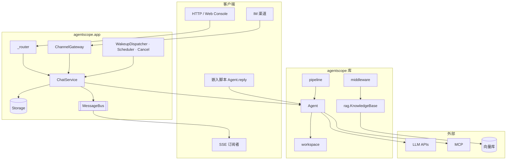

### A.2 端到端时序：嵌入 vs App

**嵌入**（无 Bus）：

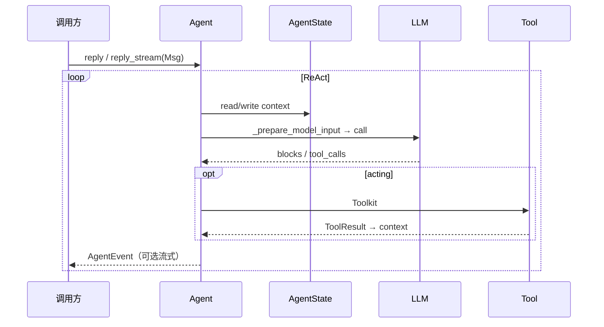

**App**（Bus + Storage）：

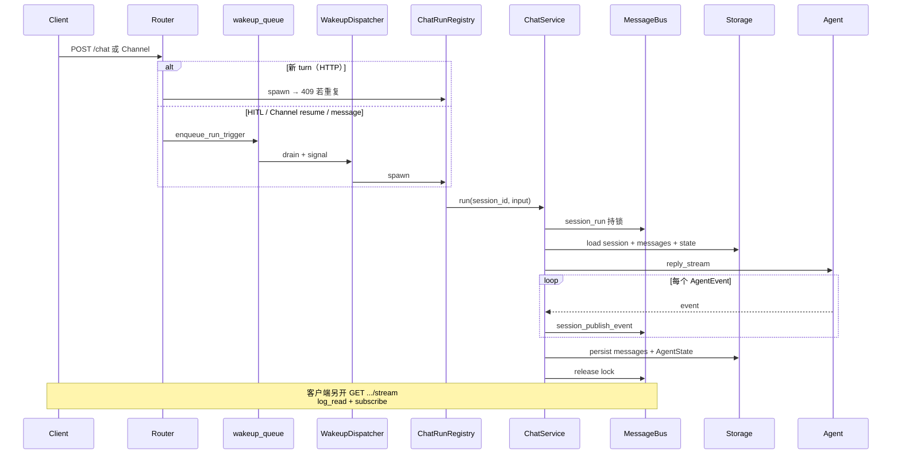

### A.3 数据平面 S / W / L / T（架构图）

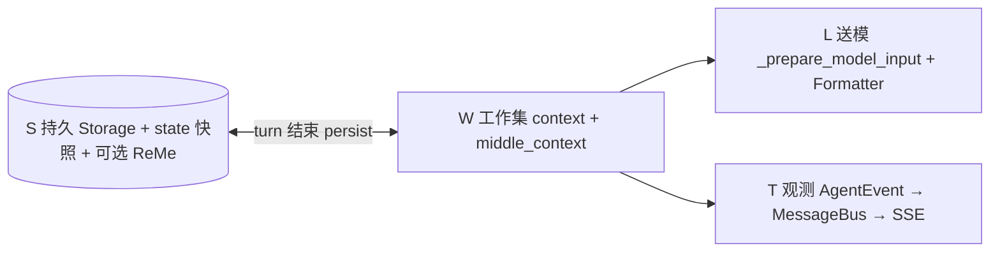

---

## B. 库层模块 {#b-lib}

### B1. message + state {#b1-message-state}

**架构图**

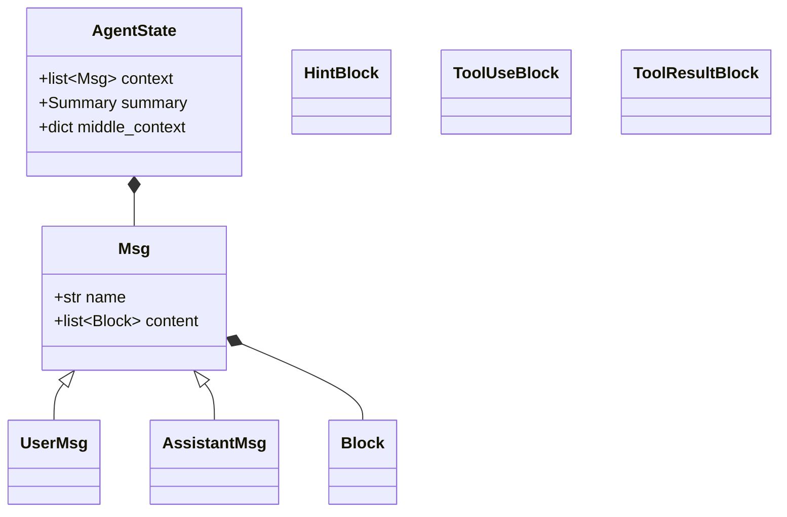

**时序图：写入 context → 压缩 → 送模投影**

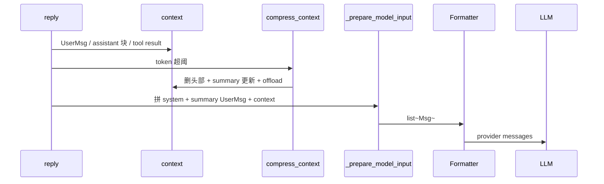

---

### B2. agent（ReAct） {#b2-agent-react}

**架构图**

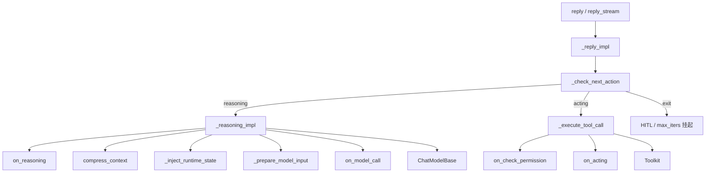

**时序图：单轮 reasoning + acting**

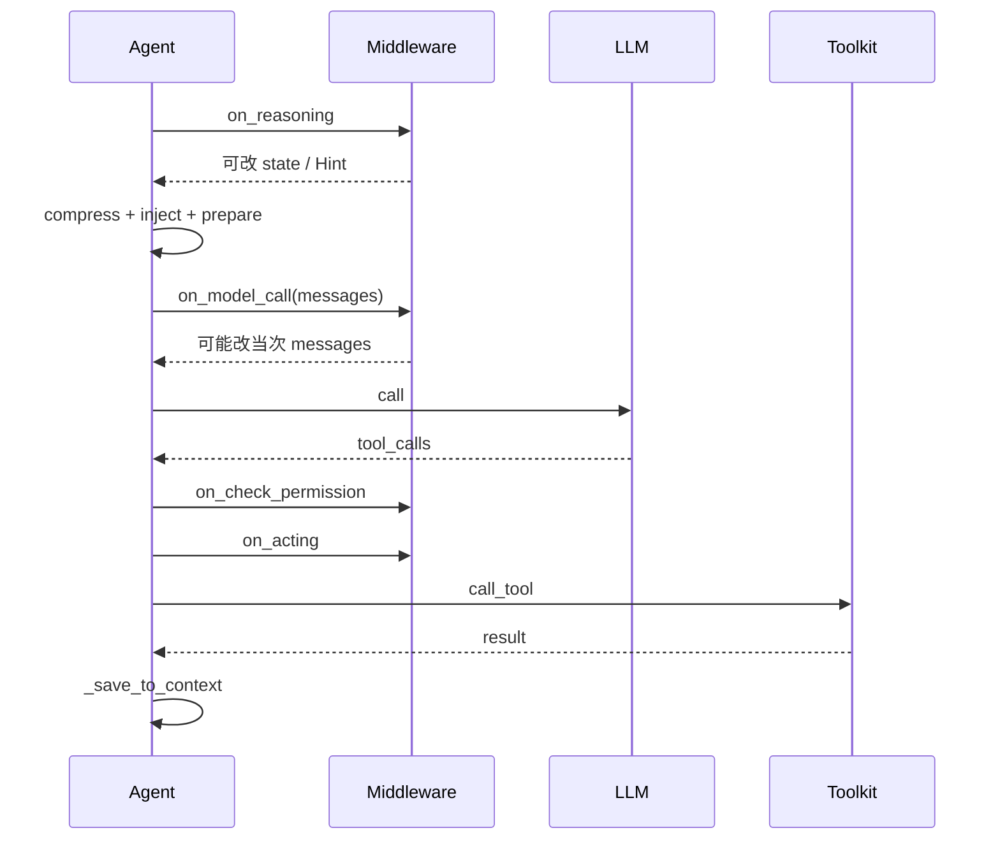

---

### B3. model + formatter + credential {#b3-model-formatter}

**架构图**

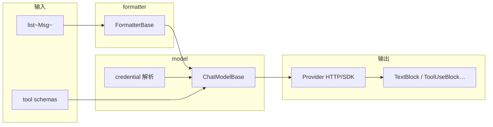

**时序图：一次 model 调用**

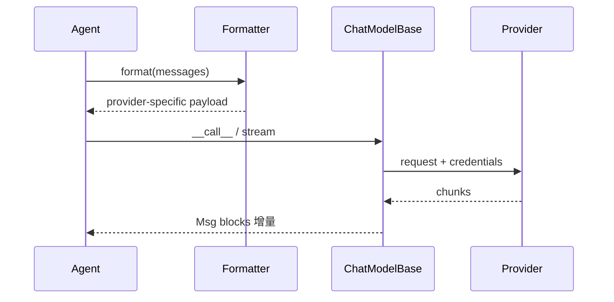

---

### B4. tool + mcp + permission {#b4-tool-mcp-permission}

**架构图**

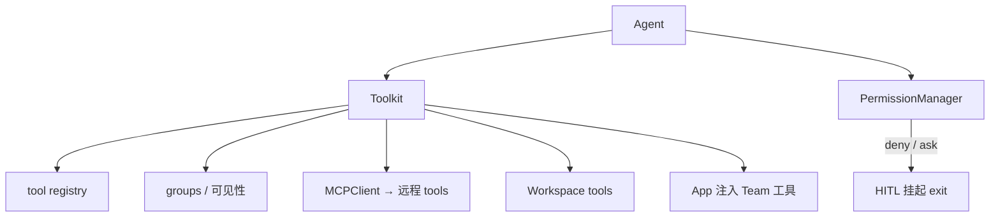

**时序图：带审批的工具调用**

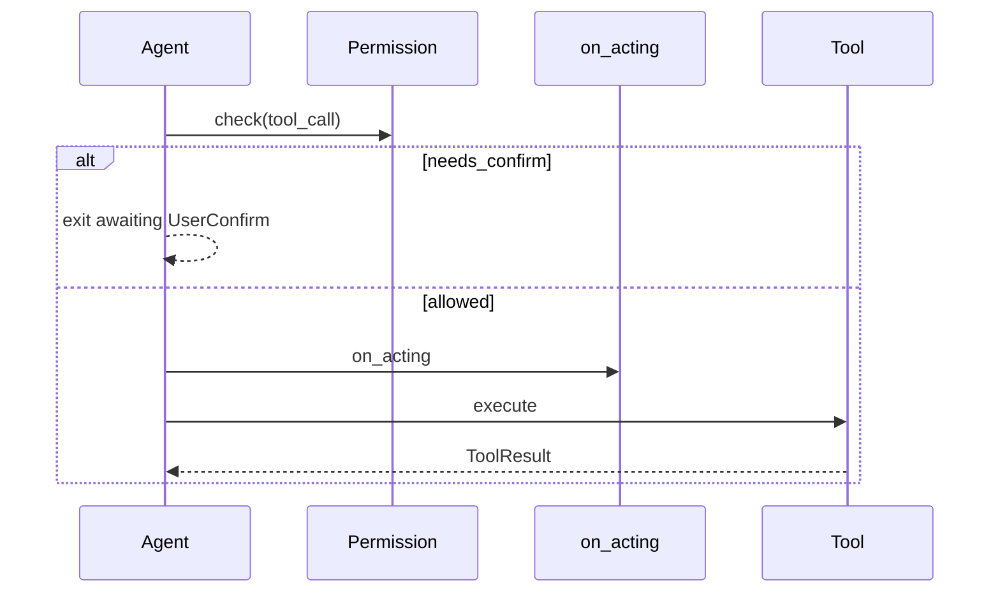

---

### B5. event（AgentEvent） {#b5-event}

**架构图**

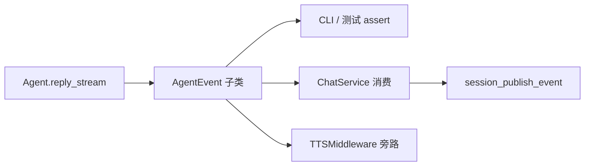

**时序图：事件旁路（不写入 context）**

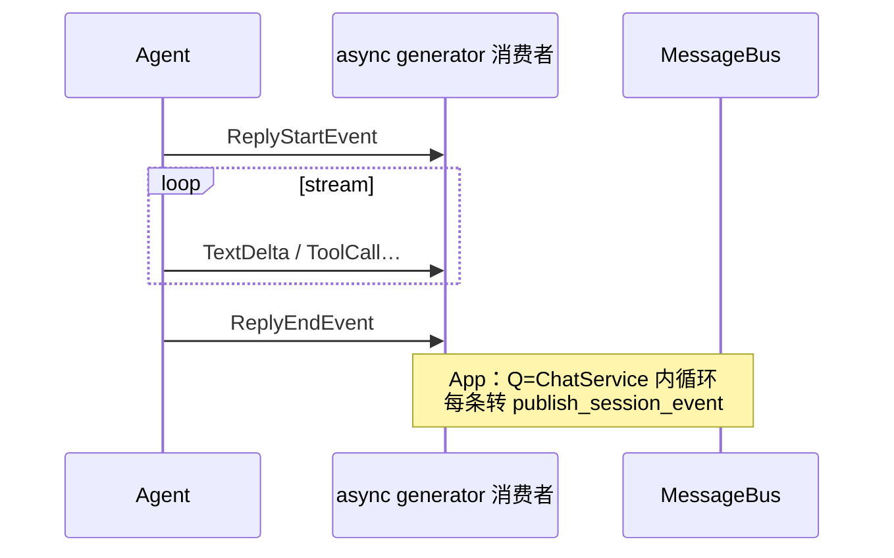

---

### B6. middleware（库） {#b6-middleware-lib}

**架构图**

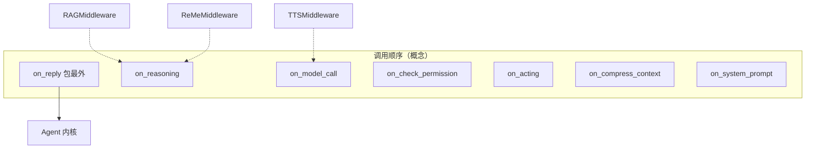

**时序图：RAG auto 检索 → HintBlock**

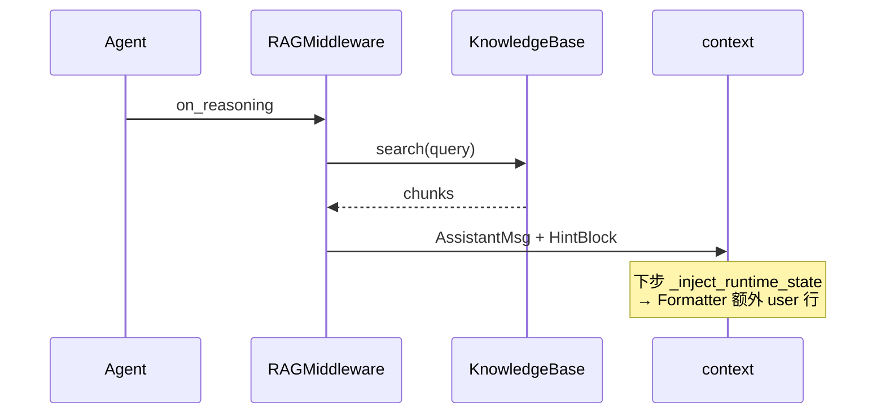

---

### B7. workspace {#b7-workspace}

**架构图**

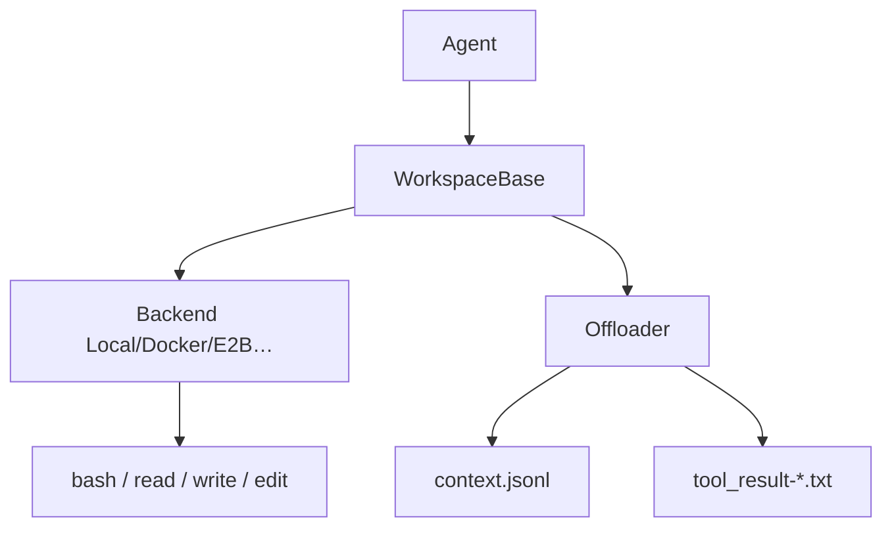

**时序图：大 tool result 截断 + offload**

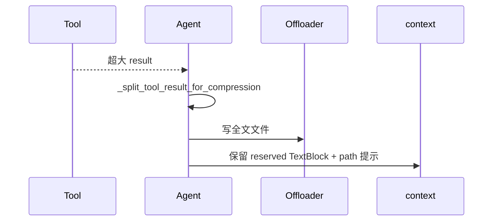

---

### B8. rag + embedding {#b8-rag-embedding}

**架构图**

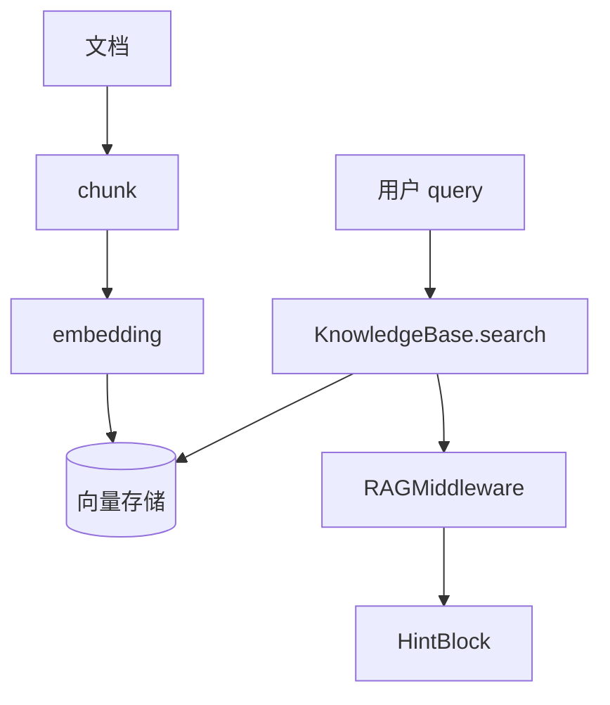

**时序图：库内自建 RAG（无 App worker）**

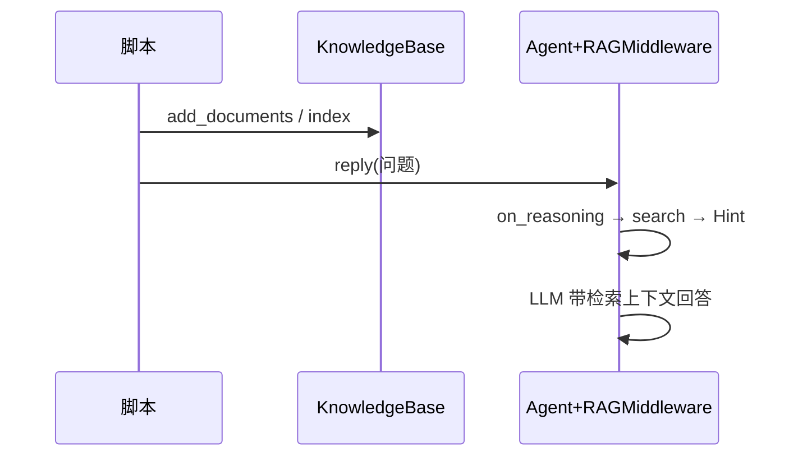

---

### B9. pipeline {#b9-pipeline}

**架构图**

```mermaid
flowchart TB
    subgraph goal["GoalPipeline"]
        G[goal Msg] --> E[Executor Agent]
        E --> V[Verifier Agent]
        V -->|retry| E
    end
    subgraph team["TeamPipeline"]
        L[Leader] --> M1[Member state A]
        L --> M2[Member state B]
    end
```

**时序图：GoalPipeline 验收环**

```mermaid
sequenceDiagram
    participant P as GoalPipeline
    participant E as Executor
    participant V as Verifier

    P->>E: reply(goal)
    E-->>P: ExecutionReport
    P->>V: reply(report)
    alt fail
        V-->>P: feedback
        P->>E: reply(feedback)
    else pass
        V-->>P: done
    end
```

---

### B10. 库扩展（skill / sop / voice / A2A…） {#b10-extensions-lib}

**架构图**

```mermaid
flowchart TB
    SK[skill 包] --> AG[Agent tools/prompt]
    SOP[SOPEngine 库] --> STEPS[milestone 状态机]
    RT[RealtimeAgent] --> WS[WebRTC 音频链]
    TTS[tts/asr Middleware] --> AG
    A2A[A2AAgent] --> REMOTE[远程 Agent 协议]
    CLS[classifier] --> EVAL[评测流水线]
    UI[console/tui] --> AG
```

**时序图：Skill 加载进 Toolkit**

```mermaid
sequenceDiagram
    participant U as 开发者
    participant SV as SkillViewer/loader
    participant TK as Toolkit
    participant A as Agent

    U->>SV: load skill path
    SV->>TK: register tools + prompt 片段
    U->>A: Agent(toolkit=TK)
    A->>TK: call skill tool
```

---

## C. App 层模块 {#c-app}

> **人话总览（设计图 + 启动 + 收发消息）**：[AGENTSCOPE · App §2.1](./AGENTSCOPE.md#app-architecture-overview)  
> **包结构组件图 + 类图**：[AGENTSCOPE · App §2.2](./AGENTSCOPE.md#app-package-diagrams)

### C0. App 包组件与类（总图） {#c0-app-package}

与 [§2.2](./AGENTSCOPE.md#app-package-diagrams) 同图；此处便于从图集 §C 直接进入。

**组件架构（按目录）**

```mermaid
flowchart LR
    subgraph app_pkg ["agentscope.app"]
        R["_router"]
        S["_service"]
        M["_manager"]
        CH["channel"]
        ST["storage"]
        BU["message_bus"]
        WM["workspace_manager"]
    end
    R --> S
    M --> S
    CH --> S
    S --> ST
    S --> BU
    S --> WM
    S --> AG["库 Agent"]
```

**核心类关系（摘要）**

```mermaid
classDiagram
    class StorageBase {
        <<abstract>>
    }
    class MessageBus {
        <<abstract>>
    }
    class ChatService
    class WakeupDispatcher
    class ChannelGateway
    class Agent {
        <<library>>
    }
    ChatService --> StorageBase
    ChatService --> MessageBus
    ChatService --> Agent
    WakeupDispatcher --> ChatService
    WakeupDispatcher --> MessageBus
    ChannelGateway --> MessageBus
```

完整类图与类型表见 [AGENTSCOPE §2.2](./AGENTSCOPE.md#app-package-diagrams)。

---

### C1. create_app + lifespan {#c1-app-factory}

**架构图**

```mermaid
flowchart TB
    CA[create_app] --> ST[state: storage bus workspace hubs channels]
    CA --> RT[include_router × N]
    CA --> LF[_lifespan]
    LF --> STG[Storage.__aenter__]
    LF --> BUS[MessageBus.__aenter__]
    LF --> CS[ChatService + SessionService + SOPService]
    LF --> WD[WakeupDispatcher]
    LF --> SM[SchedulerManager]
    LF --> CL[ChannelLifecycleDispatcher + Gateway]
    LF --> IX[IndexTaskConsumer + Sweeper]
    LF --> CD[CancelDispatcher]
    DEPS[deps: 从 app.state 注入] --> RT
```

**时序图：进程启动**

```mermaid
sequenceDiagram
    participant U as uvicorn
    participant A as FastAPI lifespan
    participant W as WakeupDispatcher
    participant B as MessageBus

    U->>A: startup
    A->>B: connect
    A->>W: create task subscribe wakeup_signal
    A->>A: start scheduler / channel / index consumers
    Note over U: ready 接 HTTP + IM webhook
```

---

### C2. ChatService {#c2-chat-service}

**从触发到 SSE（角色 + 三类 Bus 通道 + 双轨时序）**：与 [AGENTSCOPE · App §4](./AGENTSCOPE.md#part-app)（§4.1–§4.6）同文；本节保留 run 内部视图。  
**Registry 409 vs `session_lock`**：[AGENTSCOPE · §4.3.1](./AGENTSCOPE.md#app-registry-vs-session-lock)。

**架构图**

```mermaid
flowchart TB
    CS[ChatService.run] --> ACC[ResourceAccessService]
    CS --> WM[WorkspaceManager.get]
    CS --> ASM[装配 Middleware + Toolkit]
    CS --> AG[Agent.reply_stream]
    CS --> PUB[publish_session_event]
    CS --> PST[_persist messages + state]
    CS --> CHDEL[channel deliver]
    CS --> LOCK[bus.session_run 锁]
```

**时序图：run 持锁全路径**

```mermaid
sequenceDiagram
    participant CS as ChatService
    participant B as MessageBus
    participant S as Storage
    participant A as Agent
    participant INB as InboxMiddleware

    CS->>B: async with session_run(sid)
    CS->>S: load AgentRecord + SessionRecord
    CS->>CS: team role + workspace + channel origin
    CS->>A: construct Agent + middlewares
    CS->>B: register_inbox_consumer
    CS->>A: reply_stream(input)
    loop events
        A-->>CS: AgentEvent
        CS->>B: session_publish_event
    end
    CS->>S: upsert messages + update_session_state
    CS->>B: abandon_inbox_consumer
    Note over B: 释放 session_lock
```

---

### C3. Storage {#c3-storage}

**架构图**

```mermaid
classDiagram
    class StorageBase {
        +get_session()
        +upsert_message()
        +update_session_state()
    }
    class AsyncSQLAlchemyStorage
    class RedisStorage
    StorageBase <|-- AsyncSQLAlchemyStorage
    StorageBase <|-- RedisStorage
    StorageBase --> SessionRecord
    StorageBase --> AgentRecord
    StorageBase --> TeamRecord
    StorageBase --> ScheduleRecord
```

**时序图：turn 结束持久化**

```mermaid
sequenceDiagram
    participant CS as ChatService
    participant S as Storage
    participant B as MessageBus

    Note over CS: run 末尾 _persist
    CS->>S: upsert_message(user + assistant…)
    CS->>S: update_session_state(AgentState JSON)
    CS->>B: 可选 event checkpoint 与 cursor 对齐
    Note over S: 真源：可崩溃恢复的对话与 state
```

---

### C4. MessageBus（完整） {#c4-message-bus}

MessageBus 是 **live 协调层**，与 **Storage 持久层** 分离。实现：`InMemoryMessageBus`（单进程）、`RedisMessageBus`（多副本）。

#### C4.1 三种消费语义（架构图）

```mermaid
flowchart TB
    subgraph bus ["MessageBus 原语"]
        subgraph modeA ["Mode A drain queue"]
            QP["queue_push"]
            QD["queue_drain"]
        end
        subgraph modeC ["Mode C replay log"]
            LA["log_append"]
            LR["log_read"]
            LT["log_trim"]
        end
        subgraph modeD ["Mode D pub sub"]
            PB["publish"]
            SUB["subscribe"]
        end
        subgraph extra ["附加"]
            LOCK["acquire_lock registry"]
        end
    end

    subgraph keys ["MessageBusKeys 业务键"]
        INB["inbox 按 session"]
        WQ["wakeup_queue"]
        SE["session_events 按 session"]
        SL["session_lock 按 session"]
        IT["index_tasks_queue"]
        SIG["wakeup_signal index_tasks_signal"]
    end

    INB --> QP
    WQ --> QP
    IT --> QP
    SE --> LA
    SE --> PB
    SL --> LOCK
    SIG --> PB
```

| Mode | 语义 | 典型键 | 丢消息？ |
|------|------|--------|----------|
| **A drain** | 单消费者、读出即删 | `inbox`, `wakeup_queue`, `index_tasks_queue` | 未 drain 前在队列；TTL 可过期 |
| **C replay** | 多读者、有界 log | `session_events` | trim 后旧事件丢失（**非对话真源**） |
| **D pub/sub** | 瞬态广播 | `wakeup_signal`, `schedule_lifecycle`, cancel channels | 离线订阅者收不到 |

**对话与 state 真源**：`Storage` + `AgentState` 快照；Bus 事件 **可丢、可 trim**，仅观测与协调。

#### C4.2 MessageBusKeys 全表（架构索引）

| 键方法 | 用途 |
|--------|------|
| `session_events(sid)` | SSE replay + 实时 fan-out |
| `session_event_checkpoint(sid)` | replay cursor 持久 |
| `session_lock(sid)` | 每 session 至多一个 `ChatService.run` |
| `inbox(sid)` / `inbox_lock` / `inbox_consumer` | 跨 turn 消息与 drain 互斥 |
| `wakeup_queue()` / `wakeup_signal()` | 统一 run 触发 |
| `projection_namespace(sid)` | 子 Agent HITL 卡片投影到 leader UI |
| `sop_lock` / `sop_run_lock` / `sop_dispatch` | SOP 三层锁与 step 停放 |
| `session_cancel` / `task_cancel` / `session_interrupt` | 取消与优雅中断广播 |
| `bg_tasks(sid)` | 后台任务注册 |
| `index_tasks_queue` / `index_tasks_signal` | KB 索引管道 |
| `schedule_lifecycle` | 定时任务 reconcile 信号 |
| `channel_*` | 渠道 reconcile、心跳、媒体缓冲、seen_chats |

Wakeup **kind**：`wake` · `resume` · `message`（见 `MessageBusKeys.WAKEUP_KIND_*`）。

#### C4.3 类图：Bus 与业务封装

```mermaid
classDiagram
    class MessageBus {
        <<abstract>>
        queue_push/drain
        log_append/read/trim
        publish/subscribe
        acquire_lock
        session_run()
        session_publish_event()
    }
    class MessageBusKeys {
        session_events()
        inbox()
        wakeup_queue()
        ...
    }
    class RedisMessageBus
    class InMemoryMessageBus
    MessageBus <|-- RedisMessageBus
    MessageBus <|-- InMemoryMessageBus
    note for MessageBus "业务键只在 MessageBusKeys；<br/>bus 保持 domain-agnostic"
```

#### C4.4 时序图：SSE 订阅

```mermaid
sequenceDiagram
    participant C as 浏览器
    participant R as GET /sessions/{id}/stream
    participant B as MessageBus
    participant P as SessionProjection

    C->>R: SSE connect
    R->>B: log_read(session_events)
    B-->>R: 重放最近 ≤1000 条
    R->>P: 注入 projection 卡片
    R->>B: subscribe(session_events)
    loop live
        B-->>R: 新 AgentEvent JSON
        R-->>C: text/event-stream
    end
    Note over R: 30s heartbeat
```

#### C4.5 时序图：inbox（session 忙时入站）

```mermaid
sequenceDiagram
    participant IM as 渠道/TeamSay
    participant GW as Gateway / deliver_to_inbox
    participant B as MessageBus
    participant CS as ChatService 运行中
    participant M as InboxMiddleware

    IM->>B: inbox_lock → queue_push(inbox)
    IM->>B: 读 inbox_consumer：有消费者则仅入队
    CS->>M: on_reasoning 开头
    M->>B: drain inbox → HintBlock
    CS->>B: publish HintBlockEvent
    Note over IM,B: 若空闲且无 consumer：<br/>enqueue_run_trigger(wake/message)
```

#### C4.6 时序图：WakeupDispatcher + 锁重试

```mermaid
sequenceDiagram
    participant W as 写入方 HTTP/Channel
    participant B as MessageBus
    participant D as WakeupDispatcher
    participant CR as ChatRunRegistry
    participant CS as ChatService

    W->>B: queue_push(wakeup_queue, kind+session+payload)
    W->>B: publish(wakeup_signal)
    B->>D: subscribe 唤醒
    D->>B: queue_drain wakeup_queue
    alt session_lock 已占用
        D->>B: 重新 queue_push + backoff
    else 锁空闲
        D->>CR: spawn ChatService.run task
        CR->>CS: run
        CS->>B: session_run 内 acquire lock
    end
```

#### C4.7 时序图：`session_publish_event`（Mode C + D）

```mermaid
sequenceDiagram
    participant CS as ChatService
    participant B as MessageBus
    participant SSE as SSE subscribers

    CS->>B: log_append(session_events, event)
    B->>B: trim 超 SESSION_REPLAY_MAX_LEN
    CS->>B: publish(session_events, event)
    B-->>SSE: 仅当前订阅者收到
```

#### C4.8 时序图：索引任务队列（App RAG）

```mermaid
sequenceDiagram
    participant KB as KnowledgeBaseService
    participant B as MessageBus
    participant I as IndexTaskConsumer

    KB->>B: queue_push(index_tasks_queue)
    KB->>B: publish(index_tasks_signal)
    B->>I: signal
    I->>B: queue_drain
    I->>I: parse/chunk/embed → 向量库
```

---

### C5. Session + Router {#c5-session-router}

**触发 vs 观测解耦**：`POST /chat` 只 spawn/入队；`GET /stream` 只读 `session_events`。完整组件图/路由流程/双时序见 [AGENTSCOPE App §4.1–§4.6](./AGENTSCOPE.md#part-app)。

**架构图**

```mermaid
flowchart TB
    subgraph router["_router"]
        CHAT[POST /chat]
        STR[GET /stream SSE]
        SES[session CRUD]
        AGT[agent 配置]
        SCH[schedule]
        WS[workspace API]
        MCP[mcp hub]
    end
    CHAT --> CR[ChatRunRegistry]
    CHAT --> WQ[wakeup enqueue]
    STR --> BUS[MessageBus session_events]
    SES --> STG[Storage]
```

**时序图：POST /chat 409 vs wakeup**

```mermaid
sequenceDiagram
    participant C as Client
    participant R as POST /chat
    participant CR as ChatRunRegistry

    C->>R: 新用户消息 + session_id
    alt 已有 active run
        R-->>C: 409 Conflict
    else 空闲
        R->>CR: spawn → ChatService.run
        R-->>C: 202 / 空 body（事件走 SSE）
    end
    Note over C: HITL resume 不走 409 路径<br/>走 enqueue_run_trigger(resume)
```

---

### C6. Channel {#c6-channel}

**架构图**

```mermaid
flowchart LR
    IM[飞书/钉钉/Discord] --> ADP[Channel 实现]
    ADP --> GW[ChannelGateway.process]
    GW --> STG[Storage 查 session]
    GW --> BUS[inbox / wakeup]
    CS[ChatService] --> DEL[channel_clients.deliver]
    DEL --> IM
```

**时序图：空闲 vs 忙**

```mermaid
sequenceDiagram
    participant IM as IM
    participant G as ChannelGateway
    participant B as MessageBus
    participant W as WakeupDispatcher

    IM->>G: inbound text
    G->>G: resolve session + lock 探测
    alt session 空闲
        G->>B: enqueue_run_trigger(message)
        B->>W: drain → ChatService.run
    else 忙
        G->>B: deliver_to_inbox only
        Note over G: 不打断当前 run
    end
```

---

### C7. Managers（Wakeup · Registry · Cancel） {#c7-managers}

**架构图**

```mermaid
flowchart TB
    WD[WakeupDispatcher] --> CR[ChatRunRegistry]
    CD[CancelDispatcher] --> CR
    CD --> B[session_cancel / interrupt pub]
    BTM[BackgroundTaskManager] --> B
    SCH[SchedulerManager] --> STG[Storage schedules]
    SCH --> B
```

**时序图：UserInterrupt**

```mermaid
sequenceDiagram
    participant API as interrupt API
    participant B as MessageBus
    participant CD as CancelDispatcher
    participant CS as ChatService.run

    API->>B: publish session_interrupt
    B->>CD: subscribe
    CD->>CS: 注入 UserInterruptEvent / cancel task
    CS->>CS: Agent 优雅结束 turn
```

---

### C8. Team + Scheduler {#c8-team-scheduler}

**架构图**

```mermaid
flowchart TB
    L[Leader session] --> AC[AgentCreate tool]
    AC --> WR[Worker SessionRecord]
    L --> TS[TeamSay]
    TS --> B[inbox worker / leader]
    SCH[ScheduleRecord] --> SM[SchedulerManager]
    SM --> B[inbox 或 wakeup]
```

**时序图：TeamSay → worker inbox**

```mermaid
sequenceDiagram
    participant L as Leader Agent
    participant T as TeamSay tool
    participant B as MessageBus
    participant W as Worker ChatService

    L->>T: say(to=worker, text)
    T->>B: deliver_to_inbox(worker_sid)
    T->>B: enqueue wake if idle
    W->>W: InboxMiddleware drain → Hint
    W->>W: reply 继续 worker turn
```

---

### C9. WorkspaceManager（App） {#c9-workspace-manager}

**架构图**

```mermaid
flowchart TB
    WM[WorkspaceManagerBase] --> L[Local]
    WM --> D[Docker / E2B / K8s / Daytona…]
    CS[ChatService] --> WM
    WM --> WS[库 workspace 实例]
```

**时序图：每 run 绑定沙箱**

```mermaid
sequenceDiagram
    participant CS as ChatService
    participant WM as WorkspaceManager
    participant A as Agent

    CS->>WM: get_workspace(session_id)
    WM-->>CS: WorkspaceBase + cwd 策略
    CS->>A: permission + toolkit 注入路径
```

---

### C10. App RAG（KB Manager + IndexWorker） {#c10-app-rag}

**架构图**

```mermaid
flowchart TB
    API[上传 / KB API] --> KBS[KnowledgeBaseService]
    KBS --> BS[blob_store]
    KBS --> BQ[MessageBus index_tasks_queue]
    IC[IndexTaskConsumer] --> BQ
    IC --> KB[KnowledgeBase 库]
    IC --> VDB[(向量库)]
    CS[ChatService] --> RAG[RAGMiddleware]
    RAG --> KB
```

**时序图**：见 [§C4.8](#c4-message-bus)。

---

### C11. Hub + Access {#c11-hub-access}

**架构图**

```mermaid
flowchart LR
    HUB[hub Skill/MCP 注册] --> TK[get_toolkit 合并]
    ACC[ResourceAccessService] --> STG[Storage ACL]
    CS[ChatService] --> ACC
    CS --> TK
```

**时序图：跨用户读 session**

```mermaid
sequenceDiagram
    participant CS as ChatService
    participant A as ResourceAccessService
    participant S as Storage

    CS->>A: assert_can_access(user, session)
    A->>S: load + policy check
    alt denied
        A-->>CS: HTTPException 403
    else ok
        A-->>CS: SessionRecord
    end
```

---

### C12. App Middleware {#c12-app-middleware}

**架构图**

```mermaid
flowchart TB
    CS[ChatService 装配] --> INB[InboxMiddleware]
    CS --> SCM[StateChangeMiddleware]
    CS --> TOF[ToolOffloadMiddleware]
    CS --> TML[TeamMemberLoopMiddleware worker]
    CS --> SOP[SOPStepSubmitMiddleware]
    INB --> BUS[MessageBus inbox]
```

**时序图：Inbox → Hint → SSE**

```mermaid
sequenceDiagram
    participant M as InboxMiddleware
    participant B as MessageBus
    participant A as Agent
    participant CS as ChatService

    M->>B: drain inbox(sid)
    M->>A: HintBlock in context
    A-->>CS: HintBlockEvent
    CS->>B: session_publish_event
```

---

### C13. SOP（App 托管） {#c13-sop-app}

**架构图**

```mermaid
flowchart TB
    SOP[SOPService] --> STG[SOPRun 持久]
    SOP --> CS[每 step ChatService.run]
    SOP --> B[sop_lock / sop_dispatch]
    TOOL[sop_submit tool] --> SOP
```

**时序图：step 停放与 resume**

```mermaid
sequenceDiagram
    participant S as SOPService
    participant CS as ChatService
    participant B as MessageBus
    participant A as Agent

    S->>CS: run step N
    A-->>S: HITL park
    S->>B: sop_dispatch 记录 run:step
    Note over S: 用户提交 / resume
    S->>B: enqueue_run_trigger(resume)
    S->>CS: 继续同 step 或 N+1
```

---

### C14. Realtime（App WebRTC） {#c14-realtime}

**架构图**

```mermaid
flowchart LR
    RT[_router/_realtime] --> RS[WebRTC session service]
    RS --> RA[RealtimeAgent 库]
    RA --> TR[音频 transport]
    RA --> LLM[实时模型]
```

**时序图：会话建立**

```mermaid
sequenceDiagram
    participant C as Client
    participant R as /realtime API
    participant S as WebRTCSession
    participant A as RealtimeAgent

    C->>R: offer / ICE
    R->>S: create peer
    S->>A: attach audio loop
    loop media
        C->>A: audio in
        A->>C: audio out + events
    end
```

---

## D. 跨切面 {#d-cross}

### D1. 窗口记忆 vs LTM {#d1-ltm}

**架构图**

```mermaid
flowchart LR
    subgraph window["AgentState 窗口"]
        CTX[context + summary]
    end
    subgraph ltm["LTM 产品"]
        REME[ReMeMiddleware / QwenPaw MemoryMiddleware]
        VAULT[(ReMe 工作区 / 向量)]
    end
    REME <-->|search write| VAULT
    REME -.->|Hint 或 on_model_call| CTX
```

**时序图**：见 [REME_ARCHITECTURE.md](./REME_ARCHITECTURE.md) §9。

---

## E. 维护约定

1. 新增 `agentscope` 包或 `app/` 子目录时，先在 **§0 清单** 加一行，再补 **架构图 + 时序图** 小节。  
2. `MessageBusKeys` 新增方法时，同步更新 [§C4.2](#c4-message-bus)。  
3. 改 `ChatService.run` 或 `WakeupDispatcher` 语义时，同步 **§C2、§C4.6、§C5**。  
4. [ARCHITECTURE_DIAGRAMS.md](./ARCHITECTURE_DIAGRAMS.md) 保持短摘要，详细图以 **本文** 为准。
