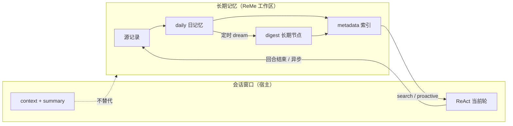
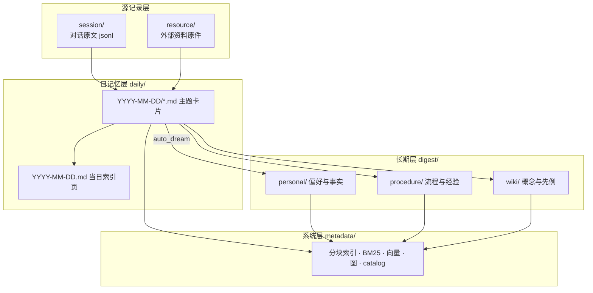
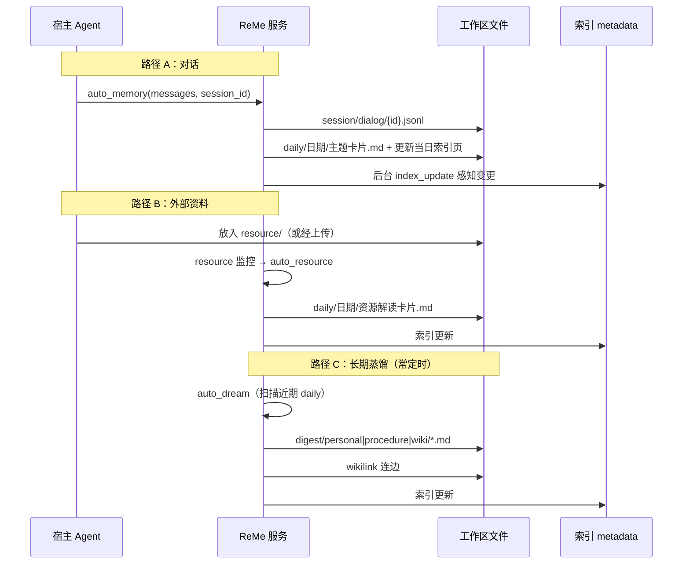
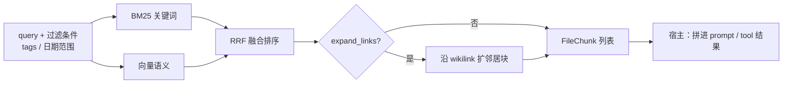
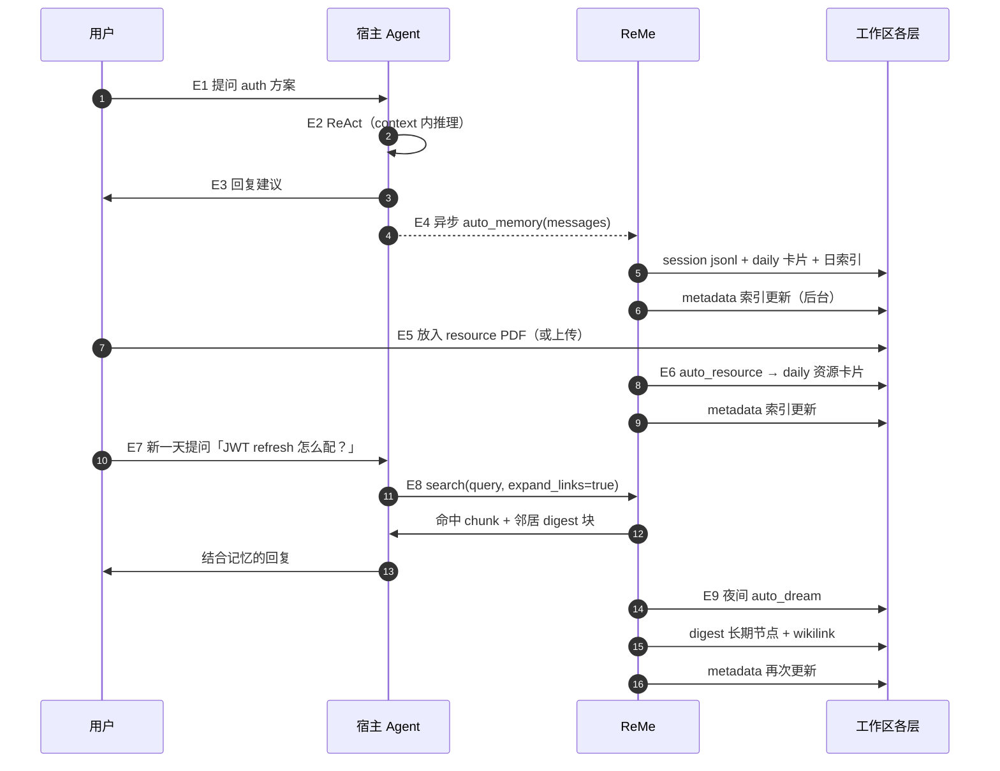
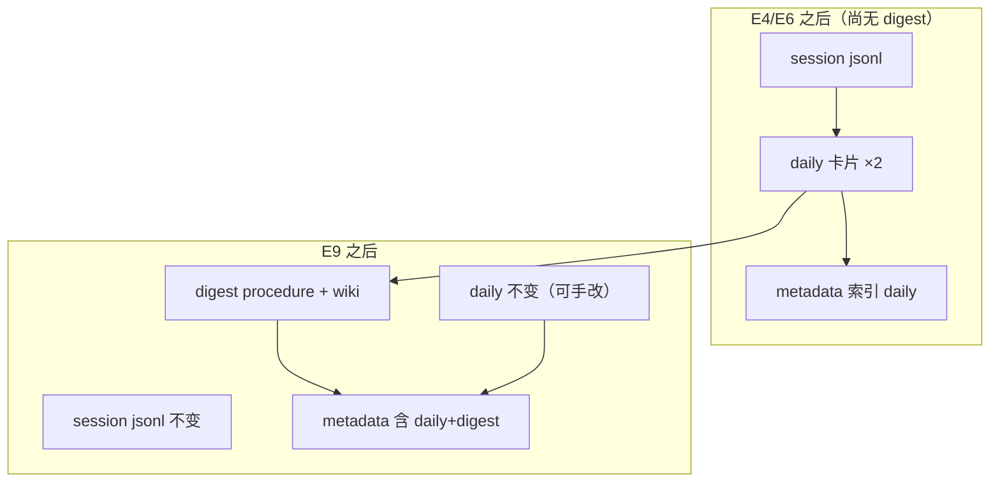
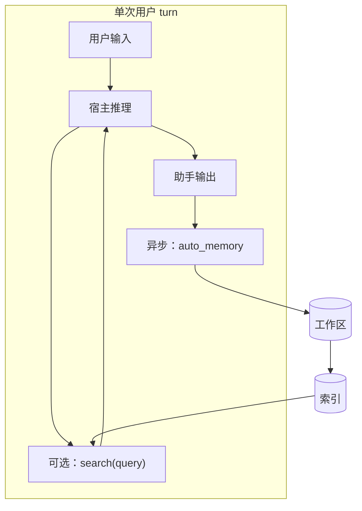
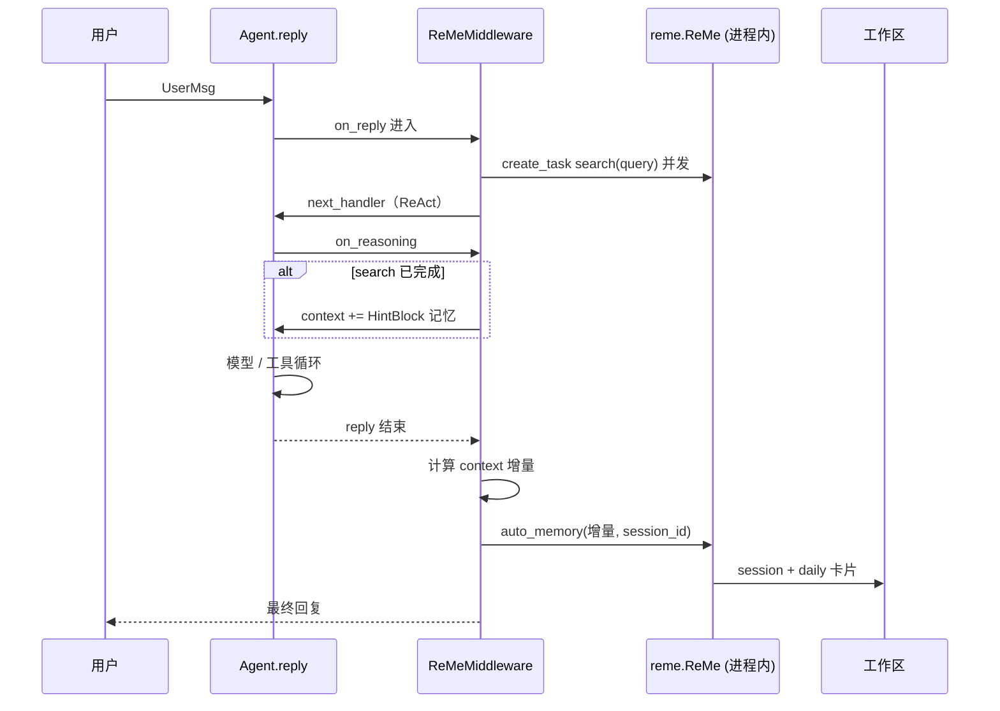
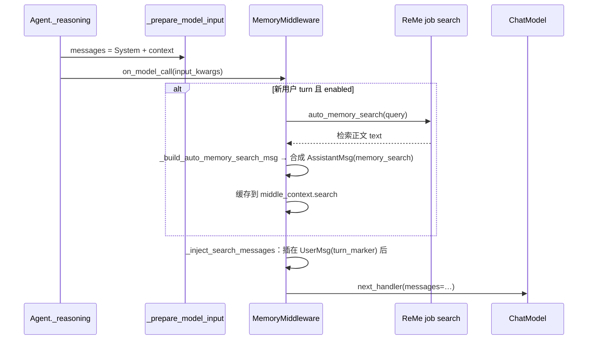

# ReMe 记忆产品设计

| 项 | 说明 |
|----|------|
| **文档类型** | 记忆分层与读写链路（产品 / 设计视角） |
| **ReMe 是什么** | **Local-first 个人知识库（PKB）运行时**：把对话与资料蒸馏成工作区里的 Markdown，再供任意 Agent **跨会话检索** |
| **官方产品文档** | [reme.agentscope.io](https://reme.agentscope.io) · 语义原文 [memory_as_file](https://github.com/agentscope-ai/ReMe/blob/main/docs/en/memory_as_file.md) |
| **与 AgentScope 关系** | 窗口在 `AgentState`；跨会话走 **`ReMeMiddleware`**（见 [§9.1](#91-agentscope-集成读写时机与-rememiddleware)）→ [AGENTSCOPE · Memory / Middleware](./AGENTSCOPE.md#part-memory) |
| **最后更新** | 2026-10-13 |

**想先看例子**：ReMe 文件分层 → [§8](#8-完整示例事件流与各层存储内容)；AgentScope **`ReMeMiddleware`** → [§9.1](#91-agentscope-集成读写时机与-rememiddleware)；**QwenPaw** → [§9.2](#92-qwenpaw-集成memorymiddleware--reme-light非-rememiddleware)。

---

## 1. 一句话

ReMe 把长期记忆做成 **用户可读、可改、可搬走的文件**；用 **分层目录** 表达「源记录 → 日工作台 → 长期知识」；用 **索引 + 图** 支撑检索；通过 **写入流水线** 和 **检索流水线** 对接宿主 Agent，而不是把记忆塞进模型 context 黑盒。

---

## 2. 能力边界（和宿主 Agent 怎么分工）

| 谁负责 | 做什么 |
|--------|--------|
| **宿主**（AgentScope、QwenPaw、Claude Code 等） | 单轮 / 单会话推理；context 压缩；tool 结果截断；`/compact` 一类「窗口内」操作 |
| **ReMe** | 跨会话 **写入** 有价值的信息；**检索** 历史记忆；**蒸馏** daily → digest；**主动推送**「今天值得看」的摘要（可选） |



**设计结论**：不要把 ReMe 当成「另一个向量库字段」；它是 **带演进语义的文件系统 + 检索产品**。

---

## 3. 设计思想：Memory as File

### 3.1 两个口号

- **Memory as File**：长期记忆的真源是工作区里的 `.md` / `.jsonl` 等 **用户拥有的文件**；`metadata/` 是 **可丢弃、可重建** 的派生状态。  
- **File as Memory**：每个文件不仅是笔记，而是 **可切块、可连边、可演进** 的记忆节点（frontmatter、正文结构、wikilink）。

### 3.2 为什么用文件而不是「记忆数据库」

| 目标 | 文件方案带来的性质 |
|------|-------------------|
| **可读** | 直接打开 `daily/`、`digest/` 像读笔记 |
| **可编辑** | 人改一句、Agent 改一段，无需专用客户端 |
| **可追溯** | digest 里用 Sources 指回 daily / session / resource |
| **可移植** | 整个目录可备份、同步、进 Git |
| **可协作** | 人与 Agent 改同一套文件；检索层跟在后面维护索引 |
| **可索引** | 纯文本仍可 BM25 / 向量 / 图扩展 |

记忆首先是 **用户的文件**，其次才是 **系统为检索建的索引**。

---

## 4. 记忆分层（核心模型）

四层解决四个不同问题：**留证、当日整理、长期抽象、机器索引**。



### 4.1 各层语义（产品语言）

| 层 | 目录 | 回答的问题 | 典型内容 |
|----|------|------------|----------|
| **源记录** | `session/`、`resource/` | 「当时到底发生了什么 / 原件是什么？」 | 对话 jsonl（过滤 tool/base64 噪音）；PDF/图片等 **路径不变** 的原件 |
| **日记忆** | `daily/` | 「今天发生了什么、得出什么、还要做什么？」 | 按日索引页 + 主题卡片；**不追求最终抽象**，是工作台 |
| **长期记忆** | `digest/` | 「以后还能复用什么？」 | 稳定偏好、项目背景、方法论、概念与决策先例 |
| **系统索引** | `metadata/` | 「怎么快搜、怎么连边？」 | 用户 **一般不手改**；删了可从 md 重建 |

另有 `mem_session/`：Agent 包装器运行产物，**不算用户记忆面**，可忽略。

### 4.2 daily 与 digest 的分工（最重要的心智）

| | daily | digest |
|---|--------|--------|
| **时间尺度** | 以「日」为界 | 跨日、可长期有效 |
| **抽象程度** | 轻加工：摘要、任务、结论草稿 | 深加工：合并重复事实、固化方法 |
| **是否可复制 daily** | — | **不应**简单拷贝；应合并、去重、结构化 |
| **典型触发** | 每轮对话 / 每个资源 | 定时 **dream** 扫描近 N 天 daily |

---

## 5. 核心写链路（Write Path）

写入不是「调一个 embed API」，而是 **源 → 卡片 →（异步）长期节点 → 索引** 的流水线。

### 5.1 总览



### 5.2 路径 A：对话 → 日记忆（Auto Memory）

**触发时机（产品约定）**：一轮 **reply 结束**后把本轮增量交给 ReMe（AgentScope 在 `ReMeMiddleware.on_reply` 的 `finally` 里调 `auto_memory`）；其它宿主可在 turn 后异步等价调用。

**输入**：消息列表 + `session_id`（可选 memory_hint、日期）。

**输出（两层）**：

1. **留证**：`session/dialog/<session_id>.jsonl` — 过滤后的对话源记录（不把 tool 大块、base64 当「用户证据」写进可召回层）。  
2. **可读记忆**：`daily/YYYY-MM-DD/<agent 命名>.md` + 更新 `daily/YYYY-MM-DD.md` 索引页。

**卡片里有什么**：当日事实、结论、待办、指向源会话的 provenance（frontmatter 如 `session_id`、`source_conversation`）。  
**文件名**：由校验后的 frontmatter `name` 决定，**不是** session_id 本身。

### 5.3 路径 B：资源 → 日记忆（Auto Resource）

**触发**：`resource/` 下文件新增或变更（监控循环）。

**行为**：按类型（文本 / 图片等）解读 → 同样落入 **daily 卡片**，与对话卡片 **进入同一检索宇宙**。

### 5.4 路径 C：日记忆 → 长期节点（Auto Dream）

**触发**：通常 **cron 定时**（如每日夜间），也可手动触发。

**行为（概念三步）**：

1. **抽取**：从近 N 天 daily 中识别可复用的 memory units。  
2. **整合**：写入 `digest/personal`、`digest/procedure` 或 `digest/wiki`，并建立 **wikilink** 关系。  
3. **收尾**：更新 catalog / 标记 dream 进度，避免重复蒸馏。

**与 Auto Memory 的关系**：Memory **当天**记；Dream **跨天**沉淀。两者串起来才是「会成长的 PKB」。

### 5.5 人工 / Agent 直接写

ReMe 仍支持 **直接读写移动** 工作区 md（CLI / HTTP / MCP）。  
任何手改都会走同一套 **索引更新**：变更 `daily/` 或 `digest/` → 后台维护 BM25 / 向量 / 图。

---

## 6. 核心读链路（Read Path）

读取是 **查询 → 多路召回 → 融合 →（可选）沿链接扩上下文 → 交给宿主注入**。

### 6.1 总览



**默认检索范围**：已索引的 `daily/` 与 `digest/` 下 Markdown（resource 经 Auto Resource 进入 daily 后才会被搜到）。

### 6.2 索引如何跟上写入（读之前发生了什么）

与「查询」解耦的一条 **后台写索引链路**：

```text
daily/ 或 digest/ 文件变更
    → 检测增删改（启动全量对齐 + 运行中监控）
    → 解析 frontmatter / 标题结构 / wikilink
    → 切成 FileChunk
    → 更新 BM25 +（可选）向量 + 图
    → 快照落 metadata/（重启可恢复）
```

**产品含义**：用户改了一个 md，**不必手动 reindex**；服务在跑时会跟上。全量重建是运维操作，不是日常路径。

### 6.3 检索策略（设计级）

| 环节 | 设计选择 | 目的 |
|------|----------|------|
| 双路召回 | BM25 + embedding | 专有名词 / 精确表述 + 语义改写 |
| 融合 | RRF（倒数排名融合） | 不强行归一化两路分数，鲁棒 |
| 过滤 | tags、日期（从 daily 路径解析） | 缩小「今天 / 某项目」范围 |
| 链接扩展 | 命中块的文件在图中的邻居 | 补全「一个结论关联的另一段背景」 |
| 去重 | 同 chunk 不重复喂给 Agent | 控制 context 膨胀 |

向量路可选：无 embedding 配置时仍可 **仅 BM25** 工作。

### 6.4 主动读（Proactive，可选第四条读路径）

除「用户问一句搜一句」外，ReMe 可从近期 daily **提炼兴趣主题**（如 `interests.yaml`），供宿主在 **开新轮之前** 拉取「今日值得关注」——属于 **push 型读**，不是 search 的替代品。

---

## 7. 记忆节点长什么样（文件契约，非实现）

### 7.1 Frontmatter（身份与溯源）

常见字段：`name`、`description`、`tags` / `memory_tags`、`session_id`、`source_conversation`、`source_resource` 等。  
**作用**：给人看摘要、给检索过滤、给 digest 追溯 Sources。

### 7.2 Wikilink（关系层）

正文里 `[[digest/wiki/foo.md]]` 或带显示名 `[[path|label]]`。  
**作用**：digest 之间、daily 与 digest 之间织网；检索时可 **沿边扩展**。

### 7.3 分块（检索单位）

检索返回的是 **块（chunk）**，不是整文件：按 Markdown 结构切，使「一节结论」可单独命中。  
用户编辑文件后，块会随索引更新 **整体替换该文件的旧块**。

---

## 8. 完整示例：事件流与各层存储内容

下面用 **一条连续故事** 把「宿主里发生什么」和「工作区每一层落什么」对齐。人物与项目均为虚构；路径与字段与 ReMe 产品语义一致。

**设定**

| 项 | 值 |
|----|-----|
| 工作区 | `~/reme-workspace/` |
| 日期 | `2026-10-13` |
| 会话 | `session_id = sess-naviforge-auth` |
| 宿主 | 某 AgentScope App（带 ReMe HTTP 集成） |

---

### 8.1 参与角色与「第 0 层」（宿主窗口，不在 ReMe 里）

ReMe **不保存** 完整 ReAct 轨迹；宿主在内存里维护当前轮可见内容。

| 时刻 | 宿主内（`AgentState`） | 是否写入 ReMe |
|------|------------------------|---------------|
| 推理中 | `context` 含用户句、助手草稿、tool_call、大段 `read_file` 结果 | 否 |
| 压缩后 | 旧轮进 `summary`，tool 巨结果被截断或卸载 | 否 |
| 回合结束 | 仍只在内存 / App Storage 的 session checkpoint | **随后** 异步 `auto_memory` |

```text
第 0 层（宿主）示例 — LLM 当轮看到的投影（概念）:

  system: 你是 Naviforge 助手…
  summary: （上周讨论的压缩摘要，若有）
  context:
    - user: 我们 auth 打算用 JWT + refresh，过期 15 分钟，你觉得呢？
    - assistant: 可以，但要注意 refresh 轮换与吊销列表…
    - tool_result: （read_file oauth.md 共 400 行 — 可能已被截断）
```

**要点**：tool 大块、base64 图片 **不会** 作为「用户证据」进入 ReMe 的 `session/*.jsonl`。

---

### 8.2 事件时间线（总览）



---

### 8.3 逐事件：每层多了什么

#### E1–E3：仅宿主（ReMe 工作区不变）

| 层 | 路径 | 内容 |
|----|------|------|
| 宿主 context | 内存 | 见 §8.1 |
| session / daily / digest / metadata | — | **无变化** |

---

#### E4：`auto_memory` 之后（对话写链路）

**触发**：宿主在 E3 返回用户后，后台调用 `auto_memory`（同 `session_id` 多次调用会 **更新同一张卡片**，而非无限新建）。

**工作区新增/更新：**

```text
~/reme-workspace/
├── session/dialog/sess-naviforge-auth.jsonl     ← 源记录（过滤后消息）
├── daily/2026-10-13.md                          ← 当日索引页（追加链到卡片）
└── daily/2026-10-13/jwt-refresh-auth-plan.md    ← 主题卡片（文件名来自 frontmatter name）
```

**① 源记录层 — `session/dialog/sess-naviforge-auth.jsonl`（示意，每行一条 JSON）**

只保留适合留证的角色与文本；**无** tool_result、无 base64。

```jsonl
{"role":"user","content":"我们 auth 打算用 JWT + refresh，过期 15 分钟，你觉得呢？"}
{"role":"assistant","content":"建议 access 15min、refresh 7d，并做 refresh 轮换；吊销用 Redis 黑名单…"}
```

**② 日记忆层 — 卡片 `daily/2026-10-13/jwt-refresh-auth-plan.md`**

```markdown
---
name: jwt-refresh-auth-plan
description: Naviforge 认证方案讨论结论与待办
session_id: sess-naviforge-auth
source_conversation: "[[session/dialog/sess-naviforge-auth.jsonl]]"
tags: [naviforge, auth]
---

# 结论

- Access token TTL **15 分钟**；Refresh **7 天**，每次刷新签发新 refresh（轮换）。
- 吊销：Redis 存 `jti` 黑名单，登出与风控共用。

# 待办

- [ ] 在 `oauth.md` 补序列图
- [ ] 评估移动端无感刷新

# 背景

用户倾向 JWT 双 token，不接受纯 session cookie 方案。
```

**③ 日记忆层 — 索引页 `daily/2026-10-13.md`（片段）**

```markdown
# 2026-10-13

## 记忆卡片

- [[daily/2026-10-13/jwt-refresh-auth-plan.md|JWT 与 Refresh 方案]]
```

**④ 系统层 — `metadata/`（概念，非手改）**

| 派生数据 | 来源 | 用途 |
|----------|------|------|
| `FileNode`（路径、mtime） | 上述 md | 变更检测 |
| `FileChunk[]` | 「结论」「待办」等标题下切块 | BM25 / 向量检索 |
| 倒排 / 向量索引 | chunk 文本 | `search` |
| `FileLink` 边 | frontmatter 与正文 wikilink | `expand_links` |
| catalog 检查点 | daily 写入完成 | dream / 增量任务 |

此时 **尚无** `digest/` 新文件；长期层要等 E9。

---

#### E5–E6：资源进入 + `auto_resource`

用户将 OEM 规范 PDF 放进资源目录（示例路径）：

```text
~/reme-workspace/resource/2026-10-13/naviforge-oauth-checklist.pdf
```

监控触发 **auto_resource** 后：

```text
~/reme-workspace/
├── resource/2026-10-13/naviforge-oauth-checklist.pdf   ← 原件不动
└── daily/2026-10-13/oauth-checklist-from-pdf.md         ← 解读卡片
```

**资源卡片示意**

```markdown
---
name: oauth-checklist-from-pdf
description: PDF《OAuth 安全检查清单》要点摘录
source_resource: "[[resource/2026-10-13/naviforge-oauth-checklist.pdf]]"
tags: [naviforge, auth, compliance]
---

# 摘录

- 必须校验 `aud`、`iss`；refresh 端点需限流。
- 建议：[[daily/2026-10-13/jwt-refresh-auth-plan.md|今日 JWT 方案]] 与清单第 3.2 节对齐。

# 行动项

- 对照清单改网关配置。
```

`daily/2026-10-13.md` 索引页再追加一条链到该卡片。  
**metadata** 再次为两个 daily md 重建 chunk 与链接；**resource 原件本身通常不进 search 范围**，检索的是 **daily 解读**。

---

#### E7–E8：读链路 — 新会话里 `search`

**用户**（次日亦可，索引已含昨日 daily）：「JWT refresh 在 Naviforge 里怎么配？」

**宿主**在调用 LLM 前：

```text
search(
  query = "JWT refresh Naviforge 配置",
  tags = ["naviforge"],      # 可选
  expand_links = true
)
```

**ReMe 内部（概念）**

```text
1. BM25 命中 chunk：jwt-refresh-auth-plan.md §「结论」
2. 向量命中 chunk：oauth-checklist-from-pdf.md §「摘录」
3. RRF 合并排序
4. expand_links：沿 [[jwt-refresh-auth-plan]] 拉取相邻块（若链到 digest 则一并扩展）
5. 返回 [{file, chunk_id, text, score}, …] 给宿主
```

**宿主注入（第 0 层，示意）**

```text
<reme_memory>
[1] daily/2026-10-13/jwt-refresh-auth-plan.md#结论
Access 15min；Refresh 7d 轮换；Redis jti 黑名单…
[2] daily/2026-10-13/oauth-checklist-from-pdf.md#摘录
refresh 端点限流；校验 aud/iss…
</reme_memory>

user: JWT refresh 在 Naviforge 里怎么配？
```

各层 **读时不变**；没有新文件，除非本轮结束再次 `auto_memory`（会更新同 session 卡片或新开 session 卡片）。

---

#### E9：夜间 `auto_dream` — 写入长期层

扫描近 N 天 daily 后，生成 **合并后的** digest（不是复制粘贴）：

```text
~/reme-workspace/digest/
├── procedure/naviforge-auth-refresh.md
└── wiki/jwt-rotation-pattern.md
```

**procedure 节点示意 — `digest/procedure/naviforge-auth-refresh.md`**

```markdown
---
name: naviforge-auth-refresh
description: Naviforge 双 token 与刷新轮换的操作约定
tags: [naviforge, auth, procedure]
---

# 约定

- Access **15m** / Refresh **7d**；刷新时轮换 refresh token。
- 吊销统一走 Redis `jti` 集合。

# Sources

- [[daily/2026-10-13/jwt-refresh-auth-plan.md]]
- [[daily/2026-10-13/oauth-checklist-from-pdf.md]]

# 相关

- 通用模式见 [[digest/wiki/jwt-rotation-pattern.md]]
```

**wiki 节点示意 — `digest/wiki/jwt-rotation-pattern.md`**

```markdown
---
name: jwt-rotation-pattern
description: Refresh token 轮换与重用检测（通用）
---

# 模式

签发新 refresh 时作废旧 refresh；检测重用视为盗用…
```

**metadata** 为 digest 建索引；此后 `search("refresh 轮换")` 可能 **优先命中 digest**，daily 仍保留「那天发生了什么」的细节。

---

### 8.4 终态快照：各层各有什么（E9 之后）

| 层 | 代表路径 | 存的是什么 | 谁读 / 谁写 |
|----|----------|------------|-------------|
| **宿主窗口** | App DB / 内存 `AgentState` | 当前会话 Msg、summary | 宿主读写；与 ReMe 异步同步 |
| **源记录** | `session/dialog/*.jsonl` | 过滤后的对话证据 | ReMe 写；人审计读 |
| **源记录** | `resource/**` | 外部原件 | 人/宿主写；ReMe 解读 |
| **日记忆** | `daily/YYYY-MM-DD.md` | 当日目录 | ReMe 写；人可改 |
| **日记忆** | `daily/YYYY-MM-DD/*.md` | 主题卡片（事实/待办/链到源） | ReMe 写；人可改 |
| **长期** | `digest/personal\|procedure\|wiki/*.md` | 跨日稳定知识 + Sources | dream 写；人可改 |
| **系统** | `metadata/**` | chunk、BM25、向量、图、catalog | ReMe 自动；可删后重建 |



---

### 8.5 同一 `session_id` 再聊一轮（更新而非堆叠）

若用户 **当天下午继续** `sess-naviforge-auth` 讨论移动端无感刷新：

1. 宿主 E2–E3 正常推理。  
2. `auto_memory` 用 `session_id` **找到已有卡片** `jwt-refresh-auth-plan.md`，合并新结论、更新待办。  
3. `session/dialog/sess-naviforge-auth.jsonl` **追加**新消息行（仍过滤 tool/base64）。  
4. 索引对该 md **替换旧 chunk**，而非多一张重复卡片。

这是「事件流」里容易忽略的一点：**日记忆按会话聚合，按主题命名**。

---

### 8.6 与 CLI 心智对齐（可选操作）

| 用户意图 | 典型操作 | 影响的层 |
|----------|----------|----------|
| 刚聊完想立刻落盘 | 宿主调 `auto_memory` | session + daily |
| 查以前说过啥 | `search` / `read` | 读 metadata→daily/digest |
| 改了 md 想搜到 | 保存文件即可（服务在跑） | metadata 自动跟 |
| 强制从文件重建索引 | `reindex`（运维） | 仅 metadata |
| 推动长期沉淀 | 等 dream cron 或手动 `auto_dream` | digest + metadata |

---

## 9. 与宿主集成的典型模式

| 模式 | 写 | 读 |
|------|----|----|
| **AgentScope `ReMeMiddleware`** | 每轮 `reply` 结束自动 `auto_memory` | `static_control` / `both`：reply 开始时后台 `search`，`on_reasoning` 注入；`agent_control`：仅 `memory_search` 工具 → [§9.1](#91-agentscope-集成读写时机与-rememiddleware) |
| **Turn 后异步记忆**（通用宿主） | 每轮结束 `auto_memory` | 下轮前 `search` |
| **仅检索** | 人/Agent 直接改 md | 需要时 `search` / `read` |
| **嵌入式产品**（如 QwenPaw） | `MemoryMiddleware` + ReMe Light；自动 recall 见 [§9.2](#92-qwenpaw-集成memorymiddleware--reme-light非-rememiddleware) | `on_model_call` 假 tool，非 `HintBlock` |
| **Hermes 等** | Provider 挂钩：回合后 memory、回合前 recall | HTTP 或 embedded |
| **SKILL / MCP** | 宿主暴露 search（ReMe **无**手动 add 工具） | Agent 自主决定何时调 |



### 9.1 AgentScope 集成：读写时机与 `ReMeMiddleware`

**是否走 Middleware？** 是。官方集成是库内 [`ReMeMiddleware`](../../agentscope/src/agentscope/middleware/_longterm_memory/_reme/_middleware.py)：进程内嵌入 `reme.ReMe` 应用（需 `pip install "agentscope[memory-reme]"`），**不**单独起 ReMe 服务。

**与 `AgentState` 的分工**

| 平面 | 载体 | ReMeMiddleware 是否碰 |
|------|------|------------------------|
| 当前窗口 | `agent.state.context` / `summary` | 只追加/排除名为 `memory` 的检索 Hint；压缩仍由 Agent 负责 |
| 长期 PKB | `workspace_dir` 下 daily / digest / session | 通过 ReMe job 读写文件与索引 |

**`session_id`**：写回卡片时从 **`agent.state.session_id`** 读取（构造时可 `Agent(state=AgentState(session_id="..."))` 固定会话），Middleware **不**在配置里单独设 id。

#### 读：何时、走哪条路径

**自动检索用 `HintBlock`，不是假 tool；主动检索用真 `memory_search` 工具**（二者可同时开）：

| `Parameters.mode` | 自动读（框架替你搜） | 模型自己搜 |
|-----------------|----------------------|------------|
| `static_control` | ✅ `HintBlock`（见下） | ❌ 不注册工具 |
| `agent_control` | ❌ | ✅ 仅 `memory_search` |
| `both` | ✅ `HintBlock` | ✅ `memory_search` |

| `Parameters.mode` | 读发生时机 | 机制 |
|-------------------|------------|------|
| `static_control` | 每次 `reply` 开始 | `on_reply` 用用户输入抽 query → **后台** `search` job；在 **`on_reasoning`**（每次进模型前）若任务已完成，向 **`context` 追加顶层** `AssistantMsg(name="memory", content=[HintBlock(...)])`（**不是** `ToolCallBlock`） |
| `agent_control` | Agent 决定 | 仅注册 **`memory_search`** 工具（`list_tools()` 挂到 `Toolkit`）；无自动检索 |
| `both` | 两者兼有 | 自动 `HintBlock` + `memory_search` |

`HintBlock` 由 formatter 转成 **额外的 `user` 行**；`auto_memory` 写回时会 **排除** `name="memory"` 的整条 Msg。见 [AGENTSCOPE · §13.8](./AGENTSCOPE.md#hintblock-生产者与送模)。

注意：检索与整段 `reply` **并发**。若本轮只有 **一次** model call 且很快结束，后台 `search` 可能来不及注入（与 `AgenticMemoryMiddleware` 相同的 best-effort 取舍）；多轮 ReAct 或较慢检索时，后续 reasoning 步通常能看到记忆。

读链路对应 ReMe 产品层的 **`search` job**（BM25 / 可选向量），作用域为 **整个 workspace**，不限于当前 `session_id`。

#### 写：何时、写什么

| 时机 | 钩子 | 行为 |
|------|------|------|
| **整段 `reply` 结束之后** | `on_reply` 的 `finally` | 对比 reply 前后 `context` 的 `msg.id`，取**本轮增量**（去掉名为 `memory` 的注入 Hint）；若本轮有用户 query 且至少一条非空 assistant 输出 → 调 **`auto_memory`** job |

`auto_memory` 输入：增量消息的 JSON 序列化 + `session_id`。ReMe 侧再落 `session/dialog/*.jsonl`、更新/合并 **daily 卡片** 并触发索引（见 [§5.2](#52-路径-a对话--日记忆auto-memory)）。**没有** `add_memory` 工具——Agent 不能手动「记一条」；记录由 ReMe 对对话做 LLM 抽取。

写失败只打日志，**不**阻塞 `reply` 返回。

#### 与单次 turn 的时序（`mode=both`）



#### 最小可运行示例

```python
import asyncio

from agentscope.agent import Agent
from agentscope.embedding import OpenAIEmbeddingModel  # 或省略：仅关键词检索
from agentscope.message import UserMsg
from agentscope.middleware import ReMeMiddleware
from agentscope.model import OpenAIChatModel
from agentscope.state import AgentState
from agentscope.tool import Toolkit


async def main() -> None:
    chat_model = OpenAIChatModel(
        model_name="gpt-4o",
        api_key="...",  # 或环境变量
    )
    reme_mw = ReMeMiddleware(
        workspace_dir="./reme-vault",
        parameters=ReMeMiddleware.Parameters(
            chat_model=chat_model,  # auto_memory 抽取所需；可 None 则用 ReMe 环境变量 LLM
            embedding_model=OpenAIEmbeddingModel(
                model_name="text-embedding-3-small",
                api_key="...",
            ),  # 可选：开启向量检索
            mode="both",  # 自动检索 + memory_search 工具
            top_k=5,
        ),
    )

    toolkit = Toolkit()
    # agent_control / both 必须把 middleware 提供的工具注册进 Toolkit
    for tool in await reme_mw.list_tools():
        toolkit.register_tool(tool)

    agent = Agent(
        name="Friday",
        system_prompt="You are a helpful assistant.",
        model=chat_model,
        toolkit=toolkit,
        middlewares=[reme_mw],
        state=AgentState(session_id="demo-session-001"),
    )

    # --- 读：reply 开始时后台 search；on_reasoning 注入（若赶上）---
    # --- 写：本 reply 结束后 auto_memory ---
    await agent.reply(UserMsg("我偏好深色主题，请记住。"))

    # 新会话 id 也可复用同一 workspace；search 仍扫全库
    await agent.reply(UserMsg("我 UI 偏好是什么？"))

    await reme_mw.close()  # 应用退出时关闭嵌入的 ReMe app


if __name__ == "__main__":
    asyncio.run(main())
```

**与 [§8 示例](#8-完整示例事件流与各层存储内容) 对齐**：上面第一次 `reply` 对应 E2–E4 的「回合结束 → `auto_memory`」；第二次 `reply` 对应 E7 的「`search` → 注入 `<reme_memory>` 语义块」——在 AgentScope 里注入形态是 **`HintBlock`**，由 formatter 转成模型可见的 user 侧提示，而不是宿主手写 XML 标签。

**App / ChatService**：若在 `create_app` 里启用 ReMe 中间件，读写时机与上表相同；额外还有 turn 末 `ChatService._persist` 写 **Storage 里的 `AgentState`**，与 ReMe 工作区是 **两条持久化线**（见 [AGENTSCOPE · Memory §15](./AGENTSCOPE.md#part-memory)）。

### 9.2 QwenPaw 集成：`MemoryMiddleware` + ReMe Light（非 `ReMeMiddleware`）

[QwenPaw](https://github.com/agentscope-ai/QwenPaw) 同样用 **AgentScope 2.0 `Agent`**，长期记忆走进程内 **`ReMeLightMemoryManager`**（`reme.ReMe` job），但 **不用** 库内 `ReMeMiddleware`；读写由 **`QwenPaw/agents/middlewares.py` · `MemoryMiddleware`** 对接。

| 维度 | 官方 `ReMeMiddleware` | QwenPaw `MemoryMiddleware` |
|------|----------------------|----------------------------|
| 自动检索注入 | `on_reasoning` → **`context` + `HintBlock`** | **`on_model_call`** → 改 **`input_kwargs["messages"]`  only** |
| 注入形态 | `AssistantMsg(name="memory")` + `HintBlock` | **`AssistantMsg(name="memory_search")`** + 已完成的 `ToolCallBlock` / `ToolResultBlock`（**模拟**已搜完） |
| 是否进 `context` 真源 | ✅ 顶层 memory 行（写回时排除） | ❌ **默认不进** `context`；缓存在 `state.middle_context["qwenpaw_auto_memory_turn_state"]` |
| 是否进聊天历史 DB | 随 `context` persist | Scroll 落库前 **`message_without_auto_memory_search`** 剥掉合成块 |
| 写 `auto_memory` | 每 `reply` 结束 | **`auto_memory_interval` 批处理** + **压缩后 flush**（`submit_auto_memory` 队列） |
| 配置 | `ReMeMiddleware.Parameters.mode` | `reme_light_memory_config.auto_memory_search_config` / `auto_memory_interval` |

**人话**：QwenPaw 在 **调 HTTP 前** 真跑 ReMe `search`，再 **塞一段「好像已经执行过 memory_search」的 tool 轨迹** 给模型看；**账本里不记这段**，避免污染 transcript 与 `AgentState.context` 快照。

#### 9.2.1 自动检索：假 tool 怎么做（`on_model_call`）

Agent 在 `_reasoning_impl` 里先 `_prepare_model_input()` 得到 `messages`，再经 **`on_model_call` 中间件链** 才 `model(messages=…)`（`agent/_agent.py`）。`MemoryMiddleware` **只改** `input_kwargs["messages"]`，**不**调用 `append_context` / `_save_to_context`。



**合成 Msg 结构**（`base_memory_manager._build_auto_memory_search_msg`）：

- `name="memory_search"`（避免与本轮 `reply_id` assistant 合并）
- `content`：`TextBlock` + `ThinkingBlock` + **`ToolCallBlock(state=FINISHED)`** + **`ToolResultBlock(检索 text)`**
- `metadata["auto_memory_search_block_ids"]`：标记哪些 block 是合成的，供落库剥离

**同一用户 turn** 内多次 model call：**复用** `middle_context` 里的 search 缓存，不重复搜。

**与真工具调用的区别**：模型自己调 `memory_search` 时仍走 acting → **`ToolResultBlock` 写入 `context`**；自动路径 **仅当次 HTTP 可见**。

#### 9.2.2 写路径与其它 Hint

| 行为 | 钩子 | 说明 |
|------|------|------|
| System 记忆指引 | `on_system_prompt` | `get_memory_prompt()`：何时用 `memory_search`、daily/digest 路径 |
| 周期写入 ReMe | `on_reply` 结束 | `pending` turn marker 满 interval → `submit_auto_memory` |
| 压缩后写入 | `on_compress_context` 之后 | 压缩前 snapshot 保留待写 turn；`trigger="compact"` |
| `/compact` 等 | QwenPaw `command_handler` | 仍可用 **`HintBlock(source="user")`** 走 `Reasoning(hint=…)` —— 这是 **Agent 内核 Hint**，与 ReMe 自动检索 **无关** |

产品配置与运维说明见 QwenPaw 官方文档 `website/public/docs/memory.*`。

---

## 10. 演进与一致性（产品规则）

| 规则 | 说明 |
|------|------|
| **真源是 md/jsonl，不是索引** | 删 metadata 可重建；删 daily 则记忆没了 |
| **daily 先于 digest** | 没有日层沉淀，长期层容易空或幻觉式抽象 |
| **digest 要合并，不要堆复制** | dream 的价值是 **去重与升格** |
| **源记录过滤** | 对话 jsonl 故意去掉 tool/base64，避免「假证据」进入个人知识 |
| **移动文件要改链** | 工作区支持 move 时，wikilink 应一并维护（产品承诺可移植） |

---

## 11. 和 AgentScope 窗口记忆对照

| 维度 | AgentScope `AgentState` | ReMe 工作区 |
|------|-------------------------|-------------|
| 生命周期 | 当前会话 / 序列化 checkpoint | 月年级 PKB |
| 载体 | 内存 list[Msg] + summary 字符串 | 分层 Markdown + jsonl |
| 压缩 | `compress_context` 物理删 context | daily/digest 语义蒸馏 |
| 检索 | 一般不扫全库；靠 RAG 或中间件 | 原生 hybrid search + 图扩展 |
| 协作方式 | `ReMeMiddleware` 进程内 job（`search` / `auto_memory`） | 亦可 CLI / HTTP / MCP 直连同一工作区 |

二者 **叠加**：窗口管「现在这轮能不能答」；ReMe 管「半年前说过什么还算数」。

---

## 12. 进一步阅读（官方，仍偏产品）

| 主题 | 文档 |
|------|------|
| 分层与目录 | ReMe `docs/en/memory_as_file.md` |
| 检索与索引 | ReMe `docs/en/memory_search.md` |
| Auto Memory / Resource / Dream | ReMe `docs/en/auto_memory.md` 等 |
| AgentScope 侧边界 | [AGENTSCOPE.md](./AGENTSCOPE.md) |

---

## 13. 本文刻意不写的内容

- 仓库目录、Job/Step/Component 类名、YAML 字段全集  
- 部署端口、Docker、插件 entry point  

若要做 **运维或二次开发**，请读 ReMe 官方 [Framework](https://github.com/agentscope-ai/ReMe/blob/main/docs/en/framework.md)；本文只固定 **记忆分层与读写链路** 的产品设计。
