# AgentScope 架构与设计（合并版）

> **源码**: `agentscope/src/agentscope/` · **生成**: `_merge_docs.py` · 专题原文已并入本文，勿再维护散落副本。
> **ReMe**（独立项目）: [REME_ARCHITECTURE.md](./REME_ARCHITECTURE.md)

## 目录

- [Part · 导读与运维](#part-guide)
- [Part · 库内核架构](#part-kernel)
- [Part · 记忆与 AgentState](#part-memory)
- [Part · App 服务层](#part-app)
- [Part · GoalPipeline](#part-pipeline)
- [Part · Workspace 与沙箱](#part-workspace)
- [Part · 中间件目录](#part-middleware)
- [Part · RAG 与知识库](#part-rag)
- [Part · Agent 与 LTM 分析](#part-ltm-analysis)
- [Part · Realtime 语音](#part-realtime)
- [Part · 实现参考与 v0.x 归档](#part-reference-archive)
- [Part · 一页速查](#part-quick-ref)
- [Part · 历史长文恢复说明](#part-restore-longform)
- [Part · Changelog](#part-changelog)
- [Part · Roadmap](#part-roadmap)
- [Part · News (EN)](#part-news-en)
- [Part · News (ZH)](#part-news-zh)

---

---

## Part · 导读与运维 {#part-guide}


> **源码**: 本 monorepo 内 [`agentscope/`](../../agentscope/)（`src/agentscope`）  
> **性质**: **唯一入口**——路线图 + 概念模型 + 崩溃/持久化专题；**不**再与 [ARCHITECTURE.md](#part-kernel) 等专题重复粘贴长文。  
> **最后整理**: 2026-10-13  
> **历史长文**: 约 3700 行的合并笔记曾误删，若你本地 Timeline 仍有备份，见 [RESTORE_AgentScopev2.md](./RESTORE_AgentScopev2.md)（恢复后可再跑 `_reorganize_v2.py`）。

---

### 0. 为什么觉得「乱」、怎么读

早期笔记把 **库内核、App Harness、旧 v0.x 命名、对话导出** 混在一篇里；后来拆成专题，但入口文件一度只剩占位符，地图与正文脱节。

**维护规则（今后按这个来）**：

| 层级 | 文件 | 写什么 |
|------|------|--------|
| **入口** | **本文** + [README.md](./README.md) | 读哪篇、旧名对照、崩溃/持久化心智模型 |
| **库内核导读** | [ARCHITECTURE.md](#part-kernel) | ReAct、`Agent`、Model、Tool、Middleware（~300 行） |
| **实现深潜** | [MEMORY_SYSTEM](#part-memory)、[APP_ARCHITECTURE](#part-app)、[WORKSPACE_AND_SANDBOX](#part-workspace) 等 | 单域 canonical，改代码只改一篇 |
| **全文检索** | [_archive/ARCHITECTURE.md](#part-reference-archive) | 路径/类图/ v0.x 历史（~3150 行） |

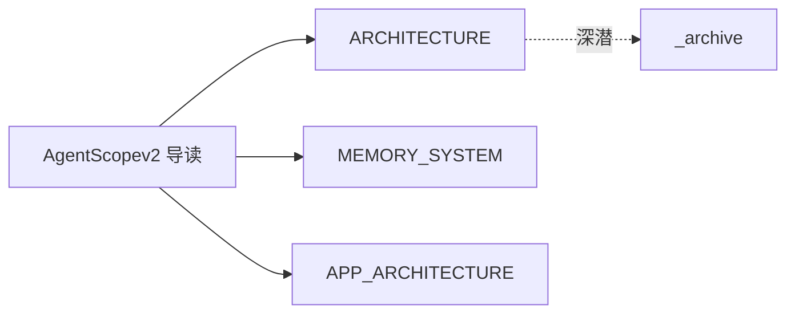

#### 按任务选读（一张表）

| 你想搞懂… | 先读 | 再读 |
|-----------|------|------|
| 一轮对话怎么跑 | [ARCHITECTURE §4](#part-kernel) | 附录 E |
| `context` / 压缩 / Offloader | [MEMORY_SYSTEM §1–§7](#part-memory) | 附录 B |
| FastAPI、飞书、SSE | [APP_ARCHITECTURE](#part-app) | 附录 D |
| 验收环、executor+verifier | [PIPELINE_AND_GOALS](#part-pipeline) | 附录 C |
| RAG / KB | [RAG_AND_KNOWLEDGE](#part-rag) | — |
| 沙箱、MCP 网关 | [WORKSPACE_AND_SANDBOX](#part-workspace) | [MIDDLEWARE_CATALOG](#part-middleware) |
| 进程死掉怎么恢复 | **本文 §5** | [APP §4–§5](#part-app)、[MEMORY §5](#part-memory) |
| 消息怎么落库 | **本文 §6** | `app/storage/` 源码 |
| 外挂长期记忆 ReMe | [REME_ARCHITECTURE](./REME_ARCHITECTURE.md) | — |

---

### 1. 原「九部分」笔记 → 现文档映射

旧合并稿按九部分编排；内容已 **下沉到专题**，避免双份维护。

| 原部分 | 主题 | 现 canonical |
|--------|------|----------------|
| 第一～二部分 | 分层、目录树、端到端 | [ARCHITECTURE](#part-kernel) §2–§4 · [_archive](#part-reference-archive) |
| 第三部分 | Session～编排内部设计 | [APP_ARCHITECTURE](#part-app) · [PIPELINE_AND_GOALS](#part-pipeline) |
| 第四～五部分 | Message / Memory / 快照 / EventStream | [MEMORY_SYSTEM](#part-memory) · [APP §5](#part-app) |
| **第六部分** | **崩溃场景推演** | **本文 §5** |
| **第七部分** | **JSON → DB Append** | **本文 §6** |
| 第八部分 | 待拆模块清单 | 本文 §7 |
| 第九部分 | 模块 1–11 类图 | 本文 §8 · [_archive](#part-reference-archive) |
| 附录 | v2 命名对照 | **附录 A–F**（文末） |

---

### 2. v2 架构一页纸

AgentScope v2 = **消息驱动、全异步** 的单 `Agent` ReAct：`AgentState` 承载对话与摘要；`ChatModelBase` 直接消费 `list[Msg]`；横切靠 **Middleware + Permission + `AgentEvent` 流**。生产部署在库外由 **`agentscope.app.create_app`** 提供 HTTP、渠道、存储与 Team。

细节与包结构图见 [ARCHITECTURE §2–§3](#part-kernel)。**已移除的 v0.x 概念**（不要在设计里再用）：`memory.MemoryBase`、`session.JSONSession`、`pipeline.MsgHub`。

---

### 3. Session / Message / 状态（概念模型）

| 概念 | v2 实现 | 说明 |
|------|---------|------|
| 「短期记忆」 | `AgentState.context: list[Msg]` | 完整近期往返，不是独立 `memory/` 包 |
| 「中期记忆」 | `AgentState.summary` | `compress_context()` 把头压进 summary 并从 context **物理删除** |
| 「Session」 | 库层无框架 Session 类 | 脚本自管 `model_dump_json()`；服务层 `SessionRecord` + `StorageBase` |
| 消息体 | `Msg` + ContentBlock / DataBlock | 归档与工具结果见 [MEMORY](#part-memory)、[WORKSPACE](#part-workspace) |
| 流式观测 | `AsyncGenerator[AgentEvent]` | App 侧 `MessageBus` replay + SSE，**不等于**持久化真源 |

---

### 4. EventStream 与前端

- **库**：`reply_stream` 产出 `AgentEvent`（Thinking / Text / ToolCall / HITL…）。
- **App**：`ChatService.run` 在 session 锁内跑 `reply_stream`，每个事件 `publish_session_event`；客户端 `GET /sessions/{id}/stream` 订阅。
- **分工**：**Storage** 存 Session、消息历史、`AgentState`；**MessageBus** 存锁、wakeup 队列、**运行时**事件 replay（可与 Redis 分离）。见 [APP_ARCHITECTURE §4–§5](#part-app)。

---

### 5. （原第六部分）崩溃与中断场景推演

以下按 **当前 main 实现** 归纳；用于写集成测试与运维 runbook，不是历史 Harness 伪代码。

#### 5.1 场景矩阵

| 场景 | 运行时表现 | 恢复策略 |
|------|------------|----------|
| **`kill -9` / OOM  mid-`reply_stream`** | 进程内 `Agent`、未 flush 的内存状态丢失；若 App 已在 turn 末 `upsert` Session/`AgentState`，磁盘可能停在 **上一完整 turn** | 重启后从 Storage 加载 `SessionRecord.state`；用户重发或 HITL resume（若 tool 已 park） |
| **Turn 中途崩溃（未持久化）** | 当前 turn 的 partial `AgentEvent` 可能已进 MessageBus replay，但 **Storage 消息/ state 可能未提交** | SSE 客户端可看到「半截」事件；以 Storage 为准重建 UI；必要时丢弃 replay 中 seq 大于已存消息的部分 |
| **Tool 执行一半（bash/网络）** | Tool 进程可能孤儿化；框架侧 tool_call 状态停在 PENDING/EXECUTING | 依赖 tool 超时与 `Permission`；恢复后 `_check_next_action` 决定 acting vs reasoning（附录 E） |
| **HITL / ASK / External 暂停** | `reply_stream` **正常结束本轮**（exit），tool 状态 ASKING/SUBMITTED | 用户确认后 **必须** 走 `enqueue_run_trigger` → `WakeupDispatcher`，勿与 `spawn` 新 turn 竞态（[APP §4.1](#part-app)） |
| **同 session 重复提交** | `ChatRunRegistry.spawn` → **409** | 客户端应去订阅已有 run 的 SSE，而不是再开一轮 |
| **Session 锁 TTL 过期** | 另一节点可能抢锁 | 设计 run 应短于 lock TTL；长 tool 用 external execution + resume |
| **`compress_context` 中途崩溃** | context 可能一半已删、summary 未写完 | 持久化应在 **压缩完成后** 或 turn 边界；Offloader 的 jsonl **追加** 与 context 删除顺序见 [MEMORY](#part-memory) |
| **LTM / Curator 中间件异步写** | 与主 turn 解耦 | 失败不应阻塞 reply；读路径需容忍「记忆尚未索引」 |

#### 5.2 推荐不变量（自建服务时）

1. **真源**：用户可见历史 = `Storage.list_messages` + `SessionRecord.state`，不是仅 MessageBus。
2. **写顺序**：一轮 turn 结束（或明确 checkpoint）再 `upsert_agent_state` + 批量 `upsert_message`。
3. **恢复**：HITL 只走 wakeup **resume** 路径；新用户句走 **spawn**。
4. **幂等**：消息以 `(session_id, msg.id)` upsert（见 §7）。

---

### 6. （原第七部分）持久化：从 JSON 快照到行级存储

#### 6.1 三层常见形态

| 形态 | 适用 | 特点 |
|------|------|------|
| **整包 JSON** | 脚本、单文件调试 | `AgentState.model_dump_json()` / 单文件 session；崩溃易 **全量回滚到上次写入** |
| **消息行 + state 列** | `create_app` + SQL/Redis | 每条 `Msg` 一行 upsert；`SessionRecord.state` 存完整 `AgentState` |
| **Offloader JSONL** | 大 context / 工具结果 | `sessions/{id}/context.jsonl` **追加**；与 summary 指针配合（[MEMORY](#part-memory)） |

#### 6.2 App Storage 契约（main）

- **`upsert_message(user_id, session_id, msg)`**：按 `(session_id, msg_id)` **insert or update** payload（`Msg.model_dump(mode="json")`），保留原 `created_at`（SQL 实现见 `app/storage/_sql/_storage.py`）。
- **`list_messages`**：游标分页 `before=msg_id`，**非** offset 主路径。
- **Agent 状态**：`SessionRecord.state: AgentState`，经 `StorageBase` 的 upsert session / update state API 与消息分开更新。

#### 6.3 MessageBus 与 Storage

| 存储 | 内容 | 崩溃后 |
|------|------|--------|
| Storage | Session、消息、AgentState、Team… | **恢复对话** |
| MessageBus `session_events` | 当前/近期 run 的事件 replay | 可丢；客户端重连后应以 Storage 重建 |

#### 6.4 从「整文件快照」迁移时的设计要点

1. **事件日志思维**：用户消息、助手消息、tool 结果各自 upsert，避免每次重写 10MB JSON。
2. **与 `AgentState` 并存**：LLM 仍吃 `context`+`summary`；加载 session 时从 Storage 灌回 `AgentState`，不必从消息全量重放（除非你做 event sourcing 重建）。
3. **压缩与落盘**：`compress_context` 改变 context/summary 后 **同一 turn 内** 再持久化 state，避免「磁盘 context 与内存不一致」。

---

### 7. （原第八部分）待深挖清单（推荐顺序）

| 优先级 | 主题 | 入口 |
|--------|------|------|
| P0 | `ChatService.run` 全链路 | `app/_service/_chat.py` · [APP](#part-app) |
| P0 | `_reply_impl` / HITL 状态机 | `agent/_agent.py` · 附录 E |
| P1 | `WorkspaceManager` 多后端 | [WORKSPACE](#part-workspace) |
| P1 | Team inbox / worker session | [APP §7](#part-app) · `app/_tool/` |
| P2 | KB 索引 worker | [RAG](#part-rag) |
| P2 | Realtime 语音 | [REALTIME_AGENT_ARCHITECTURE](#part-realtime)（分支特性） |
| P3 | 全量类图检索 | [_archive](#part-reference-archive) |

---

### 8. （原第九部分）模块索引（`src/agentscope`）

| # | 模块 | 职责 | 文档 |
|---|------|------|------|
| 1 | `message` | `Msg`、块类型 | _archive §10 |
| 2 | `agent` | ReAct、`reply_stream` | [ARCHITECTURE §4](#part-kernel) |
| 3 | `model` | 多 Provider LLM | [ARCHITECTURE §5](#part-kernel) |
| 4 | `tool` | Toolkit、MCP、Skill | [ARCHITECTURE §6](#part-kernel) |
| 5 | `state` | `AgentState` | [MEMORY](#part-memory) |
| 6 | `middleware` | 7 钩子、RAG/LTM… | [MIDDLEWARE_CATALOG](#part-middleware) |
| 7 | `permission` | 工具/命令审批 | [ARCHITECTURE §7](#part-kernel) |
| 8 | `workspace` | 沙箱、Offloader | [WORKSPACE](#part-workspace) |
| 9 | `pipeline` | `GoalPipeline` | [PIPELINE](#part-pipeline) |
| 10 | `rag` | `KnowledgeBase` | [RAG](#part-rag) |
| 11 | `app` | `create_app`、Channel、Storage | [APP](#part-app) |

---

### 附录 A：与 main 分支源码命名对照

正文或旧笔记中的 **HarnessAgent / Session 快照 / `memory/short_term` / ChatRoom** 等表述，与 main 的对应关系：

| 正文常见表述 | main / 专题文档中的对应 |
|--------------|-------------------------|
| `memory/`、`ShortTermMemory.context_messages` | **`AgentState.context`** + `summary`（无独立 `memory/` 包）→ [MEMORY_SYSTEM.md](#part-memory) |
| `save_snapshot` / JSON 会话文件 | 库层应用自管 `AgentState.model_dump_json()`；生产 **Session** → `app/storage` → [APP_ARCHITECTURE.md](#part-app) |
| `ChatRoom` / 通用 `Pipeline` 多 Agent 广播 | **MsgHub 已移除**；库级编排 → **`GoalPipeline`** → [PIPELINE_AND_GOALS.md](#part-pipeline) |
| `AgentService` + RPC | 仍存在；多渠道 HTTP/SSE → **`agentscope.app.create_app`** |
| 仅 Harness 包装 | 单 **`Agent`** + **Middleware**（7 钩子）→ [ARCHITECTURE.md](#part-kernel) §4、§7 |
| 「框架无 RAG」 | ❌ 已有 **`rag.KnowledgeBase`** + `RAGMiddleware` → [RAG_AND_KNOWLEDGE.md](#part-rag) |
| Workspace 仅 DataBlock | 沙箱谱系 + `WorkspaceManager` → [WORKSPACE_AND_SANDBOX.md](#part-workspace) |

---

### 附录 B：`AgentState` 与记忆（第四～五部分摘要）

```text
LLM 每次看到的输入 =
    system_prompt（固定，不进 context）
  + summary（可选，压缩后的旧历史）
  + context（当前会话完整近期对话）
  + tool schemas
```

| 机制 | 载体 | 作用 |
|------|------|------|
| 短期对话 | `AgentState.context: list[Msg]` | 用户/助手/tool 往返 |
| 中期摘要 | `AgentState.summary` | 头部旧消息经 `compress_context()` 压成固定格式后**物理删除**出 context |
| 工具结果上限 | `ContextConfig.tool_result_limit` | 防止单次 tool 撑爆 context |
| 卸载 | `Offloader`（常与 Workspace 配合） | 被删内容落盘，路径写入 summary 提醒 |
| 断点续聊 | `AgentState.model_dump_json()` 或 App Storage | 见 §6 |

压缩策略：**去头（压成 summary）+ 保尾（`reserve_ratio` 近期 context）**，非传统「只滑窗丢头」。全文：[MEMORY_SYSTEM.md](#part-memory)。

---

### 附录 C：`GoalPipeline` 与多 Agent 编排

v2 **`pipeline/`** 核心是 **`GoalPipeline`**：

- **Executor** 产出 `_ExecutionReport`；**Verifier** 产出 `_VerificationResult`：`pass` | `fail` | `impossible`。
- `fail` 带 feedback 回到 Executor，直到 pass/impossible 或 `max_iters`。
- 实现 **`reply_stream`**，HITL 按 `reply_id` 路由。

**与 App Team 区分**：`app/_tool/` 的 `AgentCreate` / `TeamSay` 等是 **生产编排**（inbox + worker session），见 [APP_ARCHITECTURE.md](#part-app) §7。

---

### 附录 D：App 服务层要点

**库（`agent/`）管一轮 ReAct；App（`app/`）管谁触发、存哪、怎么推前端/飞书。** 统一收敛点：**`ChatService.run`**。

| 模块 | 职责 |
|------|------|
| `_app.py` | `create_app()` 工厂 |
| `_service/` | `ChatService`、`SessionService`、`get_toolkit` |
| `_router/` | FastAPI：chat、session **SSE**、channel、schedule… |
| `message_bus/` | 锁、wakeup 队列、事件 replay（**非**持久化真源） |
| `storage/` | Session / Team / Agent / 消息历史 |
| `channel/` | 飞书、钉钉等 + `ChannelGateway` |

触发路径：新消息 `ChatRunRegistry.spawn`（重复 409）；HITL resume 走 `enqueue_run_trigger` → `WakeupDispatcher`。完整时序：[APP_ARCHITECTURE.md](#part-app) §4。

---

### 附录 E：ReAct 主循环（main 分支）

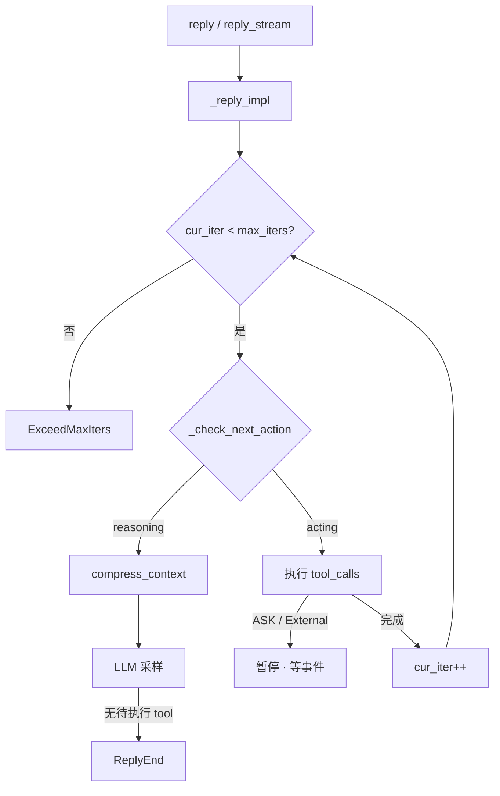

| 未完成 tool_call | 下一步 |
|------------------|--------|
| 有可执行 (PENDING/ALLOWED) | **acting** |
| 仅等待 (ASKING/SUBMITTED) | **exit**（暂停 reply） |
| 无 | **reasoning** |

源码锚点：`agent/_agent.py` — `_reply_impl`、`_check_next_action`、`_reasoning_impl`、`_execute_tool_call`。

---

### 附录 F：整理说明与官方资源

- 专题文档由 [_archive/ARCHITECTURE.md](#part-reference-archive) 与对话笔记 **拆分** 而来；**改实现请只改对应专题 + 本文索引**，避免再生成第三份全文。
- 若你从 Timeline 恢复了 ~3700 行合并稿，可保留为本地归档；仓库内 **canonical 仍以专题为准**，长文仅作检索补充。
- API：https://doc.agentscope.io/ · GitHub：https://github.com/agentscope-ai/agentscope


---

## Part · 库内核架构 {#part-kernel}


> **设计导读** · 实现级长文（FLOW + PART1–3 合并，~3150 行）：[_archive/ARCHITECTURE.md](#part-reference-archive)  
> **App 服务层**：[APP_ARCHITECTURE.md](#part-app) · **专题**见 [README](./README.md)

---

### 1. 一句话

AgentScope v2 = **消息驱动、全异步** 的单 `Agent` ReAct 框架：`AgentState` 承载记忆，`ChatModelBase` 直接吃 `list[Msg]`，横切靠 **Middleware + Permission + AgentEvent 流**。

---

### 2. 设计定位

| 维度 | 选择 |
|------|------|
| **核心循环** | 单一 `Agent`，`reply` / `reply_stream` 内 reasoning ↔ acting |
| **状态** | `AgentState`：`context` + `summary` + `permission` + `tool` + `tasks` |
| **模型** | `ChatModelBase`；无 v0.x Memory→Formatter 链 |
| **工具** | `Toolkit` + `ToolGroup` + `MCPClient` + Skill |
| **横切** | `MiddlewareBase`（7 钩子）+ `PermissionEngine` |
| **可观测** | `AgentEvent` 流（Thinking/Text/ToolCall/HITL…） |
| **生产部署** | 库本身无 Server → [`app.create_app`](#part-app) 或自建循环 |

---

### 3. 包结构（main 分支）

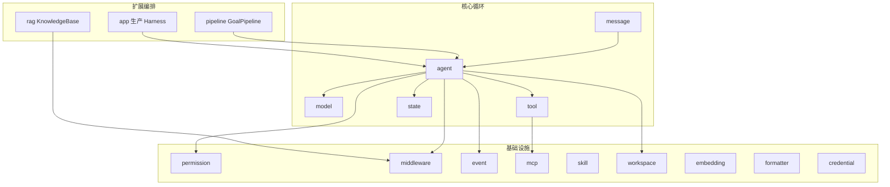

| 模块 | 职责 | 深潜 |
|------|------|------|
| `agent` | ReAct、`compress_context` | 本文 §4 |
| `message` | `Msg` + ContentBlock | 归档 §10 |
| `model` | 多 Provider LLM | 本文 §5 |
| `tool` | 注册、执行、分组 | 本文 §6 |
| `state` | `AgentState` | [MEMORY_SYSTEM](#part-memory) |
| `middleware` | 钩子 + RAG/LTM/TTS… | [MIDDLEWARE_CATALOG](#part-middleware) |
| `workspace` | 沙箱、Offloader | [WORKSPACE_AND_SANDBOX](#part-workspace) |
| `pipeline` | `GoalPipeline` | [PIPELINE_AND_GOALS](#part-pipeline) |
| `rag` | `KnowledgeBase` | [RAG_AND_KNOWLEDGE](#part-rag) |
| `app` | HTTP/Channel/Team | [APP_ARCHITECTURE](#part-app) |

**已移除（v0.x）**：`memory.MemoryBase`、`session.JSONSession`、`pipeline.MsgHub` — 见 [_archive](#part-reference-archive) 历史章节。

---

### 4. ReAct 主循环

#### 4.1 流程

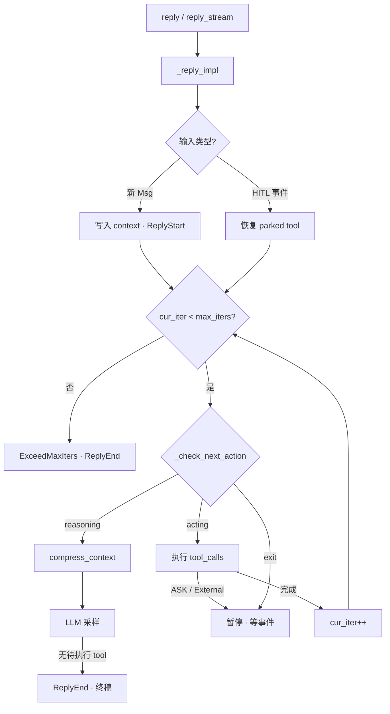

#### 4.2 `_check_next_action`

| 未完成 tool_call | 下一步 |
|------------------|--------|
| 有可执行 (PENDING/ALLOWED) | **acting** |
| 仅等待 (ASKING/SUBMITTED) | **exit**（暂停 reply） |
| 无 | **reasoning** |

#### 4.3 送模输入（L 投影）

```text
SystemMsg（system_prompt，不进 context）
+ summary?（压缩摘要）
+ context（完整近期对话）
+ tools[]（ToolGroup 激活子集）
```

→ 压缩算法：[MEMORY_SYSTEM.md](#part-memory) §9

#### 4.4 公开 API

| API | 用途 |
|-----|------|
| `await agent(msg)` | 等价 `reply`，返回终稿 `Msg` |
| `agent.reply_stream(...)` | 流式 `AgentEvent \| Msg` |
| `structured_schema=` | 强制结构化终稿（`GoalPipeline` 用） |

源码锚点：`agent/_agent.py` — `_reply_impl`、`_check_next_action`、`_reasoning_impl`、`_execute_tool_call`

---

### 5. Model 模块（设计级）

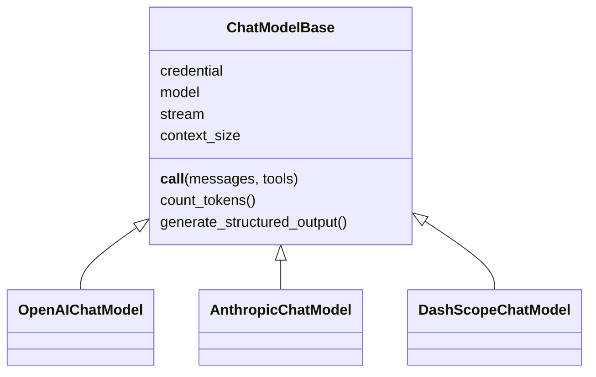

| 能力 | 说明 |
|------|------|
| **流式** | `ChatResponse` chunk → Agent 转为 Block 事件 |
| **Token 计数** | `count_tokens` 驱动 `compress_context` |
| **结构化输出** | `generate_structured_output` / reply 参数 |
| **Credential** | `credential/` 解耦密钥 |

Provider 列表与 YAML 配置：归档 [_archive/ARCHITECTURE.md §5](#part-reference-archive)

---

### 6. Tool · MCP · Permission

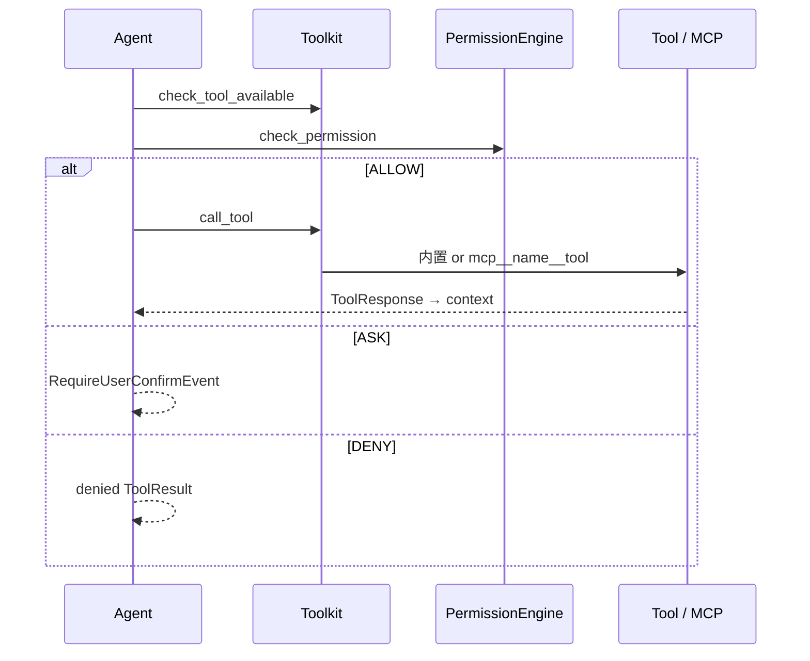

| 主题 | 要点 |
|------|------|
| **注册** | `Toolkit(tools=[...], mcps=[...], tool_groups=[...])` |
| **MCP 命名** | `mcp__{client}__{tool}` |
| **ToolGroup** | `activated_groups` 控制可见工具面 |
| **权限模式** | `DEFAULT` / `EXPLORE` / `ACCEPT_EDITS` / `BYPASS` / `DONT_ASK` |
| **HITL** | `ASK` → `UserConfirmResultEvent`；外部执行 → `ExternalExecutionResultEvent` |
| **Backend** | 内置 Bash/Read/Write 走 `BackendBase` → [WORKSPACE](#part-workspace) |

---

### 7. Middleware

7 个钩子：洋葱式 `on_reply` / `on_reasoning` / `on_acting` / `on_model_call` / `on_check_permission` / `on_compress_context`；流水线式 `on_system_prompt`。

专用中间件（RAG、LTM、Budget、TTS、Tracing）及 App 层 Inbox/Team：**不重复列举** → [MIDDLEWARE_CATALOG.md](#part-middleware)

---

### 8. 启动与构造（无 `agentscope.init()`）

```python
from agentscope import setup_logger
from agentscope.agent import Agent
from agentscope.model import OpenAIChatModel
from agentscope.credential import OpenAICredential
from agentscope.tool import Toolkit, Bash, Read, Write

setup_logger(level="INFO")

agent = Agent(
    name="Friday",
    system_prompt="You are a helpful assistant.",
    model=OpenAIChatModel(
        credential=OpenAICredential(api_key="..."),
        model="gpt-4o",
        stream=True,
        context_size=128000,
    ),
    toolkit=Toolkit(tools=[Bash(), Read(), Write()]),
)

async for event in agent.reply_stream(user_msg):
    ...
```

| v0.x | v2 |
|------|-----|
| `agentscope.init()` | `setup_logger()` |
| `InMemoryMemory` | `AgentState.context` 自动追加 |
| `JSONSession` | `AgentState.model_validate_json` 或 **app/storage** |
| `Formatter` 组装 | Model 内部处理 `Msg` |

---

### 9. 多 Agent（库层边界）

| 方式 | 机制 | 文档 |
|------|------|------|
| **手动编排** | `await a2.reply(await a1.reply(msg))` / `asyncio.gather` | — |
| **GoalPipeline** | executor + verifier 结构化环 | [PIPELINE_AND_GOALS](#part-pipeline) |
| **Team / 子 Agent** | `AgentCreate`、独立 session | [APP_ARCHITECTURE](#part-app) §7 |

核心 `Agent` **无** `children` / `delegate` → [AGENT_AND_LTM](#part-ltm-analysis)

---

### 10. 持久化

```python
## 保存
json_str = agent.state.model_dump_json()

## 恢复
state = AgentState.model_validate_json(json_str)
agent = Agent(..., state=state)
```

- 至少持久化：`context`、`summary`、`session_id`  
- 使用 `Offloader` 时同步拷贝 workspace 目录  
- 生产多实例：**不要**只写本地文件 → `app/storage`  

---

### 11. AgentEvent 与消费者

| 类别 | 例子 |
|------|------|
| **Reply 生命周期** | `ReplyStartEvent`、`ReplyEndEvent` |
| **模型流** | `ThinkingBlock*`、`TextBlock*`、`ToolCall*`、`ModelCallEndEvent` |
| **工具** | `ToolResult*` |
| **HITL** | `RequireUserConfirmEvent`、`RequireExternalExecutionEvent` |
| **提示** | `HintBlockEvent` |

`reply_stream` 消费者：CLI、测试、**App SSE**（经 MessageBus 转发）。

---

### 12. 端到端场景

| 场景 | 路径 |
|------|------|
| 最小 ReAct | 本文 §8 + §4 |
| 带 MCP | §6 + `MCPClient` connect |
| 带压缩 | [MEMORY_SYSTEM](#part-memory) |
| 带 RAG | [RAG_AND_KNOWLEDGE](#part-rag) |
| 带沙箱 | [WORKSPACE_AND_SANDBOX](#part-workspace) |
| 质量验收环 | [PIPELINE_AND_GOALS](#part-pipeline) |
| 飞书/HTTP 服务 | [APP_ARCHITECTURE](#part-app) |
| 语音 Realtime | [REALTIME_AGENT](#part-realtime)（v1，main 未迁回） |

---

### 13. 设计法则

1. **Msg 是一等公民** — 模型、存储、事件都围绕 `Msg` / Block。  
2. **压缩在 reasoning 前** — `compress_context` 每次 reasoning 前调用。  
3. **权限默认经 PE** — 不要绕过 `PermissionEngine` 直接调 tool。  
4. **HITL 是事件** — resume 用 `UserConfirmResultEvent`，不是新 UserMsg 冒充。  
5. **Middleware 可吞 ReplyEnd** — 强制多轮时先理解 `on_reply` 语义。  
6. **库与 App 分层** — Team/Channel/Scheduler 不在 `agent/` 里找。

---

### 14. 深潜与历史

| 需求 | 读哪里 |
|------|--------|
| 完整时序、类图、v0.x A2A/MsgHub/Evaluate | [_archive/ARCHITECTURE.md](#part-reference-archive) |
| Memory 权威 | [MEMORY_SYSTEM.md](#part-memory) |
| 官方教程 | `docs/tutorial/` · https://doc.agentscope.io/ |


---

## Part · 记忆与 AgentState {#part-memory}


> **文档状态**: Canonical（AgentScope v2 Memory 唯一权威文档）  
> **版本**: 2.2（与 AgentScope v2 `main` 源码对齐）  
> **适合人群**: 应用开发者、框架定制者、需要理解压缩与持久化的工程师  
> **核心源码**:  
> - `src/agentscope/state/_state.py` — `AgentState`、`ToolContext`  
> - `src/agentscope/agent/_config.py` — `ContextConfig`、`SummarySchema`  
> - `src/agentscope/agent/_agent.py` — `compress_context`、context 读写、tool 截断  
> - `src/agentscope/workspace/_offload_protocol.py` — `Offloader` 协议  
> - `src/agentscope/workspace/_local_workspace.py` — 本地卸载实现  

---

### 目录

- [1. 三分钟心智模型](#1-三分钟心智模型)
- [2. v2 有什么、没有什么](#2-v2-有什么没有什么)
- [3. 与传统压缩策略对比](#3-与传统压缩策略对比)
- [4. 短期 / 长期 / 外部存储](#4-短期--长期--外部存储)
- [5. MEMORY.md、USER.md、Session？](#5-memorymdusermdsession)
- [6. 数据模型](#6-数据模型)
- [7. 端到端流程：reply() 时间线](#7-端到端流程reply-时间线)
- [8. 完整实例：state 属性逐步变化](#8-完整实例state-属性逐步变化)
- [9. 上下文压缩算法](#9-上下文压缩算法)
- [10. summary 固定格式](#10-summary-固定格式)
- [11. 工具结果截断](#11-工具结果截断)
- [12. Offloader 落盘](#12-offloader-落盘)
- [13. LLM 实际看到什么](#13-llm-实际看到什么)
- [14. 配置与调参](#14-配置与调参)
- [15. 会话持久化](#15-会话持久化)
- [16. 长期记忆与 RAG 扩展](#16-长期记忆与-rag-扩展)
- [17. 反模式](#17-反模式)
- [18. 与 v0.x 的差异](#18-与-v0x-的差异)
- [19. 源码索引与 Middleware](#19-源码索引与-middleware)
- [20. 相关文档](#20-相关文档)

---

### 1. 三分钟心智模型

AgentScope v2 **没有独立的 `memory/` 子包**。所有「记忆」都是 **`Agent` 运行时状态 `AgentState`** 的一部分：

```text
LLM 每次看到的输入 =
    system_prompt（固定，不进 context）
  + summary（可选，压缩后的旧历史）
  + context（当前会话完整近期对话）
  + tool schemas
```

**三件事记住即可**：

1. **当前对话** → 自动写入 `agent.state.context`，无需手动 `memory.add()`。
2. **对话太长** → `compress_context()` 把**头部旧消息**压进 `summary`，**尾部近期**留在 `context`。
3. **断点续聊** → 序列化整个 `AgentState`（至少 `context` + `summary` + `session_id`）。

压缩策略一句话：**去头（压成固定格式 summary）+ 保尾（留近期 context）**，不是传统的「去头去尾、中间压缩」。

---

### 2. v2 有什么、没有什么

#### 2.1 内置能力

| 机制 | 载体 | 解决什么问题 |
|------|------|----------------|
| 对话上下文（短期） | `AgentState.context: list[Msg]` | 用户输入、Assistant 输出、tool_call / tool_result |
| 压缩摘要（中期） | `AgentState.summary` | 被压缩掉的旧历史，结构化续写文本 |
| 上下文压缩 | `ContextConfig` + `compress_context()` | token 超阈值时 LLM 摘要并**物理删除**旧 context |
| 工具结果截断 | `ContextConfig.tool_result_limit` | 防止单次 tool result 撑爆 context |
| 上下文卸载（可选） | `Offloader`（如 `LocalWorkspace`） | 被删/被截断内容落盘，路径写入 summary 或 tool 提醒 |
| 状态序列化 | `AgentState.model_dump_json()` | 应用层自行持久化 |

#### 2.2 非目标（v2 框架级 Session / 旧 MemoryBase）

- 跨会话向量记忆的内置 **Mem0/ReMe 集成**（可用 `AgenticMemoryMiddleware` 等，见 `middleware/`）
- 框架级 `JSONSession` / `RedisSession`（**`app/storage`** 提供生产 Session，见 [APP_ARCHITECTURE.md](#part-app)）
- 对话历史的 mark / exclude_mark 过滤（旧版 `MemoryBase`）

> **RAG**：库级 `rag.KnowledgeBase` 与 `RAGMiddleware` **已存在**，见 [RAG_AND_KNOWLEDGE.md](#part-rag)。下文 §16 中「应用层自建 RAG」描述仍可作为模式参考，但不再表示「框架无 KB」。
- `MEMORY.md` / `USER.md` 等文件记忆原语

---

### 3. 与传统压缩策略对比

很多框架采用 **sliding window** 或 **三段式**：

```text
传统三段式：
[删掉最老 N 条] + [保留最近 M 条] + [中间段 LLM 自由摘要]
或：只保留尾部，头部直接丢弃（无摘要）
```

AgentScope v2 的策略：

```text
context 时间线：
|---- msgs_to_compress（头部旧消息）----|==== 分界 ====|---- msgs_to_reserve（尾部近期）----|
         ↓ LLM 结构化摘要
    state.summary（固定五段格式，覆盖写入）
         ↓ 物理删除
context = msgs_to_reserve only
```

| 维度 | AgentScope v2 | 常见传统方案 |
|------|---------------|--------------|
| 保留段 | **尾部** `reserve_ratio`（默认约 10% context） | 常保留头+尾，或只留尾 |
| 压缩段 | **头部**旧消息 | 常压「中间」或直接丢弃 |
| 压缩产物 | **固定 schema** 的 `summary` 字符串 | 常为自由文本或多段摘要 |
| 旧消息 | 从 `context` **物理删除** | 有的只打 `compressed` mark 仍留 storage |
| 完整备份 | 可选 `Offloader` 写 JSONL | 视框架而定 |

---

### 4. 短期 / 长期 / 外部存储

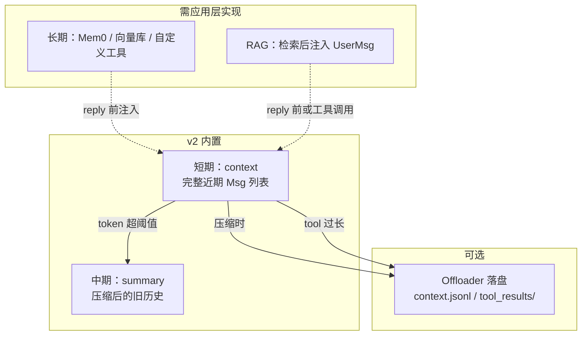

| 类型 | 载体 | 生命周期 | 谁维护 |
|------|------|----------|--------|
| **短期记忆** | `state.context` | 当前会话 | `reply()` 自动 `_save_to_context` |
| **压缩记忆** | `state.summary` | 跨多轮直到下次覆盖 | `compress_context()` 自动 |
| **卸载备份** | workspace 文件 | 磁盘持久 | `Offloader`（可选） |
| **长期记忆** | ❌ 无内置 | 跨会话 | 工具 / Middleware / 外部 DB |
| **RAG** | ❌ 无内置 | 跨文档 | 应用层检索 + 注入 |

**没有「短期类 + 长期类」两个独立子系统**——只有 `AgentState` 上的 context/summary 两层，长期能力需自己接。

---

### 5. MEMORY.md、USER.md、Session？

| 概念 | AgentScope v2 | 说明 |
|------|---------------|------|
| `MEMORY.md` | ❌ | 无文件记忆；可用自定义工具模拟 |
| `USER.md` | ❌ | 无用户画像文件 |
| `system_prompt` | ✅ | 构造 `Agent` 时传入，**不进 `context`**，每次 reasoning 由 `_get_system_prompt()` 注入 |
| `session_id` | ✅ | `AgentState` 字段，用于 Offloader 路径隔离，**不是**框架 Session |
| `JSONSession` | ❌（v2 未迁移） | v0.x 有；v2 用手动 `model_dump_json()` |
| 外部存储 | 可选 | `LocalWorkspace` 落盘压缩/截断备份，非语义 LTM |

持久化 = **你自己写 JSON 文件**（或 Redis 等），框架只提供 `AgentState` 序列化 API。

---

### 6. 数据模型

#### 6.1 `AgentState`

**位置**: `state/_state.py`

```python
class AgentState(BaseModel):
    session_id: str
    summary: str | list[TextBlock | DataBlock] = ""
    context: list[Msg] = []
    reply_id: str
    cur_iter: int = 0
    permission_context: PermissionContext
    tool_context: ToolContext      # Read 缓存、activated_groups
    tasks_context: TaskContext
```

| 字段 | 参与 LLM prompt？ | 含义 |
|------|-------------------|------|
| `context` | ✅（经 `_prepare_model_input`） | 当前会话对话轨迹 |
| `summary` | ✅（作为额外 `UserMsg` 注入） | 压缩后的旧历史 |
| `session_id` | ❌ | Offloader 路径、多租户隔离 |
| `reply_id` | ❌ | 同一 `reply` 周期内 AssistantMsg 的 id |
| `tool_context` | ❌（间接：Read 缓存影响工具） | Read LRU、工具组激活状态 |

#### 6.2 `context` 写入规则

| 来源 | 写入方式 |
|------|----------|
| 用户输入 | `_handle_incoming_messages` → `context.append(msg)` |
| 模型输出 | `_save_to_context` → 追加到最后一条同名 `AssistantMsg.content` |
| 工具结果 | acting 完成后 `_save_to_context([ToolResultBlock])` |

**同一 reply 周期**：`AssistantMsg.id == state.reply_id`，thinking / text / tool_call / tool_result 都在同一 `AssistantMsg.content` 列表中。

**输入限制**：仅接受 `role` 为 `user` 或 `assistant` 的 `Msg`，且不得含 `tool_call` / `tool_result` / `thinking` 块（这些由框架内部写入）。

#### 6.3 `ContextConfig` 默认值

**位置**: `agent/_config.py`

```python
class ContextConfig(BaseModel):
    trigger_ratio: float = 0.8      # 0 < x < 0.9
    reserve_ratio: float = 0.1        # 0 < x < 0.9
    compression_prompt: str = ...
    summary_template: str = ...
    summary_schema: dict = SummarySchema.model_json_schema()
    tool_result_limit: int = 3000
```

| 字段 | 默认 | 含义 |
|------|------|------|
| `trigger_ratio` | `0.8` | `count_tokens` ≥ 该比例 × `model.context_size` 时触发压缩 |
| `reserve_ratio` | `0.1` | 压缩时从**尾部**保留约该比例的 context token |
| `tool_result_limit` | `3000` | 单条 tool result 最大 token |
| `summary_schema` | `SummarySchema` | 压缩 LLM 结构化输出 schema |

- `trigger_ratio` 上限 **0.9**：为压缩 LLM 调用预留至少约 10% context。
- `reserve_ratio` 过大导致「无消息可压缩」时，源码 **fallback 到 0** 并打 warning。

#### 6.4 架构全景

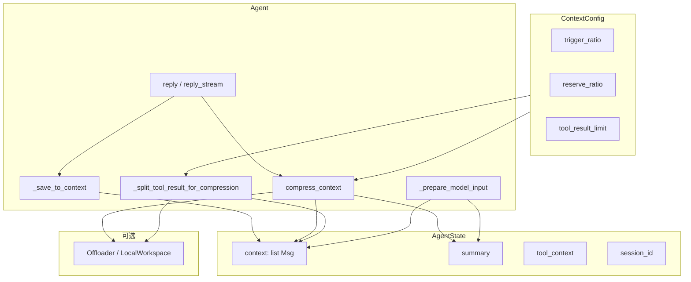

---

### 7. 端到端流程：reply() 时间线

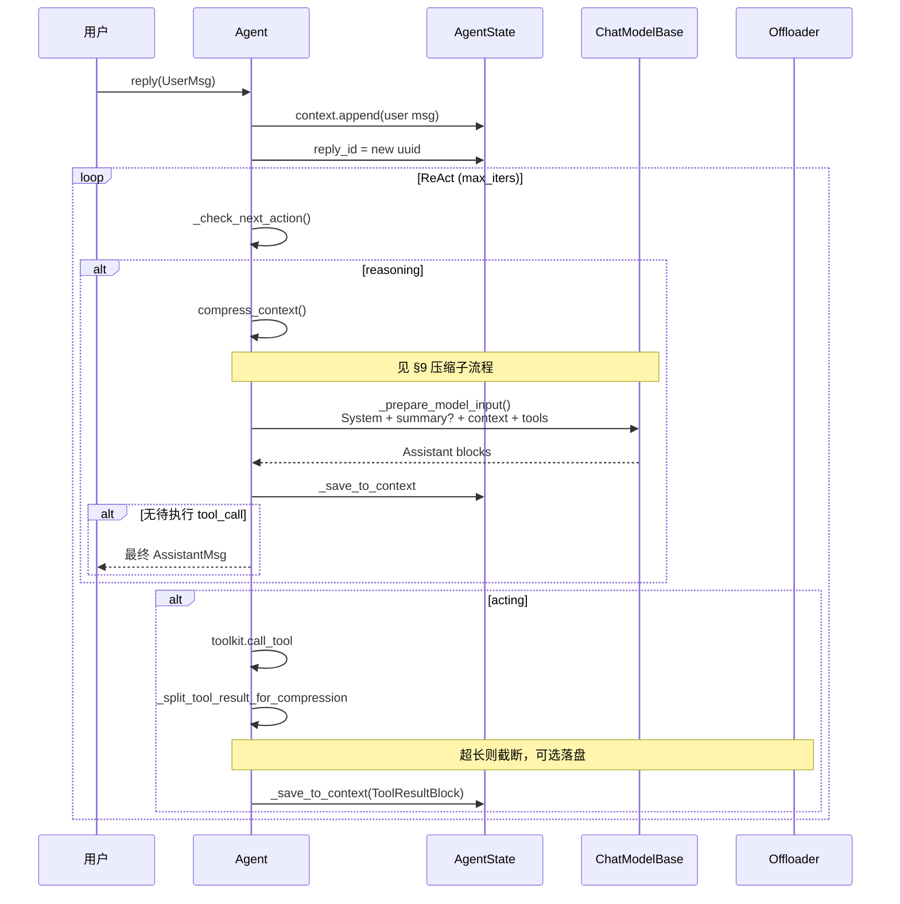

**关键点**：

1. 用户消息在 ReAct 循环**前**写入 `context`。
2. **每次 reasoning 前**调用 `compress_context()`（非 reply 开头一次性检查）。
3. 压缩后旧消息**不再保留**在 `context` 中，信息沉淀在 `summary`（及可选 offloaded 文件）。

#### 7.1 压缩子流程

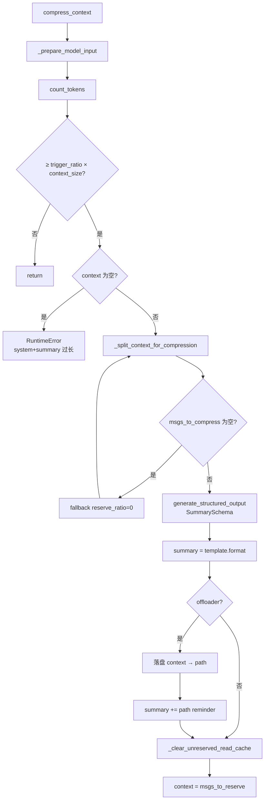

---

### 8. 完整实例：state 属性逐步变化

以下用**虚构 token 数**说明属性如何变；实际阈值由 `model.count_tokens()` 决定。

**假设**：`context_size = 100_000`，`trigger_ratio = 0.8`，`reserve_ratio = 0.1`，已配置 `LocalWorkspace`。

#### 8.1 初始状态

```python
AgentState(
    session_id="sess-001",
    summary="",
    context=[],
    reply_id="",
    cur_iter=0,
)
```

#### 8.2 Turn 1 — 用户：「读 config.yaml」

```python
await agent(UserMsg(name="user", content="读 config.yaml"))
```

| 步骤 | `context` | `summary` | `reply_id` |
|------|-----------|-----------|------------|
| 用户消息入队后 | `[UserMsg("读 config.yaml")]` | `""` | `"uuid-aaa"` |
| reasoning：token 50k < 80k，不压缩 | 不变 | 不变 | 不变 |
| LLM 返回 `tool_call: read_file` | `+ AssistantMsg(id=uuid-aaa, [ToolCallBlock])` | 不变 | 不变 |
| acting：read 返回 5k token | `+ ToolResultBlock(yaml...)` 追加到同一 AssistantMsg | 不变 | 不变 |

#### 8.3 Turn 2 — 用户：「把 debug 改成 true」

| 步骤 | `context` | `summary` | `reply_id` |
|------|-----------|-----------|------------|
| 新用户消息 | `+[UserMsg("把 debug 改成 true")]` | 不变 | `"uuid-bbb"` |
| 多轮 tool 后 context 约 85k token | 15 条 Msg | `""` | — |
| **compress_context 触发** | 见下表 | **覆盖写入** | — |

**压缩瞬间**（`_split_context_for_compression`）：

```text
msgs_to_compress = context[0:10]   # 头部旧消息，约 75k token
msgs_to_reserve  = context[10:]    # 尾部近期，约 10k token
```

| 属性 | 压缩前 | 压缩后 |
|------|--------|--------|
| `summary` | `""` | `"<system-info>\nTask Overview: 用户要修改 config.yaml 的 debug 字段\nCurrent State: 已读取 config.yaml，debug=false\n...\n</system-info>\n<system-reminder>...context.jsonl...</system-reminder>"` |
| `context` | 15 条 Msg | **5 条**（仅 `msgs_to_reserve`） |
| 磁盘 | — | `agent_workspace/sessions/sess-001/context.jsonl` 追加 10 条完整 Msg |

#### 8.4 压缩后 LLM 看到的 messages

```text
1. SystemMsg(system_prompt)          ← 不进 context，每次注入
2. UserMsg(summary)                  ← 压缩摘要（伪装成 user 消息）
3. ...context 尾部 5 条 Msg          ← 近期完整对话
4. tool schemas
```

模型**看不到**被删的 10 条原文，只能靠 `summary`、尾部 context、或 Read offloaded 文件。

#### 8.5 Turn 3 — 断点续聊

```python
## 保存
with open("sess-001.json", "w") as f:
    f.write(agent.state.model_dump_json(indent=2))

## 恢复（需同步拷贝 agent_workspace/ 若用了 Offloader）
state = AgentState.model_validate_json(open("sess-001.json").read())
agent = Agent(name="Friday", system_prompt="...", model=model, state=state)
```

恢复后 `context` + `summary` 与保存时一致；**不会**自动做语义检索或合并其他会话记忆。

#### 8.6 超长 tool result 示例

`read_file` 返回 8000 token，`tool_result_limit=3000`：

```text
acting 阶段：
  _split_tool_result_for_compression
    → reserved: 前 3000 token 等价内容 + <<<TRUNCATED>>> 提醒
    → offload: 剩余部分写入 tool_results/xxx.txt
  仅 reserved 进入 context
```

---

### 9. 上下文压缩算法

**入口**: `compress_context()` → `_compress_context_impl()`（可被 `on_compress_context` 中间件包裹）

#### 9.1 触发条件

```python
kwargs = await self._prepare_model_input()
estimated_tokens = await self.model.count_tokens(**kwargs)
threshold = cfg.trigger_ratio * self.model.context_size
if estimated_tokens < threshold:
    return  # 不压缩
```

计 token 时已包含 `system_prompt + summary + context + tools`。

#### 9.2 拆分：`_split_context_for_compression`

输入：`to_reserved_tokens = reserve_ratio * context_size`

1. 从 `context` **尾部**向前扫描，找到保留段 token ≥ `to_reserved_tokens` 的分界 `msg_index`。
2. 对分界消息内的 **content blocks** 再细粒度拆分，避免 reserved 段出现**孤立的 tool_result**（无对应 tool_call）。
3. 返回 `(msgs_to_compress, msgs_to_reserve)`。

若 `msgs_to_compress` 为空，**fallback**：`reserve_ratio → 0` 重试。

#### 9.3 生成摘要

1. 组装压缩输入：`system_prompt + 旧 summary? + msgs_to_compress + compression_prompt`。
2. 调用 `model.generate_structured_output(..., structured_model=summary_schema)`。
3. 若输入超长，**逐条丢弃** `msgs_to_compress` 最旧消息直到 token 低于 `context_size * trigger_ratio`，再重试。

#### 9.4 写回状态

```python
self.state.summary = cfg.summary_template.format(**res.content)

if self.offloader:
    path = await self.offloader.offload_context(session_id, msgs_to_compress)
    self.state.summary += f"\n<system-reminder>... '{path}' ...</system-reminder>"

await self._clear_unreserved_read_cache(msgs_to_reserve)
self.state.context = msgs_to_reserve  # 旧消息物理删除
```

#### 9.5 失败场景

| 条件 | 行为 |
|------|------|
| `context` 为空但 token 仍超阈值 | `RuntimeError`：system prompt（± summary）过长 |
| 压缩 LLM 失败且非 overflow | 异常向上抛出 |
| overflow 且丢弃全部可压缩消息后仍失败 | 异常向上抛出 |

---

### 10. summary 固定格式

压缩 LLM 必须输出 `SummarySchema` 五字段，再套入 `summary_template`：

| 字段 | 含义 |
|------|------|
| `task_overview` | 用户核心请求与成功标准 |
| `current_state` | 已完成工作与产出 |
| `important_discoveries` | 约束、决策、错误与修复 |
| `next_steps` | 待办与阻塞 |
| `context_to_preserve` | 偏好、领域细节、承诺 |

默认渲染结果形如：

```text
<system-info>
Task Overview: ...
Current State: ...
Important Discoveries: ...
Next Steps: ...
Context to Preserve: ...
</system-info>
```

- 每次压缩**覆盖** `state.summary`（不是 append 多段）。
- 可自定义 `compression_prompt`、`summary_template`、`summary_schema` 适配领域。
- 有 `offloader` 时末尾追加文件路径 `<system-reminder>`。

---

### 11. 工具结果截断

**入口**: acting 完成、`ToolResponse` 转 `ToolResultBlock` 之后

```python
reserved, offload = await self._split_tool_result_for_compression(tool_result)
```

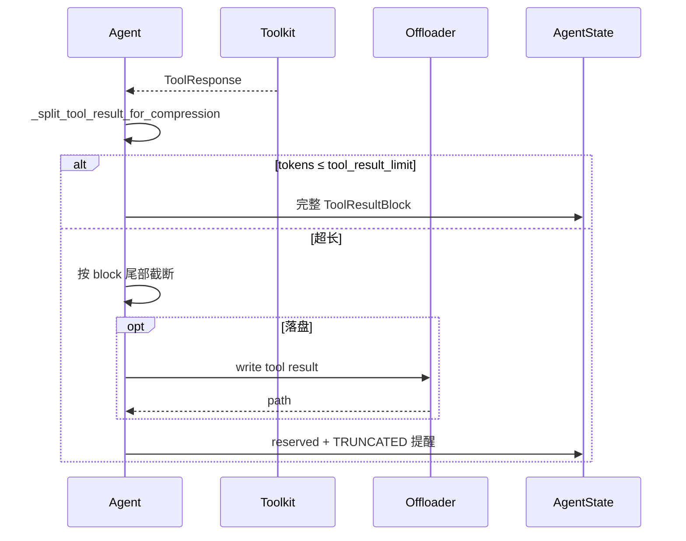

#### 11.1 算法概要

1. 对 `tool_result.output` 计 token；若 ≤ `tool_result_limit`，原样保留。
2. 否则按 **content block** 从尾部向前找边界；对边界 `TextBlock` 按比例截断文本。
3. 返回 `(reserved_block, offload_block | None)`。

#### 11.2 提醒格式

若存在 offload 部分，reserved 块末尾追加：

```text
<<<TRUNCATED>>>
<system-reminder>The remaining content has been omitted for limited context.
[ You can refer to the file in '{path}' for the truncated content if needed. ]
</system-reminder>
```

仅 **`reserved`** 部分经 `_save_to_context` 进入 `context`。

---

### 12. Offloader 落盘

**协议**: `workspace/_offload_protocol.py`

```python
class Offloader(Protocol):
    async def offload_context(self, session_id: str, msgs: list[Msg]) -> str: ...
    async def offload_tool_result(self, session_id: str, tool_result: ToolResultBlock) -> str: ...
```

**`LocalWorkspace` 实现**:

| 方法 | 输出路径 |
|------|----------|
| `offload_context` | `{workdir}/sessions/{session_id}/context.jsonl`（JSONL 追加） |
| `offload_tool_result` | `{workdir}/sessions/{session_id}/tool_results/` 下文件 |

大数据 `DataBlock`（base64）会先转为 workspace 内文件引用再写入 JSONL。

Agent 可在后续轮次通过 **Read 工具**读取 offloaded 文件（路径出现在 `summary` 或 tool result 的 `<system-reminder>` 中）。

---

### 13. LLM 实际看到什么

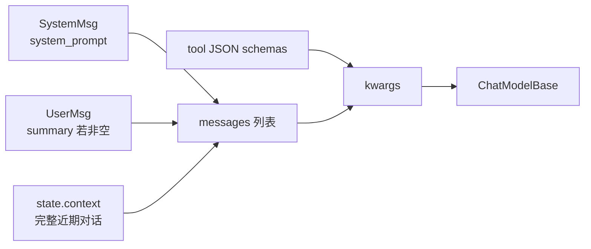

```python
## _prepare_model_input() 逻辑
messages = [SystemMsg(content=await self._get_system_prompt())]
if self.state.summary:
    messages.append(UserMsg(name="user", content=self.state.summary))
messages.extend(self.state.context)
tools = await self.toolkit.get_tool_schemas(groups=activated_groups)
return {"messages": messages, "tools": tools}
```

| 部分 | 在 `AgentState` 中？ | 可压缩？ |
|------|----------------------|----------|
| `system_prompt` | ❌（Agent 属性） | 需开发者自行控制长度 |
| `summary` | ✅ | 下次压缩时作为「旧 summary」参与再压缩 |
| `context` | ✅ | 超阈值时头部被压进 summary |

Middleware 可在 `on_system_prompt` 修改 system 内容；**不会**自动修改 `summary` 或 `context`。

---

### 14. 配置与调参

#### 14.1 最小可用

```python
import agentscope
from agentscope.agent import Agent
from agentscope.message import UserMsg
from agentscope.model import OpenAIChatModel

agentscope.init(project="demo")

agent = Agent(
    name="Friday",
    system_prompt="You are a helpful assistant.",
    model=OpenAIChatModel(model_name="gpt-4.1", api_key="..."),
)

reply = await agent(UserMsg(name="user", content="你好"))
## agent.state.context 已包含本轮对话
```

- `await agent(msg)` 等价于 `await agent.reply(msg)`。
- 流式：`async for event in agent.reply_stream(msg)`，context 更新逻辑相同。
- 传入 `state=AgentState(...)` 可恢复已有会话。

#### 14.2 启用压缩

```python
from agentscope.agent import Agent, ContextConfig

agent = Agent(
    name="Coder",
    system_prompt="You are a coding assistant.",
    model=model,
    context_config=ContextConfig(
        trigger_ratio=0.75,
        reserve_ratio=0.15,
        tool_result_limit=2500,
    ),
)
```

| 场景 | `trigger_ratio` | `reserve_ratio` | 说明 |
|------|-----------------|-----------------|------|
| 短对话 / 低成本 | `0.85`–`0.9` | `0.1` | 少压缩，延迟低 |
| 长工具链 / coding | `0.7`–`0.8` | `0.1`–`0.15` | 更早压缩，留足近期 tool 对 |
| 超大 system prompt | 降低 `trigger_ratio` | 降低 `reserve_ratio` | 否则可能「无消息可压缩」而抛错 |

#### 14.3 手动触发压缩

```python
await agent.compress_context()
await agent.compress_context(context_config=ContextConfig(trigger_ratio=0.6))
```

适合在长工具批处理前主动释放 context。

#### 14.4 配置 Offloader

```python
from agentscope.workspace import LocalWorkspace

workspace = LocalWorkspace(workdir="./agent_workspace")

agent = Agent(
    name="Friday",
    system_prompt="...",
    model=model,
    offloader=workspace,
)
```

---

### 15. 会话持久化

v2 无 `JSONSession` 子包。推荐直接持久化 `AgentState`：

```python
from agentscope.state import AgentState

## 保存
path = f"./sessions/{agent.state.session_id}.json"
with open(path, "w", encoding="utf-8") as f:
    f.write(agent.state.model_dump_json(indent=2))

## 恢复
with open(path, encoding="utf-8") as f:
    state = AgentState.model_validate_json(f.read())

agent = Agent(name="Friday", system_prompt="...", model=model, state=state)
```

**建议一并持久化**：

| 字段 | 必要性 | 说明 |
|------|--------|------|
| `context` + `summary` | 必需 | 对话连续性 |
| `session_id` | 推荐 | Offloader 路径、多租户 |
| `tool_context` | 可选 | 依赖 Read 缓存时 |
| `permission_context` | 可选 | 有未完成 ASK 工具时 |

**注意**：持久化的是**快照**，不会做历史语义检索；迁移时需同步拷贝 `agent_workspace/`（若使用 Offloader）。

---

### 16. 长期记忆与 RAG 扩展

v2 **未提供** `LongTermMemoryBase`、`KnowledgeBase`。常见扩展方式：

#### 16.1 自定义记忆工具（推荐）

```python
from agentscope.tool import Toolkit, ToolResponse

store: dict[str, str] = {}

async def save_memory(key: str, content: str) -> ToolResponse:
    store[key] = content
    return ToolResponse(content=f"Saved {key}")

async def search_memory(query: str) -> ToolResponse:
    hits = [f"[{k}] {v}" for k, v in store.items() if query.lower() in v.lower()]
    return ToolResponse(content="\n".join(hits) or "No matches.")

toolkit = Toolkit()
toolkit.register_tool_function(save_memory)
toolkit.register_tool_function(search_memory)

agent = Agent(..., toolkit=toolkit)
```

生产环境将 `store` 换为 Redis、向量库或 Mem0 客户端。

#### 16.2 Middleware 自动注入

在 `on_reply` / `on_reasoning` 钩子中检索外部记忆，向 `agent.state.context` 追加带标签的 `UserMsg`（如 `<retrieved_memory>...</retrieved_memory>`），避免与真实用户输入混淆。

#### 16.3 RAG

reply 前由应用层检索文档，将结果作为 `UserMsg` 传入，或注册 `search_docs` 工具供 Agent 按需调用。v2 的 `embedding/` 子包可用于自建向量流程，但无内置 `KnowledgeBase` 编排。

#### 16.4 多 Agent

每个 `Agent` 持有独立 `AgentState`。**不要**默认共享同一 `state` 对象。共享记忆由编排层显式转发 `Msg`，或共用外部存储 + 记忆工具。

---

### 17. 反模式

| 反模式 | 原因 | 建议 |
|--------|------|------|
| 自建 `list` 存消息，不用 `AgentState` | 与 `_save_to_context` / 压缩 / tool 对逻辑脱节 | 始终通过 `agent(msg)` 驱动 |
| 向 `context` 直接 append 含 `tool_call` 的 Msg | `_handle_incoming_messages` 会拒绝 | 仅传入 user/assistant 纯对话 Msg |
| `trigger_ratio` 设过低 | 频繁 LLM 压缩，延迟与成本上升 | 结合日志实测 |
| 超大 system prompt + 高 `reserve_ratio` | 可能 `RuntimeError: cannot be compressed` | 缩短 system prompt 或降低 reserve |
| 期望内置 LTM/RAG | v2 未迁移 | 工具或 Middleware 扩展 |
| 压缩后仍假设旧消息在 context | v2 物理删除旧 Msg | 依赖 `summary` 或 offloaded 文件 |
| 只持久化 context 不持久化 summary | 恢复后丢失压缩历史 | 两者一起序列化 |

---

### 18. 与 v0.x 的差异

| 旧版概念 | v2 对应 |
|----------|---------|
| `MemoryBase` / `InMemoryMemory` | `AgentState.context` |
| `ReActAgent.CompressionConfig` | 独立 `ContextConfig` |
| `_compressed_summary` + mark `COMPRESSED` | `summary` + 旧消息从 context **物理删除** |
| `memory.get_memory()` → Formatter | `_prepare_model_input()` |
| `JSONSession` / `RedisSession` | `AgentState.model_dump_json()` |
| `LongTermMemoryBase` / Mem0 | ❌ 需应用层扩展 |
| `rag.KnowledgeBase` | ❌ 需应用层扩展 |
| mark 过滤 | ❌ 多份 state 或过滤 context |

---

### 19. 源码索引与 Middleware

#### 19.1 类关系

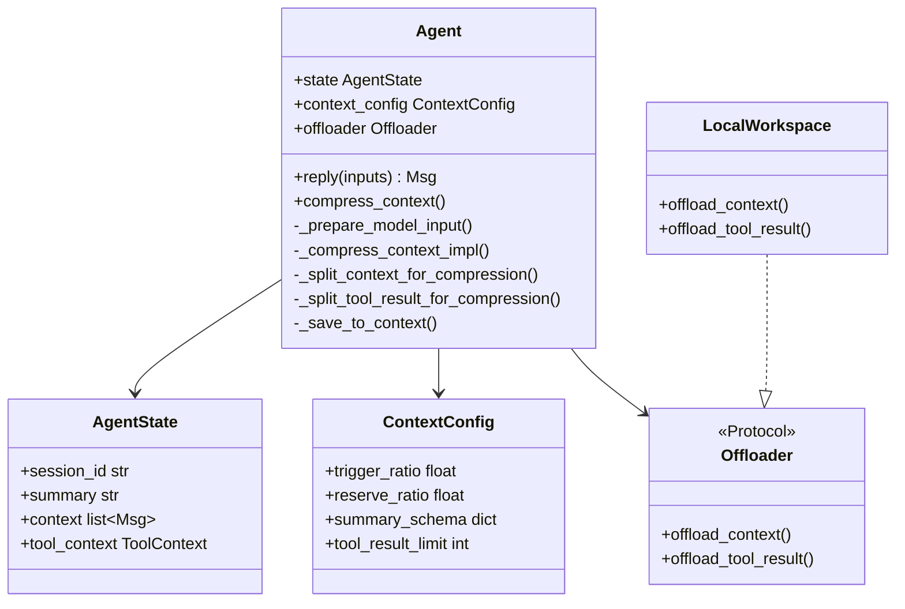

#### 19.2 Middleware 钩子

| 钩子 | 与 Memory 的关系 |
|------|------------------|
| `on_compress_context` | 包裹 `compress_context()`，可记录指标或强制压缩 |
| `on_reply` / `on_reasoning` / `on_acting` | 可观测 context 变化；勿与内置 `_save_to_context` 冲突 |
| `on_system_prompt` | 修改 system 内容（不计入 `context`） |

---

### 20. 相关文档

| 文档 | 内容 |
|------|------|
| [ARCHITECTURE.md](#part-kernel) §4、§6 | ReAct 循环与 Memory 在架构中的位置 |
| [_archive/ARCHITECTURE.md](#part-reference-archive) | 历史 Memory 章节全文 |
| [AGENT_AND_LTM_ANALYSIS.md](#part-ltm-analysis) | v0.x 长期记忆能力矩阵（v2 未迁移部分） |

---

**最后更新**: 2026-06-08


---

## Part · App 服务层 {#part-app}


> **定位**：`src/agentscope/app/` 是 **生产级 Harness**——在库级 `Agent` 之上提供 HTTP、渠道、会话持久化、Team/子 Agent、调度与事件流。  
> **前置阅读**：[ARCHITECTURE.md](#part-kernel)（单 Agent ReAct 内核）· [MEMORY_SYSTEM.md](#part-memory)  
> **最后更新**：2026-09-08

---

### 1. 一句话

**库（`agent/`）管一轮 ReAct；App（`app/`）管「谁触发、存哪、怎么推给前端/飞书、多成员怎么协作」。**  
所有运行路径最终汇入 **`ChatService.run`**。

---

### 2. 库层 vs App 层

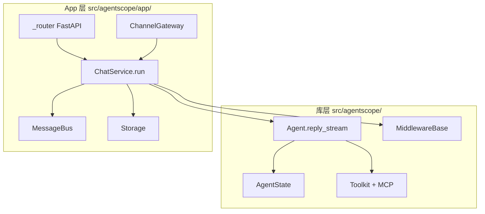

| 问题 | 库层 | App 层 |
|------|------|--------|
| 一次 turn 怎么跑 | `Agent` | 装配 Agent + 调 `reply_stream` |
| 会话存哪 | 应用自行 `model_dump_json` | `StorageBase`（SQL / Redis） |
| 前端怎么收事件 | `AsyncGenerator[AgentEvent]` | SSE `GET /sessions/{id}/stream` |
| IM 怎么接入 | 无 | `channel/` + `ChannelGateway` |
| 子 Agent | 无内置 | `AgentCreate` / `AgentInvite` + Team |

---

### 3. 模块地图

| 目录 | 职责 |
|------|------|
| **`_app.py`** | `create_app()` 工厂，注册路由与 lifespan |
| **`_lifespan.py`** | 启动 `WakeupDispatcher`、`SchedulerManager`、`ChannelLifecycleDispatcher` 等 |
| **`_service/`** | 业务核心：`ChatService`、`SessionService`、`get_toolkit`、KB 服务 |
| **`_router/`** | FastAPI：chat、session（SSE）、agent、channel、schedule、workspace、hub… |
| **`message_bus/`** | 运行时协调：锁、队列、pub/sub、事件 replay（**非**持久化真源） |
| **`storage/`** | 持久化：`Session` / `Team` / `Agent` / `Schedule` / `Channel` / 消息历史 |
| **`channel/`** | 飞书 / 钉钉 / Discord 适配；`ChannelGateway` 入站路由 |
| **`_manager/`** | `WakeupDispatcher`、`ChatRunRegistry`、`BackgroundTaskManager`、`SchedulerManager` |
| **`workspace_manager/`** | 每 session 工作区隔离（local / Docker / E2B / K8s…） |
| **`_tool/`** | Team 工具：`TeamCreate`、`AgentCreate`、`AgentInvite`、`TeamSay`… |
| **`middleware/`**（app） | `InboxMiddleware`、`TeamMemberLoopMiddleware`、`StateChangeMiddleware`… |
| **`hub/`** | 外部 MCP / Skill 注册表 |
| **`rag/`**（app） | `KnowledgeBaseManager`、索引 worker、blob store（配合库级 `rag.KnowledgeBase`） |
| **`access/`** | 跨用户资源访问策略 |

入口：`agentscope.app.create_app(storage, message_bus, workspace_manager, ...)`

---

### 4. 主流程：从触发到 SSE

#### 4.1 统一收敛点

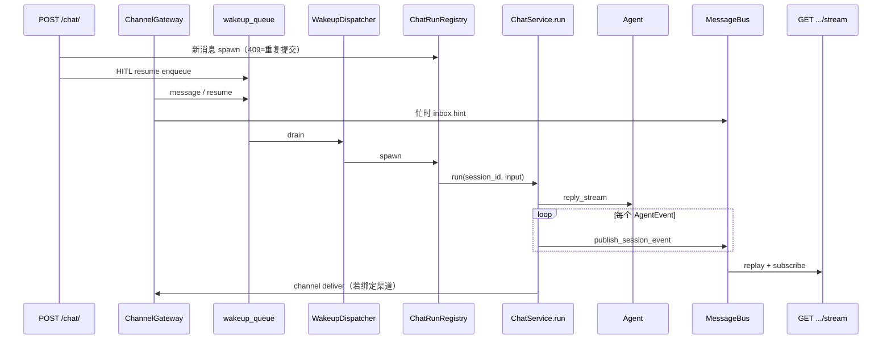

**设计要点**（见 `_router/_chat.py` 注释）：

- **新用户消息**：直接 `ChatRunRegistry.spawn` → 同 session 重复提交返回 **409**
- **HITL 恢复**（确认 / 外部执行结果）：走 **`enqueue_run_trigger`** → `WakeupDispatcher` 唯一 spawn 点，避免与 parked run 竞态

#### 4.2 `ChatService.run` 内部（持 session 锁）

在 `MessageBusKeys.session_lock(session_id)` 下大致顺序：

1. 加载 `AgentRecord` / `SessionRecord`（`ResourceAccessService`）
2. 解析 **Team 角色**（leader vs worker session）
3. `workspace_manager.get_workspace` → 合并进 permission context
4. 若 `ChannelOrigin` → 注入渠道工具与 system 片段
5. 装配 middleware：`InboxMiddleware`、`StateChangeMiddleware`、`ToolOffloadMiddleware`；worker 加 `TeamMemberLoopMiddleware`；可选 TTS / RAG
6. `get_toolkit`（按角色暴露 Team 工具）
7. 构造 `Agent` → `register_inbox_consumer` → **`reply_stream`**
8. 每个事件 → `publish_session_event`（replay log + live pub/sub）
9. 持久化 messages / `AgentState`；自动标题、team 通知

源码锚点：`app/_service/_chat.py`（文件头注释写明为 HTTP 与 wakeup 的 **single source of truth**）。

---

### 5. MessageBus 与 SSE

**Storage 与 MessageBus 分工**（`create_app` 允许 SQL 存盘 + Redis 总线）：

| 层 | 典型后端 | 存什么 |
|----|----------|--------|
| **Storage** | Postgres / Redis hash | Session、消息历史、Team、Schedule… |
| **MessageBus** | Redis / InMemory | 锁、inbox、wakeup 队列、事件流、pub/sub |

#### 5.1 关键键（`MessageBusKeys`）

| 键 | 用途 |
|----|------|
| `session_events(sid)` | 事件 replay + SSE 订阅 |
| `session_lock(sid)` | 分布式 run 锁（TTL） |
| `inbox(sid)` | 跨 turn 投递（TeamSay、调度、忙时 hint） |
| `wakeup_queue()` / `wakeup_signal()` | 统一 run 触发队列 |
| `projection_namespace(sid)` | 跨 session UI 投影（如子 Agent HITL 卡片） |
| `index_tasks_queue()` | KB 索引异步管道 |

Wakeup 种类：`wake`（空闲唤醒 drain inbox）· `resume`（HITL 续跑）· `message`（新用户 turn）

#### 5.2 SSE 路径

`GET /sessions/{session_id}/stream`（`_router/_session.py`）：

1. `log_read(session_events)` — 重放已缓冲事件  
2. 注入 `SessionProjection` 上的子 Agent HITL 卡片  
3. `subscribe(session_events)` — 实时流  
4. 30s 心跳  

客户端应 **长连 SSE**；`POST /chat/` 仅触发，**不**再返回事件流。

---

### 6. 渠道（L7）与 Gateway

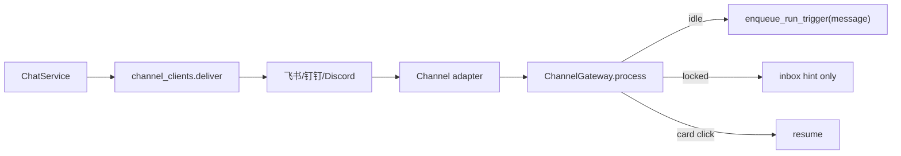

| 场景 | 行为 |
|------|------|
| Session 空闲 | 入站消息 → `WAKEUP_KIND_MESSAGE` → 新 turn |
| Session 忙 | 消息进 **inbox**（`HintBlock`），不 abort 当前 run |
| 卡片确认 | `resume` → 与 HTTP HITL 同队列 |

测试参考：`tests/channel_gateway_test.py`、`tests/service_chat_channel_delivery_test.py`

---

### 7. Team 与子 Agent

核心 `Agent` **无** `children` 字段；Team 在 **App 工具层**实现。

#### 7.1 角色与工具面

| 角色 | 典型工具 |
|------|----------|
| **Leader**（或无 team） | `TeamCreate`、`AgentCreate`、`AgentInvite`、`TeamSay`、`TeamDelete` |
| **Worker** | 仅 `TeamSay` |

由 `get_toolkit(..., team_role=...)` 在每次 run 解析。

#### 7.2 `AgentCreate`（leader）

1. 按 `SubAgentTemplate` 创建 `AgentRecord` + team 作用域 `SessionRecord`（`TeamOrigin`）  
2. `TeamRecord.members` 追加 `role=created`  
3. `deliver_to_inbox` 初始任务 → `enqueue_run_trigger(wake)` 拉起 worker run  

#### 7.3 `AgentInvite`（leader）

借用已有 `AgentRecord`，mint 新 team session，`role=invited`，同样 inbox + wakeup。

#### 7.4 `TeamMemberLoopMiddleware`（worker only）

强制 worker 以成功的 `TeamSay(to=leader)` 结束；最多 nudge 数次，否则以 ERROR 结束 reply。  
与 `TeamSay` 工具（投递路径）互补。

#### 7.5 Leader 看子 Agent HITL

`SubagentHitlProjector` → `projection_namespace(leader_session_id)` → SSE 合并展示。

测试参考：`tests/service_team_tools_test.py`、`tests/service_inbox_handoff_test.py`

---

### 8. 调度（Scheduler）

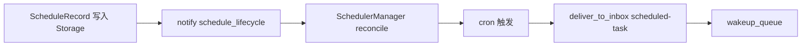

- **单节点**跑 APScheduler（`enable_scheduler=True`）  
- 触发后 **不直接**调 `ChatService`——与 Team 消息相同：inbox + wakeup  
- 测试：`tests/service_scheduler_test.py`

---

### 9. Storage 模型（设计级）

| 模型 | 要点 |
|------|------|
| **`SessionRecord`** | `agent_id`、`team_id`、`origin`（User / Schedule / Channel / Team）、`config`（model、KB、workspace）、`state: AgentState` |
| **`TeamRecord`** | `session_id`（leader）、`members[]`（agent_id、session_id、role created/invited） |
| **`AgentRecord`** | `system_prompt`、context/react 配置、`InviteConfig`、`source` user/team |
| **`ScheduleRecord`** | cron、target agent、stateful、enabled |

实现：`RedisStorage`（全量接口）或 `AsyncSQLAlchemyStorage`（可选 SQLAlchemy）。  
测试：`tests/storage_redis_test.py`、`tests/storage_sql_test.py`

---

### 10. 与库级模块的衔接

| App 装配 | 库模块 |
|----------|--------|
| `get_model` / `get_toolkit` | `model/`、`tool/`、`mcp/` |
| `RAGMiddleware` + `KnowledgeBaseManager` | `rag.KnowledgeBase`、`embedding/` |
| `TTSMiddleware` | `tts/` |
| `AgenticMemoryMiddleware` 等 | `middleware/` |
| `workspace_manager` | `workspace/`（Docker、E2B、K8s…） |
| `Offloader` / 工具落盘 | `workspace.Offloader` |

→ RAG 专题：[RAG_AND_KNOWLEDGE.md](#part-rag)  
→ Workspace：[WORKSPACE_AND_SANDBOX.md](#part-workspace)  
→ Middleware：[MIDDLEWARE_CATALOG.md](#part-middleware)

---

### 11. 设计法则

1. **`ChatService.run` 是唯一执行真源** — HTTP、渠道、调度、Team 工具都汇入此处。  
2. **Storage ≠ MessageBus** — 持久化与 live 协调分离，便于 SQL + Redis 组合。  
3. **HITL resume 走 wakeup 队列** — 避免与进行中的 run 409 竞态。  
4. **同 session 单 run** — `ChatRunRegistry` + `session_lock`；忙时 channel 用 inbox 而非硬 interrupt。  
5. **SSE 与 POST 解耦** — 触发异步，订阅收事件。  
6. **子 Agent 在 App 层** — 不要假设核心 `Agent` 有 delegate API。

---

### 12. 源码索引

| 主题 | 路径 |
|------|------|
| App 工厂 | `app/_app.py` |
| Lifespan | `app/_lifespan.py` |
| ChatService | `app/_service/_chat.py` |
| HTTP 触发 | `app/_router/_chat.py` |
| SSE | `app/_router/_session.py` |
| Channel | `app/channel/_gateway.py` |
| Bus 键 | `app/message_bus/_keys.py` |
| Wakeup | `app/_manager/_wakeup_dispatcher.py` |
| Scheduler | `app/_manager/_scheduler/_scheduler_manager.py` |
| AgentCreate | `app/_tool/_agent_create.py` |
| Team middleware | `app/middleware/_team_member_middleware.py` |
| Storage ABC | `app/storage/_base.py` |

---

### 13. 相关文档

| 文档 | 内容 |
|------|------|
| [ARCHITECTURE.md](#part-kernel) | 单 Agent ReAct、Tool、Permission |
| [MEMORY_SYSTEM.md](#part-memory) | `AgentState`、压缩、Offloader |
| [PIPELINE_AND_GOALS.md](#part-pipeline) | `GoalPipeline` |
| [WORKSPACE_AND_SANDBOX.md](#part-workspace) | 沙箱与 WorkspaceManager |
| [MIDDLEWARE_CATALOG.md](#part-middleware) | 中间件全目录 |
| [RAG_AND_KNOWLEDGE.md](#part-rag) | 知识库与 RAG |


---

## Part · GoalPipeline {#part-pipeline}


> **定位**：库级 `pipeline/` — **非** v0.x `MsgHub`（已移除）  
> **前置**：[ARCHITECTURE.md](#part-kernel) §4 · [APP_ARCHITECTURE.md](#part-app) §7（App 层 Team 是另一套编排）  
> **最后更新**：2026-09-08

---

### 1. 一句话

v2 的 `pipeline` 包目前核心是 **`GoalPipeline`**：两个 `Agent`（executor + verifier）在结构化输出约束下循环，直到验证 **pass** / **impossible** / 达上限。  
与 App 层 `AgentCreate` Team、与旧版 `MsgHub` 广播 **不是同一机制**。

---

### 2. 历史对照

| 机制 | 状态 | 语义 |
|------|------|------|
| **MsgHub / FanoutPipeline** | ❌ main 已移除 | 多 Agent 顺序/并行传 `Msg` |
| **GoalPipeline** | ✅ `pipeline/_goal_pipeline.py` | Executor ↔ Verifier 质量环 |
| **App Team** | ✅ `app/_tool/` | Leader 创建 worker session + inbox |
| **脚本 `asyncio.gather`** | ✅ 应用自行 | 扁平多 Agent，无框架编排 |

---

### 3. GoalPipeline 设计

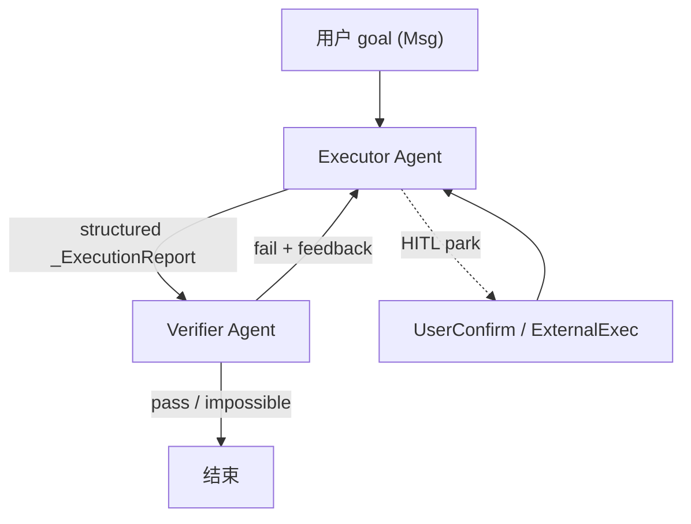

#### 3.1 角色

| 角色 | Agent | 结构化输出 |
|------|-------|------------|
| **Executor** | 干活 | `_ExecutionReport.report`（路径、入口、环境等可验证信息） |
| **Verifier** | 审稿 | `_VerificationResult`: `pass` \| `fail` \| `impossible` + `message` |

#### 3.2 关键参数

| 参数 | 默认 | 含义 |
|------|------|------|
| `verifier_reset_context` | `True` | 每轮验证后清空 verifier 上下文 |
| `max_iters` | `10` | fail 后最多重试轮次 |
| `max_retries` | `3` | 单步结构化输出无效时的重试（schema 提示） |

#### 3.3 与单 Agent 的差异

- 实现 **`reply_stream`**，与 `Agent` 一样可接入事件流  
- **`_iters` 在实例上**：HITL resume 不重置轮次预算  
- HITL 事件按 `reply_id` 路由到 executor 或 verifier  
- `UserInterruptEvent` 转发给当前 parked 的 Agent  

---

### 4. 时序（概念）

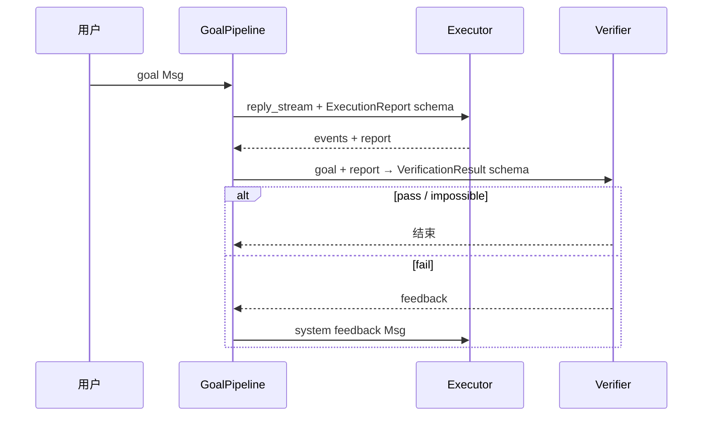

**Executor 提示**：首次 goal 会追加 `<system-reminder>`，要求产出可供 verifier 检查的 report。

---

### 5. 何时用 GoalPipeline

| 适合 | 不适合 |
|------|--------|
| 代码/任务需 **客观验收**（测试、lint、文件存在） | 开放式聊天 |
| 同一 workspace 上迭代修错 | 需要 >2 个固定角色 SOP |
| 希望 verifier **独立上下文**（防 executor 自证） | 已有 App Team 分工（用 Team 工具） |

---

### 6. 与 Plan 模式的关系

| | GoalPipeline | Plan（产品语义） |
|--|--------------|------------------|
| **编排** | 双 Agent 外环 | Todo / 只读模式 / Flow |
| **状态** | 两个 `AgentState` | 通常单 Agent |
| **停止条件** | verifier 结构化判定 | 模型自觉或工具门禁 |

→ Harness 对比：[OpenHarness framework-comparison 05-plan-mode](../../OpenHarness/docs/framework-comparison/05-plan-mode.md)

---

### 7. 最小用法（概念）

```python
from agentscope.pipeline import GoalPipeline

pipeline = GoalPipeline(executor=executor_agent, verifier=verifier_agent)

async for event in pipeline.reply_stream(goal_user_msg):
    ...  # 与 Agent.reply_stream 相同事件类型
```

---

### 8. 设计法则

1. **Verifier 要独立 system prompt** — 不要与 executor 共用「自嗨」上下文。  
2. **Report 必须可验证** — 路径、命令、入口写清楚，否则 fail 循环空转。  
3. **`impossible` 要当真** — 避免无限 executor 重试。  
4. **HITL 时记住 reply_id** — pipeline 靠它区分 executor/verifier resume。  
5. **不要与 Team worker 混用** — Team 是 session 级；GoalPipeline 是单进程双 Agent。

---

### 9. 源码索引

| 路径 | 内容 |
|------|------|
| `pipeline/_goal_pipeline.py` | `GoalPipeline` 全文 |
| `pipeline/_base.py` | `PipelineProtocol` |
| `pipeline/__init__.py` | 导出 |


---

## Part · Workspace 与沙箱 {#part-workspace}


> **定位**：`workspace/`（库）+ `app/workspace_manager/`（托管隔离）+ `tool` 内置 Backend  
> **前置**：[MEMORY_SYSTEM.md](#part-memory) §12（Offloader）· [APP_ARCHITECTURE.md](#part-app)  
> **最后更新**：2026-09-08

---

### 1. 一句话

**Workspace** = Agent 可见的文件系统根 + Skill/MCP 声明 + **卸载（Offload）** 落盘；**Backend** = bash/read/write 真正执行的位置（本机 / 容器 / 云沙箱）。  
App 层 **`WorkspaceManager`** 按 user/agent/session 策略分配 workspace 实例。

---

### 2. 三层概念

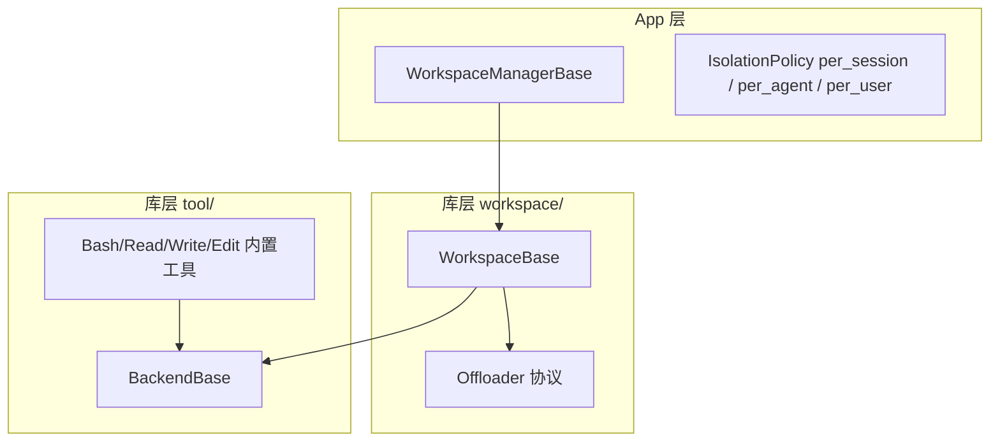

| 层 | 问什么 |
|----|--------|
| **WorkspaceManager** | 哪个用户/会话绑定哪个 workspace id |
| **WorkspaceBase** | 目录布局、MCP 声明、skill 分区、offload 路径 |
| **BackendBase** | 命令与文件 I/O 落在哪 |

---

### 3. Workspace 目录布局

`WorkspaceBase` 在 `workdir` 下约定（见 `workspace/_base.py` 文档块）：

```text
{workdir}/
├── .mcp          # MCP 声明（按 agent/session 懒连接）
├── data/         # 卸载的多模态 payload
├── skills/       # 按 agent 分区；.seed 为模板
└── sessions/     # 每 session 的 context / tool-result 文件
```

| 能力 | 设计要点 |
|------|----------|
| **MCP** | 声明在 `.mcp`；**按 session 懒实例化**，避免跨 session 状态泄漏 |
| **Skill** | 每 agent 独立分区；首次从 `.seed` 装备 |
| **Offload** | 压缩 context、大 tool result、`DataBlock` base64 → `workspace://` URL |

---

### 4. 实现谱系

#### 4.1 Workspace 实现

| 类 | 场景 |
|----|------|
| `LocalWorkspace` | 开发 / 单机 |
| `DockerWorkspace` | 容器隔离 |
| `E2BWorkspace` | E2B 云沙箱 |
| `DaytonaWorkspace` | Daytona 开发环境 |
| `K8sWorkspace` | K8s Pod |
| `OpenSandboxWorkspace` | OpenSandbox 远端 |
| `AppleContainerWorkspace` | Apple Container（macOS） |
| `BubblewrapWorkspace` | bwrap 轻量隔离 |

导出见 `workspace/__init__.py`。

#### 4.2 Backend 实现

内置工具（`tool/_builtin/_backend.py`）通过 **`BackendBase`** 三原语抽象：

- `exec_shell` — argv 执行（无 shell；需 shell 时 `sh -c`）
- `read_file` / `write_file`

| Backend | 绑定 Workspace |
|---------|----------------|
| `LocalBackend` | 本机 |
| `DockerBackend` | Docker exec/archive |
| `E2BBackend` | E2B SDK |

**原则**：工具代码不分支 workspace 类型，只调 Backend。

---

### 5. Offloader 协议

```python
## workspace/_offload_protocol.py — 协议方法
offload_data_block(block) -> DataBlock      # base64 → workspace://
offload_context(session_id, msgs) -> str    # 压缩删除前的备份
offload_tool_result(session_id, result) -> str
```

与 [MEMORY_SYSTEM.md](#part-memory) 的关系：

- **压缩物理删除** `context` 前可 offload → summary 里留引用  
- **大 tool result** 截断前 offload → Agent 可用路径再读  

---

### 6. MCP Gateway（沙箱内）

`workspace/_mcp_gateway/_mcp_gateway_app.py`：在 **workspace 环境内** 跑的 FastAPI 网关。

| 设计点 | 说明 |
|--------|------|
| **空启动注册表** | 不读 `.mcp` 文件；由 workspace 按需 `POST /mcps` 注册 |
| **会话隔离** | `?agent_id=&session_id=`；同 MCP 名不同 session 独立 client 状态 |
| **可选 bearer** | 共享 host 网络时防跨 workspace 访问 |
| **端点** | health、list/register MCP、list/call tools |

上游：`workspace/_gateway_client.py`、`_gateway_shim.py`。

---

### 7. App：WorkspaceManager

`app/workspace_manager/_base.py`：

| `IsolationPolicy` | 粒度 |
|-------------------|------|
| `PER_SESSION` | 每会话独立 workspace |
| `PER_AGENT` | 同 agent 多 session 共享（默认） |
| `PER_USER` | 用户级共享 |

- `bind_storage(storage)` — 持久化 workspace id 绑定  
- `get_workspace(user_id, agent_id, session_id)` — ChatService 每轮调用  
- 并发 **bind lock** + `_reserved` — 防双 session 同时 mint 两个 workspace  

`ChatService` 将 workdir 合并进 **permission context**，供工具路径校验。

---

### 8. 选型决策树

```mermaid
flowchart TD
    Q["需要隔离?"] -->|否| LOC["LocalWorkspace + LocalBackend"]
    Q -->|是 Docker| DOC["DockerWorkspace"]
    Q -->|是 托管云| CLD["E2B / Daytona / OpenSandbox"]
    Q -->|是 K8s| K8["K8sWorkspace"]
    Q -->|是 多租户 App| WM["WorkspaceManager PER_SESSION"]
```

| 场景 | 建议 |
|------|------|
| 本地 demo | `LocalWorkspace` |
| Coding Agent 产品 | Docker 或 E2B + `PER_AGENT` |
| 强多租户 | `PER_SESSION` + 远端沙箱 |
| 有状态 MCP（浏览器） | 必须 session 级 MCP 实例 + 可选 in-sandbox gateway |

---

### 9. 设计法则

1. **Backend 与 Workspace 分离** — 换沙箱不换工具实现。  
2. **MCP 懒连接** — 启动成本与 agent 数量解耦。  
3. **Offload 引用进 summary** — 删了还能找回。  
4. **permission context 带 workdir** — 防止路径逃逸。  
5. **Gateway 在沙箱内** — 远端 MCP 不直接暴露宿主机。

---

### 10. 源码索引

| 主题 | 路径 |
|------|------|
| Workspace 抽象 | `workspace/_base.py` |
| Offloader | `workspace/_offload_protocol.py` |
| Local | `workspace/_local_workspace.py` |
| Docker | `workspace/_docker/` |
| MCP Gateway | `workspace/_mcp_gateway/` |
| Backend | `tool/_builtin/_backend.py` |
| App 管理器 | `app/workspace_manager/_base.py` |


---

## Part · 中间件目录 {#part-middleware}


> **定位**：库级 `middleware/` + App 级 `app/middleware/` 钩子与专用中间件  
> **前置**：[ARCHITECTURE.md](#part-kernel) §8 · [APP_ARCHITECTURE.md](#part-app)  
> **最后更新**：2026-09-08

---

### 1. 钩子模型（库层）

`MiddlewareBase` 提供 **7 个可选钩子**（`middleware/_base.py`）：

| 钩子 | 模式 | 典型用途 |
|------|------|----------|
| `on_reply` | 洋葱 | 整段 reply 包裹；可吞 `ReplyEndEvent` 强制多轮 |
| `on_reasoning` | 洋葱 | 每步推理前/后；注入 context |
| `on_acting` | 洋葱 | 单 tool 执行前后 |
| `on_check_permission` | 洋葱 | 改写 ALLOW/ASK/DENY |
| `on_model_call` | 洋葱 | 原始 LLM API 前后 |
| `on_compress_context` | 洋葱 | 压缩前后 |
| `on_system_prompt` | **流水线** | 顺序变换 system 字符串 |

运行时检测 `is_implemented(hook_name)` — 只链接已实现的钩子。

```mermaid
flowchart LR
    IN["reply 入口"] --> M1["on_reply"]
    M1 --> R["reasoning"]
    R --> M2["on_reasoning"]
    M2 --> MC["on_model_call"]
    MC --> ACT["acting"]
    ACT --> M3["on_acting"]
```

---

### 2. 库级专用 Middleware

| 类 | 钩子 | 作用 |
|----|------|------|
| **`AgenticMemoryMiddleware`** | `on_system_prompt`, `on_reasoning` | 工作区 Markdown 记忆库；`MEMORY.md` 索引注入；异步检索 topic 文件 → `HintBlock` |
| **`Mem0Middleware`** | 同族 | 接 Mem0 外部记忆服务 |
| **`ReMeMiddleware`** | 同族 | 接 ReMe 外部记忆服务 |
| **`RAGMiddleware`** | `on_reasoning`, `list_tools` | KB 检索：`static` 自动注入 / `agentic` 暴露 `search_knowledge` 工具 |
| **`ReplyBudgetControlMiddleware`** | `on_reasoning`, `on_model_call` | 单 reply token 预算；超限注入 hint + `tool_choice=none` |
| **`TTSMiddleware`** | `on_reasoning` | 文本块 → `DATA_BLOCK_*` 音频事件 |
| **`TracingMiddleware`** | `on_reply`, `on_model_call`, `on_acting` | OpenTelemetry span（LLM / tool / agent） |

导出：`middleware/__init__.py`

#### 2.1 AgenticMemory（要点）

- 记忆目录：workspace 内 Markdown + frontmatter（`user` / `feedback` / `project` / `reference`）  
- **索引进 system**，正文 **on-demand** 检索注入  
- 依赖 `BackendBase` 读写记忆文件  

#### 2.2 RAGMiddleware（要点）

| 模式 | 行为 |
|------|------|
| `static` | `cur_iter==0` 时用用户 query 检索，注入 `HintBlock` |
| `agentic` | 注册 `search_knowledge` 工具，模型自选何时查 |

支持多 KB、不同 embedding 模型并存；可选 rerank。  
**不负责索引** — 见 [RAG_AND_KNOWLEDGE.md](#part-rag)。

#### 2.3 ReplyBudgetControl

- 状态在 `agent.state.middle_context`（HITL resume 可续）  
- `ReplyEndEvent` 时清理  
- 加权：`input_token_weight * in + output_token_weight * out`

---

### 3. App 级 Middleware

由 `ChatService` 每轮装配（`app/middleware/`）：

| 类 | 钩子 | 作用 |
|----|------|------|
| **`InboxMiddleware`** | `on_reasoning` | drain `MessageBus` inbox → `HintBlock` 进 context + `HintBlockEvent` |
| **`StateChangeMiddleware`** | 状态同步 | Session 持久化触发 |
| **`ToolOffloadMiddleware`** | `on_acting` | tool 超时 → 后台任务 + inbox 占位 + wakeup |
| **`TeamMemberLoopMiddleware`** | `on_reply` | worker 必须以 `TeamSay(leader)` 成功结束 |
| **`AGUIProtocolMiddleware`** | 协议 | AG-UI 事件投影 |

#### 3.1 Inbox + ToolOffload 协作

```mermaid
sequenceDiagram
    participant TO as ToolOffload
    participant BG as BackgroundTaskManager
    participant INB as inbox queue
    participant IM as InboxMiddleware
    participant AG as Agent

    TO->>BG: 超时后注册后台 tool
    TO->>AG: 占位 ToolResponse
    BG-->>INB: 完成后 HintBlock
    BG->>WQ: wakeup
    IM->>INB: drain
    IM->>AG: 注入 context
```

与 [APP_ARCHITECTURE.md](#part-app) §5–§7 一致：Team 消息、调度任务、渠道忙时 hint 均走 **inbox**。

---

### 4. ChatService 装配顺序（概念）

每轮 `ChatService._run_impl` 大致：

1. **App 固定**：`InboxMiddleware` → `StateChangeMiddleware` → `ToolOffloadMiddleware`  
2. **Team worker**：`TeamMemberLoopMiddleware`  
3. **Session 配置**：`TTSMiddleware`、`RAGMiddleware`（若配置 KB/TTS）  
4. **用户自定义**：`AgentMiddlewareFactory` 注入  

库级 middleware 在构造 `Agent(..., middlewares=[...])` 时传入。

---

### 5. 选型表

| 需求 | 选用 |
|------|------|
| 跨会话 Markdown 记忆 | `AgenticMemoryMiddleware` |
| 已有 Mem0/ReMe 投资 | `Mem0Middleware` / `ReMeMiddleware` |
| 知识库问答 | `RAGMiddleware` |
| 控费 / 防无限 tool | `ReplyBudgetControlMiddleware` |
| 语音播报 | `TTSMiddleware` + `tts/` 模型 |
| 可观测 | `TracingMiddleware` |
| 生产 IM/调度/Team | App `InboxMiddleware` + `ToolOffloadMiddleware`（随 `create_app`） |

---

### 6. 设计法则

1. **App middleware 依赖 MessageBus** — 仅 `create_app` 场景；脚本嵌入用库级即可。  
2. **Inbox 用 HintBlock** — 统一跨 turn 注入形态。  
3. **Budget 状态放 middle_context** — 不要放 middleware 实例字段。  
4. **RAG static 只首轮** — 避免每 iter 重复检索。  
5. **Tracing 最外层** — 通常 `middlewares` 列表靠前注册（先包 on_reply）。

---

### 7. 源码索引

| 路径 | 内容 |
|------|------|
| `middleware/_base.py` | 钩子定义 |
| `middleware/_longterm_memory/` | Agentic / Mem0 / ReMe |
| `middleware/_rag.py` | RAG |
| `middleware/_budget.py` | Token 预算 |
| `middleware/_tts_middleware.py` | TTS |
| `middleware/_tracing/` | OTel |
| `app/middleware/` | Inbox、Team、ToolOffload、AG-UI |


---

## Part · RAG 与知识库 {#part-rag}


> **定位**：库级 `rag/` + `RAGMiddleware` + App `app/rag/`  
> **前置**：[APP_ARCHITECTURE.md](#part-app) · [MIDDLEWARE_CATALOG.md](#part-middleware) §2.2  
> **最后更新**：2026-09-08

---

### 1. 一句话

**索引与检索算法**在 `rag.KnowledgeBase`；**何时注入上下文**由 `RAGMiddleware` 决定；**托管多租户 KB 生命周期**在 `app/rag/KnowledgeBaseManager` + 异步 `index_worker`。

> 旧文档「v2 无 KnowledgeBase」已作废。

---

### 2. 两层结构

```mermaid
flowchart TB
    subgraph ingest["写入路径"]
        UP["上传 / API insert"]
        PAR["Parser PDF/Word/Excel…"]
        CHK["ApproxTokenChunker"]
        EMB["EmbeddingModel"]
        VDB["VectorStore"]
    end
    subgraph runtime["读取路径"]
        KB["KnowledgeBase"]
        RM["RAGMiddleware"]
        AG["Agent.reply_stream"]
    end
    subgraph hosted["App 托管"]
        KBM["CollectionPerKbManager"]
        IW["index_worker"]
        BS["blob_store"]
    end
    UP --> PAR --> CHK --> EMB --> VDB
    KBM --> KB
    IW --> KBM
    KB --> RM --> AG
```

| 层 | 职责 |
|----|------|
| **`KnowledgeBase`** | 单库运行时句柄：`search` / `insert_document` / `delete_document` / `list_documents` |
| **`RAGMiddleware`** | 把检索结果送进 loop（static / agentic） |
| **`KnowledgeBaseManager`** | 记录 CRUD、向量 collection 分配、维度策略、构造 KB 句柄 |
| **`index_worker`** | 消费 `index_tasks_queue`，异步建索引 |

---

### 3. KnowledgeBase（库级）

源码：`rag/_knowledge.py`

```python
kb = KnowledgeBase(
    name="handbook",
    description="HR 与 onboarding 文档",
    embedding_model=embedding_model,
    vector_store=vector_store,
    collection="handbook",
    metadata_filter={"tenant_id": "t1"},  # 可选，构造时固定
)
```

| 设计点 | 说明 |
|--------|------|
| **懒建 collection** | 首次操作 `ensure_collection`，部署零配置 |
| **metadata_filter** | 同物理 collection 多逻辑库；search/insert 强制 scope |
| **name/description** | 给 LLM 与前端；agentic 模式靠 description 决定是否检索 |

#### 3.1 组件导出（`rag/__init__.py`）

| 类别 | 类 |
|------|-----|
| **Parser** | `PDFParser`, `WordParser`, `ExcelParser`, `PPTParser`, `TextParser`, `ImageParser` |
| **Chunker** | `ApproxTokenChunker` |
| **VectorStore** | `QdrantStore`, `MilvusLiteStore`, `ElasticsearchStore`, `MongoDBStore` |
| **模型** | `Chunk`, `Section`, `VectorRecord`, `VectorSearchResult`, `DocumentSummary` |

`embedding/` 包提供 `EmbeddingModelBase` 实现，与 KB 绑定。

---

### 4. RAGMiddleware 模式

源码：`middleware/_rag.py`

| 模式 | 行为 | 适用 |
|------|------|------|
| **`static`** | 每 reply 首轮（`cur_iter==0`）用用户 query 检索，合并结果 → `HintBlock` 进 `context` | 问答、助手必带资料 |
| **`agentic`** | 暴露 `search_knowledge` 工具；模型自选 KB 与时机 | 复杂任务、多 KB |

可选：**rerank**（独立 prompt + candidate cap）、`HintBlockEvent` 给前端展示引用。

**非职责**：解析 PDF、chunk、embed、insert — 由调用方或 index worker 完成后再把 `KnowledgeBase` 传给 middleware。

---

### 5. App 托管流程

#### 5.1 KnowledgeBaseManager

`app/rag/knowledge_base_manager/`：

- `KnowledgeBaseManagerBase` — ABC  
- `CollectionPerKbManager` — MVP：每 KB 独立 collection  
- `DimensionPolicy` — embedding 维度校验  

职责：KB 记录持久化、分配 vector store、credential 解析、为 `ChatService` 构造运行时 `KnowledgeBase`。

#### 5.2 异步索引

```mermaid
sequenceDiagram
    participant API as KB HTTP API
    participant STG as Storage
    participant Q as index_tasks_queue
    participant W as index_worker
    participant VDB as VectorStore

    API->>STG: 创建 KB 记录 + blob
    API->>Q: 索引任务
    W->>Q: drain
    W->>W: parse → chunk → embed
    W->>VDB: insert
```

Bus 键：`MessageBusKeys.index_tasks_queue()` / `index_tasks_signal()`（见 [APP_ARCHITECTURE.md](#part-app) §5.1）。

#### 5.3 ChatService 装配

Session `config` 指定 KB id → `get_toolkit` / middleware 工厂 → 注入 `RAGMiddleware(knowledge_bases=[...])`。

---

### 6. 与 Memory 的边界

| | Session Memory | RAG |
|--|----------------|-----|
| **载体** | `AgentState.context/summary` | 向量库 + blob |
| **生命周期** | 单会话为主 | 跨会话文档库 |
| **大结果** | compress + Offloader | chunk + 引用；避免全文进 L |
| **Middleware** | `AgenticMemoryMiddleware` | `RAGMiddleware` |

二者可同时挂载在同一 `Agent` 上。

---

### 7. 端到端（自建脚本，无 App）

```text
1. 配置 EmbeddingModel + VectorStore
2. KnowledgeBase(...) → insert_document(parsed chunks)
3. Agent(..., middlewares=[RAGMiddleware(kbs=[kb], config=SearchConfig(mode="static"))])
4. await agent(user_msg)
```

托管部署改为：HTTP 上传 → manager 建记录 → worker 索引 → session config 绑定 KB。

---

### 8. 设计法则

1. **索引与检索分层** — Middleware 不做 parse。  
2. **metadata_filter 构造时固定** — 防租户串库。  
3. **static 只首轮** — 省 token。  
4. **description 写给模型** — agentic 模式选型靠它。  
5. **大文档走 worker** — 避免阻塞 `ChatService.run`。

---

### 9. 测试与源码

| 路径 | 内容 |
|------|------|
| `tests/rag_parser_test.py` | Parser |
| `rag/_knowledge.py` | KB 算法 |
| `middleware/_rag.py` | Middleware |
| `app/rag/knowledge_base_manager/` | 托管 manager |
| `app/rag/index_worker/` | 异步消费者 |
| `app/rag/blob_store/` | 原始文件存储 |


---

## Part · Agent 与 LTM 分析 {#part-ltm-analysis}


> **版本**: 1.0  
> **分析时间**: 2026-05-22  
> **App 层 Team/子 Agent**（`AgentCreate` 等）：见 [APP_ARCHITECTURE.md](#part-app) §7 — 核心 `Agent` 仍无内置 delegate。  
> **分析方法**: 源码深度阅读 + 文档交叉验证
> **源码路径**: `src/agentscope/`
> **前置阅读**: [ARCHITECTURE.md](#part-kernel) · [MEMORY_SYSTEM](#part-memory)

---

### 📋 目录

- [第1章：Agent 架构分析——没有子 Agent](#第1章agent-架构分析没有子-agent)
- [第2章：长期记忆系统——源码与文档差异](#第2章长期记忆系统源码与文档差异)
- [第3章：当前 v1 实际可用的记忆机制](#第3章当前-v1-实际可用的记忆机制)
- [第4章：长期记忆的替代实现方案](#第4章长期记忆的替代实现方案)
- [第5章：多 Agent 协作机制——扁平编排而非层级委派](#第5章多-agent-协作机制扁平编排而非层级委派)
- [第6章：与竞品对比](#第6章与竞品对比)
- [第7章：设计取舍与总结](#第7章设计取舍与总结)

---

### 第1章：Agent 架构分析——没有子 Agent

#### 1.1 Agent 类结构

**位置**: `src/agentscope/agent/_agent.py`（2390 行）

AgentScope v1 的 `Agent` 类是一个**独立的、自包含的 ReAct 智能体**，其构造函数参数为：

```python
class Agent:
    def __init__(
        self,
        name: str,
        system_prompt: str,
        model: ChatModelBase,
        toolkit: Toolkit | None = None,
        middlewares: list[MiddlewareBase] | None = None,
        state: AgentState | None = None,
        offloader: Offloader | None = None,
        model_config: ModelConfig = ModelConfig(),
        context_config: ContextConfig = ContextConfig(),
        react_config: ReActConfig = ReActConfig(),
    ):
```

**没有任何 `children`、`sub_agents`、`parent`、`delegate` 之类的字段**。Agent 内部不持有其他 Agent 的引用，也无法嵌套或委托给另一个 Agent。

#### 1.2 AgentState 结构

**位置**: `src/agentscope/state/_state.py`

```python
class AgentState(BaseModel):
    session_id: str
    summary: str | list[TextBlock | DataBlock] = ""   # 压缩摘要
    context: list[Msg] = []                            # 对话上下文
    reply_id: str
    cur_iter: int = 0
    permission_context: PermissionContext
    tool_context: ToolContext
    tasks_context: TaskContext
```

AgentState 中同样**没有任何子 Agent 相关字段**。

#### 1.3 ReAct 循环内部流程

Agent 的核心是 `_reply_impl()` 方法，执行标准的 ReAct 循环：

```
Step 1: 检查输入事件（用户确认 / 外部执行结果）
Step 2: 处理输入消息，写入 context
Step 3: 进入 reasoning-acting 循环
  ├─ 3.1 检查下一步动作（exit / reasoning / acting）
  ├─ 3.2 reasoning：压缩上下文 → 调用 LLM → 生成回复或工具调用
  └─ 3.3 acting：执行工具调用（顺序 / 并发）→ 结果写入 context
Step 4: 超过 max_iters 则退出
```

整个循环中**没有任何调用其他 Agent 的逻辑**，只有 `toolkit.call_tool()` 执行工具。

#### 1.4 源码验证

在 `src/agentscope/` 中搜索以下关键词，均无结果：

| 搜索词 | 结果 |
|--------|------|
| `sub_agent` / `child_agent` / `delegate_agent` | ❌ 无匹配 |
| `spawn_agent` / `agent_hierarchy` | ❌ 无匹配 |
| `orchestrat` | ❌ 无匹配 |
| `long_term_memory` / `LongTermMemory` | ❌ 无匹配 |
| `Mem0` / `ReMe` | ❌ 无匹配（源码中） |

---

### 第2章：长期记忆系统——源码与文档差异

#### 2.1 关键发现：v1 源码中尚未实现长期记忆

经过对源码的逐目录验证：

| 预期路径 | 是否存在 | 说明 |
|----------|----------|------|
| `src/agentscope/memory/` | ❌ 不存在 | 文档描述的 memory 子目录 |
| `src/agentscope/memory/_working_memory/` | ❌ 不存在 | 工作记忆实现 |
| `src/agentscope/memory/_long_term_memory/` | ❌ 不存在 | 长期记忆实现 |
| `src/agentscope/rag/` | ❌ 不存在 | RAG 知识库 |
| `src/agentscope/session/` | ❌ 不存在 | Session 持久化 |
| `src/agentscope/plan/` | ❌ 不存在 | Plan Notebook |
| `src/agentscope/a2a/` | ❌ 不存在 | A2A 协议 |

**结论**：`MEMORY_SYSTEM.md` 等文档中描述的长期记忆、RAG、Session、Plan、A2A 等功能属于**旧版（v0.x）或规划中功能**，尚未迁移到当前 v1 异步版本。

#### 2.2 文档与源码的对应关系

| 文档描述 | v1 源码实际状态 |
|----------|-----------------|
| `MemoryBase` + `InMemoryMemory` / `RedisMemory` | ❌ 不存在；由 `AgentState.context` 替代 |
| `LongTermMemoryBase` + `Mem0LongTermMemory` | ❌ 不存在 |
| `ReMePersonalLongTermMemory` / `TaskLongTermMemory` / `ToolLongTermMemory` | ❌ 不存在 |
| `CompressionConfig`（嵌套在 ReActAgent 中） | ✅ 已实现为 `ContextConfig`（独立配置类） |
| `KnowledgeBase` + `SimpleKnowledge` | ❌ 不存在 |
| `JSONSession` / `RedisSession` | ❌ 不存在 |
| `PlanNotebook` | ❌ 不存在；由 `TaskCreate`/`TaskUpdate` 工具替代 |
| `MsgHub` | ❌ 不存在（v1 源码中） |
| `SequentialPipeline` / `FanoutPipeline` | ❌ 不存在（v1 源码中） |

#### 2.3 文档描述的长期记忆设计（参考）

以下为文档中描述的长期记忆架构，供未来迁移参考：

##### 分层架构

```mermaid
graph TB
    subgraph L4["L4: 知识库 RAG（可选）"]
        K1[KnowledgeBase / SimpleKnowledge]
        K2[retrieve + query rewrite]
    end

    subgraph L3["L3: 长期记忆（可选）"]
        L1[LongTermMemoryBase]
        M0[Mem0LongTermMemory]
        R1[ReMe Personal / Task / Tool]
        L1 --> M0
        L1 --> R1
    end

    subgraph L2["L2: 上下文压缩（可选）"]
        C1[CompressionConfig]
        C2[SummarySchema LLM 输出]
        C3[_compressed_summary + mark compressed]
    end

    subgraph L1["L1: 工作记忆（必选）"]
        W1[MemoryBase]
        W2[InMemory / Redis / SQL / Tablestore]
        W1 --> W2
    end

    subgraph L0["L0: 会话状态持久化（可选）"]
        S1[JSONSession / RedisSession]
        S2[state_dict memory.content]
    end

    RA[ReActAgent.reply] --> L1
    RA --> L2
    RA --> L3
    RA --> L4
    L1 --> S1
```

##### 三种控制模式

| 模式 | `_static_control` | `_agent_control` | 行为 |
|------|-------------------|------------------|------|
| `static_control` | ✓ | ✗ | 每 reply 自动 retrieve + 结束 record |
| `agent_control` | ✗ | ✓ | 注册两个工具，模型自控 |
| `both` | ✓ | ✓ | 自动 + 工具并存 |

##### 注入格式

```xml
<long_term_memory>
The content below are retrieved from long-term memory, which maybe useful:
{retrieved_info}
</long_term_memory>
```

以 `Msg(name="long_term_memory", role="user")` 写入工作记忆。

---

### 第3章：当前 v1 实际可用的记忆机制

#### 3.1 对话上下文（AgentState.context）

**核心载体**，存储当前会话的完整对话历史：

```python
class AgentState(BaseModel):
    context: list[Msg] = []  # 对话上下文
```

- 每轮 `reply()` 的输入消息和输出消息都写入 `context`
- 工具调用（`ToolCallBlock`）和工具结果（`ToolResultBlock`）也存储在 `context` 中的 `AssistantMsg` 内
- `_prepare_model_input()` 将 `system_prompt` + `summary` + `context` 组装为 LLM 输入

#### 3.2 上下文压缩（ContextConfig）

**位置**: `src/agentscope/agent/_config.py`

```python
class ContextConfig(BaseModel):
    trigger_ratio: float = 0.8       # 上下文占用超过 80% 时触发压缩
    reserve_ratio: float = 0.1       # 保留 10% 近期上下文
    compression_prompt: str = ...    # 引导压缩模型的提示
    summary_template: str = ...      # 摘要模板
    summary_schema: dict = ...       # 结构化摘要 Schema
    tool_result_limit: int = 3000    # 工具结果截断 token 限制
```

##### 压缩流程

```mermaid
sequenceDiagram
    participant Agent
    participant Model as LLM
    participant State as AgentState

    Agent->>State: count_tokens(context)
    State-->>Agent: token_count

    alt token_count > trigger_ratio × context_size
        Agent->>Agent: _split_context_for_compression()
        Note over Agent: 从尾部保留近期消息<br/>保证 tool_call/tool_result 成对完整

        Agent->>Model: generate_structured_output(旧消息 + compression_prompt)
        Model-->>Agent: SummarySchema(task_overview, current_state, ...)

        Agent->>State: summary = summary_template.format(**schema)
        Agent->>State: 旧消息标记为 compressed（不参与后续 prompt）
    end
```

##### SummarySchema 结构

| 字段 | 用途 |
|------|------|
| `task_overview` | 用户核心请求与成功标准 |
| `current_state` | 已完成工作与产出 |
| `important_discoveries` | 约束、决策、错误与修复 |
| `next_steps` | 待办与阻塞 |
| `context_to_preserve` | 偏好、领域细节、承诺 |

##### 压缩后的 prompt 组装

```python
## _prepare_model_input() 的组装逻辑
messages = [
    SystemMsg(content=system_prompt),      # 系统提示
]
if state.summary:
    messages.append(UserMsg(content=state.summary))  # 压缩摘要
messages.extend(state.context)             # 未压缩的近期上下文
```

#### 3.3 工具结果截断

当工具返回结果过长时，自动截断并附加提醒：

```python
## 超过 tool_result_limit 的工具结果会被截断
reserved, offload = await self._split_tool_result_for_compression(tool_result)

## 截断后附加提醒
reminder = "\n<<<TRUNCATED>>>\n<system-reminder>The remaining content has been omitted...</system-reminder>"

## 如果配置了 offloader，截断内容可保存到文件
if self.offloader:
    path = await self.offloader.offload_tool_result(session_id, offload)
    reminder += f" You can refer to the file in \'{path}\' for the truncated content."
```

#### 3.4 上下文卸载（Offloader）

**位置**: `src/agentscope/workspace/`

`Offloader` 可将压缩后的旧上下文和截断的工具结果保存到外部存储（本地文件系统、Docker、E2B 等），并在摘要中附加文件路径引用。

#### 3.5 任务管理（Task Tools）

**位置**: `src/agentscope/tool/_task/`

虽然不是记忆系统，但 `TaskCreate`/`TaskUpdate`/`TaskList`/`GetTask` 工具可以让 Agent 在 ReAct 循环中跟踪任务进度，起到一定的"工作记忆"作用。

| 工具 | 功能 |
|------|------|
| `TaskCreate` | 创建子任务 |
| `TaskUpdate` | 更新任务状态（pending → in_progress → completed） |
| `TaskList` | 列出所有任务 |
| `GetTask` | 获取任务详情 |

任务存储在 `AgentState.tasks_context` 中。

#### 3.6 技能系统（Skill）

**位置**: `src/agentscope/skill/`

`SkillViewer` 工具允许 Agent 查看和激活预定义的技能（markdown 格式），技能描述会注入到系统提示中。这是**知识/指令注入**，不是独立记忆。

#### 3.7 能力矩阵

| 能力 | v1 状态 | 实现方式 |
|------|---------|----------|
| 对话上下文 | ✅ 已实现 | `AgentState.context` |
| 上下文压缩 | ✅ 已实现 | `ContextConfig` + `compress_context()` |
| 工具结果截断 | ✅ 已实现 | `ContextConfig.tool_result_limit` |
| 上下文卸载 | ✅ 已实现 | `Offloader` |
| 任务跟踪 | ✅ 已实现 | `TaskCreate`/`TaskUpdate` 工具 |
| 技能注入 | ✅ 已实现 | `SkillViewer` 工具 |
| **长期记忆（LTM）** | ❌ 未迁移 | 文档描述但源码不存在 |
| **RAG 知识库** | ❌ 未迁移 | 文档描述但源码不存在 |
| **Session 持久化** | ❌ 未迁移 | 文档描述但源码不存在 |

---

### 第4章：长期记忆的替代实现方案

#### 4.1 方案一：通过 Toolkit 注册自定义记忆工具（推荐）

将长期记忆封装为工具，由 LLM 在 ReAct 循环中自主决定何时读写：

```python
from agentscope.agent import Agent
from agentscope.tool import Toolkit
from agentscope.model import OpenAIChatModel

## 自定义记忆存储（生产环境用 Redis / Chroma / Qdrant 等）
class SimpleMemoryStore:
    """简单的键值记忆存储，生产环境应替换为向量数据库"""

    def __init__(self):
        self.store: dict[str, str] = {}

    async def record(self, key: str, content: str) -> str:
        self.store[key] = content
        return f"Recorded: {key}"

    async def retrieve(self, query: str) -> str:
        # 简单实现；生产环境用语义检索
        results = [
            f"- [{k}] {v}" for k, v in self.store.items()
            if query.lower() in k.lower() or query.lower() in v.lower()
        ]
        return "\n".join(results) if results else "No relevant memory found."

memory_store = SimpleMemoryStore()
toolkit = Toolkit()

## 注册记忆工具
@toolkit.register_tool_function
async def record_to_memory(key: str, content: str) -> str:
    """Record important information to long-term memory for later recall.

    Args:
        key: A brief identifier for the information (e.g., "user_preference_theme").
        content: The detailed content to remember.
    """
    return await memory_store.record(key, content)

@toolkit.register_tool_function
async def retrieve_from_memory(query: str) -> str:
    """Retrieve relevant information from long-term memory.

    Args:
        query: Keywords or description of what you want to recall.
    """
    return await memory_store.retrieve(query)

agent = Agent(
    name="Friday",
    system_prompt=(
        "You are a helpful assistant. "
        "Use record_to_memory to save important facts about the user, "
        "and retrieve_from_memory to recall them when needed."
    ),
    model=OpenAIChatModel(...),
    toolkit=toolkit,
)
```

**优点**：
- LLM 自主决定何时读写，灵活性高
- 与现有 ReAct 循环无缝集成
- 可对接任意后端（Redis、Mem0、Chroma、Qdrant 等）

**缺点**：
- 依赖 LLM 的判断能力，可能遗忘记录
- 每次检索消耗一轮 ReAct 迭代

#### 4.2 方案二：通过 Middleware 自动注入（模拟 static_control）

在每轮 `reply` 前自动检索长期记忆并注入上下文：

```python
from agentscope.middleware import MiddlewareBase
from agentscope.message import Msg

class MemoryInjectionMiddleware(MiddlewareBase):
    """在 reply 前自动检索长期记忆并注入上下文（模拟 static_control）"""

    def __init__(self, memory_store):
        self.memory_store = memory_store

    async def on_reply(self, agent, input_kwargs, next_handler):
        # 从输入消息提取查询关键词
        inputs = input_kwargs.get("inputs")
        query = self._extract_query(inputs)

        if query:
            # 检索相关记忆
            memory_content = await self.memory_store.retrieve(query)

            if memory_content:
                # 构造记忆注入消息
                memory_msg = Msg(
                    name="long_term_memory",
                    content=(
                        f"<long_term_memory>"
                        f"The content below are retrieved from long-term memory, "
                        f"which may be useful:\n{memory_content}"
                        f"</long_term_memory>"
                    ),
                    role="user",
                )

                # 注入到输入消息中
                if inputs is None:
                    input_kwargs["inputs"] = memory_msg
                elif isinstance(inputs, list):
                    input_kwargs["inputs"] = [memory_msg] + inputs
                else:
                    input_kwargs["inputs"] = [memory_msg, inputs]

        # 执行正常的 reply 流程
        async for item in next_handler(**input_kwargs):
            yield item

        # reply 结束后自动归档（模拟 static_control 的 record）
        if query:
            context_text = self._serialize_context(agent.state.context)
            await self.memory_store.record(
                key=f"session_{agent.state.session_id}",
                content=context_text,
            )

    def _extract_query(self, inputs) -> str:
        """从输入消息中提取查询文本"""
        if inputs is None:
            return ""
        if isinstance(inputs, Msg):
            return inputs.content if isinstance(inputs.content, str) else ""
        if isinstance(inputs, list):
            return " ".join(
                m.content for m in inputs
                if isinstance(m, Msg) and isinstance(m.content, str)
            )
        return ""

    def _serialize_context(self, context: list) -> str:
        """将上下文序列化为文本"""
        parts = []
        for msg in context:
            if isinstance(msg.content, str):
                parts.append(f"[{msg.name}]: {msg.content[:200]}")
        return "\n".join(parts[-10:])  # 只保留最近 10 条
```

**使用方式**：

```python
agent = Agent(
    name="Friday",
    system_prompt="You are a helpful assistant.",
    model=OpenAIChatModel(...),
    middlewares=[MemoryInjectionMiddleware(memory_store)],
)
```

**优点**：
- 自动注入，LLM 无需主动调用
- 与文档描述的 `static_control` 行为一致
- 对 LLM 透明，不消耗 ReAct 迭代

**缺点**：
- 每轮都注入，可能增加上下文长度
- 需要自行实现检索逻辑

#### 4.3 方案三：组合方案（模拟 both 模式）

同时使用 Middleware 自动注入 + Toolkit 工具，实现 `both` 模式：

```python
agent = Agent(
    name="Friday",
    system_prompt=(
        "You are a helpful assistant. "
        "Some memories are automatically provided. "
        "You can also use record_to_memory and retrieve_from_memory "
        "to actively manage your memories."
    ),
    model=OpenAIChatModel(...),
    toolkit=toolkit,                                      # agent_control 工具
    middlewares=[MemoryInjectionMiddleware(memory_store)],  # static_control 注入
)
```

#### 4.4 方案四：利用上下文压缩（已内置，会话内有效）

当前 v1 已实现的 `ContextConfig` 可以在**单会话内**起到类似长期记忆的效果：

```python
from agentscope.agent import Agent, ContextConfig

agent = Agent(
    name="Friday",
    system_prompt="...",
    model=OpenAIChatModel(...),
    context_config=ContextConfig(
        trigger_ratio=0.8,       # 80% 上下文时触发压缩
        reserve_ratio=0.1,       # 保留 10% 近期上下文
        tool_result_limit=3000,  # 工具结果截断
    ),
)
```

压缩后，旧对话被结构化摘要替代，关键信息保留在 `summary` 中。

**局限**：仅限于当前会话，会话结束后 `AgentState` 不持久化，摘要丢失。

#### 4.5 方案选型指南

| 场景 | 推荐方案 | 理由 |
|------|----------|------|
| 需要跨会话记住用户偏好 | 方案一（Toolkit 工具） | LLM 主动记录，灵活可控 |
| 需要"无感"自动注入记忆 | 方案二（Middleware） | 模拟 static_control，对 LLM 透明 |
| 既要自动注入又要主动管理 | 方案三（组合） | 模拟 both 模式 |
| 只需单会话内长对话 | 方案四（上下文压缩） | 已内置，零额外开发 |
| 生产级跨会话记忆 | 方案一 + Mem0/Redis 后端 | 对接专业记忆服务 |

---

### 第5章：多 Agent 协作机制——扁平编排而非层级委派

#### 5.1 设计哲学

AgentScope 采用**扁平协作**模式，而非层级化的 Supervisor/Worker 模式：

```mermaid
graph LR
    subgraph "AgentScope：扁平编排"
        A1[Agent A] --- H[MsgHub / Pipeline]
        A2[Agent B] --- H
        A3[Agent C] --- H
    end

    subgraph "CrewAI 等：层级委派"
        S[Supervisor Agent] --> W1[Worker Agent 1]
        S --> W2[Worker Agent 2]
        S --> W3[Worker Agent 3]
    end
```

#### 5.2 文档描述的编排方式（v0.x / 规划中）

| 编排方式 | 说明 | v1 状态 |
|----------|------|---------|
| **MsgHub** | 消息中心，Agent reply 后自动广播给其他 participant | ❌ 未迁移 |
| **SequentialPipeline** | 顺序管道，A→B→C | ❌ 未迁移 |
| **FanoutPipeline** | 扇出管道，同一消息并行发给多个 Agent | ❌ 未迁移 |
| **ChatRoom** | 实时多 Agent 房间（仅 RealtimeAgent） | ❌ 未迁移 |

#### 5.3 当前 v1 如何实现多 Agent 协作

由于 Pipeline 和 MsgHub 尚未迁移，当前 v1 的多 Agent 协作需要**应用层手动编排**：

```python
## 手动顺序编排
agent_a = Agent(name="Planner", ...)
agent_b = Agent(name="Executor", ...)
agent_c = Agent(name="Reviewer", ...)

msg = Msg("user", "帮我完成一个任务", role="user")
plan = await agent_a.reply(msg)
result = await agent_b.reply(plan)
review = await agent_c.reply(result)
```

```python
## 手动并行编排
import asyncio

agents = [Agent(name=f"Expert_{i}", ...) for i in range(3)]
msg = Msg("user", "分析这个问题", role="user")

results = await asyncio.gather(*[agent.reply(msg) for agent in agents])
```

#### 5.4 实现动态委派的变通方案

如果需要类似"Supervisor Agent 动态分配任务"的效果，可以将其他 Agent 封装为工具：

```python
from agentscope.tool import Toolkit

toolkit = Toolkit()

## 将 Agent 封装为工具函数
@toolkit.register_tool_function
async def ask_coder_agent(task: str) -> str:
    """Delegate a coding task to the Coder Agent.

    Args:
        task: The coding task description.
    """
    coder = Agent(name="Coder", system_prompt="You are a coder...", model=...)
    result = await coder.reply(Msg("user", task, role="user"))
    return result.content if isinstance(result.content, str) else str(result.content)

@toolkit.register_tool_function
async def ask_reviewer_agent(code: str) -> str:
    """Ask the Reviewer Agent to review code.

    Args:
        code: The code to review.
    """
    reviewer = Agent(name="Reviewer", system_prompt="You are a code reviewer...", model=...)
    result = await reviewer.reply(Msg("user", f"Review this code:\n{code}", role="user"))
    return result.content if isinstance(result.content, str) else str(result.content)

## Supervisor Agent 通过工具调用实现动态委派
supervisor = Agent(
    name="Supervisor",
    system_prompt="You are a supervisor. Delegate tasks to specialists.",
    model=OpenAIChatModel(...),
    toolkit=toolkit,
)
```

**注意**：每次工具调用会创建新的 Agent 实例，没有共享状态。如需共享状态，需要自行管理 Agent 实例的生命周期和状态传递。

---

### 第6章：与竞品对比

#### 6.1 子 Agent / 委派机制对比

| 框架 | 子 Agent / 委派机制 | 说明 |
|------|---------------------|------|
| **CrewAI** | ✅ `delegate` 机制 | Agent 可委派任务给其他 Agent |
| **AutoGen** | ✅ `GroupChat` + Manager | Manager Agent 动态分配发言权 |
| **LangGraph** | ✅ 嵌套图（Subgraph） | 子图可作为"子 Agent"使用 |
| **OpenAI Swarm** | ✅ `handoff` 机制 | Agent 可将对话转交给另一个 Agent |
| **AgentScope** | ❌ **没有** | Agent 之间只能通过 Pipeline 外部编排 |

#### 6.2 长期记忆对比

| 框架 | 长期记忆机制 | 说明 |
|------|-------------|------|
| **Mem0** | ✅ 内置 | 专门的记忆服务，支持向量检索 |
| **LangChain** | ✅ 丰富 | `ConversationSummaryMemory`、`VectorStoreRetrieverMemory` 等 |
| **Hermes (Claude)** | ✅ `MEMORY.md` / `USER.md` | 始终在线的精编记忆文件 |
| **AgentScope v0.x** | ✅ `LongTermMemoryBase` | Mem0 / ReMe 后端 |
| **AgentScope v1** | ❌ **未迁移** | 需自行通过 Toolkit/Middleware 实现 |

#### 6.3 多 Agent 编排对比

| 框架 | 编排方式 | 动态调度 |
|------|----------|----------|
| **CrewAI** | `Crew` + `Process`（sequential/hierarchical） | ✅ hierarchical 模式 |
| **AutoGen** | `GroupChat` + 自定义 Speaker Selection | ✅ 动态选择 |
| **LangGraph** | 状态图 + 条件边 | ✅ 完全自定义 |
| **AgentScope v0.x** | MsgHub + Pipeline | ❌ 应用层手动驱动 |
| **AgentScope v1** | 无内置编排 | ❌ 需自行实现 |

---

### 第7章：设计取舍与总结

#### 7.1 AgentScope v1 的设计哲学

1. **Agent 是原子单位**：每个 Agent 是独立的 ReAct 循环，不嵌套、不委派
2. **编排在外部**：多 Agent 协作通过 Pipeline / MsgHub 在应用层实现，而非 Agent 内部
3. **工具是扩展点**：通过 Toolkit 注册工具函数、MCP 工具、Skill 来扩展 Agent 能力
4. **中间件是修饰器**：通过 Middleware 在不修改源码的情况下改变 Agent 行为
5. **状态是可序列化的**：`AgentState` 是 Pydantic BaseModel，可序列化/反序列化

#### 7.2 当前 v1 的能力边界

| 能做 | 不能做（需自行实现） |
|------|---------------------|
| 单 Agent ReAct 循环 | 跨会话长期记忆 |
| 上下文压缩与摘要 | RAG 知识库检索 |
| 工具调用（含 MCP） | 动态 Agent 委派 |
| 权限控制与用户确认 | 多 Agent 自动编排 |
| 流式事件输出 | Session 持久化与恢复 |
| 中间件扩展 | A2A 协议通信 |

#### 7.3 迁移路线图（推测）

基于文档与源码的差异，以下功能可能在后续版本迁移：

| 优先级 | 功能 | 依赖 |
|--------|------|------|
| 🔴 高 | 长期记忆（LongTermMemoryBase + Mem0/ReMe） | 向量数据库 |
| 🔴 高 | Session 持久化（JSONSession / RedisSession） | 存储后端 |
| 🟡 中 | RAG 知识库（KnowledgeBase） | Embedding + VectorStore |
| 🟡 中 | MsgHub / Pipeline 编排 | 无 |
| 🟢 低 | A2A 协议 | HTTP 服务 |
| 🟢 低 | Plan Notebook | 已有 Task 工具替代 |

#### 7.4 开发者建议

1. **需要长期记忆**：使用方案一（Toolkit 工具）+ Mem0/Redis 后端，最灵活
2. **需要多 Agent 编排**：应用层手动编排，或将 Agent 封装为工具
3. **需要 Session 持久化**：自行序列化 `AgentState`，存入 Redis/文件
4. **关注官方迁移进度**：https://github.com/agentscope-ai/agentscope

---

### 附录：相关文档索引

| 文档 | 内容 | 与本文关系 |
|------|------|------------|
| [MEMORY_SYSTEM.md](#part-memory) | 旧版记忆系统源码级设计 | 本文 §2.3 引用其设计描述 |
| [MEMORY_SYSTEM_USAGE.md](./MEMORY_SYSTEM_USAGE.md) | 旧版记忆配置示例 | 本文 §4 基于其模式提供 v1 替代方案 |
| [ARCHITECTURE.md](#part-kernel) | 库内核导读 | 本文 §1、§5 补充验证 |
| [_archive/ARCHITECTURE.md](#part-reference-archive) | 历史 Pipeline/Memory 长文 | 实现路径搜索 |
| [ARCHITECTURE.md](#part-kernel) | 总体架构流程 | 前置阅读 |
| [README.md](./README.md) | 文档索引与核对清单 | 旧名称对照 |

---

**文档版本**: 1.0
**最后更新**: 2026-05-22


---

## Part · Realtime 语音 {#part-realtime}


> **源码版本说明**：`RealtimeAgent` 完整实现位于 **`origin/v1`** 分支（约 2025 年底）。当前 **`main`（v2）** 已重构为统一 `Agent` 类，Realtime 子系统**尚未迁移**（见 [roadmap.md](./roadmap.md) Phase 3）。本文基于 `v1` 源码撰写，便于理解设计与后续迁移。

---

### 1. 设计定位

| 维度 | `Agent` / ReAct（v2 main） | `RealtimeAgent`（v1） |
|------|---------------------------|------------------------|
| 交互模式 | 请求-响应，逐轮 `reply()` | 长连接 WebSocket，双向流式 |
| 输入模态 | 文本为主，可扩展多模态块 | 音频流、文本、图像（实时 append） |
| 输出 | 完整 `Msg` / 事件流 | 音频 delta、转写 delta、工具调用 delta |
| 编排 | 手动 `asyncio.gather` / 未来 MsgHub | `ChatRoom` 广播 Client/Server 事件 |
| 模型层 | `ChatModelBase` HTTP/SSE | `RealtimeModelBase` WebSocket |
| 状态 | `AgentState` + context | 无对话 history 抽象，依赖模型 session |

RealtimeAgent **不继承** v2 的 `Agent`，而是独立的 `StateModule` 子类，通过 **asyncio Queue + 统一事件协议** 解耦「前端 / 多 Agent / 模型 API」。

---

### 2. 模块与文件索引（v1）

```
src/agentscope/
├── agent/
│   └── _realtime_agent.py          # RealtimeAgent 核心
├── pipeline/
│   └── _chat_room.py               # 多 Agent 实时房间
└── realtime/
    ├── __init__.py                 # 导出 Model / Events
    ├── _base.py                      # RealtimeModelBase
    ├── _openai_realtime_model.py
    ├── _dashscope_realtime_model.py
    ├── _gemini_realtime_model.py
    └── _events/
        ├── _model_event.py           # 模型 API → Agent 层
        ├── _server_event.py          # Agent → 前端 / 其他 Agent
        └── _client_event.py          # 前端 → Agent / ChatRoom

examples/
├── agent/realtime_voice_agent/     # 单 Agent + FastAPI WebSocket
└── workflows/multiagent_realtime/  # ChatRoom 多 Agent
```

---

### 3. 总体架构

```mermaid
flowchart TB
    subgraph Frontend["浏览器 / 客户端"]
        WS[WebSocket JSON]
    end

    subgraph Backend["FastAPI 后端"]
        FQ[frontend_queue<br/>outgoing]
        CE[ClientEvents.from_json]
        SE[ServerEvents.model_dump]
    end

    subgraph AgentLayer["RealtimeAgent"]
        IQ[_incoming_queue]
        FL[_forward_loop]
        MRQ[_model_response_queue]
        MRL[_model_response_loop]
        ACT[_acting 工具执行]
    end

    subgraph ModelLayer["RealtimeModelBase"]
        WSock[websockets.connect]
        RECV[_receive_model_event_loop]
        PARSE[parse_api_message]
        SEND[send Audio/Text/Image/ToolResult]
    end

    subgraph API["厂商 Realtime API"]
        OAI[OpenAI]
        DS[DashScope]
        GEM[Gemini]
    end

    WS -->|ClientEvents| CE
    CE -->|handle_input| IQ
    FL -->|AudioBlock/TextBlock/ImageBlock| SEND
    SEND --> WSock
    WSock --> API
    API --> WSock
    WSock --> RECV --> PARSE -->|ModelEvents| MRQ
    MRL -->|ServerEvents| FQ
    MRL -->|ToolUseDone| ACT
    ACT -->|ToolResultBlock| SEND
    ACT -->|AgentResponseToolResultEvent| FQ
    FQ --> SE --> WS
```

**三条数据通路**：

1. **Client → Model**：`handle_input` → `_incoming_queue` → `_forward_loop` → `model.send()`
2. **Model → Client**：WebSocket 收包 → `parse_api_message` → `_model_response_queue` → `_model_response_loop` → `outgoing_queue`
3. **Agent ↔ Agent**（ChatRoom）：某 Agent 的 `ServerEvents` 广播给其他 Agent 的 `_incoming_queue`（例如把对方语音 delta 当输入音频）

---

### 4. 三层事件协议

AgentScope 用 **Pydantic BaseModel** 定义三类事件，避免各厂商 WebSocket JSON 直接泄漏到业务层。

#### 4.1 ModelEvents（模型 API 内部）

- **方向**：`RealtimeModelBase._receive_model_event_loop` → `RealtimeAgent._model_response_queue`
- **Session 含义**：与 **厂商 Realtime WebSocket 会话**，不是浏览器 session
- **典型类型**：
  - 生命周期：`ModelSessionCreatedEvent` / `ModelSessionEndedEvent`
  - 响应：`ModelResponseCreatedEvent` / `ModelResponseDoneEvent`
  - 音频输出：`ModelResponseAudioDeltaEvent` / `ModelResponseAudioDoneEvent`
  - 输出转写：`ModelResponseAudioTranscriptDeltaEvent` / `…DoneEvent`
  - 工具：`ModelResponseToolUseDeltaEvent` / `ModelResponseToolUseDoneEvent`
  - 输入转写 / VAD：`ModelInputTranscription*`, `ModelInputStartedEvent`, `ModelInputDoneEvent`
  - 错误：`ModelErrorEvent`

各 `*RealtimeModel` 的 `parse_api_message()` 负责把厂商原始 JSON **映射** 为上述类型。例如 OpenAI 的 `response.audio.delta` → `ModelResponseAudioDeltaEvent`。

#### 4.2 ServerEvents（Agent → 外部）

- **方向**：`RealtimeAgent._model_response_loop` → `outgoing_queue` → WebSocket / 其他 Agent
- **转换规则**：`ServerEvents.from_model_event()` 做两件事：
  1. `type` 字段前缀 `model_` → `agent_`
  2. 注入 `agent_id`, `agent_name`
- **特殊映射**：
  - `ModelSessionCreatedEvent` → `AgentReadyEvent`（对前端表示 Agent 可接收输入）
  - `ModelSessionEndedEvent` → `AgentEndedEvent`
- **工具结果**：`_acting()` 完成后额外发送 `AgentResponseToolResultEvent`

#### 4.3 ClientEvents（外部 → Agent）

- **方向**：WebSocket `receive_json` → `ClientEvents.from_json()` → `handle_input()`
- **典型类型**：
  - `ClientSessionCreateEvent` / `ClientSessionEndEvent` — 由 **应用层**（如 `run_server.py`）处理，用于创建/销毁 Agent，**不进入** `_forward_loop`
  - `ClientAudioAppendEvent` — base64 PCM 音频块
  - `ClientTextAppendEvent` / `ClientImageAppendEvent`
  - `ClientResponseCreateEvent` / `ClientResponseCancelEvent` — 打断/强制响应（依模型支持）
  - `ClientAudioCommitEvent` — 提交音频缓冲区

---

### 5. RealtimeAgent 生命周期

#### 5.1 构造

```python
agent = RealtimeAgent(
    name="Friday",
    sys_prompt="You are a helpful assistant.",
    model=DashScopeRealtimeModel(...),
    toolkit=toolkit,  # 可选；OpenAI/Gemini 支持工具
)
```

内部状态：

| 字段 | 作用 |
|------|------|
| `id` | `shortuuid`，多 Agent 广播时识别发送方 |
| `_incoming_queue` | 外部事件入口 |
| `_model_response_queue` | 模型事件入口 |
| `_external_event_handling_task` | `_forward_loop` 协程 |
| `_model_response_handling_task` | `_model_response_loop` 协程 |

#### 5.2 `start(outgoing_queue)`

```python
await agent.start(frontend_queue)
```

顺序：

1. **`model.connect(_model_response_queue, instructions=sys_prompt, tools=...)`**
   - `websockets.connect(url, headers=...)`
   - 启动 `_receive_model_event_loop`（持续 `async for message in websocket`）
   - 发送 `_build_session_config()` 生成的 session 初始化 JSON（各厂商格式不同）
2. **`asyncio.create_task(_forward_loop())`** — 消费 `_incoming_queue`，调用 `model.send()`
3. **`asyncio.create_task(_model_response_loop(outgoing_queue))`** — 消费模型事件，写入 `outgoing_queue`

#### 5.3 `stop()`

- `cancel` `_external_event_handling_task`（注意：**未** cancel `_model_response_handling_task`，disconnect 后该 loop 可能仍阻塞在 `queue.get()`）
- `await model.disconnect()` — cancel 收包 task，关闭 WebSocket

#### 5.4 `handle_input(event)`

```python
await agent.handle_input(client_event)  # 非阻塞入队
```

---

### 6. `_forward_loop`：外部输入 → 模型

`match/case` 分发（Python 3.10+）：

| 输入事件 | 动作 |
|----------|------|
| `ClientAudioAppendEvent` | `AudioBlock` + `Base64Source` → `model.send()` |
| `ClientTextAppendEvent` | `TextBlock` → `model.send()` |
| `ClientImageAppendEvent` | `ImageBlock` → `model.send()` |
| `ServerEvents.AgentResponseAudioDeltaEvent` | **多 Agent**：对方 Agent 的音频 delta，经 `_resample_pcm_delta` 对齐 `model.input_sample_rate` 后送入本模型 |
| `ServerEvents.AgentResponseAudioDoneEvent` | 当前为 `pass`（可扩展发送静音结束标记） |

**采样率**：OpenAI/Gemini 常用 24kHz；DashScope 可能不同。跨 Agent 转发音频时必须重采样。

---

### 7. `_model_response_loop`：模型输出 → 外部

```mermaid
sequenceDiagram
    participant M as RealtimeModel
    participant Q as _model_response_queue
    participant L as _model_response_loop
    participant O as outgoing_queue
    participant T as Toolkit

    M->>Q: ModelResponseAudioDeltaEvent
    Q->>L: get()
    L->>L: ServerEvents.from_model_event
    L->>O: AgentResponseAudioDeltaEvent

    M->>Q: ModelResponseToolUseDoneEvent
    Q->>L: get()
    L->>O: AgentResponseToolUseDoneEvent
    L->>T: create_task(_acting)
    T->>M: ToolResultBlock via send()
    T->>O: AgentResponseToolResultEvent
```

**直接映射**的事件：`ResponseCreated/Done`、音频/转写 delta/done、工具 delta、输入转写、VAD、错误等。

**需特殊处理**：

- `ModelSessionCreatedEvent` → `AgentReadyEvent`
- `ModelSessionEndedEvent` → `AgentEndedEvent`
- `ModelResponseToolUseDoneEvent` → 先推送 `AgentResponseToolUseDoneEvent`，再 `asyncio.create_task(_acting(...))`

#### 7.1 工具调用 `_acting`

```python
res = await self.toolkit.call_tool_function(tool_use)
async for chunk in res:
    last_chunk = chunk
## 1. ToolResultBlock → model.send()  让模型继续生成
## 2. AgentResponseToolResultEvent → outgoing_queue  通知前端
```

与 ReAct Agent 不同：**工具在独立 task 中异步执行**，不阻塞事件 loop 收音频 delta。

---

### 8. RealtimeModelBase

抽象基类定义 Realtime 模型的 **最小契约**：

| 方法/属性 | 说明 |
|-----------|------|
| `websocket_url` / `websocket_headers` | 连接参数 |
| `input_sample_rate` / `output_sample_rate` | 音频格式 |
| `support_input_modalities` | 如 `["audio","text","tool_result"]` |
| `connect(outgoing_queue, instructions, tools)` | 建连 + 收包 loop + session 配置 |
| `disconnect()` | 关连 |
| `send(data)` | 抽象；子类把 Block 序列化为厂商 JSON |
| `_build_session_config(instructions, tools)` | 抽象；生成首包或 `session.update` |
| `parse_api_message(message)` | 抽象；原始 JSON → `ModelEvents` |

**收包 loop**（`_base.py`）：

```python
async for message in self._websocket:
    events = await self.parse_api_message(message)
    for event in (events if list else [events]):
        await outgoing_queue.put(event)
```

#### 8.1 厂商实现对比

| 类 | 模型示例 | 输入 | 工具 | 采样率 |
|----|----------|------|------|--------|
| `DashScopeRealtimeModel` | `qwen3-omni-flash-realtime` | 文本、音频、图像 | ❌ | 依 API |
| `OpenAIRealtimeModel` | `gpt-4o-realtime-preview` | 文本、音频 | ✅ | 24kHz |
| `GeminiRealtimeModel` | `gemini-2.5-flash-native-audio-preview-09-2025` | 文本、音频、图像 | ✅ | 依 API |

**OpenAI 特有逻辑**（示例）：

- Session：`session.update` + `server_vad` turn detection + `whisper-1` 输入转写
- 工具 schema：Chat API 的 `{"type":"function","function":{...}}`  flatten 为 Realtime API 格式
- 工具参数：`_tool_args_accumulator` 累积 `function_call_arguments.delta` 直至 `done`
- 发送：`input_audio_buffer.append`、`conversation.item.create`（文本/工具结果）

---

### 9. ChatRoom 多 Agent 流程

```python
chat_room = ChatRoom(agents=[agent1, agent2])
await chat_room.start(frontend_queue)
await chat_room.handle_input(client_event)
await chat_room.stop()
```

#### 9.1 内部结构

- 每个 Agent 的 `outgoing_queue` **共用** ChatRoom 内部 `_queue`（不是直接的 `frontend_queue`）
- `_forward_loop(outgoing_queue)` 从 `_queue` 取事件：
  - **`ClientEvents`**：分发给 **所有** Agent 的 `handle_input`（用户说话，人人听到）
  - **`ServerEvents`**：
    1. 转发到 `outgoing_queue`（前端 UI）
    2. 按 `agent_id` 广播给 **除发送者外** 的 Agent（Agent 间听对方说话）

```mermaid
sequenceDiagram
    participant U as 用户/前端
    participant CR as ChatRoom
    participant A1 as Agent1
    participant A2 as Agent2

    U->>CR: ClientAudioAppendEvent
    CR->>A1: handle_input
    CR->>A2: handle_input
    A1->>CR: AgentResponseAudioDelta (agent_id=A1)
    CR->>U: 转发 ServerEvent
    CR->>A2: handle_input (AudioDelta)
    A2->>A2: _forward_loop → model.send(对方音频)
```

多 Agent 示例在 session 创建后常向 `agent1.model.send(TextBlock("<system>Now you can talk.</system>"))` 触发开场。

---

### 10. 典型部署：FastAPI + WebSocket

参考 `examples/agent/realtime_voice_agent/run_server.py`。

#### 10.1 连接与双协程

```python
@app.websocket("/ws/{user_id}/{session_id}")
async def single_agent_endpoint(websocket, user_id, session_id):
    await websocket.accept()
    frontend_queue = asyncio.Queue()
    asyncio.create_task(frontend_receive(websocket, frontend_queue))

    agent = None
    while True:
        data = await websocket.receive_json()
        client_event = ClientEvents.from_json(data)

        if isinstance(client_event, ClientEvents.ClientSessionCreateEvent):
            # 按 config 选择 DashScope / OpenAI / Gemini，创建 RealtimeAgent
            agent = RealtimeAgent(name=..., sys_prompt=..., model=..., toolkit=...)
            await agent.start(frontend_queue)
            await websocket.send_json(
                ServerEvents.ServerSessionCreatedEvent(session_id=session_id).model_dump()
            )
        elif client_event.type == ClientEventType.CLIENT_SESSION_END:
            await agent.stop()
            agent = None
        else:
            await agent.handle_input(client_event)
```

`frontend_receive` 独立 task：`frontend_queue.get()` → `websocket.send_json(msg.model_dump())`，避免阻塞收客户端消息。

#### 10.2 前端职责（`chatbot.html`）

- 麦克风 PCM → base64 → `ClientAudioAppendEvent`
- 播放 `AgentResponseAudioDeltaEvent` 的 delta
- 展示 `AgentInputTranscription*` / `AgentResponseAudioTranscript*`
- 可选：摄像头 JPEG → `ClientImageAppendEvent`（1 fps）

---

### 11. 与 ReAct `Agent` 的对比（迁移视角）

v2 `main` 上的 `Agent`（`src/agentscope/agent/_agent.py`）使用：

- `ModelCallStartEvent` / `ToolCallStartEvent` 等 **LangGraph 风格事件**
- `Toolkit` + `reply()` 循环 + `AgentState.context`

v1 `RealtimeAgent` 使用：

- **Queue 驱动** 的双 loop，无 `reply()` 单次调用
- **Server/Client/Model** 三套事件，专为 WebSocket 全双工设计
- 工具结果通过 `model.send(ToolResultBlock)` 回灌，而非写入 `AgentState`

**roadmap Phase 3** 目标：在 v2 上实现低延迟 streaming、打断、并发多模态，并统一编程范式。迁移时需决定：

1. RealtimeAgent 是否重新接入 v2 `Agent` 事件体系
2. `ChatRoom` 是否与未来 `MsgHub` 合并或保持独立
3. DashScope 工具支持是否补齐

---

### 12. 时序：单次语音轮次（单 Agent）

```mermaid
sequenceDiagram
    participant B as 浏览器
    participant S as run_server
    participant A as RealtimeAgent
    participant M as RealtimeModel
    participant API as 厂商 API

    B->>S: ClientSessionCreateEvent
    S->>A: RealtimeAgent + start()
    A->>M: connect(session_config)
    M->>API: WebSocket + session.update
    API-->>M: session.created
    M-->>A: ModelSessionCreatedEvent
    A-->>S: AgentReadyEvent
    S-->>B: JSON

    loop 用户说话
        B->>S: ClientAudioAppendEvent
        S->>A: handle_input
        A->>M: send(AudioBlock)
        M->>API: input_audio_buffer.append
    end

    API-->>M: speech_started / transcription.delta
    M-->>A-->>S-->>B: AgentInput*

    API-->>M: response.audio.delta
    M-->>A-->>S-->>B: AgentResponseAudioDelta

    API-->>M: response.done
    M-->>A-->>S-->>B: AgentResponseDone
```

---

### 13. 本地查看源码

当前 workspace 的 `main` 分支不含 Realtime 实现，可用：

```bash
cd agentscope
git show origin/v1:src/agentscope/agent/_realtime_agent.py
git show origin/v1:src/agentscope/realtime/_base.py
git checkout v1   # 或 git worktree add ../agentscope-v1 v1
```

运行示例（v1）：

```bash
export DASHSCOPE_API_KEY=...
cd examples/agent/realtime_voice_agent
python run_server.py
## 浏览器 http://localhost:8000
```

---

### 14. 相关文档

- [roadmap.md](./roadmap.md) — Voice Agent 三阶段路线（TTS → 非实时多模态 → Realtime）
- [ARCHITECTURE.md](#part-kernel) — Agent 类型总览（§3）
- [_archive/ARCHITECTURE.md](#part-reference-archive) — v0.x 编排与 Realtime 迁移（§9）
- 官方教程（v1）：`docs/tutorial/zh_CN/src/task_realtime.py`

---

*文档基于 `agentscope` `origin/v1` 源码整理；若 main 完成迁移，请以实际 API 为准并更新本文。*


---

## Part · 实现参考与 v0.x 归档 {#part-reference-archive}


> **合并版** · 2026-08-05 · 合并自 FLOW + PART1–3。  
> **App 服务层**：[APP_ARCHITECTURE.md](#part-app)  
> **专题**：[PIPELINE_AND_GOALS](#part-pipeline) · [WORKSPACE_AND_SANDBOX](#part-workspace) · [MIDDLEWARE_CATALOG](#part-middleware) · [RAG_AND_KNOWLEDGE](#part-rag) · MEMORY_SYSTEM · REALTIME · AGENT_AND_LTM  
> 源码：`src/agentscope/`

---


<!-- ===== 总体流程（原 ARCHITECTURE_FLOW） ===== -->

> **版本**: 2.1（源码级完整版：流程图 + 时序图 + 模型模块设计）  
> **分析时间**: 2026-05-22（全面扩写 2026-06-01）  
> **源码**: `src/agentscope/`（v2.0.0，全异步 API）  
> **配套**: [Part 1]) · [PART2](./ARCHITECTURE_PART2.md) · [PART3](./ARCHITECTURE_PART3.md)

> **文档原则**：本文是**流程设计主文档**，含完整 mermaid 图与时序图；章节内**不**用「详见 XX」替代实现细节。Memory / Tool 深度见 PART1/2 对应章节。

---

### 📋 目录

1. [设计定位](#1-设计定位)
2. [包结构与模块依赖](#2-包结构与模块依赖)
3. [应用启动与 Agent 构造](#3-应用启动与-agent-构造)
4. [单 Agent：ReAct 主循环（完整时序）](#4-单-agentreact-主循环完整时序)
5. [Model 模块设计](#5-model-模块设计)
6. [Memory 在循环中的位置](#6-memory-在循环中的位置)
7. [Tool / MCP / Permission 时序](#7-tool--mcp--permission-时序)
8. [Middleware 拦截链](#8-middleware-拦截链)
9. [多智能体编排（v0.x 参考）](#9-多智能体编排v0x-参考)
10. [会话持久化](#10-会话持久化)
11. [端到端场景对照](#11-端到端场景对照)

---

### 1. 设计定位

AgentScope v2 是 **消息驱动（Msg-centric）、全异步** 的智能体框架：

| 维度 | 设计选择 |
|------|----------|
| 核心循环 | 单一 `Agent` 类，`reply()` 内 ReAct（reasoning ↔ acting） |
| 状态 | `AgentState`（`context` + `summary` + `permission` + `tool`） |
| 模型 | `ChatModelBase` 直接消费 `list[Msg]`，无独立 Memory→Formatter 链 |
| 工具 | `Toolkit` + `ToolGroup` + `MCPClient` + Skill |
| 横切 | `MiddlewareBase`（6 钩子）+ `PermissionEngine` |
| 可观测 | `AgentEvent` 流式事件（17+ 类型） |
| 部署 | 无内置生产 Server；配合 [agentscope-runtime](https://github.com/agentscope-ai/agentscope-runtime) |

> ⚠️ v2 main 中 `memory/`、`pipeline/`、`session/`、`rag/`、`plan/`、`a2a/` **尚未迁移**（v0.x 参考见 PART1 §3、PART2 §6–7）。

---

### 2. 包结构与模块依赖

```mermaid
graph TB
    subgraph core["核心循环 ✅"]
        MSG[message<br/>Msg + ContentBlock]
        AGENT[agent<br/>Agent + AgentState]
        MODEL[model<br/>ChatModelBase]
        TOOL[tool<br/>Toolkit + ToolGroup]
        STATE[state<br/>AgentState]
    end

    subgraph infra["基础设施 ✅"]
        PERM[permission<br/>PermissionEngine]
        MID[middleware<br/>MiddlewareBase]
        EVENT[event<br/>AgentEvent]
        CRED[credential<br/>CredentialBase]
        MCP[mcp<br/>MCPClient]
        SKILL[skill<br/>SkillLoader]
        WORK[workspace<br/>Offloader]
    end

    subgraph unmigrated["❌ v0.x 未迁移"]
        HUB[pipeline MsgHub]
        MEM[memory MemoryBase]
        SESS[session JSONSession]
        RAG[rag KnowledgeBase]
    end

    MSG --> AGENT
    AGENT --> MODEL
    AGENT --> TOOL
    AGENT --> STATE
    AGENT --> PERM
    AGENT --> MID
    AGENT --> EVENT
    TOOL --> MCP
    TOOL --> SKILL
    AGENT --> WORK
```

#### 模块职责表

| 模块 | 路径 | 核心类 | 职责 |
|------|------|--------|------|
| `agent` | `agent/` | `Agent`, `ContextConfig`, `ReActConfig` | ReAct 循环、压缩、reply 入口 |
| `message` | `message/` | `Msg`, `*Block`, `UserMsg` 等 | 消息信封 + 6 种 ContentBlock |
| `model` | `model/` | `ChatModelBase`, `*ChatModel` | LLM API、token 计数、结构化输出 |
| `tool` | `tool/` | `Toolkit`, `ToolGroup`, `ToolBase` | 工具注册、执行、分组 |
| `state` | `state/` | `AgentState`, `ToolContext` | 运行时状态 |
| `event` | `event/` | `AgentEvent` 子类 | 流式 UI / SSE |
| `permission` | `permission/` | `PermissionEngine` | ALLOW/ASK/DENY |
| `middleware` | `middleware/` | `MiddlewareBase` | 6 钩子洋葱链 |
| `mcp` | `mcp/` | `MCPClient` | MCP stdio/HTTP |
| `workspace` | `workspace/` | `Offloader`, `LocalWorkspace` | 压缩/截断落盘 |

---

### 3. 应用启动与 Agent 构造

#### 3.1 v2 启动流程（无 `agentscope.init()`）

```mermaid
sequenceDiagram
    participant App as 应用 main
    participant Log as setup_logger
    participant Cred as CredentialBase
    participant Model as ChatModelBase
    participant TK as Toolkit
    participant MCP as MCPClient
    participant Agent as Agent

    App->>Log: setup_logger(level, path)
    App->>Cred: OpenAICredential(api_key=...)
    App->>Model: OpenAIChatModel(credential, model, stream=True)
    opt MCP 工具
        App->>MCP: MCPClient(...); await connect()
        App->>TK: Toolkit(mcps=[mcp_client])
    end
    opt 恢复会话
        App->>App: AgentState.model_validate_json(...)
    end
    App->>Agent: Agent(name, system_prompt, model, toolkit, state=...)
    App->>App: await agent.reply(UserMsg(...))
```

```python
from agentscope import setup_logger
from agentscope.agent import Agent
from agentscope.model import OpenAIChatModel
from agentscope.credential import OpenAICredential
from agentscope.tool import Toolkit, Bash, Read, Write

setup_logger(level="INFO")

agent = Agent(
    name="Friday",
    system_prompt="You are a helpful assistant.",
    model=OpenAIChatModel(
        credential=OpenAICredential(api_key="..."),
        model="gpt-4o",
        stream=True,
        context_size=128000,
    ),
    toolkit=Toolkit(tools=[Bash(), Read(), Write()]),
)
```

#### 3.2 与 v0.x 启动差异

| 步骤 | v0.x | v2 |
|------|------|-----|
| 全局初始化 | `agentscope.init(project, studio_url, tracing_url)` | `setup_logger()` 即可 |
| Formatter | 必须 `DashScopeChatFormatter()` 等 | Model 内部处理 `Msg` |
| Memory | `InMemoryMemory()` | `AgentState.context`（自动） |
| Session | `JSONSession.load_state(agent)` | `Agent(..., state=restored)` |
| 调用 | `await agent(msg)` 经 `__call__` | `await agent.reply(msg)` |

---

### 4. 单 Agent：ReAct 主循环（完整时序）

#### 4.1 顶层流程图

```mermaid
flowchart TD
    START([reply / reply_stream]) --> WRAP{_reply 中间件链?}
    WRAP --> IMPL[_reply_impl]

    IMPL --> E1{_check_incoming_event}
    E1 -->|待确认/待执行| HE[_handle_incoming_event]
    E1 -->|新消息| HM[_handle_incoming_messages<br/>reply_id=new, cur_iter=0]
    HE --> LOOP
    HM --> RS[ReplyStartEvent]
    RS --> LOOP

    LOOP{cur_iter < max_iters?}
    LOOP -->|否| MAX[ExceedMaxItersEvent + ReplyEndEvent]
    LOOP -->|是| CNA[_check_next_action]

    CNA -->|exit| EXIT([return 等待 Msg])
    CNA -->|reasoning| COMP[compress_context]
    COMP --> REAS[_reasoning]
    REAS -->|返回 Msg| DONE[ReplyEndEvent + AssistantMsg]
    CNA -->|acting| BATCH[_batch_tool_calls]

    BATCH -->|sequential| SEQ[_execute_sequential_tool_calls]
    BATCH -->|concurrent| CONC[_execute_concurrent_tool_calls]
    SEQ --> PERM{需外部交互?}
    CONC --> PERM
    PERM -->|ASK/External| WAIT([return 等待事件])
    PERM -->|完成| INC[cur_iter += 1]
    INC --> LOOP

    DONE --> END([return])
    MAX --> END
```

#### 4.2 完整端到端时序图（单次 `reply`）

```mermaid
sequenceDiagram
    participant U as 用户/调用方
    participant A as Agent
    participant S as AgentState
    participant M as Middleware
    participant Model as ChatModelBase
    participant TK as Toolkit
    participant PE as PermissionEngine

    U->>A: reply(UserMsg)
    A->>M: on_reply (optional)
    A->>S: context.append(user)
    A->>S: reply_id = uuid4
    A-->>U: ReplyStartEvent

    loop cur_iter < max_iters
        A->>A: _check_next_action()

        alt action == reasoning
            A->>A: compress_context()
            Note over A,S: 超阈值 → LLM 摘要 → summary 更新<br/>context 裁剪

            A->>M: on_reasoning (optional)
            A->>S: _prepare_model_input()
            Note over A: SystemMsg + summary? + context + tools

            A->>M: on_model_call (optional)
            A->>Model: generate(messages, tools)
            Model-->>A: stream ChatResponse chunks
            A-->>U: Thinking/Text/ToolCall 事件
            A->>S: _save_to_context(blocks)

            alt 无未完成 tool_call
                A-->>U: ReplyEndEvent
                A-->>U: AssistantMsg (final)
            end
        end

        alt action == acting
            A->>A: _batch_tool_calls()
            loop 每个 tool_call
                A->>TK: check_tool_available
                A->>PE: check_permission
                alt ALLOW
                    A->>M: on_acting (optional)
                    A->>TK: call_tool(ToolCallBlock, state)
                    TK-->>A: ToolChunk → ToolResponse
                    A->>A: _split_tool_result_for_compression
                    A->>S: _save_to_context(ToolResultBlock)
                    A-->>U: ToolResult* 事件
                else ASK
                    A-->>U: RequireUserConfirmEvent
                    Note over U,A: 用户发送 UserConfirmResultEvent 后继续
                else DENY
                    A->>S: denied ToolResultBlock
                end
            end
            A->>S: cur_iter += 1
        end
    end
```

#### 4.3 `_check_next_action` 决策

| 未完成 tool_call 状态 | 有可执行 (PENDING/ALLOWED) | 仅等待 (ASKING/SUBMITTED) | 无未完成 |
|----------------------|---------------------------|--------------------------|---------|
| **下一步** | `acting` | `exit`（暂停 reply） | `reasoning` |

#### 4.4 `reply()` 方法索引（`agent/_agent.py`）

| 阶段 | 方法 | 说明 |
|------|------|------|
| 入口 | `reply` / `reply_stream` | 公开 API |
| 包装 | `_reply` | `on_reply` 中间件链 |
| 核心 | `_reply_impl` | 四步：事件检查 → 消息写入 → ReAct 循环 → max_iters |
| 动作判断 | `_check_next_action` | reasoning / acting / exit |
| 压缩 | `compress_context` → `_compress_context_impl` | reasoning **前**每次调用 |
| 推理 | `_reasoning` → `_reasoning_impl` | `_prepare_model_input` → `_call_model` → 事件转换 |
| 行动 | `_acting` → `_acting_impl` | 委托 `toolkit.call_tool` |
| 单工具 | `_execute_tool_call` | 校验 → 权限 → 执行 → context 写入 |
| 输入组装 | `_prepare_model_input` | System + summary + context + tool schemas |
| 上下文写入 | `_save_to_context` | 追加到 `reply_id` 对应 `AssistantMsg` |

#### 4.5 Reasoning 流式事件时序

```mermaid
sequenceDiagram
    participant A as Agent._reasoning_impl
    participant Model as ChatModelBase
    participant UI as reply_stream 消费者

    A->>UI: ModelCallStartEvent
    A->>Model: _call_model(messages, tools)
    
    loop stream chunks
        Model-->>A: ChatResponse (partial)
        A->>A: _convert_chat_response_to_event
        alt thinking
            A->>UI: ThinkingBlockStart/Delta/End
        else text
            A->>UI: TextBlockStart/Delta/End
        else tool_call
            A->>UI: ToolCallStart/Delta/End
        else data (multimodal)
            A->>UI: DataBlockStart/Delta/End
        end
    end

    A->>UI: ModelCallEndEvent (含 usage)
    A->>A: _save_to_context(所有 blocks)
    alt 无 tool_call 待执行
        A->>UI: AssistantMsg (final)
    end
```

---

### 5. Model 模块设计

#### 5.1 类层次与职责

```mermaid
classDiagram
    class ChatModelBase {
        +credential CredentialBase
        +model str
        +stream bool
        +max_retries int
        +context_size int
        +__call__(messages, tools, tool_choice)
        +count_tokens(messages, tools)
        +generate_structured_output(messages, schema)
        #_call_api()*
        #_get_retryable_exceptions()*
    }

    class OpenAIChatModel {
        +Parameters temperature, top_p, ...
        #_call_api()
    }

    class AnthropicChatModel {
        +Parameters
        #_call_api()
    }

    class DashScopeChatModel {
        +Parameters
        #_call_api()
    }

    class ModelConfig {
        +max_retries int
        +fallback_model ChatModelBase
    }

    class ChatResponse {
        +content list~Block~
        +usage Usage
        +is_last bool
    }

    ChatModelBase <|-- OpenAIChatModel
    ChatModelBase <|-- AnthropicChatModel
    ChatModelBase <|-- DashScopeChatModel
    ChatModelBase --> ChatResponse
    Agent --> ChatModelBase : model
    Agent --> ModelConfig : model_config
```

**位置**: `src/agentscope/model/_base.py`、各 provider 子模块、`model/_models/*.yaml`

#### 5.2 `ChatModelBase` 核心 API

| 方法 | 用途 | 调用方 |
|------|------|--------|
| `__call__(messages, tools, tool_choice)` | 聊天补全（流式或非流式） | `Agent._call_model` |
| `count_tokens(messages, tools)` | 估算 token（压缩触发） | `compress_context` |
| `generate_structured_output(messages, structured_model)` | 结构化 JSON 输出 | `compress_context`（SummarySchema） |
| `list_models()` | 从 `_models/*.yaml` 加载 ModelCard | CLI / 配置 UI |
| `_call_api(...)` | 子类实现的具体 API 调用 | 内部 |
| `_get_retryable_exceptions()` | 可重试异常类型 | `__call__` 重试循环 |

#### 5.3 模型调用与重试时序

```mermaid
sequenceDiagram
    participant A as Agent._call_model
    participant MW as on_model_call 中间件
    participant M as ChatModelBase
    participant API as Provider API
    participant FB as fallback_model

    A->>MW: on_model_call (optional)
    MW->>M: __call__(messages, tools)

    loop attempt 0..max_retries
        M->>API: _call_api(...)
        alt 成功
            API-->>M: ChatResponse | AsyncGenerator
            M-->>A: response
        else 可重试异常
            API-->>M: retryable error
            M->>M: sleep(retry_delay)
        else 不可重试
            API-->>M: fatal error
            M-->>A: raise
        end
    end

    opt Agent.model_config.fallback_model
        A->>FB: 主模型全部失败后切换
        FB-->>A: response
    end
```

#### 5.4 流式 vs 非流式

```python
## Agent._reasoning_impl 内
res = await self._call_model(tool_choice=tool_choice, **kwargs)

if inspect.isasyncgen(res):
    async for chunk in res:
        if chunk.is_last:
            completed_response = chunk
        else:
            async for evt in self._convert_chat_response_to_event(block_ids, chunk):
                yield evt
elif isinstance(res, ChatResponse):
    completed_response = res
    async for evt in self._convert_chat_response_to_event(block_ids, res):
        yield evt
```

- `stream=True`（默认）：`__call__` 返回 `AsyncGenerator[ChatResponse]`
- 每个 `ChatResponse` chunk 含增量 `content` blocks；`is_last=True` 的 chunk 携带完整 `usage`

#### 5.5 Credential 与 ModelCard

| 组件 | 位置 | 说明 |
|------|------|------|
| `CredentialBase` | `credential/` | API Key / OAuth 等 |
| `ModelCard` | `model/_model_card.py` | 从 YAML 描述模型能力（vision、context_size 等） |
| `Parameters` | 各 Model 内部类 | Pydantic 参数（temperature、top_p 等） |

#### 5.6 Provider 一览

| 实现类 | 文件 | 典型模型 |
|--------|------|----------|
| `OpenAIChatModel` | `model/_openai.py` | gpt-4o, o-series |
| `AnthropicChatModel` | `model/_anthropic.py` | claude-sonnet-4, claude-opus-4 |
| `DashScopeChatModel` | `model/_dashscope.py` | qwen-max, qwen-plus |
| `GeminiChatModel` | `model/_gemini.py` | gemini-2.5-flash |
| `DeepSeekChatModel` | `model/_deepseek.py` | deepseek-chat |
| `OllamaChatModel` | `model/_ollama.py` | 本地模型 |
| `MoonshotChatModel` | `model/_moonshot.py` | moonshot-v1 |
| `XAIChatModel` | `model/_xai.py` | grok |

---

### 6. Memory 在循环中的位置

#### 6.1 数据流

```mermaid
graph LR
    subgraph Input
        SP[system_prompt]
        SUM[AgentState.summary]
        CTX[AgentState.context]
        TOOLS[tool schemas]
    end

    subgraph Agent
        PREP[_prepare_model_input]
        COMP[compress_context]
        SAVE[_save_to_context]
        TRUNC[_split_tool_result_for_compression]
    end

    SP --> PREP
    SUM --> PREP
    CTX --> PREP
    TOOLS --> PREP
    PREP --> Model[ChatModelBase]
    COMP --> SUM
    COMP --> CTX
    SAVE --> CTX
    TRUNC --> CTX
```

#### 6.2 压缩触发时序

```mermaid
sequenceDiagram
    participant A as Agent
    participant Model as ChatModelBase
    participant S as AgentState
    participant OFL as Offloader

    A->>A: _prepare_model_input()
    A->>Model: count_tokens(messages, tools)
    Model-->>A: estimated_tokens

    alt tokens < trigger_ratio × context_size
        A->>A: return（不压缩）
    else 超阈值
        A->>A: _split_context_for_compression(reserve_ratio)
        A->>Model: generate_structured_output(msgs_to_compress, SummarySchema)
        Model-->>A: structured summary
        A->>S: summary = template.format(**fields)
        opt 落盘
            A->>OFL: write context
            OFL-->>A: file path
            A->>S: summary += path reminder
        end
        A->>S: context = msgs_to_reserve
    end
```

完整算法见 [§4 Memory](#第4章memory-记忆系统v2-源码级完整)。

---

### 7. Tool / MCP / Permission 时序

```mermaid
sequenceDiagram
    participant A as Agent._execute_tool_call
    participant TK as Toolkit
    participant PE as PermissionEngine
    participant Tool as ToolBase
    participant MCP as MCPClient

    A->>TK: check_tool_available(name, activated_groups)
    TK-->>A: ToolBase
    A->>A: jsonschema.validate(input)

    alt state == ALLOWED (用户已确认)
        A->>A: skip permission
    else
        A->>PE: check_permission(tool, input)
        PE-->>A: PermissionDecision
    end

    alt ALLOW
        A->>A: _acting → toolkit.call_tool
        alt 内置工具
            TK->>Tool: __call__(**input)
            Tool-->>TK: ToolChunk stream
        else MCP
            TK->>MCP: call_tool(name, args)
            MCP-->>TK: result
        end
        TK-->>A: ToolResponse
        A->>A: _split_tool_result_for_compression
        A->>A: _save_to_context(ToolResultBlock)
    else ASK
        A-->>A: tool_call.state = ASKING
        A-->>U: RequireUserConfirmEvent
    else DENY
        A->>A: _handle_error_tool_call(denied)
    end
```

**要点**：
- 工具通过构造 `Toolkit(tools=[...], mcps=[...], tool_groups=[...])` 注册，**非** `register_tool_function`
- MCP 工具名：`mcp__{client_name}__{tool_name}`
- 权限模式：`DEFAULT` / `EXPLORE` / `ACCEPT_EDITS` / `BYPASS` / `DONT_ASK`

---

### 8. Middleware 拦截链

```mermaid
graph TB
    subgraph reply["on_reply 链"]
        R1[MW[0].on_reply] --> R2[MW[1].on_reply] --> RIMPL[_reply_impl]
    end

    subgraph reasoning["on_reasoning 链"]
        RE1[MW[0].on_reasoning] --> RE2[...] --> REIMPL[_reasoning_impl]
    end

    subgraph model["on_model_call 链"]
        M1[MW[0].on_model_call] --> M2[...] --> MCALL[_call_model]
    end

    subgraph acting["on_acting 链"]
        A1[MW[0].on_acting] --> A2[...] --> AIMPL[_acting_impl]
    end

    subgraph compress["on_compress_context 链"]
        C1[MW[0].on_compress_context] --> CIMPL[_compress_context_impl]
    end

    subgraph sysprompt["on_system_prompt 管道"]
        S1[MW[0].on_system_prompt] --> S2[...] --> SPROMPT[_get_system_prompt]
    end

    RIMPL --> REASONING[_reasoning]
    REASONING --> MCALL
    REASONING --> ACTING[_acting]
    REASONING --> COMPRESS[compress_context]
```

| 钩子 | 模式 | 可 yield 事件 |
|------|------|--------------|
| `on_reply` | 洋葱 | ✅ |
| `on_reasoning` | 洋葱 | ✅ |
| `on_acting` | 洋葱 | ✅ |
| `on_model_call` | 洋葱 | ✅ |
| `on_compress_context` | 洋葱 | ❌（async 完成） |
| `on_system_prompt` | 管道 | ❌（返回 str） |

---

### 9. 多智能体编排（v0.x 参考）

v2 main **无** `pipeline/`。应用层手动编排：

```python
## 顺序
plan = await planner.reply(msg)
result = await executor.reply(plan)

## 并行（各 Agent 独立 AgentState）
results = await asyncio.gather(*[a.reply(msg) for a in experts])
```

v0.x 参考（详见 [PART1 §3](#第3章pipeline-多智能体编排v0x-参考)）：

| 组件 | 模式 |
|------|------|
| `MsgHub` | `async with` + subscriber 自动 observe |
| `SequentialPipeline` | A→B→C 顺序 |
| `FanoutPipeline` | 同一消息并行 fan-out |
| `ChatRoom` | RealtimeAgent 语音房间 |

---

### 10. 会话持久化

#### v2（main）

```python
## 保存
state_json = agent.state.model_dump_json()

## 恢复
agent = Agent(..., state=AgentState.model_validate_json(state_json))
```

#### v0.x（未迁移）

`JSONSession` / `RedisSession` 通过 `StateModule.state_dict()` 持久化 memory/toolkit。

---

### 11. 端到端场景对照

| 场景 | v2 推荐组件 | 主流程 |
|------|-------------|--------|
| 单助手 + 工具 | `Agent` + `Toolkit` | `reply(UserMsg)` → ReAct 循环 |
| 单助手 + MCP | `Agent` + `Toolkit(mcps=[...])` | MCP connect → reply |
| 需用户确认危险操作 | `PermissionEngine` ASK 模式 | `RequireUserConfirmEvent` → `UserConfirmResultEvent` → 继续 reply |
| 外部执行工具 | `is_external_tool=True` | `RequireExternalExecutionEvent` → `ExternalExecutionResultEvent` |
| 长对话防溢出 | `ContextConfig` + `Offloader` | 每次 reasoning 前 `compress_context` |
| 流式 UI | `reply_stream` | 消费 `AgentEvent` |
| 多 Agent 文本讨论 | 应用层 `asyncio` + 独立 `AgentState` | 或 v0.x `MsgHub` |
| 可恢复会话 | `AgentState.model_dump_json` | 自建存储 |
| 实时语音 | v0.x `RealtimeAgent` + `ChatRoom` | 见 [REALTIME_AGENT_ARCHITECTURE.md](#part-realtime) |

---

### 12. 与官方教程的关系

| 文档 | 用途 |
|------|------|
| **本文** | 流程 + 时序 + 模型模块设计（本地维护） |
| PART1–3 | 各子系统源码级详解 |
| `docs/tutorial/` | Sphinx 教程 → https://doc.agentscope.io/ |

**阅读顺序**：**FLOW（本文）→ PART1 → PART2 → PART3**

---

### 13. 与竞品框架对比（原 OVERVIEW §6）

> 合并自原 `AgentScope_ARCHITECTURE_OVERVIEW.md` §6（2026-08-05）。子 Agent / LTM 对比见 [AGENT_AND_LTM_ANALYSIS.md §6](#part-ltm-analysis#第6章与竞品对比)。

#### 13.1 架构对比

| 特性 | AgentScope | OpenHands | OpenHarness | hermes-agent |
|------|-----------|-----------|-------------|--------------|
| **核心循环** | ReAct (`reply`) | ReAct (Controller+Agent) | ReAct (QueryEngine) | ReAct (AIAgent) |
| **沙箱** | ❌ 无内置 | ✅ Docker/K8s | ✅ srt (bubblewrap) | subprocess |
| **多Agent** | ✅ MsgHub编排 | ✅ Delegation机制 | ✅ Coordinator-Worker | ✅ Subagents |
| **Memory** | Working + Long-Term | ConversationMemory + Condenser | 4-Layer Model | File-based |
| **Tools** | Toolkit (统一接口) | Event-driven Actions | Tool Registry | Tool Functions |
| **Skills** | ✅ anthropics/skills | ❌ | ✅ anthropics/skills | ✅ Skills |
| **MCP** | ✅ 内置支持 | ✅ 内置支持 | ❌ | ✅ 内置支持 |
| **前端** | ❌ 仅SDK | ✅ React SPA + Textual TUI | Textual TUI | CLI |
| **特色功能** | Realtime Voice · Agentic RL · A2A | 企业级RBAC · 多租户 | Harness测试框架 | Delegation模式 |
| **开源协议** | Apache 2.0 | MIT | MIT | MIT |

#### 13.2 技术亮点与适用场景

**AgentScope 优势**：极简 API、Realtime Voice、Agentic RL、A2A、多 Provider、中文文档完善。

**AgentScope 劣势**：无内置沙箱、无 Web UI、企业功能（RBAC/多租户）较弱。

| 选型 | 倾向 |
|------|------|
| AgentScope | 快速原型、Realtime Voice、Agentic RL、只需 SDK |
| OpenHands | Web GUI、Docker 沙箱、企业部署、复杂软件工程 |
| OpenHarness | Harness 评测、Benchmark、轻量 TUI |

---

**文档版本**: 2.2（2026-08-05，§13 竞品对比自 OVERVIEW 并入）  
**最后更新**: 2026-08-05

---


<!-- ===== Part 1 — Agent/Memory/Pipeline ===== -->

> **版本**: 2.1（源码级完整版，非摘要）  
> **分析时间**: 2026-05-17（全面扩写 2026-06-01）  
> **分析方法**: 对照 `src/agentscope/` 源码逐行阅读  
> **流程总览**: [总体流程])

> **API 约定**：AgentScope v2 为 **全异步**。调用 Agent 使用 `await agent.reply(msg)` 或 `async for event in agent.reply_stream(msg)`。v2 中统一 `Agent` 类替代 v0.x 的 `AgentBase` + `ReActAgent`；`memory/`、`pipeline/`、`session/`、`rag/`、`plan/`、`a2a/` 子包在 **main 分支尚未迁移**（实现见 `origin/v1` 或官方历史版本）。本文 **第 2、4 章** 以 v2 源码为准；**第 3 章** 保留 v0.x Pipeline 完整设计供多 Agent 场景参考。

---

### 📋 目录

- [第1章：项目概览与核心架构](#第1章项目概览与核心架构)
- [第2章：Agent 核心系统（v2 源码级）](#第2章agent-核心系统v2-源码级)
  - [2.1 统一 `Agent` 类](#21-统一-agent-类)
  - [2.2 `AgentState` 状态模型](#22-agentstate-状态模型)
  - [2.3 `reply()` / `reply_stream()` 完整流程](#23-reply--reply_stream-完整流程)
  - [2.4 `_check_next_action` 与 ReAct 分支](#24-_check_next_action-与-react-分支)
  - [2.5 Middleware 中间件（6 钩子）](#25-middleware-中间件6-钩子)
  - [2.6 PermissionEngine 权限引擎](#26-permissionengine-权限引擎)
  - [2.7 配置类：`ModelConfig` / `ReActConfig` / `ContextConfig`](#27-配置类modelconfig--reactconfig--contextconfig)
  - [2.8 流式事件体系](#28-流式事件体系)
  - [2.9 附录：v0.x `ReActAgent` / `RealtimeAgent` / `UserAgent`](#29-附录v0x-reactagent--realtimeagent--useragent)
- [第3章：Pipeline 多智能体编排（v0.x 参考）](#第3章pipeline-多智能体编排v0x-参考)
- [第4章：Memory 记忆系统（v2 源码级完整）](#第4章memory-记忆系统v2-源码级完整)

---

### 第1章：项目概览与核心架构

#### 1.1 项目定位

**AgentScope** 是阿里巴巴达摩院开源的智能体开发框架。v2.0.0 已完成核心异步化重构，统一 `Agent` 类承载 ReAct 循环、上下文压缩、权限与中间件；部分 v0.x 子系统尚未迁移到 main：

| 能力 | v2 main 状态 | 说明 |
|------|-------------|------|
| 统一 `Agent` + ReAct 循环 | ✅ | `agent/_agent.py`，~2500 行 |
| `Toolkit` + MCP + Skill | ✅ | `tool/` + `mcp/` + `skill/` |
| `PermissionEngine` | ✅ | ALLOW / ASK / DENY + 5 种模式 |
| `Middleware` | ✅ | 6 钩子（含 `on_compress_context`） |
| `ContextConfig` 压缩 + `Offloader` | ✅ | 内建于 `AgentState` |
| `AgentEvent` 流式事件 | ✅ | 17+ 事件类型 |
| Multi-Agent Pipeline | ❌ 未迁移 | MsgHub / FanoutPipeline 见 §3 |
| `MemoryBase` / LTM | ❌ 未迁移 | 由 `AgentState.context/summary` 替代 |
| RAG / Plan / A2A | ❌ 未迁移 | 见 PART2 |
| `JSONSession` / Tracing / `init()` | ❌ 未迁移 | 见 PART3 §11 |

---

#### 1.2 核心模块架构

```mermaid
graph TB
    subgraph "Agent Core ✅ v2"
        A[Agent] --> AS[AgentState]
        A --> CC[ContextConfig]
        A --> RC[ReActConfig]
        A --> MC[ModelConfig]
        A --> PE[PermissionEngine]
        A --> MW[MiddlewareBase]
    end

    subgraph "Tool System ✅ v2"
        N[Toolkit] --> TG[ToolGroup]
        N --> MCP[MCPClient]
        N --> SK[SkillLoader]
    end

    subgraph "Model Layer ✅ v2"
        R[ChatModelBase] --> S[OpenAI / Anthropic / DashScope / ...]
    end

    subgraph "❌ 未迁移 v0.x"
        E[MsgHub] --> G[SequentialPipeline]
        E --> H[FanoutPipeline]
        I[MemoryBase] --> J[InMemoryMemory]
        K[LongTermMemoryBase] --> L[Mem0 / ReMe]
    end

    A --> N
    A --> R
```

---

#### 1.3 关键组件关系

| 组件 | 位置 | v2 状态 | 职责 |
|------|------|---------|------|
| `Agent` | `agent/_agent.py` | ✅ | 统一 Agent：reply / reasoning / acting / compress |
| `AgentState` | `state/_state.py` | ✅ | context / summary / permission / tool / tasks |
| `ContextConfig` | `agent/_config.py` | ✅ | 压缩阈值、摘要 schema、tool result 上限 |
| `ReActConfig` | `agent/_config.py` | ✅ | `max_iters`、`stop_on_reject` |
| `ModelConfig` | `agent/_config.py` | ✅ | `fallback_model`、`max_retries` |
| `MiddlewareBase` | `middleware/_base.py` | ✅ | 洋葱式拦截 reply/reasoning/acting/model_call |
| `PermissionEngine` | `permission/_engine.py` | ✅ | 工具执行权限决策 |
| `Toolkit` | `tool/_toolkit.py` | ✅ | ToolGroup + MCP + Skill + `call_tool` |
| `ChatModelBase` | `model/_base.py` | ✅ | 聊天模型抽象 + `count_tokens` |
| `Offloader` | `workspace/_offload_protocol.py` | ✅ | 压缩 context / 截断 tool result 落盘 |
| `MsgHub` | `pipeline/`（v0.x） | ❌ | 多 Agent 订阅广播 |
| `MemoryBase` | `memory/`（v0.x） | ❌ | 工作记忆（v2 由 `AgentState.context` 替代） |

---

#### 1.4 数据流转全景图

```mermaid
sequenceDiagram
    participant User as 用户
    participant Agent as Agent
    participant State as AgentState
    participant Model as ChatModelBase
    participant Tool as Toolkit
    participant Perm as PermissionEngine

    User->>Agent: await agent.reply(UserMsg)
    Agent->>State: context.append(user msg)
    Agent->>State: reply_id = new uuid

    loop cur_iter < max_iters
        Agent->>Agent: _check_next_action()
        alt action == reasoning
            Agent->>Agent: compress_context()
            Agent->>Model: _prepare_model_input()
            Model-->>Agent: stream blocks → _save_to_context
            alt 无待执行 tool_call
                Agent-->>User: 最终 AssistantMsg
            end
        end
        alt action == acting
            Agent->>Perm: check_permission(tool, input)
            alt ALLOW
                Agent->>Tool: call_tool(ToolCallBlock)
                Tool-->>Agent: ToolResponse → ToolResultBlock
                Agent->>Agent: _split_tool_result_for_compression
                Agent->>State: _save_to_context
            else ASK
                Perm-->>User: RequireUserConfirmEvent
            else DENY
                Perm-->>Agent: denied ToolResultBlock
            end
        end
    end
```

---

### 第2章：Agent 核心系统（v2 源码级）

#### 2.1 统一 `Agent` 类

**位置**: `src/agentscope/agent/_agent.py`（约 2500 行）

v2 **不再**区分 `AgentBase` / `ReActAgent`。所有 ReAct 逻辑内建于单一 `Agent` 类。

```python
class Agent:
    def __init__(
        self,
        name: str,
        system_prompt: str,
        model: ChatModelBase,
        toolkit: Toolkit | None = None,
        middlewares: list[MiddlewareBase] | None = None,
        state: AgentState | None = None,
        offloader: Offloader | None = None,
        model_config: ModelConfig = ModelConfig(),
        context_config: ContextConfig = ContextConfig(),
        react_config: ReActConfig = ReActConfig(),
    ) -> None:
        self.name = name
        self._system_prompt = system_prompt
        self.model = model
        self.state = state or AgentState()
        self.model_config = model_config
        self.context_config = context_config
        self.react_config = react_config
        self._engine = PermissionEngine(self.state.permission_context)
        self.offloader = offloader
        self.toolkit = toolkit or Toolkit()
        # 按实现的钩子预过滤 middleware 列表（6 组）
        self._reply_middlewares = [...]
        self._reasoning_middlewares = [...]
        self._acting_middlewares = [...]
        self._model_call_middlewares = [...]
        self._system_prompt_middlewares = [...]
        self._compress_context_middlewares = [...]
```

**与 v0.x 的关键差异**：

| v0.x | v2 |
|------|-----|
| `sys_prompt` 参数 | `system_prompt` |
| 独立 `formatter: FormatterBase` | 模型直接消费 `Msg` 列表 |
| 独立 `memory: MemoryBase` | `AgentState.context` + `summary` |
| `ReActAgent(max_iters=10)` | `react_config=ReActConfig(max_iters=20)` |
| Hook（`pre_reasoning` 等） | `MiddlewareBase` 洋葱链 |
| `await agent(msg)` 经 `__call__` | 直接 `await agent.reply(msg)` |

**公开 API**：

| 方法 | 签名 | 说明 |
|------|------|------|
| `reply` | `async def reply(inputs) -> Msg` | 消费全部流式事件，返回最终 `AssistantMsg` |
| `reply_stream` | `async def reply_stream(inputs) -> AsyncGenerator[AgentEvent]` | 流式产出事件（不含最终 `Msg` 以外的中间态需自行处理） |
| `observe` | `async def observe(msgs) -> None` | 将外部观察写入 `context`（不产生回复） |
| `compress_context` | `async def compress_context(cfg?) -> None` | 手动触发压缩（通常由 reasoning 前自动调用） |

**`inputs` 联合类型**（`reply` / `reply_stream` 均支持）：

```python
inputs: Msg
      | list[Msg]
      | UserConfirmResultEvent      # 用户确认 ASK 工具后继续
      | ExternalExecutionResultEvent  # 外部执行工具后继续
      | None                          # 从当前状态继续（无新输入）
```

---

#### 2.2 `AgentState` 状态模型

**位置**: `src/agentscope/state/_state.py`

```python
class AgentState(BaseModel):
    session_id: str = Field(default_factory=lambda: uuid.uuid4().hex)
    summary: str | list[TextBlock | DataBlock] = ""
    context: list[Msg] = []
    reply_id: str = ""
    cur_iter: int = 0
    permission_context: PermissionContext = Field(default_factory=PermissionContext)
    tool_context: ToolContext = Field(default_factory=ToolContext)
    tasks_context: TaskContext = Field(default_factory=TaskContext)
```

##### `context` 写入规则

| 来源 | 写入路径 |
|------|----------|
| 用户输入 | `_handle_incoming_messages` → `context.append(msg)` |
| 模型流式输出 | `_save_to_context` → 追加到 `reply_id` 对应的 `AssistantMsg.content` |
| 工具结果 | acting 完成后 `_save_to_context([ToolResultBlock])` |

**同一 `reply` 周期**：新建或扩展的 `AssistantMsg.id == state.reply_id`，与流式事件 `reply_id` 一致。

**输入限制**（`_handle_incoming_messages`）：
- 仅接受 `role` 为 `user` 或 `assistant` 的 `Msg`
- 不得含 `tool_call` / `tool_result` / `thinking` 块（这些由 Agent 内部生成）

##### `ToolContext`

```python
class ToolContext(BaseModel):
    max_cache_files: int = 100
    max_cache_bytes: float = 25000   # KB
    read_file_cache: list[ReadCacheEntry] = []
    activated_groups: list[str] = []
```

- **`read_file_cache`**：Read 工具 LRU 缓存，按文件 `mtime` 校验有效性
- **`activated_groups`**：当前激活的工具组名列表
- 压缩完成后 `_clear_unreserved_read_cache` 删除 reserved context 未引用的 Read 路径缓存

##### 序列化

```python
json_str = agent.state.model_dump_json()
restored = AgentState.model_validate_json(json_str)
agent = Agent(..., state=restored)
```

`Msg` 嵌套在 `context` 内一并序列化。若使用 `Offloader`，迁移会话时需同步拷贝 workspace 目录。

---

#### 2.3 `reply()` / `reply_stream()` 完整流程

**入口链**：`reply()` → `_reply()`（可被 `on_reply` 中间件包裹）→ `_reply_impl()`

##### `_reply_impl` 四步结构

```mermaid
flowchart TD
    A[Step 1: _check_incoming_event] --> B{is_awaiting?}
    B -->|是| C[Step 2a: _handle_incoming_event<br/>处理确认/外部执行结果]
    B -->|否| D[Step 2b: _handle_incoming_messages<br/>reply_id = uuid, cur_iter = 0]
    D --> E[yield ReplyStartEvent]
    C --> F[Step 3: while cur_iter < max_iters]
    E --> F
    F --> G[_check_next_action]
    G -->|reasoning| H[compress_context → _reasoning]
    H -->|返回 Msg| I[yield ReplyEndEvent + Msg → return]
    G -->|acting| J[_batch_tool_calls → 顺序/并发执行]
    J -->|需外部交互| K[yield RequireUserConfirmEvent → return]
    G -->|exit| L[return 等待中的 Msg]
    F -->|超 max_iters| M[yield ExceedMaxItersEvent + ReplyEndEvent]
```

**Step 3 循环体源码逻辑**（`agent/_agent.py` L595–670）：

```python
while self.state.cur_iter < self.react_config.max_iters:
    action, data = self._check_next_action()
    if action == "exit" and isinstance(data, Msg):
        yield data
        return

    if action == "reasoning":
        await self.compress_context()
        async for evt in self._reasoning():
            if isinstance(evt, Msg):
                yield ReplyEndEvent(...)
                yield evt
                return
            yield evt

    for batch in await self._batch_tool_calls():
        if batch.type == "sequential":
            evt_generator = self._execute_sequential_tool_calls(batch.tool_calls)
        elif batch.type == "concurrent":
            evt_generator = self._execute_concurrent_tool_calls(batch.tool_calls)
        # ... 处理 RequireUserConfirmEvent / RequireExternalExecutionEvent
    self.state.cur_iter += 1
```

**`_prepare_model_input()`**（LLM 输入组装）：

```python
messages = [SystemMsg(content=await self._get_system_prompt())]
if self.state.summary:
    messages.append(UserMsg(name="user", content=self.state.summary))
messages.extend(self.state.context)
tools = await self.toolkit.get_tool_schemas(
    groups=self.state.tool_context.activated_groups or None,
)
return {"messages": messages, "tools": tools}
```

`on_system_prompt` 中间件可修改 system 内容；**不会**自动修改 `summary` 或 `context`。

---

#### 2.4 `_check_next_action` 与 ReAct 分支

**位置**: `agent/_agent.py` L2240

Agent 根据最后一条 `AssistantMsg` 中 **未完成** 的 `ToolCallBlock` 状态决定下一步：

| ToolCallBlock.state | 含义 |
|---------------------|------|
| `PENDING` / `ALLOWED` | 可执行 |
| `ASKING` | 等待用户确认（`RequireUserConfirmEvent` 已发出） |
| `SUBMITTED` | 等待外部执行结果 |
| 已有对应 `tool_result` | 已完成，不再处理 |

**决策表**（源码 docstring）：

| | 有待执行 tool_call | 无待执行 tool_call |
|--|-------------------|-------------------|
| **有可执行 tool_call** | `acting` | `acting` |
| **无可执行 tool_call** | `exit`（等待外部事件） | `reasoning` |

```python
def _check_next_action(self) -> (
    tuple[Literal["exit"], Msg]
    | tuple[Literal["reasoning"], None]
    | tuple[Literal["acting"], None]
):
    last_msg = self._get_last_msg()
    if last_msg is None:
        return "reasoning", None
    # 过滤已有 tool_result 的 tool_call
    unfinished_tool_calls = [...]
    executable = [tc for tc in unfinished if tc.state in (PENDING, ALLOWED)]
    awaiting = [tc for tc in unfinished if tc.state in (ASKING, SUBMITTED)]
    if executable:
        return "acting", None
    if awaiting:
        return "exit", waiting_msg
    return "reasoning", None
```

**工具批处理**（`_batch_tool_calls`）：将待执行 tool_call 分为 `sequential` 与 `concurrent` 批次；同一批次内并发执行使用 `asyncio` gather。

---

#### 2.5 Middleware 中间件（6 钩子）

**位置**: `src/agentscope/middleware/_base.py`

中间件采用 **洋葱模式**（onion）：外层 `on_*` 可在 `next_handler()` 前后插入逻辑；`on_system_prompt` 为 **变换器模式**（顺序管道）。

| 钩子 | 拦截点 | 模式 | `input_kwargs` 关键字段 |
|------|--------|------|------------------------|
| `on_reply` | 整个 `_reply_impl` | 洋葱 | `inputs` |
| `on_reasoning` | `_reasoning` 模型推理 | 洋葱 | `tool_choice` |
| `on_acting` | 单次 tool 执行 | 洋葱 | `tool_call` |
| `on_model_call` | 原始模型 API 调用 | 洋葱 | `messages`, `tools` |
| `on_system_prompt` | `_get_system_prompt` | 变换器 | 无（返回修改后的 str） |
| `on_compress_context` | `compress_context` | 洋葱 | `context_config` |

**实现检测**：构造时 `is_implemented(hook_name)` 比较子类是否覆写基类方法；未实现的钩子不参与链。

**示例**（日志中间件）：

```python
class LoggingMiddleware(MiddlewareBase):
    async def on_reasoning(self, agent, input_kwargs, next_handler):
        logger.info("Before reasoning: iter=%d", agent.state.cur_iter)
        async for event in next_handler():
            yield event
        logger.info("After reasoning")

agent = Agent(
    name="Friday",
    system_prompt="...",
    model=model,
    middlewares=[LoggingMiddleware()],
)
```

**注意**：自定义中间件修改 `context` 时勿与内置 `_save_to_context` 冲突；观测用 `on_reply` / `on_reasoning` 只读访问更安全。

---

#### 2.6 PermissionEngine 权限引擎

**位置**: `src/agentscope/permission/_engine.py`

每个 `Agent` 构造时创建 `PermissionEngine(self.state.permission_context)`。

##### 三种行为

| `PermissionBehavior` | 效果 |
|---------------------|------|
| `ALLOW` | 直接执行工具 |
| `ASK` | 发出 `RequireUserConfirmEvent`，等待 `UserConfirmResultEvent` |
| `DENY` | 生成 denied `ToolResultBlock`，不调用工具 |

##### 五种模式

| `PermissionMode` | 策略概要 |
|------------------|----------|
| `DEFAULT` | 先查 deny → ask → allow 规则 |
| `EXPLORE` | 读操作宽松，写/执行更严格 |
| `ACCEPT_EDITS` | 自动允许文件编辑类工具 |
| `BYPASS` | 跳过所有检查 |
| `DONT_ASK` | ASK 规则视为 DENY |

##### 规则匹配

```python
engine.add_rule(PermissionRule(
    tool_name="Bash",
    rule_content="git:*",
    behavior=PermissionBehavior.ALLOW,
))
decision = await engine.check_permission(tool, tool_input)
```

匹配策略委托给各 `ToolBase.match_rule`：
- **Bash**：命令子串 / 前缀通配
- **Write/Read/Edit**：文件路径 glob
- **其他**：通用模式或仅工具名级

`ReActConfig.stop_on_reject=True` 时，工具被拒绝后 Agent **停止** reasoning，等待用户介入。

---

#### 2.7 配置类：`ModelConfig` / `ReActConfig` / `ContextConfig`

**位置**: `src/agentscope/agent/_config.py`

##### `ReActConfig`

```python
class ReActConfig(BaseModel):
    max_iters: int = 20          # 单次 reply 内最大 reasoning-acting 轮数
    stop_on_reject: bool = False # 工具被拒后是否停止循环
```

##### `ModelConfig`

```python
class ModelConfig(BaseModel):
    max_retries: int = 0                    # 主模型失败重试次数（0 = 不重试）
    fallback_model: ChatModelBase | None = None  # 失败后的备用模型
```

##### `ContextConfig`（详见第 4 章）

```python
class ContextConfig(BaseModel):
    trigger_ratio: float = 0.8       # 0 < x < 0.9
    reserve_ratio: float = 0.1       # 0 < x < 0.9
    compression_prompt: str = "..."  # 引导 LLM 生成续写摘要
    summary_template: str = "..."      # 格式化 summary 的 Jinja 风格模板
    summary_schema: dict = SummarySchema.model_json_schema()
    tool_result_limit: int = 3000    # 单条 tool result 最大 token
```

##### `SummarySchema`（压缩 LLM 结构化输出）

| 字段 | max_length | 含义 |
|------|------------|------|
| `task_overview` | 300 | 用户核心请求与成功标准 |
| `current_state` | 300 | 已完成工作与产出 |
| `important_discoveries` | 300 | 约束、决策、错误与修复 |
| `next_steps` | 200 | 待办与阻塞 |
| `context_to_preserve` | 300 | 偏好、领域细节、承诺 |

---

#### 2.8 流式事件体系

**位置**: `src/agentscope/event/`

`reply_stream()` 产出 `AgentEvent` 子类，供 UI / SSE 实时渲染：

| 事件类 | 触发时机 |
|--------|----------|
| `ReplyStartEvent` / `ReplyEndEvent` | reply 周期起止 |
| `ModelCallStartEvent` / `ModelCallEndEvent` | 模型 API 调用 |
| `ThinkingBlockStart/Delta/EndEvent` | thinking 块流式 |
| `TextBlockStart/Delta/EndEvent` | 文本块流式 |
| `ToolCallStart/Delta/EndEvent` | tool_call 块流式 |
| `ToolResultStart/TextDelta/DataDelta/EndEvent` | tool_result 流式 |
| `RequireUserConfirmEvent` | 权限 ASK |
| `RequireExternalExecutionEvent` | 需外部执行 |
| `ExceedMaxItersEvent` | 超过 `max_iters` |

所有事件的 `reply_id` 与当前 `AssistantMsg.id` 对齐。

---

#### 2.9 附录：v0.x `ReActAgent` / `RealtimeAgent` / `UserAgent`

> 以下类在 **v2 main 不存在**，实现位于 `origin/v1` 或历史版本。保留完整说明供迁移与对照。

##### `ReActAgent`（v0.x）

**位置（v0.x）**: `src/agentscope/agent/_react_agent.py`

```python
class ReActAgent(AgentBase):
    async def reply(self, msg, structured_model=None) -> Msg:
        await self.memory.add(msg)
        await self._retrieve_from_long_term_memory(msg)
        await self._retrieve_from_knowledge(msg)
        for _ in range(self.max_iters):
            await self._compress_memory_if_needed()
            msg_reasoning = await self._reasoning(tool_choice)
            await self._acting(...)
```

**v0.x 独有参数**：`long_term_memory`、`knowledge`（RAG）、`compression_config`、`plan_notebook`、`parallel_tool_calls`、`enable_meta_tool`。

##### `RealtimeAgent`（v0.x）

> 完整流程见 **[REALTIME_AGENT_ARCHITECTURE.md](#part-realtime)**

- 独立 `StateModule`，**无** `reply()` 接口
- 双 loop：`_forward_loop`（外部→模型）、`_model_response_loop`（模型→外部）
- 配合 `ChatRoom` 实现多 Agent 语音房间

##### `UserAgent`（v0.x）

```python
class UserAgent(AgentBase):
    async def reply(self, x: Msg | None = None) -> Msg:
        # TerminalUserInput / StudioUserInput 获取人类输入
```

用于 MsgHub 多 Agent 对话中的人类角色。

---

### 第3章：Pipeline 多智能体编排（v0.x 参考）

> ⚠️ **迁移状态**：`pipeline/` 子包在 v2 main **尚未迁移**。本章内容基于 v0.x / `origin/v1` 源码，供多 Agent 应用设计参考。v2 当前需应用层自行编排多个 `Agent` 实例。

#### 3.1 MsgHub 消息中心

**位置（v0.x）**: `src/agentscope/pipeline/_msghub.py`

`MsgHub` 是 **async 上下文管理器**，通过 Agent 的 **subscriber** 机制实现自动广播：

```python
async with MsgHub(
    participants=[agent_a, agent_b, user],
    announcement=intro_msg,           # 进入时全员 observe
    enable_auto_broadcast=True,       # 某 participant reply 后自动 observe 给他人
) as hub:
    x = await agent_a(user_msg)
    y = await agent_b(x)

await hub.broadcast(msg)  # 手动广播
```

##### Subscriber 机制（v0.x `AgentBase`）

```python
class AgentBase(StateModule):
    _subscribers: dict[str, list[Callable]]

    def reset_subscribers(self, subscribers: list[AgentBase]):
        """MsgHub 进入时注册；退出时 remove_subscribers"""

    async def __call__(self, msg) -> Msg:
        reply_msg = await self.reply(msg)
        await self.print(reply_msg)
        # 自动 notify subscribers → observe(reply_msg)
        return reply_msg
```

**设计要点**：
- ❌ **无** `run()` 循环调度器；由应用层控制「谁何时 `await agent(...)`」
- ✅ `add()` / `delete()` 可动态调整 participants
- ✅ `enable_auto_broadcast=False` 时仅手动 `broadcast`

##### 典型模式：多 Agent 辩论

```python
async with MsgHub(participants=[pro_agent, con_agent, moderator]):
    for round in range(5):
        pro_msg = await pro_agent(debate_topic)
        con_msg = await con_agent(pro_msg)
        summary = await moderator([pro_msg, con_msg])
```

---

#### 3.2 ChatRoom（Realtime 多 Agent 房间）

**位置（v0.x）**: `src/agentscope/pipeline/_chat_room.py`

`ChatRoom` **不继承** `MsgHub`，专用于 **`RealtimeAgent`** 语音/实时多模态：

```python
room = ChatRoom(agents=[realtime_a, realtime_b])
await room.start(outgoing_queue)  # 各 agent connect + 事件转发
## 处理 ClientEvents / ServerEvents ...
await room.stop()
```

| 场景 | 推荐编排 |
|------|----------|
| 文本多 Agent | MsgHub + `ReActAgent` / v2 `Agent` |
| 语音多 Agent | ChatRoom + `RealtimeAgent` |

---

#### 3.3 SequentialPipeline 顺序执行

**位置（v0.x）**: `src/agentscope/pipeline/_class.py`、`_functional.py`

```python
pipe = SequentialPipeline(agents=[planner, executor, reviewer])
result = await pipe(initial_msg)
## 等价于：
## msg = initial_msg
## for agent in agents:
##     msg = await agent(msg)
```

**应用场景**：规划 → 执行 → 审核；ETL 式多阶段处理。

---

#### 3.4 FanoutPipeline 扇出执行

> 旧文档 `ParallelPipeline` 在源码中名为 **`FanoutPipeline`**。

```python
pipe = FanoutPipeline(agents=[expert_a, expert_b, expert_c], enable_gather=True)
results: list[Msg] = await pipe(same_msg)
## enable_gather=False 时顺序执行各 agent
```

**应用场景**：多专家并行作答、投票、多样性候选、辩论备稿。

**v2 替代方案**（无 Pipeline 时）：

```python
results = await asyncio.gather(
    agent_a.reply(msg),
    agent_b.reply(msg),
    agent_c.reply(msg),
)
```

注意：各 Agent 需独立 `AgentState`，避免共享 `context`。

---

#### 3.5 Pipeline 函数式 API（v0.x）

```python
from agentscope.pipeline import sequential_pipeline, fanout_pipeline

result = await sequential_pipeline([a, b, c], msg)
results = await fanout_pipeline([a, b, c], msg, enable_gather=True)
```

---

### 第4章：Memory 记忆系统（v2 源码级完整）

> v2 **无** `memory/` 子包。对话与上下文由 **`AgentState`** 承载，**`ContextConfig`** 驱动压缩，可选 **`Offloader`** 落盘被删内容。  
> 配置示例与反模式另见 [MEMORY_SYSTEM.md](#part-memory) §14–§17。

#### 4.1 设计定位

##### 问题定义

v2 将「记忆」收敛为 **Agent 运行时状态**，而非可插拔的 `MemoryBase` 存储层：

1. **`AgentState.context`** — 当前会话完整对话轨迹（`Msg` 列表）
2. **`AgentState.summary`** — 超长时由 LLM 生成的结构化续写摘要
3. **`ContextConfig`** — 压缩触发条件、摘要 schema、tool result 上限
4. **`Offloader`**（可选）— 被移出 context 的内容落盘，路径写回摘要或 tool 提醒

##### 设计目标

- **单一真相源**：LLM 所见 history 即 `system_prompt + summary + context`，无二次转换层
- **压缩保 tool 对完整**：拆分时从尾部保留 token 预算内的消息，且不在 reserved 段留下「孤立的 tool_result」
- **流式友好**：同一 `reply_id` 下 thinking / text / tool_call / tool_result 追加到同一 `AssistantMsg`
- **可观测**：`compress_context` 支持 Middleware 钩子 `on_compress_context`

##### 非目标（v2 当前不提供）

- 跨会话向量记忆（Mem0 / ReMe 等）的内置集成
- 文档 RAG 检索管线（`KnowledgeBase`）
- 框架级 `Session` 持久化（`JSONSession` / `RedisSession`）
- 对话历史的 mark / exclude_mark 过滤（旧版 `MemoryBase` 机制）

---

#### 4.2 架构全景

```mermaid
graph TB
    subgraph Agent
        REPLY[reply / reply_stream]
        PREP[_prepare_model_input]
        COMP[compress_context]
        SAVE[_save_to_context]
        TRUNC[_split_tool_result_for_compression]
    end

    subgraph State
        CTX[context: list Msg]
        SUM[summary]
        TC[tool_context]
        SID[session_id]
    end

    subgraph Config
        TR[trigger_ratio]
        RR[reserve_ratio]
        SCH[summary_schema]
        TRL[tool_result_limit]
    end

    subgraph Optional
        OFF[Offloader / LocalWorkspace]
    end

    REPLY --> SAVE --> CTX
    REPLY --> COMP
    COMP --> SUM
    COMP --> CTX
    COMP --> OFF
    TRUNC --> CTX
    TRUNC --> OFF
    PREP --> CTX
    PREP --> SUM
```

| 组件 | 负责 | 不负责 |
|------|------|--------|
| `AgentState.context` | 存对话与 tool 轨迹 | token 计数、压缩决策 |
| `AgentState.summary` | 存压缩摘要文本 | 单独持久化（随 state 一起序列化） |
| `ContextConfig` | 阈值、模板、schema、tool 上限 | 存储 Msg |
| `compress_context()` | 超阈值时 LLM 摘要 + 裁剪 context | 跨会话检索 |
| `Offloader` | 落盘被删/被截断内容 | 自动读回 context |

---

#### 4.3 与 v0.x Memory 对比

| 旧版概念 | v2 对应 |
|----------|---------|
| `MemoryBase` / `InMemoryMemory` | `AgentState.context` |
| `ReActAgent.CompressionConfig` | `ContextConfig` |
| `_compressed_summary` + `mark=COMPRESSED` | `AgentState.summary` + 旧消息**物理删除** |
| `memory.get_memory()` → Formatter | `_prepare_model_input()` 直接组装 |
| `JSONSession` 持久化 memory | `AgentState.model_dump_json()` |
| Marks（`HINT` / `COMPRESSED`） | 无；hint 由应用层自行管理 |

##### v0.x `InMemoryMemory` 参考（未迁移）

```python
class InMemoryMemory(MemoryBase):
    def __init__(self):
        self.content: list[tuple[Msg, list[str]]] = []  # (Msg, marks)
        self._compressed_summary: str | None = None

    async def add(self, memories, marks=None, allow_duplicates=False): ...
    async def get_memory(self, mark=None, exclude_mark=None, prepend_summary=True) -> list[Msg]: ...
    async def delete_by_mark(self, mark) -> int: ...
```

v0.x 压缩后旧消息可标记 `COMPRESSED` 仍留在 storage；v2 直接从 `context` 移除。

---

#### 4.4 `reply()` 与 Memory 的交互时序

```mermaid
sequenceDiagram
    participant User
    participant Agent
    participant State as AgentState
    participant Model as ChatModelBase
    participant Tool as Toolkit

    User->>Agent: reply(UserMsg)
    Agent->>State: context.append(user msg)
    Agent->>State: reply_id = new uuid

    loop cur_iter < max_iters
        Agent->>Agent: _check_next_action()

        alt action == reasoning
            Agent->>Agent: compress_context()
            Agent->>Model: messages from _prepare_model_input()
            Model-->>Agent: stream → _save_to_context(blocks)

            alt 无待执行 tool_call
                Agent-->>User: 最终 AssistantMsg
            end
        end

        alt action == acting
            Agent->>Tool: call_tool_function
            Tool-->>Agent: ToolResponse
            Agent->>Agent: _split_tool_result_for_compression
            Agent->>State: _save_to_context(ToolResultBlock)
        end
    end
```

**关键点**：
1. 用户消息在循环**前**写入 `context`
2. **每次 reasoning 前**调用 `compress_context()`（非 reply 开头一次性检查）
3. 压缩后旧消息**不再保留**在 `context` 中

---

#### 4.5 上下文压缩算法

**入口**: `compress_context()` → `_compress_context_impl()`（可被 `on_compress_context` 中间件包裹）

##### 4.5.1 触发条件

```python
kwargs = await self._prepare_model_input()
estimated_tokens = await self.model.count_tokens(**kwargs)
threshold = cfg.trigger_ratio * self.model.context_size
if estimated_tokens < threshold:
    return  # 不压缩
```

##### 4.5.2 拆分：`_split_context_for_compression`

输入：`to_reserved_tokens = reserve_ratio * context_size`

1. 从 `context` **尾部**向前扫描，找到满足「保留段 token ≥ to_reserved_tokens」的分界 `msg_index`
2. 对分界消息内的 **content blocks** 再细粒度拆分（避免 reserved 段出现无对应 `tool_call` 的 `tool_result`）
3. 返回 `(msgs_to_compress, msgs_to_reserve)`

若 `msgs_to_compress` 为空（`reserve_ratio` 过大），**fallback**：`reserve_ratio → 0` 重试。

##### 4.5.3 生成摘要

1. 组装压缩输入：

```python
messages = [
    SystemMsg(content=await self._get_system_prompt()),
    # 若有旧 summary：
    UserMsg("user", self.state.summary),
    *msgs_to_compress,
    UserMsg("user", cfg.compression_prompt),
]
```

2. 调用 `model.generate_structured_output(..., structured_model=cfg.summary_schema)`
3. 若输入超长导致失败，**逐条丢弃** `msgs_to_compress` 最旧消息直到 token 低于 `context_size * trigger_ratio`，再重试

##### 4.5.4 写回状态

```python
self.state.summary = cfg.summary_template.format(**res.content)

if self.offloader:
    path = await self.offloader.offload_context(self.state.session_id, msgs_to_compress)
    self.state.summary += (
        f"\n<system-reminder>The compressed context is offloaded to "
        f"'{path}', you can refer to it when needed.</system-reminder>"
    )

await self._clear_unreserved_read_cache(msgs_to_reserve)
self.state.context = msgs_to_reserve
```

##### 4.5.5 失败场景

| 条件 | 行为 |
|------|------|
| `context` 为空但 token 仍超阈值 | `RuntimeError`：system prompt（± summary）过长 |
| 压缩 LLM 失败且非 overflow | 异常向上抛出 |
| overflow 且丢弃全部可压缩消息后仍失败 | 异常向上抛出 |

---

#### 4.6 工具结果截断

**入口**: acting 完成、`ToolResponse` 转 `ToolResultBlock` 之后

```python
reserved, offload = await self._split_tool_result_for_compression(tool_result)
```

##### 算法概要

1. 对 `tool_result.output` 计 token；若 ≤ `tool_result_limit`，原样保留
2. 否则按 **content block** 从尾部向前找边界；对边界 `TextBlock` 按比例截断文本
3. 返回 `(reserved_block, offload_block | None)`

##### 提醒与卸载

若存在 `offload` 部分，reserved 块末尾追加：

```text
<<<TRUNCATED>>>
<system-reminder>The remaining content has been omitted for limited context.
[ You can refer to the file in '{path}' for the truncated content if needed. ]
</system-reminder>
```

仅 **`reserved`** 部分经 `_save_to_context` 进入 `context`。

---

#### 4.7 `Offloader` 协议与 `LocalWorkspace`

**位置**: `workspace/_offload_protocol.py`、`_local_workspace.py`

```python
class Offloader(Protocol):
    async def offload_context(self, session_id: str, msgs: list[Msg]) -> str: ...
    async def offload_tool_result(self, session_id: str, tool_result: ToolResultBlock) -> str: ...
```

| 方法 | `LocalWorkspace` 输出路径 |
|------|--------------------------|
| `offload_context` | `{workdir}/sessions/{session_id}/context.jsonl`（JSONL 追加） |
| `offload_tool_result` | `{workdir}/sessions/{session_id}/tool_results/` 下文件 |

大数据 `DataBlock`（base64）会先转为 workspace 内文件引用再写入 JSONL。

---

#### 4.8 Middleware 与 Memory 扩展点

| 钩子 | 与 Memory 的关系 |
|------|------------------|
| `on_compress_context` | 包裹 `compress_context()`，可记录指标或强制压缩 |
| `on_reply` / `on_reasoning` / `on_acting` | 可观测 context 变化 |
| `on_system_prompt` | 修改 system 内容（不计入 `context`） |

---

#### 4.9 使用示例

```python
from agentscope.agent import Agent, ContextConfig
from agentscope.message import UserMsg
from agentscope.workspace import LocalWorkspace

workspace = LocalWorkspace(workdir="./ws")

agent = Agent(
    name="Friday",
    system_prompt="You are a helpful assistant.",
    model=model,
    context_config=ContextConfig(
        trigger_ratio=0.75,
        reserve_ratio=0.15,
        tool_result_limit=2000,
    ),
    offloader=workspace,
)

reply = await agent.reply(UserMsg(name="user", content="继续之前的任务"))
## agent.state.context — 近期对话
## agent.state.summary   — 压缩摘要（若已触发）
```

#### 4.10 未迁移能力与扩展路径

| 能力 | v2 状态 | 扩展方式 |
|------|---------|----------|
| Mem0 / ReMe LTM | ❌ | reply 前/后应用层检索注入 `UserMsg` |
| RAG `KnowledgeBase` | ❌ | 应用层检索后 prepend context |
| `JSONSession` | ❌ | `AgentState.model_dump_json()` + 自建存储 |
| mark 过滤 | ❌ | 应用层维护多份 state 或过滤 context |

详见 [MEMORY_SYSTEM.md](#part-memory) §16。

---

### 总结

本文档（第一部分）提供 **源码级完整** 的 AgentScope 核心架构说明，**非摘要版**：

✅ **第1章** — 项目概览、模块关系、数据流转  
✅ **第2章** — v2 统一 `Agent`：reply 流程、Middleware、Permission、配置、事件  
✅ **第3章** — v0.x Pipeline 完整参考（MsgHub / Fanout / ChatRoom）  
✅ **第4章** — v2 Memory 完整实现：压缩算法、tool 截断、Offloader  

**关键洞察**：
1. v2 将 ReAct + Memory + Permission 收敛到单一 `Agent` 类
2. `AgentState.context/summary` 替代 `MemoryBase`；压缩是**物理删除**而非 mark
3. Middleware 6 钩子 + Permission 5 模式构成横切能力
4. Pipeline / LTM / Session 需参考 v0.x 或应用层自建

**下一步**：
- [总体流程]) — 总体流程
- [Part 2]) — Tool、MCP、A2A、RAG
- [Part 3]) — Msg/Formatter、Session、Tracing
- [MEMORY_SYSTEM.md](#part-memory) — Memory 唯一权威文档（与 §4 同步，含端到端实例）
- 官方教程：https://doc.agentscope.io/

---

**文档版本**: 2.1  
**最后更新**: 2026-06-01  
**维护者**: Deep Agents Team

---


<!-- ===== Part 2 — Tool/MCP/Plan/RAG ===== -->

> **版本**: 2.2（源码级完整版，非摘要）  
> **分析时间**: 2026-05-17（全面扩写 2026-06-01；Plan/RAG 章节更新 2026-06-08）  
> **分析方法**: 对照 `src/agentscope/` 源码逐行阅读  
> **源码路径**: `src/agentscope/`  
> **流程总览**: [总体流程]) · **前置**: [Part 1])

> **迁移说明**：**第 5 章**（Tool / MCP / Skill）与 **第 7 章**（Plan 模式 / RAG 扩展边界）以 **v2 main** 源码为准；**第 6、8、9 章**仍包含 v0.x 子包与部署模式参考。

---

### 📋 目录

- [第5章：Tool 系统与MCP集成](#第5章tool-系统与mcp集成)
- [第6章：A2A 协议详解](#第6章a2a-协议详解)
- [第7章：Plan 模式与 RAG 扩展边界](#第7章plan-模式与-rag-扩展边界)
- [第8章：Evaluation & Testing](#第8章evaluation--testing)
- [第9章：Deployment & Performance](#第9章deployment--performance)

---

### 第5章：Tool 系统与 MCP 集成（v2 源码级）

#### 5.1 架构概览

v2 工具系统由三层组成：

```mermaid
graph TB
    Agent[Agent._acting] --> TK[Toolkit.call_tool]
    TK --> TG[ToolGroup]
    TG --> T[ToolBase 子类]
    TG --> MCP[MCPClient]
    TG --> SK[Skill / SkillLoader]
    TK --> META[ResetTools 元工具]
    TK --> SV[SkillViewer]
```

| 组件 | 位置 | 职责 |
|------|------|------|
| `Toolkit` | `tool/_toolkit.py` | 工具组管理、schema 导出、`call_tool` 执行 |
| `ToolGroup` | `tool/_tool_group.py` | 逻辑分组：tools + mcps + skills |
| `ToolBase` | `tool/_base.py` | 工具协议：权限检查、schema、流式 `__call__` |
| `MCPClient` | `mcp/_mcp_client.py` | 统一 MCP 连接（STDIO / HTTP SSE / Streamable HTTP） |
| `SkillLoaderBase` | `skill/` | Agent Skill 目录加载（Anthropic skills 格式） |

---

#### 5.2 `Toolkit` 构造与工具组

**位置**: `tool/_toolkit.py`

```python
class Toolkit:
    def __init__(
        self,
        tools: list[ToolBase] | None = None,
        skills_or_loaders: Sequence[str | Skill | SkillLoaderBase] | None = None,
        mcps: list[MCPClient] | None = None,
        tool_groups: list[ToolGroup] | None = None,
        meta_tool_response_template: str = DEFAULT_META_TOOL_RESPONSE_TEMPLATE,
        skill_instruction_template: str = DEFAULT_SKILL_INSTRUCTION,
    ) -> None:
        self.tool_groups = [
            ToolGroup(
                name="basic",
                tools=tools or [],
                skills_or_loaders=skills_or_loaders or [],
                mcps=mcps or [],
            ),
        ] + (tool_groups or [])
        # 内置元工具
        self.builtin_meta_tool = RegisteredTool(tool=ResetTools(...))
        self.builtin_skill_viewer = RegisteredTool(tool=SkillViewer(...))
```

**设计要点**：
- **`basic` 组保留名**：构造时不可在 `tool_groups` 中重复声明 `basic`
- **有状态 MCP 须先 `connect()`**：构造时检查 `is_stateful and not is_connected` 则抛错
- **动态激活**：非 `basic` 组默认未激活；Agent 通过 `ResetTools` 元工具切换 `tool_context.activated_groups`

##### `ToolGroup`

```python
class ToolGroup:
    name: Literal["basic"] | str
    description: str          # 非 basic 组必填
    instructions: str | None  # 激活时注入给 Agent 的使用说明
    tools: list[ToolBase]
    skills_or_loaders: list[Skill | SkillLoaderBase]
    mcps: list[MCPClient]
```

---

#### 5.3 `ToolBase` 协议

**位置**: `tool/_base.py`

```python
class ToolBase(ABC):
    name: str
    description: str
    input_schema: dict[str, Any]   # JSON Schema
    is_concurrency_safe: bool
    is_read_only: bool
    is_external_tool: bool = False   # True → Agent yield RequireExternalExecutionEvent
    is_state_injected: bool = False  # True → 调用时注入 _agent_state
    is_mcp: bool = False
    mcp_name: str | None = None

    @abstractmethod
    async def check_permissions(tool_input, context) -> PermissionDecision: ...

    @abstractmethod
    async def __call__(**kwargs) -> AsyncGenerator[ToolChunk, None]: ...
```

**内置工具**（`tool/_builtin/`）：

| 工具类 | 说明 | `is_read_only` |
|--------|------|----------------|
| `Bash` | 执行 shell 命令 | False |
| `Read` | 读文件（带 LRU 缓存） | True |
| `Write` | 写文件 | False |
| `Edit` | 编辑文件 | False |
| `Glob` / `Grep` | 文件搜索 | True |
| `Task` | 子任务 Agent | False |

**Task 工具**（`tool/_task/`）：在 Agent 内启动子 Agent 执行独立子任务，状态写入 `AgentState.tasks_context`。

---

#### 5.4 Schema 导出与工具调用

##### `get_tool_schemas`

```python
async def get_tool_schemas(self, groups: list[str] | None = None) -> list[dict]:
    """返回当前激活工具组的 JSON function schemas。
    groups 未指定时仅含 basic 组；basic 组始终包含。"""
```

Agent 在 `_prepare_model_input()` 中调用，传入 `state.tool_context.activated_groups`。

##### `call_tool`

```python
async def call_tool(
    self,
    tool_call: ToolCallBlock,
    state: AgentState,
) -> AsyncGenerator[ToolChunk | ToolResponse, None]:
    """执行工具，流式 yield ToolChunk，最终返回 ToolResponse。
    累积逻辑在 Toolkit 内部完成；工具只需增量 yield ToolChunk。"""
```

**执行流程**（`call_tool` 内部）：

1. `check_tool_available` — 工具名是否在激活组中
2. `get_tool` — 解析 `ToolBase` 实例（含 MCP 包装）
3. `PermissionEngine.check_permission` — 权限决策（在 Agent 层，acting 前）
4. 调用 `tool.__call__(**validated_input)`，收集 `ToolChunk` → `ToolResponse`
5. 外部工具（`is_external_tool=True`）不执行 `__call__`，由 Agent 发出 `RequireExternalExecutionEvent`

##### `ToolResponse` / `ToolChunk`

**位置**: `tool/_response.py`

```python
class ToolChunk(BaseModel):
    output: list[ContentBlock]   # 增量内容块

class ToolResponse(BaseModel):
    output: list[ContentBlock]   # 完整输出
    is_error: bool = False
```

---

#### 5.5 元工具：`ResetTools` 与 `SkillViewer`

##### `ResetTools`（动态切换工具组）

Agent 面向模型的工具名：`reset_equipped_tools`

```python
## Agent 调用示例（模型生成 tool_call）
{
    "name": "reset_equipped_tools",
    "arguments": {"groups": ["coding", "web_search"]}
}
```

激活后：
- 更新 `state.tool_context.activated_groups`
- 返回新激活组的 description + instructions + 可用工具列表摘要

##### `SkillViewer`

查看已注册 Skill 的指令内容（`get_skill_instructions`），供 Agent 按需加载 skill 工作流。

---

#### 5.6 `MCPClient` 统一实现

**位置**: `mcp/_mcp_client.py`、`mcp/_config.py`

```python
class MCPClient(BaseModel):
    name: str
    is_stateful: bool
    mcp_config: StdioMCPConfig | HttpMCPConfig
    enable_tools: list[str] | None = None   # 白名单
    disable_tools: list[str] | None = None  # 黑名单
    execution_timeout: float | None = None

    async def connect(self) -> None: ...    # 有状态连接必须调用
    async def close(self) -> None: ...
    async def list_tools(self) -> list[mcp.types.Tool]: ...
    async def call_tool(self, name: str, arguments: dict) -> Any: ...
```

##### 连接类型

| 配置类 | 传输 | `is_stateful` |
|--------|------|---------------|
| `StdioMCPConfig` | 子进程 stdio | **必须** True |
| `HttpMCPConfig`（SSE） | HTTP SSE | True 或 False |
| `HttpMCPConfig`（Streamable HTTP） | HTTP 流式 | True 或 False |

- **有状态**：`connect()` 后维持 `ClientSession`，适合 STDIO 长连接
- **无状态**：每次 `call_tool` 创建临时 session，适合 HTTP 无状态服务

##### 工具命名规则

MCP 工具暴露给模型的名称格式：

```text
mcp__{mcp_client_name}__{tool_name}
```

`mcp_client_name` 须匹配 `^[a-zA-Z0-9_-]+$`。

##### 集成到 Toolkit

```python
from agentscope.mcp import MCPClient, StdioMCPConfig
from agentscope.tool import Toolkit

fs_client = MCPClient(
    name="filesystem",
    is_stateful=True,
    mcp_config=StdioMCPConfig(command="npx", args=["-y", "@modelcontextprotocol/server-filesystem", "/tmp"]),
)
await fs_client.connect()

toolkit = Toolkit(mcps=[fs_client])
agent = Agent(name="Friday", system_prompt="...", model=model, toolkit=toolkit)
```

MCP 工具在 `list_tools` 时自动包装为 `MCPTool`（`is_mcp=True`），权限检查走 MCP 专用规则。

---

#### 5.7 Agent Skill 集成

**位置**: `skill/`

```python
from agentscope.skill import LocalSkillLoader

toolkit = Toolkit(
    skills_or_loaders=["./skills/deep-research", LocalSkillLoader("./skills")],
)
```

- Skill 目录含 `SKILL.md`（Anthropic Agent Skills 格式）
- 激活对应 ToolGroup 后，Agent 可通过 `SkillViewer` 读取 skill 指令
- `skill_instruction_template`（Jinja2）控制 skill 说明注入格式

---

#### 5.8 完整使用示例

```python
from agentscope.agent import Agent
from agentscope.model import OpenAIChatModel
from agentscope.tool import Toolkit, ToolGroup, Bash, Read, Write
from agentscope.mcp import MCPClient, StdioMCPConfig
from agentscope.message import UserMsg

## 自定义工具组
coding_group = ToolGroup(
    name="coding",
    description="Tools for code editing and execution",
    tools=[Bash(), Read(), Write()],
)

mcp_client = MCPClient(
    name="brave_search",
    is_stateful=True,
    mcp_config=StdioMCPConfig(command="npx", args=["-y", "@anthropic/mcp-server-brave-search"]),
)
await mcp_client.connect()

toolkit = Toolkit(
    tool_groups=[coding_group],
    mcps=[mcp_client],
)

agent = Agent(
    name="DevAgent",
    system_prompt="You are a coding assistant.",
    model=OpenAIChatModel(model_name="gpt-4o", api_key="..."),
    toolkit=toolkit,
)

reply = await agent.reply(UserMsg(name="user", content="Search for AgentScope docs"))
```

---

#### 5.9 与 v0.x Toolkit 的差异

| v0.x | v2 |
|------|-----|
| `register_tool_function(callable)` | 构造时传入 `ToolBase` 子类实例 |
| `Toolkit(StateModule)` + `state_dict` | 普通类；状态在 `AgentState.tool_context` |
| MCP 手动包装注册 | `MCPClient` 直接传入 `Toolkit(mcps=[...])` |
| `enable_meta_tool` 构造参数 | 内置 `ResetTools` 始终注册 |

---

### 第6章：A2A 协议详解（v0.x 参考，v2 未迁移）

> ⚠️ `a2a/` 子包在 v2 main **不存在**。本章保留 v0.x 完整设计，供跨 Agent 互操作场景参考。v2 应用层可自建 HTTP/gRPC 客户端调用远程 Agent。

#### 6.1 A2A 通信架构

**位置（v0.x）**: `src/agentscope/a2a/`

##### **Agent-to-Agent 协议**

```mermaid
graph TB
    A[Agent A] -->|Request| B[A2A Resolver]
    B --> C{Service Discovery}
    C -->|File| D[file://agent-a.json]
    C -->|Nacos| E[Nacos Registry]
    C -->|Well-Known| F[https://agent-b.com/.well-known/a2a]
    
    D --> G[Agent B Endpoint]
    E --> G
    F --> G
    
    G --> H[Agent B]
    H -->|Response| A
    
    style B fill:#fff4e1
    style C fill:#e1f5ff
```

**服务发现实现**：

```python
class A2AResolver(ABC):
    """A2A解析器基类"""
    
    @abstractmethod
    async def resolve(self, agent_id: str) -> AgentEndpoint:
        pass


class FileResolver(A2AResolver):
    """文件-based服务发现"""
    
    def __init__(self, directory: str):
        self.directory = Path(directory)
    
    async def resolve(self, agent_id: str) -> AgentEndpoint:
        filepath = self.directory / f"{agent_id}.json"
        
        if not filepath.exists():
            raise AgentNotFoundError(f"Agent '{agent_id}' not found")
        
        with open(filepath, 'r') as f:
            data = json.load(f)
        
        return AgentEndpoint.model_validate(data)


class NacosResolver(A2AResolver):
    """Nacos服务发现"""
    
    def __init__(self, server_addr: str, namespace: str = ""):
        self.client = nacos.NacosClient(server_addr, namespace)
    
    async def resolve(self, agent_id: str) -> AgentEndpoint:
        # 从Nacos获取服务信息
        service_info = self.client.get_service(agent_id)
        
        if not service_info:
            raise AgentNotFoundError(f"Agent '{agent_id}' not found in Nacos")
        
        # 选择健康实例
        healthy_instances = [
            inst for inst in service_info.instances
            if inst.healthy
        ]
        
        if not healthy_instances:
            raise AgentUnavailableError(f"No healthy instances for '{agent_id}'")
        
        # 负载均衡（随机选择）
        instance = random.choice(healthy_instances)
        
        return AgentEndpoint(
            url=f"http://{instance.ip}:{instance.port}",
            metadata=instance.metadata,
        )


class WellKnownResolver(A2AResolver):
    """Well-Known URI服务发现"""
    
    async def resolve(self, agent_id: str) -> AgentEndpoint:
        # 从agent_id提取域名
        domain = self._extract_domain(agent_id)
        
        # 访问.well-known端点
        url = f"https://{domain}/.well-known/a2a"
        
        async with httpx.AsyncClient() as client:
            response = await client.get(url, timeout=5)
            
            if response.status_code != 200:
                raise AgentNotFoundError(f"Failed to fetch A2A config from {url}")
            
            data = response.json()
        
        return AgentEndpoint.model_validate(data)
```

---

#### 6.2 A2A 消息格式

```python
class A2AMessage(BaseModel):
    """A2A消息"""
    
    message_id: str = Field(default_factory=lambda: str(uuid.uuid4()))
    sender: str  # 发送者Agent ID
    receiver: str  # 接收者Agent ID
    content: str  # 消息内容
    timestamp: datetime = Field(default_factory=datetime.utcnow)
    metadata: dict = Field(default_factory=dict)


class A2AClient:
    """A2A客户端"""
    
    def __init__(self, resolver: A2AResolver):
        self.resolver = resolver
    
    async def send_message(self, message: A2AMessage) -> A2AMessage:
        """发送消息到另一个Agent"""
        
        # Step 1: 解析接收者地址
        endpoint = await self.resolver.resolve(message.receiver)
        
        # Step 2: 发送HTTP请求
        async with httpx.AsyncClient() as client:
            response = await client.post(
                f"{endpoint.url}/a2a/messages",
                json=message.model_dump(mode="json"),
                timeout=30,
            )
            
            if response.status_code != 200:
                raise A2AError(f"Failed to send message: {response.text}")
            
            # Step 3: 返回响应
            return A2AMessage.model_validate(response.json())
```

---

### 第7章：Plan 模式与 RAG 扩展边界（v2 源码级）

> ✅ v2 main 中已没有 `src/agentscope/plan/` 与 `src/agentscope/rag/` 子包。旧版 `PlanNotebook`、`PlanStorage`、`SimpleKnowledgeBase` 等类不再是当前实现的一部分。本章改为说明 **v2 如何通过 Agent 状态、ToolGroup、Agent Skill、Task 子 Agent、Middleware 和 Workspace/Offloader 组合出 Plan 模式与 RAG 能力边界**。

#### 7.1 Plan 模式的重新定位

v2 的 Plan 不再是一个内置 notebook 对象，而是一种 **运行时编排模式**：

1. **计划生成**：由模型在普通对话中输出 plan，或通过 Skill 指令要求先规划再执行。
2. **计划持久化**：框架不提供专用 `PlanStorage`；可用文件工具、业务数据库、外部 MCP 或应用层状态保存。
3. **计划执行**：由 Agent 的 reasoning-acting loop、工具调用、Task 子 Agent 和 ToolGroup 动态激活完成。
4. **计划观测**：通过 `AgentState.context`、`AgentState.tasks_context`、Middleware 事件、日志或外部报告文件追踪。

这意味着 Plan 是 **上层协议 / Skill SOP**，不是核心库里的强制抽象。v2 核心只提供可组合的基础设施，避免把某一种 planning 形态固化到框架内。

---

#### 7.2 Plan 模式可用构件

| 构件 | 位置 | 在 Plan 模式中的作用 |
|------|------|----------------------|
| `AgentState.context` | `state/_state.py` | 保存用户目标、计划文本、执行结果、修正记录 |
| `AgentState.summary` | `state/_state.py` | 长任务压缩后保留计划进展与关键上下文 |
| `AgentState.tasks_context` | `state/_state.py` | 记录通过 `Task` 工具启动的子任务上下文 |
| `ToolContext.activated_groups` | `state/_state.py` | 记录当前激活的工具组，实现阶段性工具切换 |
| `Toolkit` / `ToolGroup` | `tool/_toolkit.py`、`tool/_tool_group.py` | 把“研究 / 编码 / 浏览 / 发布”等能力拆成可动态激活的组 |
| `ResetTools` | `tool/_builtin/` | 允许模型在执行计划时切换工具集 |
| `SkillViewer` / `LocalSkillLoader` | `tool/_builtin/`、`skill/_local_loader.py` | 按需读取 `SKILL.md`，把复杂 SOP 注入当前任务 |
| `Task` | `tool/_task/` | 将计划中的独立步骤交给子 Agent 执行 |
| `MiddlewareBase` | `middleware/` | 在 reply / reasoning / acting / model call 等节点记录或校验计划进度 |
| `Offloader` / `WorkspaceBase` | `workspace/` | 长上下文或大工具结果落盘，避免计划执行被上下文窗口截断 |

核心数据结构在 `AgentState` 中集中：

```python
class AgentState(BaseModel):
    session_id: str
    summary: str | list[TextBlock | DataBlock]
    context: list[Msg]
    reply_id: str
    cur_iter: int
    permission_context: PermissionContext
    tool_context: ToolContext
    tasks_context: TaskContext
```

`ToolContext` 则保存 Plan 执行时最重要的动态工具状态：

```python
class ToolContext(BaseModel):
    read_file_cache: list[ReadCacheEntry]
    activated_groups: list[str]
```

---

#### 7.3 推荐的 Plan Skill 结构

在 v2 中，最自然的 Plan 模式是写成 Agent Skill，而不是新增框架类。一个典型 `SKILL.md` 可以规定：

```markdown
---
name: plan
description: 复杂任务先规划、再分阶段执行、最后验证。
---

## Plan Mode

### 触发条件
- 用户请求“计划 / 方案 / 架构 / 大改动”
- 任务涉及多文件、多阶段或不可逆操作

### 执行流程
1. 读取相关文件，确认当前状态
2. 输出目标、约束、风险和分阶段计划
3. 等待用户确认或选择方案
4. 执行时每次只推进一个阶段
5. 每阶段结束后更新进度并运行验证

### 输出要求
- 不把猜测写成事实
- 不跳过风险和回滚策略
- 不在未确认时执行 destructive 操作
```

加载方式由 `LocalSkillLoader` 完成：扫描包含 `SKILL.md` 的目录，解析 frontmatter 中的 `name` / `description`，并把正文作为 skill 指令缓存。Agent 并不“调用 Skill”本身，而是通过 `SkillViewer` 读取说明后，按说明使用工具和资源。

```python
class LocalSkillLoader(SkillLoaderBase):
    async def list_skills(self) -> list[Skill]:
        # 查找 SKILL.md，读取 frontmatter，返回 Skill(name, description, dir, markdown)
```

---

#### 7.4 Plan 执行状态如何保存

v2 没有专用 `PlanNotebook.current_plan`，保存策略应由应用层决定：

| 需求 | 推荐位置 | 说明 |
|------|----------|------|
| 短任务临时计划 | `AgentState.context` | 直接保存在对话上下文中，模型可见 |
| 长任务进度摘要 | `AgentState.summary` | 压缩上下文时保留目标、已完成步骤、待办、风险 |
| 可恢复工程任务 | 工作区文件，如 `task_plan.md` / `progress.md` | 最容易审查和恢复，也适合 git diff |
| 多 Agent 子任务 | `AgentState.tasks_context` | `Task` 工具启动的子任务需要可追踪 |
| 产品级调度 | 外部数据库 / MCP / 业务 API | 适合跨会话、跨设备、多人协作 |

推荐实践是：**短计划留在 context，长计划落盘，关键状态写进 summary**。这样既不依赖未迁移的 v0.x `PlanStorage`，又能利用 v2 已有的上下文压缩和 workspace/offloader 能力。

---

#### 7.5 ToolGroup 驱动的阶段化执行

Plan 模式通常需要不同阶段使用不同工具。v2 的 `ToolGroup` 正好承担这个角色：

```python
Toolkit(
    tools=[Read(), Glob()],
    tool_groups=[
        ToolGroup(
            name="coding",
            description="Code editing tools",
            instructions="Use only after the implementation plan is confirmed.",
            tools=[Write(), Edit(), Bash()],
        ),
        ToolGroup(
            name="research",
            description="Research tools",
            instructions="Use for documentation and evidence gathering.",
            mcps=[docs_mcp],
        ),
    ],
)
```

执行时，模型可通过内置元工具 `reset_equipped_tools` 激活阶段所需工具组：

```json
{
  "name": "reset_equipped_tools",
  "arguments": {"groups": ["research"]}
}
```

这种设计比旧 `PlanNotebook.get_next_step()` 更灵活：计划不是固定在一个 Python 对象里，而是通过工具组、Skill 指令和状态共同约束执行。

---

#### 7.6 RAG 在 v2 中的边界

v2 main 不再内置 `rag/` 子包，也没有 `SimpleKnowledgeBase`、`VectorStoreBase` 这类统一抽象。当前可用的是更底层的能力：

1. **Embedding 包**：`embedding/` 提供 embedding model 相关实现，可作为外部知识库的组件。
2. **MCP**：通过 `MCPClient` 接入已有检索服务、向量库、文档库或公司知识系统。
3. **Skill**：把某个知识库的查询 SOP 写成 `SKILL.md`，让 Agent 按需读取和执行。
4. **Workspace / Offloader**：将长文档、检索结果或工具输出落盘，避免塞满上下文。
5. **应用层 RAG**：业务应用在调用 Agent 前完成检索，把结果作为 system prompt、user context 或 tool result 注入。

因此，v2 推荐的 RAG 形态是 **外置知识库 + AgentScope 工具/MCP 接入**，而不是框架内置向量库。

```mermaid
flowchart LR
    Q[User Query] --> APP[Application / Skill SOP]
    APP --> RET[MCP / External Retriever]
    RET --> DOCS[Vector DB / Search API / Docs Store]
    DOCS --> RET
    RET --> CTX[Retrieved Context]
    CTX --> AG[AgentScope Agent]
    AG --> TOOL[Tools / Task / SkillViewer]
```

---

#### 7.7 推荐实现模式

##### 模式 A：轻量 Plan（纯 Skill）

适合文档写作、代码审查、简单多步骤任务：

1. `SKILL.md` 定义计划模板和质量门禁。
2. 计划文本保存在对话上下文中。
3. 每个阶段完成后在回复中更新进度。
4. 结束前运行验证命令或阅读 lints。

优点是成本低、侵入小；缺点是跨会话恢复能力弱。

##### 模式 B：文件化 Plan（推荐）

适合工程任务、调研任务和长链路自动化：

```text
task_plan.md     # 目标、阶段、验收条件
findings.md      # 调研发现和引用
progress.md      # 已完成 / 当前 / 阻塞
```

Agent 每次恢复任务时先读取这些文件，再继续执行。这是 v2 里替代旧 `PlanNotebook + PlanStorage` 的最稳妥方案。

##### 模式 C：产品级 Plan 服务

适合 Hermes、dashboard、cron、多人协作等场景：

1. Plan 存在外部数据库或任务服务中。
2. AgentScope 通过 MCP 或业务 Tool 读取/更新状态。
3. Middleware 记录每次 step 状态变化。
4. UI 根据外部状态展示计划进度。

这种模式把 AgentScope 保持为执行引擎，把产品状态交给产品后端管理。

---

#### 7.8 与旧版设计的迁移关系

| 旧 v0.x 概念 | v2 推荐替代 |
|--------------|-------------|
| `PlanNotebook` | `SKILL.md` + 文件化计划 + `AgentState.context` |
| `PlanStorage` | 工作区文件 / 外部 DB / MCP Tool |
| `PlanStep.status` | `progress.md`、外部任务状态、Middleware 日志 |
| `get_next_step()` | 模型按 Skill SOP 选择下一步，或由应用层调度 |
| `SimpleKnowledgeBase` | 外部检索服务 + MCP / Tool 接入 |
| `VectorStoreBase` | 业务侧向量库或搜索系统 |

迁移原则：

1. **不要在 v2 文档中继续引用不存在的 `src/agentscope/plan/`、`src/agentscope/rag/`。**
2. **不要把 Plan 状态塞进隐藏全局变量。** 要么让模型看见，要么落盘，要么由外部服务管理。
3. **不要让 RAG 结果绕过上下文管理。** 大结果应通过 workspace/offloader 落盘，并在摘要里保留路径和结论。
4. **复杂任务优先 Skill 化。** Skill 是 v2 中承载 SOP、质量门禁和跨项目复用知识的主要机制。

---

### 第8章：Evaluation & Testing（v0.x 参考，v2 未迁移）

> ⚠️ `evaluate/`、`tuner/` 子包在 v2 main **不存在**。

#### 8.1 ACE Benchmark

**位置**: `src/agentscope/evaluate/`

```python
class ACEBenchmark:
    """ACE (Agent Capability Evaluation) Benchmark"""
    
    def __init__(self, tasks: list[Task]):
        self.tasks = tasks
    
    async def evaluate(self, agent: AgentBase) -> EvaluationResult:
        """评估Agent能力"""
        
        results = []
        
        for task in self.tasks:
            # 运行任务
            result = await self._run_task(agent, task)
            results.append(result)
        
        # 计算总分
        total_score = sum(r.score for r in results) / len(results)
        
        return EvaluationResult(
            task_results=results,
            overall_score=total_score,
        )
    
    async def _run_task(self, agent: AgentBase, task: Task) -> TaskResult:
        """运行单个任务"""
        
        start_time = time.time()
        
        try:
            # 发送任务给Agent
            response = await agent.reply(Msg(name="User", content=task.instruction))
            
            # 验证结果
            is_correct = self._verify_result(response.content, task.expected_output)
            
            duration = time.time() - start_time
            
            return TaskResult(
                task_id=task.id,
                success=is_correct,
                score=1.0 if is_correct else 0.0,
                duration=duration,
            )
        
        except Exception as e:
            return TaskResult(
                task_id=task.id,
                success=False,
                score=0.0,
                error=str(e),
            )
```

---

### 第9章：Deployment & Performance

> v2 无内置生产 Server；部署见 [agentscope-runtime](https://github.com/agentscope-ai/agentscope-runtime)。以下含 v0.x 部署模式参考。

#### 9.1 Docker 部署

```dockerfile
## Dockerfile
FROM python:3.11-slim

WORKDIR /app

COPY requirements.txt .
RUN pip install --no-cache-dir -r requirements.txt

COPY src/ ./src/

EXPOSE 8000

CMD ["python", "-m", "uvicorn", "src.main:app", "--host", "0.0.0.0", "--port", "8000"]
```

#### 9.2 性能优化

```python
## ✅ 启用连接池
db = AsyncDatabase(pool_size=20)

## ✅ 使用缓存
from cachetools import TTLCache
cache = TTLCache(maxsize=1000, ttl=3600)

## ✅ 异步并发
import asyncio
results = await asyncio.gather(*tasks)

## ✅ 批量操作
await db.batch_insert(records)
```

---

### 总结

本文档完成了 AgentScope 的全面分析：

✅ **PART1** - Agent核心、Pipeline编排、Memory系统  
✅ **PART2** - Tool/MCP、A2A协议、Plan模式/RAG边界、Evaluation、Deployment  

**关键洞察**：
1. ✅ **模块化设计** - Tool、Memory、Skill/Plan SOP 可独立替换
2. ✅ **A2A标准化** - 支持多种服务发现机制
3. ✅ **RAG边界清晰** - v2 不内置向量库，推荐外部检索服务通过 Tool/MCP/Skill 接入
4. ✅ **评估框架** - ACE Benchmark系统化测试

---

**文档版本**: 2.2  
**最后更新**: 2026-06-08  
**维护者**: Deep Agents Team

---


<!-- ===== Part 3 — Msg/Session/Tracing ===== -->

> **版本**: 2.1（源码级完整版，非摘要）  
> **分析时间**: 2026-05-22（全面扩写 2026-06-01）  
> **源码路径**: `src/agentscope/`  
> **前置阅读**: [总体流程]) · [Part 1]) · [PART2](./ARCHITECTURE_PART2.md)

> **迁移说明**：**第 10 章** 以 v2 `message/`、`formatter/`、`model/` 为准；**第 11–12 章** 中 `init()` / `session/` / `tracing/` / `evaluate/` 描述 v0.x 能力，v2 main **尚未迁移**（v2 状态持久化见 §11.2 v2 小节）。

---

### 📋 目录

- [第10章：消息与格式化层](#第10章消息与格式化层)
- [第11章：运行时横切（init / Session / Tracing）](#第11章运行时横切init--session--tracing)
- [第12章：评估与调优](#第12章评估与调优)
- [第13章：模块索引与扩展阅读](#第13章模块索引与扩展阅读)

---

### 第10章：消息与格式化层

#### 10.1 Msg 与 ContentBlock

**位置**: `src/agentscope/message/`（`_base.py` + `_block.py`）

AgentScope 的消息系统采用 **Msg + ContentBlock** 两层结构：`Msg` 是消息信封，`ContentBlock` 是消息体内的结构化内容块。所有 Agent 与 Model 之间的通信、Agent 内部状态存储均基于此体系。

##### 10.1.1 Msg 类

```python
class Msg(BaseModel):
    name: str                                      # 发送者名称
    content: list[ContentBlock]                    # 内容块列表（非 str）
    role: Literal["user", "assistant", "system"]   # 角色
    id: str                                        # 消息唯一 ID（uuid hex）
    metadata: dict                                 # 附加元数据
    created_at: str                                # 创建时间（ISO 格式）
    finished_at: str | None                        # 完成时间（流式结束后填充）
    usage: Usage | None                            # token 用量
```

**关键设计**：
- `content` 类型为 `list[ContentBlock]`，**不是** `str`。传入 `str` 时由工厂函数自动包装为 `[TextBlock(text=...)]`
- `role` 严格限定为 `user` / `assistant` / `system` 三种
- `id` 用于关联流式事件（`AgentEvent.reply_id` 与 `Msg.id` 对应）
- `usage` 在流式过程中逐次累加（`MODEL_CALL_END` 事件触发）

##### 10.1.2 工厂函数

不同角色的消息通过工厂函数创建，**自动校验 content block 类型的合法性**：

| 工厂函数 | role | 允许的 ContentBlock 类型 | 说明 |
|----------|------|--------------------------|------|
| `UserMsg(name, content)` | `"user"` | `TextBlock`、`DataBlock` | 用户消息，可含多模态数据 |
| `AssistantMsg(name, content)` | `"assistant"` | **所有** ContentBlock 类型 | Agent 回复，可含 thinking / tool_call / tool_result 等 |
| `SystemMsg(name, content)` | `"system"` | 仅 `TextBlock` | 系统提示，纯文本 |

```python
## 使用示例
msg1 = UserMsg("Alice", "你好")                          # str 自动包装为 TextBlock
msg2 = AssistantMsg("Friday", [TextBlock(text="...")])   # 显式 block 列表
msg3 = SystemMsg("system", "You are a helpful assistant.")
```

**校验逻辑**（`model_validator`）：
- `user` 消息含 `tool_call` / `thinking` 等块 → `ValueError`
- `system` 消息含非 `TextBlock` → `ValueError`
- `assistant` 消息无限制

##### 10.1.3 ContentBlock 类型体系

```mermaid
classDiagram
    class ContentBlock {
        <<TypeAlias>>
    }

    class TextBlock {
        +type: "text"
        +text: str
        +id: str
    }

    class ThinkingBlock {
        +type: "thinking"
        +thinking: str
        +id: str
        +extra: allow
    }

    class HintBlock {
        +type: "hint"
        +hint: str
        +id: str
    }

    class ToolCallBlock {
        +type: "tool_call"
        +id: str
        +name: str
        +input: str
        +state: ToolCallState
        +suggested_rules: list~PermissionRule~
    }

    class ToolResultBlock {
        +type: "tool_result"
        +id: str
        +name: str
        +output: str | list~TextBlock|DataBlock~
        +state: ToolResultState
    }

    class DataBlock {
        +type: "data"
        +id: str
        +source: Base64Source | URLSource
        +name: str | None
    }

    ContentBlock --> TextBlock
    ContentBlock --> ThinkingBlock
    ContentBlock --> HintBlock
    ContentBlock --> ToolCallBlock
    ContentBlock --> ToolResultBlock
    ContentBlock --> DataBlock
```

各 Block 详细说明：

| Block 类型 | 字段 | 用途 | 出现场景 |
|------------|------|------|----------|
| **TextBlock** | `text: str` | 纯文本内容 | 所有角色消息 |
| **ThinkingBlock** | `thinking: str` + `extra="allow"` | 模型思维链（如 Claude extended thinking） | assistant 消息；支持 provider 特有字段（如 Anthropic `signature`） |
| **HintBlock** | `hint: str` | 推理循环中的临时提示（如 PlanNotebook hint） | assistant 消息；Formatter 将其转为 user 消息注入 |
| **ToolCallBlock** | `name`, `input`(JSON str), `state`, `suggested_rules` | 工具调用请求 | assistant 消息 |
| **ToolResultBlock** | `name`, `output`(str 或 block 列表), `state` | 工具执行结果 | assistant 消息 |
| **DataBlock** | `source`(Base64Source / URLSource) | 二进制/多模态数据（图片、音频、视频） | user / assistant 消息 |

##### 10.1.4 ToolCallBlock 状态机

`ToolCallBlock.state` 是工具调用的核心状态，控制 ReAct 循环的执行流程：

```mermaid
stateDiagram-v2
    [*] --> pending : LLM 生成 tool_call

    pending --> finished : 权限 DENY / 输入校验失败
    pending --> asking : 权限 ASK（需用户确认）
    pending --> allowed : 权限 ALLOW

    asking --> finished : 用户拒绝
    asking --> allowed : 用户批准

    allowed --> finished : 本地工具执行完成
    allowed --> submitted : 外部工具（需外部执行）

    submitted --> finished : 收到 ExternalExecutionResultEvent

    finished --> [*]
```

| 状态 | 值 | 含义 |
|------|-----|------|
| `PENDING` | `"pending"` | 初始状态，LLM 刚生成，尚未经权限系统处理 |
| `ASKING` | `"asking"` | 权限系统要求用户确认，等待 `UserConfirmResultEvent` |
| `ALLOWED` | `"allowed"` | 权限系统/用户批准，等待执行 |
| `SUBMITTED` | `"submitted"` | 外部工具已提交执行，等待 `ExternalExecutionResultEvent` |
| `FINISHED` | `"finished"` | 执行完成（成功/失败/拒绝均归于此） |

##### 10.1.5 ToolResultBlock 状态

| 状态 | 值 | 含义 |
|------|-----|------|
| `RUNNING` | `"running"` | 工具正在执行中（流式场景） |
| `SUCCESS` | `"success"` | 执行成功 |
| `ERROR` | `"error"` | 执行出错（输入校验失败等） |
| `DENIED` | `"denied"` | 被权限系统或用户拒绝 |
| `INTERRUPTED` | `"interrupted"` | 执行被中断 |

##### 10.1.6 DataBlock 与多模态

`DataBlock` 通过 `source` 字段支持两种数据来源：

```python
## Base64 内嵌数据
DataBlock(source=Base64Source(data="<base64>", media_type="image/png"))

## URL 引用
DataBlock(source=URLSource(url="https://...", media_type="image/png"))
```

| Source 类型 | 字段 | 适用场景 |
|-------------|------|----------|
| `Base64Source` | `data: str` + `media_type: str` | 小图片、短音频等内嵌数据 |
| `URLSource` | `url: AnyUrl` + `media_type: str` | 大文件、外部资源链接 |

`media_type` 遵循 MIME 规范（如 `image/png`、`audio/mpeg`、`video/mp4`）。

##### 10.1.7 Msg 的核心方法

| 方法 | 签名 | 用途 |
|------|------|------|
| `get_content_blocks` | `(block_type=None) -> Sequence[ContentBlock]` | 按类型筛选内容块，支持 `"text"` / `"thinking"` / `"tool_call"` / `"tool_result"` / `"data"` / `"hint"` |
| `has_content_blocks` | `(block_type=None) -> bool` | 检查是否含指定类型的内容块 |
| `get_text_content` | `(separator="\n") -> str | None` | 提取所有 TextBlock 的文本拼接 |
| `append_event` | `(event: AgentEvent) -> Self` | 将流式事件应用到消息，增量更新 content / usage / finished_at |

**`append_event` 的流式更新逻辑**：

| 事件类型 | 操作 |
|----------|------|
| `TEXT_BLOCK_START` | 追加新 `TextBlock(id=..., text="")` |
| `TEXT_BLOCK_DELTA` | 找到对应 block，`text += delta` |
| `THINKING_BLOCK_START` | 追加新 `ThinkingBlock(id=..., thinking="")` |
| `THINKING_BLOCK_DELTA` | 找到对应 block，`thinking += delta` |
| `TOOL_CALL_START` | 追加新 `ToolCallBlock(id=..., name=..., input="")` |
| `TOOL_CALL_DELTA` | 找到对应 block，`input += delta` |
| `TOOL_RESULT_START` | 追加新 `ToolResultBlock(id=..., output=[], state=RUNNING)` |
| `TOOL_RESULT_TEXT_DELTA` | 找到对应 block，追加/拼接文本 |
| `TOOL_RESULT_DATA_DELTA` | 找到对应 block，追加 `DataBlock` |
| `TOOL_RESULT_END` | 更新 `state` 为最终状态 |
| `MODEL_CALL_END` | 累加 `usage`（input_tokens / output_tokens） |
| `REPLY_END` | 设置 `finished_at` |
| `REQUIRE_USER_CONFIRM` | 更新 `ToolCallBlock.state` → `ASKING` |
| `USER_CONFIRM_RESULT` | 更新 `ToolCallBlock.state` → `ALLOWED` / `FINISHED` |
| `REQUIRE_EXTERNAL_EXECUTION` | 更新 `ToolCallBlock.state` → `SUBMITTED` |

##### 10.1.8 Msg 在 ReAct 循环中的流转

```mermaid
sequenceDiagram
    participant User
    participant Agent
    participant LLM
    participant Tool

    User->>Agent: UserMsg("user", "帮我写代码")
    Note over Agent: state.context.append(UserMsg)

    loop ReAct 循环
        Agent->>LLM: [SystemMsg, summary?, ...context]
        LLM-->>Agent: AssistantMsg(content=[ThinkingBlock, TextBlock, ToolCallBlock...])
        Note over Agent: state.context 追加 AssistantMsg

        alt 有 ToolCallBlock
            Agent->>Tool: 执行工具
            Tool-->>Agent: ToolResultBlock
            Note over Agent: 追加到同一 AssistantMsg.content
        else 无 ToolCall（纯文本回复）
            Agent-->>User: AssistantMsg
        end
    end
```

**关键点**：
- 一个 `reply` 周期内，Agent 的所有输出（thinking、text、tool_call、tool_result）**存储在同一个 `AssistantMsg` 的 `content` 列表**中
- `_save_to_context()` 方法将 block 追加到 `context` 中最后一个 `AssistantMsg`；若最后一条非 assistant 消息，则创建新的 `AssistantMsg`
- `get_content_blocks("tool_call")` 用于 ReAct 行动阶段提取待执行的工具调用
- `get_content_blocks("tool_result")` 用于判断哪些工具调用已有结果

##### 10.1.9 Usage 类

```python
class Usage(BaseModel):
    input_tokens: int
    output_tokens: int
```

- 仅 `AssistantMsg` 携带 `usage`
- 流式过程中，每次 `MODEL_CALL_END` 事件累加 token 数
- 一个 `reply` 可能包含多次模型调用（多轮 ReAct），`usage` 是所有调用的累计值

#### 10.2 Model 层（v2）

**位置**: `src/agentscope/model/`

v2 中 `ChatModelBase` **直接消费 `Msg` 列表**，不再经独立 Formatter 转换历史：

```python
class ChatModelBase(ABC):
    context_size: int
    async def count_tokens(self, messages: list[Msg], tools: list[dict] | None = None) -> int: ...
    async def generate(self, messages, tools, tool_choice, ...) -> AsyncGenerator[ChatResponse, None]: ...
    async def generate_structured_output(self, messages, structured_model, ...) -> ChatResponse: ...
```

**支持的 Provider**（`model/_openai.py` 等）：

| 类 | Provider |
|----|----------|
| `OpenAIChatModel` | OpenAI / 兼容 API |
| `AnthropicChatModel` | Anthropic Claude |
| `DashScopeChatModel` | 阿里云 DashScope |
| `GeminiChatModel` | Google Gemini |
| `DeepSeekChatModel` | DeepSeek |
| `OllamaChatModel` | 本地 Ollama |
| `MoonshotChatModel` | Moonshot |
| `XAIChatModel` | xAI Grok |

`ModelConfig.fallback_model` + `max_retries` 在 Agent 层处理主模型失败切换。

#### 10.3 Formatter 层（v2 定位变化）

**位置**: `src/agentscope/formatter/`

v2 中 Formatter 主要用于 **模型 provider 特定的消息序列化细节**（如 tool_call 格式差异），而非从 `MemoryBase` 组装历史。Agent 的 `_prepare_model_input()` 直接构建 `list[Msg]` 传给 Model。

| v0.x | v2 |
|------|-----|
| `formatter.format(memory.get_memory())` | `_prepare_model_input()` → `messages.extend(state.context)` |
| 每 Agent 必配 Formatter | Model 内部处理 provider 格式 |
| `MultiAgentFormatter` 区分发言者 | `Msg.name` 字段区分 Agent |

---

### 第11章：运行时横切（Logging / 持久化 / Tracing）

#### 11.1 v2 日志配置

**位置**: `src/agentscope/_logging.py`、`__init__.py`

v2 **`agentscope` 包无 `init()` 全局函数**（v0.x 有）。日志通过：

```python
from agentscope import setup_logger, logger

setup_logger(level="INFO", path="./logs/agentscope.log")
```

`Agent` 内部关键路径（压缩触发、超 max_iters 等）使用 `logger.info` / `logger.warning`。

#### 11.2 状态持久化

##### v2：`AgentState` 序列化（main 已实现）

```python
import json
from agentscope.state import AgentState

## 保存
state_json = agent.state.model_dump_json()
with open(f"sessions/{agent.state.session_id}.json", "w") as f:
    f.write(state_json)

## 恢复
with open("sessions/abc123.json") as f:
    restored = AgentState.model_validate_json(f.read())
agent = Agent(name="Friday", system_prompt="...", model=model, state=restored)
```

**注意**：
- `context` 内嵌套完整 `Msg` 对象
- 若使用 `Offloader`，须同步拷贝 `{workdir}/sessions/` 目录
- `permission_context` 规则一并序列化

##### v0.x：`JSONSession` / `RedisSession`（未迁移）

> ⚠️ `session/` 子包在 v2 main **不存在**。以下为 v0.x 完整设计。

**位置（v0.x）**: `src/agentscope/session/`

```mermaid
sequenceDiagram
    participant App
    participant S as JSONSession
    participant A as StateModule

    App->>S: load_session_state(session_id, agent)
    Note over A: memory / toolkit state_dict
    App->>A: 多轮 await agent(msg)
    App->>S: save_session_state(session_id, agent)
```

| 类 | 后端 | 序列化对象 |
|----|------|-----------|
| `JSONSession` | 本地 JSON 文件 | `StateModule.state_dict()` |
| `RedisSession` | Redis | 同上 |
| `TablestoreSession` | 阿里云 Tablestore | 同上 |

v0.x 中 `AgentBase`、`MemoryBase`、`Toolkit` 继承 **`module.StateModule`**，通过 `state_dict()` / `load_state_dict()` 实现组件级持久化。v2 改为单一 `AgentState` Pydantic 模型。

#### 11.3 Tracing（v0.x 参考，v2 未迁移）

> ⚠️ `tracing/` 子包在 v2 main **不存在**。

**位置（v0.x）**: `src/agentscope/tracing/`

- OpenTelemetry 集成
- `trace_reply` 等装饰器包裹 `AgentBase.reply` 关键路径
- 在 `agentscope.init(tracing_url=...)` 时启用 OTLP 导出

**v2 替代**：应用层用 OpenTelemetry SDK 包裹 `agent.reply()` / `reply_stream()`，或监听 `AgentEvent` 流自行上报。

#### 11.4 Middleware vs v0.x Hooks

| 机制 | v2 | v0.x |
|------|-----|------|
| 拦截点 | `MiddlewareBase` 6 钩子 | `AgentBase` 内置 hook（`pre_reply` / `post_reasoning` 等） |
| 注册 | `Agent(middlewares=[...])` | `agent.register_hook("pre_reasoning", fn)` |
| Studio 可视化 | 未内置 | `hooks/` + `init(studio_url=...)` |

v2 Middleware 采用洋葱链，可 yield 事件；v0.x Hook 为前后回调函数。

---

### 第12章：评估与调优（v0.x 参考，v2 未迁移）

> ⚠️ `evaluate/`、`tuner/` 子包在 v2 main **不存在**。

#### 12.1 Evaluation

**位置（v0.x）**: `src/agentscope/evaluate/`

- `EvaluatorBase`、`RayEvaluator`：分布式评测。
- ACE 等 benchmark 集成（见 `tests/` 与 `examples/evaluation/`）。

#### 12.2 Tuner

**位置（v0.x）**: `src/agentscope/tuner/`

| API | 用途 |
|-----|------|
| `tune` | 模型微调（RL/SFT 等） |
| `tune_prompt` | 提示词优化 |
| `select_model` | 模型选择 |

> `import agentscope.tune` 已废弃，会抛出迁移提示，请使用 **`agentscope.tuner`**。

---

### 第13章：模块索引与扩展阅读

#### 13.1 完整子包一览（v2 main vs v0.x）

| 子包 | v2 main | 说明 |
|------|---------|------|
| `agent` | ✅ | 统一 `Agent` + `_config` |
| `message` | ✅ | `Msg` + 6 种 `ContentBlock` |
| `model` | ✅ | `ChatModelBase` 多 Provider |
| `formatter` | ✅ | Provider 格式辅助（非 Memory 组装） |
| `tool` / `mcp` | ✅ | `Toolkit` + `MCPClient` |
| `state` | ✅ | `AgentState` + `TaskContext` |
| `permission` | ✅ | `PermissionEngine` |
| `middleware` | ✅ | `MiddlewareBase` 6 钩子 |
| `event` | ✅ | `AgentEvent` 流式事件 |
| `workspace` | ✅ | `Offloader` / `LocalWorkspace` + Docker/E2B/K8s 等 Backend（见 workspace 包） |
| `skill` | ✅ | Agent Skill 加载 |
| `credential` | ✅ | 凭证管理 |
| `embedding` | ✅ | 嵌入模型 |
| `app` | ✅ | **生产 Harness**：`create_app`、ChatService、Channel、Storage（见 [APP_ARCHITECTURE.md](#part-app)） |
| `memory` | ❌ v0.x | `MemoryBase` / LTM → 现为 `AgentState` + middleware |
| `pipeline` | ✅ | `GoalPipeline`（executor+verifier）；v0.x `MsgHub` 已移除 |
| `session` | ⚠️ | 框架级 `JSONSession` 无；**`app/storage`** 提供 Session 持久化 |
| `rag` | ✅ | `KnowledgeBase`、Parser、VDB、`RAGMiddleware`（见 [RAG_AND_KNOWLEDGE.md](#part-rag)） |
| `plan` / `a2a` | ❌ v0.x | Plan 用 ToolGroup/文件；A2A 包未迁回 |
| `tracing` | ❌ v0.x | OpenTelemetry |
| `evaluate` / `tuner` | ❌ v0.x | 评测与调优 |
| `realtime` / `tts` | ❌ v0.x | 实时语音（见 REALTIME_AGENT_ARCHITECTURE.md） |

#### 13.2 示例入口

| 路径 | 内容 |
|------|------|
| `examples/agent/react_agent/` | 最小 ReAct Agent |
| `examples/workflows/multiagent/` | MsgHub、辩论、并发 |
| `examples/functionality/` | MCP、memory、structured output |
| `examples/deployment/` | 部署相关 |
| `docs/tutorial/en`、`zh_CN` | 官方教程源码 |

#### 13.3 部署说明

框架本体 **库**无内置生产 Server；**`agentscope.app.create_app`** 提供完整服务层（见 [APP_ARCHITECTURE.md](#part-app)）。其他部署选项：

- 自建 FastAPI/脚本循环 + `await agent(msg)`
- [agentscope-runtime](https://github.com/agentscope-ai/agentscope-runtime)（官方运行时生态）
- 结合 `JSONSession`、Redis、Tablestore 做有状态服务

---

### 总结

✅ **第10章** - `Msg` / `Formatter` 与 Model 分层  
✅ **第11章** - `init`、Session、Tracing 横切能力  
✅ **第12章** - Evaluate / Tuner  
✅ **第13章** - 模块索引与示例路径  

---

**文档版本**: 2.1  
**最后更新**: 2026-06-01

---


---

## Part · 一页速查 {#part-quick-ref}


> 完整导读与崩溃/持久化：**[AgentScopev2.md](#part-guide)** · 文档地图：**[README.md](./README.md)**

| 问题 | 答案 |
|------|------|
| 核心循环 | 单 `Agent`，`reply_stream` = reasoning ↔ acting |
| 记忆在哪 | `AgentState.context` + `summary`（无 `MemoryBase`） |
| 多 Agent（库） | `GoalPipeline`（executor + verifier） |
| 多 Agent（生产） | `app` Team 工具 + inbox（≠ GoalPipeline） |
| HTTP / 飞书 | `create_app` → `ChatService.run` |
| 持久化真源 | `app/storage`（消息 upsert + `SessionRecord.state`） |
| 实时事件 | `MessageBus` replay + SSE（可丢，Storage 恢复） |
| RAG | `rag.KnowledgeBase` + `RAGMiddleware` |
| 旧名 | Harness/Session 快照/`memory/` → 见 [AgentScopev2 附录 A](#part-guide#附录-a与-main-分支源码命名对照) |


---

## Part · 历史长文恢复说明 {#part-restore-longform}


### 发生了什么

1. **2026-10-12**：将你的 ~3705 行笔记 **重组为九部分 + 附录**（`_reorganize_v2.py`），技术正文保留，仅删 UI 垃圾行。
2. **2026-10-12 晚 / 2026-10-13**：误把「去掉 v1」理解成 **整篇替换为 ~350 行简版**，导致崩溃推演、DB 改造、模块 1–11 等 **大量段落丢失**。  
   该文件 **从未进 git**，无法 `git checkout` 恢复。

**正确规则（你的要求）**：

- 只删 **纯 v1、且 v2 已不成立** 的叙述；
- **v1→v2 未变的设计**（Session 快照、EventStream、DataBlock、权限链路等概念模型）**必须保留**，必要时用附录做 **命名对照**（`AgentState.context` 等），而不是删章节。

### 请你先恢复本地历史（推荐）

在 Cursor / VS Code 中：

1. 打开 `docs/agentscope/AgentScopev2.md`
2. 资源管理器右键该文件 → **Open Timeline** / **本地历史**
3. 选择 **2026-10-12** 中体积约 **130KB / 3700 行** 的版本（重组后长文或重组前原文均可）
4. **Restore** 到工作区

若 Timeline 里没有：

- macOS **Time Machine** 还原该文件  
- 或从备份/U 盘/另一台机器拷贝原始 `AgentScopev2.md`

### 恢复后在本目录执行

若恢复的是 **重组前** 的乱序原文：

```bash
cd docs/agentscope
python3 _reorganize_v2.py          # 生成九部分 + 附录 A–F
python3 _strip_v1_only.py AgentScopev2.md --dry-run   # 预览将删行数
python3 _strip_v1_only.py AgentScopev2.md             # 仅删纯 v0.x 专节（默认很保守）
```

若恢复的是 **重组后** ~3703 行版本：

```bash
cd docs/agentscope
python3 _strip_v1_only.py AgentScopev2.md --dry-run
python3 _strip_v1_only.py AgentScopev2.md
```

然后手工检查：文首保留「阅读导航」；**不要**再整篇替换为简版。当前误生成的简版已另存为 `AgentScopev2.v2-brief.md`（恢复成功后可删）。

### 若无法恢复

请把能找到的 **任何副本**（哪怕旧导出）放到 `AgentScopev2.source.md`，再联系协助合并；仓库内 **没有** 完整长文的第二份拷贝。


---

## Part · Changelog {#part-changelog}


> ➡️ change; ✅ new feature; ❌ deprecate

The overall changes from v0.x.x to v1.0.0 are summarized below.

### Overview
- ✅ Support asynchronous execution throughout the library
- ✅ Support tools API thoroughly


### ✨Session
- ✅ Support automatic state management
- ✅ Support session/application-level state management


### ✨Tracing
- ✅ Support OpenTelemetry-based tracing
- ✅ Support third-party tracing platforms, e.g. Arize-Phoenix, Langfuse, etc.


### ✨MCP
- ✅ Support both client- and function-level control over MCP by a new MCP module
- ✅ Support both "pay-as-you-go" and persistent session management
- ✅ Support streamable HTTP, SSE and StdIO transport protocols


### ✨Memory
- ✅ Support long-term memory by providing a `LongTermMemoryBase` class
- ✅ Provide a Mem0-based long-term memory implementation
- ✅ Support both static- and agent-controlled long-term memory modes


### Formatter
- ✅ Support prompt construction/formatting with token count estimation
- ✅ Support tools API in multi-agent prompt formatting


### Model
- ❌ Deprecate model configuration, use explicit object instantiation instead
- ✅ Provide a new `ModelResponse` class for structured model responses
- ✅ Support asynchronous model invocation
- ✅ Support reasoning models
- ✅ Support any combination of streaming/non-streaming, reasoning/non-reasoning and tools API


### Agent
- ❌ Deprecate `DialogAgent`, `DictDialogAgent` and prompt-based ReAct agent class
- ➡️ Expose memory, formatter interfaces to the agent's constructor in ReActAgent
- ➡️ Unify the signature of pre- and post- agent hooks
- ✅ Support pre-/post-reasoning and pre-/post-acting hooks in ReActAgent class
- ✅ Support asynchronous agent execution
- ✅ Support interrupting agent's replying and customized interruption handling
- ✅ Support automatic state management
- ✅ Support parallel tool calls
- ✅ Support two-modes long-term memory in ReActAgent class


### Tool
- ✅ Provide a more powerful `Toolkit` class for tools management
- ✅ Provide a new `ToolResponse` class for structured and multimodal tool responses
- ✅ Support group-wise tool management
- ✅ Support agent to manage tools by itself
- ✅ Support post-processing of tool responses
- Tool function
  - ✅ Support both async and sync functions
  - ✅ Support both streaming and non-streaming return


### Evaluation
- ✅ Support ReAct agent-oriented evaluation
- ✅ Support Ray-based distributed and concurrent evaluation
- ✅ Support statistical analysis over evaluation results


### AgentScope Studio
- ✅ Support runtime tracing
- ✅ Provide a built-in copilot agent named Friday


### Logging
- ❌ Deprecate `loguru` and use Python native `logging` module instead


### Distribution
- ❌ Deprecate distribution functionality momentarily, a new distribution module is coming soon


### RAG
- ❌ Deprecate RAG functionality momentarily, a new RAG module is coming soon


### Parsers
- ❌ Deprecate parsers module


### WebBrowser
- ❌ Deprecate the `WebBrowser` class and shift to MCP-based web browsing


---

## Part · Roadmap {#part-roadmap}


### Long-term Goals

Offering **agent-oriented programming (AOP)** as a new programming paradigm to organize the design and implementation of next-generation LLM-empowered applications.

### Current Focus (January 2026 - )

#### 🎙️ Voice Agent

**Voice agents** are a domain we are highly focused on, and AgentScope will continue to invest in this direction.

AgentScope aims to build **production-ready** voice agents rather than demonstration prototypes. This means our voice agents will:

- Support **production-grade** deployment, including seamless frontend integration
- Support **tool invocation**, not just voice conversations
- Support **multi-agent** voice interactions

##### Development Roadmap

Our development strategy for voice agents consists of **three progressive milestones**:

1. **TTS Models** → 2. **Multimodal Models** → 3. **Real-time Multimodal Models**

---

##### Phase 1: TTS (Text-to-Speech) Models

- **Build TTS model base class infrastructure**
  - Design and implement a unified TTS model base class
  - Establish standardized interfaces for TTS model integration

- **Horizontal API expansion**
  - Support mainstream TTS APIs (e.g., OpenAI TTS, Google TTS, Azure TTS, ElevenLabs, etc.)
  - Ensure consistent behavior across different TTS providers

---

##### Phase 2: Multimodal Models (Non-Realtime)

- **Enable ReAct agents with multimodal support**
  - Integrate multimodal models (e.g., qwen3-omni, gpt-audio) into existing ReAct agent framework
  - Support audio input/output in non-realtime mode

- **Advanced multimodal agent capabilities**
  - Enable tool invocation within multimodal conversations
  - Support multi-agent workflows with multimodal communication

---

##### Phase 3: Real-time Multimodal Models


- **Beyond request-response**: Explore streaming, interrupt handling, and concurrent multimodal processing
- **New programming paradigms**: Design agent programming models specifically tailored for real-time interactions
- **Production readiness**: Ensure low-latency performance, stability, and scalability for production deployment

#### 🛠️ Agent Skill

Provide **production-ready** agent skill integration solutions.

#### 🌐 Ecosystem Expansion

- **A2UI (Agent-to-UI)**: Enable seamless agent-to-user interface interactions
- **A2A (Agent-to-Agent)**: Enhance agent-to-agent communication capabilities

#### 🚀 Agentic RL

- Support using [Tinker](https://tinker-docs.thinkingmachines.ai/) backend to tune agent applications on devices without GPU.
- Support tuning agent applications based on their run history.
- Integrate with AgentScope Runtime to provide better environment abstraction.
- Add more tutorials and examples on how to build complex judge functions with the help of evaluation module.
- Add more tutorials and examples on data selection and augmentation.

#### 📈 Code Quality

Continuous refinement and improvement of code quality and maintainability.

## Completed Milestones

#### AgentScope V1.0.0 Roadmap

We are deeply grateful for the continuous support from the open-source community that has witnessed AgentScope's
growth. Throughout our journey, we have maintained **developer-centric transparency** as our core principle,
which will continue to guide our future development.

As the AI agent ecosystem rapidly evolves, we recognize the need to adapt AgentScope to meet emerging trends and
requirements. We are excited to announce the upcoming release of AgentScope v1.0.0, which marks a significant shift
towards deployment-focused and secondary development direction. This new version will provide comprehensive support for agent developers
with enhanced deployment capabilities and practical features. Specifically, the update will include:

- ✨New Features
  - 🛠️ Tool/MCP
    - Support both sync/async tool functions
    - Support streaming tool function
    - Support parallel execution of tool functions
    - Provide more flexible support for the MCP server

  - 💾 Memory
    - Enhance the existing short-term memory
    - Support long-term memory

  - 🤖 Agent
    - Provide powerful ReAct-based out-of-the-box agents

- 👨‍💻 Development
  - Provide enhanced AgentScope Studio with visual components for developing, tracing and debugging
  - Provide a built-in copilot for developing/drafting AgentScope applications

- 🔍 Evaluation
  - Provide built-in benchmarking and evaluation toolkit for agents
  - Support result visualization

- 🏗️ Deployment
  - Support asynchronous agent execution
  - Support session/state management
  - Provide sandbox for tool execution

Stay tuned for our detailed release notes and beta version, which will be available soon. Follow our GitHub
repository and official channels for the latest updates. We look forward to your valuable feedback and continued
support in shaping the future of AgentScope.


---

## Part · News (EN) {#part-news-en}


<!-- This is the source of truth for all NEWS items. -->
<!-- The first 10 items are automatically synced to README.md and README_zh.md via GitHub Actions. -->
<!-- To update news in READMEs, modify this file and push to trigger the workflow. -->

- **[2026-09] `FEAT`:** [agentscope-skill](https://github.com/agentscope-ai/skills/tree/main/skills/agentscope-skill) now supports AgentScope v2.
- **[2026-09] `INTE`:** Support DashScope, OpenAI, Gemini and xAI realtime APIs in `RealtimeAgent`. [Example](https://github.com/agentscope-ai/agentscope/tree/main/examples/realtime) | [Docs](https://docs.agentscope.io/latest/en/building-blocks/realtime/speech-to-speech)
- **[2026-09] `FEAT` `Experimental`:** Realtime voice agent supported. [Example](https://github.com/agentscope-ai/agentscope/tree/main/examples/realtime) | [Docs](https://docs.agentscope.io/latest/en/building-blocks/realtime/overview)
- **[2026-09] `FEAT`:** A2A protocol supported — chat with any remote A2A agent via `A2AAgent`. [Example](https://github.com/agentscope-ai/agentscope/tree/main/examples/a2a) | [Docs](https://docs.agentscope.io/latest/en/building-blocks/a2a)
- **[2026-08] `FEAT`:** Pipeline supported — run multiple agents by a fixed logic behind one event stream. [Example](https://github.com/agentscope-ai/agentscope/tree/main/examples/pipeline) | [Docs](https://docs.agentscope.io/latest/en/building-blocks/pipeline/overview)
- **[2026-08] `INTE`:** DingTalk channel supported. [Docs](https://docs.agentscope.io/latest/en/deploy/channel/dingtalk)
- **[2026-08] `FEAT`:** Console supported — test and debug agents in the terminal. [Example](https://github.com/agentscope-ai/agentscope/tree/main/examples/console) | [Docs](https://docs.agentscope.io/latest/en/building-blocks/console)
- **[2026-08] `INTE`:** Feishu (Lark) and Discord channels supported. [Feishu](https://docs.agentscope.io/latest/en/deploy/channel/feishu) | [Discord](https://docs.agentscope.io/latest/en/deploy/channel/discord)
- **[2026-08] `FEAT`:** Channels supported — connect agents to IM platforms in agent service. [Example](https://github.com/agentscope-ai/agentscope/tree/main/examples/agent_service) | [Docs](https://docs.agentscope.io/latest/en/deploy/channel/overview)
- **[2026-08] `INTE`:** GitHub MCP Registry and ClawHub supported as built-in hubs. [Example](https://github.com/agentscope-ai/agentscope/tree/main/examples/agent_service) | [Docs](https://docs.agentscope.io/latest/en/deploy/hub)
- **[2026-08] `FEAT`:** MCP & Skill Hub supported — browse a hub, install into your library, add to a workspace. [Example](https://github.com/agentscope-ai/agentscope/tree/main/examples/agent_service) | [Docs](https://docs.agentscope.io/latest/en/deploy/hub)
- **[2026-07] `INTE`:** Daytona-based workspace/sandbox supported. [Docs](https://docs.agentscope.io/latest/en/building-blocks/workspace)
- **[2026-07] `INTE`:** K8s, OpenSandbox-based workspace/sandbox supported. [Docs](https://docs.agentscope.io/latest/en/building-blocks/workspace)
- **[2026-07] `INTE`:** ReMe long-term memory supported. [Example](https://github.com/agentscope-ai/agentscope/tree/main/examples/long_term_memory/reme) | [Docs](https://docs.agentscope.io/latest/en/building-blocks/long-term-memory)
- **[2026-06] `FEAT`:** Agentic Memory supported. [Example](https://github.com/agentscope-ai/agentscope/tree/main/examples/long_term_memory/agentic_memory) | [Docs](https://docs.agentscope.io/latest/en/building-blocks/long-term-memory)
- **[2026-06] `FEAT`:** Distributed & Multi-Tenancy & Multi-Session RAG service supported. [Docs](https://docs.agentscope.io/latest/en/deploy/agent-team)
- **[2026-06] `FEAT`:** RAG supported. [Example](https://github.com/agentscope-ai/agentscope/tree/main/examples/rag) | [Docs](https://docs.agentscope.io/latest/en/building-blocks/rag)
- **[2026-06] `INTE`:** Mem0 supported. [Example](https://github.com/agentscope-ai/agentscope/tree/main/examples/long_term_memory) | [Docs](https://docs.agentscope.io/latest/en)
- **[2026-06] `FEAT`:** Agent Team supported. [Example](https://github.com/agentscope-ai/agentscope/tree/main/examples/agent_service) | [Docs](https://docs.agentscope.io/latest/en/deploy/agent-team)
- **[2026-05] `RELS`:** AgentScope 2.0 released! [Docs](https://docs.agentscope.io/)


---

## Part · News (ZH) {#part-news-zh}


<!-- This is the source of truth for all NEWS items. -->
<!-- The first 10 items are automatically synced to README.md and README_zh.md via GitHub Actions. -->
<!-- To update news in READMEs, modify this file and push to trigger the workflow. -->

- **[2026-09] `功能`:** [agentscope-skill](https://github.com/agentscope-ai/skills/tree/main/skills/agentscope-skill) 已适配 AgentScope v2。
- **[2026-09] `集成`:** `RealtimeAgent` 支持 DashScope、OpenAI、Gemini 与 xAI 的实时语音 API。[样例](https://github.com/agentscope-ai/agentscope/tree/main/examples/realtime) | [文档](https://docs.agentscope.io/latest/zh/building-blocks/realtime/speech-to-speech)
- **[2026-09] `功能` `实验性`:** 支持实时语音智能体。[样例](https://github.com/agentscope-ai/agentscope/tree/main/examples/realtime) | [文档](https://docs.agentscope.io/latest/zh/building-blocks/realtime/overview)
- **[2026-09] `功能`:** 支持 A2A 协议 —— 通过 `A2AAgent` 与任意远端 A2A 智能体对话。[样例](https://github.com/agentscope-ai/agentscope/tree/main/examples/a2a) | [文档](https://docs.agentscope.io/latest/zh/building-blocks/a2a)
- **[2026-08] `功能`:** 支持流水线 —— 按照固化逻辑运行多智能体，并向外提供统一接口。[样例](https://github.com/agentscope-ai/agentscope/tree/main/examples/pipeline) | [文档](https://docs.agentscope.io/latest/zh/building-blocks/pipeline/overview)
- **[2026-08] `集成`:** 支持钉钉（DingTalk）频道。[文档](https://docs.agentscope.io/latest/zh/deploy/channel/dingtalk)
- **[2026-08] `功能`:** 支持 Console —— 在终端中测试与调试智能体。[样例](https://github.com/agentscope-ai/agentscope/tree/main/examples/console) | [文档](https://docs.agentscope.io/latest/zh/building-blocks/console)
- **[2026-08] `集成`:** 支持飞书（Lark）与 Discord 频道。[飞书](https://docs.agentscope.io/latest/zh/deploy/channel/feishu) | [Discord](https://docs.agentscope.io/latest/zh/deploy/channel/discord)
- **[2026-08] `功能`:** 支持消息频道 —— 将智能体接入即时通讯平台。[样例](https://github.com/agentscope-ai/agentscope/tree/main/examples/agent_service) | [文档](https://docs.agentscope.io/latest/zh/deploy/channel/overview)
- **[2026-08] `集成`:** 内置集成 GitHub MCP Registry 与 ClawHub。[样例](https://github.com/agentscope-ai/agentscope/tree/main/examples/agent_service) | [文档](https://docs.agentscope.io/latest/zh/deploy/hub)
- **[2026-08] `功能`:** 支持 MCP & Skill Hub —— 浏览 hub、安装到个人库、再添加到工作区。[样例](https://github.com/agentscope-ai/agentscope/tree/main/examples/agent_service) | [文档](https://docs.agentscope.io/latest/zh/deploy/hub)
- **[2026-07] `集成`:** 集成 Daytona 工作区/沙箱实现。 [文档](https://docs.agentscope.io/latest/zh/building-blocks/workspace)
- **[2026-07] `集成`:** 集成 K8s，OpenSandbox 工作区/沙箱实现。 [文档](https://docs.agentscope.io/latest/zh/building-blocks/workspace)
- **[2026-07] `集成`:** 集成 ReMe 长期记忆。 [样例](https://github.com/agentscope-ai/agentscope/tree/main/examples/long_term_memory/reme) | [文档](https://docs.agentscope.io/latest/zh/building-blocks/long-term-memory)
- **[2026-06] `功能`:** 支持 Agentic Memory。 [样例](https://github.com/agentscope-ai/agentscope/tree/main/examples/long_term_memory/agentic_memory) | [文档](https://docs.agentscope.io/latest/zh/building-blocks/long-term-memory)
- **[2026-06] `功能`:** 支持分布式 & 多租户 & 多会话 RAG 服务。 [文档](https://docs.agentscope.io/latest/zh/deploy/agent-team)
- **[2026-06] `功能`:** 支持多模态 RAG。 [样例](https://github.com/agentscope-ai/agentscope/tree/main/examples/rag) | [文档](https://docs.agentscope.io/latest/zh/building-blocks/rag)
- **[2026-06] `集成`:** 集成 Mem0 长期记忆。 [Example](https://github.com/agentscope-ai/agentscope/tree/main/examples/long_term_memory) | [Docs](https://docs.agentscope.io/latest/zh)
- **[2026-06] `功能`:** 支持 Agent Team。[样例](https://github.com/agentscope-ai/agentscope/tree/main/examples/agent_service) | [文档](https://docs.agentscope.io/latest/zh/deploy/agent-team)
- **[2026-05] `发布`:** AgentScope 2.0 已发布！[文档](https://docs.agentscope.io/)
