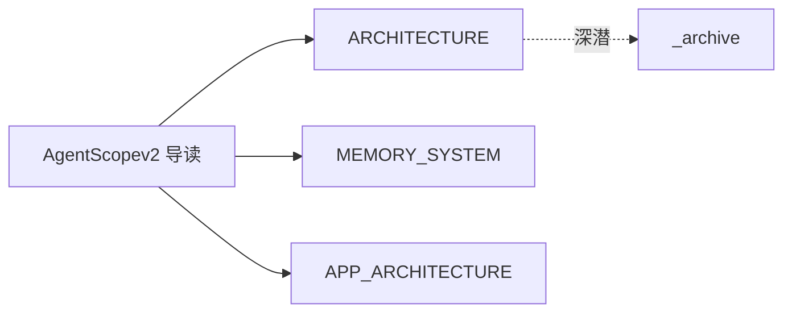
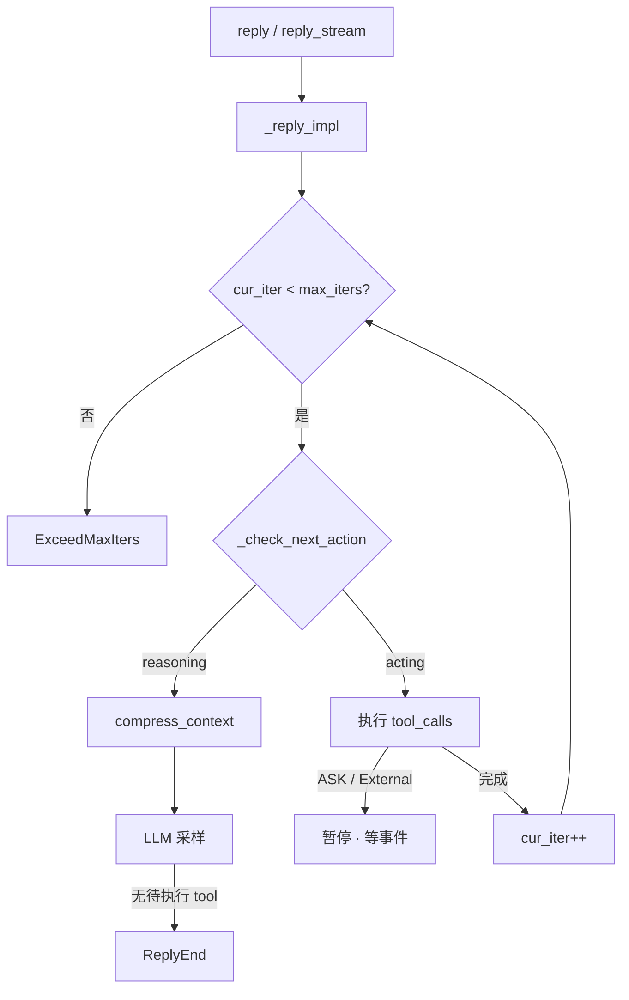

# AgentScope v2 设计导读

> **源码**: 本 monorepo 内 [`agentscope/`](../../agentscope/)（`src/agentscope`）  
> **性质**: **唯一入口**——路线图 + 概念模型 + 崩溃/持久化专题；**不**再与 [ARCHITECTURE.md](./ARCHITECTURE.md) 等专题重复粘贴长文。  
> **最后整理**: 2026-10-13  
> **历史长文**: 约 3700 行的合并笔记曾误删，若你本地 Timeline 仍有备份，见 [RESTORE_AgentScopev2.md](./RESTORE_AgentScopev2.md)（恢复后可再跑 `_reorganize_v2.py`）。

---

## 0. 为什么觉得「乱」、怎么读

早期笔记把 **库内核、App Harness、旧 v0.x 命名、对话导出** 混在一篇里；后来拆成专题，但入口文件一度只剩占位符，地图与正文脱节。

**维护规则（今后按这个来）**：

| 层级 | 文件 | 写什么 |
|------|------|--------|
| **入口** | **本文** + [README.md](./README.md) | 读哪篇、旧名对照、崩溃/持久化心智模型 |
| **库内核导读** | [ARCHITECTURE.md](./ARCHITECTURE.md) | ReAct、`Agent`、Model、Tool、Middleware（~300 行） |
| **实现深潜** | [MEMORY_SYSTEM](./MEMORY_SYSTEM.md)、[APP_ARCHITECTURE](./APP_ARCHITECTURE.md)、[WORKSPACE_AND_SANDBOX](./WORKSPACE_AND_SANDBOX.md) 等 | 单域 canonical，改代码只改一篇 |
| **全文检索** | [_archive/ARCHITECTURE.md](./_archive/ARCHITECTURE.md) | 路径/类图/ v0.x 历史（~3150 行） |



### 按任务选读（一张表）

| 你想搞懂… | 先读 | 再读 |
|-----------|------|------|
| 一轮对话怎么跑 | [ARCHITECTURE §4](./ARCHITECTURE.md) | 附录 E |
| `context` / 压缩 / Offloader | [MEMORY_SYSTEM §1–§7](./MEMORY_SYSTEM.md) | 附录 B |
| FastAPI、飞书、SSE | [APP_ARCHITECTURE](./APP_ARCHITECTURE.md) | 附录 D |
| 验收环、executor+verifier | [PIPELINE_AND_GOALS](./PIPELINE_AND_GOALS.md) | 附录 C |
| RAG / KB | [RAG_AND_KNOWLEDGE](./RAG_AND_KNOWLEDGE.md) | — |
| 沙箱、MCP 网关 | [WORKSPACE_AND_SANDBOX](./WORKSPACE_AND_SANDBOX.md) | [MIDDLEWARE_CATALOG](./MIDDLEWARE_CATALOG.md) |
| 进程死掉怎么恢复 | **本文 §5** | [APP §4–§5](./APP_ARCHITECTURE.md)、[MEMORY §5](./MEMORY_SYSTEM.md) |
| 消息怎么落库 | **本文 §6** | `app/storage/` 源码 |
| 外挂长期记忆 ReMe | [REME_ARCHITECTURE](./REME_ARCHITECTURE.md) | — |

---

## 1. 原「九部分」笔记 → 现文档映射

旧合并稿按九部分编排；内容已 **下沉到专题**，避免双份维护。

| 原部分 | 主题 | 现 canonical |
|--------|------|----------------|
| 第一～二部分 | 分层、目录树、端到端 | [ARCHITECTURE](./ARCHITECTURE.md) §2–§4 · [_archive](./_archive/ARCHITECTURE.md) |
| 第三部分 | Session～编排内部设计 | [APP_ARCHITECTURE](./APP_ARCHITECTURE.md) · [PIPELINE_AND_GOALS](./PIPELINE_AND_GOALS.md) |
| 第四～五部分 | Message / Memory / 快照 / EventStream | [MEMORY_SYSTEM](./MEMORY_SYSTEM.md) · [APP §5](./APP_ARCHITECTURE.md) |
| **第六部分** | **崩溃场景推演** | **本文 §5** |
| **第七部分** | **JSON → DB Append** | **本文 §6** |
| 第八部分 | 待拆模块清单 | 本文 §7 |
| 第九部分 | 模块 1–11 类图 | 本文 §8 · [_archive](./_archive/ARCHITECTURE.md) |
| 附录 | v2 命名对照 | **附录 A–F**（文末） |

---

## 2. v2 架构一页纸

AgentScope v2 = **消息驱动、全异步** 的单 `Agent` ReAct：`AgentState` 承载对话与摘要；`ChatModelBase` 直接消费 `list[Msg]`；横切靠 **Middleware + Permission + `AgentEvent` 流**。生产部署在库外由 **`agentscope.app.create_app`** 提供 HTTP、渠道、存储与 Team。

细节与包结构图见 [ARCHITECTURE §2–§3](./ARCHITECTURE.md)。**已移除的 v0.x 概念**（不要在设计里再用）：`memory.MemoryBase`、`session.JSONSession`、`pipeline.MsgHub`。

---

## 3. Session / Message / 状态（概念模型）

| 概念 | v2 实现 | 说明 |
|------|---------|------|
| 「短期记忆」 | `AgentState.context: list[Msg]` | 完整近期往返，不是独立 `memory/` 包 |
| 「中期记忆」 | `AgentState.summary` | `compress_context()` 把头压进 summary 并从 context **物理删除** |
| 「Session」 | 库层无框架 Session 类 | 脚本自管 `model_dump_json()`；服务层 `SessionRecord` + `StorageBase` |
| 消息体 | `Msg` + ContentBlock / DataBlock | 归档与工具结果见 [MEMORY](./MEMORY_SYSTEM.md)、[WORKSPACE](./WORKSPACE_AND_SANDBOX.md) |
| 流式观测 | `AsyncGenerator[AgentEvent]` | App 侧 `MessageBus` replay + SSE，**不等于**持久化真源 |

---

## 4. EventStream 与前端

- **库**：`reply_stream` 产出 `AgentEvent`（Thinking / Text / ToolCall / HITL…）。
- **App**：`ChatService.run` 在 session 锁内跑 `reply_stream`，每个事件 `publish_session_event`；客户端 `GET /sessions/{id}/stream` 订阅。
- **分工**：**Storage** 存 Session、消息历史、`AgentState`；**MessageBus** 存锁、wakeup 队列、**运行时**事件 replay（可与 Redis 分离）。见 [APP_ARCHITECTURE §4–§5](./APP_ARCHITECTURE.md)。

---

## 5. （原第六部分）崩溃与中断场景推演

以下按 **当前 main 实现** 归纳；用于写集成测试与运维 runbook，不是历史 Harness 伪代码。

### 5.1 场景矩阵

| 场景 | 运行时表现 | 恢复策略 |
|------|------------|----------|
| **`kill -9` / OOM  mid-`reply_stream`** | 进程内 `Agent`、未 flush 的内存状态丢失；若 App 已在 turn 末 `upsert` Session/`AgentState`，磁盘可能停在 **上一完整 turn** | 重启后从 Storage 加载 `SessionRecord.state`；用户重发或 HITL resume（若 tool 已 park） |
| **Turn 中途崩溃（未持久化）** | 当前 turn 的 partial `AgentEvent` 可能已进 MessageBus replay，但 **Storage 消息/ state 可能未提交** | SSE 客户端可看到「半截」事件；以 Storage 为准重建 UI；必要时丢弃 replay 中 seq 大于已存消息的部分 |
| **Tool 执行一半（bash/网络）** | Tool 进程可能孤儿化；框架侧 tool_call 状态停在 PENDING/EXECUTING | 依赖 tool 超时与 `Permission`；恢复后 `_check_next_action` 决定 acting vs reasoning（附录 E） |
| **HITL / ASK / External 暂停** | `reply_stream` **正常结束本轮**（exit），tool 状态 ASKING/SUBMITTED | 用户确认后 **必须** 走 `enqueue_run_trigger` → `WakeupDispatcher`，勿与 `spawn` 新 turn 竞态（[APP §4.1](./APP_ARCHITECTURE.md)） |
| **同 session 重复提交** | `ChatRunRegistry.spawn` → **409** | 客户端应去订阅已有 run 的 SSE，而不是再开一轮 |
| **Session 锁 TTL 过期** | 另一节点可能抢锁 | 设计 run 应短于 lock TTL；长 tool 用 external execution + resume |
| **`compress_context` 中途崩溃** | context 可能一半已删、summary 未写完 | 持久化应在 **压缩完成后** 或 turn 边界；Offloader 的 jsonl **追加** 与 context 删除顺序见 [MEMORY](./MEMORY_SYSTEM.md) |
| **LTM / Curator 中间件异步写** | 与主 turn 解耦 | 失败不应阻塞 reply；读路径需容忍「记忆尚未索引」 |

### 5.2 推荐不变量（自建服务时）

1. **真源**：用户可见历史 = `Storage.list_messages` + `SessionRecord.state`，不是仅 MessageBus。
2. **写顺序**：一轮 turn 结束（或明确 checkpoint）再 `upsert_agent_state` + 批量 `upsert_message`。
3. **恢复**：HITL 只走 wakeup **resume** 路径；新用户句走 **spawn**。
4. **幂等**：消息以 `(session_id, msg.id)` upsert（见 §7）。

---

## 6. （原第七部分）持久化：从 JSON 快照到行级存储

### 6.1 三层常见形态

| 形态 | 适用 | 特点 |
|------|------|------|
| **整包 JSON** | 脚本、单文件调试 | `AgentState.model_dump_json()` / 单文件 session；崩溃易 **全量回滚到上次写入** |
| **消息行 + state 列** | `create_app` + SQL/Redis | 每条 `Msg` 一行 upsert；`SessionRecord.state` 存完整 `AgentState` |
| **Offloader JSONL** | 大 context / 工具结果 | `sessions/{id}/context.jsonl` **追加**；与 summary 指针配合（[MEMORY](./MEMORY_SYSTEM.md)） |

### 6.2 App Storage 契约（main）

- **`upsert_message(user_id, session_id, msg)`**：按 `(session_id, msg_id)` **insert or update** payload（`Msg.model_dump(mode="json")`），保留原 `created_at`（SQL 实现见 `app/storage/_sql/_storage.py`）。
- **`list_messages`**：游标分页 `before=msg_id`，**非** offset 主路径。
- **Agent 状态**：`SessionRecord.state: AgentState`，经 `StorageBase` 的 upsert session / update state API 与消息分开更新。

### 6.3 MessageBus 与 Storage

| 存储 | 内容 | 崩溃后 |
|------|------|--------|
| Storage | Session、消息、AgentState、Team… | **恢复对话** |
| MessageBus `session_events` | 当前/近期 run 的事件 replay | 可丢；客户端重连后应以 Storage 重建 |

### 6.4 从「整文件快照」迁移时的设计要点

1. **事件日志思维**：用户消息、助手消息、tool 结果各自 upsert，避免每次重写 10MB JSON。
2. **与 `AgentState` 并存**：LLM 仍吃 `context`+`summary`；加载 session 时从 Storage 灌回 `AgentState`，不必从消息全量重放（除非你做 event sourcing 重建）。
3. **压缩与落盘**：`compress_context` 改变 context/summary 后 **同一 turn 内** 再持久化 state，避免「磁盘 context 与内存不一致」。

---

## 7. （原第八部分）待深挖清单（推荐顺序）

| 优先级 | 主题 | 入口 |
|--------|------|------|
| P0 | `ChatService.run` 全链路 | `app/_service/_chat.py` · [APP](./APP_ARCHITECTURE.md) |
| P0 | `_reply_impl` / HITL 状态机 | `agent/_agent.py` · 附录 E |
| P1 | `WorkspaceManager` 多后端 | [WORKSPACE](./WORKSPACE_AND_SANDBOX.md) |
| P1 | Team inbox / worker session | [APP §7](./APP_ARCHITECTURE.md) · `app/_tool/` |
| P2 | KB 索引 worker | [RAG](./RAG_AND_KNOWLEDGE.md) |
| P2 | Realtime 语音 | [REALTIME_AGENT_ARCHITECTURE](./REALTIME_AGENT_ARCHITECTURE.md)（分支特性） |
| P3 | 全量类图检索 | [_archive](./_archive/ARCHITECTURE.md) |

---

## 8. （原第九部分）模块索引（`src/agentscope`）

| # | 模块 | 职责 | 文档 |
|---|------|------|------|
| 1 | `message` | `Msg`、块类型 | _archive §10 |
| 2 | `agent` | ReAct、`reply_stream` | [ARCHITECTURE §4](./ARCHITECTURE.md) |
| 3 | `model` | 多 Provider LLM | [ARCHITECTURE §5](./ARCHITECTURE.md) |
| 4 | `tool` | Toolkit、MCP、Skill | [ARCHITECTURE §6](./ARCHITECTURE.md) |
| 5 | `state` | `AgentState` | [MEMORY](./MEMORY_SYSTEM.md) |
| 6 | `middleware` | 7 钩子、RAG/LTM… | [MIDDLEWARE_CATALOG](./MIDDLEWARE_CATALOG.md) |
| 7 | `permission` | 工具/命令审批 | [ARCHITECTURE §7](./ARCHITECTURE.md) |
| 8 | `workspace` | 沙箱、Offloader | [WORKSPACE](./WORKSPACE_AND_SANDBOX.md) |
| 9 | `pipeline` | `GoalPipeline` | [PIPELINE](./PIPELINE_AND_GOALS.md) |
| 10 | `rag` | `KnowledgeBase` | [RAG](./RAG_AND_KNOWLEDGE.md) |
| 11 | `app` | `create_app`、Channel、Storage | [APP](./APP_ARCHITECTURE.md) |

---

## 附录 A：与 main 分支源码命名对照

正文或旧笔记中的 **HarnessAgent / Session 快照 / `memory/short_term` / ChatRoom** 等表述，与 main 的对应关系：

| 正文常见表述 | main / 专题文档中的对应 |
|--------------|-------------------------|
| `memory/`、`ShortTermMemory.context_messages` | **`AgentState.context`** + `summary`（无独立 `memory/` 包）→ [MEMORY_SYSTEM.md](./MEMORY_SYSTEM.md) |
| `save_snapshot` / JSON 会话文件 | 库层应用自管 `AgentState.model_dump_json()`；生产 **Session** → `app/storage` → [APP_ARCHITECTURE.md](./APP_ARCHITECTURE.md) |
| `ChatRoom` / 通用 `Pipeline` 多 Agent 广播 | **MsgHub 已移除**；库级编排 → **`GoalPipeline`** → [PIPELINE_AND_GOALS.md](./PIPELINE_AND_GOALS.md) |
| `AgentService` + RPC | 仍存在；多渠道 HTTP/SSE → **`agentscope.app.create_app`** |
| 仅 Harness 包装 | 单 **`Agent`** + **Middleware**（7 钩子）→ [ARCHITECTURE.md](./ARCHITECTURE.md) §4、§7 |
| 「框架无 RAG」 | ❌ 已有 **`rag.KnowledgeBase`** + `RAGMiddleware` → [RAG_AND_KNOWLEDGE.md](./RAG_AND_KNOWLEDGE.md) |
| Workspace 仅 DataBlock | 沙箱谱系 + `WorkspaceManager` → [WORKSPACE_AND_SANDBOX.md](./WORKSPACE_AND_SANDBOX.md) |

---

## 附录 B：`AgentState` 与记忆（第四～五部分摘要）

```text
LLM 每次看到的输入 =
    system_prompt（固定，不进 context）
  + summary（可选，压缩后的旧历史）
  + context（当前会话完整近期对话）
  + tool schemas
```

| 机制 | 载体 | 作用 |
|------|------|------|
| 短期对话 | `AgentState.context: list[Msg]` | 用户/助手/tool 往返 |
| 中期摘要 | `AgentState.summary` | 头部旧消息经 `compress_context()` 压成固定格式后**物理删除**出 context |
| 工具结果上限 | `ContextConfig.tool_result_limit` | 防止单次 tool 撑爆 context |
| 卸载 | `Offloader`（常与 Workspace 配合） | 被删内容落盘，路径写入 summary 提醒 |
| 断点续聊 | `AgentState.model_dump_json()` 或 App Storage | 见 §6 |

压缩策略：**去头（压成 summary）+ 保尾（`reserve_ratio` 近期 context）**，非传统「只滑窗丢头」。全文：[MEMORY_SYSTEM.md](./MEMORY_SYSTEM.md)。

---

## 附录 C：`GoalPipeline` 与多 Agent 编排

v2 **`pipeline/`** 核心是 **`GoalPipeline`**：

- **Executor** 产出 `_ExecutionReport`；**Verifier** 产出 `_VerificationResult`：`pass` | `fail` | `impossible`。
- `fail` 带 feedback 回到 Executor，直到 pass/impossible 或 `max_iters`。
- 实现 **`reply_stream`**，HITL 按 `reply_id` 路由。

**与 App Team 区分**：`app/_tool/` 的 `AgentCreate` / `TeamSay` 等是 **生产编排**（inbox + worker session），见 [APP_ARCHITECTURE.md](./APP_ARCHITECTURE.md) §7。

---

## 附录 D：App 服务层要点

**库（`agent/`）管一轮 ReAct；App（`app/`）管谁触发、存哪、怎么推前端/飞书。** 统一收敛点：**`ChatService.run`**。

| 模块 | 职责 |
|------|------|
| `_app.py` | `create_app()` 工厂 |
| `_service/` | `ChatService`、`SessionService`、`get_toolkit` |
| `_router/` | FastAPI：chat、session **SSE**、channel、schedule… |
| `message_bus/` | 锁、wakeup 队列、事件 replay（**非**持久化真源） |
| `storage/` | Session / Team / Agent / 消息历史 |
| `channel/` | 飞书、钉钉等 + `ChannelGateway` |

触发路径：新消息 `ChatRunRegistry.spawn`（重复 409）；HITL resume 走 `enqueue_run_trigger` → `WakeupDispatcher`。完整时序：[APP_ARCHITECTURE.md](./APP_ARCHITECTURE.md) §4。

---

## 附录 E：ReAct 主循环（main 分支）



| 未完成 tool_call | 下一步 |
|------------------|--------|
| 有可执行 (PENDING/ALLOWED) | **acting** |
| 仅等待 (ASKING/SUBMITTED) | **exit**（暂停 reply） |
| 无 | **reasoning** |

源码锚点：`agent/_agent.py` — `_reply_impl`、`_check_next_action`、`_reasoning_impl`、`_execute_tool_call`。

---

## 附录 F：整理说明与官方资源

- 专题文档由 [_archive/ARCHITECTURE.md](./_archive/ARCHITECTURE.md) 与对话笔记 **拆分** 而来；**改实现请只改对应专题 + 本文索引**，避免再生成第三份全文。
- 若你从 Timeline 恢复了 ~3700 行合并稿，可保留为本地归档；仓库内 **canonical 仍以专题为准**，长文仅作检索补充。
- API：https://doc.agentscope.io/ · GitHub：https://github.com/agentscope-ai/agentscope
