# agno 完整设计文档

> 对象：`/Users/gqli/work/deepagents/agno`（本地版本 **agno 3.1.12**，`libs/agno/pyproject.toml`，"The programming language for agentic software"，Python ≥ 3.9）。
> 写法：**§1–§14 分层说明书 + 图**；**§15–§20 体系设计论证**（会话体系 / 记忆体系 / 上下文瘦身体系 / 安全体系 / 对象引用关系 / 核心流程逐段解说）；**§21 类图附录**；**§22 补充时序**；**§23 数据与存储全景**；**§24 行级数据实例（十天）**；**§25 与同类项目对比与选型**；**§26 术语与溯源**。
> 所有默认值、开关名、表名以本地代码为准；agno 迭代极快，评估前请回到目标版本源码复核。

## 目录

1. [agno 是什么](#1-agno-是什么)
2. [设计目标与非目标](#2-设计目标与非目标)
3. [全局架构（三平面 + 全景分层）](#3-全局架构三平面--全景分层)
4. [包与目录清单（别遗漏清单）](#4-包与目录清单别遗漏清单)
5. [Agent 对象：120+ 配置字段的全景分组](#5-agent-对象120-配置字段的全景分组)
6. [一次 run 的 16 步：端到端时序](#6-一次-run-的-16-步端到端时序)
7. [上下文装配：系统提示的 17 段拼装顺序](#7-上下文装配系统提示的-17-段拼装顺序)
8. [三种上下文瘦身机制（Compaction / Compression / Offload）](#8-三种上下文瘦身机制compaction--compression--offload)
9. [Session 体系：会话、run、state、summary、checkpoint、fork](#9-session-体系会话runstatesummarycheckpointfork)
10. [记忆体系：MemoryManager、Learnings、SessionSummary 三套并存](#10-记忆体系memorymanagerlearningssessionsummary-三套并存)
11. [知识与检索：Knowledge（RAG）与 ContextProvider（可查询面）](#11-知识与检索knowledgerag与-contextprovider可查询面)
12. [工具、Skills、HITL、Guardrails](#12-工具skillshitlguardrails)
13. [多 Agent：Team 四模式与 Workflow](#13-多-agentteam-四模式与-workflow)
14. [AgentOS：把库装成服务](#14-agentos把库装成服务)
15. [体系论证一：会话体系（不变量与失败模式）](#15-体系论证一会话体系不变量与失败模式)
16. [体系论证二：记忆体系（为什么三套并存、怎么选）](#16-体系论证二记忆体系为什么三套并存怎么选)
17. [体系论证三：上下文预算经济学（可复算的算例）](#17-体系论证三上下文预算经济学可复算的算例)
18. [安全与权限体系](#18-安全与权限体系)
19. [对象模型与引用关系（叙述版）](#19-对象模型与引用关系叙述版)
20. [核心流程逐段解说](#20-核心流程逐段解说)
21. [核心类图（对象模型全集）](#21-核心类图对象模型全集)
22. [补充时序（把还没画的主流程补齐）](#22-补充时序把还没画的主流程补齐)
23. [数据与存储全景：表清单、ER、方言能力矩阵与降级语义](#23-数据与存储全景表清单er方言能力矩阵与降级语义)
24. [完整实例：一个用户在十天里的**行级**数据形态](#24-完整实例一个用户在十天里的行级数据形态)
25. [与同类 memory / agent 项目的对比与选型](#25-与同类-memory--agent-项目的对比与选型)
26. [术语表、贯穿示例与资料来源](#26-术语表贯穿示例与资料来源)

---

## 1. agno 是什么

### 1.1 一句话定位

**agno 是一个"把 Agent 当程序来写"的 Python 框架 + 一个把 Agent 当服务来跑的运行时（AgentOS）**：库侧提供 `Agent / Team / Workflow` 三种控制流抽象和 100+ 模型/向量库/数据库适配；服务侧提供 FastAPI 应用（AgentOS）、控制台接口、鉴权与授权、审批与 HITL、调度器、事件流、追踪、以及一个可挂载为 MCP server 的暴露面。

它与 CowAgent 这类"个人助理成品"的根本差异：**agno 不提供人格、渠道与记忆文件，它提供的是可组合的积木与一套持久化协议**。CowAgent 是"装好就能聊天的一台机器"，agno 是"造机器的机床 + 车间管理系统"。

### 1.2 三件产品，一套代码

| 产品 | 位置 | 你得到什么 |
|---|---|---|
| **agno 库** | `agno/agent`、`agno/team`、`agno/workflow`、`agno/models`、`agno/tools` | 用 Python 声明一个 agent / team / workflow，跑起来，拿到 `RunOutput` 与事件流 |
| **agno 运行时（AgentOS）** | `agno/os/app.py` 的 `AgentOS` | 一个 FastAPI 服务：会话/记忆/知识/审批/调度/追踪的 REST 接口、鉴权、MCP 暴露、控制台可连 |
| **存储契约** | `agno/db/*` | 会话、run、记忆、学习、压缩记录、工具结果、审批、调度、指标、trace 的统一表模型（每种数据库方言各自声明 schema） |

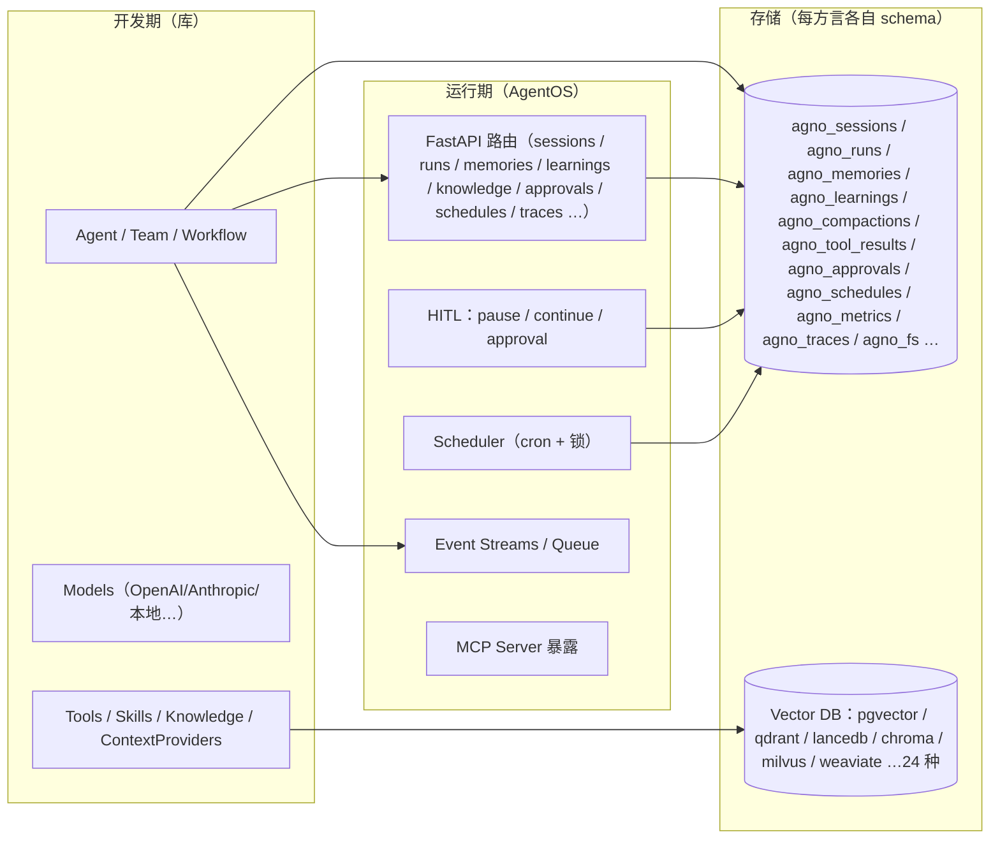

### 1.3 三个判读（决定你是否该用它）

1. **你要的是"可编程的 agent 平台"而不是"能聊天的助理"**：agno 的所有能力都是构造参数与对象组合，没有内置人格与渠道适配器（渠道靠 `os/interfaces`、Slack/WhatsApp 等接口层与自己的前端）。
2. **你接受"上下文管理是一门显式学问"**：agno 把历史、记忆、压缩、卸载、归档全部拆成独立开关，且**默认大量关闭**（`add_history_to_context=False`、`enable_agentic_memory=False`、`compaction=None`、`offload_tool_results=None`）。这不是缺陷，是设计立场：**每一分 token 成本都要开发者签字**。
3. **你需要多后端**：会话/记忆/知识都要能落到 Postgres / SQLite / MySQL / Mongo / Redis / Dynamo / Firestore / ClickHouse / SurrealDB…，且能水平扩展（服务化 + 调度 + 事件流）。

---

## 2. 设计目标与非目标

### 2.1 设计目标（从代码结构反推）

| 目标 | 证据 |
|---|---|
| **一切可持久化、可回放** | `agno_sessions` + `agno_runs` 分离存储；`RunOutput` 全字段落库；`checkpoint` 三档；`fork` / `continue` / `regenerate` 的时间旅行 API |
| **上下文成本可控且可测量** | `Compaction`（折叠 + 归档 + 可搜索）、`CompressionManager`（工具结果重写）、`ResultStore`（工具结果外置 + 回读工具）、`RunMetrics` 与 `CompactionStats` 全程记账 |
| **人机协同是一等公民** | `RunPaused/RunContinued` 事件、`RunRequirement`、`agno_approvals` 表、`/continue` 的统一 dispatch、`user_input`/`ask_for` 工具 |
| **多租户与运维就绪** | `user_isolation`、`authorization` + scopes + service accounts、`registry`、`diagnostics`、`tracing`、`scheduler` 带锁与重试、`event_streams` |
| **不绑定模型与向量库** | `models/*` 与 `vectordb/*`（24 个向量库适配器），`Knowledge` 同时支持"注入上下文"与"作为工具"两种用法 |
| **记忆分层但由 LLM 主导** | `MemoryManager`（agentic CRUD 工具）、`LearningMachine`（六类 learning）、`SessionSummaryManager`；检索默认靠"最近 N 条"，语义检索是"让模型挑 ID" |

### 2.2 非目标与边界

| 不是 | 说明 | 影响 |
|---|---|---|
| 不是"开箱即用的助理" | 没有人格、渠道、定时提醒、本地文件记忆 | 你要自己写 prompt 与产品层 |
| 不是"文件即真相"的记忆系统 | 记忆/历史/压缩记录都在数据库；删库=失忆 | 备份策略必须自己定（DB 备份） |
| 默认不做向量检索的记忆 | `UserMemory` 检索三法：`last_n` / `first_n` / `agentic`（把全部记忆喂给模型挑 ID） | 记忆规模一大，agentic 检索会线性烧 token（§10.4） |
| 不是 OS 级沙箱 | 权限模型是**应用层**：approval、guardrails、`user_isolation`、`fs` 的 user_scoped；`sandbox/` 提供 docker/AgentCore 执行环境但需显式启用 | 默认执行环境 = 你的进程 |
| 不提供跨方言一致的能力面 | 例如"压缩归档"只有实现可选契约的方言能存（`SqliteDb`、`PostgresDb`），异步 DB 目前不具备该契约 | 用异步 DB 时 `store_compacted_messages` 会退化（源码有显式 warning 与降级） |

---

## 3. 全局架构（三平面 + 全景分层）

### 3.1 全景分层

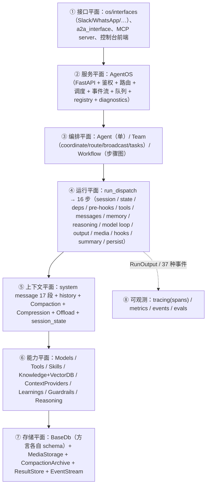

### 3.2 三张架构视图

**视图 A：进程形态（三种跑法）**

| 形态 | 入口 | 进程内有什么 | 典型场景 |
|---|---|---|---|
| 库内直跑 | `agent.run("...")` | 只有 Agent + Db | 脚本、单测、notebook |
| 服务化 | `AgentOS(...).serve()` | Agent/Team/Workflow 注册表 + FastAPI + 调度 + 事件流 | 多用户产品、控制台 |
| 后台/队列 | `_arun_background`、`QueueConfig`、`job_queue` | run 以 PENDING 落库后 detach asyncio.Task，事件缓冲发布 | 长任务、断线续传、并发削峰 |

**视图 B：包依赖方向（谁 import 谁）**

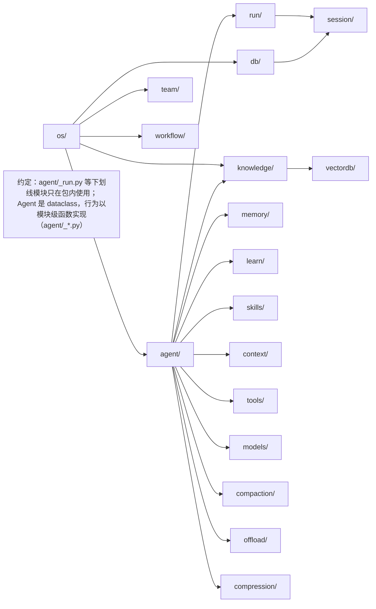

**视图 C：双平面（对话平面 vs 资产平面）**

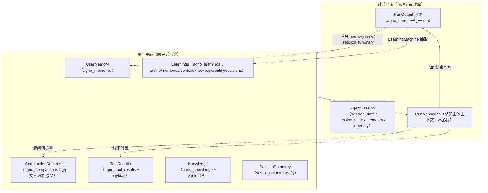

这张图是理解 agno 记忆设计的钥匙：**agno 没有"分层记忆"这一个概念，它有六条独立的沉淀通道**，每条通道有独立的开关、模型调用、表与注入点。§10 会把它们逐条拆开。

### 3.3 配置面：跨层的关键开关（Agent 侧）

| 组 | 开关 | 默认 | 打开后多花什么 |
|---|---|---|---|
| 历史 | `add_history_to_context`、`num_history_runs`、`num_history_messages`、`max_tool_calls_from_history` | False / 未限 | 每轮多 N 轮 token |
| 记忆 | `memory_manager`、`enable_agentic_memory`、`update_memory_on_run`、`add_memories_to_context` | None/False | 每次 run 一次额外 LLM 调用（抽取） |
| 会话摘要 | `enable_session_summaries`、`session_summary_manager` | False | 每次 run 一次 LLM 调用 |
| 知识 | `knowledge`、`add_knowledge_to_context`、`search_knowledge`、`knowledge_filters`、`enable_agentic_knowledge_filters` | None | 注入或工具化 |
| 上下文瘦身 | `compaction`、`compress_tool_results`/`compression_manager`、`offload_tool_results` | None/None | 摘要 LLM 调用 + 归档存储 |
| 推理 | `reasoning`、`reasoning_model`、`reasoning_agent`、`read_chat_history`、`read_tool_call_history` | False | 多一轮思考调用 |
| 结构化 IO | `input_schema`、`output_schema`、`parser_model`、`output_model`、`use_json_mode` | None | 可能一次解析调用 |
| 状态 | `session_state`、`add_session_state_to_context`、`enable_agentic_state`、`overwrite_db_session_state` | {} | 状态注入系统提示 |
| 学习 | `learning` / `learnings` | None | 每次 run 抽取 + 召回注入 |
| 兜底 | `fallback_models`、`fallback_config`、`retries`、`delay_between_retries`、`exponential_backoff` | None | 失败时多调用 |
| 存储 | `db`、`filesystem`、`media_storage`、`store_media`、`store_tool_messages`、`store_history_messages`、`checkpoint` | None | 行数与体积 |
| 工具 | `tools`、`tool_call_limit`、`tool_choice`、`tool_hooks`、`pre_hooks`、`post_hooks` | [] | — |
| 流式 | `stream`、`stream_events`、`store_events`、`events_to_skip` | — | — |

> **读法**：agno 的"记忆能力"不是布尔开关，而是**一组互不相干的子系统**。新人最常犯的错是只打开 `add_history_to_context`，然后惊讶于"它不记得上周的事"；或同时打开 `memory_manager` 与 `learning.user_memories`，导致同一事实写两处。

---

## 4. 包与目录清单（别遗漏清单）

`libs/agno/agno/` 下的一级包（按角色分组）：

| 角色 | 包 |
|---|---|
| 编排 | `agent/`（拆成 `agent.py` + `_run/_messages/_session/_storage/_managers/_tools/_hooks/_init/_response/_run_options/_default_tools/_utils/_telemetry/factory/protocol/remote/followup/_cli`）、`agents/`、`team/`、`workflow/`、`environments/`、`job_queue/`、`scheduler/` |
| 上下文 | `session/`、`context/`、`compaction/`、`compression/`、`offload/`、`media/`、`reasoning/` |
| 记忆/学习 | `memory/`（`manager.py` + `strategies/`）、`learn/`（`machine.py`、`stores/`、`schemas.py`、`config.py`、`curate.py`） |
| 知识 | `knowledge/`、`vectordb/`（24 个适配器）、`embedder`（在 `models/` 内） |
| 能力 | `tools/`、`skills/`、`guardrails/`、`hooks/`、`fs/`、`sandbox/`、`approval/`、`eval/`、`scorer/` |
| 基础设施 | `db/`（13+ 方言 + `schemas/` + `migrations/` + `session_filters.py` + `transcripts.py`）、`os/`（AgentOS、auth、authz、mcp、event_streams、interfaces、managers、routers、diagnostics）、`cloud/`、`registry/`、`remote/`、`tracing/`、`factory/`、`integrations/`、`api/`、`client/`、`run/`、`utils/` |

**体量线索**（行数是"哪里最复杂"的粗略指标）：`workflow/workflow.py` 12126、`team/_run.py` 10518、`db/postgres/postgres.py` 10026、`db/sqlite/sqlite.py` 8962、`agent/_run.py` 6617、`knowledge/knowledge.py` 5820、`db/base.py` 4697、`os/app.py` 3448、`os/mcp.py` 3418、`agent/_messages.py` 2768、`memory/manager.py` 1575、`compaction/compaction.py` 1162。

> **推论**：agno 最重的代码不在"推理循环"，而在 **workflow/team 编排**与**存储方言**；记忆与上下文机制反而小而集中。这与 CowAgent 相反（CowAgent 最重的地方是 `agent_stream.py` 与 `policy.py`）。

---

## 5. Agent 对象：120+ 配置字段的全景分组

`Agent` 是一个 dataclass（`agent/agent.py`，约 2000 行，类级字段 120+），行为全部在 `agent/_*.py` 的模块级函数里（`_run(agent, ...)`、`get_system_message(agent, ...)`）。**这是 agno 最重要的结构性决定**：数据对象与行为分离，使得 Agent 可以被序列化、远程化（`remote.py`、`protocol.py`）、工厂化（`factory.py`）而不用携带资源对象。

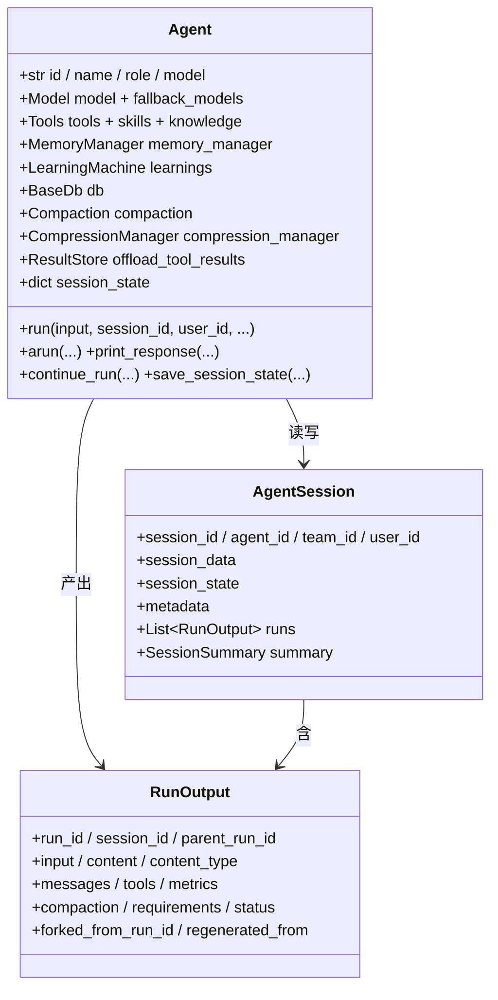

**字段分组速查（选关键）**

| 组 | 字段 | 语义要点 |
|---|---|---|
| 身份与归属 | `id`、`name`、`role`、`user_id`、`session_id`、`team_id`、`workflow_id` | `role` 是"给 team 用的自我介绍"，不是系统提示 |
| 模型与恢复 | `model`、`fallback_models`、`fallback_config`、`retries`、`delay_between_retries`、`exponential_backoff` | 兜底是**列表 + 配置**双形态 |
| 会话与状态 | `session_state`、`add_session_state_to_context`、`enable_agentic_state`、`overwrite_db_session_state`、`cache_session`、`search_past_sessions`、`num_past_sessions_to_search`、`num_past_session_runs_in_search` | "跨会话记忆"有一条独立通道：搜索历史会话（工具） |
| 记忆 | `memory_manager`、`enable_agentic_memory`、`update_memory_on_run`、`add_memories_to_context` | 三个开关分别对应"给工具 / 每次 run 后抽取 / 注入上下文" |
| 历史 | `add_history_to_context`、`num_history_runs`、`num_history_messages`、`max_tool_calls_from_history` | 历史来自 `agno_runs`，不是内存 |
| 摘要 | `enable_session_summaries`、`session_summary_manager`、`add_session_summary_to_context` | 摘要存 `sessions.summary` |
| 知识 | `knowledge`、`knowledge_filters`、`enable_agentic_knowledge_filters`、`add_knowledge_to_context`、`knowledge_retriever`、`search_knowledge`、`references_format` | 注入 vs 工具 二选一或都要 |
| 上下文瘦身 | `compaction`、`compress_tool_results`、`compression_manager`、`offload_tool_results` | §8 |
| 工具与钩子 | `tools`、`tool_call_limit`、`tool_choice`、`tool_hooks`、`pre_hooks`、`post_hooks`、`_run_hooks_in_background` | pre-hooks 可改 `RunContext` |
| 结构化 IO | `input_schema`、`output_schema`、`parser_model`、`output_model`、`parse_response`、`use_json_mode`、`followups`、`num_followups`、`followup_model` | 连"追问建议"都是模型调用 |
| 依赖注入 | `dependencies`、`add_dependencies_to_context`、`resolve_in_context` | run 前异步解析，供工具/参数用 |
| 其他 | `debug_mode`、`telemetry`、`markdown`、`datetime`/`location` 注入、`cache_callables`、`callable_tools_cache_key`、`checkpoint`、`_registry_excluded` | — |

> **对比锚点**：CowAgent 的 Agent 只有 ~30 个属性，且行为内聚在类里（`run_stream` 与 `AgentStreamExecutor`）。agno 的 120+ 字段是"平台"的代价：**没有任何一个默认值能同时满足所有人**，代价是新手要读几十页文档才能配出一个好用的 agent。

---

## 6. 一次 run 的 16 步：端到端时序

`agent/_run.py::agent_run` 的 docstring 就是官方流程定义（原文编号）：

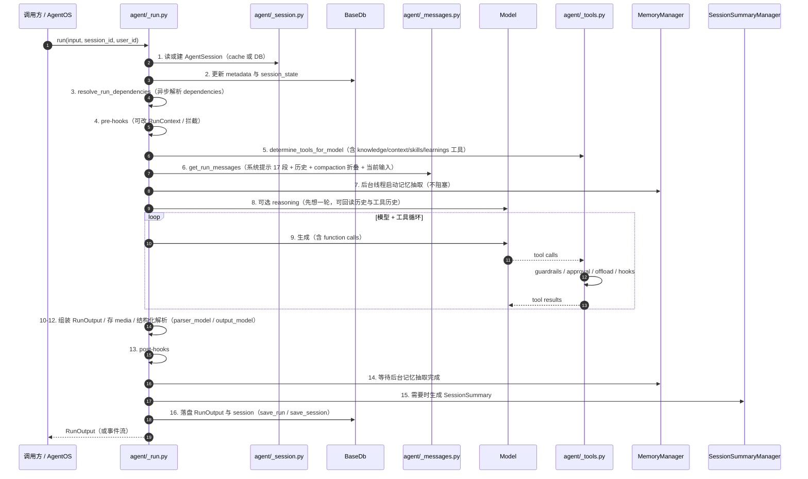

**三个"看起来小但决定架构"的细节**

1. **第 7 步在模型调用之前就起后台记忆线程**：记忆抽取与主推理**并行**，第 14 步才 join。含义：记忆抽取失败不会让本轮失败，但会让本轮多等；`MemoryUpdateStarted/Completed` 事件把这件事暴露给前端。
2. **第 6 步每轮都重建上下文**：历史从 `agno_runs` 读（不是内存对象），因此**多进程/多实例无状态**：任何实例处理同一 `session_id` 都会拿到同样的持久历史。代价是每 run 至少 1–2 次 DB 读。
3. **第 16 步 run 与 session 分开写**：`save_run()` 被刻意做成 O(1) 的单行 upsert（源码注释："Save a single run to the database (O(1) operation)… optimized for updating existing runs (e.g., status)"），`save_session()` 只写会话行。这解释了为什么 agno 能边跑边更新状态（PENDING→RUNNING→COMPLETED/CANCELLED）而不重写整个会话。

**状态机**

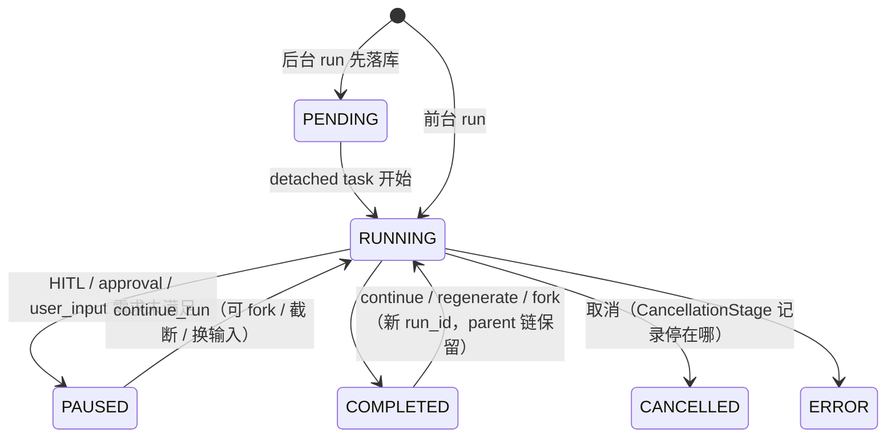

`RunOutput` 的关键字段就是这套生命周期的账本：`status`、`cancellation_stage`、`requirements`（暂停时缺什么）、`parent_run_id`、`forked_from_run_id`、`forked_from_message_index`、`regenerated_from`、`last_checkpoint_at_message_index`、`compaction`（本次折叠记录）、`metrics`。

---

## 7. 上下文装配：系统提示的 17 段拼装顺序

`agent/_messages.py::get_system_message()` 用带编号的注释把顺序写死在源码里。**记住这个顺序，比记住任何开关都有用**——它决定了模型先看什么、被什么"锚定"。

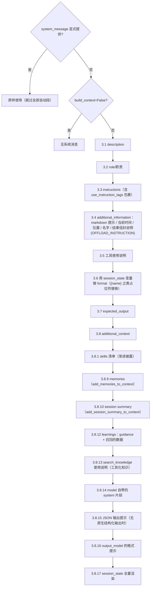

消息序列的装配（`get_run_messages`）：

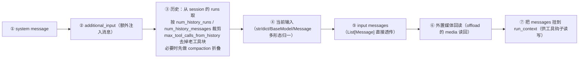

**四条设计含义**

1. **"记忆注入"排在 skills 之后、知识之前**：模型先看到"我是谁、要做什么、有哪些技能"，再看到"关于用户的记忆 / 会话摘要 / 学到的东西 / 怎么查知识库"。这决定了冲突时的隐性优先级：**任务指令 > 记忆**。想让记忆更强，只能写进 `instructions` 或用 `dependencies`，不是靠调参数。
2. **历史与记忆是两条独立来源**：历史来自本会话的 runs（§9），记忆来自 `agno_memories`（§10）。关掉历史不会关掉记忆，反之亦然。
3. **`session_state` 同时做"占位符 format"和"末尾全量渲染"**：前者让 `instructions` 里能写 `{user_tier}`，后者让模型随时能看到状态字典。这是 agno 版的"结构化短期记忆"。
4. **`OFFLOAD_INSTRUCTION` 只在开启外置时注入**：模型被明确告知"工具结果是一个信封，剩下的用 read/search 工具取回"。这比 CowAgent 的"硬截断 + 提示字符数"更可解释：**agno 把截断做成了可回读的引用**。

---

## 8. 三种上下文瘦身机制（Compaction / Compression / Offload）

agno 把"上下文太长"拆成三个正交问题，各给一个子系统。这是它与绝大多数 agent 框架最大的差异点，也是它最值得借鉴的部分。

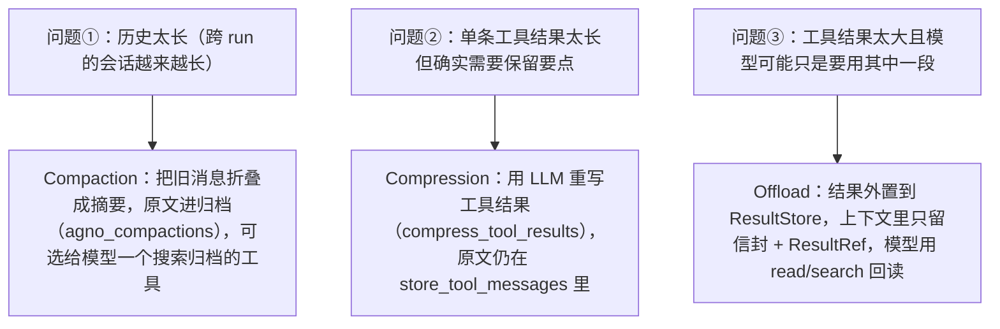

### 8.1 Compaction：非丢失式折叠（默认阈值 150k token / 保留 5 个 run）

`Compaction` 的字段就是它的算法说明书：

| 字段 | 默认 | 作用 |
|---|---|---|
| `compact_at_tokens` | **150,000** | 唯一自动触发条件（大小）；用 `use_model_token_count` 或自定义 `token_counter` 可换成模型侧计数 |
| `uncompacted_runs` | **5** | 折叠后至少保留最近 5 个 run 原文 |
| `uncompacted_tokens` | None | 用 token 而非 run 数定义"尾巴"，会被 `_tail_limit` 上限夹紧 |
| `compacted_token_budget` + `enforce_token_budget` | None + True | 摘要自身的长度预算（超出从尾部裁） |
| `store_compacted_messages` | True | 原文归档（写到 `agno_compactions.archived_messages`） |
| `search_compacted_messages` | None（自动） | 给模型一个**只读搜索归档**的工具；关掉则归档只对开发者可读 |
| `on_context_overflow` | False | 是否把"provider 说太长"当作触发器（反应式再折叠） |
| `enforce_min_fold_ratio` / `min_fold_ratio` | False / 2.0 | 折叠收益不足 2 倍则不做（避免"摘要只省一点"的无效折叠） |
| `stats: CompactionStats` | — | 累计：折叠次数、被压缩消息数、前后 token |

边界选择的安全性（`boundary_for` + `choose_boundary` + `_outside_newest_exchange`）：

- 切割点必须**成对安全**：不能把 `tool_call` 和它的 `tool result` 拆到折叠线两侧；
- 折叠点若落在**最新一轮 user→assistant 交换内部**，会往前退到最近一条 user 消息；
- 若阈值留给折叠的余量不足，会显式 warning（"threshold leaves no room for a fold to land well under it"）；
- 折叠后仍 ≥ 阈值 → 警告"下一 run 还会再折"（`_warn_if_still_over`）。

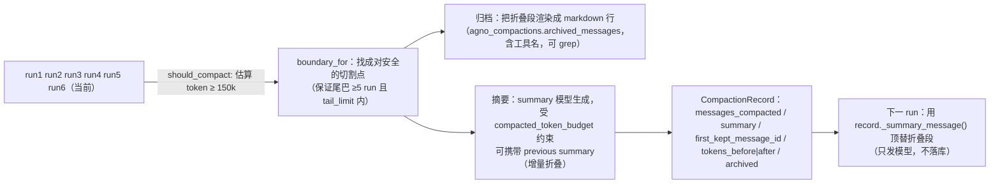

**幂等与时间旅行**：`CompactionArchive.latest(up_to_run_id)` 让"从某个旧 run 恢复/分叉"时继承**当时生效的折叠**，而不是重新摘要（省一次 LLM 调用，也保证可复现）。表 `agno_compactions` 一行一次折叠，**写一次永不更新**——注释解释了为什么用行而不是文件："a fold is a fact about a run: two containers writing different runs never collide"。

**能力降级**：只有实现可选契约的方言（`SqliteDb`、`PostgresDb`）能存折叠记录；不能存时 `disable_compaction_without_records` 会**关闭 compaction 并 warning**，而不是静默丢历史。这是 agno 少见的"显式拒绝服务"设计。

### 8.2 Compression：把工具结果改写得更短

`CompressionManager`：`compress_tool_results=True` + `compress_tool_results_limit`（条数）/ `compress_token_limit`。它只压"未压过的工具结果"（`_is_tool_result_message` + 去重标记），压完发 `CompressionStarted/Completed` 事件并记账。

| 对比 | Compaction | Compression |
|---|---|---|
| 对象 | 历史消息（含对话） | 工具结果 |
| 原文 | 归档且可搜索 | 若 `store_tool_messages=True` 仍留在 run 记录里（上下文里被替换） |
| 触发 | 会话大小阈值 | 工具结果数量/大小阈值 |
| 失败代价 | 一次摘要调用 | 一次摘要调用（每条一次，可累加成本） |

### 8.3 Offload：结果外置 + 可回读信封

`ResultStore`（表 `agno_tool_results` + 载荷）：

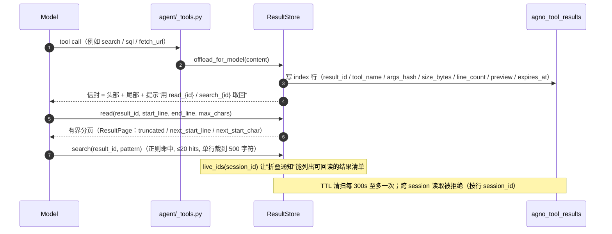

设计要点（源码注释明确写出）：

- **永不抛异常**：外置失败时信封里直接写明失败，而不是让整个 run 挂掉（"Never raises: failure is loud in the envelope"）。
- **回读工具永远有界**：`read`/`search` 的分页与 20 hits 上限保证"一次回读不会把上下文重新撑爆"；`payload()`（全量）只给代码用，不给 transcript。
- **`search` 是"带护栏的正则"**：`pattern` 由模型给出，所以先**在调用方** `re.compile`（非法 pattern 立刻变成 `re.error`，由工具层报错而不是从子进程里抛）；只要 pattern 含 `* + ? { (` 中任意一个（能回溯），扫描就搬到 `sys.executable -I offload/_scan.py` 的**隔离子进程**里跑，`communicate(timeout=10s)` 硬超时——注释写得很直白："**卡死在正则引擎里的线程无法中断**，所以必须换个能被 deadline 杀掉的地方"。脚本缺失（zipapp 安装）时退回进程内扫描并告警。输出再受 `SEARCH_MAX_MATCHES=20 / SEARCH_LINE_CLIP=500 / 一页上限` 三重约束。
- **`args_hash` + `preview`**：让"同一工具同一参数"的重复外置可辨识，`preview` 让模型不看全文也能判断要不要回读。

### 8.4 三件套的关键默认值与硬上限（可直接核对源码）

| 机制 | 常量 / 参数 | 值 | 出处 | 设计意图 |
|---|---|---|---|---|
| Compaction | `compact_at_tokens` | **150 000**（sentinel 默认，可被显式覆盖） | `compaction/compaction.py` `_COMPACT_AT_TOKENS_DEFAULT` | 折叠点：超过即把旧消息换成摘要 |
| Compaction | `uncompacted_runs` | **5**（与 `uncompacted_tokens` 互斥） | 同上 `_UNCOMPACTED_RUNS_DEFAULT` | 最近 N 个 run 永远原文保留 |
| Compaction | `enforce_min_fold_ratio` / `min_fold_ratio` | **False** / **2.0** | 同上 | 折叠段至少是被保留尾巴的 2 倍，否则不折叠（避免"折了个寂寞"） |
| Compaction | `store_compacted_messages` / `search_compacted_messages` | **True** / 跟随前者 | 同上 | 归档正文 + 归档搜索同时开关，防止"搜索工具指向空表" |
| Compaction | `DEFAULT_SUMMARIZE_CHAR_BUDGET` | **400 000 字符** | `compaction/compaction.py` | 摘要器自己也不能溢出：喂给摘要的原文先按 oldest-first 截断 |
| Compaction | 归档搜索上限 | ≤20 个 fold、每行 500 字符、输出 ≤8 000 字符、上下文 10 行 | `_SEARCH_MAX_FOLDS` 等 | 回读本身绝不能把上下文撑爆 |
| Compaction | `DEFAULT_TOKENIZER_MODEL_ID` | `gpt-5.4` | 同上 | 模型不带计数器时的兜底 tokenizer 口径 |
| Compression | `compress_tool_results_limit` | **3**（未设 token 阈值时） | `compression/manager.py.__post_init__` | 累计 3 条未压缩工具结果即触发 |
| Compression | `compress_token_limit` | None（设了就改为按 token 触发） | 同上 | 二选一的触发口径 |
| Offload | `DEFAULT_THRESHOLD_CHARS` | **16 000**（= 一次 `read_result` 的上限） | `offload/store.py` | 小于"一页可读"的结果不值得外置 |
| Offload | `READ_MAX_LINES` / `READ_MAX_CHARS` | **400 / 16 000** | 同上 | 回读分页的硬上限（先到者生效） |
| Offload | `SEARCH_MAX_MATCHES` / `SEARCH_MAX_CONTEXT_LINES` / `SEARCH_LINE_CLIP` | **20 / 20 / 500** | 同上 | 搜索返回有界 |
| Offload | `SEARCH_TIMEOUT_SECONDS` | **10**（仅可能回溯的 pattern 走子进程） | 同上 + `_scan.py` | 防模型写灾难性正则挂死 run |
| Offload | `MAX_RESULT_BYTES` / `MAX_SESSION_NAMESPACE_BYTES` | **8 MB / 200 MB** | 同上 | 单结果与单会话配额；超了走 `stored="false"` 拒绝信封 |
| Offload | `SWEEP_INTERVAL_SECONDS` / `DELETE_BATCH_SIZE` | **300 / 500** | 同上 | TTL 清扫节流与批量 |

> **可复算的一句话**：默认配置下，"外置"只对 **>16 000 字符**的结果生效，而每次回读最多拿回 **16 000 字符**——所以外置的收益只在"结果远大于阈值、且只需要其中几段"的场景成立；阈值调小会让模型反复回读，反而更贵。

**三者何时用哪个（决策表）**

| 症状 | 选择 | 理由 |
|---|---|---|
| 长会话（几十轮）成本线性上升 | Compaction | 折叠 + 归档是唯一"跨 run 生效"的机制 |
| 某几个工具（搜索/DB 查询）返回巨长文本 | Offload | 模型只需要其中几行；可回读避免信息丢失 |
| 工具结果多但每份都有价值、需要留在对话里 | Compression | 保留要点，不换引用 |
| provider 报 "context too long" | Compaction + `on_context_overflow=True` | 反应式再折叠（`_recompact_after_overflow`）而不是清历史 |
| 完全不想丢信息且要审计 | Compaction（保留归档 + 打开搜索） | "summary 是索引，ground truth 在行里" |

---

## 9. Session 体系：会话、run、state、summary、checkpoint、fork

### 9.1 数据模型

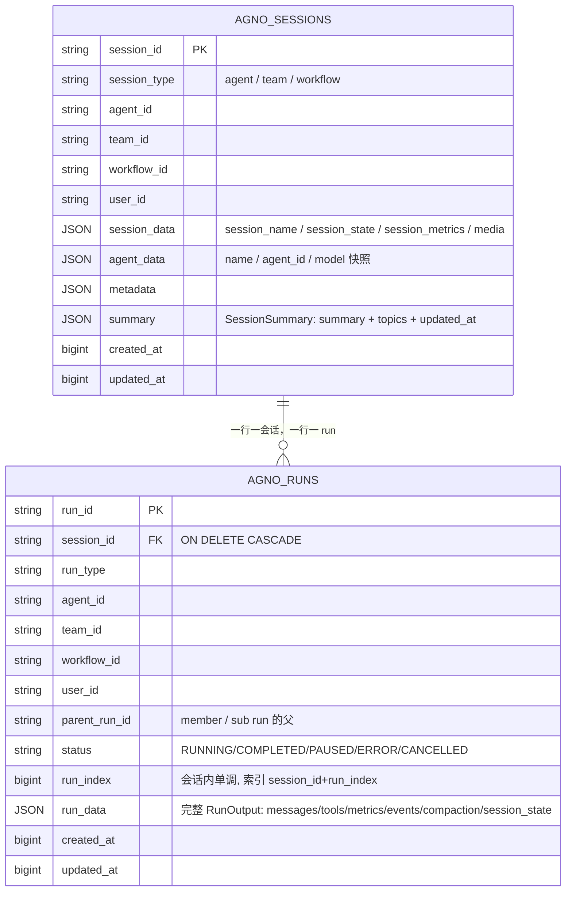

> 列名以 `db/postgres/schemas.py` 为准：**run 的内部结构（messages、tools、metrics、session_state、`forked_from_*`）都在 `run_data` 这一个 JSONB 里**，不是列。想按 token/模型/状态查询，PG 用 `run_data->>` JSON 路径，其他方言做不到——这是"分表 + JSON 载荷"设计的代价。完整 ER（含记忆、学习、折叠、外置结果、审批、调度、观测）见 §23.3。

`AgentSession`（`session/agent.py`）：`session_id`、四类 id、`session_data`（`session_name` / `session_state` / images / videos / audio）、`metadata`、`agent_data`、`runs`、`summary`、时间戳。`to_dict()` 用**浅拷贝**避免并发下序列化撕裂；`from_dict()` 反序列化 runs。

**为什么会话与 run 分表**（源码与代码规模都在暗示这点）：

| 好处 | 体现 |
|---|---|
| 单 run 增量更新 O(1) | `save_run()` 只 upsert 一行，支持 RUNNING/PAUSED 状态刷新 |
| 历史读取可下推裁剪 | `_bounded_history_runs_limit`：有 DB、有 `num_history_runs` 时把 limit 下推到 SQL，**不全量加载会话** |
| 时间旅行 | `fork` 深拷贝 run_output + 新 run_id + `forked_from_*`；`_truncate_run_to_checkpoint` 支持截断到某条消息 |
| 并发安全 | 两个实例改同一会话的不同 run 不冲突；只有 `session_data` 需要竞争 |

### 9.2 会话状态（session_state）与"跨会话记忆"

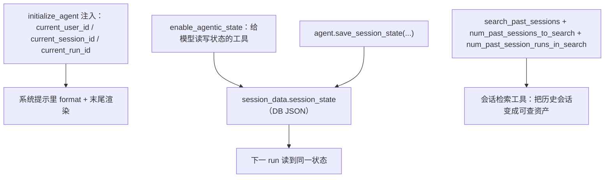

三种"记住"的粒度，必须分清：

| 机制 | 作用域 | 存哪 | 是否 LLM 参与 | 典型用法 |
|---|---|---|---|---|
| `session_state` | 单会话 | `sessions.session_data` | 否（除非 `enable_agentic_state` 给工具） | 表单字段、进度、开关、当前对象 |
| `add_history_to_context` | 单会话 | 由 `agno_runs` 装配 | 否 | 连续对话 |
| `search_past_sessions` | 跨会话 | `agno_sessions` + `agno_runs` | 工具检索 | "上次我们讨论的那个方案" |
| `UserMemory` / Learnings | 跨会话（按 user） | `agno_memories` / `agno_learnings` | **是**（抽取 + 检索） | 用户偏好、长期事实 |

### 9.3 Checkpoint、Continue、Fork、Regenerate（时间旅行 API）

| 能力 | 参数 | 语义 |
|---|---|---|
| 检查点粒度 | `checkpoint ∈ {runs, tool-batch, tools}` | 决定"能从哪一级恢复"：整 run / 一批工具 / 单个工具。AgentOS 侧有 `os/checkpoints.py` 与 `agno_transcripts` |
| 继续 | `continue_run(...)` + `_resolve_continue_from`（`end` / `last_user`） | 恢复被暂停的 run；`_restore_continue_context_metadata` 强调"恢复用的元数据必须来自被暂停的 run 行，绝不从调用方输入取"（防伪造 lineage 绕过审批） |
| 分叉 | `fork=True` → `_fork_run` | 深拷贝 + 新 run_id + `forked_from_run_id/message_index/session_id`，原 run 不动 |
| 重生成 | `regenerate=True` → `_find_regenerate_checkpoint` | 只丢掉"末尾没有 tool_calls 的 assistant 消息"，保留中间工具轨迹 |

> **这一组能力是 agno 相对所有本地记忆项目的独特优势**：run 是**可寻址、可截断、可分叉的账本**，不是一段聊天记录。做评测、A/B、错误复现时价值极大。

---

## 10. 记忆体系：MemoryManager、Learnings、SessionSummary 三套并存

agno 的"记忆"不是一个子系统，而是**三条独立通道 + 一条上下文通道**。先给全景：

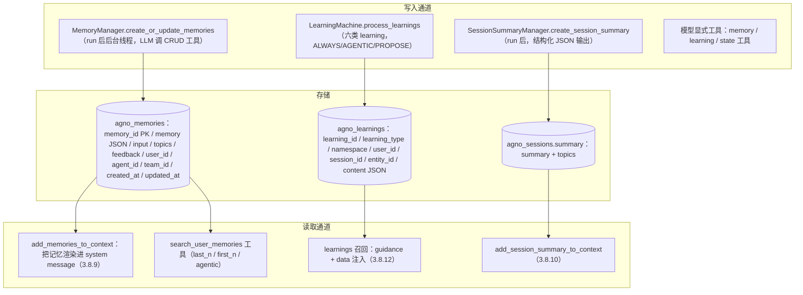

### 10.1 MemoryManager：LLM 驱动的 CRUD

`UserMemory` 是**扁平的单条事实**：

```python
@dataclass
class UserMemory:
    memory: str                 # 事实本身（第三人称短句）
    memory_id: str | None
    topics: list[str] | None    # 检索辅助标签（不是向量索引）
    user_id: str | None
    input: str | None           # 触发它的原始输入（溯源）
    feedback: str | None
    agent_id / team_id: str | None
    created_at / updated_at: int
```

它的系统提示（`get_system_message`）把策略写死了：

- 该记什么：个人事实、偏好与观点、重要事件、当前处境与目标、任何有洞察的细节；
- 怎么写：**第三人称、简短、不含冗余**（例：`User's name is John Doe`）；
- 一条别太长，必要时拆多条；**不要重复，改而新**；
- "用户要求忘记"时 → **删除所有相关引用**，而不是写"用户以前喜欢…"。

写入流程（`create_or_update_memories`）：

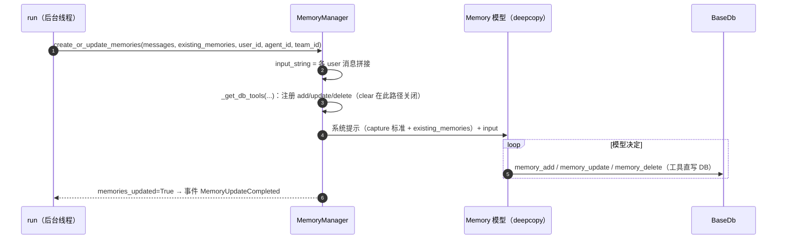

**关键性质**：记忆的写入者**是模型本身**，不是解析器。这带来两个后果——① 记忆质量取决于模型与提示词（可自定义 `memory_capture_instructions`）；② 记忆内容不可预测，因此它是**注入面**（§16.3）。

### 10.2 检索：三种方法，默认不是语义检索

```python
search_user_memories(query, limit, retrieval_method)  # last_n | first_n | agentic
```

| 方法 | 实现 | 成本 | 适用 |
|---|---|---|---|
| `last_n`（默认） | 按 `created_at` 取最近 N 条 | 0 次 LLM | 记忆量小、时间即相关性 |
| `first_n` | 最早 N 条 | 0 次 LLM | 保留"最初的原则性事实" |
| `agentic` | **把该用户全部记忆（ID + 文本 + topics）塞进提示，让模型返回相关 memory_id**（`MemorySearchResponse`） | **1 次 LLM，且与记忆总量成正比** | 需要语义相关性但不想上向量库 |

> 这是 agno 与 CowAgent / Hindsight / ai-memory 最大的方法论分歧：**agno 用模型算力替代检索基础设施**。小记忆量下它更准（模型真读内容），大记忆量下它不可持续（§10.4）。

### 10.3 Learnings：六类结构化学习（agno 3 的新记忆层）

`LearningMachine`（`learn/machine.py`）把"学习"拆成六个 store，每类有自己的 schema、作用域与写入模式：

| learning 类型 | schema 要点 | 作用域 | 默认 mode | 语义 |
|---|---|---|---|---|
| `user_profile` | 结构化字段（name、preferred_name + 可扩展自定义字段，字段 metadata 描述给 LLM） | USER | ALWAYS | **结构化长期档案**，可 upsert，不膨胀 |
| `user_memories` | `memories: List[Dict]` 无结构观察 | USER | ALWAYS | 与 `MemoryManager` 功能重叠的"观察型记忆" |
| `session_context` | `summary / goal / plan / progress` | SESSION | ALWAYS | **每次更新是 REPLACED**（会话工作记忆，不是累加） |
| `learned_knowledge` | `title / learning / context / tags` | namespace（默认 `global`）+ 知识 | **AGENTIC** | **跨用户共享的可复用洞察** |
| `entity_memory` | `entity_id / entity_type / properties / aliases / facts / events / relationships` | namespace | AGENTIC | 第三方实体（公司/项目/系统）；`supersession_threshold=0.8` 控制事实被取代 |
| `decision_log` | 决策 + 理由 + 上下文 | AGENT | AGENTIC | 审计与复盘 |

`LearningMode`：`ALWAYS`（每次响应后自动抽取）/ `AGENTIC`（模型用工具决定何时学）/ `PROPOSE`（模型提议、人确认，仅 learned_knowledge）/ `HITL`（保留，未实现）。

**配置里藏着成本阀门**：`max_updates_per_run`、`max_entities_in_context=5`、`max_facts_per_entity=10`、`max_entities_in_directory=50`、`enable_clear_*` 默认 False、`enable_agent_tools`（是否给模型工具）。

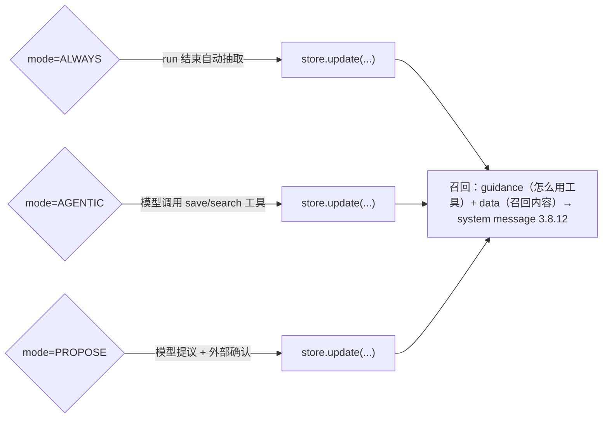

### 10.4 记忆规模的可复算代价（agno 的软肋）

设每条约 40 token（含 ID/topics 渲染约 60 token），用户记忆 N 条：

| N | `add_memories_to_context` 注入全部 | `agentic` 检索一次的输入 | 后果 |
|---|---|---|---|
| 20 | ≈1.2k token | ≈1.2k + 查询 | 完全可接受，且召回质量高 |
| 200 | ≈12k token（每轮） | ≈12k | 注入开始挤占主任务；一次检索≈一次小模型调用 |
| 2,000 | ≈120k token（**必然触发 compaction 阈值 150k**） | ≈120k | 两条路都不可用：必须换检索实现（向量库）或做记忆归档/合并 |

`SummarizeStrategy`（`memory/strategies/`）正是为此存在：`optimize_memories(user_id, strategy, apply=True)` 用 LLM 把全部记忆**合并成一条综合记忆并保留 metadata**（`count_tokens` 报告收益）。它是 agno 唯一的"记忆压缩"机制——**注意它是有损合并，默认 `apply=False` 先看效果**。

### 10.5 三套记忆的重叠与选法（最实用的决策表）

| 需求 | 选 | 不选 | 原因 |
|---|---|---|---|
| 记住用户偏好/事实，跨会话 | `MemoryManager`（`add_memories_to_context` + `update_memory_on_run`） | `learning.user_memories` 同时开 | 两者语义重叠，同时开=重复写 + 双倍抽取成本 |
| 需要可查询的结构化档案（表单、CRM） | `learning.user_profile`（自定义 schema） | `UserMemory` 自由文本 | 字段级 upsert，不会膨胀成噪声 |
| 跨用户共享经验（"这类问题这样解"） | `learning.learned_knowledge`（namespace=`global`） | `UserMemory`（按 user 隔离） | 作用域不同 |
| 会话工作记忆（目标/计划/进度） | `learning.session_context` 或 `session_state` | 历史堆叠 | context 是 REPLACED，成本恒定 |
| 审计"为什么这么做" | `learning.decision_log` + `agno_approvals` | 记忆 | 记忆会被改写，审计不能 |
| "上周那个会话说了啥" | `search_past_sessions` + `SessionSummary` | 记忆 | 会话级事实属会话 |
| 需要语义检索、大规模 | **自建检索**（把 `UserMemory` 同步进 `Knowledge`/VectorDB，写一个 `search_memories` 工具） | `agentic` 检索 | §10.4 的成本曲线 |

---

## 11. 知识与检索：Knowledge（RAG）与 ContextProvider（可查询面）

agno 有**两套"外部知识"抽象**，很多文档读者会把它们混为一谈：

| | `Knowledge`（`knowledge/`） | `ContextProvider`（`context/`） |
|---|---|---|
| 本质 | **离线索引**：内容被 reader 解析 → 切块 → embed → 写入 Vector DB → 查询 | **在线可查询面**：直接把"一个目录 / 一个库 / 一个网页 / 一个 MCP server"暴露成工具 |
| 有无 embedding | 有（`vectordb/` 24 种适配器 + embedder + reranker + query_transformer） | 无（靠背后的工具：grep、SQL、搜索引擎） |
| 新鲜度 | 需要同步（`insert/insert_many`、`sync_pages`） | 实时 |
| 给模型的方式 | `add_knowledge_to_context`（预取注入）或 `search_knowledge_base` 工具 | `ContextMode.agent`（一个 `query_<id>` 工具）或 `ContextMode.tools`（暴露底层工具） |
| 典型 | 手册、合同库、文档站 | 本地代码目录、Wiki、Gmail、日历、生产库 |

### 11.1 Knowledge 的管线

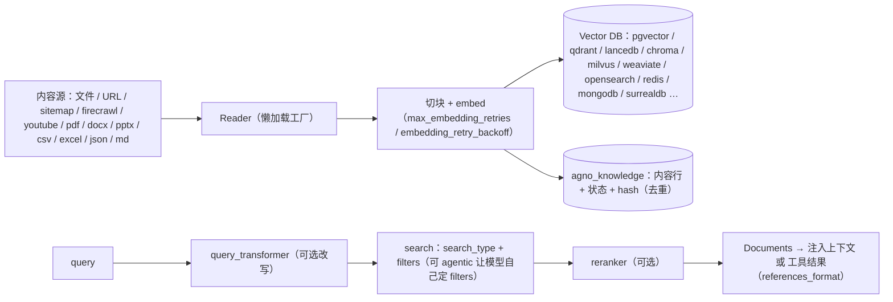

两条产品化程度很高的细节：

- **`page_store` / `PageSearchConfig`（llms.txt 站点式发布）**：`sync_pages()` 把一个 `llms.txt` 源**逐页原子发布**；`search_pages()` 明确写着"**索引化混合检索 + 倒数排名融合（RRF）**"；`read_page/read_full_page` 有字符与时间预算；`grep_pages` 是**有界字面量扫描**，且注释强调"不完整结果不能证明不存在"；`migrate_page_source` 默认 dry-run。这套 API 的形状说明 agno 想把 RAG 做成**可运维的站点**，而不是"塞进向量库的一堆块"。
- **`isolate_vector_search` + `user_id` 贯穿**：内容行带 owner，`remove_content_by_id(user_id)` 级联删向量；`get_valid_filters / validate_filters` 让"过滤条件"成为可校验的资产而不是字符串拼接。

### 11.2 ContextProvider：把"信息源"变成一等对象

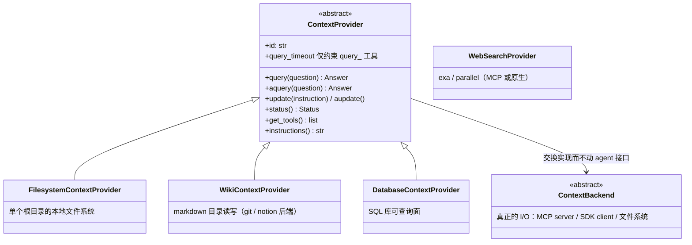

三个关键设计：

1. **`ContextMode` 三态**：`default`（子类自选）/ `agent`（**把 provider 包在一个子 agent 后面**，调用方只看到一个 `query_<id>` 工具）/ `tools`（把底层工具直接给调用方，由它自己编排）。同一个 provider 可以按调用方能力换形态——**这是控制"上下文膨胀"的结构性手段**：一个 wiki 暴露 8 个工具 vs 1 个 query 工具。
2. **`query_timeout` 只约束工具面**：源码 docstring 明确——超时只给 `query_<id>` 工具（覆盖子 agent 获取与流式回答），程序化 `query()` 与 `mode=tools` 的裸工具**不受约束**，写面 `update_<id>` 永不超时。这是一条少见的、写得很清楚的边界。
3. **Provider 自带读写**：`update/aupdate` 默认 `NotImplementedError`（只读 provider 干净失败），可写的（wiki/workspace）会换一套写工具集（`write_tools`），并允许注入写策略提示。

内置 provider：`fs`、`wiki`（git/notion）、`web`（exa / parallel，含 MCP 变体）、`database`、`calendar`、`gmail`、`gdrive`、`google`、`slack`、`mcp`、`workspace`。

> **与 Knowledge 的组合建议**：稳定语料 → Knowledge（要 rerank 与 filter）；易变/可执行的世界 → ContextProvider（要实时与写回）。两者都注册工具，靠 `tool_call_limit` 与 `ContextMode.agent` 控制扇出。

---

## 12. 工具、Skills、HITL、Guardrails

### 12.1 工具解析与注入

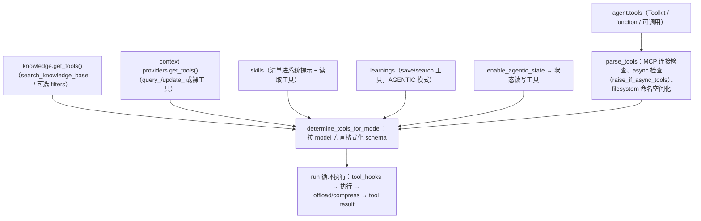

要点：

- **工具集是每次 run 组装的**（不是构造时冻结）：MCP 连接、knowledge、learnings、filesystem 都能在这一刻加入。与 CowAgent 的"运行时冻结 + 报废重建"是相反取舍：agno 付一点组装成本，换来**热变更**。
- **`filesystem` 是被托管的一等能力**（`agent/_init.py::set_filesystem/apply_filesystem_user_isolation`）：`fs/` 提供 `DbFileSystem`（落在 `agno_fs` 表，带 `project_key/session_id/subpath/entry`）与 `FileSystemTools`，并由 AgentOS 的 `user_isolation` 统一打开 `user_scoped`。也就是说 agno 的"agent 文件区"**默认在数据库里，不在磁盘上**——这正是它能水平扩展的原因。
- **`tool_call_limit` / `tool_choice`**：限制与强制来自模型参数，不来自框架的循环防护。agno **没有** CowAgent 那种"同参数打转≥5 次中止"的四级循环防护——它的防打转靠 `max_iterations` + `tool_call_limit`，更弱。

### 12.2 Skills：与 Claude 式 SKILL.md 同构

`Skill`：`name / description / instructions / source_path / scripts / references / metadata / license / compatibility / allowed_tools`；`loaders/` 支持多来源，`validator.py` 校验。渐进披露：系统提示 3.8.1 只放清单，模型按需读指令与参考文件。`allowed_tools` 是**技能级**的工具白名单（弱约束，不覆盖权限模型）。

### 12.3 HITL：暂停—审批—继续（agno 的独特强项）

```mermaid
sequenceDiagram
    autonumber
    participant MDL as Model
    participant AG as agent/_tools.py
    participant DB as agno_approvals / agno_runs
    participant OS as AgentOS 路由 /approvals
    participant HU as 人类（控制台/IM）
    MDL->>AG: tool call（工具声明需审批 / user_input / external_execution）
    AG->>DB: 写 approval 行（tool_name / tool_args / approval_type / pause_type / requirements / expires_at）
    AG-->>MDL: run 暂停：RunPaused 事件 + RunOutput.status=paused + requirements
    HU->>OS: 查看 / 批准 / 拒绝 / 修改参数
    OS->>DB: resolution_data + resolved_by + resolved_at
    OS->>AG: continue_run(run_id, 修改后的输入 / fork / 截断点)
    AG->>AG: _restore_continue_context_metadata：元数据只从被暂停的 run 行取
    AG-->>HU: RunContinued → 继续跑
```

四种人工介入：`user_input`（问用户要东西）、`external_execution`（工具在框架外执行）、`approval`（批准/拒绝，含 `approval_type='audit'` 的事后审计记录）、`requires_confirmation`（参数确认）。`RunRequirement` 是"缺什么"的结构化描述，`cancellation_stage` 区分"没开始 / 跑一半 / 已有部分输出"。

### 12.4 Guardrails：本质是"被特殊对待的 hook"

`BaseGuardrail` + 三个内置：`PIIDetectionGuardrail`、`PromptInjectionGuardrail`、`OpenAIModerationGuardrail`。它们通过 `pre_hooks` / `post_hooks` / `tool_hooks` 进入流程（`normalize_pre_hooks` 把 guardrail 与普通 hook 区分）：

- **guardrail hook 同步执行**，其余 hook 可后台（`run_hooks_in_background`、`should_run_in_background`）；
- **顺序保证**：非 guardrail hook 会被缓冲，**只有全部 guardrail 通过后才入队**；
- **副作用传播**：deepcopy 发生在 guardrail 循环**之后**，所以 PII 脱敏等修改会带到后续（源码注释明确写了这点）。

> 这意味着 agno 的安全扩展点是**函数级的**，不是权限表级的。它没有 CowAgent 那种"read-only / workspace-write / full-access"三态与 bash 解析——**它默认假设工具是可信代码**，把防线放在 guardrail（内容层）与 approval（授权层）。

---

## 13. 多 Agent：Team 四模式与 Workflow

### 13.1 Team 模式（`team/mode.py`）

| 模式 | 语义 | 何时用 | 代价 |
|---|---|---|---|
| `coordinate`（默认） | 主管模式：挑选成员、派任务、综合回答 | 通用复杂任务 | 多轮成员调用 + 一次综合 |
| `route` | 路由模式：转给专家，**直接返回成员回答** | 明确分工的入口分发 | 少了综合，回答风格=成员 |
| `broadcast` | 广播：同一任务给所有成员；`arun` 并发、`run` 串行 | 多视角/多模型对照、评审 | 成本 × 成员数 |
| `tasks` | 任务制：把目标拆成共享任务表，循环直到完成（有 `TaskCreated/TaskUpdated/TaskStateUpdated` 事件供前端渲染） | 长任务、可分解工作 | 编排复杂、可能过拆 |

```mermaid
flowchart TD
    U["用户输入"] --> T["Team（leader）"]
    T --> M1{"mode"}
    M1 -->|coordinate| C1["选成员 → 派任务 → 收回答 → 综合"]
    M1 -->|route| C2["选一个成员 → 直接返回其输出"]
    M1 -->|broadcast| C3["同一任务并发给全部成员 → 汇总"]
    M1 -->|tasks| C4["拆任务表 → 逐个/并行委派 → 循环直到清空"]
    C1 --> SH["共享会话：一个 session，成员读写同一 transcript（team/_members.py、_messages.py）"]
    C2 --> SH
    C3 --> SH
    C4 --> SH
    C1 -.-> SUB["成员若是子 Team：递归（有深度保护）"]
```

`team/_run.py` 有 10518 行——多 agent 的复杂度集中在**共享 transcript、成员寻址、成员工具继承、事件嵌套**上，而不是"调用成员"本身。`parent_run_id` 与嵌套事件让前端能画层级。

### 13.2 Workflow（`workflow/`，`workflow.py` 12126 行）

确定性编排：步骤、条件、循环、并行、`WorkflowState`、步骤级 HITL 与重试。与 Team 的分工：**Team 是"把决定权交给模型"，Workflow 是"把决定权写回代码"**。选型判断：步骤可枚举 → Workflow；步骤要靠判断 → Team。

---

## 14. AgentOS：把库装成服务

`AgentOS.__init__` 的参数就是它的装配面（节选，按功能分组）：

| 组 | 参数 |
|---|---|
| 身份 | `id/name/description/version` |
| 组件 | `agents`、`teams`、`workflows`（都支持 Remote / Protocol / Factory） |
| 存储 | `db`、`auto_provision_dbs`、`media_storage`、`checkpoint`、`knowledge` |
| 安全 | `authorization`(+`AuthorizationConfig`)、`user_isolation`、`user_directory`、`cors`/`cors_allowed_origins`、`service_accounts`、`mcp_auth` |
| 协议暴露 | `interfaces`（Slack/WhatsApp 等）、`a2a_interface`、`mcp`/`mcp_server`(+`MCPConfig`)、`base_app`、`on_route_conflict` |
| 运行 | `queue: QueueConfig`、`event_stream`、`scheduler`(+`scheduler_poll_interval`/`internal_service_token`)、`run_hooks_in_background`、`job_queue` |
| 观测 | `tracing`、`registry`、`telemetry`、`diagnostics` |
| 组织层 | `manager`（OSManager）、`company`（`CompanyConfig`：产品/项目/任务） |

```mermaid
flowchart LR
    subgraph OS["AgentOS"]
      MW["auth 中间件（JWT / service account / scopes）"]
      RT["路由：/sessions /runs /agents /teams /workflows /memories /learnings /knowledge /approvals /schedules /metrics /traces /filesystem /media /health /components /job-queue /service-accounts /evals"]
      SCHM["Scheduler：agno_schedules（cron_expr/timezone/timeout/max_retries/locked_by/next_run_at）+ agno_schedule_runs"]
      ESCH["Event Streams + Queue（后台 run、断线续传）"]
      MCPE["MCP Server：把 agents 暴露成 MCP 工具（含 mcp_auth、authz 状态镜像）"]
      DIAG["run_diagnostics（自检）"]
    end
    AG["Agents/Teams/Workflows"] --> RT
    RT --> DB[("BaseDb")]
    SCHM --> DB
    MCPE --> AG
    UI["控制台 / 第三方客户端 / MCP 客户端"] --> RT
```

**值得注意的三点**

1. **`user_isolation` 会下推到 filesystem store**（`apply_filesystem_user_isolation`）：多租户下 agent 的文件区自动按 user 分区。这是 agno 把"隔离"当成部署属性而非代码属性的体现。
2. **调度器带分布式锁语义**：`locked_by/locked_at/next_run_at/enabled/disabled_reason/managed_by`，加上 `internal_service_token`——说明调度器是多副本部署的一等公民（CowAgent 的 DailyFlush/evolution 只有进程内 timer，没有锁）。
3. **MCP 暴露是内置的**：`os/mcp.py`（3418 行）把 agent 变成 MCP server，并镜像 authz 状态（`_mirror_authz_state_to_mcp_app`）。这让"把自家 agent 挂到 Codex/Cursor"成为配置问题而不是开发问题。

---

## 15. 体系论证一：会话体系（不变量与失败模式）

前面讲了机制，这一节讲"哪些性质永远成立、破坏了会看到什么症状"。

### 15.1 agno 的会话到底是什么

**一行 DB + 一堆 run 行 + 一个内存 dataclass**。没有运行时池、没有会话锁、没有进程内 registry（除 `cache_session`）。这与 CowAgent 正好相反：CowAgent 的会话是"运行时 + 队列 + 身份四元组"，agno 的会话是"**可被任何实例无状态读取的记录**"。

```mermaid
flowchart LR
    REQ["任意实例收到 (session_id, user_id, agent_id)"] --> LOAD["get_session：cache_session? 命中内存 : DB 读"]
    LOAD --> HIST["_bounded_history_runs_limit：把 LIMIT N 下推到 SQL（有 DB + 有 num_history_runs 时）"]
    HIST --> CTX["装配上下文（§7）"]
    CTX --> SAVE["save_run（单行 upsert）+ save_session（仅会话行）"]
```

**不变量（agno 会话推理的地基）**

| 编号 | 不变量 | 谁保证 | 破坏后的症状 |
|---|---|---|---|
| A-1 | run 与会话分开持久化，run 行可被反复更新（状态、消息、指标） | `save_run` 单行 upsert | 长 run 期间前端看不到进度；崩溃丢全部中间态 |
| A-2 | 会话的历史顺序由 `(session_id, run_index)` 决定，并被复合索引服务 | `agno_runs_session_id_run_index`（源码注释："ORDER BY run_index DESC LIMIT N is index-served"） | 历史"跳序"；大会话装配时全表扫描 |
| A-3 | run 之间**不共享内存**：每次 run 从 DB 重建上下文 | `get_session` + `get_run_messages` | 单机能跑、多副本不一致（说明代码偷偷依赖了内存） |
| A-4 | 删除会话会级联删除 runs / transcripts / compactions（+ 媒体与外置结果由 agent 侧删） | `db.delete_session`、`delete_for_sessions`、`delete_media` | 孤儿外置结果与归档堆积 |
| A-5 | 折叠记录继承"当时生效的那次折叠"，不是每次重新摘要 | `CompactionArchive.latest(up_to_run_id)` | fork/continue 时重复摘要烧 token，且结果不可复现 |
| A-6 | 恢复暂停的 run 时，lineage 元数据只来自被暂停的 run 行 | `_restore_continue_context_metadata` | **越权**：调用方伪造 parent 绕过审批 |
| A-7 | 工具结果按行 `session_id` 归属，跨会话读回被拒绝 | `ResultStore.get_row` + 工具层检查 | 跨用户读到别人的工具结果（隐私事故） |

**没有的不变量（必须自己补）**

| 缺什么 | 后果 | 补法 |
|---|---|---|
| **没有会话级串行/锁** | 同一 `session_id` 并发两个 run：两条 run 都读到同一历史，写回两条 run，`session_state` 后写覆盖先写 | 业务层按 session 加锁（或每用户一个队列）；AgentOS 的 `queue` 可削峰但不是互斥锁 |
| 没有 `session_state` 的乐观并发控制 | 并发写状态丢更新 | 用 `learning.session_context`（结构化 REPLACED 语义更清晰）或外部状态存储 |
| 没有"会话保留/清理"策略 | 表无限增长（`session_filters.py` 提供过滤但不自动清） | 自己写保留策略；注意清理要连带 compactions / tool_results / media |

### 15.2 会话体系的失败模式

| # | 症状 | 根因 | 处置 |
|---|---|---|---|
| 1 | "它不记得上一句" | `add_history_to_context` 默认 False | 打开，并设 `num_history_runs` |
| 2 | 长会话每轮越来越贵 | 历史无界 + 未开 compaction | `compaction=Compaction()`（默认 150k 触发） |
| 3 | 多副本部署时同一会话行为不一致 | 代码依赖了内存 `cache_session` | 关掉 `cache_session` 或粘滞路由 |
| 4 | 打开 compaction 却没生效，日志有 warning | 当前 DB 不实现折叠记录契约（异步 DB / 部分方言） | 换 `SqliteDb`/`PostgresDb`，或关 compaction |
| 5 | 折叠后模型"忘了细节" | 摘要是有损的 | 打开 `search_compacted_messages`（只读归档搜索）或提高 `compacted_token_budget` |
| 6 | 折叠没省多少 token | 未达 `min_fold_ratio` 或尾巴太大 | `enforce_min_fold_ratio=True` + 调 `uncompacted_runs` |
| 7 | 折叠后仍超阈值，反复折叠 | 尾巴太大（`_warn_if_still_over`） | 降 `uncompacted_tokens`；开 offload/compression |
| 8 | 会话删了但体积没降 | 外置结果/媒体/trace 未连带清理 | `delete_media=True`；`ResultStore.delete_for_sessions` |
| 9 | 并发同一会话出现"消息错乱" | 无会话锁（A-缺失） | 上层加互斥；或每会话单队列 |
| 10 | `continue` 后模型重复回答 | `_resolve_continue_from` 用了 `end` | 用 `last_user` 或 `regenerate=True` |
| 11 | 大会话打开慢 | 无 limit 下推（`num_history_runs` 未设 → 全量加载） | 设 `num_history_runs`，让 LIMIT 下推 |
| 12 | 工具结果被别的会话读到 | 自定义工具绕过了 ResultStore 的归属检查 | 只用框架注入的回读工具 |

---

## 16. 体系论证二：记忆体系（为什么三套并存、怎么选）

### 16.1 一句话概括 agno 的记忆哲学

> **agno 不设计"记忆结构"，它设计"记忆的读写协议"。** 结构交给模型（自由文本记忆）或开发者（自定义 learning schema），检索交给模型（agentic 检索）或向量库（Knowledge），持久化交给统一 DB 契约。

对比 CowAgent 的哲学（"文件是真相，索引可重建，衰减与融合算法定死"）：

| 维度 | agno | CowAgent |
|---|---|---|
| 真相载体 | 数据库行 | Markdown 文件（DB 索引可重建） |
| 写入者 | LLM（MemoryManager / LearningMachine 工具） | 框架（裁剪/摘要触发）+ LLM 蒸馏 |
| 分层 | 无显式分层，按**通道**分（memory / learning / summary / history / state / compaction） | 显式四层（上下文 / 日记 / 核心记忆 / 知识技能） |
| 检索 | `last_n` / `first_n` / **模型挑 ID** | BM25 + 向量 + rank 归一融合 + 时间衰减 +（可选 rerank / 命中加权） |
| 遗忘机制 | `SummarizeStrategy` 合并；模型执行 delete | 时间衰减（只作用日记）+ 蒸馏上提 |
| 可审计性 | SQL 查询 / AgentOS 路由 | 直接看文件、git diff |
| 多进程 | 天然支持（DB） | 弱（文件 + SQLite 本地） |
| 规模上限 | 高（DB），但 agentic 检索成本线性 | 低—中（扫文件 + embed） |

### 16.2 记忆写入的三条路径与其风险

```mermaid
flowchart TD
    P1["路径①：update_memory_on_run（第 7 步并行起，第 14 步 join）"] --> R1["成本：每 run 一次 LLM<br/>风险：抽取噪声累积；看不到本轮回答"]
    P2["路径②：enable_agentic_memory（模型自己调记忆工具）"] --> R2["成本：按需<br/>风险：模型不写 or 过度写；可被注入诱导写"]
    P3["路径③：learning ALWAYS/AGENTIC/PROPOSE"] --> R3["成本：每 run 抽取（ALWAYS）<br/>PROPOSE 引入人审，最安全"]
    R1 --> Q["同一事实可能被写两次（memory + learnings.user_memories）"]
    R2 --> Q
```

**必须自己建立的四条纪律**（框架不提供）：

1. **单一事实源**：`memory_manager` 与 `learning.user_memories` 二选一。
2. **命名空间纪律**：`learned_knowledge.namespace` 默认 `global`——跨用户共享。个人助理场景应显式改成 `user`，否则 A 用户学到的东西会注入 B 用户的提示（源码支持 `"user"` 私有命名空间）。
3. **溯源留痕**：`UserMemory.input` 与 `EntityMemory.events` 要保留（默认写），排查"它为什么这么想"时是唯一线索。
4. **容量与合并**：`optimize_memories(strategy=SummarizeStrategy(), apply=False)` 先 dry-run 看 token 收益，再 `apply=True`。
5. **别指望它记住"结论"**：记忆与学习抽取都在**模型回答之前**起（输入 = 系统提示 + 历史 + 本轮用户输入），所以"模型在回答里推断出的规则"不会自动成为记忆。若某条结论必须留存，要么让模型显式调用记忆工具（路径②），要么把它写进 `session_state` / `learned_knowledge`。

### 16.3 记忆污染：agno 的具体路径与可缓解点

```mermaid
flowchart LR
    X1["不可信内容（网页/邮件/用户输入/工具结果）进入上下文"] --> X2["模型把它写进 UserMemory 或 learned_knowledge"]
    X2 --> X3["下一 run：add_memories_to_context / learnings 召回把它注入系统提示"]
    X3 --> X4["跨 run、跨会话持续生效；namespace=global 时跨用户"]
    X4 --> X5["若模型据此调用写类工具 → 实际损害"]
```

| 缓解 | 手段 | 强度 |
|---|---|---|
| 内容层拦截 | `PromptInjectionGuardrail`、`PIIDetectionGuardrail`、`OpenAIModerationGuardrail`（pre_hooks，同步、先于其他 hook） | 中 |
| 写权限层 | 不给 `update_memory_on_run`，只给 `AGENTIC` 模式并限制工具；`enable_clear_memories=False`（默认） | 中高 |
| 人审 | `LearningMode.PROPOSE`（learned_knowledge）+ `agno_approvals` | 高 |
| 隔离 | `namespace='user'`、`user_isolation=True`、记忆按 `user_id/agent_id` 过滤 | 高 |
| 事后可逆 | 记忆是行：可 SELECT/UPDATE/DELETE；`feedback` 字段可存人工标注 | 高 |
| 缺什么 | 没有"来源可信度"字段、没有"外部内容不得进入记忆"的硬闸门 | — |

### 16.4 记忆规模的可复算拐点（选型关键数字）

以"记忆文本 + ID + topics 渲染 ≈ 60 token/条"为例：

| 记忆条数 N | `add_memories_to_context` 每轮注入 | `agentic` 检索一次的输入 | 建议 |
|---|---|---|---|
| 30 | ≈1.8k | ≈1.9k | 默认方案完全够用（`last_n` 或全注入） |
| 150 | ≈9k | ≈9k | 只注入 + 关掉 agentic 检索；开始考虑合并 |
| 600 | ≈36k | ≈36k | 必须合并（SummarizeStrategy）或改为工具化按需检索 |
| 2000 | ≈120k（≈触发 150k 折叠阈值） | ≈120k | **agno 的 agentic 检索不再适用**：把记忆镜像进 `Knowledge` + VectorDB，写 `search_memories` 工具 |

---

## 17. 体系论证三：上下文预算经济学（可复算的算例）

agno 的价值在"每一分 token 都能记账"。下面用一个具体场景把 §8 的三套机制的取舍算清楚。

**场景**：客服 agent，`gpt-class` 模型窗口 128k，会话跑到 40 个 run，平均每 run 2.5 次工具调用，工具结果平均 3,000 token（搜索结果）。

```mermaid
flowchart TD
    B0["基线：只 add_history_to_context=True"] --> B1["每 run 历史增长 ≈ 3000(用户+回答) + 2.5×3000(工具) ≈ 10.5k token<br/>40 run ≈ 420k token 历史 → 必然被 provider 拒绝"]
    B1 --> C1["方案A：compaction(默认 150k, 保 5 run)"]
    B1 --> C2["方案B：offload_tool_results"]
    B1 --> C3["方案C：compression"]
    B1 --> C4["方案D：num_history_runs=8"]
    C1 --> R1["折叠到约 150k 以下：一次性摘要调用 + 归档行；后续每轮省约 60-70%"]
    C2 --> R2["工具结果变信封（约 200-400 token）→ 每 run 省 2.5×(3000-300)≈6.7k"]
    C3 --> R3["每条结果压到约 1/3 → 每 run 省 2.5×2000=5k，但每条一次 LLM 调用"]
    C4 --> R4["硬窗口：只保留最近 8 run ≈ 84k token，简单但会丢早期约束"]
```

**决策矩阵（按"能否丢信息"与"是否付 LLM"**）

| 机制 | 是否丢信息（上下文内） | 是否额外付 LLM | 是否可回读 | 记账位置 |
|---|---|---|---|---|
| `num_history_runs` | **是**（直接丢） | 否 | 否（DB 里还在，但模型不再看） | — |
| Compaction | 是（换摘要） | 是（摘要调用） | **是**（归档 + 可选搜索工具） | `CompactionStats`、`RunMetrics`、`agno_compactions.tokens_before/after` |
| Compression | 部分（重写） | 是（每条一次） | 是（`store_tool_messages`） | `CompressionStarted/Completed` + `stats` |
| Offload | 否（改为引用） | 否 | **是**（`read`/`search` 有界回读） | `agno_tool_results`（size_bytes/line_count/preview） |
| `max_tool_calls_from_history` | 是（老工具块降级为文本/去掉） | 否 | 部分 | — |

**推荐组合（生产经验式）**：`offload_tool_results`（工具大户必开）+ `compaction`（长会话必开，`search_compacted_messages=True`）+ `num_history_runs` 做上界兜底 + `store_tool_messages=True` 保证审计。`compression` 只在"结果必须留在对话里且模型确实读不完"时才开（成本最高）。

---

## 18. 安全与权限体系

### 18.1 威胁模型

| 资产 | 存放 | 威胁 | 现有防护 |
|---|---|---|---|
| 多租户数据（会话/记忆/知识/文件/外置结果） | DB | 跨用户读取 | `user_id` 贯穿所有表；`user_isolation`；`fs` 的 `user_scoped`；`ResultStore` 按行 session 拒绝跨会话读；`session_filters` |
| 服务本身 | AgentOS HTTP | 未认证访问、脚本滥用 | JWT / `service_accounts`（token_hash/scopes/revoked_at）/ `authorization` + scopes / `mcp_auth` |
| 工具执行面 | 进程内或 `sandbox/` | 危险工具调用、代码执行 | `approval`（HITL）、`tool_hooks` + guardrails、`sandbox/`（docker / AgentCore）、`filesystem` 受管存储 |
| 模型输入 | 上下文 | 提示注入、PII 外泄 | `PromptInjectionGuardrail`、`PIIDetectionGuardrail`、`OpenAIModerationGuardrail` |
| 记忆/学习 | `agno_memories`/`agno_learnings` | 记忆污染、跨用户泄漏 | namespace、`user_id/agent_id` 过滤、`PROPOSE` 人审、行级可删 |
| 审批链 | `agno_approvals` | 伪造 lineage 绕过 | A-6：恢复只从被暂停 run 行取元数据 |
| 成本 | 模型 API | 记忆/摘要/知识调用叠加导致账单失控 | `max_updates_per_run`、`tool_call_limit`、`metrics` 与 `diagnostics` |

```mermaid
flowchart TD
    IN["请求（HTTP / MCP / interface / scheduler）"] --> AU["认证：JWT / service account / mcp_auth"]
    AU --> AZ["授权：authorization + scopes + run_permissions"]
    AZ --> ISO["隔离：user_isolation（下推到 fs / 查询过滤）"]
    ISO --> GR["内容防线：input guardrails（PII / 注入 / 审核）"]
    GR --> TOOL["工具执行"]
    TOOL --> AP{"需要审批？"}
    AP -->|是| PAUSE["run 暂停 → agno_approvals → 人工 → continue"]
    AP -->|否| EXEC["执行（可选 sandbox：docker / AgentCore）"]
    EXEC --> OUT["输出 guardrails → 记忆/学习写入（可 PROPOSE 人审）"]
```

### 18.2 与 CowAgent 的权限哲学差异（关键）

| | agno | CowAgent |
|---|---|---|
| 保护对象 | **多租户数据与服务边界** | **本机文件系统与用户配置** |
| 机制 | 认证/授权/隔离/审批/内容 guardrails/沙箱可选 | 三态权限模式 + 工具与命令级解析（只读白名单 fail-closed / 工作区黑名单 best-effort） |
| bash 类风险 | 交给工具作者与 sandbox（框架不解析命令） | 框架解析命令：白名单、写形态 flag、git 二级判定、提权命令禁止 |
| 结论 | 适合"平台多租户"，不适合"把 shell 交给模型而不设防" | 适合"个人机器上的 shell 助理" |

> 换句话说：**agno 没有命令级权限模型**。如果你在 agno 里给 agent 一个 shell 工具，安全边界只能来自 (a) approval/HITL，(b) 容器/`sandbox/`，(c) 自建 guardrail。这一点在选择框架时必须明确。

### 18.3 上线前的最小加固清单

1. `authorization=True` + scopes + `service_accounts`（别把裸 AgentOS 暴露公网）；配 `cors_allowed_origins`。
2. `user_isolation=True`，并确认每个 store（db / fs / media / result store / knowledge）都带 `user_id`。
3. 所有写类工具（发信、删数据、改文件）配 `approval`；`approval_type='audit'` 用于事后追责。
4. 记忆写入走 `AGENTIC` 或 `PROPOSE`，`enable_clear_memories` 保持 False。
5. `learned_knowledge.namespace` 明确设成 `user`（除非确实要跨用户共享）。
6. 打开 `tracing` + `metrics` + `diagnostics`，把 `RunMetrics` 与 `CompactionStats` 上报。
7. `sandbox/`（docker/AgentCore）承载代码执行类工具；不要用宿主 shell 工具。
8. 备份：会话/记忆/学习/折叠/审批表是**不可重建**资产；`agno_tool_results` 可牺牲，`agno_compactions` 不可（丢了就只剩摘要）。

---

## 19. 对象模型与引用关系（叙述版）

### 19.1 五个所有权层

| 层 | 载体 | 创建 | 销毁 | 线程/协程亲和 |
|---|---|---|---|---|
| **进程级** | `AgentOS` 应用、`BaseDb` 连接池、scheduler、event stream、registry、MCP 会话 | 启动装配（`_make_app`、`_initialize_agents`） | 进程退出 / lifespan | 任意（需连接池安全） |
| **组件级（Agent/Team/Workflow）** | `Agent` dataclass 及其持有的 `model`、`tools`、`memory_manager`、`learnings`、`compaction`、`knowledge`、`skills` | 构造时；`initialize_agent()` 补齐（`set_default_model`、`set_memory_manager`、`set_learning_machine`、`set_session_summary_manager`、`set_compression_manager`、`set_compaction`、`set_result_store`、`set_filesystem`、`set_checkpoint`） | 显式 `close`（MCP 断连、DB 关闭） | 任意（Agent 会被并发 run 复用 → **可变字段是竞态源**） |
| **run 级** | `RunContext`、`RunOutput`、`RunMessages`、`RunRequirement`、后台 memory task | `run_dispatch` | run 结束（落库后释放） | 该 run |
| **会话级（逻辑）** | `AgentSession`（从 DB 载入的快照） | `get_session` | run 结束写回 | 该 run |
| **调用级** | `Message`、`ToolExecution`、`ResultRef`、`CompactionRecord` | 模型/工具 | 随 run | 该 run |

**关键结构性事实：Agent 是被并发复用的可变对象。**
`initialize_agent()` 会改 `agent.model`、`agent._hooks_normalised`、`agent.memory_manager` 等；`determine_tools_for_model` 每次 run 重新组装工具。因此**同一个 Agent 实例并发服务多个 session 时，任何"把 per-run 信息写到 self 上"的代码都是 bug**。agno 的做法是把 per-run 状态放进 `RunContext`/`RunOutput`——**这是它能把 Agent 当无状态组件复用的原因**（对比 CowAgent：一个 `(agent_id, session_id)` 一个运行时实例，靠会话串行保证安全）。

### 19.2 持有链与引用清单

```mermaid
flowchart TD
    OS["AgentOS"] --> AGs["List[Agent] / Team / Workflow"]
    OS --> DB[("BaseDb")]
    AG["Agent"] --> MDL["Model（+ fallback_models）"]
    AG --> DB
    AG --> MM["MemoryManager --> BaseDb + Model(deepcopy 调用)"]
    AG --> LM["LearningMachine --> stores --> BaseDb"]
    AG --> SM["SessionSummaryManager --> Model"]
    AG --> CMP["Compaction --> Archive(agno_compactions) + summary Model"]
    AG --> RS["ResultStore --> agno_tool_results"]
    AG --> KM["Knowledge --> VectorDB + contents_db(BaseDb)"]
    AG --> CPs["List[ContextProvider] --> ContextBackend"]
    AG --> SK["Skills --> loaders"]
    AG --> FS["FileSystem --> DbFileSystem(agno_fs)"]
    AG --> RC["RunContext（per run）"]
    RC --> SESS["AgentSession（载入的快照）"]
    RC --> MSGS["RunMessages"]
    MSGS --> REC["CompactionRecord（生效的折叠）"]
    AG -.->|"deepcopy(model) 用于 memory / compression / parser"| TM["临时 Model"]
```

| 引用 | 强度 | 设计意图 / 陷阱 |
|---|---|---|
| `Agent → BaseDb` | 强 | 会话、记忆、学习、折叠、外置结果**共用一个 db 对象**；换 db 等于换整个资产层。`auto_provision_dbs` 会自动发现多个 db |
| `MemoryManager → Model` | 强，但每次调用 **deepcopy** | 记忆模型不能被 run 改写（源码 `model_copy = deepcopy(self.model)`） |
| `Agent → Compaction` | 强 | 折叠记录不在内存，读时从 `agno_compactions` 取 `latest(up_to_run_id)`——所以重启/换实例都能正确继承 |
| `Compaction → BaseDb` | **可选契约** | 方言未实现则整体关闭 compaction（`disable_compaction_without_records`） |
| `Knowledge → VectorDB + contents_db` | 强，两个后端 | 内容行在关系库，向量在向量库：**一致性靠 remove 级联与 hash 去重，不是事务** |
| `ContextProvider → ContextBackend` | 组合 | 换后端（git↔notion、exa↔MCP）不改 agent 接口 |
| `RunOutput → CompactionRecord` | 值语义 | run 输出里带本次折叠，前端可直接显示"这轮把 12 条消息折成 1 条摘要" |
| `Agent.stream/事件回调` | 弱（闭包） | 事件带 `event_index`（发布时打戳），持久化与流式顺序由此对齐 |

### 19.3 状态归属矩阵（出问题该找谁）

| 状态 | 权威副本 | 内存副本 | 恢复方式 | 丢失后果 |
|---|---|---|---|---|
| 对话历史 | `agno_runs.run_output` | `RunMessages`（每 run 重建） | 读 DB | **不可重建** |
| 会话名/元数据 | `agno_sessions.session_data`/`metadata` | `AgentSession` | 读 DB | 不可重建 |
| 会话状态 | `session_data.session_state` | 同上 | 读 DB | 工作流中断 |
| 会话摘要 | `agno_sessions.summary` | — | 重新生成（付 LLM） | 可重建但成本高 |
| 用户记忆 | `agno_memories` | — | 重新抽取（不可靠） | 近似不可重建 |
| 学习 | `agno_learnings` | stores 缓存 | 重新抽取 | 近似不可重建 |
| 折叠摘要 + 原文归档 | `agno_compactions`（`summary` + `archived_messages`） | `CompactionRecord` | **不可重建**（原文只在这） | 细节永久丢失（只剩摘要） |
| 外置工具结果 | `agno_tool_results` + payload | `ResultRef` | 可牺牲（重跑工具） | 可接受 |
| 知识内容 | `agno_knowledge` + VectorDB | — | 重新同步源 | 可重建（慢） |
| 审批链 | `agno_approvals` | `RunRequirement` | 不可重建（合规） | 严重 |
| agent 文件区 | `agno_fs` | — | 不可重建 | 严重 |
| 追踪/指标 | `agno_traces`/`agno_spans`/`agno_metrics` | `RunMetrics` | 可牺牲 | 观测缺口 |

> **备份优先级**：`agno_runs`/`agno_sessions` > `agno_compactions`（含原文归档）> `agno_memories`/`agno_learnings` > `agno_approvals`/`agno_fs` > `agno_knowledge`（可重同步）> `agno_tool_results`/`traces`（可牺牲）。

### 19.4 扩展配方

| 你要做的事 | 必须动的对象 | 必须遵守的约定 | 常见错误 |
|---|---|---|---|
| 自定义记忆抽取 | `MemoryManager(memory_capture_instructions=…)` 或子类 | 记忆必须是第三人称短句；保留 `input` 溯源 | 让记忆写长段落 → 注入成本爆炸 |
| 加一类记忆（结构化） | `LearningMachine(user_profile=CustomSchema)`（字段加 `metadata.description`） | schema 字段会被渲染给 LLM；`internal` 字段不外露 | 把大字段塞 profile（每 run 都抽取回写） |
| 加一类上下文源 | 继承 `ContextProvider`（`query`/`status`/可选 `update`）+ 可选 `ContextBackend` | 决定 `ContextMode`；设 `query_timeout` | 暴露一堆裸工具导致上下文膨胀 |
| 换向量库 | `vectordb/<new>` 实现 + `Knowledge(vector_db=…)` | 需要支持 filters 与 reranker 接口 | 只换 search 不换 upsert/删除级联 |
| 加权限（命令/工具级） | 自建 `BaseGuardrail` + `tool_hooks` + `approval` | guardrail 必须是同步 hook，先于普通 hook | 以为框架有路径/命令权限模型（没有） |
| 加部署级隔离 | `user_isolation=True` + 各 store `user_scoped` | 每个 store 都要生效 | 只开 db 过滤忘开 fs/media |
| 加新存储方言 | `db/<dialect>/schemas.py` + `*_db.py` | 可选契约（compaction records）不实现就得关闭相关功能 | 实现 sessions 但漏 runs 复合索引 → 大会话慢 |

---

## 20. 核心流程逐段解说

按 §6 的 16 步合并成 9 段，每段给"输入 / 输出 / 不变量 / 失败策略 / 代码位置"。这是排查与二次开发的定位表。

### 20.1 段①：入口与输入校验

| 项 | 内容 |
|---|---|
| 输入 | `input`（str/list/dict/`Message`/`BaseModel`/`List[Message]`）+ `images/videos/audios/files` + `session_id`/`user_id` |
| 输出 | 校验后的 `RunInput`、归一后的 hook 列表、初始化好的 session_id |
| 关键动作 | `validate_input(input, input_schema)`（TypedDict/Pydantic）、`normalize_pre_hooks/post_hooks`（区分 guardrail）、`initialize_session`（生成或复用 session_id，注入 `current_user_id/session_id/run_id` 到 `session_state`） |
| 不变量 | 输入 schema 校验发生在任何 LLM 调用之前（省钱 + 防注入式畸形输入） |
| 失败策略 | 校验失败直接抛错，不产生 run 记录之外的副作用 |
| 位置 | `agent/_run.py`（dispatch 前段）、`agent/_session.py::initialize_session`、`agent/_init.py::_initialize_session_state` |

### 20.2 段②：会话载入与状态更新

| 项 | 内容 |
|---|---|
| 输出 | `AgentSession`（含 runs 与 summary）、更新后的 `session_data`/`metadata` |
| 关键动作 | `get_session`（`cache_session` 决定内存缓存与否）；`update_session_state`；`_bounded_history_runs_limit` 决定历史读取是否下推 LIMIT |
| 不变量 | A-2/A-3（顺序与无状态）；会话不存在则创建 |
| 失败策略 | DB 不可用 → run 直接失败（会话是唯一硬依赖，不像 CowAgent 的"run 记录可降级"） |
| 位置 | `agent/_session.py`、`db/*/`（方言） |

### 20.3 段③：依赖解析与 pre-hooks

| 项 | 内容 |
|---|---|
| 输出 | `RunContext.dependencies`、可能被改写的输入/上下文 |
| 关键动作 | `resolve_run_dependencies`（异步解析 callable 依赖）；pre-hooks（guardrail 同步优先，其余可后台，全部 guardrail 通过后才入队后台 hook） |
| 不变量 | guardrail 的修改（如 PII 脱敏）必须传播：deepcopy 在 guardrail 循环之后 |
| 失败策略 | guardrail 命中 → 整个 run 以 error 结束（`RunError`）；普通 hook 异常按 hook 语义（记录/忽略） |
| 位置 | `agent/_run.py`、`agent/_hooks.py`、`guardrails/*` |

### 20.4 段④：工具集组装

| 项 | 内容 |
|---|---|
| 输出 | 该 run 的工具 schema 列表 |
| 关键动作 | `get_tools/aget_tools`（含 MCP 连接检查、filesystem 命名空间化）→ knowledge 工具 → context provider 工具（按 `ContextMode`）→ learnings 工具（AGENTIC 模式）→ 状态工具 → `determine_tools_for_model`（按模型方言） |
| 不变量 | 工具集是 **per-run** 的：改 `agent.tools` 下一 run 生效，无需重启（与 CowAgent 相反） |
| 失败策略 | 含 async 工具的同步 run → 立即抛（`raise_if_async_tools`）；MCP 连接失败 → 工具缺席 + 日志 |
| 位置 | `agent/_tools.py`、`knowledge/knowledge.py::get_tools`、`context/provider.py::get_tools` |

### 20.5 段⑤：上下文装配（含折叠）

| 项 | 内容 |
|---|---|
| 输出 | `RunMessages`：system + 历史（可能已折叠）+ 当前输入 |
| 关键动作 | `get_system_message`（17 段）→ 历史裁剪（`num_history_runs`/`max_tool_calls_from_history`）→ `apply_compaction`（必要时先折叠）→ 外置媒体回读 |
| 不变量 | 折叠边界成对安全；不吞最新一轮交换；折叠记录来自 DB（A-5） |
| 失败策略 | 摘要失败 → 保留原历史并记录（不丢消息）；DB 不支持归档 → 关闭 compaction 并 warning |
| 位置 | `agent/_messages.py`、`compaction/*` |

### 20.6 段⑥：后台记忆与学习抽取

| 项 | 内容 |
|---|---|
| 输出 | `agno_memories` / `agno_learnings` 变化；`MemoryUpdateCompleted` 事件 |
| 关键动作 | 后台线程 `create_or_update_memories`；`process_learnings`/`start_learning_future`；`run_memory_task` |
| 不变量 | 抽取失败**不影响本轮回复**；`existing_memories` 会喂给抽取模型避免重复 |
| 失败策略 | 抽取异常被记录（`log_exception`）；`memories_updated` 只在实际写入时置位 |
| 位置 | `memory/manager.py`、`learn/machine.py`、`agent/_run.py`（start/join） |

### 20.7 段⑦：模型—工具循环（含 guardrail/审批/offload/compress）

| 项 | 内容 |
|---|---|
| 输出 | 最终内容 + `ToolExecution` 列表 + 引用/推理内容 |
| 关键动作 | 模型调用 → tool calls → `tool_hooks` → 审批判定（可能 `paused`）→ 执行 → 结果 `offload_for_model`/`compress` → 回注；`tool_call_limit` 限制次数；可选 reasoning 轮 |
| 不变量 | 暂停不是失败：`status=paused` + `requirements`；外置失败在信封里显式说明而非抛错 |
| 失败策略 | 模型错误 → `fallback_models`/`retries`/`exponential_backoff`；工具错误 → `ToolCallError` 事件 + 作为 tool result 交回模型 |
| 位置 | `agent/_run.py`、`agent/_tools.py`、`offload/*`、`compression/*`、`run/requirement.py` |

### 20.8 段⑧：输出结构化与后处理

| 项 | 内容 |
|---|---|
| 输出 | `RunOutput.content`（可能是 Pydantic 对象）、`followups`、媒体 |
| 关键动作 | `parser_model`（把文本解析成 schema）/ `output_model`（二次生成）/ `use_json_mode`；`store_media`；post-hooks |
| 不变量 | 结构化失败不丢原始文本（`content` 与 `content_type` 记录真实类型） |
| 失败策略 | 解析失败 → 保留原文 + 错误事件 |
| 位置 | `agent/_response.py`、`agent/_run.py` |

### 20.9 段⑨：摘要、落盘与清理

| 项 | 内容 |
|---|---|
| 输出 | `agno_runs` 行、`agno_sessions` 行、`sessions.summary`、事件序列落库（`store_events`） |
| 关键动作 | 等后台记忆任务 → `create_session_summary`（若开启）→ `save_run`（O(1) 单行）→ `save_session`（仅会话行）→ 可选 `session_summary` 事件 |
| 不变量 | run 与 session 分写；`event_index` 保证流式与持久化顺序一致 |
| 失败策略 | 落盘失败 → run 结果为 error，但已产生的记忆不回滚（**记忆与 run 非事务**，这是常见困惑源） |
| 位置 | `agent/_session.py`、`agent/_storage.py`、`session/summary.py` |

### 20.10 九段速查（症状 → 定位）

| 段 | 典型症状 | 优先检查 |
|---|---|---|
| ① | 输入被拒 / 状态里没有 current_user_id | `input_schema`、`initialize_session` |
| ② | 没有历史 / 打开慢 | `add_history_to_context`、`num_history_runs`、索引 |
| ③ | guardrail 命中导致全 run 失败 / PII 未脱敏到后续 | hook 归一化与执行顺序 |
| ④ | 工具缺失 / 工具太多乱调 | MCP 连接、`ContextMode`、`tool_call_limit` |
| ⑤ | 上下文超长 / 折叠不生效 | compaction 阈值与契约、tail 设置 |
| ⑥ | 记忆没写 / 记忆重复 | `update_memory_on_run`、`existing_memories`、与 learnings 重叠 |
| ⑦ | 卡在 paused / 结果被截断 | requirements、offload 信封、approval 路由 |
| ⑧ | 结构化输出解析失败 | `parser_model` vs 原生结构化输出、`use_json_mode` |
| ⑨ | 记忆写成功但 run 失败 | 记忆与 run 非事务（§20.9） |

---

## 21. 核心类图（对象模型全集）

### 21.1 记忆与学习

```mermaid
classDiagram
    class MemoryManager {
        +Model model
        +BaseDb db
        +str memory_capture_instructions
        +bool update_memories
        +bool add_memories
        +bool delete_memories
        +bool clear_memories
        +create_or_update_memories(messages, existing_memories, user_id, db, agent_id, team_id) str
        +search_user_memories(query, limit, retrieval_method, user_id) List~UserMemory~
        +optimize_memories(user_id, strategy, apply) dict
        +get_user_memories(user_id) list
        +add_user_memory(memory, user_id)
        +get_system_message(...) Message
        -_search_user_memories_agentic(user_id, query, limit)
        -_get_db_tools(user_id, db, input_string, ...)
    }
    class UserMemory {
        +str memory
        +str memory_id
        +List~str~ topics
        +str user_id
        +str agent_id
        +str team_id
        +str input
        +str feedback
        +to_dict()
        +from_dict()
    }
    class MemoryOptimizationStrategy {
        <<abstract>>
        +optimize(memories, model) List~UserMemory~
        +get_system_prompt() str
        +count_tokens(memories) int
    }
    class SummarizeStrategy {
        +optimize(memories, model)
    }
    class MemorySearchResponse {
        +List~str~ memory_ids
    }
    MemoryManager --> UserMemory : 读写
    MemoryManager --> MemoryOptimizationStrategy : optimize_memories
    MemoryOptimizationStrategy <|-- SummarizeStrategy
    MemoryManager --> MemorySearchResponse : agentic 检索的结构化输出
```

```mermaid
classDiagram
    class LearningMachine {
        +dict stores
        +user_profile / user_memories / session_context / entity_memory / learned_knowledge / decision_log
        +recall(...) 抽取与召回
        +process_learnings(...)
        +get_tools(...)
    }
    class UserProfile {
        +str user_id
        +str name
        +str preferred_name
        %% 可扩展自定义字段：字段 metadata 会被渲染给 LLM
    }
    class SessionContext {
        +str session_id
        +str summary
        +str goal
        +List~str~ plan
        +List~str~ progress
        %% 语义：每次更新是 REPLACED（不是累加）
    }
    class EntityMemory {
        +str entity_id
        +str entity_type
        +str name
        +str description
        +dict properties
        +List~str~ aliases
        +List facts
        +List events
        +List relationships
    }
    class LearnedKnowledge {
        +str title
        +str learning
        +str context
        +List~str~ tags
    }
    class LearningConfig {
        +LearningMode mode
        +int max_updates_per_run
        +bool enable_agent_tools
        %% LearningMode：ALWAYS / AGENTIC / PROPOSE / HITL
    }
    LearningMachine --> UserProfile
    LearningMachine --> SessionContext
    LearningMachine --> EntityMemory
    LearningMachine --> LearnedKnowledge
    LearningMachine --> LearningConfig
```

### 21.2 上下文瘦身三件套

```mermaid
classDiagram
    class Compaction {
        +int compact_at_tokens
        +int uncompacted_runs
        +int uncompacted_tokens
        +int compacted_token_budget
        +bool store_compacted_messages
        +bool search_compacted_messages
        +bool on_context_overflow
        +float min_fold_ratio
        %% 默认：compact_at_tokens=150000，uncompacted_runs=5，min_fold_ratio=2.0
        +should_compact(messages) bool
        +boundary_for(messages, min_index, overhead_tokens) int
        +build_record(...) CompactionRecord
        +archive_for(session_id, db, user_id) CompactionArchive
        -_summary_message(record) Message
    }
    class CompactionRecord {
        +int messages_compacted
        +str summary
        +str first_kept_message_id
        +bool archived
        +int tokens_before
        +int tokens_after
    }
    class CompactionArchive {
        +write(record, messages)
        +latest(up_to_run_id) CompactionRecord
        +search(query, limit) list
    }
    class CompressionManager {
        +bool compress_tool_results
        +int compress_tool_results_limit
        +int compress_token_limit
        +should_compress(messages, tools, model, response_format) bool
        +compress(messages, run_metrics)
    }
    class ResultStore {
        +offload_for_model(content) envelope
        +read(result_id, start_line, end_line, max_chars) ResultPage
        +search(result_id, pattern, context_lines) List~ResultMatch~
        +live_ids(session_id, limit) list
        +delete_for_sessions(session_ids) int
        +maybe_sweep()
    }
    class ResultRef {
        +str result_id
        +str path
        +str tool_name
        +int size_bytes
        +int line_count
    }
    Compaction --> CompactionRecord
    Compaction --> CompactionArchive
    ResultStore --> ResultRef
```

### 21.3 会话、run 与事件

```mermaid
classDiagram
    class AgentSession {
        +str session_id
        +str agent_id
        +str team_id
        +str user_id
        +str workflow_id
        +dict session_data
        +dict metadata
        +List runs
        +SessionSummary summary
        +to_dict()
        +from_dict()
    }
    class SessionSummary {
        +str summary
        +List~str~ topics
        +datetime updated_at
    }
    class SessionSummaryManager {
        +Model model
        +int last_n_runs
        +int conversation_limit
        +create_session_summary(session, run_metrics)
    }
    class RunOutput {
        +str run_id
        +str session_id
        +str parent_run_id
        +RunInput input
        +Any content
        +str content_type
        +List~Message~ messages
        +List~ToolExecution~ tools
        +RunMetrics metrics
        +CompactionRecord compaction
        +RunStatus status
        +CancellationStage cancellation_stage
        +List~RunRequirement~ requirements
        +str forked_from_run_id
        +str regenerated_from
    }
    class RunContext {
        +str run_id
        +str session_id
        +str user_id
        +dict dependencies
        +list messages
        +list tools
        +dict session_state
    }
    class RunRequirement {
        %% 待满足的人工介入项：approval / user_input / external_execution
    }
    AgentSession --> SessionSummary
    AgentSession --> RunOutput
    RunOutput --> RunRequirement
```

### 21.4 知识与上下文源

```mermaid
classDiagram
    class Knowledge {
        +vector_db
        +BaseDb contents_db
        +int max_results
        +Dict~str,Reader~ readers
        +page_store
        +page_search
        +query_transformer
        +reranker
        +insert_many()
        +search()
        +retrieve()
        +build_context()
        +get_tools()
        +search_pages()
        +read_page()
        +grep_pages()
        +list_pages()
        +sync_pages()
        +migrate_page_source()
    }
    class ContextProvider {
        <<abstract>>
        +str id
        +query(question) Answer
        +status() Status
        +update(instruction)
        +get_tools() list
        +instructions() str
    }
    class ContextBackend {
        <<abstract>>
        %% 真正的 I/O 实现：MCP server / SDK client / 文件系统
    }
    class ContextMode {
        <<enumeration>>
        default
        agent
        tools
    }
    Knowledge --> VectorDB : 向量检索
    Knowledge --> BaseDb : 内容行
    ContextProvider --> ContextBackend
    ContextProvider --> ContextMode : 暴露形态
```

---

## 22. 补充时序（把还没画的主流程补齐）

### 22.1 记忆抽取与主推理的并行与 join

```mermaid
sequenceDiagram
    autonumber
    participant RL as run loop
    participant BG as 后台线程/任务
    participant MM as MemoryManager
    participant DB as agno_memories
    RL->>BG: start（第 7 步：run 结束前就启动）
    RL->>RL: 继续推理 / 工具循环（不等记忆）
    BG->>DB: 读 existing_memories（喂给抽取模型，避免重复）
    BG->>MM: create_or_update_memories
    MM->>DB: memory_add / update / delete（模型决定的工具调用）
    RL->>BG: join（第 14 步）
    RL-->>RL: MemoryUpdateCompleted 事件
```

### 22.2 折叠的三条触发路径

```mermaid
flowchart TD
    T1["① 主动：装配时 should_compact（估算 token ≥ 150k）"] --> F["fold：选边界 → 摘要 → 归档 → 写 record"]
    T2["② 反应：provider 返回 too-long → on_context_overflow → _recompact_after_overflow"] --> F
    T3["③ 手动：agent.compact() / compact_session() → CompactionResult(status)"] --> F
    F --> J{"min_fold_ratio 达标？"}
    J -->|否，且 enforce=True| SKIP["放弃折叠（省一次无效摘要）"]
    J -->|是| W["写 agno_compactions（一次写永不改）+ 下一 run 用摘要顶替"]
```

### 22.3 外置结果的回读闭环

```mermaid
sequenceDiagram
    autonumber
    participant MDL as Model
    participant RS as ResultStore
    participant DB as agno_tool_results
    MDL->>RS: read_r1(start_line=120, max_chars=4000)
    RS->>DB: get_row(result_id) → 校验 session_id 归属
    RS-->>MDL: ResultPage（truncated, next_start_line, next_start_char）
    MDL->>RS: search_r1(pattern="timeout")（正则命中, ≤20 hits, 可能进子进程限时 10s）
    RS-->>MDL: 命中行（每行裁到 500 字符）
    Note over RS: maybe_sweep()：有 TTL 且距上次≥300s 才扫，store 级而非会话级
    Note over RS,DB: 删会话时 delete_for_sessions 先删载荷再删索引行
```

### 22.4 HITL：暂停 → 审批 → 继续（含 fork/截断）

```mermaid
sequenceDiagram
    autonumber
    participant CL as 客户端 / 控制台
    participant OS as AgentOS /approvals /runs
    participant DB as agno_runs / agno_approvals
    participant AG as agent
    AG->>DB: run status=paused + requirements
    CL->>OS: 列出待审批（含 tool_name/tool_args/expires_at）
    CL->>OS: 批准 / 拒绝 / 改参数
    OS->>DB: resolution_data, resolved_by, resolved_at
    CL->>OS: continue(run_id, fork=true, continue_from="last_user")
    OS->>AG: continue_run_dispatch
    AG->>DB: 读被暂停的 run 行（lineage 元数据只从行取）
    AG->>AG: _apply_continue_modifiers：fork → 新 run_id + forked_from_*
    AG-->>CL: RunContinued → 正常事件流
```

### 22.5 多副本下的同一会话（agno 的无状态性验证）

```mermaid
sequenceDiagram
    autonumber
    participant LB as 负载均衡
    participant I1 as 实例 A
    participant I2 as 实例 B
    participant DB as BaseDb
    LB->>I1: run(session=S)
    I1->>DB: get_session(S) → 装配 → save_run(r1)
    LB->>I2: run(session=S)（可能路由到另一副本）
    I2->>DB: get_session(S)（读到 r1）→ save_run(r2)
    Note over I1,I2: 若两请求并发同 session：各自读到同一历史 → 状态与历史交错误乱（无会话锁）
```

### 22.6 Knowledge 同步与检索

```mermaid
sequenceDiagram
    autonumber
    participant ADM as 管理接口
    participant KN as Knowledge
    participant CDB as agno_knowledge
    participant VDB as Vector DB
    ADM->>KN: insert_many(contents) / sync_pages()（llms.txt 源）
    KN->>CDB: upsert 内容行（hash 去重、status）
    KN->>VDB: 切块 embed（retry/backoff）
    Note over KN: setup()/asetup() 先校验 page_store 与 source 绑定，再放查询流量
    KN-->>ADM: 状态可查（get_content_status）
```

### 22.7 ContextProvider 的一次查询（带超时）

```mermaid
sequenceDiagram
    autonumber
    participant AG as 调用 Agent
    participant CP as ContextProvider（mode=agent）
    participant SA as 内部子 Agent
    participant BE as ContextBackend
    AG->>CP: query_wiki("发布流程是什么")
    CP->>CP: query_timeout 起表（只约束 query_ 工具）
    CP->>SA: 子 agent（带后端工具）提问
    SA->>BE: 实际 I/O（git / notion / mcp / sql）
    BE-->>SA: 原始材料
    SA-->>CP: Answer（serialize_answer：省略空字段）
    CP-->>AG: 工具结果
    Note over CP: 超时 → 工具产出 {"error": ...}，而不是挂住调用方 run
```

### 22.8 Team（coordinate）的一轮

```mermaid
sequenceDiagram
    autonumber
    participant U as 用户
    participant T as Team leader
    participant M1 as 成员 A
    participant M2 as 成员 B
    participant S as 共享会话（session）
    U->>T: 输入
    T->>T: 装配团队上下文（成员 roster + 共享 transcript）
    T->>M1: 派任务（嵌套 run，parent_run_id）
    M1-->>T: 成员输出（写入同一 transcript）
    T->>M2: 派任务
    M2-->>T: 输出
    T-->>U: 综合回答（+ 成员事件流）
    Note over T,S: route 模式直接返回成员输出；broadcast 并发；tasks 模式循环拆任务
```

---

## 23. 数据与存储全景：表清单、ER、方言能力矩阵与降级语义

> 这一节回答三个问题：**数据到底落在哪几张表里、每列是什么意思、换一个数据库会悄悄失去什么能力**。agno 的 `BaseDb` 不是"等价抽象层"，而是**能力分层**：核心四件事（会话、run、记忆、指标）所有方言都实现，进阶能力（折叠记录、结果外置、审批持久化、调度、外部 transcript、组件图）**只有 Sqlite/Postgres 有**。选型时这是最容易踩的坑。

### 23.1 四个存储平面

```mermaid
flowchart LR
    subgraph P1["平面一：BaseDb（agno_* 表：账本与资产）"]
        S[("agno_sessions")]
        R[("agno_runs")]
        M[("agno_memories")]
        LN[("agno_learnings")]
        CP[("agno_compactions")]
        TRX[("agno_tool_results")]
        AP[("agno_approvals")]
        SC[("agno_schedules")]
        SCR[("agno_schedule_runs")]
        TCE[("agno_traces")]
        SPN[("agno_spans")]
        TXF[("agno_transcripts")]
        JOB[("agno_jobs")]
        VER[("agno_schema_versions")]
    end
    subgraph P2["平面二：AgentFS（agno_fs：大 payload 与文件）"]
        FS[("agno_fs")]
    end
    subgraph P3["平面三：VectorDb（分块 + embedding）"]
        KN[("agno_knowledge：仅元数据")]
        VDB[("pgvector / LanceDB / Qdrant / ...")]
    end
    subgraph P4["平面四：进程内（重启即丢，可重建）"]
        CACHE["SessionRunObjectCache：按原始行文本缓存反序列化结果"]
        EVT["event stream / queue 缓冲"]
    end
    R -- "session_id FK, ON DELETE CASCADE" --> S
    SPN -- "trace_id FK" --> TCE
    SCR -- "schedule_id FK, ON DELETE CASCADE" --> SC
    TRX -- "namespace + path 指向 payload" --> FS
    KN -- "content 的向量" --> VDB
    M -. "语义检索不在这里，要么 agentic 要么自建" .-> VDB
```

**四个平面的分工是有意为之**：账本要可查可 join（所以进关系表）；payload 只按 id 取、体积大（所以进 AgentFS 的文件语义）；向量检索的引擎各不相同（所以彻底外包给 VectorDb，`agno_knowledge` 只存元数据）；缓存必须可丢（所以 `SessionRunObjectCache` 只按行文本 key，永不成为事实源）。

### 23.2 默认表清单

`BaseDb.__init__`（`db/base.py`）给出默认表名；**除 tool_results / compactions / transcripts 外均可自定义**（`PostgresDb(..., memory_table="my_mem")`）。

| 默认表名 | 装什么 | 谁写 | 谁读 | 方言覆盖 |
|---|---|---|---|---|
| `agno_sessions` | 一个会话一行：身份、`session_data`（含 `session_state`）、`summary`、`metadata` | `upsert_session`（run 收尾、state 保存） | 每次 run 开头、AgentOS 会话列表、`search_past_sessions` | 全部 |
| `agno_runs` | 一个 run 一行，`run_data` 是完整 RunOutput | `upsert_run`（O(1) 单行）、HITL 状态刷新 | 历史装配（带 LIMIT 下推）、审计、fork/continue | 全部 |
| `agno_memories` | `UserMemory`：一条第三人称事实 + topics + input + feedback | `MemoryManager`（LLM 决定增改删） | 系统提示"memories"段、`search_user_memories` 工具 | 全部 |
| `agno_learnings` | 六类结构化学习（profile / memories / session_context / entity / learned_knowledge / decision_log） | `LearningMachine` 的各 store | 系统提示（profile / learnings）、learnings 工具、AgentOS learnings 面板 | 读：全部；**检索**：仅 Pg/Sqlite |
| `agno_compactions` | 一次折叠一行：摘要 + 锚点 + 原文归档 + token 前后 | `CompactionArchive.write()` | 装配时取"当前生效的折叠"、`search_compacted_messages` | **仅 SqliteDb / PostgresDb（同步）** |
| `agno_tool_results` | 外置结果索引（preview、行数、字节数、args_hash、expires_at） | `ResultStore.offload()` | `read_result` / `search_result` 工具、TTL 清扫 | **仅 SqliteDb / PostgresDb** |
| `agno_fs` | AgentFS 文件：`(namespace, user_id, path)` → 内容 | AgentFS（payload、sandbox、组件资源） | ResultStore、sandbox | **仅 Postgres / SQLite 方言**（`DbFileSystem` 显式检查 dialect） |
| `agno_approvals` | HITL 暂停项：工具名/参数/要求/决议 + `run_status` 冗余 | pause/resume 路径 | `continue_run`、审批面板、超时清理 | **仅 Pg/Sqlite（含 async）** |
| `agno_schedules` / `agno_schedule_runs` | cron 定义 + 每次触发历史（含 `locked_by/locked_at` 租约） | Scheduler manager | 调度器 claim、AgentOS schedules 路由 | Pg / Sqlite / Mongo |
| `agno_traces` / `agno_spans` | run 级 trace 与 span（OTel 风格） | `tracing` 中间件 | 观测面板 | 读：全部；写：由 tracing 层 |
| `agno_transcripts` | **外部 agent**（Claude Code / Codex 等）的不透明 transcript，按 position 追加 | sandbox/外部 agent 集成 | 回放、checkpoint | **仅 Pg/Sqlite** |
| `agno_knowledge` | 知识内容**元数据**（name、type、size、status、linked_to、user_id、access_count） | Knowledge 入库 | 检索结果回填、入库面板 | 全部 |
| VectorDb（自定） | 分块 + embedding | Knowledge ETL | `search_knowledge` | 由 `vectordb/*` 适配 |
| `agno_metrics` | 按天聚合的 run/session 计数与 token | `calculate_metrics`（懒刷新，≤1 次/分钟） | AgentOS 指标接口 | 全部 |
| `agno_eval_runs` | 评测运行（准确率/相关性/模型性能等） | 评测器 | 评测面板 | 全部 |
| `agno_company_products / sources / projects / tasks` | Company（多 agent 协作产品化）资产 | Company 层 | Company 面板 | 部分 |
| `agno_components / _configs / _links` | 可配置组件图（Studio/构建器） | 组件 API | 组件图加载 | Pg/Sqlite 为主 |
| `agno_auth_tokens` / `agno_mcp_oauth_*` | OAuth token 与内置 MCP OAuth 服务端状态 | 认证路径 | MCP 授权 | **仅 Pg/Sqlite（构造期即拒绝别的 db）** |
| `agno_jobs` | 可恢复后台作业 | queue/background 路径 | worker | 部分 |
| `agno_schema_versions` | 每张表的结构版本（`MigrationManager`） | 建表后立即 upsert | 启动时决定是否迁移 | 全部 |

### 23.3 全景 ER（真实列，Postgres 方言）

```mermaid
erDiagram
    AGNO_SESSIONS {
        string session_id PK
        string session_type "agent / team / workflow"
        string agent_id
        string team_id
        string workflow_id
        string user_id "所有跨会话资产的隔离键"
        JSONB session_data "session_name + session_state + media"
        JSONB agent_data "Agent 的可持久化配置快照"
        JSONB metadata
        JSONB summary "SessionSummary：摘要与话题"
        bigint created_at
        bigint updated_at
    }
    AGNO_RUNS {
        string run_id PK
        string session_id FK "ON DELETE CASCADE"
        string run_type
        string agent_id
        string team_id
        string workflow_id
        string user_id
        string parent_run_id "子 agent / member run 的父"
        string status "RUNNING/COMPLETED/PAUSED/ERROR/CANCELLED"
        bigint run_index "会话内单调, 有 session_id 与 run_index 复合索引"
        JSONB run_data "完整 RunOutput"
        bigint created_at
        bigint updated_at
    }
    AGNO_MEMORIES {
        string memory_id PK
        JSONB memory "第三人称事实文本"
        Text feedback "用户反馈通道"
        Text input "抽取来源的用户原话"
        string agent_id
        string team_id
        string user_id "索引"
        JSONB topics
        bigint created_at
        bigint updated_at
    }
    AGNO_LEARNINGS {
        string learning_id PK "身份派生的主键, 例如 user_profile 加 uid"
        string learning_type
        string namespace "global / 自定义；learned_knowledge 用"
        string user_id
        string agent_id
        string team_id
        string workflow_id
        string session_id "session_context 用, 无外键"
        string entity_id
        string entity_type
        JSONB content "该类别的结构化正文"
        JSONB metadata
        bigint created_at
        bigint updated_at
    }
    AGNO_COMPACTIONS {
        string compaction_id PK
        string session_id "无 FK：删会话不级联"
        string run_id "产生该折叠的 run, resume 用它定位当时的折叠"
        string user_id
        string first_kept_message_id "锚点是消息 id，不是位置"
        Text summary "折叠后的摘要"
        Text archived_messages "被折叠的原文（markdown）；不支持大列时为 NULL"
        bigint messages_compacted
        bigint tokens_before
        bigint tokens_after
        bigint created_at
    }
    AGNO_TOOL_RESULTS {
        string result_id PK "res_ 加会话-run-调用 的哈希前 10 位"
        string namespace "tool-results 命名空间含 session 摘要"
        string path "results 下按 run 与 result 命名的 txt"
        string session_id "无 FK"
        string run_id
        string tool_call_id
        string tool_name
        string args_hash "规范化 args 的哈希"
        string content_type "text / json"
        bigint size_bytes
        bigint line_count
        Text preview "给模型看的信封正文"
        string user_id
        bigint created_at
        bigint expires_at "TTL 索引"
    }
    AGNO_FS {
        string namespace "联合主键之一"
        string user_id "联合主键之一"
        string path "联合主键之一"
        Text content "payload 正文"
    }
    AGNO_APPROVALS {
        string id PK
        string run_id
        string session_id
        string status
        string source_type
        string pause_type
        string tool_name
        JSONB tool_args
        JSONB requirements
        JSONB resolution_data
        string resolved_by
        bigint resolved_at
        bigint expires_at
        string run_status "从 run 冗余, 便于列表"
        bigint created_at
    }
    AGNO_SCHEDULES {
        string id PK
        string name
        string method
        string endpoint
        JSONB payload
        string cron_expr
        string timezone
        bigint next_run_at
        string locked_by "租约"
        bigint locked_at
        string managed_by
        string target_type
        string target_id
        boolean enabled
    }
    AGNO_SCHEDULE_RUNS {
        string id PK
        string schedule_id FK "ON DELETE CASCADE"
        bigint attempt
        string status
        string run_id
        string session_id
        JSONB input
        JSONB output
        Text error
    }
    AGNO_TRACES {
        string trace_id PK
        string name
        string status
        string start_time "ISO 字符串"
        bigint duration_ms
        string run_id
        string session_id
        string user_id
    }
    AGNO_SPANS {
        string span_id PK
        string trace_id FK
        string parent_span_id
        string span_kind
        string status_code
        JSONB attributes
        bigint duration_ms
    }
    AGNO_KNOWLEDGE {
        string id PK
        string name
        Text description
        string type
        bigint size
        string linked_to "Knowledge 归属者（隔离用）"
        string user_id "NULL 表示共享"
        string status
        bigint access_count
    }
    AGNO_SESSIONS ||--o{ AGNO_RUNS : "账本：一行一个 run"
    AGNO_SESSIONS ||..o{ AGNO_COMPACTIONS : "逻辑归属（无 FK）"
    AGNO_SESSIONS ||..o{ AGNO_TOOL_RESULTS : "逻辑归属（无 FK）"
    AGNO_TOOL_RESULTS |o--|| AGNO_FS : "索引指向 payload"
    AGNO_SESSIONS ||..o{ AGNO_LEARNINGS : "session_context 按 session_id"
    AGNO_TRACES ||--o{ AGNO_SPANS : "trace 树"
    AGNO_SCHEDULES ||--o{ AGNO_SCHEDULE_RUNS : "触发历史"
    AGNO_SESSIONS ||..o{ AGNO_APPROVALS : "逻辑归属（无 FK）"
```

> **注意三条"逻辑归属但没有外键"**：`agno_compactions`、`agno_tool_results`、`agno_approvals` 的 `session_id` 都**没有 FK**。删会话（`delete_session`，FK 级联清掉 `agno_runs`）**不会**清掉折叠记录、外置 payload 与审批记录。合规删除必须走组合调用：`delete_sessions()` + `ResultStore.delete_for_sessions()` + `delete_memories` / `delete_user_learnings` + 审批与 transcripts 清理。**这是 agno 部署里最容易漏的隐私口子。**

### 23.4 关键列的语义与不变量

| # | 列 | 语义 | 不变量 / 为什么这样设计 |
|---|---|---|---|
| 1 | `runs.run_index` | 会话内的位置 | 插入必须显式给 index；给不出时 Pg 用 `pg_advisory_xact_lock(hashtext('agno_run_index'), hashtext(sid))` 串行化 `MAX+1` 回填。**ON CONFLICT 更新集不含 run_index**，否则并发写会重排历史。NULL 会破坏 `ORDER BY run_index`，被视为"数据损坏"。 |
| 2 | `runs.run_data` | 完整 `RunOutput`（`messages`、`tools`、`metrics`、`events`、`compaction`、`session_state`、`forked_from_*`、`requirements`） | 会话行只存"会话级"事实，run 级事实在这里。因此**读历史 = 读 runs**，可分页、可下推 LIMIT。 |
| 3 | `compactions.first_kept_message_id` | 折叠锚点 | **锚点必须是 message id，不能是下标**：历史每次从 runs 重建，下标每轮都变。源码注释直接写明这点。 |
| 4 | `compactions.run_id` | 产生折叠的 run | 折叠记录**写一次不改**；"当前生效的折叠"是查询而非字段。`Archive.latest(up_to_run_id)` 让 resume/fork 一个旧 run 时用的是**那个 run 当时看到的折叠**，不会看到自己的未来。 |
| 5 | `compactions.archived_messages` | 被折叠的原文 | 可为 NULL（后端不支持大列或调用方关闭）。此时摘要仍生效，只是**不可回读**。 |
| 6 | `tool_results.result_id` | 外置结果主键 | `"res_" + sha256(session:run:tool_call_id)[:10]`：可从 run 重放推导，不需查表。session id 参与哈希，因为索引表全局共享，run id 复用会互相覆盖。 |
| 7 | `tool_results.namespace` / `path` | payload 定位 | `namespace = tool-results/{可读化的 session_id}-{hash}`；`path = results/{run_id}/{result_id}.txt`，**文件名用 result id 而不是 call id**（sanitizing 会让不同 id 撞同一个文件名）。唯一约束 `(namespace, path)`。 |
| 8 | `tool_results.expires_at` | TTL | 只在 `ttl_seconds` 设置时写入；清扫节流 `min(300s, ttl)`，批量 `DELETE_BATCH_SIZE=500`。 |
| 9 | `learnings.learning_id` | 身份即主键 | `build_learning_id()`：`user_profile_{uid}`、`memories_{uid}`、`session_context_{sid}`、`entity_user_{user摘要}_{entity_type}_{entity_id}`。**幂等 REPLACE 的来源**：同一用户档案只有一行；外部写这张表（REST 创建端点）必须算同一个 id，否则出现"agent 读不到的重复行"。 |
| 10 | `approvals.run_status` | run 状态的副本 | run 完成/失败/取消时回写。列表页因此不必 join runs。 |
| 11 | `schedules.locked_by/locked_at` + `(enabled,next_run_at)` | 调度租约 | 多副本 AgentOS 靠 claim + 租约避免同一 cron 跑两次；`uq_user_name` / `uq_unowned_name` 两个**部分唯一索引**给"名字按 owner 唯一"兜底（check-then-insert 会竞态）。 |
| 12 | `knowledge.user_id` | 上传者 | **NULL = 全局共享**，所以列表查询是 `WHERE (user_id = :uid OR user_id IS NULL) AND linked_to = :name`，配 `ix_knowledge_user_linked_to` 复合索引。 |

### 23.5 方言能力矩阵（实测：谁实现了哪组方法）

下表来自对 `db/*/**.py` 的 AST 统计（agno 3.1.12）：`Y` = 该组方法全部覆盖；数字 = 覆盖比例；`-` = 全部继承 `BaseDb` 的 `NotImplementedError` 桩。

> 矩阵省略了 `AsyncMySQLDb` 与 `AsyncMongoDb`（与各自同步版同构：MySQL 侧无进阶能力，Mongo 侧只有 schedules）。完整后端清单：`Postgres/AsyncPostgres、Sqlite/AsyncSqlite、MySQL/AsyncMySQL、SingleStore、Mongo/AsyncMongo、Redis、Valkey、Dynamo、Firestore、GcsJson、Json、InMemory、Clickhouse、Surreal`。

| 能力组 | Postgres | AsyncPostgres | Sqlite | AsyncSqlite | MySQL | SingleStore | Mongo | Redis | Valkey | Dynamo | Firestore | GcsJson | Json | InMemory | Clickhouse | Surreal |
|---|---|---|---|---|---|---|---|---|---|---|---|---|---|---|---|---|
| 会话（增删查） | Y | Y | Y | Y | Y | Y | Y | Y | Y | Y | Y | Y | Y | Y | Y | Y |
| 记忆 | Y | Y | Y | Y | Y | Y | Y | Y | Y | Y | Y | Y | Y | Y | Y | Y |
| Learnings（含检索/统计） | Y | Y | Y | 6/7 | 3/7 | 3/7 | 6/7 | 3/7 | 6/7 | 3/7 | 3/7 | 3/7 | 3/7 | 3/7 | 3/7 | 3/7 |
| **Compaction 记录** | **Y** | **-** | **Y** | **-** | - | - | - | - | - | - | - | - | - | - | - | - |
| **Tool-result 索引** | **Y** | Y | **Y** | Y | - | - | - | - | - | - | - | - | - | - | - | - |
| **Approvals** | **Y** | Y | **Y** | Y | - | - | - | - | - | - | - | - | - | - | - | - |
| **Transcripts** | Y | Y | Y | Y | - | - | - | - | - | - | - | - | - | - | - | - |
| Schedules | Y | Y | Y | Y | - | - | Y | - | - | - | - | - | - | - | - | - |
| Metrics / Traces 读 | Y | Y | Y | Y | Y | Y | Y | Y | Y | Y | Y | Y | Y | Y | Y | Y |
| 组件图 | Y | - | Y | - | - | - | - | - | - | - | - | - | - | - | 2/4 | - |
| MCP OAuth 服务端存储 | Y | - | Y | - | - | - | - | - | - | - | - | - | - | - | - | - |

> **矩阵读法补充**：`agno_fs`（AgentFS 的数据库后端）按**方言**判定 —— `fs/db.py` 的 `SUPPORTED_DIALECTS = ("postgresql", "sqlite")`，所以**异步** Pg/Sqlite 同样有文件后端；而 offload 走的是**类级白名单**（`_db_supports_offloading` 只认 `SqliteDb` / `PostgresDb` 实例）。叠加结果：**异步方言存得下 payload，却因为缺 `agno_tool_results` 索引而不能外置结果** —— 这是 agno 『能力分层』最典型的一个例子。

**降级语义（这是 agno 存储层的设计哲学）**：所有可选能力的调用点都遵循同一条规则——**持久化失败绝不 fail 整个 run**，而是 `log_warning` 后把能力关掉：

| 能力 | 不支持时的行为 | 代码位置 |
|---|---|---|
| 折叠记录 | 摘要照常生效，`archived_messages` 不再可回读；`Archive.search()` 返回空 | `compaction/archive.py`（"persistence must never fail a run"） |
| 结果外置 | `build_result_store()` 用 `_db_supports_offloading()` **白名单**（`isinstance(db, (SqliteDb, PostgresDb))`）判定；不满足就把设置**当作 off** 并警告一次，"绝不让 run 以为 payload 可恢复" | `offload/setup.py` |
| Learnings 检索 | `NotImplementedError` → 一次性警告 → **降级为"最近 50 行"或客户端过滤** | `learn/stores/entity_memory.py`（`_log_degraded_search_once`） |
| 单 run 落盘 | `upsert_run` 未实现 → 退回"整会话 `upsert_session` 内联写"（v3 之前的旧路径） | `agent/_storage.py` |
| 审批面板 | 路由捕获 `NotImplementedError` → 该面板/接口返回不支持 | `os/routers/approvals/router.py` |
| 内置 MCP OAuth | 构造期就拒绝没有该契约的 db | `db/base.py` 注释 + `AgentOSBuiltinAuth` |

```mermaid
flowchart TD
    Q{"我要用哪些 agno 能力？"}
    Q -- "只要会话 + run 账本 + 记忆 CRUD + 指标" --> ANY["任意方言都行<br/>（Json/InMemory 做原型）"]
    Q -- "要 Compaction（折叠可回读、可搜索归档）" --> SYNC["必须是同步 SqliteDb / PostgresDb<br/>异步方言当前没有该契约"]
    Q -- "要 Offload（工具结果外置 + read_result）" --> PGSQL["SqliteDb / PostgresDb 实例<br/>否则设置被静默关闭"]
    Q -- "要 HITL 审批持久化 / 重启后继续" --> PGSQL2["Pg / Sqlite（含 async）"]
    Q -- "要定时任务 + 多副本 claim" --> SCH["Pg / Sqlite / Mongo"]
    Q -- "要外部 agent transcript 回放" --> PGSQL3["Pg / Sqlite"]
    Q -- "要 AgentFS（agno_fs）" --> DIALECT["方言必须是 postgres / sqlite<br/>DbFileSystem 显式拒绝其他"]
    ANY --> NOTE["无论选哪个：跨会话资产（memories / learnings / compactions / tool_results）不与 sessions 级联，删除要自己组合"]
```

### 23.6 索引清单与查询下推

| 索引 | 服务的查询 | 意义 |
|---|---|---|
| `agno_runs (session_id, run_index)`（复合） | `WHERE session_id=? ORDER BY run_index DESC LIMIT n` | **有界历史**：`num_history_runs` + 有 db 时把 limit 下推到 SQL，不整表加载会话（这是 agno 大会话不炸内存的关键） |
| `agno_runs (session_id)` / `(agent_id)` / `(user_id)` / `(status)` | 审计、按用户/状态过滤 | 多租户查询 |
| `agno_compactions (session_id, created_at)` | "当前生效的折叠"、会话清理 | 折叠是查询而非字段，所以必须有这条 |
| `agno_tool_results (session_id, created_at)` + `(expires_at)` + `uq(namespace,path)` | 会话内最新结果列表、TTL 清扫、防重 | 外置结果的有界列举 |
| `agno_learnings` 上 `learning_type/user_id/namespace/entity_*` 单列索引 | 六类 store 的读取 | **没有复合索引也没有 FTS**：learnings 检索是 LIKE 级别 |
| `agno_knowledge (user_id, linked_to)` | `(user_id = :uid OR user_id IS NULL) AND linked_to = :name` | 共享/私有知识混合可见性 |
| `agno_schedules (enabled, next_run_at)` / `(user_id, enabled, next_run_at)` + 两个部分唯一索引 | claim 到期任务、按用户 claim、名字唯一 | 多副本调度的正确性 |
| `agno_sessions (session_type, created_at)` | 会话列表分页 | AgentOS 会话页 |

### 23.7 结构版本与迁移

- 每张业务表建好后立刻向 `agno_schema_versions` 写一行"该表当前结构版本"（`MigrationManager.latest_schema_version`）。
- 启动时按 `agno_schema_versions` 与代码里的目标版本比对，决定是否执行 `db/migrations/versions/*`（v3.0.0 那次迁移的主要内容就是**把 runs 从 sessions 的 JSON 里拆成独立表**并回填 `run_index`）。
- 运维含义：**升级 agno 前先备份**；`create_schema=False` 表示结构由外部迁移工具管（生产环境推荐）；跨版本回滚不保证（迁移只做前向）。

### 23.8 保留、清理与合规

| 目标 | 正确做法 | 只做 `delete_session` 的后果 |
|---|---|---|
| 删会话与对话 | `db.delete_session(session_id)` / `delete_sessions(...)` | runs 随 FK 级联删除；其余不动 |
| 删外置结果（含 payload） | `ResultStore.delete_for_sessions([...])` | `agno_tool_results` 索引行与 `agno_fs` payload **留存** |
| 删折叠 | `delete_compactions_for_session` | 归档原文（可能含全部历史对话文本）留存 |
| 删用户记忆 / 学习 | `delete_user_memories(...)`、全清用 `clear_memories()`；学习用 `delete_learning` / `delete_user_learnings` | 跨会话事实留存（这本来就不是会话资产） |
| 删审批 / transcripts / schedule runs | 各自 API（approvals router、transcript delete、`delete_schedule_runs`） | 审计与外部 transcript 留存 |
| 控制体积 | `ResultStore(ttl_seconds=...)`（清扫节流 300s、批 500）；`MAX_RESULT_BYTES=8MB`、`MAX_SESSION_NAMESPACE_BYTES=200MB` | 无 TTL 时只增不减 |

### 23.9 观测面（同库同源）

`agno_traces / agno_spans` 提供 OTel 风格的 run 树（`span_kind`、`parent_span_id`、`duration_ms`、`attributes`），`agno_metrics` 提供按天聚合（`calculate_metrics` 懒刷新，最多每分钟一次），`agno_eval_runs` 存评测结果，`agno_schedule_runs` 存每次定时触发（含 `error`、`input`、`output`、`attempt`）。**意义**：观测数据与账本同库，所以"某次 run 为什么慢/为什么贵"可以在同一个 SQL 会话里 join 出来；代价是观测写入也占用同一个 db，规模化时要考虑分库或采样。

### 23.10 存储失败模式速查

| 症状 | 根因 | 处置 |
|---|---|---|
| 换了 Mongo/MySQL 后 `Compaction` 没效果，日志出现一次 warning | 方言没有 compaction 契约 | 换 Pg/Sqlite，或放弃折叠（用 `add_history_to_context` + 手动摘要） |
| `offload_tool_results=True` 但上下文里仍有大结果 | `build_result_store()` 白名单没过 | 用 `SqliteDb`/`PostgresDb`；异步方言当前不满足 |
| 历史顺序乱 / 分页重复 | `run_index` 为 NULL 或被覆盖（自定义 adapter 没遵守 ON CONFLICT 规则） | 自研 db 必须：插入显式 index、更新不改 index |
| 删了会话但磁盘还在涨 | 折叠与外置 payload 不级联 | 补 `delete_compactions_for_session` + `delete_for_sessions` |
| Learnings 搜索"总能返回最近的 50 条" | 非 Pg/Sqlite 的降级路径 | 换方言或自建检索（镜像到 Knowledge） |
| 重启后 pending 审批消失 | approvals 表不可用 | Pg/Sqlite（async 亦可） |
| 两个 schema 的 tool payload 串了 | AgentFS payload 表在同一库里跨 schema 共享，靠 `namespace` 里的 scope 区分 | 自定义 `ResultStore(fs=...)` 时务必带上 scope |

---

## 24. 完整实例：一个用户在十天里的**行级**数据形态

> §26.2 给了"一条事实的十天"的**叙事版**；本节是**数据版**：每一步写出表里真实的行、列、JSON 键，并标注"谁写的、下一次读到哪里会读到它"。所有键名来自 3.1.12 的序列化路径（`AgentSession.to_dict()`、`build_single_run_row()`、`RunOutput.to_dict()`、`CompactionArchive._row()`、`ResultStore._build_row()`、`build_learning_id()`）。示例数据是为讲解构造的，**键名与语义是真实的**。

### 24.0 场景与基线配置

用户 `u_alice` 在 10 天里跨 4 个会话使用同一个"发布助手"。助手要记住一条规则：**发布前必须跑兼容测试，且只能在 CI 跑**。

```python
from agno.agent import Agent
from agno.compaction import Compaction
from agno.compression import CompressionManager
from agno.db.postgres import PostgresDb
from agno.learn import LearningMachine
from agno.memory import MemoryManager
from agno.offload import ResultStore
from agno.session import SessionSummaryManager

db = PostgresDb(db_url="postgresql+psycopg://ai:ai@localhost:5432/ai", db_schema="ai")

release_agent = Agent(
    id="release-bot", name="Release Bot", db=db,
    # —— 记忆三通道：默认全部关闭，必须显式打开
    memory_manager=MemoryManager(),
    enable_agentic_memory=True,      # 给模型 update_user_memory 工具
    update_memory_on_run=True,       # 第 7 步起后台抽取任务，第 14 步 join
    add_memories_to_context=True,    # 系统提示里注入记忆
    learning=LearningMachine(),      # agno_learnings 六类学习
    # —— 会话与历史
    add_history_to_context=True, num_history_runs=8,
    session_summary_manager=SessionSummaryManager(),   # sessions.summary
    checkpoint="tool-batch",         # 恢复粒度：每个模型轮次
    # —— 上下文瘦身三件套（都依赖方言契约，见 §23.5）
    compaction=Compaction(compact_at_tokens=150_000, store_compacted_messages=True),
    offload_tool_results=ResultStore(threshold_chars=16_000, ttl_seconds=7*24*3600),
    compress_tool_results=True, compression_manager=CompressionManager(),
)
```

> **一个真实的配置陷阱**（源码注释原文）：**不要**同时开 `enable_agentic_memory` 与"带 user_memory store 的 `LearningMachine`"——两者都注册名为 `update_user_memory` 的工具，工具解析只保留第一个，**学习侧的工具会被无声丢弃**。这是"记忆通道重叠"（§10.5）最具体的表现。

### 24.1 D1 第一次对话：两行账本

`agent.print_response("发布前记得跑兼容测试，别在本地跑", session_id="s_mon")` 之后：

**`agno_sessions`（1 行）**

```jsonc
{
  "session_id": "s_mon",
  "session_type": "agent",
  "agent_id": "release-bot",
  "user_id": "u_alice",
  "created_at": 1762000000,          // 写于 read_or_create_session
  "updated_at": 1762000412,          // 每次 run 收尾刷新
  "agent_data": {                    // get_agent_data()：可持久化的身份与模型快照
    "name": "Release Bot", "agent_id": "release-bot",
    "model": {"id": "gpt-5", "provider": "OpenAI"}
  },
  "session_data": {                  // 没有 session_state 就没有这个键
    "session_state": {"release_target": "v3.2"},
    "session_metrics": {"input_tokens": 4210, "output_tokens": 615,
                        "tool_executions": 2, "total_tokens": 4825}
  },
  "summary": null,                   // SessionSummaryManager 跑过之后才有值
  "metadata": null
}
```

**`agno_runs`（2 行：一次用户请求一行，注意 tool 往返不另起行）**

```jsonc
// run_index = 0
{
  "run_id": "r_7f3a", "session_id": "s_mon", "run_type": "agent",
  "agent_id": "release-bot", "user_id": "u_alice",
  "parent_run_id": null, "status": "COMPLETED",
  "run_index": 0, "created_at": 1762000300, "updated_at": 1762000412,
  "run_data": {
    "input": {"input_content": "发布前记得跑兼容测试，别在本地跑"},
    "content": "明白：发布前跑兼容测试，且只在 CI 跑。我已把它写进发布检查。",
    "content_type": "str",
    "model": "gpt-5", "model_provider": "OpenAI",
    "messages": [
      {"role": "system",    "content": "...(17 段拼装后的完整系统提示)...", "created_at": 1762000300},
      {"role": "user",      "content": "发布前记得跑兼容测试，别在本地跑"},
      {"role": "assistant", "tool_calls": [{"id": "tc_1", "function": {"name": "save_release_note"}}]},
      {"role": "tool", "tool_call_id": "tc_1", "tool_name": "save_release_note",
       "content": "ok", "tool_call_error": false},
      {"role": "assistant", "content": "明白：发布前跑兼容测试，且只在 CI 跑。..."}
    ],
    "tools": [
      {"tool_call_id": "tc_1", "tool_name": "save_release_note",
       "tool_args": {"text": "compat test in CI only"},
       "result": "ok", "tool_call_error": false,
       "metrics": {"start_time": 1762000311, "end_time": 1762000312, "duration": 1.0},
       "created_at": 1762000312}
    ],
    "metrics": {"input_tokens": 4210, "output_tokens": 615, "total_tokens": 4825,
                "duration": 41.2, "tool_executions": 1},
    "session_state": {"release_target": "v3.2"},
    "created_at": 1762000300,
    "status": "completed"
  }
}
```

**这张 run 行就是 agno 全部独特能力的地基**：`messages` + `tools` + `metrics` + `session_state` 全在一行里，于是 `fork`（拷贝 run_data + 新 run_id + `forked_from_*`）、`continue_run`（按 run 行恢复上下文）、`regenerate`（丢弃末尾无 tool_calls 的 assistant 消息）都只是"对这行做手术"。

**不变量**：`run_index` 单调、`ON CONFLICT` 不改 index；写这行的是 `upsert_run`（O(1)），不是整会话重写。

### 24.2 D1 同一时刻的后台记忆抽取：一行事实

抽取**不是**"run 结束后再做一次"：`start_memory_future()` 在装配完消息之后、**调用模型之前**（16 步里的第 7 步）就把后台任务起来，第 14 步才 join（§6、§22.1）。因此**喂给抽取 LLM 的是"系统提示 + 历史 + 用户本轮输入"，不含模型本轮的回答**。这一点决定了记忆的风格：它记的是**用户说了什么**，不是**模型推断出什么**。产出是一条第三人称事实：

**`agno_memories`**

```jsonc
{
  "memory_id": "m_9c1b7e",
  "memory": "Alice requires compatibility tests before any release, and they must run only in CI, never locally.",
  "topics": ["release", "testing", "ci"],
  "input": "发布前记得跑兼容测试，别在本地跑",      // 抽取来源原话：便于人审
  "feedback": null,                                // 用户显式反馈通道（可写）
  "user_id": "u_alice", "agent_id": "release-bot", "team_id": null,
  "created_at": 1762000430, "updated_at": 1762000430
}
```

**关键读法**：这是**一条可被 LLM 改写的自然语言句子**，不是类型化事实、没有版本链、没有置信度、没有来源指针（`input` 只是原话片段）。所以它的审计粒度到"这条记忆存在"为止，"它为什么对"要靠 run 行回放。

### 24.3 D2 新会话：读路径只有三次查询

`agent.print_response("帮我出 v3.2 的发布单", session_id="s_tue")`：

```mermaid
sequenceDiagram
    autonumber
    participant A as Agent.run()
    participant DB as PostgresDb
    A->>DB: SELECT * FROM agno_sessions WHERE session_id='s_tue' AND user_id='u_alice'
    DB-->>A: 无行 → read_or_create_session() 新建（写 agent_data/session_data）
    A->>DB: SELECT run_data FROM agno_runs WHERE session_id='s_tue' ORDER BY run_index DESC LIMIT 8
    DB-->>A: 空（历史不跨会话）
    A->>DB: SELECT memory, topics FROM agno_memories WHERE user_id='u_alice' AND agent_id='release-bot' ORDER BY created_at DESC
    DB-->>A: 1 行：兼容测试规则
    Note over A: 系统提示拼装：… memories 段（第 3.8.9 段）放入该事实
    A->>DB: INSERT agno_runs (run_index=0) …（run 收尾时）
    A->>DB: UPDATE agno_sessions SET updated_at/summary/session_data（会话级刷新）
```

**为什么 D2 能记住而 D1 的历史读不到**：`add_history_to_context` 的边界是 `session_id`；跨会话只有三条路——`agno_memories`（本节这条）、`search_past_sessions`（把旧会话当资产查）、`agno_learnings`。

### 24.4 D3 长会话：一次折叠写了什么

`s_tue` 会话跑到 40 个 run、约 210k token，装配时 `should_compact()` 命中（≥150k）：

**`agno_compactions`（1 行，写一次永不更新）**

```jsonc
{
  "compaction_id": "cmp_2b81",
  "session_id": "s_tue",              // 没有外键：删会话不会级联删它
  "run_id": "r_tue_40",               // 产生折叠的 run：resume 旧 run 时靠它定位
  "user_id": "u_alice",
  "first_kept_message_id": "msg_5521",   // 锚点是 message id，不是下标
  "summary": "用户要求发布前跑兼容测试且只在 CI；已生成 v3.2 发布单草案；待确认回滚方案。",
  "archived_messages": "### user\n…（被折叠消息的 markdown 逐条原文）…",  // 不支持大列时 NULL
  "messages_compacted": 61,
  "tokens_before": 210000, "tokens_after": 46800,
  "created_at": 1762100500
}
```

装配时的算法（`Compaction` + `Archive`）：

```text
1. latest(up_to_run_id)  → 找到"本次 run 应该看到的折叠"（rows 新→旧，取第一个 run_id ≤ 本次）
2. 在重建出的历史里定位 first_kept_message_id → 之前的消息全部丢弃
3. 把 summary 作为一条摘要消息插在保留段之前
4. 若 search_compacted_messages=True：额外挂 search_compacted_messages 工具，
   模型可按关键词找回被折叠的原文（SQL 子串过滤 + 精确复核）
```

**这条记录的可复算性极强**：`tokens_before/after` 让"折叠省了多少"可审计；`archived_messages` 让"它是不是曲解了原话"可核对——这是 agno 相对"只留摘要"的实现最大的差别。

### 24.5 D5 工具大结果：索引行 + payload 行 + 信封

CI 查询工具返回 180k 字符日志（> `threshold_chars=16000`）：

**`agno_tool_results`（索引）**

```jsonc
{
  "result_id": "res_4d0c9a7b21",       // "res_" + sha256("s_tue:r_tue_57:tc_9")[:10]
  "namespace": "tool-results/s_tue-1a7f3c9d2e",   // 可读化 session + scope 哈希
  "path": "results/r_tue_57/res_4d0c9a7b21.txt",
  "session_id": "s_tue", "run_id": "r_tue_57", "tool_call_id": "tc_9",
  "tool_name": "ci_logs", "args_hash": "sha256:6f0a…（规范化 args）",
  "content_type": "text", "size_bytes": 184320, "line_count": 3127,
  "preview": "…(前 20 行 / 1200 字符)…",
  "user_id": "u_alice", "created_at": 1762200100, "expires_at": 1762804900
}
```

**`agno_fs`（payload）**：`("tool-results/s_tue-1a7f3c9d2e", null, "results/r_tue_57/res_4d0c9a7b21.txt") → 184KB 正文`

**上下文里模型看到的（`render_stored_envelope` 原样）**：

```text
<result id="res_4d0c9a7b21" tool="ci_logs" lines="3127" size="180.0KB">
…(preview)…
</result>
Full result stored; read with read_result("res_4d0c9a7b21") or search_result("res_4d0c9a7b21", pattern).
```

模型随后 `search_result("res_4d0c9a7b21", "timeout")` → 最多 20 个命中、每处 20 行上下文、单行截 500 字符；`read_result` 一页上限 `min(400 行, 16000 字符)`。**若正则可能回溯（含 `* + ? { (`）则丢进子进程限时 10s 执行**——防止模型写一个灾难性正则把 run 挂死。

超配额时不是外置而是**拒绝外置**：`render_refused_envelope(... stored="false" reason="quota")` 给出头尾预览并明确写"Full result was NOT stored. Re-run the tool with a narrower query"——**绝不假装可回读**。

### 24.6 D7 把它升级为团队资产：`agno_learnings` 的四行

```jsonc
// (1) 用户画像：一行/用户，身份即主键 → 幂等 REPLACE
{"learning_id": "user_profile_u_alice", "learning_type": "user_profile",
 "user_id": "u_alice", "agent_id": "release-bot",
 "content": {"role": "release engineer", "preferences": ["CI-only tests"], "communication": "terse"},
 "created_at": 1762000430, "updated_at": 1762400100}

// (2) 会话上下文：一行/会话（会被 REPLACED，不是追加）
{"learning_id": "session_context_s_tue", "learning_type": "session_context",
 "session_id": "s_tue", "content": {"goal": "produce v3.2 release note",
 "open_items": ["rollback plan"], "decisions": ["compat tests in CI only"]}}

// (3) 实体记忆：按 user namespace 时 id 内嵌 user 摘要 → 两个用户写同名实体互不覆盖
{"learning_id": "entity_user_7d31f9_entity_release-v3.2",
 "learning_type": "entity_memory", "entity_type": "release", "entity_id": "v3.2",
 "user_id": "u_alice", "content": {"gates": ["compat test in CI"], "status": "draft"}}

// (4) 团队共享知识：namespace="global" 时跨用户可见
{"learning_id": "（uuid：learned_knowledge 不用身份 id）",
 "learning_type": "learned_knowledge", "namespace": "global",
 "content": {"title": "Release gate", "learning": "兼容测试必须在 CI 跑，本地跑不算",
             "tags": ["release", "ci"]}}
```

**判读**：`learnings` 才是 agno 里"结构化"的那一层，但它的结构化体现在 **id 派生与列布局**，正文仍是自由 JSON（由 schema 校验）；`decision_log` 例外——它用随机 uuid，因为决策是 append-only 事件，不应被身份合并。

### 24.7 D9 规则变更：UPDATE，不是新增

用户说"本地也可以跑，但 CI 必须再跑一遍" → 抽取 LLM 选择 `memory_update`：

```sql
UPDATE agno_memories
   SET memory = 'Alice allows local compatibility tests but requires a CI re-run before release.',
       topics = '["release","testing","ci"]', updated_at = 1762600300
 WHERE memory_id = 'm_9c1b7e';
```

**代价**：旧句子被覆盖，**没有 supersede 链**，因此"上周它按哪条规则做的决定"只能靠 D1/D3 的 run 行 + 折叠归档反推。ai-memory / Hindsight 一类项目在这点上有版本链或证据流，是明确的取舍差别。

### 24.8 D10 审计：一次 SQL 就够

"上周三它为什么直接发布了？"

```sql
SELECT r.run_id, r.created_at, r.run_index,
       (r.run_data->>'content') AS final_answer,
       jsonb_array_elements(r.run_data->'tools') AS tool_use
  FROM agno_runs r
 WHERE r.session_id = 's_tue' AND r.created_at BETWEEN 1762195000 AND 1762200000;

SELECT id, tool_name, tool_args, status, resolved_by, resolved_at
  FROM agno_approvals WHERE run_id = 'r_tue_57';
```

外加 `agno_traces/agno_spans` 看耗时分布、`agno_metrics` 看当天 token、`agno_learnings(decision_log)` 看它自己记录的判断（若启用）。**这套"账本 + 观测 + 资产同库"的复盘能力，是文件式记忆项目做不到的。**

### 24.9 十天后的数据体积账（可复算）

| 对象 | 增长模型 | 十天估算（4 会话 / 40 run） |
|---|---|---|
| `agno_runs.run_data` | 每 run ≈ 系统提示副本 + 工具往返（agno **每个 run 都存完整 messages**） | 40 × 平均 6–14KB ≈ **0.4–0.6MB** |
| `agno_sessions` | 会话数 × 常数（summary 封顶） | 4 行 ≈ 8KB |
| `agno_compactions` | 触发次数 ×（摘要 + 归档原文） | 3 次 × 归档 60–180KB ≈ **0.3MB（最大头）** |
| `agno_tool_results` + `agno_fs` | 超阈值结果数 × payload（TTL 控制） | 设 TTL 后稳态 ≈ 0.3MB；**不设 TTL 单调增** |
| `agno_memories` | 用户数 × 记忆条数（无上限） | 6 行 ≈ 3KB，但**检索成本与条数成正比** |
| `agno_learnings` | 身份键去重后 ≈ 用户 + 会话 + 实体 + 全局知识 | 15 行 ≈ 20KB |

**两条结论**：① agno 的存储成本主要由"完整 run 账本 + 折叠归档 + 外置 payload"决定，而不是记忆本身；② 记忆条数增长带来的**检索成本**（agentic 检索把全部记忆喂给模型挑 id）比存储成本更致命——见 §16.4。

### 24.10 同一事实在四个项目里的落点对照

| 项目 | 这条规则最终住在哪 | 生成路径 | 能否回答"它当时按哪条规则行动" |
|---|---|---|---|
| **agno** | `agno_memories` 一句话 + `agno_runs` 账本 + 可选 `learned_knowledge` | 第 7 步起后台抽取（与推理并行），第 14 步 join；只喂输入不喂回答 | **能**（查 run 行 + 折叠归档） |
| **CowAgent** | `MEMORY.md`（Deep Dream 蒸馏后）+ `memory/YYYY-MM-DD.md` | 会话内 Trim 写 daily → 每日蒸馏 → 空闲复盘改 skill | 部分（dreams/evolution 留痕，靠人读） |
| **ai-memory** | Semantic 事实页（带 supersede 版本）+ Procedural 发布清单 + Episodic 证据 | hook 捕获 → consolidation fan-out | **能**（版本链 + page_evidence） |
| **Hindsight** | Semantic/ExperienceFact + MentalModel | Retain → Recall → Reflect | 中（Reflect 产物不保留完整推导链） |

**一句话总括**：agno 把"记忆"实现成**run 账本的派生视图**（可审计、可回放，但不会自己长成习惯，也不会自己版本化）；记忆型项目把记忆实现成**一等公民资产**（会版本化、会巩固，但缺 run 级账本）。这也是 §25 选型表的根因。

---

## 25. 与同类 memory / agent 项目的对比与选型

本仓库已有对应深度文档，本节只做**同一坐标系下的定位**：

- `docs/cowagent-architecture/CowAgent-完整设计文档.md`
- `docs/ai-memory-architecture/ai-memory-完整设计文档.md`
- `docs/第三方memory/多memory.md`（Hindsight / TencentDB-Agent-Memory / AgentMemory / ReMe / Cognee / mem0 的选型对比）
- `docs/第三方memory/hindsight-architecture/`、`docs/第三方memory/agent-memory/`、`docs/第三方memory/ReMe-architecture/`、`docs/第三方memory/TencentDB-Agent-Memory.md`

### 25.1 定位一句话

| 项目 | 一句话 | 主要产物 |
|---|---|---|
| **agno** | Agent 的编程语言 + 运行时（库 + AgentOS） | 可持久化 run 账本、上下文工程工具箱、多租户服务面 |
| **CowAgent** | 装好就能用的个人/团队助理（多渠道 + 文件式记忆 + 权限模型） | 一个常驻助理进程 |
| **ai-memory** | 认知分层的记忆服务（Working / Episodic / Semantic / Procedural / Handoff） | 分层记忆库 + 自动捕获 hook |
| **Hindsight** | 记忆即管线：Retain / Recall / Reflect 三通道，分层记忆 + MCP 集成 | 记忆中间件（可挂到 Codex/Cursor） |
| **TencentDB-Agent-Memory** | 记忆资产四件套（会话 / Skills / Wiki / CodeGraph）+ 控制平面（Core / Knowledge / Proxy / Hub） | 企业级记忆控制平面 |
| **mem0 / Cognee / ReMe / AgentMemory** | 轻量事实记忆 / 图—向量一体化 / 记忆框架 / 会话记忆 | 可嵌入的记忆层 |

### 25.2 记忆设计对比（同一维度）

| 维度 | agno | CowAgent | ai-memory | Hindsight | TencentDB-Agent-Memory |
|---|---|---|---|---|---|
| 分层方式 | **按通道**（history / memories / learnings / summary / state / compaction） | **按层级**（L0 上下文 → L1 日记 → L2 核心记忆 → 知识/技能） | **按认知类型**（Working/Episodic/Semantic/Procedural/Handoff） | **按管线**（Retain/Recall/Reflect）+ 分层记忆 | **按资产类别**（会话/Skills/Wiki/CodeGraph） |
| 真相载体 | 关系库行（13+ 方言） | Markdown 文件（索引可重建） | 记忆库/页面 | 记忆存储 + 索引 | 数据库 + Wiki + 代码图 |
| 写入者 | LLM（CRUD 工具）+ LearningMachine | 框架触发（裁剪/日终）+ LLM 蒸馏 | hook 自动捕获 + 分层生成 | Retain 管线 | 对话回流 + 抽取（Core/Knowledge） |
| 检索 | 最近 N / 最早 N / **模型挑 ID** | BM25 + 向量 + 融合 + 衰减 +（rerank） | 类型化检索（按层/类型） | Recall 管线（多信号） | Wiki 检索 + CodeGraph 查询 |
| 遗忘 | Summarize 合并、模型 delete | 时间衰减（仅日记）+ 蒸馏上提 | 分层 TTL（如 episodic hot→cold→清理） | Reflect 巩固/修剪 | 资产生命周期与可见性管理 |
| 是否向量检索 | 默认**否**（Knowledge 才有向量） | 是（本地 SQLite 混合） | 是 | 是 | 是（+ 代码图） |
| 多进程/多租户 | **强**（DB + scopes + user_isolation） | 弱（本机文件） | 中 | 中—强（取决于部署） | 强（Hub + ACL） |
| 可审计 | SQL + 路由 API | 看文件 / git diff | 看页面/层 | 看记忆条目 | Hub 面板 |
| 独有强项 | **run 账本 + 时间旅行 + 三种上下文瘦身 + HITL/审批** | **文件即真相 + 命令级权限模型** | **认知分层与 handoff 语义** | **三管线 + 与编码 agent 的 MCP 集成** | **Skills/Wiki/CodeGraph 同为一等记忆资产** |

### 25.3 选型判断（按问题而不是按品牌）

| 你的问题 | 选 | 理由 |
|---|---|---|
| 我要做**产品**（多用户、多会话、要运维与鉴权） | **agno**（AgentOS） | 唯一自带 auth/authz/隔离/审批/调度/事件流/追踪的一体面 |
| 我要一个**自己电脑上长期陪我干活的助理** | CowAgent | 文件记忆可读可改、命令级权限、多渠道即用 |
| 我要给编码 agent（Codex/Cursor）**外挂长期记忆** | Hindsight / TencentDB / agent-memory 之一 | 见 `docs/第三方memory/多memory.md` 的决策树 |
| 我只想把"用户偏好"记住几十条 | agno 的 `MemoryManager` 就够 | 小 N 下 agentic 检索便宜且准 |
| 我要**语义检索 + 大规模记忆** | 不要直接用 agno 的记忆：把记忆镜像进 `Knowledge`+VectorDB，或换专用记忆层 | §10.4 / §16.4 的成本曲线 |
| 我要**跨会话工作交接**（下个会话接着干） | ai-memory 的 Handoff / CowAgent 的 daily + MEMORY.md | agno 需要手写 `session_context`（REPLACED）或 summary |
| 我要**可复现、可评测、能回滚 agent 行为** | **agno** | fork / regenerate / checkpoint / compaction 记录 |
| 我要**把 shell 交给模型并限制它能做什么** | CowAgent（或自建 guardrail + 容器） | agno 无命令级权限模型 |
| 我要**多 agent 编排 + 确定性流程** | agno（Team 四模式 / Workflow） | 其他项目多数不含编排 |

### 25.4 可组合的推荐架构（务实版）

```mermaid
flowchart LR
    subgraph ORCH["编排与运行时：agno"]
      AG["Agent（历史 + compaction + offload + HITL）"]
      OS2["AgentOS（auth / approvals / scheduler / tracing）"]
    end
    subgraph MEM["长期记忆：专用记忆层（Hindsight / ai-memory / TencentDB 之一）"]
      L1["事件/语义/程序性记忆"]
    end
    subgraph KNOW["知识：agno Knowledge + VectorDB"]
      K["文档站 / 代码 Wiki / 手册"]
    end
    AG -->|"把记忆读写做成 ContextProvider 或工具"| MEM
    AG --> K
    OS2 --> AG
```

要点：**agno 负责"这一次怎么把活干完并留账"，专用记忆层负责"跨会话跨月你是谁"**。把记忆层包装成 agno 的 `ContextProvider`（`query_<id>` 单工具 + `update` 写回），既保住 agno 的上下文预算控制（单工具、带超时），又保住记忆层的分层语义——这是目前最省事的组合方式。

---

## 26. 术语表、贯穿示例与资料来源

### 26.1 术语表

| 术语 | 含义 |
|---|---|
| **Run / RunOutput** | 一次 agent 调用及其完整结果；`agno_runs` 一行；可继续、分叉、重生成 |
| **Session** | 一组 run 的容器（`agno_sessions`），持有 `session_state`、`summary` |
| **UserMemory** | 一条第三人称事实（`agno_memories`），由 LLM 增删改 |
| **Learning** | 六类结构化学习记录（profile / memories / session_context / learned_knowledge / entity / decision） |
| **Compaction / fold** | 把旧消息换成摘要并归档原文；一行一次折叠 |
| **Archive** | 折叠时被替换消息的 markdown 渲染行（可被人和模型搜索） |
| **Compression** | 用 LLM 重写工具结果（不换引用） |
| **Offload / ResultRef / ResultStore** | 工具结果外置，上下文里留信封 + 回读工具 |
| **ContextProvider / ContextBackend / ContextMode** | 可查询信息源的接口 / I/O 实现 / 暴露形态（default、agent、tools） |
| **Requirement / Approval / Pause** | 人工介入项 / 审批记录 / 运行暂停状态 |
| **Checkpoint** | 可恢复粒度：`runs` / `tool-batch` / `tools` |
| **AgentFS / `agno_fs`** | agno 的文件语义 `(namespace, user_id, path)`；外置 payload、sandbox 文件都住这里（仅 Postgres/SQLite 方言） |
| **ResultRef / 信封** | `<result id=... tool=... lines=... size=...>` + preview + 回读提示；`stored="false"` 表示明确没存 |
| **learning id** | `build_learning_id()` 派生的主键：`user_profile_{uid}` / `memories_{uid}` / `session_context_{sid}` / `entity_user_{摘要}_{type}_{id}`；身份即主键 → 幂等 REPLACE |
| **降级（degraded）路径** | 可选契约未实现时 `NotImplementedError` → 一次 warning → 功能关闭或退化为『最近 N 行』 |
| **`agno_schema_versions`** | 每张表的结构版本行；`MigrationManager` 据此决定是否迁移 |

### 26.2 贯穿示例：一条事实在 agno 里的十天

> 本节是**叙事版**；每一步的真实行、列与 JSON 形态见 **§24（行级数据实例）**。

事实：**"这个项目发布必须先跑兼容测试，测试要在 CI 里跑，不能本地跑。"**

| 天 | 发生了什么 | agno 里留下的东西 |
|---|---|---|
| D1 | 用户说"发布前跑兼容测试" | `agno_runs` 里两条 run（含完整 messages）；`session_data.session_state` 无变化（除非显式 `save_session_state`） |
| D1 第 7 步起、第 14 步 join | `update_memory_on_run=True` → 记忆抽取（只喂输入与历史） | `agno_memories`：`memory="User requires compatibility tests before release"`，`topics=["release","testing"]`，`input="发布前跑兼容测试"` |
| D2 | 新会话（新 `session_id`，同 `user_id`） | `add_memories_to_context=True` → 该事实被渲染进系统提示第 3.8.9 段；历史是空的（历史不跨会话） |
| D3 | 会话很长（40 run，210k token） | 装配时 `should_compact()` 触发 → `agno_compactions` 一行：`summary` + `archived_messages`（含 D3 全部原文的 markdown）+ `tokens_before=210000 / tokens_after=48000` |
| D3 之后 | 模型问"CI 配置在哪次讨论里提过" | 打开 `search_compacted_messages` → 归档搜索命中"compatibility test CI" |
| D5 | 工具（CI 查询）返回 30k token 日志 | `offload_tool_results`：`agno_tool_results` 一行（`size_bytes`、`line_count`、`preview`）；上下文只有信封；模型 `search_r1("timeout")` 回读 12 行 |
| D7 | 团队决定把规则共享给所有人 | `learned_knowledge`（namespace 若为 `global` 则跨用户）：`title="Release gate"`、`learning="兼容测试必须在 CI 跑"`、`tags=["release"]` |
| D9 | 规则变更（"本地也可以跑，但 CI 必须再跑一遍"） | 模型对旧 `UserMemory` 执行 `memory_update`（不是新增第二条）；若开了 `SummarizeStrategy`，若干条会被合并为一条综合记忆 |
| D10 | 审计："上周它为什么直接发布了？" | `agno_runs`（那次 run 的 messages/tools/metrics）+ `agno_approvals`（谁批准）+ `agno_learnings/decision_log`（若启用）→ **可完整复盘**，这是文件式记忆做不到的 |

对照 CowAgent 的同一事实：会落到 `memory/YYYY-MM-DD.md`（Trimmed Context 段）→ 夜间蒸馏进 `MEMORY.md` → 空闲复盘写成 `skills/`；对照 ai-memory：会先成 Episodic，再被提炼成 Semantic（带 supersede 版本）与 Procedural（发布清单）。

**三者的判读**：agno 的记忆是"**围绕 run 账本的派生视图**"（可审计、可回放、但不会自己长成"习惯"）；CowAgent 的记忆是"**围绕文件的生活记录**"（会长成习惯与技能，但审计靠人）；ai-memory/Hindsight 是"**围绕认知类型的分层存储**"（分层语义清楚，检索质量最可控）。

### 26.3 局限与检查清单

| 局限 | 说明 | 上线前动作 |
|---|---|---|
| 记忆检索不是语义检索 | `agentic` 与记忆总量成正比 | 记忆超过几百条就自建检索（镜像进 Knowledge） |
| 会话无并发互斥 | 无会话锁 | 上层按 session 串行 |
| compaction 依赖方言契约 | 异步 DB 与部分方言不支持 | 选 `SqliteDb`/`PostgresDb`，或明确不用折叠 |
| 无命令级权限 | 只有 guardrail + approval + sandbox | 写类工具全部走 approval |
| 记忆与 run 非事务 | run 失败记忆已写 | 关键记忆走 `PROPOSE` + 人审 |
| Agent 可变字段并发风险 | per-run 状态必须放 `RunContext` | 代码审查：不在 Agent 上存 per-run 数据 |
| 默认大量关闭的能力开关 | 历史/记忆/摘要/压缩全部默认关 | 写一份"本项目基线配置"并纳入版本控制 |

### 26.4 资料来源

**代码骨架（本地 `agno/libs/agno/agno/`）**：`agent/{agent,_run,_messages,_session,_storage,_tools,_hooks,_init,_managers,_response}.py`、`run/{agent,team,base,requirement,cancel,status_persist,concurrency}.py`、`session/{agent,team,workflow,summary}.py`、`memory/{manager,strategies/*}`、`learn/{machine,config,schemas,stores}`、`compaction/{compaction,archive,types,prompts,_cut,_tokens}`、`compression/manager.py`、`offload/{store,types,runs,tools}`、`context/{provider,backend,mode,*/*}`、`knowledge/{knowledge,*}`、`vectordb/*`、`db/{base,sqlite,postgres,...}/{*db,schemas}`、`db/migrations/versions/v3_0_0.py`、`os/{app,mcp,auth,authz,checkpoints,job_queue,routers/*,event_streams,interfaces,manager}`、`team/{mode,team,_run,_messages,_members}`、`workflow/*`、`guardrails/{base,pii,prompt_injection,openai}`、`skills/{skill,loaders,validator}`、`fs/*`、`sandbox/*`、`tracing/*`。
**存储层补充（§23/§24 依据）**：、`db/base.py`（214 个方法的能力契约）、`db/{postgres,sqlite,mongo,...}/schemas.py`（真实列定义）、`db/utils.py`（`build_single_run_row`）、`db/migrations/manager.py`、`db/transcripts.py`、`fs/{fs,db,base}.py`（AgentFS / `agno_fs`）、`offload/{setup,store}.py`（方言白名单与信封渲染）、`learn/utils.py`（`build_learning_id`）

**本仓库相关对照文档**：`docs/cowagent-architecture/CowAgent-完整设计文档.md`、`docs/ai-memory-architecture/ai-memory-完整设计文档.md`、`docs/第三方memory/多memory.md` 及其子目录、`docs/AGENT_PROJECTS_FULL_ARCHITECTURE_COMPARISON.md`、`docs/框架对比/`。

> **版本提示**：本文为 agno **3.1.12** 的源码级整理。agno 发布节奏极快（`compaction`、`learnings`、`context providers`、`filesystem`、`tasks` 模式都是近期新增），任何默认值与开关名在评估前都应回到目标版本源码复核。
