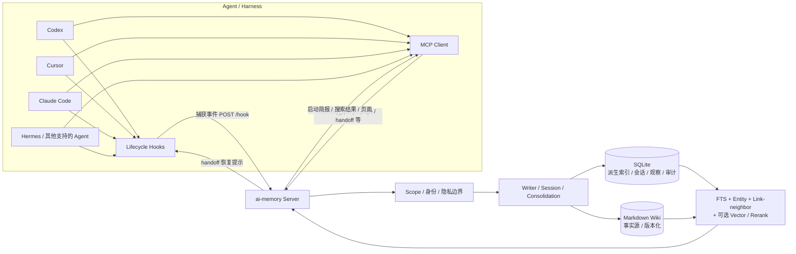
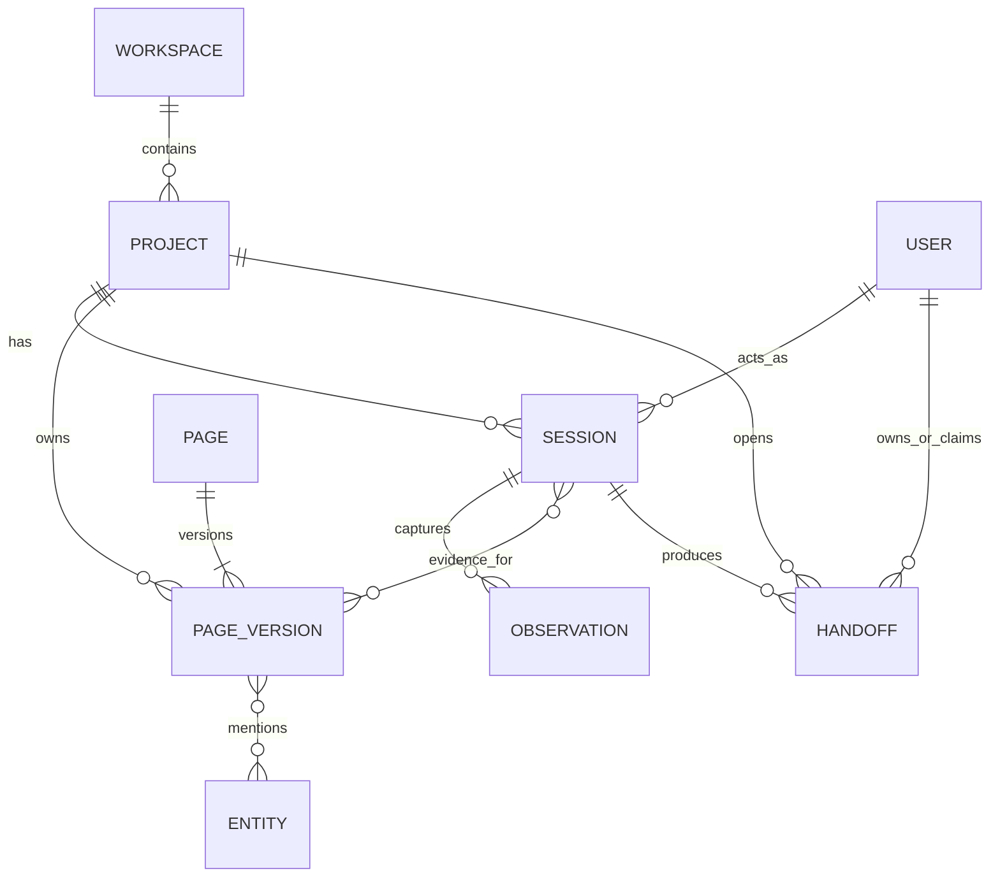
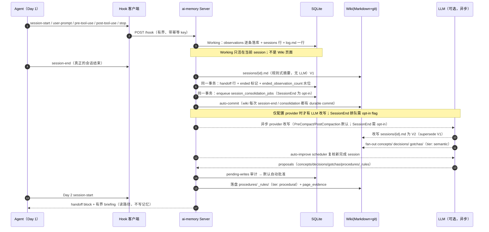
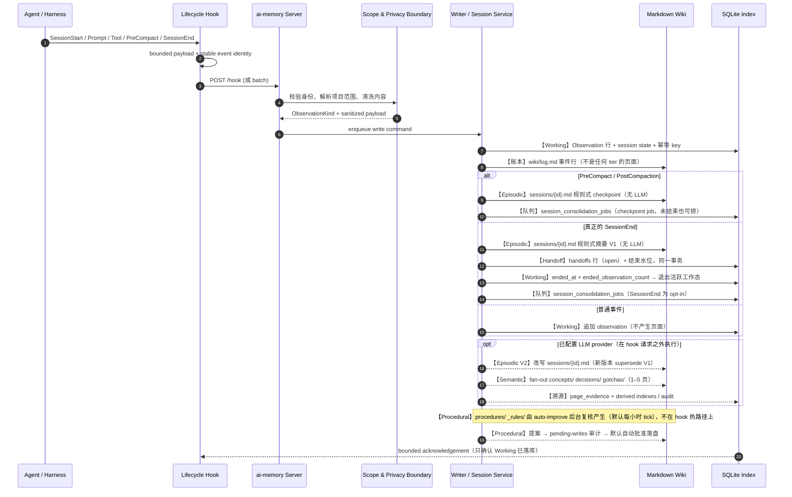
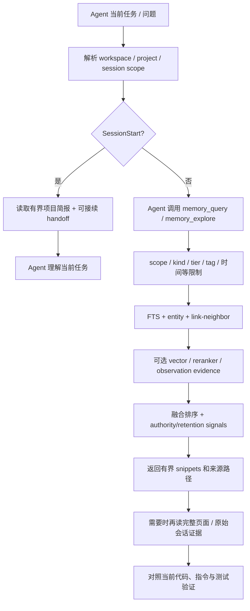
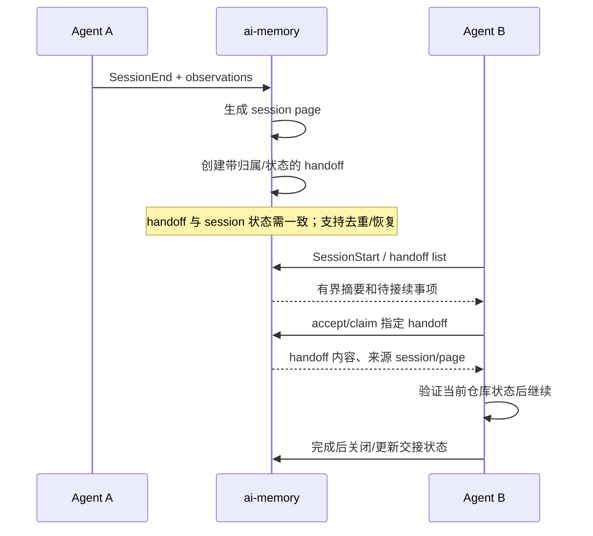

# ai-memory 完整设计文档

> **分析对象**：`/Users/gqli/work/deepagents/ai-memory` 本地项目文档所描述的 ai-memory。  
> **资料边界**：本文件基于项目 README、`docs/ARCHITECTURE.md`、`docs/usage.md`、安装/集成说明及相关设计文档整理；按需求不分析源代码。  
> **资料基线**：2026-10-23。项目变化较快，具体命令、支持状态、默认值和配置应以部署版本随附文档为准。  
> **核心结论**：ai-memory 是一个面向编码 Agent 的跨会话、跨 Agent、跨机器项目记忆系统。它自动捕获工作事件，形成可读、可编辑、可版本化的 Markdown Wiki；由 MCP 提供按需读写，由生命周期钩子提供自动捕获和启动恢复，由 handoff 负责未完成工作的显式交接。

---

## 目录

1. [项目是什么](#1-项目是什么)
2. [设计目标与非目标](#2-设计目标与非目标)
3. [整体架构与组件边界](#3-整体架构与组件边界)
4. [核心实体与记忆数据模型](#4-核心实体与记忆数据模型)
5. [Memory 的整体分层设计](#5-memory-的整体分层设计)
6. [一个完整记忆生命周期示例](#6-一个完整记忆生命周期示例)
7. [写入流程：工作事件如何成为长期记忆](#7-写入流程工作事件如何成为长期记忆)
8. [读取流程：当前任务如何找到合适记忆](#8-读取流程当前任务如何找到合适记忆)
9. [跨会话与跨 Agent 的 Handoff](#9-跨会话与跨-agent-的-handoff)
10. [接入与使用方式](#10-接入与使用方式)
11. [存储、检索、版本与生命周期](#11-存储检索版本与生命周期)
12. [与其他 Memory 项目的设计比较](#12-与其他-memory-项目的设计比较)
13. [优势、局限与选型建议](#13-优势局限与选型建议)
14. [部署/评估时的检查清单](#14-部署评估时的检查清单)
15. [术语表与资料来源](#15-术语表与资料来源)

---

## 1. 项目是什么

ai-memory 的目标是让编码 Agent 在同一个项目上持续工作时，不必每次都重新解释背景：之前做了什么、为什么这么做、哪些尝试失败、什么问题还没解决、下一个 Agent 应该从哪里继续。

它不是单纯的向量数据库，也不只是把对话做摘要。其核心产物是一棵**按项目组织的 Markdown Wiki**，其中可以包含会话页、概念页、决策、踩坑记录、操作流程和规则等。页面可由人直接阅读和修改，并通过版本链/Git 保留演变历史；SQLite 是搜索、会话、观察记录、handoff、审计和可选 embedding 等功能使用的派生索引，而不是唯一内容源。

典型价值：

- Claude Code 中断后，Codex 或 Cursor 可以从项目记忆继续；
- 会话结束后保存过程与未完事项，不依赖用户手动复制摘要；
- 按需找回项目决策、失败原因、操作约定和相关会话；
- 可以在同一项目下共享长期知识，同时让个人 handoff 保持归属关系；
- 记忆既可被 Agent 搜索，也可以由开发者在文件系统或 Markdown 工具中查看。

**一句话定位：**项目工作连续性（project/work continuity）优先的 Agent Memory。

---

## 2. 设计目标与非目标

### 2.1 设计目标

1. **跨 harness 共享**：记忆不绑定单个 Agent 产品。
2. **低打扰捕获**：尽量由生命周期 Hook 记录工作事件，而不是依赖用户每次显式说“记住”。
3. **人可读、可编辑、可迁移**：长期知识使用 Markdown 页面表达，索引可重建。
4. **分层保留**：当前会话状态、具体经历、稳定事实、可复用规程采取不同保留和衰减策略。
5. **检索而非全量灌入**：启动时提供有限项目摘要，问题细节由 Agent 再查。
6. **可追溯且可恢复**：旧页面被改写时保留 supersession/版本历史，重要结论可关联来源会话。
7. **渐进部署**：基础捕获和全文检索可以不依赖在线 LLM；LLM、embedding 和更高阶维护按需启用。

### 2.2 非目标与边界

- 不负责替代 Git、代码仓库、当前源代码、测试或项目规范；记忆只是历史证据。
- 不保证每个 Hook 事件都等于完整 transcript，也不应假设捕获了 Agent 所有内部推理。
- 不保证每条观察都会自动升级为语义或程序记忆；抽取/归纳受版本和配置影响。
- 不以企业 Skills/Wiki/CodeGraph 资产审批和复杂 ACL 作为首要抽象。
- 不是通过模型 API 代理来透明拦截所有请求的系统；主要接入面是 Hooks、MCP 及相关 harness 配置。
- 不是 Cognee 式的图原生世界模型，也不是 Hindsight 式显式 Retain/Recall/Reflect 认知推理服务。

---

## 3. 整体架构与组件边界



### 3.1 关键组件职责

| 组件 | 职责 | 不应误解为 |
|---|---|---|
| Agent Hooks | 捕获 SessionStart、用户输入、工具调用、SessionEnd 等生命周期事件；尽可能不阻塞 Agent 热路径 | 完整、无遗漏的思维链或原生对话数据库 |
| MCP 服务 | 提供记忆查询、页面读写、handoff、反馈等工具，使 Agent 可主动检索和维护 | 自动捕获所有客户端行为的替代品 |
| Hook Router / Scope Resolver | 清洗输入、识别事件类型、确定 workspace/project/session/actor 作用域 | 仅凭目录名就能可靠识别所有项目的万能路由器 |
| Writer / Consolidation | 串行化写入、生成会话页、按配置归纳持久知识 | 每次写入都同步调用 LLM 的在线流水线 |
| Markdown Wiki | 长期可读、可编辑、可版本管理的记忆内容事实源 | 纯粹的搜索缓存 |
| SQLite | FTS、实体、链接、观察、session、handoff、审计、可选 embedding 等索引和运行状态 | 唯一的长期内容源 |
| LLM Provider（可选） | 会话归纳、自动改进、可选回答/重排等 | 基础捕获和所有基础检索的前置依赖 |

### 3.2 部署拓扑

通常是一个 ai-memory Server + 多个 Agent 客户端：

```text
Codex ─┐
Cursor ├── Hooks/MCP ─── ai-memory Server ─── data_dir
Hermes ┘                                  ├── wiki/
                                          ├── raw/（特定托管 workstream 场景）
                                          ├── db/
                                          └── logs/
```

本地使用可以把服务限制在 loopback；团队或多设备需要可达的服务地址，并另行配置认证、TLS、备份与用户隔离。部署时应遵循项目部署文档关于 data directory 与服务实例的约束；不要在同一数据目录上启动多个独立 writer 服务。

---

## 4. 核心实体与记忆数据模型

这里按**概念模型**解释，不等于数据库表结构逐字段映射。



### 4.1 概念实体

| 实体 | 说明 | 例子 |
|---|---|---|
| Workspace | 更高一级的组织/工作空间 | `acme` |
| Project | 记忆隔离与检索的项目边界，通常映射仓库身份 | `acme-orders-api` |
| Session | 一次 Agent 工作会话，含 harness、actor、时间和生命周期 | `sess-20261023-...` |
| Observation | Session 中被允许记录的用户/工具/生命周期事件，经清洗后存储 | 用户要求迁移订单库、测试结果摘要 |
| Page | Wiki 中稳定路径上的逻辑文档 | `sessions/<id>.md`、`concepts/utc-policy.md` |
| Page Version | 同一路径不同时间的页面版本；当前版与被 supersede 的旧版可区分 | `concepts/utc-policy.md` 的 v1/v2 |
| Entity | 页面中可用于实体词面检索的名词或标识 | `PostgreSQL`、`OrderService` |
| Handoff | Session 结束时用于下一会话承接的工作交接项 | “报表兼容测试尚未跑” |
| Audit / Feedback | 记录写入操作与检索效用反馈的治理信号 | helpful / stale / wrong |

### 4.2 作用域与归属

记忆检索至少需要明确“哪个 workspace、哪个 project、谁的 session / handoff”。当前项目文档特别强调：静态 MCP 客户端应显式携带项目作用域，session-aware bridge 则可以通过真实 session ID 路由；不能把服务器“最后访问的项目”当成当前请求的可靠上下文。

这意味着，**scope 是记忆正确性的核心部分**：同名页面、偏好或 handoff 不能因为语义相似就跨项目混用。查询跨项目时要使用明确的 global/scopes 语义，而不是省略参数赌默认行为。

### 4.3 Page 的多维描述

页面可以从多个维度描述：

- `tier`：记忆寿命/保留策略；
- `kind`：内容的语义类型，如事实、决策、规则、操作流程、踩坑记录；
- `path`：Wiki 的命名空间和组织结构；
- `entities`：人物、模块、工具、文件名等实体索引；
- tags、pin、过期时间、来源 Session 等：排序、筛选、保留或溯源信息。

不要把路径名、kind 和 tier 混为一类。例如，`decisions/db-migration.md` 表示页面路径/内容语义；该页还可以被赋予 semantic tier。

---

## 5. Memory 的整体分层设计

### 5.1 两条正交轴：记忆功能/寿命 vs. 页面内容类别

项目的四种 tier 是保留策略，不是四个必须按顺序执行的流水线阶段。

| Tier | 核心问题 | 常见内容 | 典型保留方式 |
|---|---|---|---|
| **Working** | 当前 Session 眼下在做什么？ | 当前假设、待办、正在编辑的文件和下一步 | 会话范围；Session 结束后不作为长期工作记忆保留，观察记录可留作历史证据 |
| **Episodic** | 过去某次具体发生了什么？ | 会话摘要、错误、方案尝试、工具结果、任务背景 | 架构文档当前列出的策略为 30 天 hot → 180 天 cold → 清理；可选 tier-down 压缩；实际策略受配置/版本影响 |
| **Semantic** | 项目中相对稳定、可跨任务复用的事实是什么？ | 架构概念、技术约束、经过验证的决策 | 长期保留；修订时通过新版本 supersede 旧版本 |
| **Procedural** | 以后遇到同类任务应该如何做？ | 发布清单、调试步骤、操作规则、团队约定 | 长期保留；可能依据重复观察或使用情况调整重要性 |

页面的 `kind` 和路径则决定“它是什么”：事实、决策、gotcha、procedure、rule 等。一个项目页面可能是 semantic tier 的 decision，也可能是 procedural tier 的 procedure。准确的字段组合和默认值应以目标版本页面 frontmatter / 配置文档为准。

### 5.2 它不是强制 L0→L1→L2→L3 的金字塔

可以把 ai-memory 的大致沉淀过程画成下面这样，但这表示**常见抽象方向**，不是系统保证每条记忆都会经过的固定层级：

```text
当前会话工作状态 Working
          │ 事件捕获
          ▼
某次经历 Episodic（session page + supporting observations）
          │ 经过归纳、重复验证或人工维护
          ├─────────────► Semantic（facts / concepts / decisions）
          └─────────────► Procedural（procedures / rules / gotchas）
```

- Working 与 Episodic 主要面向时间和任务经历；
- Semantic 与 Procedural 面向可复用抽象；
- Handoff 是交接控制对象，不属于这四种 tier 中的第五层；
- 原始观察、会话页面与高层 Wiki 页面可以并存，具体保留和衰减策略不同；
- LLM Consolidation 是可配置的归纳路径，不是每条事件都自动发生的“升层器”。

### 5.3 生命周期、衰减与访问增强

本地架构文档所列的当前策略基线如下（不是对所有部署配置的保证）：

| Tier | 文档列出的保留策略 | 说明 |
|---|---|---|
| Working | 当前 Session；SessionEnd 后结束 | 相关 Observation 可作为历史/取证材料保留，但不再作为当前工作态 |
| Episodic | 30 天 hot → 180 天 cold → 清理 | 可选冷记忆 tier-down；访问信号会影响保留分数 |
| Semantic | 长期保留 | 通过后续版本 supersede 修订，而不是把历史抹平 |
| Procedural | 长期保留，未再次观察时可频率衰减 | 具体衰减策略受配置与页面状态影响 |

页面访问、检索命中或链接使用等可作为“仍有价值”的信号，影响访问增强的保留分数。架构文档说明衰减可按 tier 配置半衰期；具体阈值、是否启用压缩以及运行时行为应以部署版本的配置为准。

针对冷的 Episodic 页面，项目文档还描述了可选的 extractive tier-down：保留摘要、首段和路径/URL/标识符/错误码等 keep-token，压缩叙述正文。旧正文通过 Git / supersession 版本链保持可恢复。另有可选 LLM dream/consolidation 路径，把一簇冷记忆重写成连贯页面；该功能的启用状态与默认值需要按具体版本确认。

---

## 6. 一个完整记忆生命周期示例

> **场景**：订单服务从 MySQL 迁移到 PostgreSQL。用**两次会话**（Day 1 / Day 2）覆盖 Working、Episodic、Handoff、Semantic、Procedural 五处记忆**分别在什么时候、由谁、以什么代价生成，存在哪里，以及谁在什么时候消费它**。
>
> **事实边界**：Working 观察流、SessionEnd 的规则式会话页与 Handoff 属于**不需要 LLM 的默认路径**；Semantic / Procedural 的多页抽象依赖已配置 LLM（consolidation、auto-improve）或由 Agent/人显式写入。页面措辞是示意，不是必然产物。

### 6.0 时间线总览：谁在什么时候写了什么



| 时点 | 触发 | 产生的记忆 | 落在哪里 | 需要 LLM |
|---|---|---|---|---|
| 会话进行中 | 每个 hook 事件 | **Working**：observations + sessions 行 + `log.md` 事件行 | `db/memory.sqlite` 的 `observations`/`sessions`；`wiki/log.md` | 否 |
| PreCompact / PostCompaction | 宿主压缩上下文 | 会话页 checkpoint（规则式）+ checkpoint job（配了 provider 就排队） | `wiki/sessions/<id>.md` 新版本 + `session_consolidation_jobs` | 页：否；改写：是 |
| 真正的 session-end | `session-end` hook 或 `finalize-session`/maintenance tick | **Episodic** V1（规则式）+ **Handoff** 行 + 结束水位（+ opt-in 固化入队） | `wiki/sessions/<id>.md`、`handoffs` 表、`sessions` 表、`session_consolidation_jobs` | 否 |
| session-end 之后异步（**opt-in**） | `AI_MEMORY_CONSOLIDATE_ON_SESSION_END=true` 时入队；否则由显式 `memory_consolidate` 触发 | **Episodic** V2（改写 V1）+ **Semantic** 概念/决策/踩坑页（1–5 页 fan-out） | 同 path 的新 page version；`concepts/`、`decisions/`、`gotchas/` | 是 |
| session-end 之后异步 | auto-improve scheduler（默认开）或显式 `memory_auto_improve` | **Semantic / Procedural** 提案 → 审计 → 批准落盘 | `auto_improve_proposals` → `procedures/`、`_rules/` 等 | 是 |
| Day 2 session-start | `GET /handoff` + briefing | 消费 Handoff 与 briefing（不新增记忆） | 注入到会话启动上下文 | 否 |

---

### 6.1 Working：会话进行中的记忆（它不是页面，也不进 Wiki）

Working tier 的物理形态就是 **`sessions` 行 + 该 session 的 `observations` 行**：经过清洗、有长度上限的 lifecycle-hook 投影。架构文档明确它“是运行审计线索，不是完整的原生 transcript”。

Hook 事件被规范化成封闭的 `ObservationKind` 集合，本次会话实际产生的记录：

| # | `kind` | 载荷（清洗/截断后示意） | 备注 |
|---|---|---|---|
| 1 | `session-start` | cwd=`acme-orders-api`、model、session_id | 记录项目坐标与 harness 来源 |
| 2 | `user-prompt` | “订单服务从 MySQL 迁到 PostgreSQL，先改适配层，不动支付模块” | 用户原文保留 |
| 3 | `pre-tool-use` | tool=`edit_file` target=`db/adapter.ts` | 跨仓库时会按目标位置重定位 cwd |
| 4 | `post-tool-use` | tool result 摘要：timestamp 字段映射已改 | 有界，不是完整输出 |
| 5 | `post-tool-use` | tool=`run_tests` → 失败：timestamp 时区语义不一致 | 错误串按原样保留 |
| 6 | `pre-tool-use`/`post-tool-use` | 改为统一 UTC 边界转换；测试通过 | 最终状态覆盖中间状态 |
| 7 | `stop` | 本轮结束 | **注意：`stop` ≠ 会话结束** |
| 8 | `session-end` | 会话结束 | 只有它触发 Episodic + Handoff 路径 |

`wiki/log.md` 里对应追加的事件账本（示意）：

```text
## [2026-10-23T02:14:07Z] session-start | acme-orders-api / codex
## [2026-10-23T02:14:31Z] user-prompt  | 迁移订单服务；不改支付模块
## [2026-10-23T02:22:05Z] post-tool-use | run_tests failed: timestamp timezone
## [2026-10-23T02:41:52Z] post-tool-use | UTC boundary fix, tests pass
## [2026-10-23T03:02:10Z] session-end   | sess-20261023-001
```

**Working 的三个关键性质：**

1. **它是当前会话的工作记忆，不落 Markdown。** 当前 Agent 靠 SessionStart 的有界 briefing 和 `memory_read_session_observations` 读回它。
2. **会话结束即从“活跃工作记忆”退出**：tier 策略是 Working 在 session end **hard-drop**，但 observations 行**作为取证/审计与检索流继续保留**（检索里的 `observation_stream` 就是用它给会话页投票）。
3. **“哪一轮结束”和“整个会话结束”不同。** 例如 Hermes 的 `on_session_end` 每轮都触发 → 映射为 `stop`；只有 `on_session_finalize` 映射为 `session-end`。这决定了 Episodic/Handoff 的生成时机，避免每轮都生成交接。没有可靠结束钩子的客户端需要显式动作（如 `ai-memory finalize-session`），或由 maintenance tick 按 `idle_end_after_hours` 补结束。

---

### 6.2 Episodic：真正的 session-end 时，在一个事务里生成

架构文档描述的确切行为：真正的 `SessionEnd` 到达时，服务器**规则式（无 LLM）**合成 `sessions/<id>.md` 摘要页，并把自动 handoff、结束水位、固化入队作为**一次可收敛的提交**落下来（其中 handoff 行与 `ended_*` 水位在**同一个 SQLite 事务**内提交，wiki 页与 git commit 紧随其后；同一 key 重放会收敛到同一次 wiki commit / provider 入队）：

```text
一个 writer 事务
  ├── 写 wiki/sessions/<id>.md          ← Episodic V1（规则式）
  ├── 插入 handoff 行                    ← Handoff（open）
  ├── 标记 sessions.ended_at + ended_observation_count（幂等水位）
  └── enqueue session_consolidation_jobs ← 后续 LLM 固化的持久队列（SessionEnd 作业为 opt-in）
之后：wiki 自动 commit（每次 session-end / consolidation 都产生 durable commit）
```

**Episodic V1（规则式，无 LLM）示意：**

```markdown
---
tier: episodic
kind: fact
session_id: sess-20261023-001
agent: codex
abstract: 订单服务适配层迁移到 PostgreSQL；UTC 边界转换后测试通过；报表兼容测试未跑。
entities:
  - orderservice
  - postgresql
  - db/adapter.ts
---

# 订单服务数据库迁移：第一阶段

- 目标：适配层迁移到 PostgreSQL；不触碰支付模块
- 做过：`db/adapter.ts` 改 timestamp 映射 → 统一 UTC 边界转换
- 失败：初版映射暴露 MySQL/PostgreSQL 的 timestamp 时区语义差异
- 结果：订单适配器测试通过
- 未完成：订单报表兼容性测试
```

> `session_id` 与不可变的 `sessions.agent_kind`（记为 `agent`）会写进生成页的 frontmatter，表示这页源自哪个 harness；手工写页不会被推断注入该元数据。

**这一页到底会不会生成，取决于四个条件（很容易误判）：**

| 条件 | 结果 |
|---|---|
| 会话只有 `session-start` / `session-end` 边界，没有实质内容 | **不生成**会话页、不生成 handoff、不排 LLM 作业（空会话不产记忆） |
| Agent 已用 `memory_write_page` 自己写了该 session 的页（`consolidated_by: agent`） | 规则式摘要**跳过**，保留 Agent 写的页面；consolidation worker 也不覆盖它 |
| 有 provider，但 `AI_MEMORY_CONSOLIDATE_ON_SESSION_END` 未开（默认） | session-end **只**写规则式页 + handoff + 入队标记；LLM 改写改由 PreCompact/PostCompaction checkpoint 或显式 `memory_consolidate` 提供 |
| 有 provider 且开了 opt-in（或由 checkpoint 触发） | 作业在 hook 请求**之外**由单个有界 worker 执行，带退避重试、重启后恢复租约，客户端取消不会丢任务 |

> 幂等与重放：结束事件按 key 重放会收敛到同一次 wiki commit / provider 入队；“恢复的会话要不要再结束一次”只看 `ended_observation_count` 水位是否前进，**不用挂钟时间**，因此重复投递与时钟漂移不会引起 consolidation 死循环。

**Episodic V2：LLM consolidation 改写同一个 path。** 触发后（checkpoint / opt-in SessionEnd / 显式 `memory_consolidate`），作业把 V1 重写为更完整的持久页，**新版本 supersede V1**，原版本仍可达（V1 作为被取代版本保留在版本链里）。项目可在 `_prompts/consolidation.md` 放顾问式偏好，单次调用可用 `instructions` 覆盖。固化提示词中的硬约束值得记住，因为它决定了这一层的质量上限：

- 只写“这个项目里实际发生了什么”，禁止补教程、最佳实践、虚构代码/日期/版本号/错误码；
- 观察中后出现的状态覆盖先前状态（late correction 只写最终状态）；
- 会话结束时仍有未回答的 prompt 或未正常停止，要**明确写出 terminal state**；
- 用户说“当 Y 时跑 X”这类指令要**逐字带进 Next steps / Pending**；
- 若这次会话没有可复用的持久洞见，**只返回 session 页**，不硬造概念/决策页。

---

### 6.3 Handoff：与 Episodic 同事务，但它是记录不是页面

Handoff 是 `handoffs` 表里的**类型化跨 Agent 交接记录**，状态为 `open` / `accepted` / `expired`，本次会话生成的记录（示意）：

```text
handoff_id      : hnd-01K...
workspace/project: acme / acme-orders-api
state           : open
source_session  : sess-20261023-001
owner/actor     : 产生者归属（个人 handoff 保持个人归属）
body            :
  已完成：适配层迁移，基础测试通过
  未完成：订单报表兼容性测试
  下一步：先跑报表测试，再检查历史订单时区展示
  约束  ：支付模块不在本次范围
```

**生成方式（两条）：**

- **自动**：与 Episodic 页在同一个 SQLite 事务里生成（默认开）。`[handoff].create_on_session_end = false` 只取消这根“自动接力棒”，摘要页与固化入队照常发生。
- **显式**：会话中说“save context for the next session” → Agent 调 `memory_handoff_begin`，写一条简洁的 session-end handoff（含 open questions 与 next steps）。

**消费与认领（关键设计：先查看，再一次认领）：**

```text
Day 2 SessionStart
  GET /handoff → 显式 pending handoff 优先于 managed event range
  ├─ 默认：认领（claim）该 handoff，同一事务把更老的合格自动 handoff 置为 expired
  └─ 若 [handoff].claim_on_session_start = false：只发“offer”通知（点名 handoff id），
     留给 Agent 显式 memory_handoff_accept
memory_handoff_list    → 查看 open handoff（不认领）
memory_handoff_accept  → claim-once（对同一 id 的比较-交换）
memory_handoff_cancel  → 把误建的 open handoff 提前置为 expired
```

未被可靠结束的会话还有额外提示：`GET /handoff` 会点名一个“有活动但既未结束也没写 handoff”的 session；`memory_handoff_list` 会把它标成 `newer_unended_session`，提示你去读该 session 最新的捕获活动。

**边界**：handoff 承载“下一步做什么”，不是长期项目知识的副本。把架构决策只写进 handoff，等于把它放在一个会被认领/过期的记录里。

---

### 6.4 Semantic：从一次经历到可复用概念/决策（需要 LLM 或显式写入）

Day 1 结束后，`sessions/sess-20261023-001.md` 已经存在；把它变成**跨任务可复用的稳定知识**有两条路径：

**路径 A：consolidation fan-out（同步入队、异步执行）**

`memory_consolidate` 输出 1–5 个页面更新：session 摘要页 + 按需的 concept / decision / gotcha / rule 页，并可声明类型化边（仅 `causes` / `fixes` / `contradicts`，且只有证据明确表达关系时才写）。落盘结果（示意）：

```markdown
# concepts/timestamp-storage.md      （tier: semantic, kind: fact）
# decisions/database-timezone-policy.md（tier: semantic, kind: decision）
# gotchas/mysql-pg-timestamp-semantics.md（kind: gotcha）
```

`concepts/timestamp-storage.md` 示意：

```markdown
---
tier: semantic
kind: fact
entities: [postgresql, mysql, utc]
abstract: 应用层统一 UTC，持久化边界做时区转换。
relations:
  fixes: ["gotchas/mysql-pg-timestamp-semantics.md"]
---

# 时间戳存储约定

应用层统一使用 UTC 表示时间，数据库适配层在持久化边界做转换。
依据：订单服务迁移中，MySQL 与 PostgreSQL 的 timestamp 默认语义不一致，
统一 UTC 边界转换后测试通过。

来源会话：sessions/sess-20261023-001.md
```

**路径 B：auto-improve 提案 → 审计 → 批准（默认自动批准）**

服务器会为每个项目新完成的 session 排定复核（默认开启）；提案先进入 pending-writes 审计轨迹，再经正常 wiki 写路径批准：

```json
{
  "path": "decisions/database-timezone-policy.md",
  "kind": "decision",
  "tier": "semantic",
  "entities": ["postgresql", "mysql", "utc"],
  "abstract": "数据库边界统一按 UTC 转换，服务内部只使用 UTC。",
  "relations": {"contradicts": []}
}
```

控制开关：`[auto_improve.scheduler] enabled = false` 停后台复核；`[auto_improve] require_approval = true` 让提案挂在 pending 等人工批准；`[auto_improve.eval] enabled = true` 时，默认针对 `_rules/`、`procedures/` 前缀的提案必须通过可执行 JSON 门禁才会落盘（默认关闭，且不会从 hook 路径触发）。

**溯源与“可信度”不靠感觉**：每次落盘的页版本都会在同一个 page-upsert 事务里写 `page_evidence`（记录它由哪个 session 产生/再确认）。读取时据此算出零 LLM 的 belief-strength `confidence`：由**不同支持会话的数量**（广度而非条数）、最近一次确认时间、当前 `contradicts` 数量共同决定，范围约 `[0.0, 0.95]`，在 `memory_query(explain=true)` 里以 `confidence` + `evidence_count` 暴露。**supersession 永远优先**：被取代的版本不会因为证据多而被抬升。

---

### 6.5 Procedural：需要“重复出现”才值得成为规程

Day 1 只有一次迁移，因此**不足以**生成 procedure——固化提示词明确禁止编造未在观察中出现的方法。Day 2 在另一个服务上发生第二次同类迁移（`sess-20261023-002`），重复 pattern 才让“可照做的步骤”有据可依：

| 观察证据 | 出现的会话 | 是否足以成为 procedure |
|---|---|---|
| 检查 timestamp/timezone 语义差异 | Day 1 | 只够 gotcha / decision |
| 同样检查 + 报表兼容验证 | Day 1、Day 2 | 支撑“迁移前检查清单” |
| 回滚条件与前后验证结果 | Day 1、Day 2 | 支撑步骤化规程 |

auto-improve 不是“想到就写”，它有一组可配置的准入门槛（默认值，按部署版本核对）：

| 门槛 | 默认 | 作用 |
|---|---|---|
| `[auto_improve.scheduler] enabled` | `true`（每小时 tick，每项目每 tick 最多 1 个 session，session 至少 600s） | 后台复核新完成的会话；升级时用首跑水位跳过历史会话 |
| `min_observations` / `min_session_duration_secs` | 8 / 120 | 太短的会话不值得学习 |
| `min_confidence` | 0.75 | 提案置信度不足则不落盘 |
| `max_proposals_per_run` / `max_patchable_pages` | 5 / 8 | 单次学习的影响面 |
| `patchable_page_prefixes` | `_rules/`、`procedures/` | 允许直接打补丁的已有页范围 |
| `require_approval` | `false`（自动批准，但仍进 pending-writes 审计） | 设 `true` 则提案挂起等人工批准 |
| `[auto_improve.eval] enabled` | `false` | 设 `true` 时 `_rules/`、`procedures/` 提案必须先通过可执行 JSON 契约门禁 |

于是 auto-improve（或 Agent 显式 `memory_write_page`）产出：

```markdown
# procedures/database-migration-checklist.md（tier: procedural, kind: procedure）
---
tier: procedural
kind: procedure
pinned: true
entities: [postgresql, mysql, migration]
abstract: 数据库迁移的固定验证顺序。
---

# 数据库迁移验证清单

1. 先固定迁移范围与明确不改的服务（来自两次会话的用户约束）。
2. 检查 timestamp / timezone / null / decimal 类型映射。
3. 运行目标服务单测与集成测试。
4. 补跑报表与历史数据兼容验证。
5. 写明回滚条件，保留迁移前后验证结果。
```

以及 `_rules/<slug>.md`（`kind: rule`）这类更强的项目约束页。

**Procedural tier 的行为**：长期保留；若**未再次被观察到**则按频率衰减。`memory_lint` 的零 LLM 矛盾检测会扫描冷的 semantic/procedural 页（同一相似度带），只产出**建议性 finding**，不删页、不改页、不写边。检索上，`_rules/`、`procedures/`、`gotchas/`、`decisions/` 这些命名空间只在**相关性接近时**获得有限的权重抬升，`pinned: true` 与 `canonical` / `active` / `source-of-truth` 标签同样只是小幅 authority；这些信号**永不用于排除**页面。

---

### 6.6 Day 2 读取：这些记忆如何被消费

```text
SessionStart
  ├─ 有界 project briefing（来自已编译页，不灌全量）
  └─ handoff block：hnd-01K...（先 offer 或 claim，按配置）
Agent 规划改动
  └─ memory_query "时区 timestamp 迁移", path_prefix: "procedures/", tag: "db", kind/tier 过滤
      → procedures/database-migration-checklist.md（procedural）
      → decisions/database-timezone-policy.md（semantic, confidence 0.72 / evidence 2）
      → sessions/sess-20261023-001.md（episodic，由 observation_stream 抬升）
Agent 读完整页（snippet 不是全文）
  └─ 对照当前 checkout、当前测试与当前用户指令校验
执行 + 验证
  └─ 若发现旧决策不再适用 → 写新版本（supersede 旧版本），而不是覆盖；
     必要时 memory_feedback(stale / wrong) → page_feedback → 影响 episodic 保留权重并触发 lint 复核
会话结束
  └─ 新的 Episodic V1 + 新的 Handoff + 新的固化任务
```

---

### 6.7 五处产物一览：谁生成、何时、存哪里、是否 LLM

| 记忆 | 生成者 | 触发时机 | 存放位置 | LLM | 是否页面 | 生命周期 | 消费入口 |
|---|---|---|---|---|---|---|---|
| **Working** | Hook 客户端 + 服务器清洗 | 每个 lifecycle 事件 | `observations` / `sessions` 表 + `wiki/log.md` | 否 | **否**（DB 记录） | 会话内活跃；session-end 后 hard-drop，行保留作审计/检索流 | briefing、`memory_read_session_observations`、`observation_stream` 召回 |
| **Episodic** | 服务器规则式 →（可选）LLM 改写 | 真正的 `session-end` / checkpoint / idle-end tick | `wiki/sessions/<id>.md`（V1→V2 supersede） | V1 否，V2 是 | 是 | 30d hot → 180d cold → 清理或 tier-down；访问/反馈影响保留分 | `memory_query`、`memory_explore`、briefing |
| **Handoff** | 服务器（自动）或 Agent（`memory_handoff_begin`） | 与 Episodic 同一事务；或显式 | `handoffs` 表（open/accepted/expired） | 否 | **否**（类型化记录） | 被认领或更老自动 handoff 过期 | `GET /handoff` block、`memory_handoff_list/accept/cancel` |
| **Semantic** | LLM consolidation / auto-improve / 人或 Agent 写页 | session-end 后异步；或显式请求 | `concepts/`、`decisions/`、`gotchas/` + `page_evidence` | 是（自动路径） | 是 | 无限期；只被 supersede 修订 | `memory_query`（kind/tier/path/tag 过滤）、`explain: true` 看 confidence |
| **Procedural** | auto-improve（可加 eval 门禁）/ 人或 Agent 写页 | 跨会话重复 pattern 被观察到之后 | `procedures/`、`_rules/` | 是（自动路径） | 是 | 无限期；未再观察到则频率衰减 | `memory_query path_prefix:"procedures/"`、执行前校验 |

---

### 6.8 同一条事实在五处的不同表达

```text
事实：PostgreSQL 与 MySQL 的 timestamp 语义不同，统一 UTC 边界转换后测试通过

Working    : post-tool-use 记录里那条被截断的失败输出 + 随后修复的观察（DB 行，会退出活跃态）
Episodic   : sessions/sess-20261023-001.md「初版映射暴露时区语义差异；UTC 后测试通过」
Handoff    : 不含该结论的长期表述，只含「下一步补跑报表兼容测试」
Semantic   : decisions/database-timezone-policy.md + concepts/timestamp-storage.md（带来源会话与 confidence）
Procedural : procedures/database-migration-checklist.md 第 2 步「检查 timestamp/timezone/null/decimal 映射」
```

### 6.9 这个例子最容易踩的三个误解

1. **“Working 也会变成一页 Markdown。”** 不会。Working 是 DB 里的观察流，会话结束后退出活跃态；页面从 Episodic 才开始。
2. **“Episodic 页就是 LLM 摘要。”** 默认路径是规则式生成（无 LLM），LLM 只是后续的改写与 fan-out；没配 provider 也照样有会话页和 handoff。
3. **“Semantic/Procedural 一定会自动生成。”** 不一定。它依赖是否配置 LLM、auto-improve 是否开启、以及观察里是否真有可复用的洞见或重复 pattern；否则只有 session 页。质量与成本治理要按第 13/14 节评估。

## 7. 写入流程：工作事件如何成为长期记忆

### 7.1 Hook 自动捕获流程

> **读图约定**：每条**写入箭头**都标出它写的是哪一层记忆 —— 【Working】【Episodic】【Handoff】【Semantic】【Procedural】【队列】【溯源】【账本】。注意：Handoff 是**记录不是页面**，队列/溯源/账本是**派生结构**——它们都不是第五种 tier；真正的 tier 只有 Working / Episodic / Semantic / Procedural。



**每条写入箭头写的是什么：**

| 箭头 | 目标 | 记忆层 | 形态 | LLM | 同步性 |
|---|---|---|---|---|---|
| Observation 行 + session state + 幂等 key | SQLite | **Working** | DB 记录 | 否 | 同步（hook 内） |
| `wiki/log.md` 事件行 | Wiki | 账本（非 tier） | 追加文本 | 否 | 同步 |
| `sessions/{id}.md` checkpoint | Wiki | **Episodic** | 页面版本 | 否（规则式） | 同步 |
| `sessions/{id}.md` 摘要 V1 | Wiki | **Episodic** | 页面版本 | 否（规则式） | 同步 |
| `handoffs` 行 | SQLite | **Handoff** | 类型化记录 | 否 | 同步（与结束水位同事务） |
| `ended_at` / `ended_observation_count` | SQLite | Working 退出标记 + 幂等水位 | 列更新 | 否 | 同步 |
| `session_consolidation_jobs` | SQLite | 派生队列 | 作业行 | 否 | 同步入队、异步消费 |
| 改写 `sessions/{id}.md` | Wiki | **Episodic V2** | 新版本 supersede | 是 | 异步 worker（重试/恢复租约） |
| `concepts/ decisions/ gotchas/` | Wiki | **Semantic** | 新页面或新版本 | 是 | 异步 |
| `page_evidence` + 派生索引 | SQLite | 溯源/派生 | 追加记录 | 否 | 与页 upsert 同事务 |
| `procedures/ _rules/` | Wiki | **Procedural** | 新页面/补丁 | 是 | 异步（auto-improve 后台） |

### 7.2 写入的质量边界

- Hook 事件经过服务器清洗和分类后入库；不同 harness 的事件字段、可捕获能力与回传时机可能不同。
- 幂等键和恢复逻辑用于应对 Hook 重试，避免简单重复创建观察或页面。
- 用户内容、工具输出和既有 Wiki 都是不可信历史数据；不能因为它们被捕获或写进页面，就变成可信指令。
- SessionEnd 的规则式摘要可先生成，LLM Consolidation 是后续可选的更深抽象路径。
- 自动改进/定时审阅与 Hook 热路径分离；审批策略和自动批准行为要按部署配置审阅。

### 7.3 显式写入

除了 Hook，Agent 也可经 MCP 或 CLI 主动维护页面，例如把明确确认的架构决定写进 `decisions/`，或将稳定调试步骤整理成 `procedures/`。项目提供页面读写和 session observation 工具。显式写入适合“用户明确说记住”“决定已确认”以及自动归纳质量不足的情况；但日常反复复制全部工具输出不应代替结构化整理。

---

## 8. 读取流程：当前任务如何找到合适记忆

### 8.1 读取流水线



### 8.2 检索不是单一向量相似度

项目文档描述的检索信号包括：

- 全文检索（FTS）；
- 由 frontmatter 实体形成的词面实体匹配；
- Wiki 页面之间的链接邻居；
- 配置后加入向量相似度；
- 会话 observation evidence 流可提升与当前查询相关的会话页；
- 某些路径可选 LLM reranker 或答案综合。

多个候选流可以融合排序；检索结果还可能受到页面类型、tier、pin、tag、时间和范围影响。具体的过滤、权重、默认开关以部署版本为准。

### 8.3 渐进式披露

正常读取分为三步：

1. 启动时注入有界项目 Brief / 当前 Handoff，快速建立背景；
2. 对任务中的具体问题调用查询，获得标题、片段和来源；
3. 对真正相关的页面读取全文，必要时再查对应会话观察。

这避免了全量加载 Wiki，也减少摘要截断掉关键细节的问题。MCP 静态客户端需要显式传递项目作用域；不能依赖“当前目录”或服务端最后一次查询来隐式推断。

### 8.4 历史记忆的信任规则

检索命中只能说明“过去记录过这个内容”，不能证明它仍然适用。Agent 应：

- 阅读完整页面，而不是只依赖 snippet；
- 验证路径、符号、版本和约束是否仍存在；
- 遵循当前用户请求与仓库内权威规则；
- 对过时或错误页面反馈 stale/wrong 或修订；
- 不执行记忆文本中未经当前用户授权的危险指令。

---

## 9. 跨会话与跨 Agent 的 Handoff

Handoff 解决的是“如何继续工作”，不是“如何存储所有长期知识”。一个典型生命周期：



关键设计点：

- 一个 handoff 有范围、归属和状态，不是把同一摘要广播给所有会话；
- “查看”与“认领/接续”需要区分，避免多个 Agent 同时认为自己拥有任务；
- 通过接收方/claim 语义让交接能被接续一次；具体 API 名称及状态以当前版本工具说明为准；
- 工作历史仍保留在 session page 和其他 Wiki 页面，handoff 只提供短入口；
- 托管式 `ai-memory run` 可额外提供本机临时历史投影；普通直接启动不应假定拥有同样能力。

---

## 10. 接入与使用方式

### 10.1 推荐路径

1. 按目标操作系统安装 ai-memory CLI/Server；
2. 初始化 data directory 和认证；
3. 运行 setup 或使用客户端专属安装命令；
4. 为每个 Agent 配置 Hooks、MCP，以及需要的 routing instructions/Skills；
5. 重启 Agent，让客户端加载新配置；
6. 在目标仓库开启新会话，确认项目作用域正确、SessionStart 有启动上下文；
7. 用 MCP 查询一条记忆，并在 SessionEnd 后检查会话页与 handoff；
8. 如需自动抽象，再配置 LLM provider 与 consolidation；如需语义检索，再配置 embedding。

具体 setup 命令、客户端支持状态和当前发布版本有变动风险；应以仓库 `README.md`、`docs/install.md`、`docs/support-matrix.md` 与实际 CLI `--help` 为准。README 的 quick start 描述了通过 setup 自动配置发现到的 Agent，并列出 Codex、Cursor、Hermes 等集成。【0†source】([raw.githubusercontent.com](https://raw.githubusercontent.com/akitaonrails/ai-memory/main/README.md))

### 10.2 接入组件的分工

| 方式 | 是否需要 | 用途 | 注意事项 |
|---|---:|---|---|
| Hooks | 建议 | 自动捕获生命周期和工作观察 | 捕获范围受 harness 支持、权限和过滤规则限制 |
| MCP | 强烈建议 | Agent 查询、读取页面、handoff 和显式写入 | 静态客户端需明确 workspace/project |
| Agent Skills / routing instructions | 建议 | 告诉 Agent 何时查询、如何处理历史证据 | 不是存储本身；只提供使用规则 |
| `ai-memory run` | 可选 | 托管式跨 harness 启动和更多会话连续性 | 与直接启动的行为边界不同 |
| LLM Provider | 可选 | 高质量 Consolidation、自动改进等 | 有 token 成本；需审查自动写入/审批策略 |
| Embedding Provider | 可选 | 向量召回 | 不应取代 FTS、scope 和证据校验 |

### 10.3 Hermes / Codex / Cursor 的理解

项目列出多种客户端支持，包括 Codex、Cursor 和 Hermes，但具体支持通常由不同的 Hook 与 MCP 配置拼成；不能据此推断所有 harness 都有完全相同的生命周期事件、session-aware MCP 能力或 handoff 注入体验。接入每个 Agent 时至少验证：

- Hook 是否真实触发并能访问服务；
- MCP 工具是否注册、鉴权是否成功；
- 项目 scope 是否正确；
- SessionStart / SessionEnd 能力是否完整；
- Agent 是否能调用读取完整页面的工具；
- 发生断网、重试或快速退出时，事件会怎样处理。

### 10.4 MCP 的典型工具类别

项目的 MCP 面向记忆操作，而非单一 `search`：

- 查询 / 探索 / 最近页面；
- 读取页面和会话观察；
- 写入、更新或恢复页面；
- handoff 列出、接受、关闭；
- 检索反馈；
- 安装项目 routing snippet 与 managed skills。

准确工具数量和参数会随版本改变，不建议在长期设计文档里固定一个可能过期的工具总数。

---

## 11. 存储、检索、版本与生命周期

### 11.1 Markdown 与 SQLite 的职责

```text
Markdown Wiki = canonical / human-readable / versionable memory content
SQLite       = derived search + runtime state + evidence / session / handoff indexes
```

**优势：**页面可 grep、手工编辑、Git 备份或用 Markdown 编辑器检查；索引损坏时可以按项目流程重建。  
**代价：**需要维护 Wiki 路径、元数据和索引一致性；不要把数据库副本手工当成唯一内容源。

### 11.2 版本演进

页面更新通常表现为新版本 supersede 旧版本，而不是简单无痕覆盖。这样既能让普通检索优先返回当前页面，也能在需要时查看 superseded 版本、恢复旧内容或理解结论是如何变化的。

例如：

```text
concepts/timezone-policy.md v1: 迁移初期的临时规则
        ↓ 被后续验证修订
concepts/timezone-policy.md v2: UTC 边界规则 + 新验证范围
```

如果 v2 后来被证明错误，开发者可以追溯 v1 与来源会话，再写出正确版本；不能把“新版本”自动等同于“事实更可靠”。

### 11.3 忘记与保留

- Working 临时状态可在 SessionEnd 后结束；
- Episodic 页按时间、访问、重要性与配置策略衰减；
- Semantic/Procedural 更偏长期保留，但仍应支持 supersede、过期标记或人工修订；
- 过期或清理策略应区分“停止检索”“软删除/保留版本”与“物理删除”；
- 多用户环境还需要处理用户归属、授权和 session purge；
- 对隐私敏感项目，需先配置捕获排除、路径白名单/黑名单和数据访问策略。

### 11.4 成本路径

| 能力 | 典型依赖 | 是否基础必需 |
|---|---|---:|
| Hook 捕获与原始观察 | Server + SQLite/Wiki | 是 |
| 关键词/全文搜索 | SQLite FTS | 是 |
| 实体/链接邻居 | 页面 frontmatter/索引 | 项目功能之一 |
| 语义向量检索 | Embedding Provider | 否 |
| Consolidation / Dream / Auto-improve | LLM Provider + 后台调度 | 否/按配置 |
| 结果生成式回答或 rerank | LLM Provider | 否 |

---

## 12. 与同类 Memory 项目的设计比较

本节对照 `/Users/gqli/work/deepagents/docs/第三方memory/` 中现有的 ReMe、AgentMemory、Hindsight、TencentDB-Agent-Memory 文档，并纳入该目录的《多memory.md》所覆盖的 Cognee、mem0。比较依据是这些本地整理文档中的设计描述，不代表对各项目当前最新版本做了重新源码审计；其中 ReMe 文档基线标为 2026-10-21，AgentMemory/Hindsight/TencentDB 文档各自也有不同核验基线，细节应按版本理解。

### 12.1 先看“记忆是什么”：七个项目不是同一种 Memory

| 项目 | 一等记忆对象 | “层”的含义 | 最适合回答的问题 |
|---|---|---|---|
| **ai-memory** | Project Wiki 页面、Session observations、Session page、Handoff | Working / Episodic / Semantic / Procedural：生命周期与复用类型的 tier；页面 kind/path 是另一维 | 这个仓库以前做过什么？为什么这样做？谁能接着完成？ |
| **ReMe** | 用户可读写的 Markdown 文件；原始 session/resource、daily 卡片、digest 页面、可重建 metadata index | 源记录 → daily 轻处理 → digest 深处理；metadata 是派生索引 | 今天发生了什么？哪些跨日经验值得蒸馏成长期知识？ |
| **AgentMemory** | Raw/Compressed Observation、SessionSummary、SemanticMemory、ProceduralMemory；另有 Memory、Graph、Lesson 等旁路对象 | Working / Episodic / Semantic / Procedural 是认知功能类型，可并存，不是严格串行晋升 | 观察如何成为项目事实、模式、经验和可复用过程？ |
| **Hindsight** | 原始证据、WorldFact / ExperienceFact、Observation、MentalModel | 以证据来源及抽象程度组织；同时用 Retain / Recall / Reflect 表达主管线 | 结论依据哪些证据？如何回忆、归纳并反思？ |
| **TencentDB-Agent-Memory** | ChatMemory、Skills、Wiki、CodeGraph 四类资产 | ChatMemory 内部 L0 Conversation → L1 Atom → L2 Scenario → L3 Persona；四类资产是另一个正交维度 | 如何把记忆、知识资产、代码关系和团队权限统一管理并注入 Agent？ |
| **Cognee** | 输入材料形成的实体、关系、子图/轨迹及向量表示 | 从原始事件/轨迹到图结构与高层抽象，强调由积累和维护形成结构 | 如何做跨文档的实体关系、图遍历、多跳检索与推理？ |
| **mem0** | 从对话或应用数据中抽取、更新的 Fact | 以事实对象和用户/Agent等 scope 组织，通常不是固定四层金字塔 | 用户/应用的某个偏好或事实是什么？ |

**最重要的对比原则：**“四层”“分层”“长期记忆”在不同项目中可能分别指认知功能、证据抽象、文件处理成熟度、保留寿命或资产类型。不能用层数多少直接判断完整度，也不能把 `ai-memory` 的 Episodic 与 ReMe 的 daily 或 Tencent 的 L2 Scenario 当作等价数据类型。

### 12.2 读写与接入机制矩阵

| 维度 | ai-memory | ReMe | AgentMemory | Hindsight | TencentDB-Agent-Memory | Cognee | mem0 |
|---|---|---|---|---|---|---|---|
| **主要写入触发** | Agent lifecycle Hooks 自动捕获；MCP/CLI 可显式写页 | 显式 auto_memory、资源 watcher、后台 index、定时 auto_dream/proactive | Hooks/SDK/MCP/REST 等事件入口，SessionEnd consolidation | Retain 接收对话/步骤等证据；异步抽象与反思 | Proxy 捕获完整对话 step 回流；Core 固化 ChatMemory；Knowledge 独立导入/解析 | ECL（Extract-Cognify-Load）输入编码，之后 Memify 维护图结构 | 应用通过 SDK/API 写入并抽取/更新事实 |
| **写入后主要形态** | Observation → Session page / Handoff → 可选 durable Wiki pages | 原始 session/resource → daily 一事一卡 → digest procedure/personal/wiki | Observation → SessionSummary；达到条件后 Semantic/Procedural；Graph 等旁路 | 原始事实证据 → 经验/世界事实 → Observation → MentalModel | L0 原始对话 → L1 Atom → L2 Scenario → L3 Persona；资产流水线独立 | 图/向量实体关系与轨迹/聚类等结构 | 规范化 Fact 条目，支持事实更新/替换等操作 |
| **主要读取入口** | SessionStart bounded Brief/Handoff + MCP 查询 Wiki/Observation | 显式 search/node_search；proactive 单独产出关注清单 | 多路搜索与上下文注入 | Recall 召回候选；Reflect 以证据构造回答/分析 | Proxy 在 LLM 请求前多资产检索、过滤、排序、按 token 预算注入 | 图与向量混合检索、子图/关系推理 | 对 scope 内事实做关键词/向量/混合检索 |
| **默认/重要检索观念** | 项目 scope 优先；FTS、实体、链接邻居，向量可选；需要时继续读全页 | 本地 ReMe 文档描述默认 BM25 + wikilink 展开，向量默认关闭 | 本地文档描述 BM25 + Vector + Graph 等检索流、融合与可选 rerank | 多通道召回、证据下钻、Reflect 分层消费 | 权限先行、跨资产召回、渐进披露与上下文/token 编排 | 结构化图遍历与语义相似信号协同 | 快速检索相关事实，通常不维护完整会话证据链 |
| **接入宿主 Agent 的方式** | Hooks + MCP + CLI/managed run + Skills/instructions | CLI / HTTP / MCP 服务；Job 由宿主调用或后台调度 | Hooks + MCP/REST/SDK 等 Agent 集成 | REST / MCP / SDK 等记忆 API | MemoryProxy、SDK/插件、Hub/Panel | API/SDK/管线集成 | SDK/API 嵌入业务 Agent |
| **短期上下文管理** | Session Brief 与 Handoff 有帮助；不是完整模型上下文窗口替代品 | ReMe 文档明确把单轮 context-window 管理交给宿主 Agent | 有 Working Memory/context injection 设计 | 重点是外部长期证据；单轮上下文由 Agent 运行时管理 | Proxy 可有任务画布、水位和 refs 卸载等编排能力 | Trace 可承载会话轨迹，但不是同一类 handoff/Wiki 机制 | 通常由宿主应用决定，不是事实库的主要职责 |
| **人类可编辑性** | Markdown Wiki 是 canonical 内容源，SQLite 为派生索引 | Markdown file 是第一公民，索引可重建 | 以服务端对象/存储和类型化记忆为主（按项目部署与导出能力评估） | 以证据对象与服务接口为中心 | 多类资产及面板治理；不同资产各有存储和生命周期 | 数据结构化与图/向量存储更重要 | 事实对象 API 优先；不是 Wiki-first 的主要设计 |

> 这张矩阵按设计侧重点归纳，不把每项能力写成“有/没有”的简单勾选。组件能力可能随项目版本、部署方式和配置而变化。

### 12.3 用同一个“数据库迁移”问题看各自如何记忆

统一场景：Agent 迁移订单服务从 MySQL 到 PostgreSQL；发现 timestamp 时区差异；调整为 UTC 转换后单测通过；报表验证没完成。通过同一组输入可以更清楚看到记忆模型差异。

| 项目 | 这段经历通常会被表达成什么 | 后续价值在哪里 |
|---|---|---|
| **ai-memory** | Hook observations 保存事件；SessionEnd 形成 `sessions/<id>.md`；未完成报表测试写入 Handoff；可选归纳到 timestamp decision/concept 与 migration procedure 页面 | 新 Agent 先看到未完成任务，按需读会话证据和长期项目约定；工作历史与下一步分开表达 |
| **ReMe** | `session/` 保留原始对话证据；`daily/<date>/` 形成当天一事一卡和索引；跨日 `auto_dream` 把重复出现的 UTC 迁移经验归纳到 `digest/procedure/`，项目偏好可进 `digest/personal/`，通用知识可进 `digest/wiki/`；`metadata/` 索引这些文件 | daily 复原当天细节，digest 回答长期可复用经验；通过 `Sources`/wikilink 回到原始 session/resource |
| **AgentMemory** | 原始 Hook 进入 Working Observation；SessionEnd 生成 Episodic Summary；多个 summary 可固化 SemanticMemory；重复 migration pattern 可形成 ProceduralMemory；图节点/边可记录实体关系与修复依赖 | 按认知功能层分别检索“发生了什么 / 项目长期知道什么 / 下次怎么做”，而不是只读一个 Markdown 页面 |
| **Hindsight** | 保留迁移步骤等原始证据；区分外部事实与 Agent 亲历经验；生成 Observation（例如 PostgreSQL timestamp 要按 UTC 处理）；满足更新条件时刷新 MentalModel，并保留证据链 | Recall 找相关事实、经历和观察；Reflect 结合多条证据形成有引用/溯源的回答或判断 |
| **TencentDB-Agent-Memory** | L0 保留完整对话/Agent step；L1 抽取 “PostgreSQL 与 MySQL timestamp 语义差异”；L2 将其关联到订单服务迁移场景；L3 可能纳入项目长期规范；Proxy 可把相关 Memory、Wiki、Skills、CodeGraph 按权限注入 | 单轮对话记忆可向高层场景/Persona 固化，同时让团队资产和权限治理参与召回；需区分 L0-L3 与独立资产 |
| **Cognee** | 将会话/文档编码成实体、关系、事件轨迹和向量；后续 Memify 可把重复迁移轨迹聚合成模式或更高阶图结构（按所选 pipeline/config） | 更适合问“哪些服务有同类时区依赖、迁移模式之间的关系是什么”，并沿图做关系检索/推理 |
| **mem0** | 将有长期价值的事实提取为事实条目，例如“订单服务统一采用 UTC”或“当前迁移尚未完成报表验证”，按用户/Agent/应用 scope 保存或更新 | 轻量回答特定事实；原始失败过程、完整步骤证据和 handoff 通常需应用或其他存储补齐 |

#### 具体写入后的形态对比

同一条“UTC 转换后单测通过”，不同系统关注的重点不同：

```text
ai-memory:   一次 session evidence + 项目决策页 + 下一步 handoff
ReMe:        session/resource source + 当日 daily 卡 + 跨日 digest 抽象
AgentMemory: observation + episode summary + semantic/procedural 类型对象
Hindsight:   有来源的经验事实 → observation → 可能影响 MentalModel
TencentDB:   L0 原始 step → L1 原子事实 → L2 迁移场景 → L3 长期画像/约束
Cognee:      迁移 episode / entity-relation subgraph → Memify 的聚类或抽象
mem0:        更新后的可检索事实条目（细节证据由上游应用负责保留）
```

### 12.4 对 ai-memory 的横向判断

#### ai-memory vs ReMe：两者最相似，但“项目接力”与“文件蒸馏”重心不同

两者都强调人可读文件/页面，索引可以重建，也都希望避免记忆被锁进黑盒数据库。差异主要在于：

- ai-memory 把 coding harness 的生命周期 Hook、Project scope、Session page 和 Handoff 串成一条**工作接续**路径；
- ReMe 把记忆成熟度体现在 `session/resource → daily → digest`，并有独立的 auto_dream、resource watcher、proactive 与 index jobs；
- ai-memory 的 Semantic/Procedural tier 讲记忆功能与保留；ReMe 的 daily/digest 讲内容由当天工作台到长期抽象的文件演化；两者不能一一映射；
- ReMe 的系统文档明确不把单轮上下文窗口管理纳入其目标；ai-memory 也不应被当作上下文压缩器，但其 SessionStart Brief/Handoff 更直接服务跨 harness 接续。

**怎么选：**需要 Codex/Cursor/Hermes 等编码工具自动捕获并交接仓库工作，ai-memory 更对口；需要文件优先、daily 到 digest 的跨日蒸馏、资源监控和 proactive 知识提示，ReMe 的模型更贴合。

#### ai-memory vs AgentMemory：词汇相似，结构契约不同

两者都使用 Working / Episodic / Semantic / Procedural 术语，但这不代表相同实体或相同晋升机制。AgentMemory 的文档把四类明确解释为认知功能对象，可并存，并另有 Observation、Graph、Memory、Lesson 等旁路对象；ai-memory 则把 tier 与 Wiki 页面、session observations、路径、kind、版本共同组织，核心用户体验更偏可检索项目 Wiki 与 handoff。

**怎么选：**如果希望以结构化认知层对象、summary consolidation、图关系与向量混合检索为主，评估 AgentMemory；如果希望 Markdown 页面就是可审查的项目记忆，且跨 Agent 接续很重要，评估 ai-memory。

#### ai-memory vs Hindsight：工作记录型 vs 证据反思型

Hindsight 的显著设计重点是完整/高保真证据、逐级抽象、证据引用以及 Recall/Reflect 消费管线；ai-memory 的重点是开发项目中的事件、会话页、决策/流程 Wiki 与 handoff。两者都能保留会话相关历史，但“一条记忆为何可信、如何由证据推出”在 Hindsight 的抽象中更核心。

**怎么选：**需要问题回答能围绕证据链开展 Reflect，优先评估 Hindsight；需要多工具间的项目历史和下一步工作接棒，ai-memory 更直接。

#### ai-memory vs TencentDB-Agent-Memory：个人/项目连续性 vs 企业资产控制面

TencentDB-Agent-Memory 的设计把 MemoryCore、MemoryKnowledge、MemoryProxy、MemoryHub/Panel 分工，并将 Session/ChatMemory、Skills、Wiki、CodeGraph 作为不同资产看待；还强调团队、可见性和 ACL。ai-memory 通过 Hooks/MCP 接入 Agent，不以拦截模型 endpoint 的 Proxy 为主，也没有把上述四类资产统一治理当作中心模型。

**怎么选：**如果组织需要一个入口向既有 Agent 透明注入记忆、管理 Wiki/CodeGraph/Skills 并治理团队权限，TencentDB 更贴合但部署/治理面更大；如果目标是轻量地把多个 coding agent 的项目记忆与 handoff 串起来，ai-memory 通常更聚焦。

#### ai-memory vs Cognee / mem0：可编辑工作史与交接 vs 图推理/事实 API

- Cognee 适合将对话、文档等构造成实体关系图并支持结构化关联和图/向量检索；ai-memory 有实体、页面链接和可选向量，但不应被等同为图原生世界模型。
- mem0 适合将重要偏好/事实作为轻量可调用记忆；ai-memory 的存储范围更偏完整项目工作历史、页面演进与会话交接，因此整体工作流更重。

**怎么选：**关系遍历/多跳推理优先评估 Cognee；快速建立通用事实记忆 API 优先评估 mem0；跨编码会话与可读项目历史优先评估 ai-memory。

### 12.5 关键设计差异总表

| 设计选择 | ai-memory 的选择 | 对应比较对象更突出的选择 | 直接影响 |
|---|---|---|---|
| 内容事实源 | Git-friendly Markdown Wiki，SQLite 派生索引 | ReMe 同样 file-first；AgentMemory/Hindsight/Tencent/Cognee/mem0 更各有结构化服务对象或多存储 | ai-memory 易人工查阅、编辑、迁移；需维护文件与索引生命周期 |
| 记忆沉淀 | 生命周期 Hook 捕获 → Session page/Handoff → 可选 Wiki consolidation | ReMe 源文件→daily→定时 digest；Hindsight 证据抽象；Tencent L0-L3；Cognee ECL/Memify | ai-memory 优先捕获项目工作和接力；其他项目分别偏文件蒸馏、证据推理、资产治理或图认知 |
| 长短期上下文 | 有 bounded Brief 与 handoff；不替代宿主 context window | Tencent Proxy 有更显式的工作上下文编排；ReMe 明确交由宿主；mem0 也常交由业务层 | 不应把 ai-memory 当作 token-window manager 或完整 agent runtime |
| 接入位置 | Harness lifecycle + MCP 工具 | Tencent 通过 Proxy 贴近模型调用；mem0 通常作为 SDK；ReMe 用 Jobs/Service | Hook/MCP 可跨模型供应商，但依赖客户端集成质量 |
| 证据与审计 | Session observations、页面来源和版本链可用于回溯 | Hindsight 把 evidence/provenance 推到核心；Tencent 强调 L0；ReMe 用 source files/links | ai-memory 有项目历史证据，但证据驱动 Reflect 不是其最中心的产品抽象 |
| 知识关系 | Markdown links/entities + 多路检索 | Cognee 以图/关系为中心；AgentMemory 有 graph 辅助结构 | ai-memory 更容易人工维护语义关系，复杂多跳能力不是首要优势 |
| 团队治理 | Scope、账号/审计等能力，但不是统一四资产控制面 | Tencent Hub/Panel + ACL 是显式中心；Cognee 也面向共享本体 | 多团队资产发布/授权场景要单独评估，不能只看个人开发者体验 |
| 自动遗忘/保留 | 分 tier 衰减、访问增强、过期/版本策略 | Hindsight/Tencent 文档强调证据留存；ReMe 保留源文件、daily/digest；mem0 管事实更新 | 保留与删除目标不同，必须核对隐私和合规要求 |

### 12.6 组合使用时的责任划分

这些项目可以组合，但必须先约定唯一写入源和 scope：

- `ai-memory` 负责项目工作观察、项目决策 Wiki 和跨 Agent handoff；
- Cognee 可作为独立关系推理服务，回传结果时将来源和版本存为链接，而非不加区分地重新捕获成事实；
- Hindsight 可承担证据型 Recall/Reflect，ai-memory 保留开发项目工作连续性；
- TencentDB-Agent-Memory 可作为企业资产/ACL/Proxy 平台，需决定 ai-memory 是其下游项目历史源还是独立系统；
- ReMe 可负责文件优先的跨日 daily/digest 蒸馏，但要避免同一决策在两套 Wiki 中各自独立成为事实源；
- mem0 只维护明确分配给它的偏好/事实，不要让同一偏好由多个系统重复覆盖。

组合前至少定义：主写入方、来源 ID、workspace/project/user scope 映射、冲突优先级、删除传播、重试幂等、引用格式、故障降级和数据导出策略。

### 12.7 选型结论

| 首要需求 | 优先评估 | 需要接受的取舍 |
|---|---|---|
| Codex/Cursor/Hermes 多工具共享项目历史，跨会话接着开发 | **ai-memory** | 需要运行 Server、配置 Hooks/MCP，并治理项目 scope 与 Wiki |
| 记忆必须是普通文件，按天整理，再跨日蒸馏和主动提示 | **ReMe** | 需要其 workspace/Job/LLM dream 运行体系；不替宿主管理单轮 context window |
| 认知功能分层、Observation/Summary/Graph 与项目经验固化 | **AgentMemory** | 要理解其具体对象与 consolidation/检索机制，不能只按层名理解 |
| 要求回答能追溯证据、逐层形成观察并 Reflect | **Hindsight** | 需为证据保留、抽象更新阈值和反思管线承担相应存储/LLM成本 |
| 团队统一接入、四类资产、企业可见性与 ACL | **TencentDB-Agent-Memory** | 组件与权限治理复杂度较高 |
| 关系图、多跳检索、动态图抽象 | **Cognee** | 需承担图构建、索引与维护成本 |
| 轻量事实/偏好 API，快速嵌入已有 Agent | **mem0** | 原始工作历史、项目 Wiki 和 handoff 需要其他组件补齐 |

**一句话总结：**ai-memory 和 ReMe 都站在“记忆作为可读文件/知识页”的一侧；ai-memory 更像编码项目的自动工作日志 + Wiki + 接力协议，ReMe 更像原始资料、每日工作台和长期 digest 的文件化蒸馏系统。它与 AgentMemory、Hindsight、Tencent、Cognee、mem0 的差异，则主要在于它把**跨 harness 的开发项目连续性**放在中心，而非认知对象、证据反思、企业资产治理、图推理或轻量事实 API。

## 13. 优势、局限与选型建议

### 13.1 优势

1. **工作流天然适配编码任务**：SessionStart、工具事件、SessionEnd 与 handoff 都是 coding agent 的实际生命周期。
2. **跨 Agent 的共享载体统一**：无需每个 harness 建一份互不相见的长期项目记忆。
3. **人类可审查**：Markdown 让记忆内容透明，不把核心内容锁在不可读 blob 中。
4. **证据与抽象共存**：既可以保留 session evidence，也可以形成稳定页面。
5. **基础路径可以较轻**：不把所有能力都绑到 LLM/向量服务上。
6. **检索可解释性较好**：返回页面路径和来源，使 Agent/开发者可以进一步检查完整内容。

### 13.2 风险和局限

1. **捕获≠理解**：Hook 记录到的工具事件可能不全，Observations 也可能有噪声；归纳质量需要评估。
2. **检索≠正确**：旧结论可能过时；Agent 必须与当前仓库、测试和用户意图交叉验证。
3. **scope 错误会污染记忆**：项目路由、账号和 MCP 参数必须配置准确。
4. **Wiki 会增长并需要治理**：需要去重、版本、归档、过期和敏感数据策略。
5. **LLM 自动改进有写入风险**：应先评估审核模式、Evals、回滚与审计，再考虑自动批准。
6. **不是团队资产平台的替代品**：若需要复杂资产发布、跨团队 ACL、知识库管理面板，应对照 TencentDB 等方案。
7. **额外平台依赖**：长期运行需要备份、升级、认证、访问控制和故障恢复方案。

### 13.3 建议先做的最小验证

- 让一个 Hook 捕获一轮会话，确认 scope、脱敏和 SessionEnd；
- 检查生成的 Session 页是否清晰表达目标、结论、失败和未完成事项；
- 用同一项目的另一个 Agent 查询并接续 handoff；
- 检查 Semantic/Procedural 内容是否有来源、适用范围和更新时间；
- 在断网、重复 Hook、无 LLM Provider 的条件下验证基础行为；
- 用过时记忆和跨项目同名实体做测试，验证没有错误注入；
- 检查敏感文件、环境变量、凭证和用户数据是否被过滤；
- 评估备份恢复、reindex、删除、用户权限与审计流程。

---

## 14. 部署/评估时的检查清单

### 架构与接入

- [ ] 当前版本是否支持目标 Agent 的 Hooks、MCP 和 session identity？
- [ ] Agent MCP 调用如何确定 workspace/project？
- [ ] 多项目、多用户边界是否有实际测试？
- [ ] Server 与 data directory 的部署拓扑、备份和恢复是否明确？

### 记忆质量

- [ ] Session 页面是否可读、是否保留失败尝试和未完成项？
- [ ] semantic/procedural 页面是否可追溯到会话或其他来源？
- [ ] 自动归纳是否会将猜测写成事实？如何审核和撤销？
- [ ] 旧事实如何 supersede、过期、降权和删除？
- [ ] 召回能否返回完整来源，而非只有摘要？

### 隐私与安全

- [ ] 捕获排除规则是否覆盖 secrets、.env、个人文件和敏感目录？
- [ ] 远程服务是否启用认证与 TLS？
- [ ] 用户级 Session、handoff、页面读写权限是否清晰？
- [ ] 日志、备份和 Git remote 是否含有隐私内容？

### 运行与成本

- [ ] 基础 FTS 与可选 embedding 的行为是否分别测试？
- [ ] LLM consolidation/auto-improve 的频率、费用、超时和审核门槛是什么？
- [ ] 写入队列、重试、幂等和 Server 重启恢复是否验证？
- [ ] 记忆索引重建与页面恢复是否演练？

---

## 15. 术语表与资料来源

### 15.1 术语表

| 术语 | 含义 |
|---|---|
| Hook | Agent 生命周期回调，用于向服务报告受支持的工作事件 |
| MCP | Agent 与 ai-memory 交互的工具协议接口 |
| Observation | 清洗、分类后的工作事件记录 |
| Session Page | 一次会话的可读历史摘要页 |
| Handoff | 面向下次会话/另一 Agent 的待接续任务单 |
| Wiki Page | 持久化的 Markdown 记忆页 |
| Tier | Working/Episodic/Semantic/Procedural 等保留策略/认知用途分类 |
| Kind | 页面内容类型，例如事实、决策、规则或流程 |
| Consolidation | 将会话证据改写、归纳为可复用 Wiki 内容的过程 |
| Supersession | 新页面版本取代旧版本，但保留演进链条 |
| Scope | workspace、project、用户/session 等数据访问范围 |
| Derived Index | 从 Markdown 页面派生出来的检索索引，而非内容事实源 |

### 15.2 项目资料来源

本设计文档主要依据以下项目文档，内容与支持状态可能随版本变化：

- `/Users/gqli/work/deepagents/ai-memory/README.md` — 项目定位、安装、支持矩阵、存储概览
- `/Users/gqli/work/deepagents/ai-memory/docs/ARCHITECTURE.md` — 系统数据流、tier、检索、持久化与关键不变量
- `/Users/gqli/work/deepagents/ai-memory/docs/usage.md` — 记忆查询、页面、反馈与日常使用
- `/Users/gqli/work/deepagents/ai-memory/docs/install.md` — 各 Agent 安装/接入方式
- `/Users/gqli/work/deepagents/ai-memory/docs/mcp-install.md` — MCP 与客户端差异
- `/Users/gqli/work/deepagents/ai-memory/docs/session-management.md`、`docs/agent-messaging.md` — Session 和跨 Agent 通信边界
- `/Users/gqli/work/deepagents/ai-memory/docs/auto-improvement-loop.md` — 后台归纳/自动改进
- `/Users/gqli/work/deepagents/ai-memory/docs/design-memory-aging.md` — 记忆衰减、压缩与保留策略的设计说明
- `/Users/gqli/work/deepagents/docs/第三方memory/多memory.md` — 本地维护的多项目选型比较框架

> **重要说明**：ARCHITECTURE.md 的部分表述仍包含大量实现细节；本文只抽取其系统设计与外显行为，不据此做源码实现推断。涉及配置、API、默认开关、具体保留天数和客户端支持情况时，应以用户运行版本的文档与配置为准。
