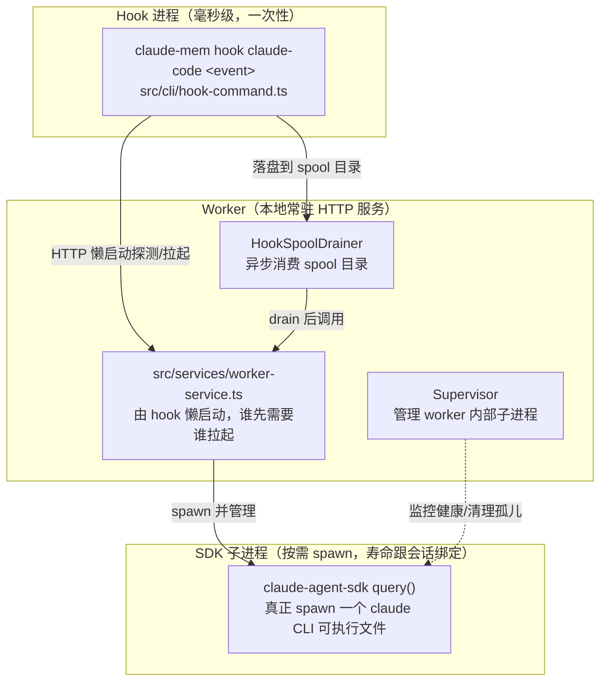
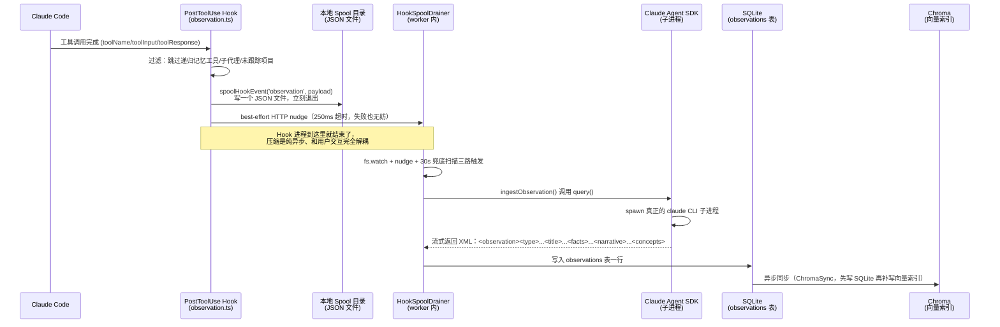
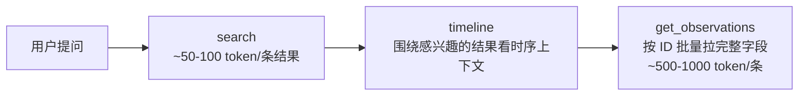

# claude-mem 设计原理文档

[claude-mem](https://github.com/thedotmack/claude-mem) 源码级整理，面向读写主流程、分层原理与架构设计，不做逐行源码解读。
核验基准：本地 `/Users/gqli/work/deepagents/claude-mem`，tag `v15.0.1-2-gbbb337902`，整理日期 2026-10-21。
调研方式：三个并行子代理分别探索 hooks 生命周期、worker 进程拓扑与 SDK 压缩、存储分层与检索流程，所有关键结论均回查过具体源码文件验证。

## 一句话

claude-mem 是一个**挂在 Claude Code 生命周期 hook 上的异步压缩管线**：每次工具调用的原始观察数据先落盘成一个"待处理文件"，一个常驻的本地 worker 进程异步把它喂给 Claude Agent SDK 子进程压缩成结构化的 Markdown-like XML 记录，存进 SQLite；SQLite 是唯一权威源，Chroma 向量库只是一份可以随时整体重建的派生语义索引。整条链路的核心哲学是**hook 永不阻塞、永不失败**——压缩可以晚几秒发生，但绝不能让记忆功能卡住用户当下的交互。

这与 ReMe 的"Memory as File, File as Memory"哲学形成有趣的对照：ReMe 把记忆做成用户能直接读写的 Markdown 文件，索引是派生物；claude-mem 则是反过来——SQLite 数据库是唯一权威源，但数据库里的字段本身在设计上模仿了结构化 Markdown 笔记的骨架（标题、小标题、事实列表、叙述段、概念标签），只是载体不是文件而是数据库行。两种设计都承认"要不要向用户/人类暴露原始存储格式"是一个设计决策，只是做出了相反的选择。

---

## 目录

- [Part I. 进程拓扑：三种角色](#part-i-进程拓扑三种角色)
- [Part II. 写入主流程：从工具调用到数据库行](#part-ii-写入主流程从工具调用到数据库行)
- [Part III. 存储分层：SQLite 是真相，Chroma 是索引](#part-iii-存储分层sqlite-是真相chroma-是索引)
- [Part IV. 检索流程：三层渐进式披露](#part-iv-检索流程三层渐进式披露)
- [Part V. 完整示例：一次调试会话的生命周期](#part-v-完整示例一次调试会话的生命周期)
- [Part VI. 关键设计思考](#part-vi-关键设计思考)

---

## Part I. 进程拓扑：三种角色

claude-mem 不是一个单一进程，而是三种生命周期完全不同的角色协作：



三种角色的职责边界：

| 角色 | 生命周期 | 由谁启动 | 做什么 |
|---|---|---|---|
| Hook 进程 | 毫秒到秒级，一次性 | Claude Code 在每个生命周期节点触发 | 归一化输入、落盘排队、HTTP "捅一下" worker，自己立刻退出 |
| Worker（常驻服务） | 长期存活（直到被回收） | 第一个需要它的 hook 进程懒启动（`ensureWorkerRunning`），带 spawn-lock 防止多个 hook 并发抢着起 | 监听本地 HTTP 端口，跑 `HookSpoolDrainer` 异步消费排队事件，调用 SDK 做压缩，读写 SQLite/Chroma，服务 MCP 检索工具 |
| SDK 子进程 | 跟一次压缩调用或一个会话绑定 | Worker 按需 `spawn`（`process-registry.ts::spawnSdkProcess`） | 真正执行 `@anthropic-ai/claude-agent-sdk` 的 `query()`，底层是一个独立的 `claude` CLI 进程，不是库内 API 调用 |

一个容易误判的地方：仓库里确实有一个 `src/server/` 目录，但它**不是**本地这套 Worker Service，而是另一条面向多租户云端部署的独立运行时（Postgres + Redis/BullMQ，由 `CLAUDE_MEM_RUNTIME` 环境变量二选一切换，`src/services/hooks/runtime-selector.ts::selectRuntime()` 负责路由）。本文档只讲默认的本地单机路径；`src/server/jobs/`、`src/server/queue/` 里的 BullMQ 队列属于云端那条分支，本地用户完全不会经过它们。

**"Supervisor"这个名字也容易误导**：`src/supervisor/index.ts` 的 `Supervisor` 类并不管理 worker 进程本身的生死——那是 hook 端 `ensureWorkerRunning()` 的职责（探测端口健康、没活着的就 `spawnDetachedWorkerDaemon`）。Supervisor 管的是 worker **进程内部**自己 fork 出来的子进程（SDK 子进程、chroma-mcp 子进程）的注册、健康检查和孤儿清理，运行在 worker 进程里，而不是在 worker 之外监控它。

Worker 挂了或还没启动时，hook 的行为是**明确的降级，不是失败**：`executeWithWorkerFallback()` 在 worker 不可达时让 hook 正常退出（exit 0），连续失败达到阈值（默认 3 次）才触发一次性的"fail loud"诊断通知告知用户记忆功能降级，但绝不阻塞用户当下的操作。

---

## Part II. 写入主流程：从工具调用到数据库行

### 六个 hook 各自的职责

Claude Code 的六个生命周期 hook，在 claude-mem 里分别映射到：

| Hook 事件 | CLI 子命令 | Handler | 职责 |
|---|---|---|---|
| SessionStart | `context` | `src/cli/handlers/context.ts` | 向 worker 请求 `/api/context/inject`，把历史记忆渲染成文本塞进 `additionalContext`——**唯一的"注入"节点** |
| UserPromptSubmit | `session-init` | `src/cli/handlers/session-init.ts` | 创建/延续 `memory_session`；可选按本次 prompt 语义做二次检索注入 |
| PreToolUse | `file-context` | `src/cli/handlers/file-context.ts` | 针对 Read/Bash/Grep/Glob 等工具的前置上下文增强，不涉及观察生成 |
| PostToolUse（含失败态） | `observation` | `src/cli/handlers/observation.ts` | **观察管线的起点**：把一次工具调用的输入输出落盘排队 |
| Stop | `summarize` | `src/cli/handlers/summarize.ts` | 取"最后一条 assistant 消息"（不是整段 transcript）生成会话级总结，并顺带抓 advisor 工具调用 |
| SessionEnd | `session-end` | `src/cli/handlers/session-end.ts` | 落盘一个 `session_end` 事件，收尾 |

### PostToolUse 到数据库行的完整链路

这是整条写入流程里最核心、也最体现设计哲学的一段。时序图：



几个值得展开的细节：

**Spool 文件的去重设计**。`src/shared/hook-spool.ts` 的文档注释直接写明了设计意图：文件名本身就是确定性的去重键——`<kind>-<key>.json`，key 是会话+平台的哈希再接 `tool_use_id`。一次事件被重复投递（比如 hook 重试）只会覆盖同一个文件，不会产生两份，也不需要 hook 端扫描目录判断是否已存在。这避免了"两个 hook 进程并发写同一个事件，产生竞态"的问题，在 Windows 这种文件系统行为更保守的平台上也成立。

**压缩 Prompt 喂的是什么**。`src/sdk/prompts.ts::buildObservationPrompt` 组装的是结构化字段（`tool_name` / `tool_input` / `tool_output` / `cwd`），不是整段原始对话 transcript。模型被要求只能回复符合 XML 骨架的结构化内容：

```text
<observation>
  <type>[ decision | bugfix | feature | refactor | discovery | change ]</type>
  <title>...</title>
  <subtitle>...</subtitle>
  <facts>...</facts>
  <narrative>...</narrative>
  <concepts>...</concepts>
</observation>
```

Prompt 原文甚至写了很强硬的约束："Never reply with an empty response, or with prose... Only `<observation>` blocks or the `<skip_summary />` sentinel complete this tool use; anything else is asked again once, then discarded." 也就是说模型只有两种合法输出：产出一到多个 `<observation>` 块，或者显式声明"这次工具调用没有记忆价值，跳过"。这个约束存在的原因很直接——如果放任模型自由回复，解析层就要处理无穷多种不规范格式；把输出空间收紧到一个严格的 XML 骨架加一个哨兵值，解析器（`ResponseProcessor.ts`）就能做确定性校验。

**Stop hook 和 PostToolUse 的分工不同**。PostToolUse 逐条产出 observation（细粒度，一次工具调用一条）；Stop 只负责生成一条会话级总结（`session_summaries` 表，字段是 `request/investigated/learned/completed/next_steps`，是完全独立的另一张表，不是 observation 的汇总视图）。两者在 schema 层面就是分开的，没有"总结表派生自观察表"的耦合关系。

**一个意外的旁路：claude-mem 会顺手吃掉 Claude Code 自带的记忆文件**。`src/services/memory/ingest.ts` 会把 Claude Code 原生的 `~/.claude/projects/<cwd>/memory/*.md`（也就是 Claude Code 自己的 auto-memory 蒸馏产物）直接存进同一张 observations 表，代码注释写明是"mechanical store, zero model spend"——完全不经过 SDK 压缩，是机械存储。这意味着 claude-mem 的"记忆"实际上有两个源头：自己通过 hook 捕获并压缩的观察，和顺带吸收的 Claude Code 原生记忆文件。

---

## Part III. 存储分层：SQLite 是真相，Chroma 是索引

### observations 表的核心字段

权威定义在 `src/services/sqlite/types.ts` 的 `ObservationRow`：

```text
id, memory_session_id, project, text, type,
title, subtitle, facts(JSON), narrative, concepts(JSON),
files_read(JSON), files_modified(JSON),
prompt_number, discovery_tokens, created_at, created_at_epoch,
content_hash, generated_by_model, agent_type, agent_id,
reinforcement_dates(JSON), last_reinforced,
sync_rev, synced_at, origin_device_id
```

这组字段就是前面那段 XML 压缩结果的落地形态：`title`/`subtitle`/`facts`/`narrative`/`concepts` 对应 SDK 吐出的 XML 标签，`content_hash` 用于去重判断，`reinforcement_dates`/`last_reinforced` 支撑强化排序（见下文），`sync_rev`/`synced_at`/`origin_device_id` 支撑跨设备云同步。

### Chroma：完全可丢弃、宁可整体重建不维护脏数据

这是整个存储设计里最鲜明的一条原则。`src/services/sync/ChromaSync.ts` 把每条 observation 按字段拆成多个 Chroma 文档（narrative、text、每条 fact 各一个文档），每个文档的 `metadata.sqlite_id` 回指 SQLite 主键。当 Chroma 的 HNSW 索引段损坏时，处理方式不是修复，而是**直接删除整个 collection，从 SQLite 全量重建**——代码注释直白地写着"the collection is dropped and rebuilt from SQLite, the source of truth"。日常运行中还有一个持续对账循环（`bootstrapWatermarksFromChroma` / `ensureBackfilled`）：以 SQLite 的行 id 作为水位线，把 Chroma 里缺失的行异步补写进去，写入顺序永远是"先写 SQLite、再异步同步到 Chroma"，只有确认 Chroma 侧写入成功才推进水位线，否则标记待重试。

这个设计的取舍很清楚：**不接受"双写但允许暂时不一致"的脆弱状态**。向量索引可以暂时落后，也可以整体报废重建，但绝不允许成为第二份权威数据——这和一些系统里"向量库和关系库各自存一份、靠应用层保证最终一致"的做法不同，claude-mem 选择了更简单但更保守的单向数据流。

### dedup：基于标题 TF-IDF 的轻量启发式，不是语义去重

`src/services/dedup/nearDuplicate.ts` 把去重分成两档，两档都是确定性规则，不涉及任何向量相似度：

- **Tier-0「exact」**：标题归一化后完全相等，直接**静默自动合并**。
- **Tier-1「candidate」**：IDF 加权余弦相似度超过阈值，且不触发"IDF 否决"（某个双方差异 token 的 IDF 过高说明这不是改写而是真的不同内容），标记为去重候选——但**从不静默合并**，留给人工审核或未来的 LLM 裁决。

代码注释说明了为什么不用更"聪明"的语义去重：在真实的 7651 条观察数据库上验证过，基于叙述正文做 simhash 的方案"假阳性泛滥"（useless），而 IDF-余弦加否决机制能准确区分"真的是同一件事的改写"和"标题相似但内容不同"。这是一个经过数据验证后反直觉的选择——更复杂的语义方法未必比带否决机制的词频统计更可靠，尤其是在"错误合并=数据丢失"这种不可逆代价的场景下，宁可用更简单、更可解释、更容易预测失败模式的方法。

### reinforcement：ACT-R 幂律衰减，而非置信度分数

`src/services/reinforcement/` 实现的不是"置信度"或"权重"，而是认知科学 ACT-R 架构里的幂律衰减强度模型（代码注释明确标注来源）。每条 observation 维护一个 `reinforcement_dates` 列表（最近 10 次命中的日期，FIFO 裁剪），强度按 `age^-0.5` 的幂律衰减公式计算——越近期被重新印证的记忆强度越高，但不是线性遗忘，而是符合人类记忆的幂律曲线。这套机制完全是 embedding-free 的：不依赖向量相似度判断"这是不是同一件事被再次提起"，只依赖日期序列的统计。排序时，被反复确认的记忆会比单纯"时间新"的记忆更优先浮出。

---

## Part IV. 检索流程：三层渐进式披露

### MCP 工具的三层设计

`search` → `timeline` → `get_observations` 不是三个互相独立的工具，而是刻意设计的渐进式检索协议——`src/server/mcp/recall-mcp-server.ts` 里工具描述文本本身写得很直白："inspect timeline around selected IDs, then get_observations only for needed details"。意图是强迫调用方先看紧凑索引再决定要不要拉全文，省 token：



### search：Chroma 主导、SQLite 兜底的主备切换，不是 RRF 融合

这是一个和直觉不同的地方。很多系统把"混合检索"理解为"BM25 和向量各召回一批，再用 RRF 之类的方法按排名融合分数"（ReMe 就是这么做的，见 ReMe 设计文档 Part III）。claude-mem 的 `SearchOrchestrator`（`src/services/worker/search/SearchOrchestrator.ts`）走的是不同的策略：

1. 没有查询词、只有过滤条件 → 直接走 SQLite/FTS5。
2. 有查询词且 Chroma 可用 → **先且只用** Chroma 做语义检索；代码注释解释了为什么不是简单的"任一类别为空就兜底"：Chroma 的检索是"跨所有文档类型的单次 top-N 查询"，一个请求的类别（比如 observations）即使有匹配，也可能被另一个类别（比如 prompts）挤出结果——所以要先看"这个类别是不是真的空"，而不是看"总的结果数够不够"。
3. 对于 Chroma **返回结果为空的那些类别**，才去查 SQLite 补充；如果请求的所有类别都是空的，才整体回退到纯 SQLite。
4. Chroma 整体未启用（配置关闭）→ 直接走 SQLite/FTS5。

也就是说，默认路径里语义检索优先，关键词检索只是"对语义检索遗漏类别的兜底补充"，而不是两路结果按分数融合排序。代码注释里专门提到一个真实场景：CJK（中日韩）查询下，prompts 类别可能挤占 observations 类别的召回名额，导致 observations 类别即使有真实匹配也拿不到结果——这是"主备切换、分类别补洞"这个设计要专门解决的问题。

### timeline：跨 session 的纯时间窗口，不是会话内上下文

另一个和直觉不同的地方：`timeline` 工具不是"这次会话里前后发生了什么"，而是纯粹的时间戳范围查询（`getTimelineAroundObservation` / `getTimelineAroundTimestamp`）。先定位一个锚点时间（可以是某条 observation 的时间，也可以是任意时间戳），再用 `created_at_epoch` 向前向后各取若干条记录——不按 `session_id` 做 JOIN 聚合。换句话说，timeline 关心的是"这段时间前后，不管是哪次会话，发生了什么"，可以跨越多个 session 边界。

### get_observations：唯一返回完整字段的阶段

按 ID 批量精确查询，是三层里唯一返回 `facts`/`narrative`/`concepts` 等完整字段的阶段——`search` 和 `timeline` 都只返回够做筛选判断的紧凑摘要。

---

## Part V. 完整示例：一次调试会话的生命周期

构造一个具体场景，跟踪数据从 hook 事件到数据库行、再到下次会话被注入的完整形态变化。场景：用户在 Claude Code 里排查一个认证 bug。

### 步骤 1：UserPromptSubmit

用户发消息："线上登录接口偶发 401，帮我查一下。" 触发 `session-init` hook，创建一条 `memory_session` 记录，`user_prompts` 表新增一行存这条原始 prompt。

### 步骤 2：PreToolUse + PostToolUse（工具调用阶段）

Claude 调用 `Grep` 搜索认证相关代码，`PreToolUse` 触发 `file-context` 做前置增强（不产生记忆）。工具执行完毕，`PostToolUse` 触发 `observation` handler：

```json
{
  "contentSessionId": "sess-abc123",
  "platformSource": "claude-code",
  "toolName": "Grep",
  "toolInput": { "pattern": "validateToken", "path": "src/auth/" },
  "toolResponse": "src/auth/jwt.ts:42: export function validateToken(...)",
  "cwd": "/home/user/project"
}
```

这个 payload 被 `spoolHookEvent` 写成文件 `observation-<hash>.json` 落在本地 spool 目录，hook 进程立刻退出。Worker 的 `HookSpoolDrainer` 被 nudge（或下一次 fs.watch 事件、或 30 秒兜底扫描）触发，取出这个文件，调用 `ingestObservation()`。

### 步骤 3：SDK 压缩

Worker 组装 `buildObservationPrompt`，spawn 一个 `claude` CLI 子进程执行压缩。假设模型判断这次 Grep 调用有记忆价值（定位到了一个可疑的 token 校验函数），返回：

```xml
<observation>
  <type>discovery</type>
  <title>Found validateToken in src/auth/jwt.ts</title>
  <subtitle>Candidate location for intermittent 401 bug</subtitle>
  <facts>
    - validateToken defined at src/auth/jwt.ts:42
    - Called from middleware on every authenticated request
  </facts>
  <narrative>While investigating intermittent 401s, located the JWT validation
  entry point. Next step is checking token expiry handling for race conditions.</narrative>
  <concepts>jwt, authentication, 401, token-validation</concepts>
</observation>
```

Worker 解析这段 XML（`ResponseProcessor.ts`），写入 `observations` 表一行，字段对应前面描述的 `title`/`subtitle`/`facts`/`narrative`/`concepts`。写入成功后，`ChromaSync` 异步把 `narrative`、`facts` 的每一条拆成独立的 Chroma 文档，`metadata.sqlite_id` 回指这一行的主键。

### 步骤 4：继续排查，Stop 阶段生成总结

假设后续又产生了几条类似的 observation（检查了 token 过期逻辑、发现了一个时钟偏移问题）。会话结束时，`Stop` hook 触发 `summarize`，取最后一条 assistant 消息生成会话级总结，写入独立的 `session_summaries` 表：

```text
request:      排查线上登录接口偶发 401
investigated: JWT 校验逻辑、token 过期时间处理
learned:      时钟偏移超过 5 秒会导致校验失败，服务器间 NTP 同步存在漂移
completed:     定位根因
next_steps:   给 token 校验加一个时钟容差（clock skew tolerance）
```

### 步骤 5：几天后，新会话的 SessionStart 注入

用户开了一个新会话，提到"继续看那个 401 的问题"。`SessionStart` hook 触发 `context` handler，向 worker 请求 `/api/context/inject`。Worker 的 `ContextBuilder` 从 SQLite 里取出相关的历史 observation 和 session summary（受 `ContextBudget` 的字符数上限约束，约 1 万字符），渲染成一段文本，作为 `additionalContext` 注入这次会话——Claude 在还没看到用户完整追问之前，就已经知道"上次查到是 JWT 校验在 jwt.ts:42，根因可能是时钟偏移"。

### 步骤 6：用户主动检索

假如用户问"之前查过哪些跟 token 有关的问题"，Claude 调用 MCP 的 `search(query="token validation", type="discovery")`。因为有查询词且 Chroma 已启用，`SearchOrchestrator` 先用 Chroma 做语义检索，命中前面那条 observation 的紧凑索引（约 50-100 token）；如果用户进一步问"那次排查前后还做了什么"，Claude 调用 `timeline`，以那条 observation 的时间戳为锚点，向前向后各取几条记录——可能跨越了同一个 session 内的其它工具调用，甚至前一天的另一次会话。最后如果需要完整细节，调用 `get_observations(ids=[...])` 拉出完整的 `facts`/`narrative`。

这个例子完整走过了"工具调用 → spool 排队 → 异步压缩 → SQLite 落盘 → Chroma 派生索引 → 下次会话注入 → 主动检索的三层披露"全链路。

---

## Part VI. 关键设计思考

### 1. Hook 必须"fail-open"：压缩可以晚，但交互不能卡

所有 hook handler 的异常路径最终都收敛到 exit code 0、返回一个 no-op envelope。即使 worker 完全挂掉，Claude Code 也感知不到任何失败——只在 stderr 写一行诊断、发个遥测。这个设计选择的代价是：记忆功能本身可能在用户不知情的情况下静默降级一段时间（直到失败计数触发一次性通知）。但收益是：**一个记忆插件的故障永远不会变成"用户的正常编码交互被卡住"**。这个取舍对一个"辅助性"的记忆系统是合理的——记忆丢几条观察的代价远小于让用户每次工具调用都等一个不可靠的外部服务。这与 ReMe 的能力边界声明异曲同工：两个系统都承认"记忆系统不应该成为主流程的硬依赖"，只是 claude-mem 把这个原则贯彻到了"hook 永不等待 worker 响应"的具体机制层面。

### 2. 把耗时的压缩彻底移出请求路径，用文件系统而不是内存队列做异步缓冲

PostToolUse/Stop 用"落盘文件 + nudge"而不是直接发 HTTP 请求等结果，是为了让 hook 进程能在几百毫秒内退出——Claude Code 对 hook 执行时间有严格限制。但更有意思的选择是：**排队机制是文件系统 + fs.watch，不是内存队列，也不是 SQLite 队列**。这个选择的好处是天然持久化：即使 worker 进程重启，排队中的事件也不会丢，worker 重启后的 fs.watch 或 30 秒兜底扫描会自动捡起之前没处理完的文件。配合"文件名即去重键"的设计（见 Part II），这套机制在没有引入任何额外依赖（Redis、消息队列）的情况下，达到了"至少一次投递 + 精确一次消费"的效果（SQLite 侧的 `hook_spool_consumed` 表记录已处理的 entry，防止重复摄入）。

### 3. 把模型输出空间收紧到严格 XML 骨架，用显式哨兵值代替"沉默"

压缩 Prompt 只允许两种合法输出：`<observation>` 块，或者 `<skip_summary reason="noise" />`。不允许模型用自然语言说"这次调用不重要，跳过"——那样解析层就要处理无穷多种措辞。强制用一个显式的哨兵标签表达"无记忆价值"，这件事本身成为了协议的一部分，和 harness2 文档里提到的"错误消息是 API"是同一类思考：**当下游是程序化解析而不是人类阅读时，让模型的"没有/跳过"判断也走结构化协议，而不是指望从自然语言里猜测意图**。

### 4. 去重与强化都刻意选择了"更笨但更可控"的方法

Tier-1 候选去重用 IDF 加权余弦而不是 embedding 相似度，reinforcement 用日期序列的幂律衰减而不是向量再次命中的置信度打分——两处都是经过真实数据验证后，有意避开"看起来更聪明的语义方法"。核心原因相通：这两个决策都涉及"可能导致数据静默丢失或排序结果令人困惑"的风险，而词频统计和日期序列都是可解释、可调试、失败模式可预测的方法。这是一种务实的工程判断：**在模型能力之外，有些子系统的正确性比"用不用到最新技术"更重要**，尤其是像"要不要把两条记忆合并成一条"这种不可逆操作。

### 5. 存储层选择"宁可整体重建，不维护脆弱的最终一致性"

Chroma 向量索引损坏时的处理方式是整体删除重建，不是增量修复。这与很多系统默认选择的"尽量局部修复、尽量减少重建成本"的直觉相反，但背后的理由是：**一份被当作缓存/索引使用的数据，宁可retrieve的成本偏高，也不要让它的正确性变得不可预测**。配合"先写 SQLite、确认成功才推进 Chroma 同步水位线"的单向数据流，这套设计彻底排除了"SQLite 和 Chroma 各执一词"的状态，检索时即使 Chroma 结果有缺口，也能确定缺口只会导致"这次检索暂时漏了一些能语义匹配的结果"，而不会导致"检索返回了错误的内容"。

### 6. 检索的"混合"不是对称融合，而是带着领域知识的主备切换

`SearchOrchestrator` 对 Chroma 空结果的处理专门考虑了"Chroma 是跨类型的单次 top-N 查询，某个类别可能被其它类别挤掉召回名额"这个具体的失败模式（CJK 查询下 prompts 挤占 observations 的例子）。这比"两路结果按统一公式融合"复杂，但换来的是：召回缺口被精确定位到"哪个类别缺",而不是一个笼统的"总分不够高所以没显示"。这提示一个通用的设计原则：**融合策略的复杂度应该匹配检索系统实际会出现的失败模式，而不是套用一个通用的融合公式然后假设它总是合理的**。
