# Codex 源码校准与运行时深读（2026-10-15 增补）

> 本文是在现有 `ARCHITECTURE_PART1/2/3`、`ENTITY_AND_SEQUENCES`、`SECURITY_ARCHITECTURE` 等文档之上的补充，不替换、不删除历史内容。
>
> **源码基线**：`/Users/gqli/work/deepagents/codex`，commit `b7ba02f88095cd3c039709157618c03909d47a26`。源码路径省略 `codex-rs/` 前缀，均相对于该仓库的 Rust workspace；文档证据优先于目录名和旧版叙述。
>
> **标记约定**：`[现有]` 可在当前源码定位；`[推论]` 由多个接口关系推导；`[建议]` 是后续工程方向，不代表已经实现。

## 目录

1. [本章解决什么问题](#1-本章解决什么问题)
2. [全局事实地图](#2-全局事实地图)
3. [入口与控制面](#3-入口与控制面)
4. [Thread/Session/Turn 的运行时边界](#4-threadsessionturn-的运行时边界)
5. [SQ/EQ 与请求串行化](#5-sqeq-与请求串行化)
6. [run_turn 的阶段化执行](#6-run_turn-的阶段化执行)
7. [工具、审批、沙箱与 Guardian](#7-工具审批沙箱与-guardian)
8. [上下文、压缩与不可改写历史](#8-上下文压缩与不可改写历史)
9. [持久化、Resume 与服务端恢复](#9-持久化resume-与服务端恢复)
10. [多 Agent、Hooks、Plugins 与 Code Mode](#10-多-agenthooksplugins-与-code-mode)
11. [关闭、取消、错误与背压](#11-关闭取消错误与背压)
12. [源码缺口与工程建议](#12-源码缺口与工程建议)
13. [阅读索引与验证边界](#13-阅读索引与验证边界)

## 1. 本章解决什么问题

现有文档已经详细说明了 Codex 的概念模型，但跨文档阅读时仍有四个容易误判的地方：

- **协议边界与核心边界混在一起**：`app-server` 的 JSON-RPC 连接、`core` 的 Thread 运行时、`rollout` 的持久化不是同一个循环。
- **“串行”有多个粒度**：同一 Thread 的请求串行、文件/进程资源串行、连接级关闭等待和全局并发不是一件事。
- **事件不是历史**：`EventMsg` 面向客户端，`ResponseItem` 面向模型，`RolloutItem` 面向恢复；三者存在映射但不能互换。
- **安全决策不是单一 sandbox 开关**：审批、ExecPolicy、Guardian、网络策略和 OS sandbox 共同决定一次工具执行是否能发生。

本章将这些边界放到一张后端视图中，并特别补充当前源码中容易被旧文档遮蔽的 `app-server` admission、request serialization、connection gate 与 daemon recovery。

## 2. 全局事实地图

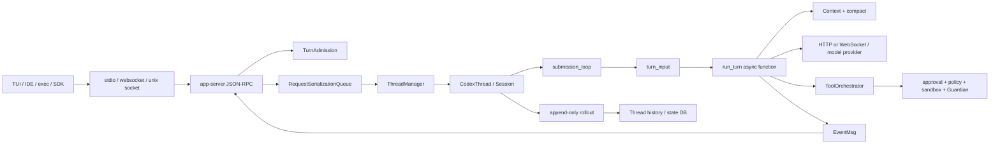

图为后端职责视图，不表示所有前端都必须走外部 socket：`app-server/src/in_process.rs` 提供进程内入口，TUI/exec 的具体装配路径需要分别追踪。Transport 具体实现主要在 `app-server-transport/src/transport/`，`app-server/src/transport.rs` 负责应用侧路由与状态。

### 2.1 分层职责表

| 层 | 代表路径 | 负责 | 不应被误认为 |
|---|---|---|---|
| Transport | `app-server-transport/src/transport/` | 连接接入、读写、认证、路由 | Agent loop |
| RPC 控制面 | `app-server/src/message_processor.rs`、`request_processors/` | JSON-RPC 参数校验、请求分发、通知 | 持久化历史 |
| Admission/并发 | `turn_admission.rs`、`request_serialization.rs`、`connection_rpc_gate.rs` | 准入、资源级串行、关闭等待 | 全局任务队列 |
| Core Thread | `core/src/codex_thread.rs`、`core/src/session/` | 一个 Thread 的运行状态 | 客户端连接 |
| Agent loop | `core/src/session/handlers.rs`、`turn.rs`、`turn_input.rs` | 输入排队、模型/工具循环 | JSON-RPC server |
| Projection | `event_mapping.rs`、protocol types | 把内部事件映射给客户端 | Rollout 原始历史 |
| Persistence | `rollout/`、`thread-store/`、`state/` | append-only 事实、索引和恢复 | 单一数据库真相 |

### 2.2 当前实现与设计叙述的读法

- `[现有]` `app-server` 使用 processor loop 与 outbound loop 分离，慢写入不会直接阻塞所有协议处理；具体连接状态和 outbound 路由见 `app-server/src/outgoing_message.rs` 与 `transport/`。
- `[现有]` `TurnAdmission` 在 shutdown drain 后拒绝新的 turn start，并以 permit 计数已准入的启动过程；它不是模型并发限制器。
- `[现有]` `RequestSerializationQueueKey` 按 Thread、路径、进程、MCP OAuth 等资源选择队列；当前 scope 映射中只有 `GlobalSharedRead` 使用共享读，其余资源 scope 使用独占访问；因此“同一连接串行”并不准确。
- `[建议]` 对外文档应把“协议并发”“Thread 并发”“工具资源并发”“服务关闭”分别命名，否则排障时会把互不相关的等待混在一起。

## 3. 入口与控制面

### 3.1 连接建立到请求执行

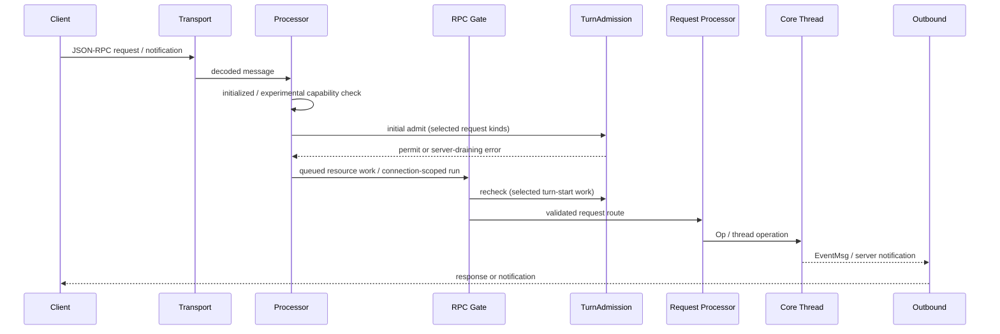

### 3.2 入站与出站的关键差异

**入站**通常是 request/notification → 参数解析 → 资源串行化 → core operation；**出站**是内部 Event/notification → connection routing → writer。出站慢、连接关闭、客户端断开和 core turn 取消有不同的生命周期，不能用一个 `await` 解释全部行为。

源码阅读入口：

```text
app-server/src/lib.rs
app-server/src/message_processor.rs
app-server/src/request_processors/
app-server/src/outgoing_message.rs
app-server/src/transport/
app-server/src/connection_rpc_gate.rs
app-server/src/connection_cleanup.rs
```

### 3.3 关键代码解读：shutdown admission

```rust
// app-server/src/turn_admission.rs（等价伪代码，省略 PoisonError 恢复）
fn try_admit(&self) -> Option<TurnPermit> {
    let mut state = self.state.lock().unwrap();
    if state.closed {
        return None;              // drain 后不再接收新的 turn
    }
    state.active += 1;
    self.active_tx.send_replace(state.active);
    Some(TurnPermit(self.clone())) // permit Drop 时递减计数
}
```

这里的设计重点不是锁本身，而是**先取得准入凭证，再让 shutdown 等待凭证归零**。它覆盖“请求已经进入启动阶段但尚未完成提交”的竞态；它不保证已经运行的模型请求立即停止，也不等同于取消 token。

### 3.4 两次准入：已经排队不代表仍可启动

`MessageProcessor::dispatch_initialized_client_request` 的顺序比抽象时序更细：

1. 检查 connection initialized 状态与 experimental capability；
2. 对需要的 request kind 取得 `TurnAdmission` permit；
3. 查询协议声明的 `serialization_scope()`；
4. 构造带 `ConnectionRpcGate` 的 queued future；
5. 某些 turn 请求在真正出队执行时**再次检查** admission；
6. 有 scope 就入对应资源队列，否则 `tokio::spawn`。

[现有] 已准入的 runtime change 可以结束正常准备；仍在队列里的 turn-start 工作必须观察 shutdown 已关闭的准入状态。原图是逻辑时序，不意味着所有请求都取得 permit。

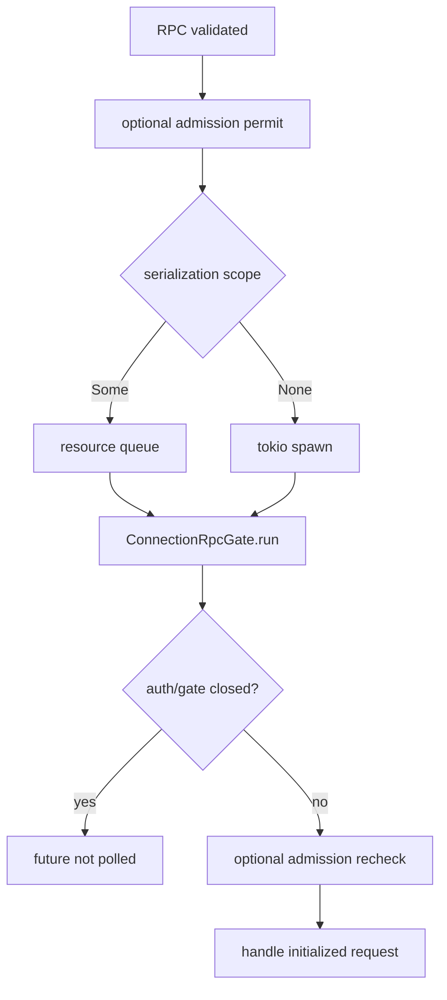

这解释了一个常见竞态：**进入排队 ≠ handler 已开始；持有 turn permit ≠ turn 已经运行**。日志应分开记录 enqueue、dequeue、gate accept、turn start。


## 4. Thread/Session/Turn 的运行时边界

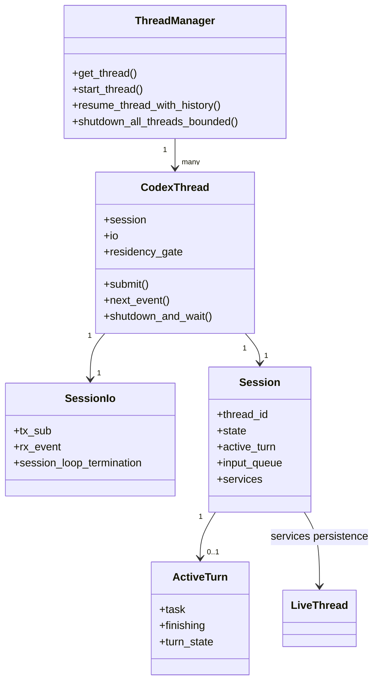

### 4.1 不变量

- **Thread**是对外稳定身份；**Session**是内存中的运行实例；**Turn**是一次用户输入到完成/失败/取消的执行；**Step**是 turn 内的一次模型/工具推进。
- 一个 Session 可以没有 ActiveTurn，也最多有一个正在执行的 ActiveTurn；这不意味着整个 app-server 只有一个 turn。
- `ThreadManager` 负责索引、创建、恢复和生命周期，不能替代 Session 内的 submission loop。
- 客户端重连不会天然等价于创建新 Thread；Resume 要依赖 rollout、ThreadStore 和协议侧的 thread identity。

### 4.2 两条循环

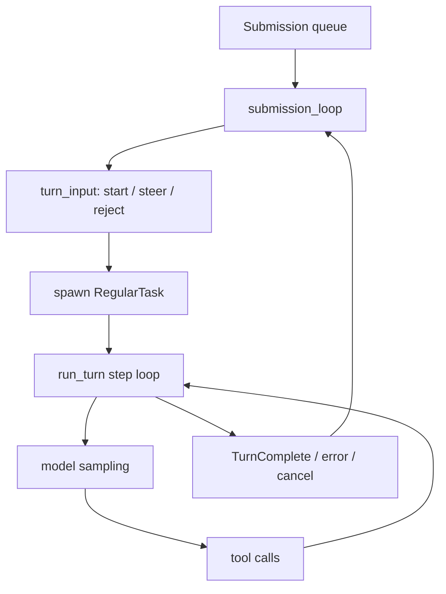

外层 loop 解决“输入如何进入 Thread、何时启动/转向/拒绝”；内层 `run_turn` 解决“上下文、采样、工具、压缩、重试和完成”。这也是为什么只读 `turn.rs` 不足以理解输入排队与取消。

### 4.3 服务依赖与可变状态必须分开读

`Session` 的 `state: Mutex<SessionState>` 与 `services: SessionServices` 承担不同职责；`input_queue`、`active_turn`、settings persistence 和 managed proxy refresh 又有独立同步点。当前源码注释明确要求 settings 持久化锁与 state 分开，避免 storage I/O 阻塞 runtime state 访问。

| 状态归属 | 源码对象 | 读代码时问什么 |
|---|---|---|
| 持续运行的核心状态 | `SessionState` | history、配置、关闭标志谁能写？ |
| 当前任务/待决请求 | `ActiveTurn`、`TurnState` | 哪些 waiter 随 cancel/shutdown 释放？ |
| 模型/插件/工具服务 | `SessionServices` | 依赖是共享服务还是 turn 捕获快照？ |
| 传输句柄 | `SessionIo` | sender/receiver 何时关闭、termination 谁等待？ |
| 输入交付 | `InputQueue`、`TurnInputQueue` | 输入是 session mailbox 还是 turn pending input？ |
| 活跃驻留 | `CodexThread::residency_gate` | queued mail 持有读 guard，eviction 为何需要写 guard？ |

[现有] `ActiveTurn` 的字段是 `task: Option<RunningTask>`、`finishing: Option<CancellationToken>`、`turn_state: Arc<Mutex<TurnState>>`；不是图中可以任意简化成 `turn_id + cancel_handle` 的普通 DTO。

[推论] 状态所有权比“多少个 async 函数”更能解释架构：死锁分析必须从实际 guard 生命周期入手，不能把所有同步都叫 session lock。


## 5. SQ/EQ 与请求串行化

### 5.1 SQ/EQ 不是普通消息队列

- **SQ（Submission Queue）**：客户端提交 `Op`，绑定请求/turn/thread 语义。
- **EQ（Event Queue/事件流）**：服务端异步产生 `EventMsg`，客户端消费事件。
- 一个 request 的 response 与随后多个 notification 可能并存；不能简单按“一个请求一个响应”建模。
- `Op` 的处理可能等待工具审批、MCP、外部进程或模型流；因此协议处理和出站写入被拆开。

### 5.2 资源级串行化

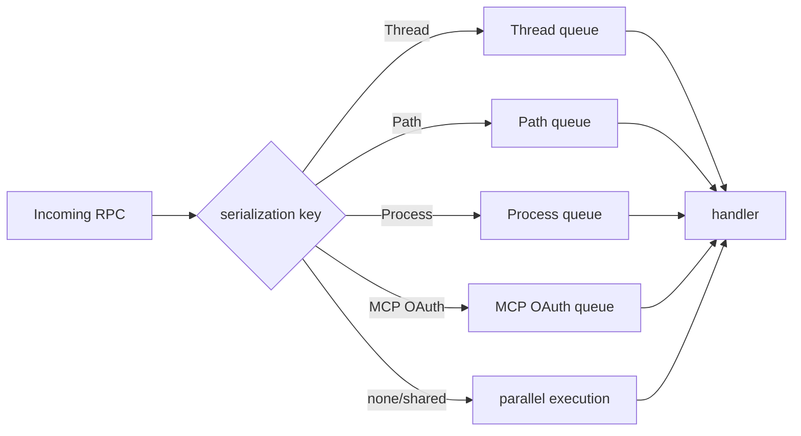

`RequestSerializationAccess::Exclusive` 与 `SharedRead` 的差别比“是否加锁”更重要：当前 `GlobalSharedRead` 允许共享读批次；Thread/path/process 等 scope 默认独占，不能把此实现泛化为所有读操作都并行。新增资源类型时必须同时考虑 key 的 identity、锁粒度、关闭行为和 metric。

### 5.3 跨请求的状态入口

建议排障时记录：

```text
connection_id
request_id
thread_id
turn_id
serialization_key
active_turn state
rollout ordinal / history mode
```

缺少其中任一项，都可能出现“请求成功但 UI 没事件”“线程没响应但 server 没退出”“恢复后重复工具调用”等难以定位的现象。

### 5.4 真实 channel 容量与共享读批次

```rust
// core/src/session/mod.rs：以下调用为当前源码节选，注释为新增解释。
let (tx_sub, rx_sub) = async_channel::bounded(SUBMISSION_CHANNEL_CAPACITY);
let (tx_event, rx_event) = async_channel::unbounded();
// SUBMISSION_CHANNEL_CAPACITY = 512；只证明 SQ 有界，不证明所有队列有界。
```

[现有] app-server transport 的 `CHANNEL_CAPACITY = 128`；`lib.rs` 用它创建 transport event、outgoing envelope 和 outbound control channels。`RequestSerializationQueues` 使用 `HashMap<Key, VecDeque<...>>`，阅读路径内未见 per-key 队列容量上限。因此**传输有界、RPC 资源等待队列和 core EQ 的压力行为不同**。

`drain()` 一次取队首；若为 `Exclusive`，等待该 handler；若为 `SharedRead`，合并连续共享读，以 `FuturesUnordered` 同时推进。新增共享读只有在 exclusive 尚未挡住队首时才能加入已有读批次，不能越过写请求。

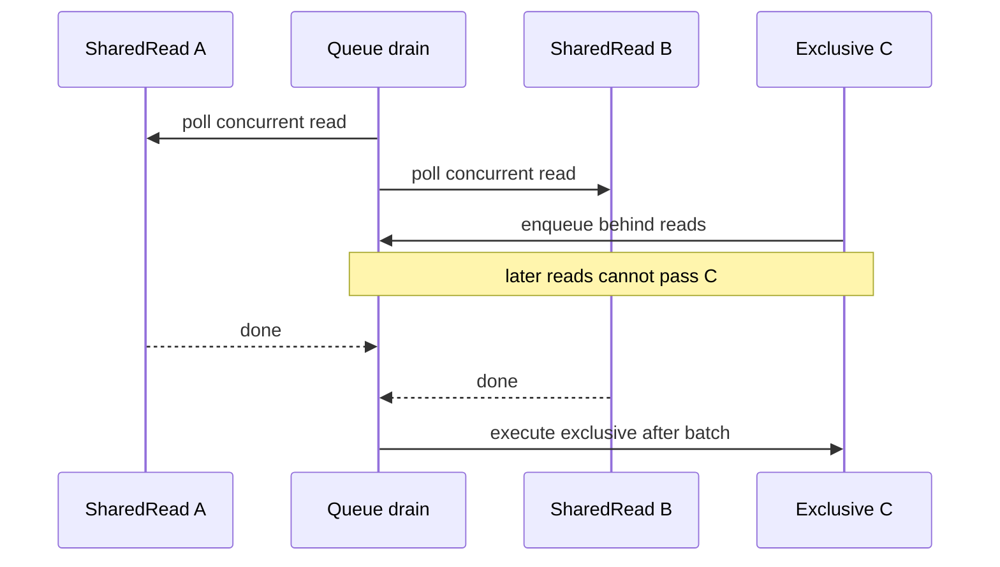

[现有] `discard_closed()` 丢弃连接 gate 已关闭的等待项，并通知 drain。已有 `app.requests.queued` Gauge，不能把“队列指标不存在”当作缺口；后续应评审资源级 wait time 与峰值监控。


## 6. run_turn 的阶段化执行

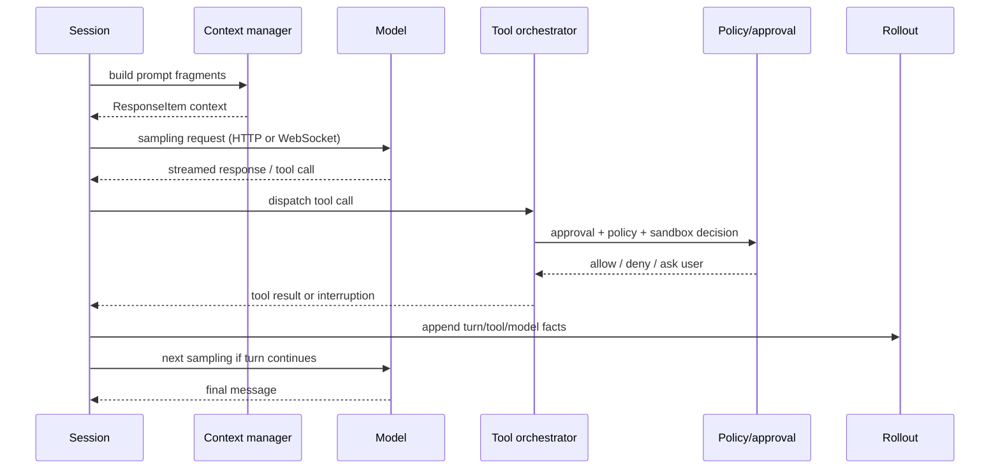

### 6.1 实际阅读顺序

1. `core/src/session/handlers.rs`：`submission_loop`；`session/submission.rs`：带 reply 的内部 Submission 契约。
2. `core/src/session/turn_input.rs`：start/steer/reject 与 pending input。
3. `core/src/session/turn.rs`：turn 级 step loop、取消、错误和完成。
4. `core/src/session/step_context.rs`、`turn_context.rs`：一次采样/一次 turn 的状态。
5. `core/src/model_request.rs`、`responses_retry.rs`：请求、SSE 和 retry。
6. `core/src/tools/router.rs`、`tools/registry.rs`、`tools/parallel.rs`、`tools/orchestrator.rs`：工具调用主链；`function_tool.rs` 当前主要提供取消错误适配，不是完整工具注册器。

### 6.2 不要把采样重试当作 turn 重试

模型 HTTP retry 只能重试一次采样请求的一部分；工具已经产生副作用后，不能自动把整个 turn 从头 replay。对“网络重试”“模型请求重试”“工具重试”“turn 恢复”要分别记录幂等语义。

### 6.3 完成条件：不仅仅是模型写了 final message

当前 `session/turn.rs` 采样后直接可见：

```rust
// 当前表达式；注释解释跨模块含义。
let needs_follow_up = model_needs_follow_up || has_pending_input;
// 模型需要下一步，或 pending/steer/mailbox 输入还未处理，都会影响收尾。
```

`drain_async_hook_results` 在模型采样及其 tools 完成后再排入本轮上下文；pending input、token status、async compaction 和终止判断并列存在。模型输出 final message 并不构成整个 Thread 的终态。

**值得保留的源码 TODO**：turn 开始的 foreground compaction 发生在新输入和 context 更新记录之前；`turn.rs` 明确 TODO 要估算即将进入的 context diff/full reinjection + user input，并在其将越过阈值时预先压缩。它是有直接证据的改进点，不是根据目录猜测的能力缺失。

### 6.4 ModelClient 与 ModelClientSession 的生命周期

[现有] `core/src/client.rs` 的模块注释明确：

- `ModelClient` 持续存在于 Codex Session，持有 provider/auth、conversation identity 和 transport fallback；
- `ModelClientSession` 按 turn 创建，缓存 Responses WebSocket 和 turn state；
- 不应复用 turn-scoped 对象跨 turn，否则可能重放旧的 turn-state 信息；
- WebSocket 的 HTTP fallback 则是 Session 级状态，不是每个 turn 都重新尝试同样失败的路径。

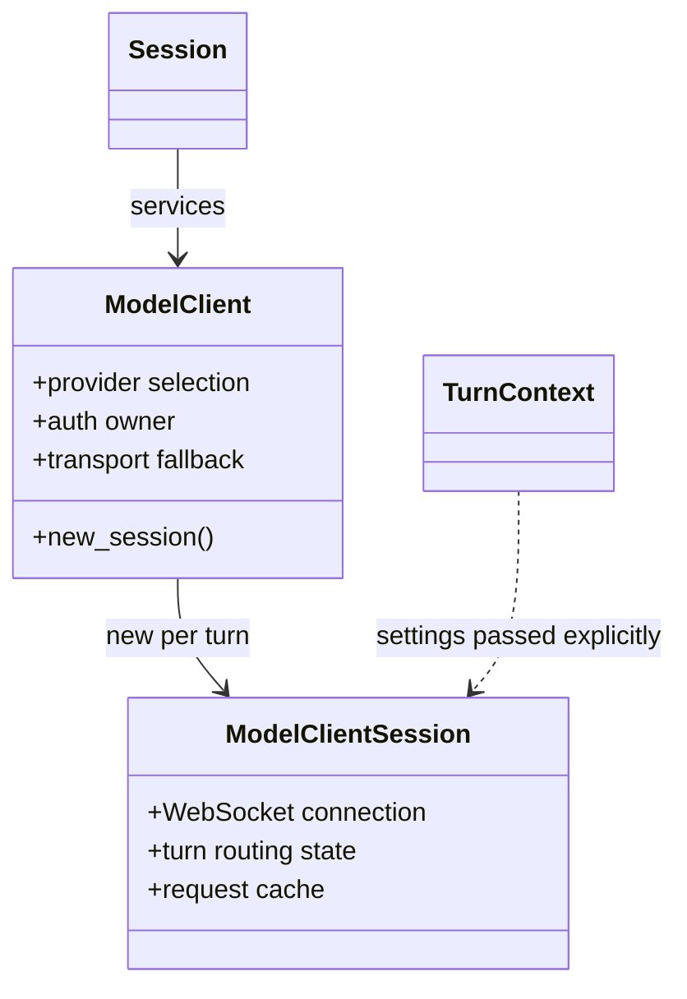

图中后两个对象的文字是职责摘要，不是 Rust 字段声明。模型传输也可能使用 WebSocket 而非 HTTP/SSE，原文“单次 HTTP 采样”应当作为某条 transport 路径阅读。原 PART1 的 §5.8.6 已解释内存 replace；本轮只补充适用条件，不能将这一已有解释当作全篇遗漏。


## 7. 工具、审批、沙箱与 Guardian

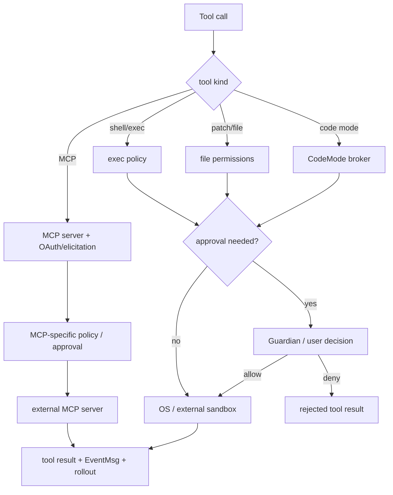

图示是工具分支的职责概览，不代表每种工具统一走 Guardian 或 OS sandbox。外部 MCP server 的实际执行环境由 server/host 管理；本地命令 sandbox 不自动限制其远程副作用。Code Mode broker 也不能替代每个工具的权限边界。

### 7.1 四个决策面

| 决策面 | 主要源码 | 作用 |
|---|---|---|
| 工具暴露 | `tools/router.rs`、`tools/registry.rs`、`mcp_tool_exposure.rs`、code mode | 模型是否能看到/调用工具 |
| ExecPolicy | `exec_policy/` | 命令模式、路径和策略匹配 |
| 用户/Guardian 审批 | `guardian/`、`guardian_review.rs` | 高风险动作是否需要外部决定 |
| 执行环境 | `sandboxing/`、`linux-sandbox`、`windows-sandbox`、network policy | 即使允许，动作能触达哪些资源 |

**关键边界**：工具可见不等于工具可执行；策略允许不等于 OS 环境具备访问权；批准后仍必须遵守当次有效 permission profile 与执行策略；但受控审批可以改变 sandbox attempt，不能宣称永远不会升级为 unsandboxed。

### 7.2 MCP 的额外状态

MCP 还会引入 server lifecycle、OAuth、elicitation、tool refresh、连接断开和 schema 变更。对 [建议] MCP 工具调用应额外记录 server identity 和工具 schema 版本，否则同名工具在不同 server 上不可审计。

### 7.3 工具主链：Router、Registry、Parallel、Orchestrator

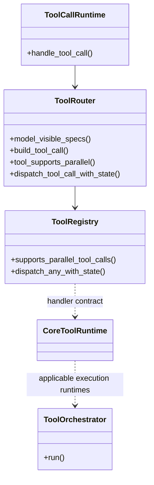

- `tools/router.rs`：解析 Responses item、工具暴露和 namespace/code mode routing；
- `tools/registry.rs`：工具查找与 handler/runtime dispatch；
- `tools/parallel.rs`：工具 futures、取消、共享 turn diff tracker 和并行/串行 gate；
- `tools/orchestrator.rs`：对适用 runtime 统一审批、sandbox attempt 和拒绝后的升级策略；
- `tools/executed_tool_calls.rs`：**记录器**，源码明确禁止它 dispatch 或 await 工具。

[现有] `ToolCallRuntime` 用 `RwLock<()>` 协调适用工具：允许并行的调用拿读 guard，不允许并行的调用拿写 guard；不是所有工具在同一 tokio task 内逐个执行，也不是模型要求 parallel 就一定照做。

### 7.4 审计记录已经存在，但不是事务回执

`ExecutedToolCalls` 已有 Direct/Code Mode 共享记录、seen-id 去重、bounded metadata、completeness 标记以及 MCP attribution。当前常量包括 256 个 pending Direct 记录、单 recorder lifetime 1 MiB Direct metadata 保留预算。

`mcp_attribution.rs` 用 connector_id、plugin_id、server_name、tool_name 区分来源，并用 revision/persisted_revision 管理 checkpoint。故“完全缺少工具审计或 MCP identity”是不准确的。

[推论] best-effort 记录与外部副作用 receipt 的区别是：前者说明系统观察到过调用；后者需要外部系统证明一个不可重复动作已经提交。记录被截断、feature 被关闭或服务重启时，不能用 incomplete 记录宣称 exactly-once。

[现有] `orchestrator.rs` 还对远程 exec-server 是否能安全保留 denied-read restrictions 做 capability 检查；不满足时明确拒绝升级并要求升级 exec-server。后端 capability negotiation 是安全边界的一部分，不只是 UI 功能开关。


## 8. 上下文、压缩与不可改写历史

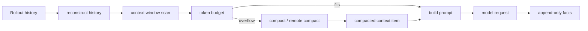

### 8.1 三种“历史”

1. **模型历史**：用于构造 `ResponseItem[]` 和上下文窗口。
2. **Rollout 历史**：append-only 事实，可用于重建和 Resume。
3. **Thread/State 索引**：便于列表、排序、分页和快速恢复，但不是完整 transcript。

压缩可以替换/安装内存中的模型 history，但 rollout 用新的事实记录该变化，不能把“append-only”误读为内存上下文不允许变更。Fork 有 copied/referenced 等路径；truncate、rollback、revert 也不是同义词，见原 PART3。

### 8.2 Context Fragment 的工程意义

Fragment 是把外部状态（workspace、AGENTS.md、skills、插件、工具说明、用户输入）转换为模型可见内容的边界。它必须回答：来源是什么、是否可缓存、何时刷新、是否持久化、是否计入 token budget、是否会被压缩丢失。

### 8.3 后台压缩是候选快照，不是立即替换当前 history

`session/async_compaction.rs` 的启用条件同时包含：`Feature::AsyncCompaction`、未启用 `Feature::TokenBudget`、provider 支持 `RemoteCompactionSupport::V2`。这不是所有 provider、所有预算配置均默认执行的通用后台线程。

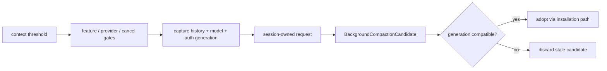

[现有] `CompactionAttempt` 跟踪 history_version、model_slug、compaction_hash、auth_owner_generation；`wait_for_pending()` 校验上述条件后释放 SessionState lock，再等待响应。`take_ready()` 则检查 candidate prefix generation，完整安装逻辑还要联读 `compact_remote_v2_installation.rs`，不能把这个单一检查说成完整兼容验证。

[现有] cancel 当前 turn 会阻止新启动；已启动后台任务是 **Session-owned**。shutdown 关闭 TaskTracker、取消专用 token 并等待任务完成 usage charging。后台请求成功不意味着一定被采用，失败/过期候选会被丢弃。

[建议] 指标至少区分 launched、completed、adopted、discarded 和 charged usage；否则只看“压缩调用成功率”可能误解预算效果。


## 9. 持久化、Resume 与服务端恢复

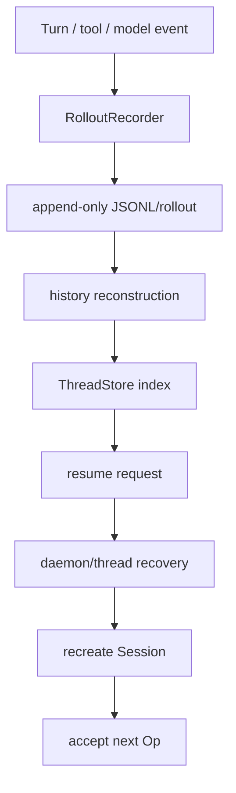

### 9.1 写入顺序是行为契约

应区分：

- 事件产生时间；
- rollout append 成功时间；
- UI EventMsg 发出时间；
- state DB projection 成功时间。

若先发 UI 后写 rollout，崩溃会造成用户看见但无法 Resume 的“幽灵事件”；若先写 rollout 后发 UI，则可能出现客户端暂时没看到但恢复后事件存在的情况。已有文档讨论三种真相，本章补充的是**可观测顺序**。以上两种顺序是故障模型，不是宣称当前实现统一采用“先 UI 后持久化”；实际本地 writer 路径见下文。

### 9.2 恢复不是简单 reload JSON

恢复需要同时处理 rollout 完整性、history mode、pending tool/approval、配置版本、workspace、MCP server 状态和 active turn 是否可恢复。[建议] 对无法安全重放的外部副作用，恢复策略应明确人工确认或幂等约束，不能把此建议写成当前所有工具已有的保证。

### 9.3 Event 发出前有持久化调用，但不等于每条消息已 fsync

`Session::send_event_raw_with_persistence` 的关键路径是：realtime reduction → `persist_rollout_items` → trace/后置 realtime effects → `deliver_event_raw`。其中 persistence policy 决定哪些 events 存下来；不是每个 delta 都成为恢复事实。

```rust
// core/src/session/mod.rs：节选当前控制结构，解释性注释为新增。
if persist {
    let rollout_items = vec![RolloutItem::EventMsg(event.msg.clone())];
    self.persist_rollout_items(&rollout_items).await;
    // bool 返回值在此调用点未阻止 deliver；失败会在下层记录错误。
}
// ... trace、realtime effects、特定 Guardian completion flush ...
self.deliver_event_raw(event).await;
```

`persist_rollout_items()` 调用 `LiveThread::append_items`，失败记录日志并返回 false。此分支**不能保证“客户端收到事件就证明磁盘写入成功”**；也不能据此宣称所有数据必然丢失，因为实际 materialization 和 flush 有其他屏障。

[现有] `rollout/src/recorder.rs` 的 writer channel 容量 256；writer 消费 AddItems、Persist、Flush、Shutdown。`flush()` 通过 oneshot ack 等待 writer；写失败会进入 recovery mode、重开句柄重试，不是单次失败就静默放弃。

区分三层保证：

| 屏障 | 能说明什么 | 不能单独说明什么 |
|---|---|---|
| queue append | 入写入/投影路径 | 每条数据都已落盘 |
| flush ack | writer 已处理积压，按实现完成 flush | 自动等同断电可恢复的 fsync |
| DB/projected history | 索引/读模型已经更新 | 外部工具副作用事务已提交 |

### 9.4 LocalThreadStore 已有 flush-before-projection

不能只读 `RolloutRecorder::record_canonical_items` 的 queue send 就判断上层保证。实际 `thread-store/src/local/live_writer.rs::write_and_project` 持有 thread 级 live writer guard：

```rust
// 当前 durable_write 的 AppendItems 分支，省略其它 match arms。
RolloutWriteOp::AppendItems(items) => {
    recorder.record_canonical_items(items.as_slice()).await
        .map_err(thread_store_io_error)?;
    recorder.flush().await.map_err(thread_store_io_error)
}
```

[现有] Legacy 路径完成 durable_write；Paginated 路径先完成同一屏障再 materialize SQLite，源码明确 SQLite 可落后 canonical history，但不能提前。projection 错误会日志记录，不能据此说主 JSONL append 自动回滚。`recorder.rs` 可见 file `flush()`，此处没有把它证明为 power-loss `sync_all`；术语 durable 是模块命名，不应超出源码操作赋予保证。

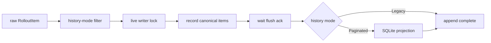

**架构推论**：本地成功 append 有 writer flush 屏障，而上层事件发送路径可能在 append 错误后仍 deliver。应分别评审“成功写入的时序”和“失败后错误传播”，不能用一句“没有落盘保证”概括。

### 9.5 Daemon 恢复实际有严格准入条件

`app-server-transport/src/daemon_recovery.rs` 的 `RecoverySnapshot` 包含 loaded Thread 集合与 interrupted metadata，不只是一个 JSON thread-id 列表。旧格式仍用数组容纳 metadata 前缀，从而兼容旧 reader；不能把 loaded runtime 名单当完整模型历史。

`core/src/session/daemon_recovery.rs::interrupted_turn` 要求：

1. active task 是 Regular；
2. cancellation token 未取消；
3. 已有 `RecordedTurnInput`，即本轮输入进入了 rollout writer；
4. 恰有一个 local environment；
5. environment config 属于 `FromThread`；
6. 调用者在保存恢复快照之前 flush rollout。

remote identities/config 不跨 daemon restart 持久化，旧快照缺少 local identity 时可以 reload 但不自动 continuation。这些能力已经存在，缺口应当定位到“跨副作用恢复契约”，而不是写成“没有 daemon 恢复”。

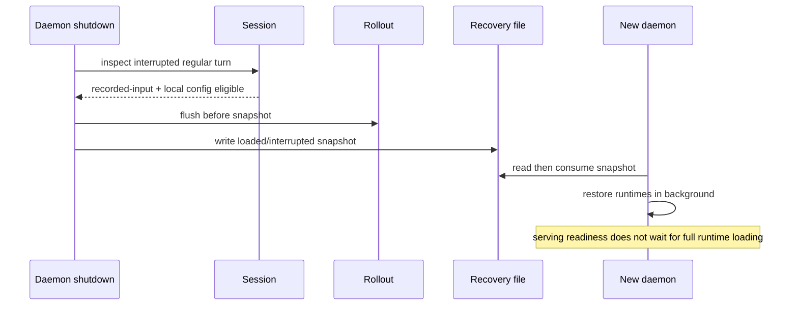

`start_recovery()` 消费快照后后台执行 restore；malformed/暂不可读快照也属于当前 generation，不能无限遗留给下一代进程。已经 loaded 的 runtime 仍归现有 client 管理，避免恢复重复接管。


## 10. 多 Agent、Hooks、Plugins 与 Code Mode

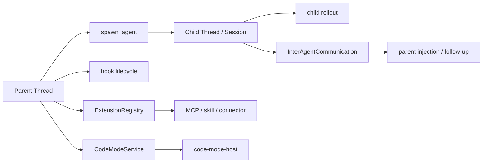

### 10.1 多 Agent 的核心边界

子 Agent 不是普通函数调用：它拥有 Thread identity、独立 turn、独立历史和取消边界。父子通信可能是 notification、follow-up 或 mailbox/board 语义；这些路径对“何时触发父 turn”“消息是否持久化”“是否等待 child 完成”有不同结果。

### 10.2 Plugins / Skills / AGENTS.md

这些扩展大多在 turn 前后注入或改变可见工具/提示，不应直接视为“修改 core”。阅读 `agents_md_manager.rs`、`plugins/`、`skills/`、`extensions.rs` 时，要分别标注 discovery、selection、injection、execution、analytics 五个阶段。

### 10.3 Code Mode

Code Mode 把工具暴露与执行搬到独立 host/broker 边界；它可以改变模型可见工具面并集中编排；具体运行隔离取决于 host、权限与 sandbox 配置，不能单凭 Code Mode 名称推导安全隔离，代价是增加协议、schema、错误映射和超时层。`CodeModeService`、`CodeModeDispatchBroker` 与 `code-mode-host` 需要联读。

## 11. 关闭、取消、错误与背压

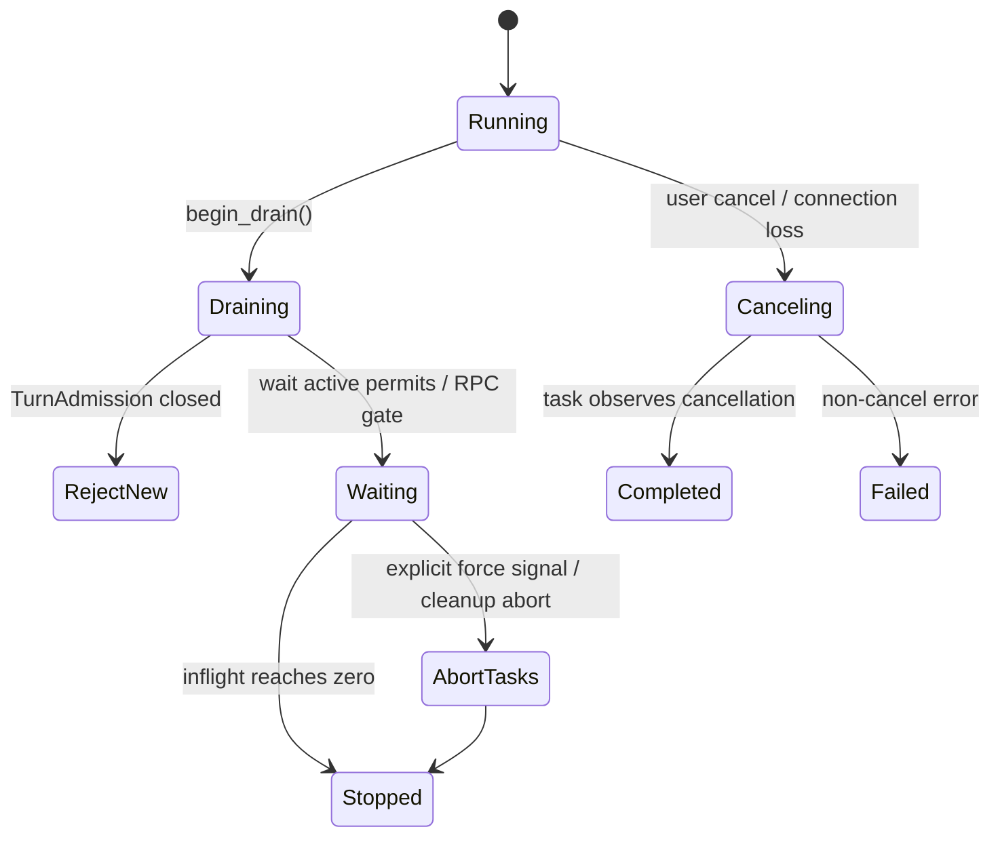

### 11.1 三种停止

- **cancel turn**：停止一个 turn 或其模型/工具任务。
- **connection cleanup**：停止连接相关 cleanup tasks，不必停止整个 Thread。
- **server drain/shutdown**：拒绝新准入，观察已准入启动数与运行 turn 数；强制信号和后续 cleanup 有独立路径。

`ConnectionRpcGate` 的“shutdown 等待 inflight、晚到任务不再执行”是连接生命周期保护；不能据此推导 turn 一定被取消。

### 11.2 背压候选点

模型 SSE、工具输出、outbound writer、MCP server、rollout recorder 都可能产生不同的速度。工程评审应检查每个边界：channel 是否有界、满载时阻塞/丢弃/取消什么、客户端断开后谁负责清理、持久化失败是否反向阻塞 turn。

### 11.3 已有慢客户端处理与实际关闭条件

`app-server/src/transport.rs::send_message_to_connection` 对可断开的连接使用 writer `try_send`：队列 Full 或 Closed 就断开该连接；不可主动断开的路径则 `writer.send(...).await`。所以不能把“没有背压控制”列为缺口，也不能说所有传输都采用同样的丢弃策略。

```rust
// 等价伪代码：分支与原实现对应，省略 outgoing filters 和 envelope。
if connection.can_disconnect() {
    match writer.try_send(message) {
        Ok(()) => {},
        Err(Full(_)) | Err(Closed(_)) => disconnect(connection_id),
    }
} else {
    writer.send(message).await?; // 特殊连接路径仍可能等待
}
```

[现有] `ShutdownState::update()` 的普通完成条件是 `running_turn_count == 0 && active_admissions == 0`，强制路径由显式 force signal 触发。后续 connection cleanup / background tasks / child-tree teardown 又有独立等待和 abort；不能把所有这些路径合成“统一超时后杀进程”。

[现有] main loop 先采样 admissions，再读取 running turn count，源码注释说明一个 submission 可以先发布 running turn 再释放 permit；顺序错误会出现 shutdown 提前判断归零的竞态。


## 12. 源码缺口与工程建议

> 以下是候选风险和设计深化点，不是“已经复现的漏洞”，也不是对全仓库的完整安全审计。

| 优先级 | 候选缺口 | 需要补强的证据/设计 |
|---|---|---|
| P1 | 跨工具副作用与恢复重放的统一幂等契约需评审 | 已有 call_id 与 ExecutedToolCalls 不等于外部副作用提交回执；评审 exec、patch、MCP 写入动作的 operation id、receipt、replay policy |
| P1 | rollout、EventMsg、state DB 的可观测顺序分散 | 统一 turn/step/ordinal/commit watermark，并暴露诊断命令 |
| P1 | 已有并发指标能否形成跨层关联视图需评审 | 增加 queue wait、active permit、serialization key、outbound lag 指标 |
| P1 | 已有 MCP attribution 与 schema/config 指纹覆盖需评审 | 已有 attribution 记录 server/tool/plugin/connector identity；进一步核对 endpoint/config fingerprint、schema digest 和 approval context |
| P1 | shutdown deadline 与工具/子进程终止语义多层分散 | 统一 cancellation budget、子进程 reap、最终状态分类 |
| P2 | 生成协议 schema 与手写架构文档容易漂移 | CI 生成 schema snapshot，并做文档符号/路径 smoke check |
| P2 | 多 Agent 消息的可靠性语义不够统一 | 明确 at-most-once / at-least-once、父子 ack、重启恢复和去重键 |

### 12.1 先区分文档遗漏与源码改进

| 类型 | 本轮结论 | 对应动作 |
|---|---|---|
| 文档遗漏 | app-server 初始化、admission 二次检查、RPC gate、资源队列 | 已补充源码流程与注释 |
| 文档漂移 | 短标题“单次 HTTP”和“不可改写上下文”缺少适用条件；旧行号也不是稳定锚点 | 当前路径/生命周期校准，历史内容保留 |
| 现有能力 | slow-client disconnect、daemon recovery、工具审计、Gauge/trace | 明确已存在，不再当作缺失功能 |
| 源码 TODO | 预采样压缩未估算待注入输入与 context diff | 有直接 TODO 证据，可形成独立实现任务 |
| 候选风险 | 跨工具幂等、commit watermark、端点/schema fingerprint、取消统一视图 | 需要复现、威胁模型或路径级审计后再决策 |

**建议优先顺序**：先修复读者会依赖的源码定位和过强保证；再把 turn.rs 的预算 TODO 转为行为测试；最后以外部副作用和恢复交界开展专项审计。本文不是批准改造计划。

### 12.2 推荐的最小诊断上下文

```rust
// 等价伪代码：用于日志/trace 的最小关联字段，不是现有可直接复制的结构体。
struct TurnDiagnosticContext {
    connection_id: Option<String>,
    request_id: Option<String>,
    thread_id: String,
    turn_id: String,
    step_id: Option<String>,
    rollout_ordinal: Option<u64>,
    serialization_key: Option<String>,
    cancellation_reason: Option<String>,
}
```

这些字段不要求全部暴露给用户，但至少应能从 debug log、rollout 和事件中关联起来。

## 13. 阅读索引与验证边界

### 13.1 推荐源码阅读顺序

| 目标 | 先读 | 再读 |
|---|---|---|
| 了解一次请求 | `app-server/src/message_processor.rs` | `request_processors/`、`core/src/session/handlers.rs` |
| 理解 turn | `core/src/session/turn_input.rs` | `turn.rs`、`step_context.rs`、`model_request.rs` |
| 理解恢复 | `rollout/` | `thread-store/`、`state/`、`daemon_thread_recovery.rs` |
| 理解安全 | `exec_policy/`、`permissions/` | `sandboxing/`、`guardian/`、`network_policy_decision.rs` |
| 理解扩展 | `plugins/`、`skills/`、`agents_md_manager.rs` | `mcp.rs`、`code_mode_*`、`hooks/` |

### 13.2 与现有文档的关系

- 基础身份、SQ/EQ、Agent Loop：见 `ARCHITECTURE_PART1.md`。
- Tool/MCP/Skill/Sandbox/Hook/Plugin：见 `ARCHITECTURE_PART2.md`。
- Rollout、ThreadStore、Realtime、Observability 和 ADR：见 `ARCHITECTURE_PART3.md`。
- 实体与时序综合：见 `ENTITY_AND_SEQUENCES.md`。
- 安全威胁模型：见 `SECURITY_ARCHITECTURE.md`。
- 本文重点补充**app-server 控制面、准入、资源串行化、关闭语义和跨层恢复边界**。

### 13.3 验证边界

已尝试用本机 Rust 1.96.1 离线执行 `codex-app-server` 的 admission 单元测试；项目指定 Rust 1.95.0，本机未安装该版本，因此该尝试并非规范工具链验证。Cargo 在解析 git-pinned `tungstenite` 依赖时因离线缓存不足而停止，尚未编译和执行用例，不能记录为测试通过。未下载依赖或修改 Cargo 配置。详见 [覆盖与改动记录](./COVERAGE_AND_CHANGES.md)。

本轮基于源码静态阅读和符号/路径核对，未启动真实模型、MCP、GUI、远程服务或执行 destructive tool。文中将源码事实、跨模块推论和建议分开；Mermaid 图做了结构化编写，未在本环境逐张进行浏览器渲染回归。

### 13.4 最终结论

Codex 的核心不是单一 Agent Loop，而是四个叠加系统：

1. **协议系统**：Transport、JSON-RPC、SQ/EQ、outbound routing；
2. **执行系统**：Thread/Session/Turn、模型—工具 step loop、审批和 sandbox；
3. **历史系统**：append-only rollout、ThreadStore、state DB、Resume/Fork/Compact；
4. **扩展系统**：MCP、Skills、Plugins、Hooks、Multi-Agent、Code Mode。

任何只描述 `run_turn()` 的架构图都会漏掉协议准入、关闭竞态、资源级串行化和恢复事实；任何只描述数据库的图都会漏掉模型上下文与工具副作用。本章补齐的正是这些跨层连接。
