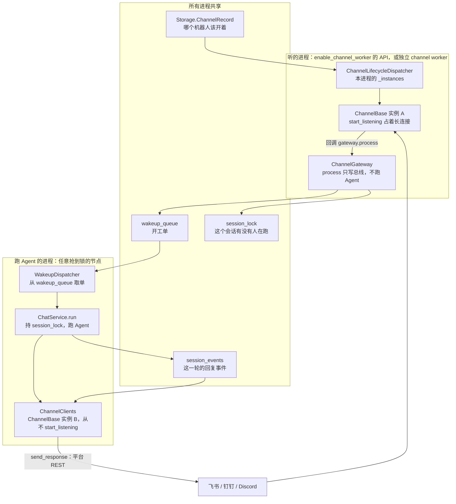
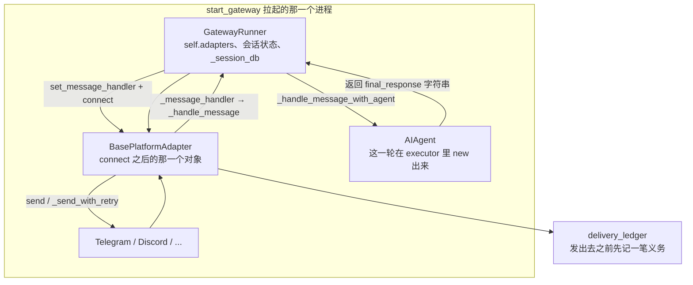
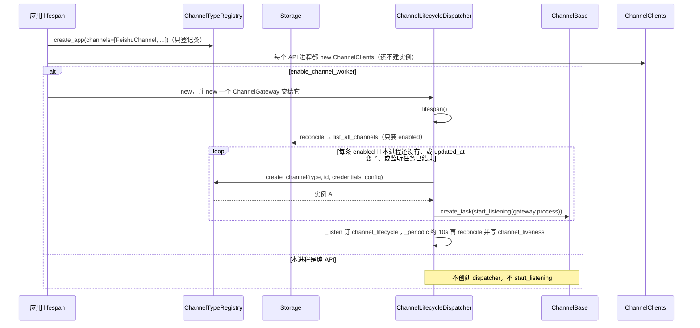
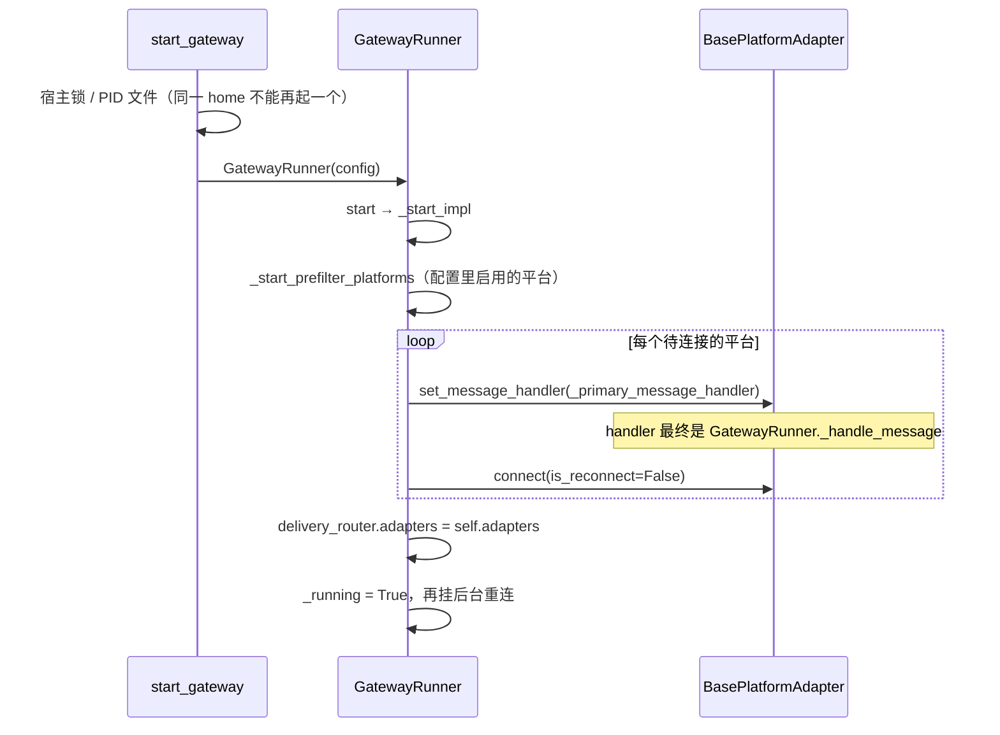
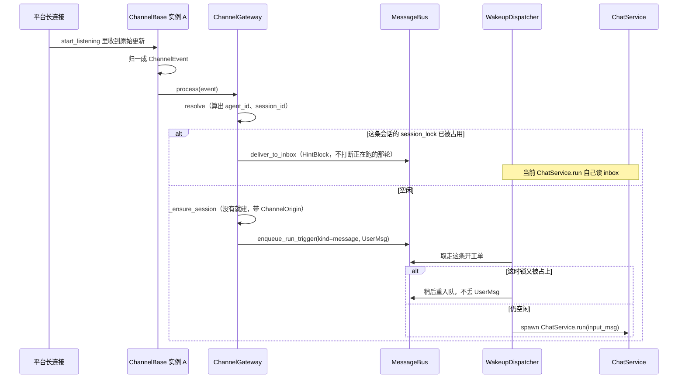
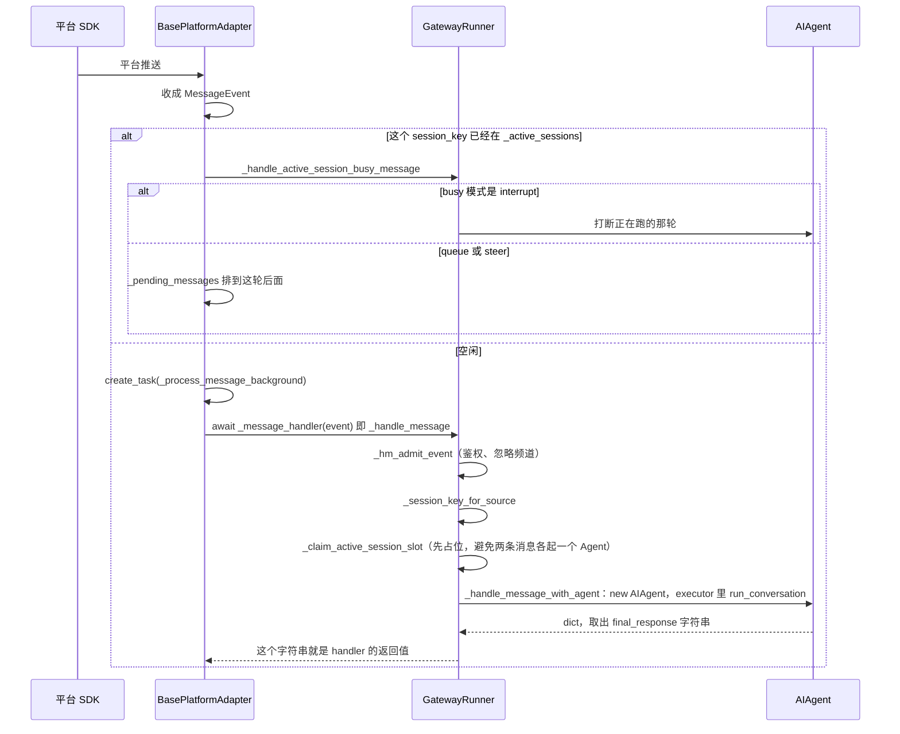
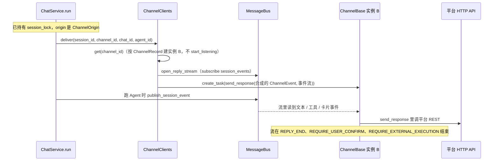
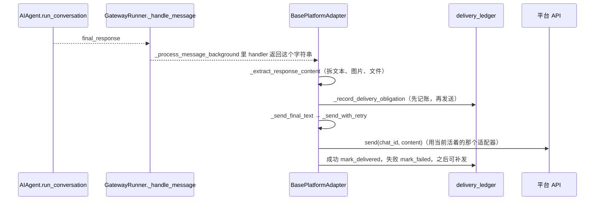

# AgentScope Channel 与 Hermes Gateway：框架与流程

两边都是「平台推来一条消息 → 跑一轮 Agent → 把回复发回那个聊天」。框架拆法不同，所以启动、收、发三条流程走的对象也不一样。

AgentScope 把 **听** 和 **跑** 拆成可以落在不同进程的两套运行时，中间用 `MessageBus` 传开工单和事件。同一份 `ChannelBase` 子类会被建两次：一次 `start_listening`（只收），一次不调用它（只拿凭证做 REST 发送）。

Hermes 不拆进程。`GatewayRunner` 持有适配器。适配器 `connect` 之后，入站回调进 `_handle_message`，`AIAgent.run_conversation` 的返回字符串再由 **同一个适配器** `send` 出去。

---

## 1. 框架：对象落在哪

### AgentScope：两个进程角色，中间是总线

`create_app(channels=[FeishuChannel, ...])` 只把 **类** 放进 `ChannelTypeRegistry`。某个机器人开不开，是 Storage 里的 `ChannelRecord`（`enabled`、凭证、`platform_config`）。

实例 A 和实例 B 是同一个类、同一套凭证，**不是同一个对象**。A 活在听的进程里。B 由跑 Agent 的进程按 `ChannelRecord` 现建，缓存键是 `channel_id` + `updated_at`。凭证轮换后 `updated_at` 变了，B 会重建；正在用旧实例的那一轮不中途关掉。

`ChannelClients` 在每个注册了渠道类型的 API 进程里都有，包括不听长连接的副本。`ChannelLifecycleDispatcher` 只在 `enable_channel_worker=True` 的进程里创建；专用 worker 部署时，API 副本的 dispatcher 是空的。

### Hermes：一个 Gateway 进程

没有第二套「只发不听」的客户端。`DeliveryRouter.adapters` 在 `GatewayRunner.start` 末尾直接指向 `self.adapters`，也就是刚才 `connect` 成功的那些对象。

定时任务不走这条入站回调。`cron` 自己 `run_conversation`，回复进 `delivery_queue`，再由网关发出。那是另一条入口，不是 `_handle_message`。

---

## 2. 启动流程

### AgentScope

类型注册和「把长连接拉起来」是两步。改一个机器人的开关不重启进程：`ChannelService` 写 Storage，再 `publish(channel_lifecycle)`，听的进程里的 `_listen` 收到就 `reconcile`。

`reconcile` 对的是两份名单：Storage 里 `enabled` 的 `ChannelRecord.id`，和本进程 `_instances` 的键。多出来的 `_stop`（cancel 监听任务，并从 `channel_liveness` 删掉本 `node_id`）。缺的、配置版本变了的、任务已经结束的，先停再 `_start`。适配器自己报了 `failed` 但任务还没结束时，不会自动重拉，要等改配置把 `updated_at` 推高。

### Hermes

配置在本进程读完就连。没有「Storage 里一条 ChannelRecord，另一个进程来对齐」这一步。同一 `HERMES_HOME` 用 PID 文件挡住第二个网关，避免两个进程抢同一个 bot。

`set_message_handler` 发生在 `connect` 之前（`run_adapters` 里先登记回调再连）。连上之后平台推来的更新才会进这个 handler。发送用的也是 `self.adapters` 里这一个对象。

---

## 3. 收消息流程

### AgentScope：回调停在 Gateway，Agent 在另一边被叫醒

平台长连接的回调是 `ChannelGateway.process`。它做三件事：对出会话、看锁、把开工单放上总线，然后返回。它不调用 `ChatService`，也不 `send`。

会话号不是查表。`resolve(event, record)` 用渠道、聊天、用户算出确定的 `(agent_id, session_id)`。第一次见到就 `_ensure_session`：`upsert_session`，`origin=ChannelOrigin(channel_id, chat_id, ...)`。以后出站靠这个 origin，不靠「刚才那条入站连接」。

卡片点击是另一条入站，仍进 `process`：`ChannelConfirmationResultEvent` → `resume_after_decision`，往同一条总线放 `kind=resume`，不是一条新的用户消息。

忙的时候 **不打断**。新内容进 inbox，等持锁的那次 `ChatService.run` 折进去。Gateway 自己不持有「正在跑的 Agent 对象」。

### Hermes：回调就在这个进程里把 Agent 跑完

适配器把平台更新收成 `MessageEvent`（里面是 `SessionSource`：平台、chat、thread、user）。会话键是 `GatewayRunner._session_key_for_source(source)`，进程内的字典，不是跨节点的锁。

忙的默认动作是 **打断当前轮**（`_hm_handle_running_session_message`）。配置可以改成 `queue`（放进适配器的 `_pending_messages`，本轮 `_finish_session_task` 再 `_spawn_drain_task`）或 `steer`（塞进正在跑的 Agent）。子 Agent 还在跑、或压缩正在换 session id 时，打断会降级成排队。

和 AgentScope 的差别在于：忙消息的队列是 **这个适配器对象上的 dict**，不是所有节点都能看见的 `wakeup_queue`。听消息的调用栈和跑 Agent 的调用栈在同一个进程里。

---

## 4. 发消息流程

### AgentScope：跑 Agent 的进程订事件流，REST 发出去，不经过实例 A

`ChatService.run` 发现 `session.origin` 是 `ChannelOrigin` 时，**先** `deliver` 再跑 `reply_stream`。`deliver` 立刻 `open_reply_stream`：先 `subscribe(session_events)`，订上之后再按 checkpoint 补放，避免漏掉开跑之后立刻发出的事件。真正的 `send_response` 在后台任务里，`run` 不等平台回 ACK。

实例 A 的长连接不参与发送。所以跑 Agent 的节点可以根本没有 dispatcher。Web 的 SSE 订的是同一条 `session_events`，和 IM 回复是同一份事件。

确认卡片上钉着 `agent_id` / `session_id`。用户点卡片后，入站不必重新 `resolve`，直接 resume 这次 run。

### Hermes：handler 的返回值，由刚才 connect 的适配器发出去

`run_conversation` 不往总线推「回复流」。网关拿到 `final_response` 字符串，返回给适配器。适配器在 **发送之前** 把这笔义务写入 `delivery_ledger`（`record_obligation` + `mark_attempting`）。进程若在平台 ACK 前死掉，下次启动按账本补发。

`_final_delivery_adapter` 会在发送时再看一眼 runner 里的适配器表。重连若换成了新对象，还没发出去的最终回复走新对象；已经发出去的 message id 仍算旧对象的。

斜杠命令和短时回复不进账本。普通最终回复进。

---

## 5. 三条流程对照

| 流程里的问题 | AgentScope | Hermes |
|--------------|------------|--------|
| 谁持有长连接 | `ChannelLifecycleDispatcher._instances` 里的实例 A，只在听的那个进程 | `GatewayRunner.adapters` 里 `connect` 成功的适配器 |
| 入站回调停在哪 | `ChannelGateway.process` 返回。Agent 要等 `WakeupDispatcher` → `ChatService.run` | `BasePlatformAdapter._process_message_background` 一直 `await _handle_message`，里面就把 `run_conversation` 跑完 |
| 会话怎么对上 | `resolve` → 固定的 `(agent_id, session_id)`，写入 `ChannelOrigin` | `_session_key_for_source(SessionSource)`，留在本进程会话状态 |
| 这轮还在跑又来一条 | 看 `session_lock`。占着就 `deliver_to_inbox`，不打断 | 看适配器 `_active_sessions`。默认同进程打断；也可 queue / steer 到 `_pending_messages` |
| 回复从哪读 | 跑 Agent 的进程订 `session_events` | handler 返回的 `final_response` 字符串 |
| 用哪条连接发出去 | 实例 B 的 `send_response`，平台 REST，与实例 A 无关 | 同一个适配器的 `send`。发出前 `record_obligation` |
