# CowAgent 完整设计文档

> **分析对象**：`/Users/gqli/work/deepagents/CowAgent`（GitHub `zhayujie/CowAgent`，本地 HEAD `5168beb1`，文档随 v2.2.2）。
> **资料边界**：官方文档 `docs/**/*.mdx`（intro/guide/memory/knowledge/multi-agent/skills/tools/channels/models/cli/extensions/releases）+ 代码骨架与关键实现（`agent/`、`bridge/`、`channel/`、`models/`、`plugins/`、`cli/`、`common/`）。默认值、开关与能力矩阵**以部署版本随附文档为准**。
> **资料基线**：2026-10-30。
> **核心结论**：CowAgent 不是"模型 SDK 封装"，也不是"agent 编排框架"，而是一套**完整的 Agent Harness（智能体运行外壳）**：把"接入渠道 → 会话与路由 → 推理循环 → 工具/技能/权限 → 记忆/知识/自成长 → 模型与多模态 → 存储"六层全部实现并解耦，交付形态是可 7×24 常驻的**单个进程 + 一组 Markdown 文件 + 本地 SQLite 索引**（一份全局会话库、每个 Agent 一份记忆索引，见 §15.3.2）。它最有辨识度的设计是：**记忆与知识全部是工作区里的 Markdown 文件**，且"写记忆"这件事由**热路径的裁剪摘要**与**冷路径的 Deep Dream / Self-Evolution 两条后台巩固回路**共同完成，而后台回路被刻意约束成"不打扰、可回滚、无变更不通知"。

---

## 目录

1. [CowAgent 是什么](#1-cowagent-是什么)
2. [设计目标与非目标](#2-设计目标与非目标)
3. [整体架构（全局视图）](#3-整体架构全局视图)
4. [一条消息的完整生命周期](#4-一条消息的完整生命周期)
5. [Agent 内核：推理循环与上下文工程](#5-agent-内核推理循环与上下文工程)
6. [记忆体系：分层、写入、检索、巩固](#6-记忆体系分层写入检索巩固)
7. [记忆分层完整实例（Day 1 → Day 2 → Day 10）](#7-记忆分层完整实例day-1--day-2--day-10)
8. [知识库（Knowledge Base）](#8-知识库knowledge-base)
9. [Skills 体系](#9-skills-体系)
10. [Tools 与权限模型](#10-tools-与权限模型)
11. [多 Agent：Team / Sub-Agent / Delegation](#11-多-agentteam--sub-agent--delegation)
12. [渠道层（Channels）](#12-渠道层channels)
13. [模型与多模态层](#13-模型与多模态层)
14. [对外接口与集成面](#14-对外接口与集成面)
15. [数据与存储全景](#15-数据与存储全景)
16. [十条贯穿全局的设计主线](#16-十条贯穿全局的设计主线)
17. [与同类项目的定位对比与选型](#17-与同类项目的定位对比与选型)
18. [局限、风险与运维检查清单](#18-局限风险与运维检查清单)
19. [会话体系：身份、键、池与两条时间线](#19-会话体系身份键池与两条时间线)
20. [记忆体系：不变量、写入协议与可复算检索](#20-记忆体系不变量写入协议与可复算检索)
21. [安全体系：威胁模型、三模式、护栏与残余风险](#21-安全体系威胁模型三模式护栏与残余风险)
22. [对象模型与引用关系（叙述版）](#22-对象模型与引用关系叙述版)
23. [核心流程逐段解说](#23-核心流程逐段解说)
24. [核心类图（对象模型全集）](#24-核心类图对象模型全集)
25. [补充时序（把还没画的主流程补齐）](#25-补充时序把还没画的主流程补齐)
26. [术语表与资料来源](#26-术语表与资料来源)

> **怎么读这份文档**：§1–§18 是**分层说明书**（每一层是什么、参数默认值、图）；§19–§23 是**体系设计论证**（会话/记忆/安全三套体系的不变量、协议、失败模式，以及对象引用关系与核心流程逐段解说）；§24–§25 是**图附录**（类图全集、补充时序）；§26 是术语与溯源索引。想快速建立心智模型：§3 → §19 → §20 → §21 → §23。

---

## 1. CowAgent 是什么

### 1.1 一句话定位

**CowAgent = 开源"超级 AI 助理 + Agent Harness"**：主动规划任务、操控本机与外部服务、创建并运行 Skills、构建个人知识库与长期记忆、组建多 Agent 团队，并通过 Self-Evolution 在使用中自我成长。官方自我定位是"**Agent Harness 工程的参考实现**"。

### 1.2 它和相邻物种的区别（先看边界，再看能力）

| 维度 | 模型 API / SDK | Agent 框架（LangGraph、CrewAI、agentscope…） | **CowAgent** |
|---|---|---|---|
| 交付物 | 库 | 库 + 编排原语 | **可常驻的服务进程 + 工作区目录** |
| 状态 | 无状态调用 | 由调用方持有 | **进程内 runtime + Markdown 文件 + SQLite** |
| 记忆 | 你自己实现 | 通常留给你 | **四层记忆 + 两条巩固回路 + 混合检索，开箱即用** |
| 成长 | 无 | 无 | **Deep Dream + Self-Evolution（会改 skill、补任务、回填记忆）** |
| 使用入口 | 你的代码 | 你的代码 | **Web 控制台 / 桌面端 / 12 种 IM / OpenAI 兼容 API / CLI** |
| 多 Agent | 无 | 图/角色编排 | **持久团队成员（各自 workspace/记忆/模型）+ 临时子代理 + 团队内委派** |
| 扩展方式 | 代码 | 代码 | **SKILL.md（自然语言工作流）+ MCP + 插件/命令** |

### 1.3 能力清单（官方 Highlights）

| 能力 | 说明 |
|---|---|
| Planning | 拆解复杂任务，逐步执行，在工具循环里迭代直到目标达成 |
| Memory | 三层架构（context → daily → core）+ 自动 Deep Dream 蒸馏 + 关键词/向量混合检索 |
| Knowledge | 自动把有价值信息整理为互相链接的 Markdown 页面，形成知识网络 + 图谱可视化 |
| Evolution | 会话空闲后在隔离环境复盘：修 skill、补未完成的任务、回填记忆与知识 |
| Skills | Skill Hub / GitHub / ClawHub / URL 一键安装，或对话式生成自定义技能 |
| Tools | 文件读写、终端、浏览器、日程、记忆检索、Web 搜索等 10+ 内置工具 + 原生 MCP |
| Channels | Web、微信、飞书、钉钉、企微、QQ、公众号、Telegram、Slack、Discord… 一个 Agent 同时对外 |
| Multi-Agent | 团队成员各有职责/模型/技能/知识/工作区，群聊协作、任务委派、子代理 |
| Multimodal | 文本/图片/语音/文件一等公民：识别、生成、投递 |
| Models | Claude/GPT/Gemini/DeepSeek/Qwen/GLM/Kimi/MiniMax/豆包… 控制台一键切换 |
| Deploy | 一行安装脚本、统一 Web 控制台、本地 / Docker / 服务器 / 桌面客户端 |

### 1.4 三个判读（决定你是否该用它）

1. **它是"个人/团队的常驻助理"，不是"IDE 里的编码 agent"**：工作区是 `~/cow`（记忆/知识/技能/团队），"项目目录"只是会话可选绑定的 cwd。
2. **它把"记忆"当成文件系统里可审计的资产**：任何一页都能用编辑器打开、diff、git、备份、回滚——这是它区别于向量库型记忆项目的根本点。
3. **它的"自成长"是有护栏的写权限**：后台复盘能改 skill 与记忆，但隔离执行、受限工具集、备份回滚、内置技能保护、无变更不通知——这套护栏是它工程成熟度的主要证据。

---

## 2. 设计目标与非目标

### 2.1 设计目标

| 目标 | 在实现上的体现 |
|---|---|
| 轻量、可部署、可常驻 | 单进程 `app.py`；一行安装脚本；Docker；桌面端打包；`cow start/stop/status/logs` |
| 每层可插拔 | Channel 工厂、Model 适配器目录、`BaseTool`、`SKILL.md`、Plugin、Voice/Translate 适配器 |
| 记忆与知识可读可审计 | Markdown 工作区文件 + git 友好；Web 控制台可浏览记忆/日记/复盘记录 |
| 成本可控 | 上下文五级压缩、工具结果截断、MCP 工具按需注入、会话恢复只回灌少量轮次 |
| 不打扰用户 | 记忆写入/蒸馏/复盘全部异步后台；"no work, no notification" |
| 可回滚、可审计 | Evolution 快照备份 + `evolution_undo`；`runs` 表；pending 记录 `memory/evolution/`、`memory/dreams/` |
| 多租户式隔离 | Agent 级 workspace、会话级模型与权限、项目目录绑定、guest 访客隔离 runtime |

### 2.2 非目标与边界

| 非目标 | 事实边界 |
|---|---|
| 不是通用 workflow/图编排框架 | 只有"主循环 + 子代理 + 团队委派"三种控制流，没有 DAG/条件图 DSL |
| 不是编码 agent | 无 diff 审阅、无 LSP、无 PR 工作流；文件/终端能力通用而非仓库专用 |
| 不是"必须分布式"的多 Agent 框架 | 跨进程 teammate 只有一个 **transport seam**（默认不安装），团队机制默认同进程 |
| 不是模型网关 | 模型层服务于 Agent 自身（含 fallback 链），不是给外部提供统一模型 API |
| 不是纯记忆中间件 | 记忆层与 prompt/工具/巩固回路深度耦合，单独取用价值低于整体（见 §17） |
| 安全边界不靠进程 | Agent 拥有终端与文件能力，权限三档只是降低误操作；强隔离官方建议**容器化** |

---

## 3. 整体架构（全局视图）

### 3.1 全景分层

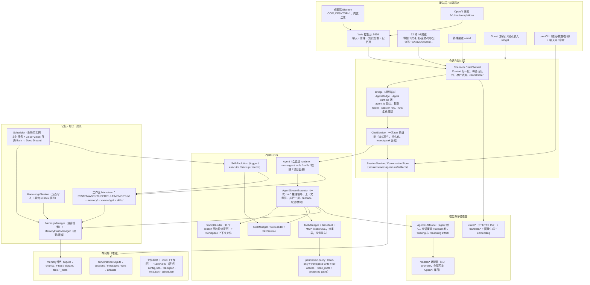

> **一句话读图**：所有入口最终都归一成 `Context` 进入 `ChatChannel`；`AgentBridge` 按 `(agent_id, session_id)` 找到/创建 Agent runtime；`AgentStreamExecutor` 是唯一的推理循环；记忆/知识/成长三块都在循环**周围**而不是循环**里面**（除 `memory_search`/`memory_get` 两个工具）。

### 3.2 模块清单（官方 10 模块 → 代码目录）

| 模块 | 职责 | 代码位置 |
|---|---|---|
| **Plan** | 意图理解、任务拆解、迭代调用工具直到完成 | `agent/protocol/agent.py`、`agent/protocol/agent_stream.py` |
| **Memory** | 短期上下文管理 + 长期记忆写入 + 混合检索 + Deep Dream | `agent/memory/`（`manager`/`storage`/`summarizer`/`conversation_store`/`service`/`embedding`） |
| **Knowledge** | 主题化 Markdown 知识网络、索引与交叉引用、reindex | `agent/knowledge/service.py`、`agent/prompt/builder.py::_build_knowledge_section` |
| **Evolution** | 空闲复盘：修 skill、补任务、回填记忆；备份与回滚 | `agent/evolution/`（`trigger`/`executor`/`backup`/`record`/`prompts`/`config`） |
| **Multi-agent** | 团队注册表、workspace 隔离、群聊 @、委派、子代理、跨进程 seam | `agent/registry.py`、`agent/team.py`、`agent/team_addressing.py`、`agent/multiagent/`、`agent/subagent/` |
| **Tools** | 内置工具、MCP 工具、工具生命周期与可用性 | `agent/tools/`（21 个工具目录 + `tool_manager.py` + `base_tool.py`） |
| **Skills** | 技能加载、优先级、安装、创建、Web/CLI 管理 | `agent/skills/`（`loader`/`manager`/`service`）、`skills/`（内置） |
| **Models** | 多 provider 文本/视觉/图像/语音/嵌入、fallback | `models/`、`voice/`、`translate/`、`bridge/bridge.py`、`bridge/agent_bridge.py::AgentLLMModel` |
| **Channels** | 消息收发、能力适配、多实例与 Agent 绑定 | `channel/`（`channel_factory`、`chat_channel`、`channel_instances`、各渠道目录、`web/`） |
| **CLI** | 终端 `cow` 与聊天内 `/` 命令 | `cli/`（`commands/` 下 `process`、`skill`、`install`、`backup`、`knowledge`、`context`）、`plugins/cow_cli/`、`plugins/godcmd/` |
| （支撑）权限 | 三档权限 + 路径根 + 命令解析 | `agent/permission/policy.py` |
| （支撑）提示组装 | 系统提示 11 section、工作区模板与 bootstrap | `agent/prompt/builder.py`、`agent/prompt/workspace.py` |
| （支撑）访客隔离 | 不复用 owner 路径的独立 runtime | `agent/guest/`（`runtime`/`profile`/`store`/`tools`） |
| （支撑）通用件 | 单例、原子写、i18n、token bucket、state 目录、运行时身份、渠道注册表 | `common/` |

### 3.3 目录 → 层 对照（"别遗漏"清单）

| 顶层目录 | 属于哪层 | 关键内容 |
|---|---|---|
| `app.py` | 进程装配 | 启动序列、`ChannelManager`、pid 文件、迁移、MCP 预热、内置技能同步、子代理资产脚手架 |
| `bridge/` | 会话与模型路由 | `bridge.py`（模型/语音/翻译路由）、`agent_bridge.py`（Agent runtime 池、团队 roster、委派/发言）、`agent_initializer.py`（每个 Agent 的记忆/嵌入/日终任务装配）、`context.py`、`reply.py`、`agent_event_handler.py` |
| `channel/` | 接入层 | 各渠道适配器 + `chat_channel.py`（队列/串行/装饰/发送）+ `web/`（控制台 + 22 个 API 模块 + OpenAI 兼容）+ `terminal/` + `channel_instances.py`（多实例） |
| `agent/` | Agent 内核 | `protocol/`、`chat/`、`prompt/`、`tools/`、`skills/`、`memory/`、`knowledge/`、`evolution/`、`subagent/`、`multiagent/`、`permission/`、`guest/`、`workspace/`、`registry.py`、`team.py`、`admin.py`、`routing.py` |
| `models/` `voice/` `translate/` | 模型层 | provider 适配器 |
| `plugins/` | 插件/命令层 | `godcmd`（命令总线）、`cow_cli`（聊天内命令）、`banwords`/`keyword`/`role`/`dungeon`/`finish`/`hello`/`linkai`/`tool`（legacy 能力与 LinkAI 增值） |
| `skills/` | 内置技能 | `image-generation`、`knowledge-wiki`、`skill-creator` |
| `cli/` | 终端 CLI | `cow` 入口、进程/技能/安装/备份/知识库/上下文命令、`update_service` |
| `common/` | 基础设施 | 见上表 |
| `desktop/` | 桌面端 | Electron main/renderer、后端打包 spec、`COW_DESKTOP=1` 轻量运行模式 |
| `docker/` | 部署 | Dockerfile、compose、`agent-mail` overlay |
| `docs/` | 文档站 | Mintlify `.mdx`（en/zh/ja/hant 四语） |
| `tests/` `scripts/` `translate/` | 支撑 | 测试、脚本 |

### 3.4 进程形态与启动序列

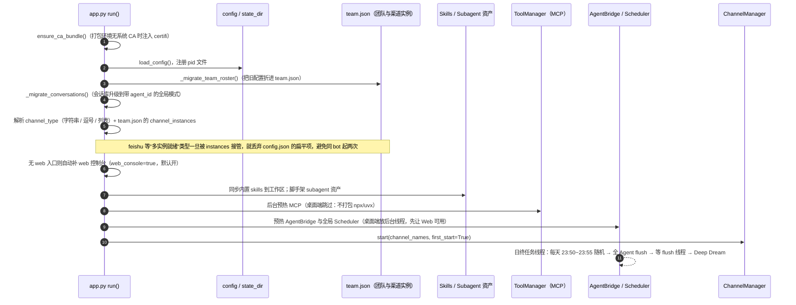

### 3.5 配置面（跨层的关键开关）

| 键 | 默认 | 层 |
|---|---|---|
| `agent` | `true` | 内核（Agent 模式） |
| `agent_workspace` | `~/cow` | 工作区 |
| `agent_max_context_tokens` / `agent_max_context_turns` / `agent_max_steps` | 200000 / 30 / 100 | 上下文与循环 |
| `agent_permission_mode` | `full-access` | 权限（会话继承） |
| `enable_thinking` | `false` | 模型层 |
| `knowledge` | `true` | 知识库（关闭后工具描述与检索范围自动收窄） |
| `deep_dream_enabled` | `true` | 记忆巩固 |
| `self_evolution_enabled` / `_idle_minutes` / `_min_turns` | `false` / 10 / 6 | 自成长 |
| `rerank_provider` / `rerank_model` | `""` / `BAAI/bge-reranker-base` | 检索 |
| `memory.hit_boost` | `false` | 检索（频繁命中抬升，约一周衰减） |
| `mcp_tool_retrieval_enabled` / `_threshold` / `_top_k` | `false` / 20 / 10 | 工具注入 |
| `agent_delegation.{enabled,allowed_targets,max_depth,timeout_seconds,max_message_chars}` | `true` / 未设 / 3 / 600 / 8000 | 多 Agent |
| `external_api_enabled` / `external_api_token` | `false` / — | Chat API |
| `web_console` / `web_host` / `web_password` | `true` / `127.0.0.1` / — | 接入层 |
| `channel_type` | `web` | 接入层（可多值） |
| `cow_lang` | `auto` | i18n（提示词/命令文本） |

---

### 3.6 进程内的线程与异步全景（细节）

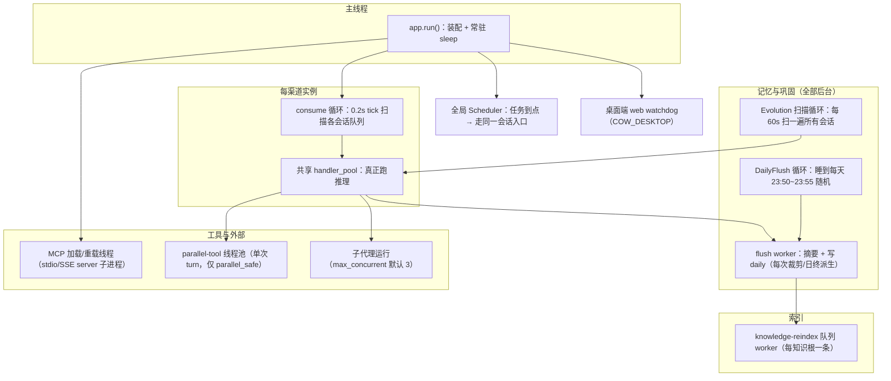

| 执行体 | 数量/生命周期 | 节奏 | 失败语义 |
|---|---|---|---|
| `consume` 循环 | 每渠道实例 1 条，常驻 | 0.2s tick | **单会话异常被吞并继续**（否则整个渠道会"活着但沉默"） |
| `handler_pool` | 进程共享线程池 | 每上下文一个 future | done-callback 释放会话信号量，保证删除时机正确 |
| flush worker | 每次摘要派生，join 后才继续 | 裁剪/溢出/日终 | 写失败只 warn，不影响回复 |
| `DailyFlush` 循环 | 1 条 daemon | 睡到目标时刻；出错退避 1h | 记录 `last_run_date`，跨零点不会把新的一天标记为已跑 |
| Evolution 扫描 | 1 条 | 60s | 单会话评估失败只 warn |
| MCP 加载/重载 | 每 server；启动后台预热 | 文件签名变化才重载 | 加载失败 → 工具不注入 + 状态可见；桌面模式跳过 |
| knowledge-reindex | 每知识根 1 条 daemon | 写页后排队 | `wait_for_reindex()` 供需要强一致时等待 |
| parallel-tool 池 | 每次 turn 临时，`max_workers=len(eligible)` | 仅当 ≥2 个 `parallel_safe` | 轮询 `cancel_event`，取消不等最慢调用 |
| 子代理 | 受 `max_concurrent` 限制 | 每次 spawn | 单任务失败返回 `unfinished` 结构，不炸主会话 |
| Scheduler | 全局单实例（不再是每 Agent 一份） | cron/interval/once | 与用户消息走同一入口，因此同样受权限与会话串行约束 |

---

### 3.7 三张架构视图：部署形态 / 静态依赖 / 双平面

#### 3.7.1 部署形态：一个进程里究竟跑着什么

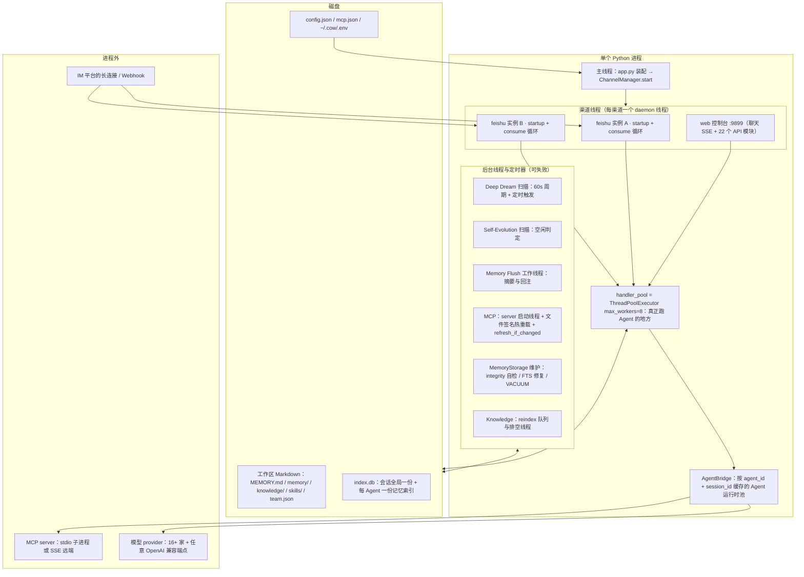

一句话读法：**渠道线程只负责搬运，线程池只负责一轮对话，后台线程只负责把文件变好，磁盘是它们唯一的公共语言。** 进程重启能恢复一切，正是因为没有跨线程的内存状态约定。

#### 3.7.2 静态依赖：包级 import 边（数字统计自本仓库代码的 AST）

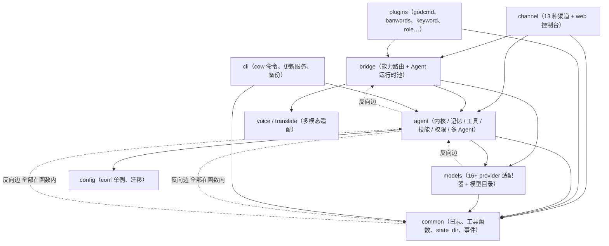

| 观察 | 数字 | 含义 |
|---|---|---|
| 主干方向 | `channel→common` 171、`channel→agent` 167、`channel→bridge` 86、`bridge→agent` 54、`agent→common` 203 | 渠道层最"厚"：它承担路由、身份、富媒体适配，内核反而被大量复用 |
| 反向依赖 | `bridge→agent` 54、`agent→bridge` 20、`common→agent` 32、`models→agent` 2、`agent→channel` 7、`common→channel` 6 | 存在双向耦合：分层是**意图**而非编译期约束 |
| 环的解法 | `channel→agent` 167 条里 **153 条在函数体内**；`common→agent` 32 条 **全部在函数体内（模块级 0 条）**；`bridge→agent` 54 条里 50 条在函数体内 | 用延迟导入把循环依赖推到调用期，`common` 因此能保持"叶子层"性质 |
| 最脆的一层 | `bridge` | 它同时持有**能力路由**（模型/语音/翻译/embedding）与**Agent 运行时池**（roster、speaker、team 播种、会话键），任何一边改动都会波及另一边 |
| 换东西的代价 | 换渠道 ≈ 只动 `channel/`；换内核 = 必动 `bridge`；换 provider = 只动 `models/` + `config` | 与 §3.1 的分层一致 |

#### 3.7.3 双平面：请求平面与后台平面只通过文件、索引与事件交接

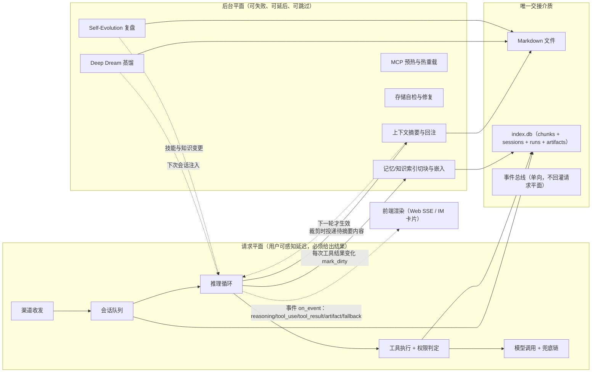

| 维度 | 请求平面 | 后台平面 |
|---|---|---|
| 延迟预算 | 秒级；任何"等一下"都要被论证（见 §13.3.3 的 60s 上限） | 无（可跨小时/跨天） |
| 失败策略 | 必须降级出结果（换模型、换渠道格式、退回文本） | 失败即放弃并记日志，**下次自然重来** |
| 并发约束 | 每会话串行（信号量）+ 全局 8 线程 | 每工作区一把锁（进化）+ 每 db 一把写锁 |
| 与对方的关系 | 只**投递**工作（写文件 / mark_dirty） | 只**产出**文件与索引，从不阻塞请求 |

这是全项目最值得抄的一条架构约束：**"变聪明"这件事永远在关键路径之外。**

---
## 4. 一条消息的完整生命周期

### 4.1 端到端时序

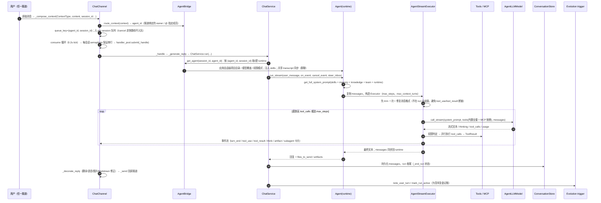

### 4.2 并发与会话隔离语义

| 机制 | 语义 | 为什么这样设计 |
|---|---|---|
| per-session 队列 + `queue_key=(agent_id, session_id)` | 同一会话内消息**串行**处理；不同会话/不同 Agent 并行 | 防止同一上下文被并发写坏；团队群聊里成员各自有队列 |
| `consume` 0.2s tick + 每会话 semaphore | 只有单一消费者；单会话异常不会终止循环 | "看着活着但永远沉默"是渠道层的典型故障，必须吞异常继续 |
| `handler_pool`（future + done_callback 释放槽位） | 实际推理在线程池；槽位靠回调释放 | 保证删除会话的时机正确 |
| `/cancel` 快路径 | 不进队列，直接取消在跑的 run（`cancel_event` 在安全点生效） | 长任务必须可中断 |
| `steer_inbox` | 中途注入新指令，在安全点 drain 并继续本轮 | 用户插话而非排队等下一轮 |
| 取消后的消息合法性 | 注入 `[Interrupted by user]` 助手注记，保留 `tool_use/tool_result` 配对 | 否则下一轮直接触发 provider 的消息格式错误 |
| Guest 访客走**独立** runtime | 明确不复用 `agent_reply` 路径（会带上 owner 的记忆/会话/调度/委派/进化） | 访客路径"每一次 owner 复用都是泄露或污染的机会" |

### 4.3 事件协议（前端渲染契约）

`on_event(event_type, data)` 是内核与所有富前端（Web/桌面/委派卡片）的接口：`agent_start`、`turn_end`、`tool_use`/`tool_result`、thinking 增量（含 `think` 标签流式过滤，未闭合的半个标签会被缓冲）、`sent_file`/artifact、子代理状态卡、MCP 工具检索模式（`retrieved`/`fallback`）。工具也可 `report_progress()` 与 `emit_event()`（如浏览器、下载类工具）。

---

### 4.4 会话、run 与取消的状态机

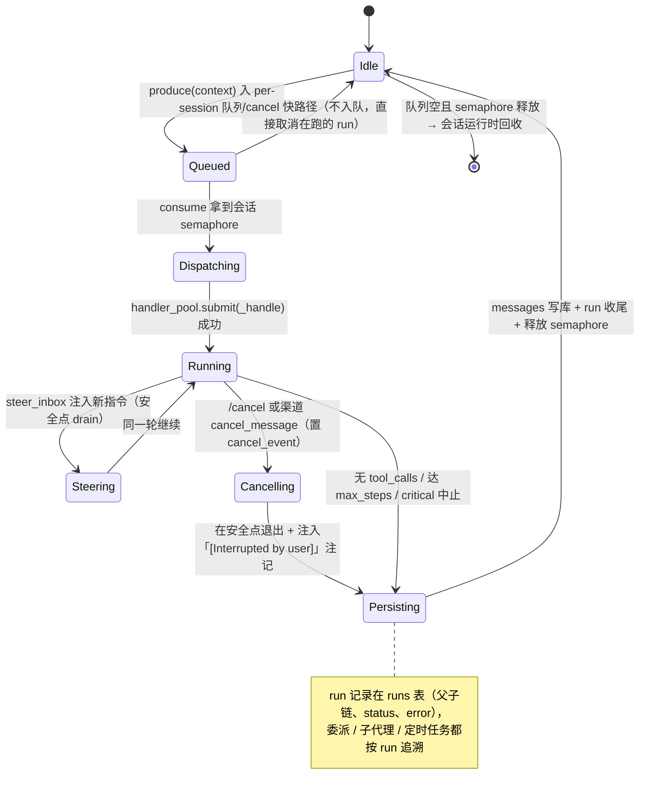

**三条不变量**（实现里处处在为它们服务）：

| 不变量 | 为什么重要 | 谁负责 |
|---|---|---|
| 同一 `(agent_id, session_id)` 同时只有一个 run | 防上下文并发写坏 | ChatChannel 队列 + semaphore |
| `messages` 里 `tool_use` 与 `tool_result` 永远成对 | 否则下一轮 provider 直接消息格式 400 | `_validate_and_fix_messages`、取消注记、trim 只在 run 开始前 |
| 会话运行时生命周期与 run 解耦 | 取消/失败不能把 Agent runtime 一起销毁 | AgentBridge 缓存 + `_retire_session_runtimes` |

---

## 5. Agent 内核：推理循环与上下文工程

### 5.1 两个对象的分工

| 对象 | 生命周期 | 持有什么 |
|---|---|---|
| `Agent` | **会话级 runtime**（被 `AgentBridge` 按 `(agent_id, session_id)` 缓存复用） | `messages`（跨调用持续）、tools、skills、model 引用与 fallback 解析、`project_dir`、权限模式与 `write_roots/protected_paths`、`memory_manager`、`captured_actions` |
| `AgentStreamExecutor` | **一次 run** | 本轮 messages 副本、system prompt、工具集、取消/转向、循环检测、usage 统计、`files_to_send` |

> 设计要点：Executor 用**副本**跑，跑完再同步回 Agent（若被裁剪则整体替换而非追加，并用 `run_start_index()` 定位本轮新增），既避免并发修改，又保证持久化不漏回复。

### 5.2 推理循环（含全部补救分支）

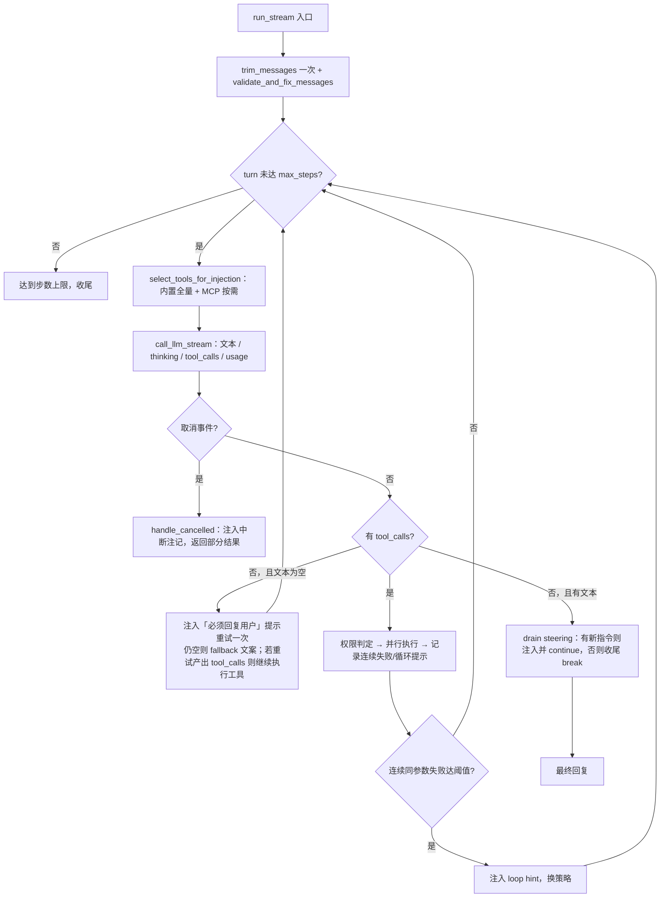

### 5.3 系统提示的组装（PromptBuilder）

| Section | 内容 | 来源 |
|---|---|---|
| Identity | 基础人设 + 语言约束 | `SYSTEM.md` / 内置模板 |
| Response language | 回复语言（`cow_lang`） | config |
| Tooling | 工具使用规范（按当前可用工具动态生成） | `ToolManager` |
| Skills | 技能清单（渐进披露：只列 name/description，正文按需 `read`） | `SkillManager` |
| Memory | **记忆召回是强制动作**：先 `memory_search`，已知路径用 `memory_get`，查不到读最近两天；并声明 `MEMORY.md` 已自动注入、`memory/YYYY-MM-DD.md` 是今日 | `MemoryManager` + 工作区 |
| Knowledge | 知识库索引（`index.md` 压缩注入）+ 路径规则 | `knowledge/index.md` |
| User identity | 用户身份（渠道类型、receiver 等） | Context |
| Docs / Workspace / Project workspace / Cloud website | 工作区规则、项目目录边界、云端站点 | 工作区 + 会话绑定 |
| Context files | `SYSTEM.md`/`AGENT.md`/`USER.md`/`RULE.md` 正文 + **`MEMORY.md` 尾部 200 行 / 25KB**（截断时插入"老内容已截断，请用 memory_search/memory_get"提示） | `prompt/workspace.py` |
| Team | 团队 roster（可委派的 teammate id）、协作与 @ 语义 | `agent/registry.py` + 会话成员 |
| Runtime | 时间、模型、权限模式、平台等运行时事实 | 运行时 |

### 5.4 上下文工程：五级压缩（成本与连续性的平衡）

| 级别 | 触发 | 动作 | 对记忆的影响 |
|---|---|---|---|
| L0 工具结果截断 | 每次决策前 | 历史轮中超 **20,000 字符**的工具结果只留首尾 + 截断说明；本轮结果不动 | 无 |
| L1 轮次裁剪 | 轮数 > `agent_max_context_turns` | 裁掉**最老一半**完整轮（保持工具链完整）；被裁内容由 LLM 摘要写入**日记忆**；摘要就绪后**异步回注**到保留上下文的首个 user 消息（下一轮生效） | **写入 daily** |
| L2 Token 预算裁剪 | 裁完仍超预算 | 轮数 <5：对每轮做**文本压缩**（只留首条 user 文本 + 末条助手回复，删中间工具链）；轮数 ≥5：再砍前半，写记忆 + 回注摘要 | **写入 daily** |
| L3 API 溢出应急 | provider 返回 context overflow | ①当前会话全量摘要落记忆 ②激进裁剪（工具结果 10K / user 文本 10K / 最多 5 轮）③仍溢出则清空上下文 | **紧急写入 daily** |
| L4 手动 `/compact` | 用户请求 | 复用同一套摘要/回注逻辑，立即执行，长任务前腾空间 | 写入 daily |

**冷启动与恢复**：会话消息持久化在 SQLite，重启后只恢复 `max(3, max_context_turns/6)` 轮，且每轮只保留 user 文本与助手最终回复（不回放工具链）；超过 30 天的会话自动清理。→ 这是"恢复快、成本低、长期一致性交给记忆层"的典型取舍。

### 5.5 工具 Schema 注入策略（MCP 规模化的关键）

- 内置工具**永远全量注入**（技能与核心流程硬依赖）。
- MCP 工具：仅当开启 `mcp_tool_retrieval_enabled` **且** MCP 工具数 > 阈值（默认 20）时，才按 embedding 相似度选 top_k（默认 10），并与本轮已选**并集（只增不减）**——已经产生过 `tool_use` 的工具绝不会中途从 schema 消失（否则 Claude/MiniMax 会报消息格式错误）。
- 任何降级路径（未开启、无 embedding provider、嵌入失败、数量未过阈、异常）→ **全量注入，工具永不静默丢失**，并发一个 `fallback` 事件供前端显示。

### 5.6 稳健性机制清单

| 机制 | 位置/说明 |
|---|---|
| 连续失败检测 + 循环提示 | `_check_consecutive_failures`（同工具同参数哈希）、`_inject_loop_hint` |
| 消息格式自检自修 | `_validate_and_fix_messages` / `_identify_complete_turns`（裁剪后孤儿 `tool_use` 修复） |
| 空响应补救 | 无文本无工具 → 注入"请明确回复"重试；重试产出工具则继续执行 |
| 模型 fallback 链 | `AgentLLMModel`：主模型 → 有序兜底链（`use_fallback`/`reset_fallback`/`fallback_available`，链长×2 遍后回卷）。**上下文溢出与消息格式错误刻意不作为兜底候选**：它们由会话引起，恢复手段是重写历史而不是换 provider（见 §13.3.3） |
| 上下文溢出的预算重算 | `_overflow_input_budget` + `_smart_compact_to_budget` |
| thinking 流式清洗 | `think` 标签跨 delta 缓冲与过滤，未闭合半标签不外泄 |
| 取消语义 | 安全点轮询 `cancel_event`，保留消息合法性，返回部分结果 |
| 运行可追溯 | `runs` 表记录一次 run（委派/子代理/定时任务都能按 run 查回、续跑、上报） |

---

### 5.7 上下文预算的算术（把默认值代进去）

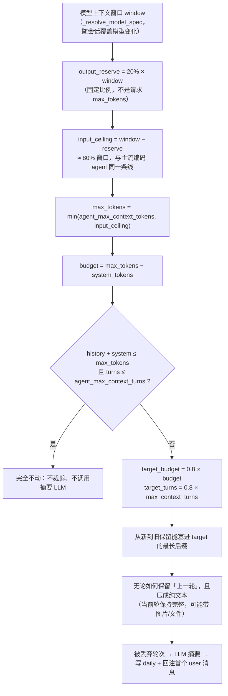

| 数字 | 值 | 含义与调法 |
|---|---|---|
| output reserve | **20% of window** | 压缩触发线在 ~80%；故意不用模型的静态 max output（否则不同模型触发点乱跳） |
| `context_reserve_tokens`（另一处） | 10% of window，clamp [10k, 200k] | 给新请求留缓冲 |
| `TRIM_TARGET_RATIO` | **0.8** | 一次裁到 80% 目标，留出增长空间，避免每轮都裁 |
| 当前轮工具结果 | 创建时 **30,000 字符** | 工具结果落消息时就限长 |
| 历史轮工具结果 | 再截到 **20,000 字符**（`MAX_HISTORY_RESULT_CHARS`） | 先缩体积，可能因此不必丢整轮 |
| trim 时机 | **run 开始前一次** | 绝不在工具步中间裁，防止链断导致模型打转 |

**Token 估算器**（不是真 tokenizer，是稳定的启发式，UI 用量图与裁剪预算共用同一把尺）：

| 元素 | 估算 |
|---|---|
| CJK/非 ASCII 字符 | **1.5 token / 字符** |
| ASCII 字符 | **0.25 token / 字符**（4 字符/token） |
| image block | 固定 **1200 token** |
| `tool_use` 结构开销 | **+50 token** + 入参 JSON 的文本估算 |
| `tool_result` 结构开销 | **+30 token** + 内容文本估算 |
| 其他 block | +10 token |

**代入示例**（`window=200k`、`agent_max_context_tokens=200000`、`turns=30`）：
reserve 40k → ceiling 160k → `max_tokens=160k`；系统提示（11 段 + 技能目录）估 18k → `budget=142k`；历史估 150k 且 34 轮 → 触发裁剪，目标 `0.8×142k=113.6k` 与 `0.8×30=24` 轮，保留最新后缀，被丢的 10 轮摘要写进当天 daily 并回注。

**溢出应急不是猜**：provider 报错串会被正则解析出 `maximum context length is N tokens` 与 `... in the completion`，据此**反推真实 input 预算**再执行 `_smart_compact_to_budget`（而不是按经验值二次裁剪）。

### 5.8 循环防护的四级阈值（防"工具打转"）

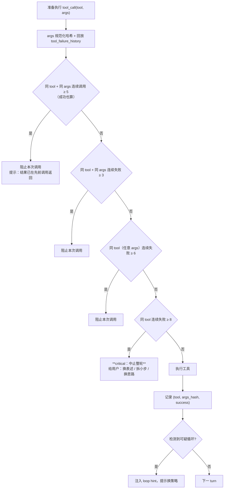

注意第一级把**成功调用也计数**：它抓的是"工具成功但模型反复用同样参数调它"的死循环。

### 5.9 工具并行执行的精确语义

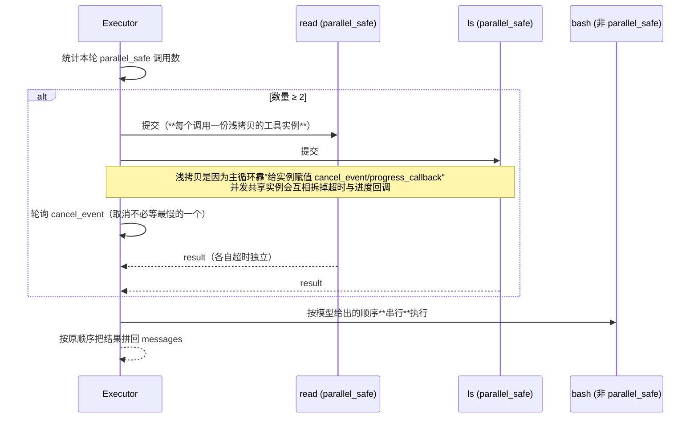

| 规则 | 说明 |
|---|---|
| 默认串行 | 严格按模型给出的调用顺序（有些调用彼此有依赖） |
| 只有声明 `parallel_safe` 才并行 | 且本轮必须 ≥2 个这样的调用 |
| 每调用独立工具实例 | 见上图说明（浏览器会话、MCP client 等仍共享） |
| 取消不等待 | 轮询 `cancel_event`，取消立即交回控制 |

### 5.10 上下文用量分解（控制台"清理上下文"按钮背后的图）

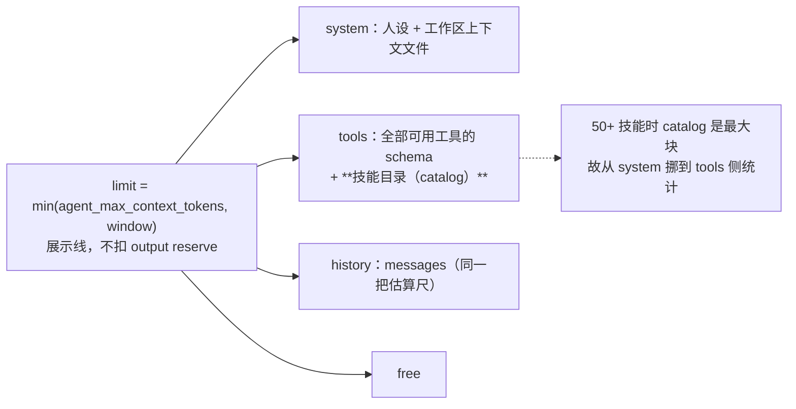

- 计数用**已缓存的 system prompt**（不重建 AGENT.md/技能，保证 hover 便宜）。
- `used` 可能超过 `limit`：裁剪预算**不预算工具 schema**，而 schema 实际占窗口。
- 开启按需工具注入时，真实注入的 tools 片段可能小于图里显示的上界。

---

## 6. 记忆体系：分层、写入、检索、巩固

CowAgent 的记忆不是一个"向量库"，而是**四层存储 + 一条检索总线 + 两条巩固回路**。

### 6.1 四层记忆模型

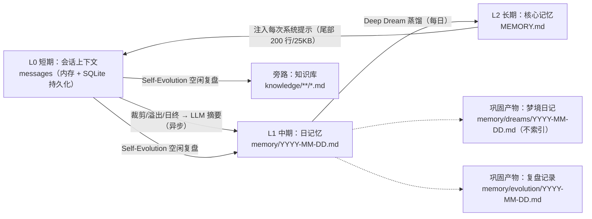

| 层 | 位置 | 写入者 / 触发 | 用 LLM | 读取路径 | 生命周期与衰减 |
|---|---|---|---|---|---|
| **L0 短期（context）** | `Agent.messages` + `messages` 表 | 每轮对话与工具结果 | 否 | 直接进模型；`/context` 查看 | 超过轮数/token 被压缩或裁剪；重启只恢复 `max(3, turns/6)` 轮；会话 30 天清理 |
| **L1 日记忆（daily）** | `~/cow/memory/YYYY-MM-DD.md`（首次写入才创建，`# Daily Memory: 日期` + 按原因分段追加） | ①上下文裁剪 ②API 溢出应急 ③每日 23:50~23:55 随机日终 flush ④`/compact` ⑤Evolution 回填 | **是**（事件维度摘要） | `memory_search` / `memory_get`；索引时 `source=memory` | 检索打分**按 30 天半衰期衰减**；文件本身不自动删 |
| **L2 核心记忆** | `~/cow/MEMORY.md` | Deep Dream 蒸馏覆写；人或 Agent 用编辑/`write` 直接改 | **是**（蒸馏） | **每次对话自动注入系统提示**（尾部 200 行 / 25KB，超限插入"老内容已截断"提示） | 不清零，只被更精炼的条目取代；**蒸馏目标 ≤30 条** |
| **旁路知识库** | `~/cow/knowledge/**` | Agent 主动结构化（文章/结论/显式要求） | **是** | 索引注入 + `memory_search` + `memory_get` | 只增不减，靠链接成网络 |
| 巩固产物 | `memory/dreams/*`、`memory/evolution/*` | Deep Dream / Self-Evolution | 是 | **Web 控制台阅读**（梦境日记 tab、自我进化 tab） | 留存供回溯；**dreams 不进检索索引** |

> **为什么 dreams 不索引**：日记里的 factual 内容已经蒸馏进 `MEMORY.md`，再索引只会制造与权威条目竞争的近似重复噪声。这是官方注释里明确写下的取舍。

### 6.2 写入路径（全部异步，不阻塞回复）

| 触发 | 摘要粒度 | 写入段落标题 | 备注 |
|---|---|---|---|
| 上下文裁剪（L1/L2 压缩） | 被丢弃的那一半轮次 | `## Trimmed Context (HH:MM)` | 摘要同时回注保留上下文，保证对话连续性（下一轮生效） |
| API 上下文溢出 | 当前全部消息 | `## Context Overflow Recovery (HH:MM)` | 应急保命路径 |
| 日终 flush（每天 23:50~23:55 随机） | 每个活跃会话的完整 messages | `## Daily Summary (HH:MM)` | 内容 hash 未变则跳过；随机分钟是跨实例错峰 |
| `/compact` | 老轮次 | 复用同一摘要（**不重复调 LLM**） | 显式腾空间 |
| Deep Dream | 日记忆 → 核心记忆 | 覆写 `MEMORY.md` | 见 §6.5 |
| Self-Evolution | 复盘发现 | 追加日记忆 / 改 `MEMORY.md` / 改知识页 / 改 skill | 见 §6.6 |

摘要提示词的硬约束（决定 L1 质量上限）：按**事件**维度归纳而非逐轮；每条一行 `- `；合并同一件事的多轮；忽略闲聊问候；保留关键决策、结论、待办；**无记录价值直接回"无"**（避免垃圾条目）。

### 6.3 检索路径（混合检索的真实算法）

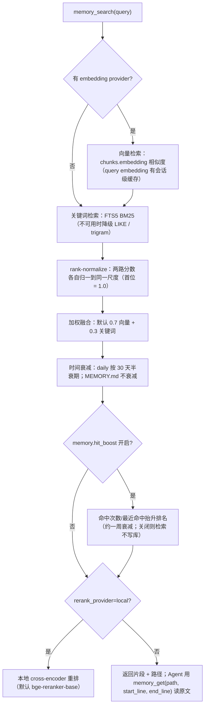

**两个容易被误解的点**：

1. 融合前做的是 **rank normalization**，首位永远被归一到 1.0，所以 `min_score` 是**排名位置的闸门**，不是绝对相关度下限。
2. 检索命中不代表"内容可信"，只代表"过去记录过"。系统提示里把**记忆召回写成强制动作**（涉及过往事件/决策/偏好/待办/不确定时**必须先搜**再答），但结论仍要对照当前事实。

### 6.4 索引与存储（SQLite）

| 表 / 对象 | 作用 |
|---|---|
| `chunks` | 记忆与知识的最小检索单元：`id`、`user_id`、`scope(shared/user)`、`source(memory/knowledge)`、`path`、`start_line/end_line`、`text`、`embedding`、`hash`、`metadata`、`hit_count/last_hit_at` |
| `chunks_fts`（FTS5） | 关键词检索主索引；损坏/不一致时自动重建（`_repair_search_indexes`、`reset_fts5`、完整性扫描） |
| `chunks_fts_trigram` | 三字符索引变体（CJK/子串场景的备选，按需禁用） |
| `files` | 每文件的 `hash/mtime/size/source` → 增量索引的依据 |
| `_meta` | 内部标记（回填进度、chunker 版本等） |

**索引范围与排除规则**（`MemoryManager.sync()`）：

- 纳入：`MEMORY.md`（`source=memory, scope=shared`）、`memory/**/*.md`（`daily/<user_id>/` 或 `users/<user_id>/` 会解析成 `scope=user`）、`knowledge/**/*.md`（`knowledge=false` 时整块跳过）。
- 排除：以 `.` 开头的目录、`dreams/`、知识库根下的 `index.md`/`log.md`（它们只是复述已被单独索引的页面，且每次写页都变，会造成全量重嵌入）。
- **两阶段批量嵌入**：先走文件树做变更检测与切块，攒够 pending chunk 后**一次 `embed_batch`**（供应商按各自上限自动分页）→ 101 个小文件的场景把 ~100 次 HTTP 降到 ceil(总块数/上限)。
- **拿到有效 embedding 之前绝不动索引**（否则会写入 NULL 向量并把文件 hash 标记为已处理，永久丢索引）。
- 无 embedding provider → 明确降级为纯关键词检索，并记日志（不"偷偷"重建一个 vendor）。

### 6.5 巩固回路 A：Deep Dream（记忆蒸馏）

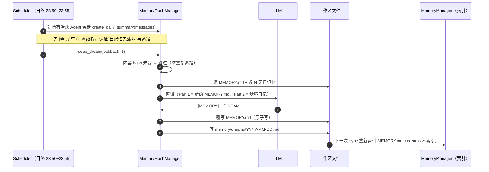

| 蒸馏操作 | 含义 |
|---|---|
| Merge & refine | 同类条目合并成高密度单句 |
| Extract new | 从日记忆抽取偏好、决策、人物、经验 |
| Conflict update | 新旧冲突时**新信息优先** |
| Clean invalid | 删除临时记录、空条目、格式残留 |
| Remove redundancy | 删除已被更精炼表述覆盖的老条目 |

安全机制：无内容跳过 / 输入去重 / 异步执行 / 排程内"先 flush 后 dream"的顺序保证 / **提示词明令"只能基于给定材料整理，严禁编造推测"**。
手动：`/memory dream [N]`（N=回溯天数，默认 3，最大 30，后台跑完通知；不依赖 Agent 已初始化）。开关：`deep_dream_enabled`（只关夜间自动蒸馏，日摘要与手动蒸馏不受影响）。**首次部署建议跑一次 `/memory dream 30`**，把历史日记忆一次性蒸进 `MEMORY.md`。

### 6.6 巩固回路 B：Self-Evolution（会话复盘）

| 维度 | Deep Dream | Self-Evolution |
|---|---|---|
| 目标 | 只整理记忆（日记忆 → `MEMORY.md` + 梦境日记） | **三件事**：回填记忆 / 改进 Skills（修错误、沉淀可复用流程为新技能）/ 跟进未完成事项 |
| 触发 | 定时（日终）或 `/memory dream` | **空闲且攒够内容**：距上次交互 > `idle_minutes`（10）**且**（自上次复盘的轮数 ≥ `min_turns`（6）**或**上下文接近容量） |
| 执行环境 | flush 线程 | 独立、短生命周期的任务；同模型但**受限工具集**（读上下文 + 编辑记忆与技能文件），不污染主会话上下文 |
| 可逆性 | 覆写前不额外备份（靠 git/版本管理） | **每次复盘前快照**相关文件 → 说一句"撤销上一次改动"即从快照恢复；变更检测决定是否通知（**无变更 = 一条消息都不发**） |
| 记录 | `memory/dreams/*` | `memory/evolution/*`（Web 里与梦境日记同一个 tab 组） |
| 硬护栏 | 严禁编造；跳过空输入 | 内置技能永不被改；读写只在工作区内；后台执行不阻塞回复；`evolution_undo` 工具 |

> **两条回路的分工**是这套记忆设计的核心节奏：**热路径**只负责"别丢"（裁剪即摘要），**冷路径**负责"变精炼、变可用"（蒸馏、技能化、补任务）。热路径不做重 LLM 工作，冷路径不抢交互延迟。

---

### 6.7 检索打分：把公式代进去（真实公式，数字可复算）

三条公式：

| 步骤 | 公式 | 说明 |
|---|---|---|
| Rank-normalize | `score_i = (N − i) / N`（i 从 0 开始，同一路结果内部） | 首位 = 1.0，末位 = 1/N；把 cosine 与 BM25 这两种不可比的尺度对齐 |
| 融合 | 只对**真正返回了该 chunk 的通道**做加权平均，权重在该子集上重新归一 | 单通道强命中不会被另一通道的 0.0 拉低；`0.7/0.3` 实际只起作用为**比值** |
| 时间衰减 | `mult = exp(−ln2 / 30 × age_days)`，仅作用于 `memory/(users/<id>/\|dreams/)?YYYY-MM-DD.md` | `MEMORY.md` 与**所有知识页（含带日期的知识页）是 evergreen，mult=1.0** |
| 命中抬升（默认关） | `mult = 1 + w × log2(1 + hit_count)` + 同量级 `last_hit_at` 近期项，上限 `hit_boost_max=1.25` | 默认 `w=0`：检索命中不等于"有用"，所以默认不写库也不改排名 |

**算例**：向量列 N=5 → 归一分 `[1.0, 0.8, 0.6, 0.4, 0.2]`；关键词列 N=5 同理。

| 候选 | 向量名次 | 关键词名次 | 融合 | 衰减 | 终分 | 名次 |
|---|---|---|---|---|---|---|
| `memory/2026-10-30.md`（2 天前） | 第 1 | 未命中 | 仅向量通道 → `1.0` | `e^(−0.0231×2)=0.955` | **0.955** | 1 |
| `MEMORY.md` 条目 | 第 2 | 第 1 | `0.7×0.8 + 0.3×1.0 = 0.86` | 1.0（evergreen） | **0.860** | 2 |
| `knowledge/concepts/rag.md` | 第 3 | 第 3 | `0.6` | 1.0（知识页） | **0.600** | 3 |
| `memory/2026-10-10.md`（20 天前） | 未命中 | 第 2 | 仅关键词通道 → `0.8` | `e^(−0.0231×20)=0.630` | **0.504** | 4 |

读法：**旧日记会被时间衰减压下去，核心记忆与知识页不会被时间惩罚**；单通道命中不会被 0.0 稀释；`min_score`（默认 0.1）在归一尺度上起作用，所以它更像"取前几名"的闸门。

默认检索参数（`MemoryConfig`，按版本核对）：

| 参数 | 默认 |
|---|---|
| `chunk_max_tokens` / `chunk_overlap_tokens` | 500 / 50 |
| `max_results` / `min_score` | 10 / 0.1 |
| `vector_weight` / `keyword_weight` | 0.7 / 0.3 |
| `hit_boost_weight` / `hit_boost_max` | 0.0（关）/ 1.25 |
| `embedding_provider` / `embedding_model` / `embedding_dim` | `openai` / `text-embedding-3-small` / 1536 |
| `enable_auto_sync` / `sync_on_search` | true / true（脏则检索前顺手同步） |

### 6.8 chunk 的生命周期（索引一致性细节）

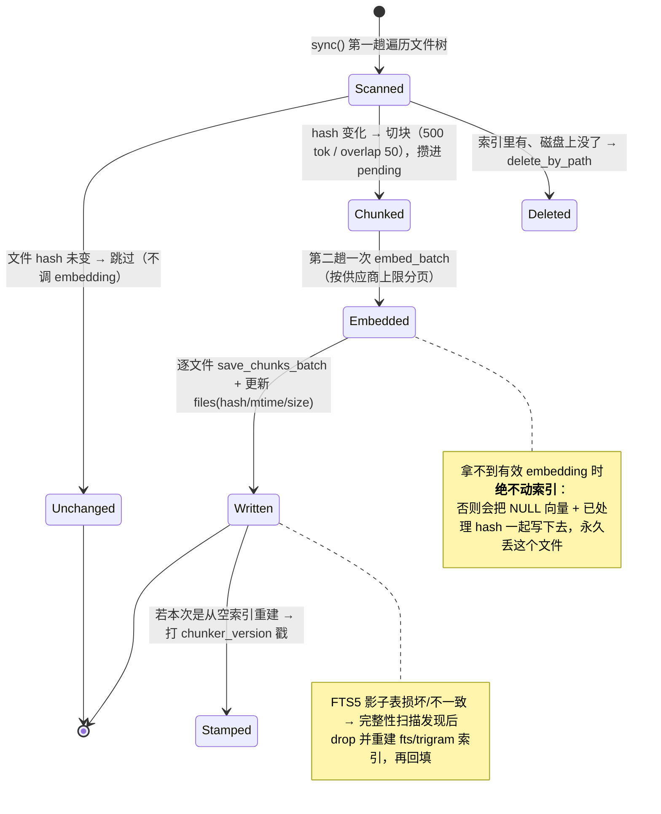

关键细节：

- **两阶段设计**的意义：101 个小文件（每文件约 1 块）从 ~100 次 embedding HTTP 降到 `ceil(总块数 / 供应商单请求上限)`。
- 索引键（`path`）按 POSIX 风格且带根前缀，因此**共享知识根**下的文件即使在工作区之外，也仍记作 `knowledge/note.md`——Agent 增删私有副本时不需要重建索引。
- `scope`：`shared` 与 `user`（`memory/users/<id>/…` 或 `daily/<id>/…` 解析出 `user_id`）；`include_shared` 与 `user_id` 决定查询覆盖哪些 scope。
- 嵌入失败/无 provider → 该次检索**只走关键词**，不抛异常。

### 6.9 两条巩固回路的合并时序（热路径 / 夜间 / 空闲三条 lane）

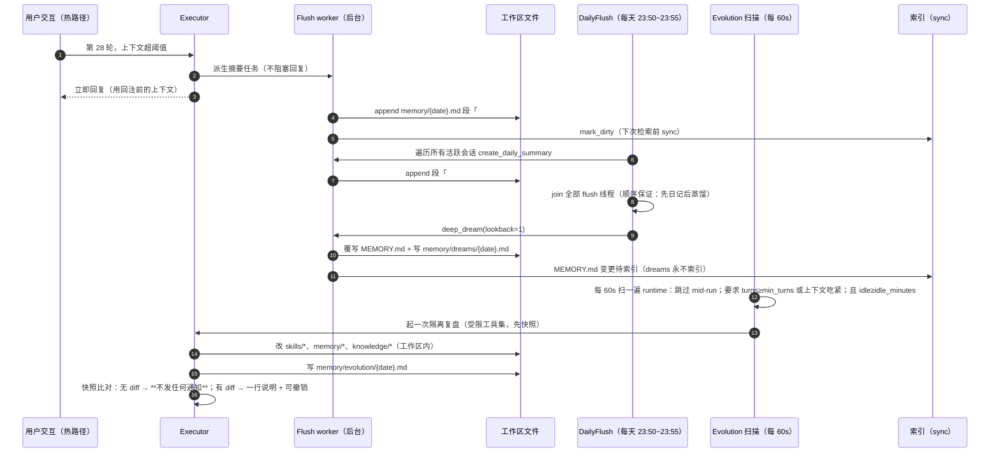

---

## 7. 记忆分层完整实例（Day 1 → Day 2 → Day 10）

> 场景：用户让助理"每周一给团队发产品周报"。目标是看清**每一层在同一件事上分别存了什么、什么时候变、被谁读走**。文件内容为示意，非必然产物。

### 7.1 Day 1：任务落地 → L0 被裁 → L1 追加

**L0 短期上下文**（当天最后几轮，简化）：

```
user: 以后每周一早上 9 点，把上周的功能上线和 bug 汇总发给我们团队群
assistant: [tool] scheduler.create(...) → 已创建定时任务（每周一 09:00）
user: 别把内部成本数字写进去，团队群里有外部同事
assistant: [tool] edit skills/weekly-report/SKILL.md（追加"禁止包含成本数字"）
```

当天第 28 轮触发 **L1 轮次裁剪**（`agent_max_context_turns=30`），被丢弃的前半段被摘要写入 `~/cow/memory/2026-10-30.md`：

```markdown
# Daily Memory: 2026-10-30

## Trimmed Context (15:42)

- 确立了每周一 09:00 的团队周报定时任务（数据源：功能上线记录 + bug 列表）
- 用户明确要求：周报正文不得出现内部成本数字（群内有外部同事）
- 待办：下周一首次执行后确认格式
```

**同一天，L2 未变**：`MEMORY.md` 此刻还是蒸馏前的老内容——**核心记忆只在 Deep Dream 时被覆写**，热路径不会直接改它（除非 Agent 主动编辑或 Evolution 回填）。

**L1 → 索引**：下一次 `sync()` 把这个新文件切成 chunk，`source=memory, scope=shared`，一次 `embed_batch` 落库；`files` 记录 hash。**此刻起它可被 `memory_search` 命中。**

### 7.2 Day 1 夜间 23:52：Deep Dream 蒸馏（L1 → L2）

读入 `MEMORY.md`（12 条）+ `2026-10-30.md` → LLM 输出 `[MEMORY]` + `[DREAM]`：

```markdown
# ~/cow/MEMORY.md（蒸馏后，节选）

## 工作约定
- 团队周报：每周一 09:00 自动生成并发到团队群；内容 = 功能上线 + bug 汇总。
- 保密约束：任何对外可见产物中不得出现内部成本数字（团队群含外部同事）。   ← 新增
- 汇报偏好：先结论后细节，条目化。

## 待跟进
- 2026-11-02 首次周报执行后检查格式与数据完整性。                          ← 新增
```

```markdown
# ~/cow/memory/dreams/2026-10-30.md

今天把"周报"从一次性的任务安排收敛成一条长期约定。发现两处冗余：
原先"周五同步会议议程"与"周报模板"重复描述了同一汇报口径，已合并。
新增一条保密约束，它可能影响以后所有对外产物的写法。
```

> `dreams/` **不进索引**（避免与 `MEMORY.md` 抢排名），只给人看。`MEMORY.md` 因为会被注入系统提示，所以必须精炼（≤30 条）。

### 7.3 Day 2：读取路径演示（谁在什么时候读它）

```text
SessionStart（新会话，L2 已在 prompt 里）
  └─ 系统提示含 MEMORY.md：模型"天然知道"周一 09:00 周报与保密约束，无需搜索
用户："帮我把这周的 bug 情况整理一下发给团队"
  └─ Agent 判断"涉及既往约定" → memory_search("周报 团队群 格式 要求")
       → 命中 memory/2026-10-30.md 的 chunk（rank-normalize 后首位=1.0）
       → memory_get("memory/2026-10-30.md", start_line=3, end_line=9) 读原文
       → 顺带读到"待办：确认格式"
  └─ 对照当前事实（当前群成员、当前 bug 数据）后执行
```

### 7.4 Day 2 会话空闲 11 分钟后：Self-Evolution（L0 → Skills / L1 / KB）

复盘任务在隔离环境跑，受限工具集，先快照：

```markdown
# ~/cow/memory/evolution/2026-11-01.md

## Review 2026-11-01 10:22
- 技能改进：skills/weekly-report/SKILL.md 补一步"发送前用群成员列表校验外部同事"（本次执行时漏了这步）
- 记忆回填：MEMORY.md 增加"bug 数据来源 = xxx 看板，需登录态"
- 未跟进事项：把"下周一确认格式"落到 scheduler 的一次性任务里 → 已创建
```

**这一层的价值**：Deep Dream 只能整理记忆文本，而 Evolution 会把**一次执行中发现的流程缺陷固化成能力**（改 skill）——这是它区别于"记忆型"项目的地方。

### 7.5 Day 10：知识库分层（记忆 vs 知识的分叉）

用户贴了一篇"如何写好周报"的文章。Agent **不把它写进记忆**，而是建知识页：

```markdown
# ~/cow/knowledge/sources/weekly-report-guide.md    （source 类页面）
# ~/cow/knowledge/concepts/report-structure.md      （concept 类页面，双向链接）
# ~/cow/knowledge/log.md                            （每次写入追加一行变更日志）
# ~/cow/knowledge/index.md                          （索引，注入系统提示时被压缩）
```

分工一目了然：

| 内容 | 落在哪 | 原因 |
|---|---|---|
| "每周一 09:00 发团队群" | `MEMORY.md`（L2） | 长期偏好/约定，需每次都在场 |
| "10-30 那天做了配置、当时用户说了什么" | `memory/2026-10-30.md`（L1） | 时间线事件，按天可回溯、随时间衰减 |
| "本周对话里正在做的事和工具结果" | L0 context | 只在当前任务有用，超预算即压缩 |
| "周报写法的通用方法与参考文章" | `knowledge/**` | 主题化、跨任务复用、互相链接成网络 |
| "为什么这样整理、发现了什么冲突" | `memory/dreams/*`、`memory/evolution/*` | 巩固过程的审计痕迹 |

### 7.6 五个最容易踩的误解

1. **"MEMORY.md 会被每次对话自动追加。"** 不会。它由 **Deep Dream 覆写**（人或 Agent 也可直接编辑），热路径只写 daily。
2. **"所有 md 文件都在向量库里。"** 不是。`dreams/`、知识库根的 `index.md`/`log.md` 被**故意排除**在索引外。
3. **"搜到 = 事实成立。"** 检索分数是 rank 归一（首位=1.0），只表示"排名靠前"，结论仍需对照当前代码/数据/指令。
4. **"自成长会自动改我的东西。"** 会改，但仅限工作区、仅限非内置技能、有快照可撤销、无变更则完全静默。
5. **"记忆层就是检索层。"** CowAgent 的记忆是**四层 + 两条巩固回路**；只谈 embedding/FTS 会漏掉它最有价值的部分（蒸馏与复盘）。

---

### 7.7 时间线与成本视图（谁在什么时候付 token）


| 时点 | 谁付 LLM token | 次数与可预测性 |
|---|---|---|
| 裁剪/溢出 | 摘要 1 次（后台） | 与上下文压力成正比，可通过阈值控制 |
| 日终 | 每活跃会话 1 次摘要 + 1 次蒸馏 | **每天 1~2 次/会话**，最可预测 |
| 手动 `/memory dream N` | 1 次蒸馏 | 只在需要时 |
| Self-Evolution | 1 次复盘（同模型） | 受 `idle` 与 `min_turns` 双闸门，最坏随交互密度上升 |
| 检索 | 0（除 embedding 查询） | 无 embedding 时纯关键词 = 0 成本 |
| 知识写入 | 结构化 1 次 | 由 Agent 决策触发 |

### 7.8 同一条事实在六处的表达（一致性检查用）

事实：**"周报每周一 09:00 发团队群，正文禁止出现内部成本数字"**

| 位置 | 形态 | 谁会读它 | 生命周期 |
|---|---|---|---|
| L0 context | 当轮 user 原话 + 工具调用/结果 | 当前 run | 超阈值即被摘要替代 |
| `memory/2026-10-30.md` | `- 用户要求：周报正文不得出现内部成本数字（群内含外部同事）` | `memory_search`（会被 30 天半衰期压低） | 文件保留，权重随时间下降 |
| `MEMORY.md` | `保密约束：任何对外可见产物中不得出现内部成本数字` | **每次对话的系统提示** | 直到被更精炼条目取代 |
| `skills/weekly-report/SKILL.md` | 工作流里的一步："发送前校验群成员是否含外部同事" | Agent 执行该技能时 | 直到被再次修订/撤销 |
| `memory/dreams/2026-10-30.md` | "新增一条保密约束，可能影响以后所有对外产物" | 人（Web 控制台） | 留存 |
| `memory/evolution/2026-11-01.md` | "补一步校验；已创建下周一确认任务" | 人 + `evolution_undo` 的依据 | 留存 |

**一致性抽查清单**：同一条约束是否同时在 daily 与 `MEMORY.md` 里表述不一致（蒸馏冲突规则要求"新信息优先"，但两次蒸馏可能打架）；技能里是否已经落实该约束（Evolution 是否补过）；`MEMORY.md` 是否已超 30 条（超了说明蒸馏没起到压缩作用）。

---

## 8. 知识库（Knowledge Base）

### 8.1 记忆 vs 知识（同一进程里的两套资产）

| 维度 | 知识库 `knowledge/` | 长期记忆 `memory/` + `MEMORY.md` |
|---|---|---|
| 组织方式 | **按主题**，页面互链 | **按时间线**，按日期命名 |
| 写入方式 | Agent **主动结构化**（或用户要求整理） | 上下文裁剪时**自动摘要** |
| 内容形态 | 精炼、结构化知识页 | 原始会话摘要、事件记录 |
| 典型用途 | 学习笔记、技术文档、项目知识 | 对话历史、事件与决策痕迹 |
| 是否注入 prompt | 索引 `index.md`（压缩后）注入 | `MEMORY.md` 全文（尾部 200 行/25KB）注入 |
| 衰减 | 无 | daily 按 30 天半衰期衰减 |

### 8.2 结构与写入

```text
~/cow/knowledge/
├── index.md          # 知识索引，所有页面的入口（每次写页都会更新）
├── log.md            # 变更日志，逐条记录写入
├── concepts/…        # 概念类
├── entities/…        # 实体类（人、组织、工具）
└── sources/…         # 来源类（文章、论文）
```

目录结构**不固定**：Agent 按内容自动开类目目录，用户也可自定义。写入的三个触发场景：用户分享文章/文档、对话产生有价值结论、用户明确要求整理。每页包含指向相关页的交叉链接，逐步长成知识图谱（Web 控制台可交互浏览）。

### 8.3 检索与工程细节

- **索引查找**：从 `knowledge/index.md` 定位页面；
- **语义检索**：`memory_search`（`source=knowledge` 的 chunk 一起参与混合检索）；
- **直接读取**：`memory_get(path=knowledge/…)`。
- `knowledge=false` 时，工具描述与检索范围**自动收窄**为仅记忆文件。
- `KnowledgeService` 有**每根知识根一条 reindex 队列**：请求线程写完文件即可返回，索引在 worker 线程补；`wait_for_reindex()` 供需要强一致的场景。
- 团队成员的知识库可**共享或独立**（独立模式各自隔离，切回共享时独立内容保留）。

---

### 8.4 知识写入的完整时序与页面图

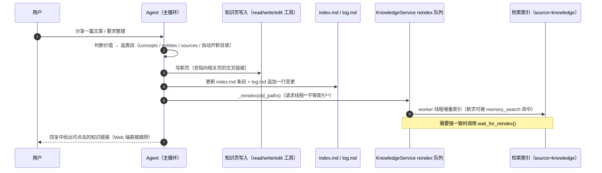

```mermaid
flowchart LR
  IDX["knowledge/index.md<br/>（注入 prompt 时被压缩）"] --> SRC["sources/weekly-report-guide.md"]
  SRC --- C1["concepts/report-structure.md"]
  C1 --- C2["concepts/data-density.md"]
  SRC --- ENT["entities/team-weekly-group.md"]
  LOG["log.md（变更日志，不索引）"] --- IDX
```

要点：`index.md` 是 Agent 的"入口目录"（注入系统提示时压缩以省 token），`log.md` 是审计轨迹；两者都不进索引，因为页面本身已被单独索引，重复索引会让每次写页触发整文件重嵌入。

---

## 9. Skills 体系

### 9.1 Skill ≠ Tool

| | Tool | Skill |
|---|---|---|
| 实现 | Python 代码（`agent/tools/`、MCP） | **Markdown 描述文件**（`SKILL.md`）+ 可选脚本/资源 |
| 粒度 | 原子操作（读写文件、执行命令、搜索） | **工作流**（组合多个工具完成一类任务） |
| 扩展成本 | 改代码、重启 | 写/装一个目录，热加载 |

### 9.2 加载与优先级

```text
~/cow/skills/<name>/        # 工作区技能（优先级最高，可被对话创建/安装/编辑）
skills/<name>/              # 项目内置技能（最低优先级，同名被工作区覆盖）
    ├── SKILL.md            # frontmatter + 指令正文
    ├── scripts/            # 可选脚本
    └── resources/          # 可选资源
```

内置技能：`image-generation`、`knowledge-wiki`、`skill-creator`。启动时 `_sync_builtin_skills()` 把内置技能同步进工作区。

`SKILL.md` frontmatter：

| 字段 | 作用 |
|---|---|
| `name` | 必须与目录名一致（同名冲突按优先级覆盖） |
| `description` | **Agent 据此决定是否使用**——渐进披露的入口 |
| `metadata.requires.bins` | 依赖的系统命令（缺失即不可用） |
| `metadata.requires.env` | 依赖的环境变量（密钥放在 `~/.cow/.env`） |
| `metadata.primaryEnv` | 主密钥（引导用户配置的入口） |
| `metadata.always` | 是否始终加载（默认 false） |

**渐进披露**：系统提示的 Skills section 只列 name/description；正文必须由 Agent 用 `read` 打开 `SKILL.md` 才获得。这是技能数量可扩展而不炸上下文的关键。

### 9.3 获取与治理

| 途径 | 说明 |
|---|---|
| Cow Skill Hub | `/skill list --remote` 浏览安装 |
| GitHub | 直接安装，支持批量 |
| ClawHub | `/skill install clawhub:name` |
| URL | zip 包或单个 `SKILL.md` |
| 对话创建 | `skill-creator` 技能把一次成功流程沉淀成技能（Self-Evolution 也会新建技能） |
| Web/CLI 管理 | `SkillService`：列表、文件树、读写内容、创建、启停、删除 |

**写保护**：`SkillService._reject_shipped_name` 与 Self-Evolution 的"内置技能保护"共同保证随产品安装的技能不会被自动改写；技能目录路径有 `_safe_skill_dir`/`_contained_skill_dir` 防穿越。

---

### 9.4 渐进披露与优先级（两张图）

```mermaid
sequenceDiagram
  autonumber
  participant PB as PromptBuilder
  participant AG as Agent
  participant FS as 工作区
  participant TM as ToolManager

  PB->>AG: Skills 段只含 catalog：name + description（+ 必要依赖提示）
  AG->>AG: 匹配任务与 catalog → 决定用某技能
  AG->>FS: read skills/{name}/SKILL.md（**此刻才拿到正文**）
  AG->>FS: 按正文指示执行 scripts/ 与 resources/（通过 bash/read/write 等工具）
  AG->>TM: 依赖检查：requires.bins 缺失或 requires.env 未配 → 该工具本轮不可用
  TM-->>AG: 下一轮自动回到 schema（配置补齐后无需重启）
```

```mermaid
flowchart TD
  Q["需要技能 name=weekly-report"] --> W{"~/cow/skills/weekly-report 存在?"}
  W -- 是 --> USE["使用工作区版本（优先级最高）"]
  W -- 否 --> BI["使用内置 skills/weekly-report"]
  USE --> SH{"与内置同名 → 内置被覆盖（不会同时出现两份）"}
  BI --> SH
  SH --> PROT{"是随产品安装的内置技能?"}
  PROT -- 是 --> RO["Self-Evolution 与 SkillService 拒绝改写（写保护）"]
  PROT -- 否 --> RW["可被对话创建 / 安装 / Evolution 修订"]
```

---

## 10. Tools 与权限模型

### 10.1 工具清单

| 类别 | 工具 | 说明 |
|---|---|---|
| 默认内置 | `read` / `write` / `edit` / `ls` / `search_files` | 文件读写与检索（read 支持文本、图片、PDF） |
| | `bash` | 终端执行（受权限模式强约束） |
| | `send` | 把文件/图片投递给用户（渠道侧送达） |
| | `memory_search` / `memory_get` | 记忆与知识库检索、按行读取 |
| | `subagent` | 派生临时子代理（并行、隔离上下文） |
| | `agent_delegate` | 团队会话中把任务交给常驻队友（仅团队会话可见） |
| | `current_time`、`env_config`（密钥管理） | 时间与环境 |
| 可选 | `scheduler` | 创建/管理定时任务（全局单实例调度） |
| | `web_search` / `web_fetch` | 联网搜索与抓取 |
| | `browser` | 浏览器自动化（需安装浏览器运行时） |
| | `vision` | 图像理解 |
| | `evolution_undo` | 撤销上一次 Self-Evolution 的改动 |
| MCP | 任意 MCP server 暴露的工具 | `mcp.json` 配置一次即可用，stdio/SSE，热重载 |

### 10.2 `BaseTool` 契约

| 能力 | 用途 |
|---|---|
| `get_json_schema()`（从类内 schema 解析） | 注入模型的工具 schema |
| `execute_tool(params) -> ToolResult` / `execute()` | 执行；`ToolResult.success/fail(result, ext_data, display)` 区分给模型看与给用户看 |
| `is_available()` | 依赖缺失时**该轮不注入**，配置好后下一轮自动回来（如 browser、web_search、可选 provider） |
| `is_cancelled()` / `report_progress()` / `emit_event()` | 长工具的中断自检与进度上报（前端卡片） |
| `renders_own_cards(arguments)` | 工具自渲染 UI（如子代理、浏览器步骤） |
| `should_auto_execute(context)` / `ToolStage` | 前置/后置处理阶段（legacy 插件式自动执行） |
| `_coerce_integer_args` | 容错：模型把整数写成字符串也能跑 |

### 10.3 权限模型（`agent/permission/policy.py`）

| 模式 | 允许 | 判定要点 |
|---|---|---|
| `read-only` | 读文件、搜索、只读命令 | 对 `bash` 做**命令段解析**（管道/`;`/`&&`/进程替换拆开逐段判定）、识别重定向目标、识别 `git` 子命令是否只读、识别 `xxd`/短参数集群等"只读形式的写"绕过 |
| `workspace-write` | 上述 + 在 `write_roots` 内写 | 路径规范化 + symlink 解析 + `_inside_roots` 判定；命令里的路径参数与重定向目标都要落在根内 |
| `full-access` | 全部（仍受 `protected_paths` 约束） | 默认值；官方建议强隔离场景改用容器 |

- 全局默认 `agent_permission_mode`，**新会话继承、会话级可改**；`Agent.apply_permission_mode` 重算 `write_roots`（工作区 + 绑定的项目目录）与 `protected_paths`。
- 拒绝时返回**带提示的 Decision**（例如提示可切模式、指出允许写入的根），让模型能自我纠正而不是瞎试。

### 10.4 MCP 生命周期

```mermaid
flowchart LR
  A["mcp.json（stdio / SSE）"] --> B["ToolManager._load_mcp_configs"]
  B --> C["后台线程启动 server（预热，避免首条消息被 npx 下载卡住）"]
  C --> D["注册为 McpTool 实例"]
  D --> E["sync_mcp_into_agent：并入每个 Agent 的工具集"]
  E --> F{"工具数 > 阈值 且 开启按需注入?"}
  F -- 是 --> G["embedding 选 top_k，本轮并集只增不减"]
  F -- 否 --> H["全量注入"]
  D --> I["refresh_mcp_if_changed / reload_mcp_server：文件签名变化即热重载"]
```

桌面模式跳过 MCP 预热（不打包 npx/uvx 运行时）。`list_mcp_status` 暴露给控制台显示连接状态。

---

### 10.5 权限判定全图（代码路径 + 27 条判例）

> 代码位置：`agent/permission/policy.py`（纯函数、无副作用、可脱离运行时单测）；调用点 `agent/protocol/agent_stream.py::_permission_denial`。

#### 10.5.1 顶层裁决：一次 `tool_use` 走哪条路

```mermaid
flowchart TD
  A["模型产出 tool_use"] --> B["_permission_denial(tool_name, arguments)"]
  B --> C{"agent.effective_permission_mode()"}
  C -->|full-access| P1["跳过检查（返回 None）"]
  C -->|read-only| R["_check_read_only(tool, args)"]
  C -->|workspace-write| W["_check_workspace_write(tool, args, cwd, roots, protected)"]
  B -.->|检查自身抛异常| FO["fail-open：记日志后按不限制继续（权限模块不得拖垮会话）"]
  R --> D{"Decision.allowed?"}
  W --> D
  D -->|是| E["工具执行"]
  D -->|否| G["Decision.reason 作为工具错误结果回给模型"]
  G --> H["reason 里写着下一步怎么办：读仍可以、可切模式、允许的根在哪"]
```

入参是 **6 元组**（`mode / tool_name / arguments / cwd / write_roots / protected_paths`），判定完全由参数决定，因此可单测、可复放。`write_roots` = 工作区 + 会话绑定的项目目录 + **系统临时目录恒在根内**；`protected_paths` 由 `Agent.apply_permission_mode` 在切换模式时重算。

#### 10.5.2 五类工具 = 五种判定策略

| 类别 | 成员 | 判定策略 |
|---|---|---|
| `_FILE_WRITE_TOOLS` | `write`、`edit` | read-only 直接拒；workspace-write 解析 `path`（规范化 + symlink 解析 + `_inside_roots`） |
| `_MUTATING_TOOLS` | `evolution_undo` | read-only 拒（会改变会话外可见的状态）；workspace-write 允许 |
| `_ACTION_TOOLS` | `browser`（click/fill/select/press/evaluate）、`scheduler`（create/delete/enable/disable）、`env_config`（set/delete） | 按 `action` 参数拆：变更型 action 拒，只读型 action（navigate/read/screenshot/list…）放行 |
| `bash` | — | 命令级解析：read-only **白名单 + 失败关闭**，workspace-write **路径约束 + 尽力而为** |
| 未知工具名（MCP） | 不在 `_KNOWN_TOOLS` 中 | 仅 read-only 模式启用 `_MUTATING_NAME_RE` 读动词判性（create/add/write/delete/drop/send/deploy/merge/run/install/revoke…）→ 拒；内置工具靠 `_KNOWN_TOOLS` 免于被猜 |

#### 10.5.3 read-only 下的 `bash` 解析链（证明只读才允许）

```mermaid
flowchart TD
  S["command 字符串"] --> Q0{"空命令?"}
  Q0 -->|是| AL["ALLOW：读写自己启动的后台任务"]
  Q0 -->|否| SP["_parse_segments：拆管道、分号、逻辑连接、进程替换"]
  SP -->|解析失败| RX["DENY：无法解析就无法确认只读"]
  SP --> SEG["逐段判定：任一段被拒则整条被拒"]
  SEG --> G1{"存在重定向目标且不属于 NULL_SINKS?"}
  G1 -->|是| R1["DENY：重定向会写文件"]
  G1 -->|否| G2{"命令名属于提权命令 sudo/doas/su/runas/pkexec?"}
  G2 -->|是| R2["DENY：提权"]
  G2 -->|否| G3{"命令名是 git?"}
  G3 -->|是| GIT["git 专用判定：跳过全局选项后看子命令"]
  G3 -->|否| G4{"命令名在只读命令白名单?"}
  G4 -->|否| R3["DENY：未知命令按可能变更处理（fail closed）"]
  G4 -->|是| G5{"存在不重定向也写文件的形式: sed -i / sed 的 w / awk system / xxd -r / 短参数集群含写开关 / sort -o?"}
  G5 -->|是| R4["DENY：该形式会写文件"]
  G5 -->|否| OK["该段 ALLOW"]
```

`git` 的二阶判定（很多实现会漏掉的部分）：先 `_skip_git_global_options` 剥掉 `-C dir`、`-c k=v`、`--no-pager`，再看子命令是否落在只读白名单（status/log/diff/show/branch/tag/remote/rev-parse/blame/stash/config/reflog/…），然后逐项加约束 —— `branch`/`tag` 带裸名字视为**创建**（必须 `-l` 或 listing 参数）；`remote add/remove/set-url` 拒；`symbolic-ref` 两个操作数即设值；`config` 必须带 `--get/--list`；出现 `_GIT_WRITE_FLAGS` 即拒。所以 `git branch -v -D topic` 在只读模式下会被拒，而 `git branch` 通过。

#### 10.5.4 workspace-write 下的 `bash` 解析链（发现越界才拒绝）

```mermaid
flowchart TD
  S2["command 字符串"] --> SP2["_parse_segments"]
  SP2 -->|解析失败| P0["ALLOW：该模式明确是尽力而为，不阻塞正常工作"]
  SP2 --> SEG2["逐段判定"]
  SEG2 --> H1{"重定向目标命中 protected_paths?"}
  H1 -->|是| S1["DENY：受保护路径"]
  H1 -->|否| H2{"重定向目标在 write_roots 之外?"}
  H2 -->|是| S2b["DENY：写到可写区域之外"]
  H2 -->|否| H3{"提权命令?"}
  H3 -->|是| S3["DENY：提权（两种模式都拒）"]
  H3 -->|否| H4{"命令名属于 PATH_MUTATING_COMMANDS?"}
  H4 -->|否| OK2["ALLOW：不改路径的命令无从约束"]
  H4 -->|是| EX["抽取写入目标：dd 的 of=、sort 的 -o/--output、sed 脚本内的 w 目标、find/awk 的搜索根、其余按位置参数"]
  EX --> H5{"目标命中 protected_paths?"}
  H5 -->|是| S4["DENY：受保护路径"]
  H5 -->|否| H6{"目标在 write_roots 之外?"}
  H6 -->|是| S5["DENY：越根（读它仍然允许）"]
  H6 -->|否| OK3["ALLOW"]
```

**两种模式的哲学差别是关键取舍**：read-only 是"必须证明只读"（解析失败、命令未知 → 拒），workspace-write 是"发现越界才拒"（解析失败 → 放行）。这正是官方建议强隔离场景改用容器的原因。

#### 10.5.5 判例表：同一动作在三种模式下的结果

| # | 调用 | read-only | workspace-write | full-access | 判定依据 |
|---|---|---|---|---|---|
| 1 | `read(~/cow/MEMORY.md)` | ALLOW | ALLOW | ALLOW | 内置只读工具 |
| 2 | `write(~/cow/MEMORY.md)` | DENY | ALLOW | ALLOW | `_FILE_WRITE_TOOLS` |
| 3 | `write(~/notes/x.md)`（根外） | DENY | DENY 越根 | ALLOW | `_inside_roots` |
| 4 | `write(<protected_paths 内>)` | DENY | DENY 受保护 | ALLOW | `_deny_protected` |
| 5 | `edit(~/cow/knowledge/a.md)` | DENY | ALLOW | ALLOW | 同 `write` |
| 6 | `git status` | ALLOW | ALLOW | ALLOW | git 只读子命令 |
| 7 | `git branch topic` | DENY（创建分支） | ALLOW | ALLOW | `_GIT_LIST_OR_CREATE` |
| 8 | `git branch -v -D topic` | DENY（写开关） | ALLOW | ALLOW | `_GIT_WRITE_FLAGS` |
| 9 | `git config user.name x` | DENY（缺 --get/--list） | ALLOW | ALLOW | `_GIT_CONFIG_READ_FLAGS` |
| 10 | `sed -i s/a/b/ f.txt` | DENY（写形式） | ALLOW（f 在根内） | ALLOW | `_READ_ONLY_WRITE_FORMS` |
| 11 | `cat f > out.txt` | DENY（重定向写） | ALLOW（out 在根内） | ALLOW | `_redirect_targets` |
| 12 | `cat f > /dev/null` | ALLOW | ALLOW | ALLOW | `_NULL_SINKS` |
| 13 | `sort a.txt -o out.txt` | DENY（短参数集群含 o） | ALLOW | ALLOW | `_READ_ONLY_WRITE_SHORT` |
| 14 | `awk 里调用 system()` | DENY（外逃执行） | ALLOW | ALLOW | `_AWK_SHELL_RE` |
| 15 | `xxd -r -p hex` | DENY（还原成二进制落文件） | ALLOW | ALLOW | `_xxd_output` |
| 16 | `sudo rm -rf /tmp/x` | DENY 提权 | DENY 提权 | ALLOW | `_ESCALATION_COMMANDS` |
| 17 | `make build` | DENY（白名单外） | ALLOW（尽力而为） | ALLOW | 只读命令白名单 |
| 18 | `npm run build` 后接 `git push` | DENY（首段未知即整条拒） | ALLOW | ALLOW | 段级判定 |
| 19 | `cd other && cat f` | ALLOW | ALLOW | ALLOW | `cd` 非变更命令（`_WRAPPER_COMMANDS`/非路径变更） |
| 20 | `bash("")` 空命令 | ALLOW | ALLOW | ALLOW | 明确放行（后台任务场景） |
| 21 | `browser(action=navigate)` | ALLOW | ALLOW | ALLOW | 只读 action |
| 22 | `browser(action=click)` | DENY | ALLOW | ALLOW | 变更 action |
| 23 | `scheduler(action=list)` | ALLOW | ALLOW | ALLOW | 只读 action |
| 24 | `env_config(action=set)` | DENY | ALLOW | ALLOW | 变更 action |
| 25 | MCP 工具 `create_issue` | DENY（名字含变更动词） | ALLOW | ALLOW | `_MUTATING_NAME_RE` |
| 26 | MCP 工具 `list_repos` | ALLOW | ALLOW | ALLOW | 动词不在变更集 |
| 27 | `evolution_undo` | DENY | ALLOW | ALLOW | `_MUTATING_TOOLS` |

#### 10.5.6 模式的继承与生效路径

```mermaid
stateDiagram-v2
  [*] --> Global: 全局默认 agent_permission_mode
  Global --> NewSession: 新会话继承全局
  NewSession --> Override: 会话级切换（控制台或聊天命令）
  Override --> Recompute: Agent.apply_permission_mode
  Recompute --> Override: 重算 write_roots（工作区 + 绑定项目目录 + 系统临时目录）与 protected_paths
  Override --> Prompt: describe_mode 把边界写进系统提示
  Prompt --> Override: 模型一开始就知道自己能改什么
```

一句话总结设计取向：**权限拒绝不是异常，而是一条写给模型看的、带下一步建议的工具结果**。这让模型能自我纠正（改用只读工具、改路径、请求切模式），而不是反复重试同一个被拒调用。

---

## 11. 多 Agent：Team / Sub-Agent / Delegation


### 11.1 四种"把活儿分出去"的机制

| 机制 | 生命周期 | 身份 | 工作区 | 记忆 | 何时用 |
|---|---|---|---|---|---|
| **Team member** | 常驻，事先配置 | 有名字/头像，在团队列表，可绑渠道 | 独立（`~/cow/agents/<id>/`） | 独立 | 任务本身属于另一个常驻 Agent（它掌握知识/权限/客户关系） |
| **Delegation（`agent_delegate`）** | 常驻队友之间的一次同步调用 | 队友 | 各自 | 各自 | 团队会话内跨领域协作；用户始终只面对一个入口 |
| **Sub-Agent（`subagent`）** | 一次任务临时创建后即弃 | 匿名、不在列表 | **与主 Agent 共享** | **没有自己的记忆** | 把自身任务并行拆分 / 隔离大量中间产物 |
| **Speak-on-peer（群聊 @）** | 用户直接点名某个成员回答本轮 | 队友 | 各自 | 各自 | 用户明确想听某位成员 |

### 11.2 Sub-Agent 的继承与隔离

| 继承 | 不继承 |
|---|---|
| 模型 | 主会话的消息历史 |
| 工作区（同一处读写文件） | 人设与规则文件（`AGENT.md`/`RULE.md`/`USER.md`） |
| 技能（仅"全工具集"类型可继承全部工具） | **写记忆的能力**（可读共享记忆与知识库，但不落盘写） |

配置（`subagent`）：`enabled=true`、`max_depth=1`（1–5）、`max_concurrent=3`（1–10）、`timeout_seconds=300`（10–3600）。内置类型 `general-purpose`、`explore`；工作区 `subagent/` 资产目录放 `*.md.template` 即可自定义类型（启动时脚手架示例模板）。实现细节值得记：每个子运行**浅拷贝工具实例**，因为主循环会在每次调用前给实例挂 `context/cancel_event/progress_callback` 再清空——共享实例会让两个并发子代理互相拆掉超时与进度回调。

### 11.3 Delegation 的六道闸门

```mermaid
flowchart LR
  A["agent_delegate(agent_id, task)"] --> G1{"目标在本会话队友中?"}
  G1 -- 否 --> X1[拒绝，并列出可达的队友]
  G1 -- 是 --> G2{"allowed_targets 允许这对?"}
  G2 -- 否 --> X2[拒绝]
  G2 -- 是 --> G3{"链上未出现过该 Agent（防环）?"}
  G3 -- 否 --> X3[拒绝]
  G3 -- 是 --> G4{"深度 ≤ max_depth(3)?"}
  G4 -- 否 --> X4[拒绝]
  G4 -- 是 --> G5{"task 长度 ≤ 8000 字符?"}
  G5 -- 否 --> X5[拒绝]
  G5 -- 是 --> R["同步执行：等待队友完成（超时 600s 取消本地运行）"]
  R --> S["结果回给发起方（不回用户）；runs 表可追溯父子链"]
```

要点：**同步语义**（阻塞等待，无需轮询/handle）；**结果只回发起方**，由 lead agent 汇总后单一出口回复用户；未配 `allowed_targets` 时任意互委，配了空数组（如 `"research": []`）= 可被委托但不可再委托。

### 11.4 团队与会话、渠道的关系

- **注册表**：`AgentRegistry`（`team.json` 派生）持有 `AgentProfile{id, name, avatar, description/职责, model, workspace, skills/knowledge 模式}`；始终存在一个不可删除的 **default agent**（跟随全局模型配置）。
- **群聊会话**：一个会话可加入多名成员，共享同一份记录；`_seed_team_members`/`_session_members` 维护成员，`_resolve_speaker` 决定本轮由谁说话（默认 owner，`@name` 定向），`_shared_history` + `_attribute_to_speaker`/去地址前缀让成员能读懂"别人说过什么"而不把自己的名字读进上下文。群聊**不用会话级模型选择**——每个成员用自己的默认模型。
- **渠道绑定**：一个渠道类型可多实例，每实例绑定一个 Agent 或一个团队（首个为 owner，负责接单并按职责分派）；`@名字/ID` 直连成员；绑定改动即时生效无需重启。
- **跨进程 teammate**：`agent/multiagent/transport.py` 只定义 seam（`PeerAgent` + 安装一个 transport），默认不安装；`inbound.serve_invoke` 提供 `mode = delegate | speak | clear` 的入站处理，使"同进程队友"与"异进程队友"在 roster、prompt、卡片、结果形状上完全一致。

---

### 11.5 团队拓扑、委派时序与并行细节

#### 11.5.1 谁在哪个工作区、用谁的记忆

```mermaid
flowchart TB
  subgraph CH["渠道实例（team.json channel_instances）"]
    I1["feishu-a3f9c2e1b7 绑定 research"]
    I2["feishu-b71d4e0c93 绑定 default"]
    I3["telegram 绑定团队（首个成员为 owner）"]
  end
  subgraph D["default agent（始终存在，不可删除）"]
    W0["~/cow/ : SYSTEM AGENT USER RULE + MEMORY.md + memory/ + knowledge/ + skills/"]
    M0["记忆：自己的 daily / core / dreams / knowledge"]
  end
  subgraph A1["成员 research"]
    W1["~/cow/agents/research/ : 同构的一套文件"]
    M1["记忆：完全独立"]
  end
  subgraph A2["成员 writer"]
    W2["~/cow/agents/writer/"]
    M2["记忆：完全独立"]
  end
  subgraph SA["subagent（匿名、用完即弃）"]
    S1["复用调用方的工作区与模型；不写自己的记忆"]
  end
  I1 --> A1
  I2 --> D
  I3 --> D
  D -->|agent_delegate| A1
  A1 -->|agent_delegate| A2
  D -->|subagent 一次调用 N 个| SA
  W0 -.->|子运行直接读写同一工作区文件| S1
```

记忆隔离 = **目录隔离**，不需要任何数据库 ACL；反过来，subagent 能读写调用方工作区里的一切（包括其中的 `memory/`），但**不会以它的身份新增记忆条目**——写记忆的权力只属于常驻 Agent。

#### 11.5.2 Delegation 的完整时序（同步语义、单一出口）

```mermaid
sequenceDiagram
  autonumber
  actor U as 用户
  participant L as Lead agent（会话入口）
  participant G as DelegationPolicy
  participant M as 目标成员 Agent
  participant R as runs 表
  U->>L: 让 research 顺手查一下 X
  L->>L: 模型产出 tool_use: agent_delegate(agent_id, task)
  L->>G: 六道闸门校验
  G->>G: 成员资格 → allowed_targets → 链上防环 → 深度 ≤ max_depth(3) → task ≤ 8000 字符
  alt 任一闸门失败
    G-->>L: 拒绝原因（含"当前可达的队友列表"）
    L->>L: 模型改为自己做，或换一个目标
  else 全部通过
    G->>R: 开一条 run（parent_run_id 记父子链）
    G->>M: 同步执行（成员用自己的模型 + 自己的工作区 + 自己的记忆）
    M-->>G: 完成；或 600s 超时 → 取消该运行
    G-->>L: 结果文本（只回发起方，绝不直接回用户）
    L->>L: lead 汇总多个委派结果
    L-->>U: 一条完整回复
  end
```

| 参数 | 默认 | 可配范围 | 语义 |
|---|---|---|---|
| `max_depth` | 3 | 1–8 | 委派链最大深度；链上出现同一 Agent 即拒（防 A→B→A） |
| `timeout_seconds` | 600 | 0.01–3600 | 超时=取消本地运行，不是让队友后台继续 |
| `max_message_chars` | 8000 | — | 任务描述长度上限（防"把整个上下文塞进委派"） |
| `allowed_targets` | 未配置 | — | 未配置=任意互委；配成 `"research": []` = 可被委托但不得再委托 |

#### 11.5.3 Sub-Agent 扇出：一次 tool_use 内部的并行

```mermaid
sequenceDiagram
  autonumber
  participant P as 父 Agent
  participant T as subagent 工具
  participant RN as run_tasks
  participant C1 as 子运行 1
  participant C2 as 子运行 2
  P->>T: tool_use: subagent(tasks=[t1, t2])
  T->>T: enabled? current_depth() ≥ max_depth? len(tasks) > max_concurrent?
  Note over T: 超限直接拒绝这次调用（不排队），理由写着"自己来做或少发几个"
  T->>RN: 通过：逐 task 解析模板（未指定类型则用默认类型，支持 subagent/*.md.template）
  RN->>C1: 启动（独立 cancel_event + 独立 SteerInbox + 独立超时 Event）
  RN->>C2: 启动（并行）
  RN-->>P: on_state(i, running/settled) 进度事件
  C1-->>RN: 结果；或超时被取消并如实标记
  C2-->>RN: 结果
  RN-->>T: 与输入等长、顺序一致的结果列表
  T-->>P: 汇总文本进入父上下文（中间消息不进父上下文）
```

两个值得照抄的实现细节：
① 每个子运行**浅拷贝工具实例**——主循环会在每次工具调用前往实例上挂 `context / cancel_event / progress_callback` 再清空，共享实例会让并发子代理互相拆掉对方的超时与进度回调。
② 子运行与父**共用同一个 model 对象**，因此 `reset_fallback()` 在嵌套运行里必须跳过（`nested_run=True` 直接 return），否则会把父正在依赖的兜底链路清空，两者一起掉回刚失败的 provider。
③ 超时任务不会"消失"：`run_tasks` 返回**等长**结果列表，父代理能区分"没找到"和"没跑成"。

#### 11.5.4 三种分派机制的硬参数与语义对照

| 维度 | 群聊 @成员（speak-on-peer） | `agent_delegate` | `subagent` |
|---|---|---|---|
| 身份 | 常驻队友 | 常驻队友 | 匿名、不在 roster |
| 生命周期 | 会话轮次 | 一次调用 | 一次调用后即弃 |
| 并发 | 每会话串行（`concurrency_in_session`） | 由 lead 在一轮内发起多次 | 单次调用的 tasks 数 ≤ `max_concurrent`（默认 3，1–10），超了直接拒 |
| 深度 | — | `max_depth` 3（1–8） | `max_depth` 1（1–5），深度用 contextvar 传递 |
| 超时 | 渠道/内核级 | 600s（0.01–3600） | 300s（10–3600），每 task 独立 |
| 上下文 | 共享会话历史并去地址前缀 | 各自上下文，仅传 task | 各自上下文，仅回汇总 |
| 写记忆 | 是（写自己的记忆目录） | 是 | **否**（可读共享记忆与知识库） |
| 结果去向 | 直接对用户 | 只回发起方 | 只回发起方 |
| 可观测 | 会话记录 | `runs` 表父子链 | `on_state` / `on_event` 事件流（给前端，不进父上下文） |

#### 11.5.5 跨进程队友：一份 roster，两种 transport

```mermaid
flowchart LR
  L["lead 调用 agent_delegate"] --> RD{"目标在同进程 roster 内?"}
  RD -->|是| IN["默认实现：直接驱动成员 Agent"]
  RD -->|否| TP{"已安装 transport（PeerAgent）?"}
  TP -->|否| ERR["明确失败：队友不可达（不静默降级为默认 Agent）"]
  TP -->|是| OUT["transport 发出 invoke → 远端 inbound.serve_invoke"]
  OUT --> MODE{"mode"}
  MODE -->|delegate| D1["以该 Agent 身份执行，结果回发起方"]
  MODE -->|speak| D2["以该 Agent 身份直接对用户说话"]
  MODE -->|clear| D3["清空该会话"]
  IN --> SAME["roster、系统提示、成员卡片、结果形状完全一致"]
  D1 --> SAME
```

`agent/multiagent/transport.py` 默认**只提供 seam 不提供实现**（不安装任何 transport）。这是刻意的：跨进程/跨机器的身份、鉴权、数据边界不该由 harness 替你决定；但一旦安装，上层代码（roster 渲染、prompt、委派闸门）零改动。

---

## 12. 渠道层（Channels）


### 12.1 抽象与数据流

```text
原始事件 → Context{type, content, kwargs(session_id/receiver/user…)}
        → ChatChannel.produce → 会话队列 → _handle
        → 插件钩子(godcmd/banwords/…) → _generate_reply（Agent 或 legacy bot）
        → _decorate_reply（翻译 / 语音合成 / 图片抽取 / Markdown 修正）
        → _send（按渠道能力适配，含重试）
```

`ContextType`：`TEXT/VOICE/IMAGE/FILE/VIDEO/SHARING` + `IMAGE_CREATE/JOIN_GROUP/PATPAT/FUNCTION/ACCEPT_FRIEND` 等事件；`Reply{type, content}` 反向映射到渠道富媒体能力。

### 12.2 能力矩阵（官方口径）

| 渠道 | 文本 | 图片 | 文件 | 语音 | 群聊 |
|---|:-:|:-:|:-:|:-:|:-:|
| Web 控制台 | ✅ | ✅ | ✅ | ✅ | — |
| 微信（个人） | ✅ | ✅ | ✅ | ✅ | — |
| 飞书 | ✅ | ✅ | ✅ | ✅ | ✅ |
| 钉钉 | ✅ | ✅ | ✅ | ✅ | ✅ |
| 企微 AI Bot | ✅ | ✅ | ✅ | ✅ | ✅ |
| QQ 官方 Bot | ✅ | ✅ | ✅ | ✅ | ✅ |
| 企微应用 | ✅ | ✅ | ✅ | ✅ | — |
| 公众号 | ✅ | ✅ | — | ✅ | — |
| 微信客服 | ✅ | ✅ | ✅ | ✅ | — |
| Telegram | ✅ | ✅ | ✅ | ✅ | ✅ |
| Slack | ✅ | ✅ | ✅ | — | ✅ |
| Discord | ✅ | ✅ | ✅ | — | ✅ |
| 终端 | ✅ | — | — | — | — |

### 12.3 多实例与路由

- `channel_type` 支持字符串/逗号/列表；`team.json.channel_instances` 可为**同一渠道类型起多个实例**，各自带凭据与 Agent 绑定（`MULTI_INSTANCE_READY` 类型如飞书）。
- **所有权转移规则**：一旦某类型被 instances 接管，`config.json` 里扁平的同类型条目会被丢弃，避免同一 bot 起两条连接；未接管类型行为完全不变（老部署零感知）。
- 渠道工厂带 `@singleton` 缓存，多实例走 `new_instance`。
- Web 控制台默认自动挂载（`web_console=true`），与 IM 渠道并行运行；监听地址默认 `127.0.0.1`，对外需 `web_host=0.0.0.0` + `web_password`。

---

### 12.4 渠道管线细节：会话键、队列、并发与多实例接管

#### 12.4.1 入站全链路（`_compose_context → produce → consume → _handle`）

```mermaid
flowchart TD
  RAW["渠道原始事件（IM 回调 / Web 请求 / 终端输入）"] --> CM["_compose_context(ctype, content, kwargs)"]
  CM --> GR{"群聊?"}
  GR -->|是| WL{"群名在 group_name_white_list / 关键字白名单 / ALL_GROUP?"}
  WL -->|否| DROP["直接丢弃（不回复，不入库）"]
  WL -->|是| SK{"group_shared_session 默认 true"}
  SK -->|true| S1["session_id = group_id（整群共享一条上下文）"]
  SK -->|false| S2["session_id = actual_user_id（同群每人一条）；命中 group_chat_in_one_session 才回退 group_id"]
  GR -->|否| S3["session_id = other_user_id（私聊一条）"]
  S1 --> H1["插件事件 ON_RECEIVE_MESSAGE（可改写或 pass 掉 context）"]
  S2 --> H1
  S3 --> H1
  H1 --> SELF{"自己发的消息且 trigger_by_self=false?"}
  SELF -->|是| DROP
  SELF -->|否| RT["produce：route_context 决定 agent_id（渠道实例绑定 / @名字 / 团队 owner）"]
  RT --> AE{"目标 Agent 已停用?"}
  AE -->|是| MSG["明确回复：该助手当前已停用（不静默换成 default agent）"]
  AE -->|否| QK["queue_key = scoped_session_key(agent_id, session_id, default)"]
  QK --> BP{"/cancel 或 /steer?"}
  BP -->|是| FAST["快速通道：不入队列，直接取消或插话"]
  BP -->|否| ENQ["以 # 开头的管理命令 putleft 插队，其余 put 排队尾"]
  ENQ --> SEM["每队列一个 BoundedSemaphore(concurrency_in_session, 默认 1)：同会话串行"]
  SEM --> CS["consume 循环：每轮取一条，提交线程池，done_callback 释放信号量"]
  CS --> ID[" _handle 内 use_identity(RuntimeIdentity(agent_id, session_id))：整条链路的身份锚点"]
  ID --> HG["插件 ON_HANDLE_CONTEXT → Agent 或 legacy bot"]
```

**关键实现点**：`session_id` 与 `queue_key` 不是一回事 —— 队列键额外带 `agent_id`，所以同一个 IM 会话被路由给不同成员时**各自排队、互不阻塞**；而 `RuntimeIdentity` 是"这条消息属于谁的工作区"的唯一真相，下游所有路径（工作区、记忆、知识库、产物）都从环境里读它，而不是被层层传参传来传去。

#### 12.4.2 会话键的构成规则（决定"谁和谁共享上下文与记忆"）

| 场景 | `session_id` | `receiver` | 效果 |
|---|---|---|---|
| 私聊 | `other_user_id` | `other_user_id` | 一人一条上下文 |
| 群聊（默认 `group_shared_session=true`） | `group_id` | `group_id` | **整群共享一条上下文**（Agent 能接住前后文，也符合群里连续讨论的直觉） |
| 群聊（关闭共享） | `actual_user_id` | `group_id` | 同群每人独立上下文（`receiver` 仍指向群，用于回发） |
| 群聊（关闭共享 + 群在 `group_chat_in_one_session`） | `group_id` | `group_id` | 白名单群恢复共享 |
| 群聊（群名不在白名单） | — | — | 消息被丢弃 |
| 跨 Agent | 追加 `agent_id` 前缀（`scoped_session_key`） | — | 会话隔离与并发隔离同时成立 |
| 访客页 | 独立的 guest 会话存储 | — | 与 owner 会话完全异库，见 §14 |

#### 12.4.3 出站管线（装饰 → 发送 → 重试）

```mermaid
flowchart TD
  G["Reply(type, content)"] --> PD["插件 ON_DECORATE_REPLY"]
  PD --> NT{"reply.type 在渠道的 NOT_SUPPORT_REPLYTYPE?"}
  NT -->|是| ER["降级为 ERROR 文本：不支持发送的消息类型"]
  NT -->|否| T1{"TEXT 且 desire_rtype=VOICE 且渠道支持语音?"}
  T1 -->|是| TTS["_safe_text_to_voice 合成语音；成功则递归 decorate 语音 reply，并保留原文用于先发文字再发音"]
  TTS -->|TTS 不可用| T1b["自动落回文本（绝不因语音失败丢掉整轮回答）"]
  T1 -->|否| GP{"群聊?"}
  GP -->|是| AT["加 @昵称 + group_chat_reply_prefix/suffix"]
  GP -->|否| SP["加 single_chat_reply_prefix/suffix"]
  AT --> SND["_send_reply → 插件 ON_SEND_REPLY → channel.send"]
  SP --> SND
  T1b --> SND
  ER --> SND
  SND -->|异常| RET{"重试次数 小于 2?"}
  RET -->|是| W["sleep 3s、6s 后重发"]
  RET -->|否| LOSE["放弃（NotImplementedError 直接返回：该渠道未实现该能力）"]
  SND --> IMG["_extract_and_send_images：正文里的图片引用抽出来按渠道能力补发"]
```

装饰链上每一环都是**降级而非抛错**：不支持的类型变文本、语音不可用变文本、渠道未实现直接跳过。用户看到的是"少了一种花样"，而不是"没有回复"。

#### 12.4.4 多实例接管规则（老实例不会被悄悄替换）

```mermaid
flowchart TD
  CFG["config.json: channel_type + 扁平凭据"] --> RS["resolve_channel_instances（team.json 的 channel_instances 优先）"]
  TJ["team.json: channel_instances 记录（instance_id / channel_type / agent_id / credentials / members / peers）"] --> RS
  RS --> MT["managed_types = 实例记录里属于 MULTI_INSTANCE_READY 的类型"]
  MT --> D1["config.json 里这些类型的扁平条目被跳过：避免同一个 bot 起两条连接"]
  MT --> D2["不属于 MULTI_INSTANCE_READY 的类型：config.json 继续原样启动（老部署零感知）"]
  RS --> BS["引导：某 ready 类型只有扁平凭据、没有实例记录 → 合成 instance_id = channel_type，绑定 default agent"]
  D1 --> ST["ChannelManager 逐个 startup（各自 daemon 线程）"]
  D2 --> ST
  BS --> ST
  ST --> NW{"一个渠道都没配?"}
  NW -->|是| WEB["至少启动 web 控制台"]
```

| 细节 | 规则 |
|---|---|
| 支持多实例的类型 | `feishu`、`dingtalk`、`qq`、`telegram`、`slack`、`discord`、`weixin`、`wecom_bot`；其余类型写进 `channel_instances` 也只跑一个实例（`@singleton` 尚未旁路，日志提示后优雅降级） |
| `instance_id` 形态 | `{channel_type}-{10位hex}`（约 40 bit 熵，重启稳定）；外部下发的 id 原样保留、绝不重生成 |
| 凭据来源 | `record.credentials` 子对象，或记录上的扁平字段；只保留该类型 `CREDENTIAL_KEYS` 里已知的键（未知键不会漏进 env） |
| 微信登录态 | 扫码 token 不在 `config.json`，而在凭据文件里；引导出的实例（`instance_id="weixin"`）会把旧默认凭据文件搬过去，避免升级后要求重新扫码 |
| 路由失败的语义 | `AgentUnavailableError` → 回一句"该助手当前已停用"。**刻意不用 default agent 兜底**：那会悄悄换掉人设与记忆 |

#### 12.4.5 把三张图串起来：群里一条消息的完整时序

```mermaid
sequenceDiagram
  autonumber
  actor U1 as 群成员 A
  actor U2 as 群成员 B
  participant CH as 飞书渠道实例（绑定 team）
  participant Q as 会话队列（queue_key = agent + group_id）
  participant AG as owner Agent（lead）
  participant ME as 成员 research
  U1->>CH: "@research 帮我查 X"
  CH->>CH: 群名白名单通过；session_id = group_id；receiver = group_id
  CH->>CH: route_context：@名字 → agent_id = research
  CH->>Q: put（普通消息排队尾）
  Q->>AG: consume 一条 → use_identity(research, group_id)
  AG->>ME: 若绑定的就是 research，则由它直接应答；若由 owner 接单则 agent_delegate
  ME-->>CH: Reply(TEXT)
  CH->>CH: 装饰：@A 前缀 + 群前后缀；Markdown 按渠道修正
  CH-->>U1: 发送（失败则 3s、6s 重试两次）
  U2->>CH: 紧接着追问
  CH->>Q: 同一 queue_key，同会话串行（上一条完成后才处理）
  Note over Q: B 的追问读到的是整群共享上下文，能看到 A 那一轮
```

---

## 13. 模型与多模态层


### 13.1 两层模型抽象

| 层 | 职责 |
|---|---|
| `Bridge` | 顶层能力路由：`chat/voice_to_text/text_to_voice/image/translate/embedding/web search` 各自映射到 provider；`voice_to_text` 空配置时按可用 key **自动挑选** |
| `AgentLLMModel`（`bridge/agent_bridge.py`） | Agent 侧模型句柄：Agent 默认模型 / 会话级覆盖 / **fallback 链**（`fallback_config`、`use_fallback`、`reset_fallback`）/ `provider_to_bot_type` 解析 / reasoning effort 与 thinking-only 判定 / 把请求转成各 provider 的 `LLMRequest` 并统一响应与流式 chunk |

`models/*` 适配器：`openai`、`chatgpt`(Azure 类)、`claudeapi`、`gemini`、`deepseek`、`dashscope`(Qwen)、`zhipuai`(GLM)、`moonshot`(Kimi)、`minimax`、`doubao`、`qianfan`、`linkai`、`modelscope`、`mimo`、`baidu`、`xunfei`；**任何模型都可走 OpenAI 兼容**（`bot_type=openai` + `open_ai_api_base/key`）。每种能力（Vision/Image/STT/TTS/Embedding/Web Search）可**各自独立配 provider**，无强制绑定。

### 13.2 与 Agent 的耦合点

| 耦合点 | 说明 |
|---|---|
| Embedding provider | 由 `agent_initializer` 统一解析与状态校验后**注入** `MemoryManager`；memory 自己不重建 vendor（避免绕过状态检查、损坏索引） |
| 摘要/蒸馏用的模型 | 复用会话模型（`MemoryFlushManager(llm_model=…)`） |
| 上下文溢出 | 与 `_switch_to_fallback` 联动（换更大窗口的模型也是一种恢复） |
| 思考模式 | `enable_thinking` + 各 provider 的 reasoning 参数；`think` 标签在流式侧过滤 |
| 语音/图像进出渠道 | `ChatChannel._safe_voice_to_text / _safe_text_to_voice / _extract_and_send_images`（失败即降级为文本） |

---

### 13.3 模型路由、兜底链与错误恢复阶梯（细节）

#### 13.3.1 一次调用究竟用哪个模型（优先级每次现算，不缓存）

```mermaid
flowchart TD
  S["读取 AgentLLMModel.model（每次调用都读：实例可能是 __new__ 构造的）"] --> F1{"_fallback_model 已生效?"}
  F1 -->|是| M1["兜底链当前 link（主模型已经彻底失败过，整轮留在生效的 link 上）"]
  F1 -->|否| F2{"_session_model（控制台里为这个会话选的模型）"}
  F2 -->|有| M2["会话模型"]
  F2 -->|否| F3{"_agent_model（AgentProfile.model）"}
  F3 -->|有| M3["成员默认模型（团队会话里每个成员各用自己的，不走会话级选择）"]
  F3 -->|否| F4{"conf().model"}
  F4 -->|有| M4["全局模型"]
  F4 -->|否| M5["const.DEFAULT_MODEL"]
```

provider 走同样的优先级：`_session_provider` → `_agent_provider` → `use_linkai` → `bot_type` → 按模型名推断（`chatGPT` 是 `openai` 的历史拼写，会折回 `openai`）。**default agent 没有 `_agent_model`**：它本身就是全局选择。

#### 13.3.2 能力路由：每种能力各自一个 provider

```mermaid
flowchart LR
  subgraph CAP["Bridge 的能力入口（彼此独立配置）"]
    C1["chat"]
    C2["voice_to_text（STT）"]
    C3["text_to_voice（TTS）"]
    C4["vision / image"]
    C5["translate"]
    C6["embedding"]
    C7["web_search"]
  end
  C1 --> A["openai / chatgpt / claudeapi / gemini / deepseek / dashscope / zhipuai / moonshot / minimax / doubao / qianfan / linkai / modelscope / baidu / xunfei"]
  C1 -.->|"bot_type=openai + open_ai_api_base/key"| B["任意 OpenAI 兼容端点（自建网关、本地推理服务皆可）"]
  C2 --> D["配置留空时按可用 key 自动挑选"]
  C6 --> E["由 agent_initializer 解析并校验状态后注入 MemoryManager；memory 不自己 new vendor（否则绕过状态检查、易损坏索引）"]
  C4 --> F["渠道侧 _safe_voice_to_text / _safe_text_to_voice / _extract_and_send_images：失败即降级为文本"]
```

#### 13.3.3 错误恢复阶梯（真实阈值与真实分支）

```mermaid
flowchart TD
  E["provider 抛错"] --> K{"错误串命中哪类 marker?"}
  K -->|"context overflow 类：十种 marker"| O1{"_overflow_stage == 0?"}
  O1 -->|是| O2["先把当前上下文全量摘要写入记忆（reason=overflow），再按 provider 报出的真实上限 smart-compact（丢 older half + 注入 LLM 摘要），重试"]
  O2 --> O3["stage=1 仍溢出：清空内存上下文（持久历史保留）并明确报错"]
  O1 -->|否| O3
  K -->|"消息格式类：tool 配对 complaint"| FM["自检自修消息后重试；这类问题源于会话而非 provider，不换模型"]
  K -->|"429 / rate limit"| RL{"配了可用兜底链?"}
  RL -->|是| SW["立刻切下一条 link：备份 provider 有独立配额，等待是错的"]
  RL -->|否| WT["退避 30s → 45s → 60s（累计上限 RATE_LIMIT_MAX_WAIT=60s，必须小于 Web SSE 空闲超时）"]
  K -->|"timeout / connection / network / overloaded / unavailable / busy / 500 502 503 504 512"| RT["退避 2s、4s、6s，最多 3 次（只有主模型享有这份额度）"]
  K -->|其他| EX["不重试，直接进入兜底判定"]
  RT -->|耗尽| FB["use_fallback() 前进一条 link"]
  WT -->|耗尽| FB
  EX --> FB
  SW --> FB
  FB -->|切换成功| RE["在新模型上从头重试本轮（retry_count 归零，但 link 只给 1 次尝试）+ 发 model_fallback 事件给前端"]
  FB -->|链已走完| DONE["抛错：把主模型与每条 link 的失败原因并列列出（只报最后一条会误导）"]
```

| 错误类 | 恢复动作 | 会换模型吗 | 会写记忆吗 |
|---|---|---|---|
| context overflow | 摘要落记忆 → 按真实上限压缩 → 再失败则重置上下文 | **否**（问题在会话，换模型也溢出） | **是**（紧急写入 daily） |
| 消息格式 / tool 配对 | `_validate_and_fix_messages` 自愈后重试 | **否** | 否 |
| 429 rate limit | 有兜底链：立即切换；无：退避至多 60s | 是（有链时） | 否 |
| 超时 / 连接 / 5xx | 退避重试至多 3 次 | 耗尽后切换 | 否 |
| 其他 / 未知 | 不重试 | 直接尝试切换 | 否 |

#### 13.3.4 兜底链：配置形状、归一化与"两遍回卷"

```jsonc
// config.json
"chat_fallback": {
  "enabled": true,
  "chain": [
    { "provider": "deepseek", "model": "deepseek-chat" },
    { "provider": "openai",   "model": "gpt-4o-mini" }      // 与主模型同名但不同 provider 是合法备份
  ]
}
```

```mermaid
flowchart LR
  PR["主模型（不占 link 名额，重试额度 3 次）"] -->|彻底失败| L0["link 0（仅 1 次尝试）"]
  L0 -->|失败| L1["link 1"]
  L1 -->|失败| L2["link N"]
  L2 -->|第 1 遍走完| L0b["回卷到 link 0（第 2 遍）：限速窗口可能已恢复"]
  L0b -->|第 2 遍仍全失败| FAIL["抛错：全链失败清单"]
```

归一化规则（`fallback_config()`）—— 每一条都是为了"别把 turn 路由到不存在的地方"：

| 规则 | 动机 |
|---|---|
| 非 dict 或 `enabled=false` → 空链 | 调用方只需一次判空 |
| 缺 `provider` 或 `model` 的 link 丢弃 | 半条 link 会把请求路由到无处 |
| 重复的 `(provider, model)` 丢弃 | 重复探测一个已证明宕机的模型 |
| 等于主模型路由的 link 丢弃（按 provider **且** model 匹配） | 同名模型换 provider 是合法备份，不能误删 |
| 旧形状 `{provider, model}` 自动升级成 chain（`config._migrate_chat_fallback`） | 兼容老配置 |
| 链长不设上限 | 配几条就给几次切换机会 |

三条运行语义：① `_FALLBACK_MAX_PASSES = 2` —— 一个 turn 最多走完整链 **两遍**（`len(chain) × 2` 次 link 尝试），走完**回卷**而非结束；② **粘性**：切换后整个 run 留在生效的 link 上，避免每个 step 重新探测故障 provider；③ `reset_fallback()` 只在 run 开头调用，且 **子代理与父共用同一个 model 对象时必须跳过**（`nested_run` 保护），否则会把父正在依赖的兜底链路清掉。

---

## 14. 对外接口与集成面

### 14.1 集成面全景：谁能连进来、各自看到什么

```mermaid
flowchart LR
  subgraph IN["外部入口"]
    A1["13 种 IM 渠道实例"]
    A2["Web 控制台 :9899（聊天/配置/技能/记忆/梦境/进化/知识图谱/团队/产物/日志）"]
    A3["OpenAI 兼容 POST /v1/chat/completions（默认关闭）"]
    A4["Guest Pages / 站点嵌入 widget"]
    A5["cow CLI 与 --cmd（终端渠道）"]
    A6["Agent Mail（可选 Docker overlay）"]
  end
  subgraph CORE["同一个 Agent 内核"]
    K1["会话队列 + 推理循环 + 工具 + 权限 + 记忆 + 知识 + 技能"]
  end
  A1 --> K1
  A2 --> K1
  A3 --> K1
  A5 --> K1
  A6 --> K1
  A4 --> GR["独立 guest runtime：自建 Agent、自有 transcript、只暴露该页开放的 tools/skills/refs"]
  GR -.->|共享的只有模型适配器| K1
  subgraph DEP["被注入的能力"]
    M1["MCP servers（stdio / SSE，mcp.json）"]
    P1["plugins/（godcmd 命令总线、banwords、keyword、role、linkai…）"]
    M2["多 provider：chat / STT / TTS / vision / embedding / search"]
  end
  M1 --> K1
  P1 -.->|渠道钩子| A1
  P1 --> K1
  M2 --> K1
```

| 入口 | 认证 | 能否看到 owner 的记忆/会话/工作区 | 能否写工作区 |
|---|---|---|---|
| IM 渠道实例 | 渠道凭据 + 群/用户白名单 | 是（绑定的那个 Agent 的） | 受该会话权限模式约束 |
| Web 控制台 | `web_password`；默认只监听 `127.0.0.1` | 是（全量管理面） | 是（文件与配置编辑） |
| OpenAI 兼容 API | `external_api_token`（每次请求校验） | 是（跑完整 Agent） | 是（按该 Agent 的会话模式） |
| Guest Pages | 可选密码 + 每人每日配额（默认 100）+ 有效期 | **否**（刻意绕开 owner 路径） | 否（独立 transcript 存储） |
| CLI | 本机文件系统权限 | 是 | 是 |

**Guest 是本项目里最干净的一条隔离边界**：不复用 owner 的 runtime、记忆、会话与调度，只共享 provider 适配器 —— 因为"把 bot 挂到网站上给陌生人用"与"给自己的助理用"需要的信任级别根本不同。

### 14.2 接口清单


| 接口 | 形态 | 关键设计 |
|---|---|---|
| **Web 控制台** | `:9899`，聊天 + 配置 + 技能 + 记忆/梦境/进化 + 知识图谱 + 渠道 + 团队 + 产物（artifacts） | 22 个 API 模块（chat/sessions/config/channels/models/agents/skills/memory/knowledge/artifacts/scheduler/files/guest/auth/themes/menu/logs/pages/integrations/openai_compat/workspace/update）；SSE 流式；`web_password` 保护 |
| **Chat API** | OpenAI 兼容 `POST /v1/chat/completions`（与控制台同端口） | **默认关闭**；开启后每次请求需 API key（`external_api_enabled/external_api_token`）。**跑的是完整 Agent**（工具/技能/记忆/知识），并返回推理、工具调用与 token 用量；不指定模型与 Agent 时由 default agent 用自己的模型答 |
| **Guest Pages** | 独立访客聊天页 / 站点嵌入 widget | **刻意不走 owner 路径**：自建 Agent、自有 transcript 存储（guest share store）、只共享模型适配器；访客只见该页开放的 tools/skills/refs，**看不到 owner 的记忆、会话与工作区**。可选密码、每人每日提问配额（默认 100）、有效期 |
| **Agent Mail**（可选） | Docker Compose overlay 装 `agently-cli` | 收发/转发/搜索邮件、下载附件；overlay 不影响默认部署，失败则正常启动 |
| **cow CLI** | 终端命令 | `start/stop/restart/update/status/logs`、`skill`、`memory dream`、`knowledge`、`backup/restore`、`install-browser`；`--cmd` 走终端渠道 |
| **聊天内命令** | `/` 或 `cow` | 经 `plugins/godcmd` 命令总线；`/context`、`/clear`、`/compact`、`/config`、`/memory dream`、`/knowledge`、`/skill`、`/cancel`、`/help` 等 |
| **插件层** | `plugins/` | `godcmd`（命令路由）、`banwords`、`keyword`、`role`、`linkai`（图像/MJ 增值）、`dungeon`、`finish`、`hello`、`tool`（legacy 工具插件）；插件可挂渠道钩子与命令 |

---

## 15. 数据与存储全景

### 15.1 文件系统

```text
~/cow/                          # 默认工作区（agent_workspace），default agent 的根
├── SYSTEM.md AGENT.md USER.md RULE.md      # 人设 / 规则 / 用户画像（注入系统提示）
├── MEMORY.md                   # L2 核心记忆（Deep Dream 覆写；每次对话注入）
├── memory/
│   ├── YYYY-MM-DD.md           # L1 日记忆（追加式，按原因分段）
│   ├── dreams/YYYY-MM-DD.md    # 梦境日记（给人看，不进索引）
│   └── evolution/YYYY-MM-DD.md # Self-Evolution 记录（给人看 + 可撤销依据）
├── knowledge/                  # 知识库（index.md + log.md + 类目目录）
├── skills/                     # 工作区技能（内置技能同步于此）
├── subagent/                   # 子代理类型模板（*.md.template）
├── scheduler/tasks.json        # 定时任务（全局单实例 store + recipients.json）
└── agents/
    ├── team.json               # 团队 roster + 渠道实例与绑定
    └── <agent-id>/             # 其他成员各自的完整工作区（含各自 memory/knowledge/skills）

~/.cow/.env                     # 密钥与技能环境变量（与工作区分开，便于备份/授权）
config.json / mcp.json          # 进程配置 / MCP server 配置
```

### 15.2 SQLite：一套 schema 装对话、一套 schema 装索引（都是本地文件）

| 库 | 表 | 语义 |
|---|---|---|
| **会话库** | `sessions(agent_id, session_id, channel_type, title, context_start_seq, msg_count, pinned, context_usage, last_active)` | 会话主档；`context_start_seq` 标记上下文起点，`context_usage` 存用量快照 |
| | `messages(agent_id, session_id, seq, role, content, created_at, extras)` | 逐条消息（含工具消息的持久化形态），`(agent_id, session_id, seq)` 唯一 |
| | `runs(run_id, agent_id, parent…, status, error, …)` | **一次可寻址的工作单元**：委派、子代理、定时任务都能按 run 查回/续跑/上报；与 session（跟谁聊）、agent（谁做）正交 |
| | `artifacts(id, agent_id, kind, path, title, pinned, …)` | 产物索引（生成/发送的文件），支持 pin/改名/遗忘（不删文件） |
| **记忆索引库** | `chunks` / `chunks_fts`(FTS5) / `chunks_fts_trigram` / `files` / `_meta` | 记忆与知识的切块、向量、全文索引、增量依据、内部标记 |

**备份与迁移**：`cow backup` / `cow restore` 打包 config + 工作区；升级时 `_migrate_conversations`（补 `agent_id` 全局模式）、`_migrate_team_roster`（旧配置折进 `team.json`）、legacy 调度表折叠为全局 store。

---

### 15.3 存储的实体关系与所有权（细节）

#### 15.3.1 实体关系图（会话侧 + 记忆侧）

```mermaid
erDiagram
  AGENT_PROFILE ||--o{ SESSION : "routes to"
  AGENT_PROFILE {
    string id PK
    string name
    string model
    string workspace
    string skills_mode
    string knowledge_mode
  }
  SESSION {
    string agent_id FK
    string session_id PK
    string channel_type
    string title
    int context_start_seq
    int msg_count
    bool pinned
    string context_usage
  }
  MESSAGE {
    int id PK
    string agent_id FK
    string session_id FK
    int seq
    string role
    string content
    string extras
  }
  RUN {
    string run_id PK
    string agent_id FK
    string parent_run_id
    string status
    string error
  }
  ARTIFACT {
    string id PK
    string agent_id FK
    string kind
    string path
    string title
    bool pinned
  }
  MD_FILE {
    string path PK
    string source
    string hash
    int mtime
    int size
  }
  CHUNK {
    string id PK
    string user_id
    string scope
    string source
    string path
    int start_line
    int end_line
    string hash
    int hit_count
    string last_hit_at
  }
  SESSION ||--o{ MESSAGE : "seq unique per agent plus session"
  SESSION ||--o{ RUN : "spawns"
  RUN |o--o{ RUN : "parent of"
  AGENT_PROFILE ||--o{ ARTIFACT : "produces"
  MD_FILE ||--o{ CHUNK : "chunked into"
  CHUNK ||--o{ CHUNK_FTS : "mirrored into FTS5 plus trigram"
```

| 表 | 真相还是派生 | 说明 |
|---|---|---|
| `sessions` / `messages` | **真相**（唯一的对话历史持久层） | `context_start_seq` 标记上下文起点，`context_usage` 存用量快照；`(agent_id, session_id, seq)` 唯一 |
| `runs` | 真相（可观测性） | 单独 DDL：建表失败只降级 run 追踪，不影响对话 |
| `artifacts` | 索引 | "遗忘"只删记录、不删文件 |
| `chunks` / `chunks_fts` / `chunks_fts_trigram` | **纯派生** | 由 `*.md` 文件切块生成，可全量重建 |
| `files` | 增量依据 | `(path, source, hash, mtime, size)` 决定哪些文件需要重新切块 |
| `_meta` | 内部标记 | schema 版本、自检状态 |

#### 15.3.2 物理文件与逻辑归属（这一层最容易搞错）

```mermaid
flowchart TB
  subgraph FS["工作区文件系统（真相）"]
    F0["~/cow/ : MEMORY.md + memory/YYYY-MM-DD.md + knowledge/ + skills/ + AGENT.md …"]
    F1["~/cow/agents/research/ : 同构的一套 Markdown"]
  end
  subgraph DB1["~/cow/memory/long-term/index.db（default agent 的那一份）"]
    T1["sessions / messages / runs / artifacts（全局唯一会话文件，靠 agent_id 列区分；default agent 绑定空串 → 零迁移）"]
    T2["default agent 自己的 chunks / chunks_fts / files / _meta"]
  end
  subgraph DB2["~/cow/agents/research/memory/long-term/index.db"]
    T3["research 的 chunks / chunks_fts_trigram / files / _meta（每 Agent 一份，按 user_id 与 scope 列做用户隔离）"]
  end
  subgraph DB3["访客数据目录下的 guest.db（权限 0o700）"]
    T4["guest_shares / guest_sessions / guest_messages / guest_usage"]
  end
  F0 -->|切块、嵌入| T2
  F1 -->|切块、嵌入| T3
  T4 -.->|完全异库：访客看不到 owner 的记忆与会话| T1
```

三条要点：
1. **会话只有一个物理文件**（default agent 的 `index.db`），所有 Agent 的对话都在里面，用 `agent_id` 列区分；default agent 绑空串，因此单 Agent 部署的历史数据零迁移。
2. **记忆索引每个 Agent 一份**，用户之间靠 `user_id` / `scope` 列隔离而非靠路径 —— 因此**过滤只能发生在唯一的检索入口处**，漏一个查询就是跨用户泄露，所以 WHERE 子句只允许在一处构造。
3. **记忆内容永远在 Markdown 里**，删掉 `index.db` 只损失索引（下次启动重建），删掉 Markdown 才是真损失。

#### 15.3.3 可重建性矩阵（运维视角）

| 数据 | 真相位置 | 删除后果 | 能否重建 |
|---|---|---|---|
| 对话历史 | `index.db.sessions/messages` | 会话列表与历史消失 | ❌（唯一真相） |
| 上下文起点/用量 | `sessions.context_start_seq/context_usage` | 会话恢复时上下文重置 | ✅（下一轮自动重算） |
| 核心记忆 | `MEMORY.md` | 长期人设与约定丢失 | ⚠️ 可从 `memory/*.md` 与 dreams 部分恢复 |
| 日记忆 | `memory/YYYY-MM-DD.md` | 该日事实不可检索；衰减窗口变化 | ❌ |
| 知识库 | `knowledge/**/*.md` | 知识资产消失 | ❌（但 `log.md` 记录了来源） |
| 记忆/知识索引 | `index.db.chunks*` | 检索退化为不可用 | ✅ 全量重建（`rebuild` 工具链） |
| 向量 | `chunks.embedding` | 语义检索失效 | ✅ 有 embedding provider 即可重算；无则退化为关键词检索 |
| 梦境/进化记录 | `memory/dreams/*.md`、`memory/evolution/*.md` | 无法追溯改动原因 | ❌（也是 `evolution_undo` 的依据） |
| 技能 | `skills/**/SKILL.md` | 能力缺失 | ✅ 内置技能启动时重新同步 |
| 团队与渠道绑定 | `agents/team.json` | 成员与渠道实例丢失 | ❌ |
| 密钥 | `~/.cow/.env`（**不在工作区内**） | 全部 provider 失效 | ❌（刻意与工作区分开，便于备份与授权） |
| 访客数据 | `guest.db` | 分享链接、访客配额丢失 | ❌ |

#### 15.3.4 备份与迁移到底搬了什么

```mermaid
flowchart LR
  BK["cow backup"] --> MC["读 config.json，并用 team.json 解析出所有 Agent 的工作区"]
  MC --> Z["zip：config.json + 每个 Agent 工作区的全部文件（跳过 .git、__pycache__、tmp、符号链接、.pyc）"]
  Z --> MF["manifest：format/version/layout/每个 agent 的文件数与字节数"]
  MC --> NN["嵌套裁剪：default 工作区包含 agents/{id}/，逐 Agent 打包时剪掉嵌套目录，避免每个成员被打包两次"]
  NN --> Z
  Z --> RS["cow restore：校验 format 与 version（v1 单工作区 / v2 多 Agent 布局都支持），拒绝符号链接条目"]
  RS --> MG["启动时自动迁移：会话表补 agent_id、旧 roster 折进 team.json、legacy 调度表折叠为全局 store"]
  RS -.->|不包含| OUT["~/.cow/.env 密钥、guest.db、第三方凭据文件：需另备"]
```

`version` 的选择很讲究：**单工作区归档仍声明 v1**，因此老版本 CowAgent 也能还原；只有显式多 Agent 注册表才用 v2。这是"兼容优先于整洁"这条主线在数据格式上的体现。

---

## 16. 十条贯穿全局的设计主线


| # | 主线 | 证据 |
|---|---|---|
| 1 | **文件即记忆，记忆即可审计资产** | `MEMORY.md`/`memory/`/`knowledge/`/`skills/` 全是 Markdown；SQLite 只做派生索引 |
| 2 | **热路径只保证不丢，冷路径负责变好** | 裁剪即摘要（异步线程）；蒸馏与复盘全在后台/定时 |
| 3 | **默认不阻塞交互** | 摘要、蒸馏、索引、MCP 加载、桌面端后端预热全部后台化 |
| 4 | **自成长必须有护栏** | 隔离执行 + 受限工具集 + 快照回滚 + 内置技能保护 + 无变更不通知 |
| 5 | **每一层都能优雅降级** | 无 embedding → 关键词检索；无 rerank → 不重排；MCP 检索失败 → 全量注入；FTS5 损坏 → 自检重建；渠道语音失败 → 降级文本 |
| 6 | **上下文是最稀缺资源** | 五级压缩、技能与 MCP 渐进披露、会话恢复只回灌少量轮次 |
| 7 | **可中断、可插话、可追溯** | `cancel_event` 安全点 + `steer_inbox` + `runs` 表 + 事件协议 |
| 8 | **隔离是分层实现的** | 会话级（模型/权限/项目目录）、成员级（工作区/记忆）、访客级（独立 guest runtime） |
| 9 | **扩展点用"文件"而非"代码"** | `SKILL.md`、`mcp.json`、`subagent/*.md.template`、`team.json`、`_prompts`/context 文件 |
| 10 | **兼容与增量优先于整洁** | 老 `config.json` 渠道语义保留；DB 列在线迁移；`team.json` 接管渠道才丢弃扁平配置 |

---

## 17. 与同类项目的定位对比与选型

> 对比对象取自本仓库已整理的文档：`ai-memory`、`ReMe`、`AgentMemory`、`Hindsight`、`TencentDB-Agent-Memory`、`mem0`/`Cognee`（记忆类），以及 Claude Code / Codex / OpenHands / MetaGPT / crewAI / agentscope / **agno 3.1.12**（harness 与框架类）。口径以各项目自身文档为准。其中 **agno 与 CowAgent 最像**（都是"记忆 + 会话账本 + 工具 + 服务化"的完整底座），因此 §17.4 单独逐项对照。

### 17.1 定位对比：CowAgent 站在哪一格

| 项目类别 | 代表 | 它交付什么 | CowAgent 的差异 |
|---|---|---|---|
| 编码 harness | Claude Code、Codex、OpenHands | 仓库内的高强度工程循环（diff/测试/PR） | CowAgent 的"工作对象"是**人的生活与工作流**（IM、日程、文档、技能），不是 repo；无 PR/测试工作流 |
| Agent 框架/示例 | MetaGPT、crewAI、agentscope、deer-flow、OpenManus | 编排原语或可运行样例，状态自己管 | CowAgent 把状态、记忆、渠道、桌面端、CLI 都做成了产品级实现，但不提供 DAG/角色 DSL |
| Agent 框架（生产级底座） | **agno 3.1.12** | 库 + AgentOS 服务：run 账本、多后端存储、知识与学习通道、审批/HITL、调度、多租户 | CowAgent 的记忆会**自我巩固**（蒸馏与自成长），agno 的记忆是**账本派生视图**；CowAgent 有命令级权限，agno 没有 |
| 记忆系统 | ai-memory、ReMe、AgentMemory、Hindsight、TencentDB-Agent-Memory、mem0、Cognee | 给**别的** agent 提供记忆读写与巩固 | CowAgent 的记忆**与自身 prompt/工具/巩固回路耦合**，价值在整体而非组件 |
| **CowAgent** | — | **常驻个人/团队助理 harness（含记忆、知识、技能、多 agent、渠道）** | 唯一把"12 渠道 + 记忆/知识 + 自成长 + 多 agent 团队"打包成单进程可部署产品的 |

### 17.2 记忆设计对比（最容易被"都叫分层"糊住的部分）

| 项目 | "层"的含义 | 存储 | 巩固机制 | 检索 | 审计性 |
|---|---|---|---|---|---|
| **CowAgent** | **寿命分层**：context → daily → core（+ 知识旁路） | **Markdown 文件** + SQLite 派生索引 | **两条**：Deep Dream（每日蒸馏）+ Self-Evolution（会话复盘，会改 skill） | FTS5 BM25 + 向量，rank-normalize 0.7/0.3，30 天半衰期，可选 rerank/hit boost | 高：文件可 diff/备份/撤销；dreams 与 evolution 留痕 |
| ai-memory | **tier(保留策略) × kind(内容类别)** 两轴：Working/Episodic/Semantic/Procedural | Markdown wiki（事实源）+ SQLite（审计/检索） | LLM consolidation fan-out + auto-improve 提案（默认自动批准）+ `page_evidence` → belief `confidence` | FTS + 实体 + 链接邻居 +（可选）向量/rerank + observation 证据流 | 很高：版本 supersede 链、pending-writes 审计、hook 观察流 |
| ReMe | session/resource → daily → digest，元数据可重建 | 文件优先 | 摘要/digest 重建 | BM25 + wikilink（默认） | 高 |
| AgentMemory | 认知对象分层（Working/Episodic/Semantic/Procedural）+ 图/lesson 侧对象 | 结构化对象/图 | 图与 lesson 侧沉淀 | 图 + 语义 | 中 |
| Hindsight | WorldFact/ExperienceFact/Observation/MentalModel；Retain/Recall/Reflect 三管线 | 类型化事实 + 模型 | Reflect 反思生成 mental model | 三管线各自检索 | 中 |
| TencentDB-Agent-Memory | L0–L3 ChatMemory + Skills/Wiki/CodeGraph 四类资产 | DB + 文件 + Proxy 注入 | 资产化沉淀（Wiki/CodeGraph） | 由 Proxy 注入 | 中高（Hub/Panel ACL） |
| **agno** | **不是寿命分层**：`UserMemory`（跨会话事实）+ `Learnings`（六类结构化）+ `SessionSummary`（会话摘要）三套并存，全部是 `agno_runs` 账本的**派生视图** | 关系库（16+ 后端类，进阶能力只有 Pg/Sqlite 有） | run 收尾后台抽取 + `LearningMachine`；**无蒸馏、无版本链** | 默认 `last_n` 全量注入；`agentic` 检索 = 把全部记忆交给模型挑 id | 很高：run/fork/continue 可机器回放 |
| mem0 / Cognee | 扁平事实 / 图+向量（ECL、Memify） | DB / 图库 | 抽取与合并（mem0）/ 强化（Cognee） | 向量 + 图 | 低–中 |

**读法**：`tier` 这个词在 CowAgent 指**寿命**（会衰减、会被蒸馏），在 ai-memory 指**保留策略**，在 AgentMemory 指**认知类别**，在 TencentDB 指**L0–L3 处理阶段**——跨项目比较时必须先对齐语义。

### 17.3 CowAgent 记忆设计的独特优势与代价

| 优势 | 代价 |
|---|---|
| 记忆是**人可读可编辑的 Markdown**，非技术用户也能纠正它 | 缺 ai-memory 那样的 **supersede 版本链**：蒸馏直接覆写 `MEMORY.md`（需自己用 git 兜底） |
| 巩固节奏清晰：**每日一次**，成本可预测 | 蒸馏是**有损压缩**（≤30 条），细节靠 daily + 检索回捞 |
| Self-Evolution 会把缺陷**固化成技能**，形成能力增量 | 记忆与 harness 耦合，**难以单独抽出**给别的 agent 用 |
| 每条后台写入都有痕迹（dreams / evolution / run） | 没有显式 belief/confidence 机制，"可信度"只能靠 Agent 自己判断 |
| 无 embedding 也能跑（关键词降级） | 跨会话证据的广度/矛盾检测这类机制缺失 |


### 17.4 与 agno 3.1.12 的逐项对照：同一个问题的两种答案

> agno 的完整整理见 `docs/agno-architecture/agno-完整设计文档.md`（26 节 / 47 图）。这里只回答一件事：**两个都是"带记忆与账本的 agent harness"，为什么设计几乎处处相反**。

```mermaid
flowchart LR
    subgraph CW["CowAgent：生活记录优先"]
        C1["渠道消息"] --> C2["messages 表 + Markdown 文件"]
        C2 --> C3["Trim → daily → MEMORY.md（蒸馏）"]
        C3 --> C4["Self-Evolution 改 skill"]
    end
    subgraph AG["agno：可回放的账本优先"]
        A1["agent.run()"] --> A2["agno_runs 一行一 run"]
        A2 --> A3["MemoryManager 抽取 → agno_memories"]
        A2 --> A4["Compaction 折叠 → agno_compactions（含原文归档）"]
        A2 --> A5["fork / continue / regenerate"]
    end
    C2 -.->|"共同点：历史都能被回读"| A2
    C4 -.->|"差别：agno 没有把经验变成能力的回路"| A5
```

| 维度 | CowAgent | agno 3.1.12 | 判读 |
|---|---|---|---|
| 产品形态 | 单进程常驻助理：12 渠道 + Web/桌面 + CLI | 库 + **AgentOS** 服务（路由、多租户、调度、MCP、审批面板） | CowAgent 面向"一个人的日常"；agno 面向"多用户产品的后端" |
| 事实源 | **Markdown 文件**（`MEMORY.md` / `memory/*.md` / skills）+ SQLite 派生索引 | **关系库里的 run 账本** + 派生资产表（memories/learnings/compactions/tool_results） | 前者可人肉编辑与 git 化；后者可 SQL 审计与机器回放 |
| 会话身份 | `(agent_id, user_id, session_id, run_id)` 四元组 + contextvar 跨线程传播 | `session_id` + `user_id/agent_id` 列；没有"运行身份"对象 | CowAgent 把身份当作**运行时契约**，agno 把它当**查询参数** |
| 历史装配 | 按 `context_start_seq` 取窗 + 五级压缩（trim/compact/overflow 两路 flush） | 按 `run_index DESC LIMIT n` 下推取窗 + 三件套（折叠 / 压缩 / 外置） | 都坚持"压缩必须有回读口"：CowAgent 靠 daily + 检索；agno 靠 `archived_messages` 与 `read_result` |
| 记忆生成 | 会话内 Trim 写 daily → **每日 Deep Dream 蒸馏** → 空闲 **Self-Evolution** 改 skill | 第 7 步起后台抽取（与推理并行，只喂输入不喂回答）+ `LearningMachine` 六类 | agno 不会把经验固化成能力；CowAgent 会 —— 这是它最大的价值，也是最大的风险面 |
| 记忆检索 | 八段流水线：FTS5 BM25 + 向量 + 通道融合 + 衰减 + rerank + hit boost | `last_n` 全量注入 / `first_n` / `agentic`（把全部记忆喂给模型挑 id） | CowAgent 检索质量可控；agno 的**记忆条数一大就同时变贵与变笨** |
| 权限 | 三模式 + bash 双解析链 + `write_roots` / `protected_paths` + git 二级判定 | guardrail hook（PII / 注入 / 审核）+ HITL 审批 + sandbox；**无命令级权限模型** | 要跑 shell，CowAgent 自带护栏；agno 需要自己补一层 |
| 会话并发 | `concurrency_in_session=1` + handler pool：**同会话串行** | 无会话锁，靠 per-run `RunContext` 与幂等 upsert | agno 假设上层串行或多副本无状态；CowAgent 在进程内保证 |
| 存储可移植 | SQLite（每 agent 一份 `index.db`）+ 文件目录 | 16+ 后端类，**但折叠 / 外置 / 审批 / transcripts 只有 Pg/Sqlite 有** | CowAgent 迁移 = 拷目录；agno 迁移 = **可能静默丢能力**（agno 文档 §23.5） |
| 可回放性 | 备份 + `dreams/` + `evolution/` 记录（**给人读**） | `fork` / `continue_run` / `regenerate` / checkpoint（**给机器执行**） | 做评测、A/B、事故复现，agno 明显更强 |

**四条结论**

1. 二者不是竞品，而是**同一问题的两种押注**：CowAgent 押"人可读、可编辑、会长大"；agno 押"可查询、可回放、可多租户"。
2. 要给 CowAgent 补"可评测 / 可回放"，最短路径不是自建 run 表，而是把现有 `runs/messages` 补成**可 fork、可 continue 的最小充分集**（run 级状态快照 + 幂等 upsert + 不可变 run_index）。
3. 要用 agno 又需要"记忆随时间巩固"，必须外挂记忆项目（ai-memory / Hindsight / ReMe）：`update_memory_on_run` 只做 CRUD，**没有版本链、没有矛盾消解、没有置信度**。
4. 安全边界不可平移：agno 的 approval 是"**让模型停下来等人**"，CowAgent 的 permission 是"**让危险命令进不来**"。生产上应叠加而非二选一。

---

## 18. 局限、风险与运维检查清单

### 18.1 局限与风险（客观列，不粉饰）

| 风险 | 说明 | 缓解 |
|---|---|---|
| **默认 `full-access` 权限** | Agent 有终端与文件写能力 | 按会话降到 `workspace-write`/`read-only`；强隔离用容器；配 `protected_paths` |
| **自成长会改文件** | Evolution 可改 skill 与记忆 | 只开必要开关；看 `memory/evolution/`；必要时 `evolution_undo`；重要技能放内置（受保护） |
| **蒸馏覆写 `MEMORY.md`** | 无内建版本链 | 工作区纳入 git；`cow backup` 定期跑 |
| **本地 SQLite 单写者** | 大量会话/大工作区时索引与维护有压力 | 关注 `chunks` 规模、FTS5 自检日志；`/memory dream` 手动分批 |
| **Token 成本** | Agent 循环 + 记忆注入 + 蒸馏 + 复盘都是 LLM 调用 | 控 `agent_max_context_*`、`max_steps`；关不需要的 `self_evolution`/`deep_dream`；小模型做摘要 |
| **对外暴露** | Web 控制台/Chat API/Guest 同一端口 | 默认 `127.0.0.1`；对外必须 `web_password` + API key + guest 配额与有效期 |
| **跨进程团队能力有限** | transport 是 seam，默认无实现 | 同进程团队已够；真需要跨机需自行实现 transport |
| **桌面模式功能子集** | 跳过 MCP 预热、插件后台加载 | 需要 MCP 的用法走服务端/容器 |
| **无内建评测/回归** | 记忆与技能质量退化不容易量化发现 | 自建固定问答集与人工抽查（见检查清单） |

### 18.2 部署与评估检查清单

**架构与接入**
- [ ] `channel_type` 与 `team.json.channel_instances` 是否重复接管同一渠道（防双 bot）
- [ ] Web 控制台是否需要对外？`web_host`、`web_password`、防火墙 9899
- [ ] Chat API 默认关闭；开启后 key 是否足够随机、是否只走必要路径
- [ ] Guest 页面是否设了密码/配额/有效期，开放的 tools/skills 是否最小集

**Agent 内核**
- [ ] `agent_max_context_tokens/turns/steps` 是否匹配所选模型窗口与成本预期
- [ ] 会话默认权限模式是否符合最小权限；项目目录是否只绑定必要目录
- [ ] MCP 工具数量是否已过阈值、是否要开按需注入
- [ ] 是否需要 fallback 模型（溢出/供应商故障时的恢复）

**记忆与知识**
- [ ] 首次部署跑 `/memory dream 30`；确认 `MEMORY.md` ≤ 30 条且无编造
- [ ] 是否配置 embedding（决定是语义检索还是纯关键词）
- [ ] `deep_dream_enabled` / `self_evolution_*` 的开关与预期是否一致
- [ ] 工作区是否纳入 git / `cow backup` 计划
- [ ] 抽查：同一事实是否同时出现在 daily 与 `MEMORY.md` 而互相矛盾

**运行与成本**
- [ ] 日志关注：`[DailyFlush]`、`[DeepDream]`、`[MemoryFlush]`、`[ToolRetrieval]`、`[MemoryStorage]` 索引自检
- [ ] `runs` / artifacts 是否需要长期保留，DB 体积监控
- [ ] 语音/图像/搜索等能力的 provider 是否各自配齐（缺则功能自动不可用）

---

## 19. 会话体系：身份、键、池与两条时间线

§4 与 §12.4 已经画过"一条消息怎么穿过会话层"。这一章回答更硬的问题：**CowAgent 的会话到底是什么东西、由哪几份状态共同构成、每份状态在谁的线程里、崩了怎么恢复、哪些性质是永远成立的（不变量）**。这也是评估"能不能多人/多 Agent/多进程跑"时唯一需要看的东西。

### 19.1 立意：CowAgent 里没有"Session 对象"，只有四样东西

很多框架把会话建模成一个一等对象（`Session` 类持有 history、state、锁、TTL）。CowAgent 刻意没有这个类。它把"会话"拆成四个彼此独立、各自可恢复的部件：

| 部件 | 载体 | 权威程度 | 掉电/重启后 |
|---|---|---|---|
| **身份**（谁在说话） | `RuntimeIdentity`（contextvar，进程内） | 瞬时，每条消息重建 | 无需恢复 |
| **键**（这是哪一段对话） | `session_id` + `scoped_session_key` 字符串 | 纯函数派生，无存储 | 重算即同值 |
| **运行时**（这一轮用什么干活） | `AgentBridge._agent_instances[(agent_id, session_id)]` → `Agent` | 缓存，可丢弃 | 下一轮重建并从 DB 回灌 |
| **记录**（说过什么、做过什么） | SQLite：`sessions` / `messages` / `runs` / `artifacts` | 唯一真相 | 完整保留 |

这个拆法的代价是：没有一处能"打开一个会话"看到它的全貌，必须四件拼起来。收益是三条：

1. **身份可以随便跨线程传递**——它只是 4 个字符串，不携带资源，所以线程池里换线程不会撕裂会话（§19.2）。
2. **运行时是纯缓存**——所以"改成员名单 / 换模型 / 换工作目录 / 换权限模式"都能靠"丢弃 + 重建"生效，不必实现一套热更新协议（`_retire_session_runtimes` 就是这么干的）。
3. **真相只有一份且是行式可查的**——web 前端的会话列表、CLI 的 `history`、记忆层的 `create_daily_summary` 读的都是同一张 `messages` 表，不存在"前端看到的和历史模型看到的不一致"这类双写问题。

### 19.2 身份四元组与传播链

`common/runtime_identity.py` 里的 `RuntimeIdentity(agent_id, user_id, session_id, run_id)` 用 `contextvars` 存放，`use_identity(...)` 是作用域上下文管理器，`derive(...)` 用于生成子身份（子代理、委派、定时任务）。日志、记忆写入、权限判定、配额计费都从当前 contextvar 取身份，而不是把参数一路透传。

```mermaid
flowchart LR
    A["渠道事件<br/>context: receiver/cn/uid"] --> B["chat_channel 决定 session_id"]
    B --> C["use_identity(RuntimeIdentity)"]
    C --> D["AgentBridge.agent_reply<br/>_begin_run 生成 run_id"]
    D --> E["handler_pool 工作线程<br/>contextvar 随线程拷贝"]
    E --> F["工具执行 / 记忆 flush / 日志<br/>就近读取身份"]
    E -.->|"derive(): 子代理 / 委派 / scheduler"| G["子身份：父 run_id 记入 parent_run_id"]
```

**为什么用 contextvar 而不是显式参数**：CowAgent 的工具是在 `executor` 里并发跑的（§5.9），记忆 flush 又在自己的线程里跑。显式透传意味着每个工具签名都要带身份，第三方工具与 MCP 工具做不到；contextvar 让"身份"成为隐式的环境。

**为什么必须显式 `use_identity`**：`ThreadPoolExecutor` 不会自动继承 contextvar 的语义是"提交任务时拷贝当前上下文"，跨线程边界仍需 `use_identity` 包一层，否则工作线程读到的是空身份或上一轮的身份。CowAgent 在入口显式包裹，就是为了避免这类"身份泄漏到别的会话"的经典事故。

**不变量（会话体系全部推理建立在这五条上）**

| 编号 | 不变量 | 谁保证 | 破坏后的表现 |
|---|---|---|---|
| I-1 | 同一时刻，一个 `scoped_session_key` 下最多一个 run 在跑 | `BoundedSemaphore(concurrency_in_session=1)` + 渠道串行队列 | 同一 Agent 实例被两个 run 并发改 `self.messages`，历史错乱 |
| I-2 | 一个 `Agent` 运行时只服务一个 `(agent_id, session_id)` | `get_agent` 的 key 与 `_agent_instances` | 串会话：A 的上下文被 B 读到（隐私事故） |
| I-3 | `messages` 表里 `(agent_id, session_id, seq)` 唯一且单调 | `UNIQUE` 约束 + 分配 seq 在同一事务内 | 重复气泡 / 顺序抖动 |
| I-4 | 每条持久化的回复都带作者标签 | `_attribute_to_speaker`（所有回复一律打戳，owner 也打） | 共享会话里 guest 把 owner 的人格当自己的人格回答 |
| I-5 | 持久层永不被上下文裁剪删除 | 裁剪只作用于 `executor.messages`（内存）；DB 历史"故意保持完整" | 一次溢出就把用户的原始对话抹掉，不可挽回 |

### 19.3 会话键派生：从渠道事件到 `session_id`

`session_id` 不是一个 id，而是一个**纯函数的输出**：输入是渠道事件（是否群聊、`actual_user_id`、`group_id`、群名白名单、`group_chat_in_one_session`）。这决定了"谁与谁共享上下文"，是多人场景里最容易设计错的地方。

```mermaid
flowchart TD
    E["渠道事件"] --> G{"isgroup?"}
    G -->|"否（私聊）"| P["session_id = other_user_id"]
    G -->|"是"| W{"群名在 group_name_white_list?"}
    W -->|"否"| DROP["消息直接丢弃（群聊白名单闸门）"]
    W -->|"是"| S{"group_shared_session = true?（默认）"}
    S -->|"是"| GRP["session_id = group_id<br/>全群共享一条 transcript"]
    S -->|"否"| U{"群消息带 actual_user_id?"}
    U -->|"是"| PER["session_id = actual_user_id<br/>群内每人独立会话"]
    U -->|"否，且 group_chat_in_one_session"| GRP
    U -->|"否，且不共享"| FAIL["无法定位会话：按渠道策略拒绝或降级"]
```

**判例表（把规则代入真实场景）**

| 场景 | `isgroup` | 关键配置 | 结果 `session_id` | 上下文共享范围 |
|---|---|---|---|---|
| 飞书私聊 | false | — | 对方 user_id | 一人一条 |
| 微信群 A 内张三、李四 | true | `group_shared_session=true` | 群 id | 全群一条（bot 看到的是同一上下文） |
| 微信群 A 内张三、李四 | true | `group_shared_session=false` | 各自的 actual_user_id | 每人一条，互不可见 |
| 钉钉群、bot 被 @ | true | 白名单含该群名 | 视 `group_shared_session` | 同上 |
| 白名单外群 | true | — | （不产生会话） | 不响应 |
| 定时任务触发 | — | scheduler | `scheduler_*` 前缀 | 任务级独立会话，且每轮裁剪到 `max_context_turns/5` 轮 |
| 访客分享链接 | — | guest | 访客会话行（guest 侧独立表） | 共享 owner 的 transcript，见 §19.8 |
| 队友被直接 @ | true/私聊 | team | 仍是 host 的 `session_id` | `host_agent_id` 决定"读谁的 transcript" |

**为什么默认"全群一条"**：群聊里 bot 要能接住"接着刚才的话"。代价是隐私——同群所有人共享同一上下文，bot 在群里复述某人的私事不是 bug 而是配置后果。要隐私就把 `group_shared_session` 关掉。这一条应该在部署时被明确决策，而不是默认值替所有人决定。

### 19.4 三层隔离与并发契约

"会话隔离"在代码里其实是三个不同层的 key，各自保护不同的资源：

```mermaid
flowchart TD
    subgraph L1["① 排队层：scoped_session_key(agent_id, session_id)"]
      Q1["每 key 一个 FIFO + BoundedSemaphore(1)"]
    end
    subgraph L2["② 运行层：(agent_id, session_id) → Agent 运行时"]
      R1["AgentBridge._agent_instances（_agents_lock 保护）"]
      R2["Agent.messages + messages_lock"]
    end
    subgraph L3["③ 存储层：db 文件路径"]
      S1["会话库：全局一份（default agent 的 index.db，agent_id 列区分）"]
      S2["记忆库：每 Agent 一份 index.db"]
      S3["_write_lock_for(db_path)：按路径共享写锁"]
    end
    Q1 --> R1 --> S1
    R2 --> S3
```

**契约与失效场景**

| 契约 | 保证点 | 若失效 |
|---|---|---|
| 同一会话串行 | 每 key 信号量，`concurrency_in_session=1`（可调） | 两个 run 同时 `self.messages.copy()/assign`，出现"半轮"上下文 |
| 不同会话并发 | 模块级 `handler_pool = ThreadPoolExecutor(max_workers=8)` | 全部退化为用户可感知的排队 |
| 跨渠道不串 | `ChatChannel.sessions/futures/lock` 是**实例级**（历史上曾是类级，导致跨渠道串消息） | 微信的回复投到 web，或 web 的 run 被飞书取消 |
| 记忆写不冲突 | 按 db 路径的共享写锁 `_write_lock_for` | 夜间 deep dream 与白天 flush 争抢，SQLite `database is locked` |
| 长 turn 不触发自演进 | `mark_run_active(agent, True/False)` 包裹 run | 单轮跑超 `idle_minutes`，evolution 并发改写工作区 |

**并发度怎么定**：`max_workers=8` 是"同时能陪聊 8 个人"的上限；`concurrency_in_session=1` 是"同一个人绝不会被两个推理线程同时服务"。前者是吞吐，后者是正确性。压测时应看两个指标：排队等待时长（吞吐不足）与单会话内消息顺序（正确性）。

### 19.5 两条时间线：上下文窗口 vs 持久层

这是 CowAgent 会话体系最容易被误解的地方，也是它"能长期跑"的关键。

```mermaid
flowchart LR
    subgraph TL1["持久时间线（sessions/messages 表，永不裁剪）"]
      A1["seq 1 … 480（全部历史）"] --> A2["context_start_seq=401（用户点了『清理上下文』）"]
    end
    subgraph TL2["上下文时间线（executor.messages，受窗口约束）"]
      B1["首次装配：回灌 max(3, agent_max_context_turns/6) 轮"] --> B2["本轮：按 budget 裁剪 / 压缩 / 摘要回注"]
    end
    A1 -.->|"只读，首次建运行时时采样"| B1
    A2 -.->|"边界之后才可回灌"| B1
```

三个要点：

1. **`context_start_seq` 是"上下文边界"而不是"删除标记"**。点"清理上下文"只是把边界推到当前 seq，并清空 `context_usage`；旧消息仍在前端可见、仍可被记忆层蒸馏（它们已经进了 `memory/` 文件）。这解释了"我清了上下文，为什么它还记得那件事"——因为它早就不在上下文里，而在记忆里（§6、§20）。
2. **首次建运行时只回灌 `max(3, agent_max_context_turns/6)` 轮**（默认 `agent_max_context_turns=30` → 5 轮）。重启进程后会话不是"恢复全部"，而是"轻量子集 + 记忆"。这是成本与连续性的显式取舍：**热连续靠上下文，长连续靠记忆**。
3. **回灌时不带 tool blocks**。持久层存了 `extras`（工具块），但重装上下文时不还原工具调用块，避免"引用了不存在的 tool_use id"这类格式错误——这也是错误路径里"内存可以重置、DB 不动"的原因。

### 19.6 一个 run 的边界与所有权

`run` 是"一次用户请求在系统里的可寻址单位"，比"一次推理循环"更宽：它在持久化任何内容之前就被打开，在出站前关闭。

```mermaid
sequenceDiagram
    participant BR as AgentBridge.agent_reply
    participant DB as ConversationStore
    participant AG as Agent.run_stream
    participant W as StepWriter
    participant EV as AgentEventHandler/渠道
    BR->>BR: get_agent + apply_session_prefs + _sync_shared_transcript
    BR->>BR: mark_run_active(True)（挡住 evolution）
    BR->>DB: _begin_run(run_id, INSERT OR IGNORE) + _begin_run 取 run_token
    BR->>DB: _pre_persist_user_message(query)  ← 用户气泡立刻可见
    BR->>AG: run_stream(..., on_executor=writer.bind)
    loop 每个 turn_end
      AG-->>W: writer.step()  ← 已完成的步骤先落盘
      W->>DB: append assistant/tool messages
      AG-->>EV: 事件转投渠道（流式渲染）
    end
    AG-->>BR: response + _last_run_new_messages
    BR->>W: writer.finish(new_messages[已去掉首条 user])
    BR->>DB: _end_run(status=completed|cancelled|failed, error)
    BR->>BR: mark_run_active(False) / 注销 cancel & steer token
    BR-->>BR: _schedule_mcp_hot_reload(agent)（本轮之后生效）
```

**为什么"先开 run、先存用户消息"**：注释说得很直白——让会话与用户气泡立即可见，即使用户切走或刷新。同时 run 记录让"正在进行的活儿"可被取消、可被观察、可被归因（`parent_run_id`、`task_id`、`task_source`）。

**StepWriter 的意义（增量落盘）**：一个 3 分钟的多步任务如果只在结束时写库，崩溃就全丢；`step()` 让"已完成的步骤"先落地，异常路径里还会补一次 `step()`。`finish()` 再补写本轮新增消息。落盘失败会抛 `RuntimeError("conversation write failed; step remains pending")`——即"步骤未持久化就不宣布完成"，把事件顺序与持久化顺序绑住（`on_run_event` 先 `writer.step()` 再 `event_handler.handle_event`）。

**幂等与降级**：`create_run` 用 `INSERT OR IGNORE`，重复开同一 run 安全；当底层表尚未就绪（`_runs_ready=False`）时 run 记录**降级为 no-op**，即"run 追踪是可牺牲的，回复不是"。进程内另有 `_live_runs` 集合用于快速判断"这个会话还在跑吗"。

**取消与插话不属于队列**：`/cancel`、`/steer` 走快速通道，不进会话 FIFO（否则"取消"要排在被取消的任务后面）。取消在安全点生效，注入 `[Interrupted by user]` 助手注记并保持 `tool_use/tool_result` 配对完整；run 状态记为 `cancelled`——"被取消不是失败，但也不是完成"，这个区分决定了读者能否信任这轮的结果。

### 19.7 会话偏好与项目绑定：为什么是 JSON 而不是 DB

| 文件 | 内容 | 为什么不用 `sessions` 表 |
|---|---|---|
| `<shared_root>/session_prefs.json` | `provider / model / permission / members`（字段可缺 = 跟随全局） | web 前端在**用户发出第一条消息之前**就有 session id，需要在那时落偏好；此时 `sessions` 行还不存在 |
| `<shared_root>/projects.json` | `session → project_dir` + 最近列表（`MAX_RECENTS=20`） | 同上；且它是纯 UI 侧映射，不需要事务 |

**语义边界（重要）**：`project_dir` 只改变**工作目录**（`effective_cwd` → `write_roots`），memory / skills / MCP / DB 仍锚在 `state_root`。所以"切项目"不会"换记忆"，两个项目共用同一套长期记忆与技能。想按项目隔离记忆，要靠不同 Agent 工作区（§15.3.2），不是靠切目录。

**guest 继承 host 的偏好**：`apply_session_prefs(..., owns_conversation=resolved_agent_id == host_id)`——项目与权限模式属于**对话**，不属于**说话人**；但模型不共享给 guest（访客不能挑主人的模型/额度）。

### 19.8 同一 transcript 的多种读法：团队、旁听、访客

共享会话的难点不是"能不能共享"，而是"共享后谁在说话、谁的记忆在增长"。CowAgent 的处理：

- **团队会话是一份 transcript**：`_shared_history` 语义 + 缓存运行时时 `_sync_shared_transcript(agent, session_id, host_agent_id)`。因为每个 Agent 只在**首次初始化**时回灌历史，若不重新拉取共享 transcript，晚加入的队友会看不见别人之前说的话，host 也看不见队友的回复。
- **作者标签**：`_attribute_to_speaker` 给**所有**回复打作者（包括 owner）。理由写在注释里：guest 靠这些标签重建"谁说过什么"，如果 owner 的话不带标签，guest 会把 owner 的人格描述（"I am Gray…"）误认成自己的人格并用它回答。发送前再 `_strip_speaker_prefix_from_messages` 去掉前缀，保证用户看到干净文本。
- **`host_agent_id` 决定 transcript，`agent_id` 决定人格**：队友被直接 @ 时以自己的人格回答，但读和继续的是 host 的会话，不另起一条。
- **成员变化必须报废运行时**：`_retire_session_runtimes(session_id)`——工具列表在构造时固定，委派工具只对"有队友的会话"暴露；队伍加了人而不报废旧运行时，新工具要到重启才出现。报废的代价是下一轮重建（transcript 本来就要从 store 重读）。
- **访客（guest）**：`guest_shares / guest_sessions / guest_messages / guest_usage` 独立表，但 `agent._current_session_id` 指向**被分享的会话**——"会话的拥有者才是 transcript 的身份"，所以访客读写的就是共享的那一条。

```mermaid
flowchart TD
    H["host agent 会话 S"] --- T1["messages 表：agent_id = host, session_id = S"]
    M1["队友 agent（被 @）"] -->|"host_agent_id = host"| T1
    M2["队友 agent（后台并行）"] -->|"子 run: parent_run_id = host run"| M1
    G["guest agent"] -->|"guest_messages 独立；transcript 仍为 S"| T1
    SCHED["scheduler_* 会话"] -.->|"独立 session_id，不记入 evolution 用户轮次"| X["不污染用户会话"]
```

### 19.9 保留、清理与可重建性

| 对象 | 保留策略 | 触发 | 是否可重建 |
|---|---|---|---|
| `sessions` 行 | `DEFAULT_MAX_AGE_DAYS = 30` 未活跃即清理（连带消息） | 启动/周期清理 | 否（真相，删了就没了）→ 备份是必须项（§15.3.4） |
| **web 渠道会话** | **豁免清理** | — | 设计如此：web 是"工作台"，历史要留着 |
| 运行时 `Agent` | 进程内缓存；成员变化 / 显式清理时报废 | `_retire_session_runtimes` | 是（下一轮重建） |
| 上下文 `executor.messages` | 按 budget 裁剪、压缩、摘要回注 | 每轮 | 否（但被丢弃的轮次先落到 `memory/YYYY-MM-DD.md`，见 §20.3） |
| `runs` 记录 | 随会话清理 | — | 否 |
| `index.db`（记忆索引） | 常驻 | 自愈 / rebuild | **是**（从 md 文件全量重建，§20.6） |

**运维含义**：备份只需要两样——会话 SQLite（不可重建）+ 记忆/知识 md 目录（不可重建）。`index.db`、运行时、上下文都不用备。

### 19.10 会话体系的失败模式（现象 → 根因 → 现有处置）

| # | 现象 | 根因 | 现有处置 |
|---|---|---|---|
| 1 | 回复串到别人的会话 | 渠道 `sessions/futures` 曾为类级共享 | 改为实例级；审查新渠道必须实例级 |
| 2 | 同一用户连续两消息得到交叉回复 | 会话信号量被绕过（自定义入口未走队列） | 只能经 `chat_channel` 入口；自建入口须自备 `scoped_session_key` + 信号量 |
| 3 | 群里 bot 复述某人私事 | `group_shared_session=true` 全群共享上下文 | 配置关闭；或按 Agent 工作区隔离 |
| 4 | 刷新后只看到一半回复 | 旧版本仅在结束写库 | `StepWriter` 增量落盘 + 预存 user |
| 5 | 清理上下文后仍"记得" | 记忆与上下文是两条时间线（I-5） | 不是 bug；要真忘掉得删 `memory/` 与 index |
| 6 | 重启后"忘了前面聊的" | 只回灌 `max(3, turns/6)` 轮 | 长连续性依赖记忆检索（§20.4），必要时提高 `agent_max_context_turns` |
| 7 | 长任务期间自演进改文件 | 空闲扫描未看到 mid-run | `mark_run_active` 闸门；异常路径 finally 也会复位 |
| 8 | 取消无效 | `/cancel` 排到队列后面 | 快速通道 + `CancelTokenRegistry`（按 agent 命名空间） |
| 9 | 取消后上下文出现孤儿 tool_use | 取消点不在安全点 | 仅在安全点退出并保持块配对 |
| 10 | 定时任务越跑越贵 | 每轮追加、上下文无界增长 | `scheduler_` 前缀会话每轮裁到 `max_context_turns/5` 轮 |
| 11 | 团队加了人但委派工具不出现 | 运行时构造时冻结工具列表 | `_retire_session_runtimes` 报废重建 |
| 12 | guest 用主人人格答话 | 回复未打作者标签 | 所有回复一律 `_attribute_to_speaker` |
| 13 | 会话被清理、历史消失 | 30 天未活跃（web 豁免） | 备份；关键会话 `pinned` |
| 14 | 落库失败但用户看到"完成" | 事件先于持久化 | `writer.step()` 先于事件转发，失败抛错保持 pending |

### 19.11 一个会话的完整生命周期（数据形态）

以"张三在飞书群里（共享会话）与默认 Agent 聊周报"为例，三张表在四个时刻的样子（省略无关列）：

```text
T0 首次消息（15:42）
sessions: (agent_id="", session_id="oc_xxx群id", channel_type="feishu",
           title="周报格式讨论", context_start_seq=0, msg_count=2, last_active=...)
messages: (…, seq=1, role="user",      content="帮我改下周报", extras=NULL)
          (…, seq=2, role="assistant", content="…", extras={"blocks":[tool_use…]})
runs:     (run_id="r1", agent_id="", user_id="zhang", session_id="oc_xxx",
           status="completed", started_at=15:42:03, ended_at=15:42:31)

T1 中途（15:45，跑第 3 步时前端刷新）
messages: 已有 seq=1（预存）、seq=2..7（writer.step() 落盘的已完成步骤）
runs:     (run_id="r2", status="running")     ← 在飞行中即可被取消/归因

T2 用户点"清理上下文"（16:10）
sessions: context_start_seq=18, context_usage=''    ← 旧消息仍在 messages 表里

T3 31 天后未活跃（非 web 渠道）
sessions/messages/runs: 该 session 的行被清理
memory/2026-10-30.md, MEMORY.md, index.db: 保留     ← 记忆的寿命不由会话决定
```

> **一句话总结会话体系**：身份是隐式的、键是纯函数、运行时是缓存、真相是行式存储；上下文是廉价可丢弃的、记忆是昂贵需备份的；串行靠信号量、并发靠池、共享靠 transcript + 作者标签。

---

## 20. 记忆体系：不变量、写入协议与可复算检索

§6 讲的是"有哪些机制"，§7 讲的是"例子"。这一章讲的是**协议与不变量**：谁能写哪一层、写入是原子的吗、崩溃在哪里会留下什么、检索为什么给出这个顺序、什么情况下整套设计要换掉。

### 20.1 分层不变量矩阵

把"四层记忆"改写成四条可检查的规则，比画金字塔有用：

| 层 | 载体 | 谁能写 | 谁在读 | 生命周期 | 可否重建 | 会不会衰减 |
|---|---|---|---|---|---|---|
| **L0 上下文** | `executor.messages`（内存） | 推理循环、裁剪器 | 模型（每轮） | 单轮—数十轮，按 budget 淘汰 | **否**（淘汰前必须先落 L1） | n/a |
| **L1 日记** | `memory/YYYY-MM-DD.md`（或 `memory/users/<uid>/…`、`memory/dreams/…`） | 裁剪器（trim/overflow）、异步 flush、夜间 daily_summary | 检索（FTS/向量）+ 蒸馏输入 | 长期，按日期分片 | 否（真相） | **是**：`exp(-ln2/30 × age)` |
| **L2 核心记忆** | `MEMORY.md` | Deep Dream 蒸馏；也可由模型显式写 | **每次系统提示装配都注入**（不经检索） | 长期，人工可编辑 | 否 | 否（evergreen） |
| **L3 知识 / 技能** | `knowledge/**`、`skills/**` | Self-Evolution、知识工具、人 | 检索 + 索引注入 + 技能加载 | 长期，版本可备份 | 否 | 否 |
| **索引** | `index.db`（`chunks` / `chunks_fts` / `chunks_fts_trigram` / `files`） | 同步器（file→chunk→embed） | 检索 | 随文件变化 | **是**（全量 rebuild） | n/a |

三条硬不变量：

- **M-1 文件是真相，索引是派生**：`index.db` 删掉不会丢记忆，只会丢检索能力（第一次检索/rebuild 时重建）。反过来，改 md 文件一定会反映到检索（靠 `files.hash` + `sync_on_search` 脏标记）。
- **M-2 L0 淘汰必须先落 L1**：`_trim_messages` 只有在"真的丢弃了轮次"时才触发 flush；丢弃与落盘在同一调用里（`flush_memory(..., reason="trim")`），且 flush 失败时 hash 会**回滚为可重试**（claim-then-commit），不是"标记为已处理"。
- **M-3 只有日记会衰减**：`MEMORY.md` 与所有知识页 mult=1.0。含义是"越接近事实层越不受时间惩罚，越接近事件层越会被时间惩罚"。

### 20.2 "文件是真相"的工程含义：一次灾难恢复演练

```mermaid
flowchart TD
    D0["rm -rf ~/cow/memory/long-term/index.db"] --> D1["下一次检索：sync_on_search + _dirty → 全量扫描 md"]
    D1 --> D2["chunker 500/50 → 写 chunks / FTS5 / trigram → 重新 embed"]
    D2 --> D3["检索恢复原状（顺序可能有细微差异：embedding 服务变化时）"]
    E0["git checkout MEMORY.md（人改坏了）"] --> E1["立即生效：下次装配系统提示即读到新内容"]
    F0["index.db 里 FTS5 模块不可用（跨设备拷贝 db）"] --> F1["reset_fts5 自愈：重建虚拟表"]
    G0["会话 SQLite 损坏"] --> G1["记忆仍在（不同库）；会话历史丢失 → 只有备份能救"]
```

| 灾难 | 影响 | 恢复 |
|---|---|---|
| 索引损坏 / 换机器 / SQLite 版本不同 | 检索退化或不可用 | 自愈（`reset_fts5`）或删除 db 让其重建 |
| embedding 配额耗尽 | 向量通道静默失败 → **退化为纯关键词检索**（不抛异常） | 继续可用，召回下降；日志有 error |
| md 文件被误删 | 该层记忆永久丢失（索引里的行会在下次同步时清掉） | 备份 / git；`memory/evolution` 有 10 份快照可回滚技能与知识改动 |
| 会话库损坏 | 上下文与历史丢失 | 记忆不受影响（分库），但历史需备份 |

**这套设计的赌注**：赌"人愿意用文本编辑器看和改自己的记忆"。收益是可审计、可 diff、可用 git 管、可人工纠错；代价是没有跨设备同步、没有并发写仲裁、记忆规模上限受"单进程扫文件"限制。

### 20.3 写入协议：四路 reason + claim-then-commit

**四路来源与落点（表头即来源指纹）**

| reason | 触发 | 写入文件表头 | 触发点 |
|---|---|---|---|
| `trim` | 每轮开始前的预算裁剪 | `## Trimmed Context (HH:MM)` | `agent_stream._trim_messages` |
| `overflow` | 上游报"上下文超长"后的反应式压缩 | `## Context Overflow Recovery (HH:MM)` | 溢出恢复循环（`guard < 32`，每轮丢旧的一半） |
| `daily_summary` | 23:50±5min 夜间整理 | `## Daily Summary` | `create_daily_summary` |
| 其他（如 `threshold`） | 阈值/显式触发 | `## Session Notes` | `MemoryManager.flush_memory` |

**去重协议（为什么不会重复写同一段）**

```mermaid
stateDiagram-v2
    [*] --> Candidate: 选出待写轮次，算出 hash
    Candidate --> Claimed: 登记到 _trim_inflight_hashes / _daily_flushed_hashes
    Claimed --> Committed: LLM 摘要成功且 write_daily_summary 返回 True
    Claimed --> Retryable: 摘要不可用 / 写失败 → _settle_flush_hashes(committed=False)
    Committed --> [*]: hash 进 _trim_flushed_hashes（此后同 hash 直接跳过）
    Retryable --> [*]: 下次同样内容会再试一次
```

关键设计：**先 claim 再 commit**。若只 claim 不 commit，同一内容会被反复摘要烧 token；若 commit 前就 claim 且不回滚，一次偶发写失败会让这段对话永远不被记录。CowAgent 选了"可重试"这一侧，因为**丢记忆比重复摘要贵**。

**崩溃点分析（进程被 kill 时会留下什么）**

| 崩溃位置 | 后果 | 是否可接受 |
|---|---|---|
| claim 之后、摘要之前 | hash 停留在 inflight（内存态），重启后重新 claim | 可接受（只重复一次 LLM 调用） |
| 摘要之后、写文件之前 | 同上，且已花的 token 白费 | 可接受 |
| 写文件之后、更新 hash 之前 | 文件已有一节；重启后可能再写一次 | 重复一节（人可删），不丢内容 |
| 写 md 成功、index 同步失败 | 下次检索前 `sync_on_search` 补做 | 可接受 |

> 原子写由 `common/atomic_write.py` 提供（写临时文件再 rename），所以不会出现"md 被写一半"。

### 20.4 读路径的完整协议（八段，含降级）

`MemoryManager.search()` 是 **async**（工具侧用 `asyncio.run` 桥接）。它不是一次查询，而是八段流水线：

```mermaid
flowchart LR
    S1["① 参数解析<br/>max_results/min_score（0=不设闸门）"] --> S2["② 作用域<br/>shared +（有 user_id 则 +user）"]
    S2 --> S3["③ 脏则先 sync<br/>sync_on_search=true"]
    S3 --> S4["④ 向量通道<br/>embedding 缓存(provider,model) → search_vector(limit=2N)"]
    S3 --> S5["⑤ 关键词通道<br/>FTS5（+trigram 兼容中文）→ search_keyword(limit=2N)"]
    S4 -->|"失败：记 error 并跳过"| S6
    S5 --> S6["⑥ 融合<br/>rank-normalize → 只在命中通道上加权平均 → ×时间衰减"]
    S6 --> S7["⑦ min_score 截断 →（若有 reranker）rerank 覆盖分数再排 → 命中抬升最后乘"]
    S7 --> S8["⑧ 取 top N →（可选）record_hits 记账"]
```

四段值得展开：

1. **`limit = max_results * 2`**：融合前多取候选，避免"两通道各排第 N+1，融合后本应进前 N"的漏召。
2. **rank-normalize 是有损的**：它保留名次、丢掉分差。后果：向量 cosine 0.98 与 0.20 在融合里都是 1.0。换来的是 cosine 与 BM25 不必同尺度。要恢复分差必须配 reranker（`_rerank` 会用 reranker 分数**替换**融合分，再乘衰减）。
3. **顺序敏感的顺序**：`min_score` 在 rerank **之前**（阈值是融合分尺度，rerank 不能救回低于阈值的结果），hit_boost 在最后（只是重排乘数，既不能救回低于阈值也不能越过 reranker）。这个次序是刻意的：**闸门用便宜信号，精排用贵信号，反馈用最末位**。
4. **`record_hits` 是 opt-in**：默认 `hit_boost_weight=0` 时连写事务都不发。理由写在注释里——"检索命中不等于有用"，默认不因为"被查过"就抬升排名。

**检索质量失败的排查顺序（比调参有用）**

| 症状 | 先查什么 | 依据 |
|---|---|---|
| 完全搜不到 | 文件是否在记忆作用域内（`memory/` vs `knowledge/` 不同 source）；`_dirty` 是否被同步 | M-1、②③ |
| 中文搜不到 | FTS5 trigram 是否可用（跨设备拷 db 常见） | `reset_fts5` 自愈、⑤ |
| 搜到但都是旧日记 | 期望它是 evergreen → 应把它蒸馏进 `MEMORY.md`/知识页 | M-3 |
| 搜到但语义不对 | 是否 embedding 失败退化成关键词（看日志 error） | ④ |
| 排名不稳 | 是否开了 reranker 而它失败（"keeping fused order"） | ⑦ |
| 同一事实每次排名不同 | 命中抬升被开启且 hit_count 在涨 | ⑧ |

### 20.5 巩固回路的状态机与竞争

三条 lane，各自的时间不变量：

| lane | 何时 | 频率不变量 | 会不会与用户轮次冲突 |
|---|---|---|---|
| 热路径（trim/overflow） | 每轮预算判定后 | 只在"真丢弃轮次"时 | 异步 dispatch，不阻塞回复；hash claim 防重 |
| 空闲 lane（Self-Evolution） | 会话空闲 `idle_minutes=10` 且 `min_turns=6` | `_SCAN_INTERVAL_SECONDS=60` 扫描；`_MAX_CONCURRENT=2` | 被 `mark_run_active` 闸门挡住（mid-run 不触发） |
| 夜间 lane（Deep Dream） | 每日 `23:50–23:55` 随机 jitter | Phase1 各 agent `create_daily_summary`，`join(timeout=60)` 后 Phase2 `deep_dream(lookback_days=1)` | 与用户轮次并发写同一 md → 依赖文件级写入与索引自愈 |

```mermaid
stateDiagram-v2
    [*] --> HotRun: 每轮推理
    HotRun --> L1: trim/overflow → flush(reason)
    HotRun --> Idle: run 结束 mark_run_active(False) + note_user_turn
    Idle --> Evolve: 空闲≥10min 且轮次≥6 且不在 mid-run
    Evolve --> L3: skills / knowledge / L1（evolution md 记录）
    Evolve --> Rollback: 无变更→静默；有护栏拒绝→事务回滚
    [*] --> Night: 23:50±jitter
    Night --> L1b: daily_summary（Phase1）
    L1b --> L2: deep_dream 蒸馏（Phase2）
    L1 --> Night: 作为蒸馏输入
```

**为什么 jitter 与 join(60)**：jitter 避免多实例同时抢写；`join(timeout=60)` 保证"蒸馏不会等到天亮"，超时则今日蒸馏降级为只做了 daily_summary——**蒸馏是可牺牲的，日记不是**。

### 20.6 chunk 生命周期与索引一致性

```mermaid
flowchart TD
    F["文件 mtime/hash 变化"] --> C{"hash 变了吗<br/>files.path PK + hash + mtime + size"}
    C -->|"未变"| KEEP["保留原 chunks（不重 embed：省钱的关键）"]
    C -->|"变/新增"| CH["chunker：500 token / overlap 50"]
    CH --> DEL["删除该 path 的旧 chunks/fts 行"]
    DEL --> INS["插入新 chunks + FTS5 + trigram"]
    INS -->EMB["embedding 批量写入（1536 维）"]
    C -->|"文件被删"| DROP["级联清掉该 path 的所有索引行"]
```

**一致性保证的实际强度**：不是事务级一致，而是"最终一致 + 每次检索前尽力同步"。所以任何"我改了 MEMORY.md 但没生效"的问题，先查 `_dirty`/`sync_on_search`，再查 hash 是否真的变了（只改 mtime 不改内容会被 hash 短路——这是省 embedding 调用的设计，不是 bug）。

### 20.7 为什么不用向量库（以及什么时候必须换）

CowAgent 用 SQLite（FTS5 + 原生向量列 + 应用层融合）而不是 Qdrant/pgvector/LanceDB，理由可以逐条对照代价：

| 维度 | 本地 SQLite 方案 | 换向量库后 |
|---|---|---|
| 部署 | 一个文件，零进程 | 多一个服务/扩展，多一套备份与权限 |
| 真相位置 | md 文件（可读可 diff） | 通常 embedding 与 metadata 在库里，需导出机制 |
| 规模 | 单机几千—几万 chunk 舒适（扫文件 + embed 增量） | 百万级 chunk 才需要 |
| 检索质量 | BM25 + 向量 + 可选 rerank；rank-normalize 丢分差 |  ANN 参数可调、可 hybrid、可过滤更强 |
| 多设备/多进程 | **弱**：文件级并发写无仲裁，SQLite 跨设备同步要小心 | 强（服务端并发） |
| 可审计性 | 强 | 弱（需要导出） |

**换库的触发条件（判断标准，不是建议）**：① 记忆规模让全量同步超过分钟级；② 需要跨设备/多进程共享同一记忆；③ 需要按 metadata 复杂过滤与租户级隔离；④ 需要 rerank/ANN 参数调优来提召回。这四条任一成立，就该把 §20.4 的④⑤两段换掉，而①②③⑥⑦⑧与全部文件真相层可以原样保留——**这是 CowAgent 分层最实用的性质：检索实现是可替换的**。

### 20.8 记忆体系的失败模式

| # | 现象 | 根因 | 处置 |
|---|---|---|---|
| 1 | 改了 md 不生效 | hash 未变 / `_dirty` 未置位 / 同步未跑 | 触发 sync 或改内容；见 §20.6 |
| 2 | 同一天出现多节重复摘要 | 写文件成功但 hash 提交失败（崩溃点③） | 人工删重；无害 |
| 3 | 夜间没蒸馏 | 多实例竞争 / `deep_dream_enabled=false` / join 超时 | 单实例跑；看 `memory/dreams/` 是否生成 |
| 4 | 检索完全退化成关键词 | embedding 失败（配额/网络/模型名） | 日志有 error；仍可用但召回降 |
| 5 | 中文召回差 | FTS5 trigram 不可用 | `reset_fts5` 自愈 |
| 6 | 旧事被反复忘掉 | 事件只在 daily 层，衰减压过 min_score | 让蒸馏把它上提到 `MEMORY.md`/知识页 |
| 7 | 记忆污染（错误事实长期存在） | 蒸馏把错误结论固化 | `MEMORY.md` 人工编辑；`dreams/` 保留原始蒸馏输入便于追溯 |
| 8 | evolution 把技能改坏 | 自演进写坏文件 | `_WorkspaceWriteGuard` + 事务回滚 + `memory/.evolution_backups`（≤10 份） |
| 9 | 记忆无限膨胀 | 只有日期分片，没有压缩/去重上限 | 人工/蒸馏合并；索引膨胀拖慢检索 |
| 10 | 多用户串记忆 | `user_id` 作用域与 `include_shared` 组合理解错 | 明确 shared/user 两层作用域（②） |
| 11 | 检索慢 | 每次检索前 sync（脏时全扫） | 降低写频率；调 `sync_on_search` |
| 12 | `min_score` 调高后召回暴跌 | 归一尺度下 0.1 已很松，调高即"只要前几名" | 先调 `max_results`，再动 `min_score` |

### 20.9 贯穿示例：一条事实的十天（补 §7 缺的"从事件到语义"的完整链）

§7 按天讲流程，这一节换成**以事实为线索**，看同一条约束在六处的生成、变形与消费。事实：**"周报必须周五 17:00 前发，用四段结构。"**

| 时刻 | 事件 | L0 上下文 | L1 日记 | L2 `MEMORY.md` | L3 知识 | `index.db` | 消费点 |
|---|---|---|---|---|---|---|---|
| D1 15:42 | 用户："周报格式又被打回了" | 当前轮 + 前 5 轮回灌 | — | — | — | 会话表写 messages | 模型检索到"四段结构"在旧日记里 |
| D1 16:05 | 预算裁剪丢弃 3 轮 | 丢弃 | 新增 `## Trimmed Context (16:05)`，含"四段结构…周五 17:00" | — | — | 新增 2 chunks（+embed） | 后续轮次不再在窗口内，只能靠检索 |
| D1 23:52 | 夜间 Phase1/Phase2 | 空 | `## Daily Summary` 汇总当日 | 写入"工作约定：周报周五 17:00 前，四段结构" | — | MEMORY.md chunks 更新 | **下一轮系统提示直接注入**，无需检索 |
| D2 10:22 | 空闲 11min 触发 evolution | 复盘最近 6 轮 | `memory/evolution/2026-11-01.md` 记 `## Review` | 不变 | 更新/新建 `skills/weekly-report/`，并写 `knowledge/concepts/report-structure.md` | 新 source 入索引 | 下次做周报时按技能流程执行 |
| D3–D9 | 日常使用 | 每轮注入 L2 + 检索命中 L1/L3 | 偶尔追加 | 不变（蒸馏只改写它认为稳定的条目） | 知识页被双向链接 | `hit_count` 上升（若开 boost） | 排名稳定靠前（evergreen 不衰减） |
| D10 09:00 | 用户："周报规则改一下，改成周四" | 当前轮 | `## Session Notes` 记录变更 | 下次蒸馏把旧约定改成周四（旧条目被替换） | 知识页由人/技能更新 | hash 变 → 重切重 embed | 新约定生效；**旧条目仍在 `dreams/` 可追溯** |

这张表想说明三件事：**① 事件 → 语义的升格是两条独立机制**（夜里蒸馏上提 L2，空闲复盘固化为 L3 技能），不是"一次 LLM 摘要"；**② 越上层越省 token**（L2 常驻注入、L3 按需加载，L1 只有检索成本）；**③ 一致性靠"多处冗余 + 上层优先"**，同一事实在六处存在并不要求同步写，因为消费顺序（注入 > 检索）已经决定了谁是权威视图。

---

## 21. 安全体系：威胁模型、三模式、护栏与残余风险

§10.3 与 §10.5 给了权限模型的"是什么"和判例。这一章给"为什么这样设计、边界在哪、哪里一定会失守"。**注意：CowAgent 的安全模型是"单人本机助理"模型，不是"多租户 SaaS"模型**——把它当后者用是最大的一类误用。

### 21.1 威胁模型（先列资产与攻击面，再谈机制）

| 资产 | 存放处 | 主要威胁 | 现有防护 |
|---|---|---|---|
| 本机文件系统（用户全部可读） | 整个用户目录 | 模型误删/覆盖、注入诱导外传 | 三模式 + `write_roots` + `protected_paths` |
| 凭据（模型 key、渠道 secret、MCP 配置） | `config.json`、`.env`、`mcp.json` | 被读入上下文后外带 | 默认在 `protected_paths`（**写**保护，读仍允许，见 21.4） |
| 记忆与知识（长期资产） | `~/cow/**` | **记忆污染**：错误/恶意指令被蒸馏成长期事实 | 蒸馏可人工编辑、`dreams/` 保留原始、evolution 护栏与撤销 |
| 技能（可执行指令） | `skills/**` | 自演进写坏/写危险技能；从 Hub 装到恶意技能 | `_WorkspaceWriteGuard`（保护内置技能）+ 事务回滚 + `evolution_undo` |
| 会话历史（隐私） | 会话 SQLite | 群聊共享上下文导致串人；访客看到不该看的 | 会话键规则（§19.3）、guest 独立表 + PathGuard |
| 算力与额度 | 模型 API | guest 滥用、循环打转、定时任务失控 | guest 配额四件套（rpm/会话轮次/日 token/日消息）、循环防护四级、run 超时 |
| 进程本身 | 本机 Python | MCP server 恶意实现；插件机制 | MCP 工具按名字启发式判危险（弱） |

**CowAgent 没有防的**：恶意 MCP server 的返回内容、恶意网页/文件内容里的提示注入、本机已有的恶意依赖、OS 级提权。这些在"残余风险"（21.12）里明确列出，不要假设它们被覆盖。

### 21.2 三种模式的设计哲学：两个不同的成本函数

```mermaid
flowchart LR
    M{"permission_mode"} -->|"full-access"| FA["直接 ALLOW<br/>（判定成本=0，责任=用户）"]
    M -->|"read-only"| RO["白名单：解析失败或未知命令 → DENY<br/>（fail-closed）"]
    M -->|"workspace-write（默认）"| WW["黑名单：解析失败 → ALLOW<br/>（best-effort）"]
```

| | read-only | workspace-write |
|---|---|---|
| 承诺 | "这一轮不会改变任何东西" | "改动不会越出工作区，且不会碰你的配置" |
| 判定策略 | **白名单**：只有已知只读命令允许；**解析失败/未知命令拒绝** | **黑名单**：已知会写路径的命令受 roots 约束；**解析失败允许** |
| 设计理由 | 承诺是"绝对不写"，所以宁误杀不误放 | 承诺是"边界内自由"，误杀会让正常工作（`pip install`、构建脚本）无法进行 |
| 可被绕过的方式 | 白名单里工具的危险写法（已被逐条补：`find -delete`、`sort -o`、`sed -i`/`w`、`awk system()`） | 任何"不显式带路径的写"（`python -c 'open(...)'`、脚本内部写文件） |

**这条不对称是整套设计的核心取舍**，必须写在评估结论里：`read-only` 是**可以信任的强承诺**（实现代价是偶尔误杀），`workspace-write` 是**便利性的尽力而为**（默认模式，不是沙箱）。想要真沙箱要靠 OS 机制（容器、Seatbelt、bubblewrap），CowAgent 本身不提供。

**包管理器的刻意豁免**（源码注释直说）：`pip install` 天然写到工作区之外，拒绝它会破坏日常工作，而这个模式从未承诺这条边界——所以包管理器**故意不在** `_PATH_MUTATING_COMMANDS` 里。这类"知道自己在放弃什么"的注释，是判断一个权限模型是否成熟的最可靠信号。

### 21.3 判定管线与"写给模型的拒绝理由"

```mermaid
flowchart TD
    A["工具调用 (tool_name, arguments)"] --> B["agent_stream._permission_denial"]
    B --> C["check_tool_call(mode, tool, args,<br/>cwd=agent.effective_cwd(),<br/>write_roots=agent.write_roots(),<br/>protected_paths=agent.protected_paths())"]
    C --> D{"mode"}
    D -->|full-access| E["ALLOW"]
    D -->|read-only| F["工具类别表 + bash 白名单解析"]
    D -->|workspace-write| G["roots/protected 路径解析 + bash 黑名单解析"]
    F --> H["Decision(allowed, reason)"]
    G --> H
    H -->|"denied"| I["reason 作为 tool_result 回注给模型<br/>（说明被拒原因 + 可行的替代 + 如何切换模式）"]
    H -->|"检查自身抛异常"| J["log warning → ALLOW（fail-open）"]
```

四个设计细节值得注意：

1. **判定是每次调用重算的**，参数来自 Agent 的 `effective_cwd()/write_roots()/protected_paths()`——所以切项目目录（`apply_project_dir`）后边界自动跟着变，不需要重新装配工具。
2. **拒绝理由是写给模型看的**：文本包含"没写任何东西""只读动作仍可用""如何切换模式"。这是把权限系统当**对话参与者**而不是栅栏——模型据此换路径（例如改用 `write` 到工作区内）而不是反复重试同一被拒调用。
3. **未知工具按名字启发**：`_KNOWN_TOOLS` 之外的名字若命中 `_MUTATING_NAME_RE`（含 create/delete/set/send/…）在 read-only 下拒绝。这是对 MCP 规模化的**弱但必要**的兜底。
4. **判定异常时 fail-open**：`except Exception → return None`（放行）+ 告警。这是可用性优先的选择，也是 21.12 里的一条真实风险（自定义工具参数形态怪异 → 解析异常 → 该次调用不受模式约束）。

**工具侧的四类识别**（read-only）：

| 类别 | 成员（节选） | 判定粒度 |
|---|---|---|
| `_FILE_WRITE_TOOLS` | `write`、`edit` | 一律拒绝 |
| `_MUTATING_TOOLS` | `evolution_undo` | 一律拒绝 |
| `_ACTION_TOOLS` | `browser`(click/fill/select/press/evaluate)、`scheduler`(create/delete/enable/disable)、`env_config`(set/delete) | **按 action 分**：只读 action 仍允许 |
| `bash` | — | 命令级解析（见 21.5/21.6） |

### 21.4 边界的推导链：`write_roots` 与 `protected_paths` 的真实默认

```mermaid
flowchart TD
    A["Agent.write_roots()"] --> A1["effective_cwd()（会话绑定的 project_dir，或工作区）"]
    A --> A2["workspace_dir（Agent 工作区）"]
    A1 --> N["_normalize_roots：恒定加入系统临时目录"]
    A2 --> N
    B["Agent.protected_paths()"] --> B1["config.json（数据根下的配置文件）"]
    B --> B2["shared_root（整个共享工作区根）"]
    B --> B3["session_prefs._store_file()"]
    B --> B4["project_store._store_file()"]
    B --> B5["各 base 下的 mcp.json 与 .env"]
```

| 概念 | 语义 | 典型误解 |
|---|---|---|
| `write_roots` | workspace-write 下**允许写**的范围 | 以为包含整个 home；实际只有"当前工作目录 + 工作区 + 临时目录" |
| `protected_paths` | 即使在 roots 内也**拒绝写** | 以为是读保护；**读不受限制**（拒绝理由里会写"Reading it is still allowed"） |

**为什么 `shared_root` 整体受保护**：`config.json` 里可能有 API key、`mcp.json` 决定启动哪些外部进程、`session_prefs.json` 决定权限模式——这三个被模型改写等于拿到系统的钥匙。代价是模型不能自动整理自己的配置（要人改），这是有意的。

**为什么读不保护**：CowAgent 假设"模型能读到的东西不算泄露"，只保证"不破坏"。要在**读**这一维设防（凭据永不出现在上下文），只能靠外部：容器里不挂 key、用环境变量代理、或把凭据放 keychain。**评估时这是必查项**：如果你的场景里"模型可读"本身就是风险，CowAgent 不提供答案。

### 21.5 bash 的两条解析链（read-only 白名单）

一条命令要经过：**预处理 → 切段 → 逐段判定**。

```mermaid
flowchart LR
    R["原始命令串"] --> P1["反引号与进程替换（形如 &lt;(cmd) / &gt;(cmd)）展开成独立段<br/>（shlex 不会把反引号当引号）"]
    P1 --> P2["按 ; && || | & ( ) { } 换行 切段"]
    P2 --> P3["_command_name：剥掉 wrapper（env/nohup/time/timeout/nice/xargs/command/exec/…）"]
    P3 --> P4{"在 _READ_ONLY_COMMANDS?"}
    P4 -->|"否 / 解析失败"| DENY["DENY（fail-closed）"]
    P4 -->|"是"| P5["危险写法专项：重定向目标、flag 写、内联脚本写"]
    P5 --> P6{"命中?"} -->|是| DENY
    P6 -->|否| P7["git 等二级判定（21.6）→ ALLOW"]
```

**同一条命令在不同解析下的分野（真实规则）**

| 命令 | read-only 结果 | 命中的规则 |
|---|---|---|
| `grep -rn x .` | ALLOW | 只读命令 |
| `ls > /tmp/a` | DENY | 重定向目标不在 `_NULL_SINKS` |
| `cat a > /dev/null` | ALLOW | `/dev/null`/`/dev/stdout`/`NUL` 等是合法 sink |
| `find . -delete` | DENY | `_READ_ONLY_WRITE_FORMS["find"]` |
| `fd --exec rm {}` | DENY | `_READ_ONLY_WRITE_FORMS["fd"]` + `-x/-X` 短簇 |
| `sort -uo out a` | DENY | `_READ_ONLY_WRITE_SHORT["sort"]="o"`（可簇状 `-uo`） |
| `sed -i.bak 's/a/b/' f` | DENY | `_READ_ONLY_WRITE_SHORT["sed"]="i"`（可带值 `.bak`） |
| `sed -e 'w out.txt' f` | DENY | `_SED_WRITE_COMMAND_RE`（脚本里的 `w <路径>`） |
| `awk 'BEGIN{system("rm x")}'` | DENY | `_AWK_SHELL_RE`（`system(` / `getline … \|` / `print … > "…"`） |
| `echo \`rm -rf ~\`` | 展开后段 `rm` 不在白名单 → DENY | 反引号先成为独立段 |
| `sudo cat /etc/shadow` | DENY | `_ESCALATION_COMMANDS`（**所有**受门控模式都不允许提权） |
| `env -i grep x .` | 剥 wrapper 后 `grep` → ALLOW | `_WRAPPER_COMMANDS` |
| `python -c 'print(1)'` | DENY | 未知命令，白名单模式下 fail-closed |

**读这里要得出的结论**：read-only 的实现强度来自"把只读命令的每一种写形态枚举完"。这是**穷举型安全**，覆盖面取决于测试用例（`tests/test_permission_*.py` 里按场景成组：flag-driven writes、protected files、shell substitution、git 二级）。新增 shell/新工具时，这套白名单必须重新过一遍。

### 21.6 git 的二级判定（一个命令名不等于一种语义）

`git` 在白名单里，但它的子命令语义差异极大，因此单独一套判定：

| 判定要素 | 规则 |
|---|---|
| `_GIT_READ_SUBCOMMANDS` | `status/log/diff/show/branch/tag/remote/ls-files/cat-file/blame/config/stash/worktree/notes/…` 默认可读 |
| `_GIT_WRITE_FLAGS` | 出现 `-d/-D/--delete/-m/-M/--move/-f/--force/--set-upstream/--unset/--add/--replace-all/--edit/-e/--prune/--rename/--create/--amend` → 写 → DENY |
| `_GIT_LIST_OR_CREATE` | `branch`/`tag` 裸名调用会**创建 ref**，只有空参或带 `_GIT_LISTING_FLAGS`（`-l/--list/-v/--contains/…`）才算列表 |
| `_GIT_LIST_ONLY` | `stash`/`worktree`/`notes` 只有 `list` 形式可读 |
| `_GIT_REMOTE_WRITE_VERBS` | `add/rename/remove/rm/set-head/set-branches/set-url/prune/update/set/unset` |
| `_GIT_CONFIG_READ_FLAGS` | `config` 只有 `--get/--get-all/--get-regexp/--get-urlmatch/--list/-l` 算读，否则视为改配置 |
| `_GIT_GLOBAL_VALUE_OPTIONS` | `-C/-c/--git-dir/--work-tree/--namespace/--config-env` 会吃值，解析时必须跳过其参数，否则下一个 token 被误判为子命令 |

**这是整套权限模型里最值得抄的一块**：`git branch feature-x`（建分支）与 `git branch -a`（列分支）在模型眼里必须是不同风险。任何自研权限如果只看命令名，就会在 git/ssh/kubectl/docker 这类"多语义命令"上失守。

### 21.7 自演进的护栏：把危险挡在提示词之外

```mermaid
sequenceDiagram
    participant EX as EvolutionExecutor
    participant G as _WorkspaceWriteGuard
    participant TX as _EvolutionWriteTransaction
    participant FS as 工作区文件
    EX->>TX: record(path) 记下本次将动哪些文件
    EX->>G: 写请求（工具级，非提示词级）
    alt 目标是内置技能 / 保留路径
        G-->>EX: 拒绝（硬护栏，提示词写什么都没用）
    else 允许
        G->>FS: 写入
    end
    EX->>TX: commit / has_changes
    alt 会话决定撤销
        EX->>TX: rollback：删除本次新建的空目录 + 恢复文件
        Note over TX: 快照目录 memory/.evolution_backups（最多 10 份）
    end
    Note over EX: 无变更 → 全程静默（不制造噪音、不写 evolution 日志）
```

三层防御，顺序不能反：

1. **提示词层**：告诉模型该改什么（最弱，可被注入绕过）。
2. **护栏层**：`_WorkspaceWriteGuard` 在**工具执行层**拒绝写内置技能与保留路径（强，模型无法用文本绕过）。
3. **可撤销层**：事务 + 快照 + `evolution_undo`（`evolution_undo` 本身在 read-only 下被拒，见 21.3）。

**记忆与技能的写保护现状**：`MEMORY.md`、`memory/**` **不在** `protected_paths`（它们就是给模型写的），保护手段是"可编辑 + 可追溯（dreams）+ 可备份"。要防记忆污染，靠的是 21.9 的运营手段，不是权限表。

### 21.8 guest：为什么权限模式是 FULL_ACCESS，边界又搬到哪里

反直觉但自洽：`GuestAgent.effective_permission_mode() → FULL_ACCESS`、`protected_paths() → []`。原因写在注释里——**访客的约束由 guest 工具自己实现，作用在"虚拟路径"上，主权限检查看不懂那些路径**。

```mermaid
flowchart TD
    V["访客消息"] --> PG["PathGuard.build(work_dir, references, skill_dirs)"]
    PG --> M1["/work → 访客工作目录（writable=True）"]
    PG --> M2["/data/{name} → 主人显式引用的文件（check_private=True）"]
    PG --> M3["技能目录（只读挂载）"]
    M1 --> T["guest 版 write/read 工具：路径先经 vpath↔real 映射"]
    M2 --> T
    T --> Q["配额：rpm / 会话 max_turns / daily_tokens / 每人 daily_messages / 并发 4"]
```

**边界的三条线**：① 挂载表（只有被显式引用的文件可见，且只有一个可写挂载）；② 能力裁剪（`enable_skills=False`、`skip_context_files=True`、`max_steps=30`、工具需 `is_tool_available`）；③ 配额与计费（`guest_usage`）。

**因此 guest 的攻击面不是"绕过权限模式"，而是"能否让 guest 工具走出挂载表"**。评估要点：`check_private=True` 是否覆盖敏感目录、软链接与 `..` 是否被解析（`path_key`/realpath 归一）、`bash` 这类非路径工具是否暴露给访客（若暴露，`FULL_ACCESS` 意味着它真的没有边界）。**上线访客前必须实测这三点。**

### 21.9 记忆与知识作为注入面（这个项目最需要认真对待的风险）

记忆是**持久化的提示注入**。写入通道有四个：trim/overflow flush、daily summary、evolution、模型显式写文件。因此污染路径是：

```mermaid
flowchart LR
    I1["不可信内容进入上下文<br/>（网页/邮件/群聊消息/被分享的会话）"] --> I2["被写进 memory/YYYY-MM-DD.md<br/>（flush 不区分内容来源）"]
    I2 --> I3["夜间蒸馏把它写入 MEMORY.md<br/>（L2：每轮都注入）"]
    I3 --> I4["空闲 evolution 固化为 skill<br/>（L3：可执行指令）"]
    I4 --> I5["长期、跨会话、跨渠道生效"]
```

**可操作的缓解（按性价比排序）**：

| 措施 | 效果 | 成本 |
|---|---|---|
| 群聊/外部渠道用 `read-only` 权限模式 | 阻断"顺手写文件"这条最短路径 | 功能受限 |
| `self_evolution_enabled=false`（或只留 daily），把 L3 写入收归人工 | 阻断"注入 → 技能"这一最危险升格 | 失去自成长 |
| 定期看 `MEMORY.md` 与 `memory/dreams/`（像看 git log 一样） | 污染可发现、可回滚 | 人力，但这是**唯一能防语义污染的手段** |
| 内置技能受 `_WorkspaceWriteGuard` 保护 | 已有 | 0 |
| 让敏感凭据不落本机文本 | 降低外带价值 | 需外部机制 |

**没有的机制（要承认）**：来源标记（provenance）、置信度分级、"外部内容不得进入 L2/L3"的硬闸门。也就是说 CowAgent 在架构上**假定上下文里的内容大体可信**，把它用于陌生群聊/公开分享时，这条假设要由运维补上。

### 21.10 网络、凭据与多租户面

| 面 | 现状 | 注意点 |
|---|---|---|
| 入站 | web 服务、渠道回调（飞书/钉钉/微信…）、Chat API、guest 分享链接 | **分享链接即入口**：配额是唯一屏障，链接外泄=他人使用你的助理与额度 |
| 出站 | 模型 API、embedding、MCP server（stdio/HTTP）、渠道 API、技能 Hub | 无出站白名单/DNS 约束；MCP server 完全可信 |
| 凭据存放 | `config.json` / `.env` / `mcp.json`（明文本机） | 写保护但不读保护（21.4）；备份归档会包含它们（§15.3.4）→ 备份文件要按密级管 |
| 多实例 | `MULTI_INSTANCE_READY` 类型 + `instance_id={channel_type}-{10hex}`；被接管类型的 config 扁平条目被跳过 | 同渠道双实例抢消息会表现为"偶发无响应"；未接管类型行为不变 |
| 多租户 | Agent 工作区 + `users/<uid>` 目录 + 每 Agent 一个 `index.db` | 隔离粒度是"目录 + 库文件"，**不是进程/内核隔离**；跨 Agent 的 `shared_root` 是共享的（见 §15.3.2） |

### 21.11 审计、留痕与撤销

| 想知道 | 看哪里 | 保留 |
|---|---|---|
| 谁在什么时候说了什么 | `messages`（含作者标签、extras 工具块） | 30 天（web 豁免） |
| 一次请求做了哪些步骤 | `runs`（`status/parent_run_id/task_source/error`）+ messages 步骤 | 同上 |
| 工具被拒过吗 | 日志：权限拒绝 reason 会进 tool_result；`[Permission] Check skipped` 表示 fail-open 发生过 | 日志轮转策略按部署 |
| 自演进改了什么 | `memory/evolution/{date}.md` + `memory/.evolution_backups` | ≤10 份快照 |
| 记忆被蒸馏成什么 | `memory/dreams/{date}.md` + `MEMORY.md`（可用 git diff） | 长期 |
| 撤销一次自演进 | `evolution_undo` 工具 / 快照回滚 | 快照用尽后只能靠 git |
| 取消一次进行中的请求 | `/cancel`（快速通道）+ `runs.status='cancelled'` | 即时 |

**建议的最小审计闭环**（把 `~/cow` 纳入 git）：`git diff MEMORY.md knowledge skills` 每日一次；备份只备份"会话 SQLite + md 目录"；快照目录设告警阈值（快照频繁滚动说明 evolution 太活跃）。

### 21.12 残余风险清单（评估时必须逐条判定）

| # | 风险 | 现状 | 你能做的 |
|---|---|---|---|
| R1 | 权限判定异常时 fail-open | 放行 + 告警 | 监控该告警；自定义工具入参要规范 |
| R2 | `workspace-write` 对"不显式带路径的写"无解（脚本、解释器、`python -c`） | 有意不覆盖 | 真要边界：容器/VM/OS 沙箱 |
| R3 | 提示词注入 → 记忆/技能污染 | 无架构级闸门 | 见 21.9 |
| R4 | 凭据可被模型读取（读不保护） | 设计如此 | 凭据放外部代理 / 容器不挂 |
| R5 | MCP server 与插件是可信第三方 | 仅名字启发式 | 只装自有/审计过的 server |
| R6 | guest 挂载表是单一执行点 | `FULL_ACCESS` + 工具级 PathGuard | 上线前实测 `..`、软链、非路径工具 |
| R7 | 分享链接外泄 | 配额是唯一限制 | 设短 `max_turns`/低 `daily_tokens`；定期看 `guest_usage` |
| R8 | 群聊共享上下文导致串人 | 默认共享 | 关 `group_shared_session` 或按 Agent 隔离 |
| R9 | 会话 30 天清理导致历史丢失（不可重建） | 默认策略 | 备份 + `pinned` |
| R10 | SQLite 跨设备并发写 | 文件级无仲裁 | 单实例；同步交给 git/云盘时要排除 `index.db` |
| R11 | 提权命令依赖字符串识别（`sudo/doas/su/runas/pkexec`） | 只读模式拒绝；workspace-write 不在黑名单则可能过 | 别把助理跑在有 root 权限的账号上 |
| R12 | 定时任务无人值守执行 | `is_scheduled_task` 时移除 `scheduler` 工具防递归 | 定时任务默认权限模式应设保守值 |

---

## 22. 对象模型与引用关系（叙述版）

§24 是类图的"全集"（谁有哪些字段方法）。这一章回答另一组问题：**谁 new 谁、谁在什么时候销毁谁、同一个对象被哪几个线程同时看到、某个状态出问题时要去找哪一个对象**。这类"引用关系与状态归属"通常是接手一个中型 Python 项目最耗时的部分，CowAgent 也不例外。

### 22.1 五个所有权层

| 层 | 存活期 | 创建者 | 销毁时机 | 线程亲和 |
|---|---|---|---|---|
| **进程级** | 与进程同寿命 | `app.py` 装配 + 模块级单例（`handler_pool`、`CancelTokenRegistry`、`SteerInbox` 注册表、`ConversationStore` 连接、`_write_lock_for` 锁表） | 只在退出 | 任意线程（必须自带锁） |
| **Agent（工作区）级** | 一个 Agent profile 一份 | `AgentInitializer` | 删除 Agent / 重建工作区时 | 任意线程 |
| **会话运行时级** | `(agent_id, session_id)` 一份 `Agent` | `AgentBridge.get_agent` → `AgentInitializer.initialize_agent` | `_retire_session_runtimes`（名单/绑定变化）、显式清理、进程退出 | 该会话的 run 线程（受 I-1 串行保证） |
| **run 级** | 一次请求 | `Agent.run_stream` 里的 `AgentStreamExecutor`、`StepWriter`、`cancel_event`、`steer_inbox` | run 结束（异常也要 finally 注销 token） | run 线程 + 流式回调线程 |
| **请求级** | 一次模型/工具调用 | `AgentLLMModel.call/call_stream`、工具实例的临时字段（`files_to_send`） | 调用返回即清理 | run 线程 |

**为什么这张表重要**：CowAgent 的多数疑难 bug 都能归因成"某对象放错了层"。§19.10 的"跨渠道串消息"就是渠道 `sessions/futures` 被放在进程级（类级）而非会话/渠道实例级；`_last_run_new_messages` 必须放 run 级（放会话级会把上一轮的消息重复入库）。

### 22.2 持有链走读（叙述 + 引用清单）

```mermaid
flowchart TD
    APP["app.py"] --> BR["Bridge（进程级）"]
    BR --> AB["AgentBridge"]
    AB --> INIT["AgentInitializer"]
    AB --> REG["AgentRegistry / TeamManager / session stores"]
    AB --> AI["Dict (agent_id, session_id) → Agent"]
    AB --> DA["Dict agent_id → 默认运行时（session_id=None）"]
    INIT --> A["Agent"]
    A --> ML["AgentLLMModel"]
    A --> TOOLS["List of BaseTool（含 McpTool / delegate / subagent）"]
    A --> MM["MemoryManager"]
    A --> SK["SkillManager"]
    A --> PB["PromptBuilder（每轮装配，不常驻）"]
    MM --> ST["MemoryStorage（按 db 路径共享写锁）"]
    MM --> EP["EmbeddingProvider / Reranker"]
    ST --> IDX[("index.db：chunks / fts / trigram / files")]
    A --> SE["AgentStreamExecutor（run 级）"]
    SE --> A
    SE --> ML
    AB --> SW["StepWriter（run 级）→ ConversationStore"]
    AB --> CS[("会话 SQLite：sessions/messages/runs/artifacts")]
    A --> CE["cancel_event / SteerInbox（run 级，注册在进程级注册表）"]
```

**逐条说明"谁持有谁、为什么"**

| 引用 | 强度 | 设计意图与陷阱 |
|---|---|---|
| `Bridge → AgentBridge` | 强，进程级 | 只有一处入口，`fetch_agent_reply` 是唯一公开面（§14） |
| `AgentBridge → Agent 运行时 dict` | 强，会话级 | key 必须是 `(agent_id, session_id)`；一旦只按 session_id 索引，多 Agent 会互相覆盖运行时 |
| `Agent → AgentLLMModel` | 强，Agent 级 | 但 `model` 是 **property**（fallback > session > agent > conf > 默认），且 setter 为空：换模型只能靠"偏好/兜底链"两条正路，不能塞进实例字段 |
| `Agent → tools: list` | 强，运行时级（构造时冻结） | 因此 roster 变化必须报废运行时；`is_scheduled_task` 会临时替换 `agent.tools` 并在 finally 还原（这是少见的"运行期改共享状态"，注意异常路径要还原） |
| `AgentStreamExecutor → Agent` | **反向强引用** | 执行器要读 `agent.memory_manager`、`agent.effective_cwd()`、`agent.write_roots()`；意味着工具与权限上下文是"运行时快照 + 实时读取"混合，不是构造时快照 |
| `Agent → stream_executor` | 强，最近一次 run | 仅为让 bridge 读 `files_to_send`；跨会话读它会拿到别人的待发文件（因此 I-2 必须成立） |
| `AgentBridge → StepWriter` | 强，run 级 | 闭包捕获 `write_reply`（内含 session_id/agent_id/speaker），把"事件顺序"和"落库顺序"绑在一起 |
| `MemoryManager → MemoryStorage` | 强，Agent 级 | 但**写锁按 db 路径共享**，因此同一 `index.db` 可被多个 MemoryManager 安全写（会话库是全局一份，这一点尤其关键） |
| `AgentBridge → registries` | 弱（模块级单例） | token key 按 agent 命名空间（default 保留旧格式以兼容）；注册表要有界（run 结束必须 unregister） |
| `Agent → memory_manager` 可为 `None` | 可选依赖 | 所有记忆写入点都要 `if self.agent.memory_manager:` 判空；测试与受限场景可关闭记忆而不崩推理 |

**"函数内 import"是刻意的**：AST 统计显示 `channel→agent` 的 167 条 import 里 153 条在函数体内，`bridge→agent` 50/54 在函数体内，`common→agent` 32/32 全在函数体内。含义是**分层靠纪律不靠包结构**，同时避免循环导入（`common` 需要读 Agent 概念时只能延迟导入）。看到大量函数内 import 不要急着"重构到模块顶部"——那会立刻制造循环依赖。

### 22.3 跨线程可见性与并发归属

| 对象 | 哪些线程会碰 | 保护手段 | 未保护的风险 |
|---|---|---|---|
| `Agent.messages` | run 线程、`/steer` 快速通道、取消处理、bridge 同步 | `messages_lock`（copy / assign / clear 全部在锁内） | 半轮上下文、消息丢失 |
| `AgentBridge._agent_instances` / `agents` | 所有 handler 线程、渠道线程 | `_agents_lock` | 重复初始化（两份运行时并存 → 上下文分裂） |
| `MemoryStorage` 写事务 | run 线程、flush 线程、夜间蒸馏线程、evolution 线程 | `_write_lock_for(db_path)` | `database is locked`、chunk 半写 |
| `index.db` 读 | 检索线程 | WAL + `sync_on_search` 尽力同步 | 读到旧索引（可接受） |
| `runs` / `_live_runs` | run 线程、web API | 进程内集合 + SQLite 事务 | 误判"还在跑" |
| `_trim_inflight_hashes` 等去重表 | flush 线程 + run 线程 | 单线程写 + 提交/回滚协议 | 重复摘要或漏写 |
| `CancelTokenRegistry` / `SteerInbox` | 渠道线程（写）+ run 线程（读） | 内部锁 + 有界清理 | token 泄漏（内存增长）、取消不到 |
| `AgentLLMModel` 兜底状态（当前链位置） | run 线程 | run 开头 `reset_fallback`（`nested_run=True` 时跳过） | 上一次失败的兜底粘到下一次请求 |

**一个反直觉但正确的点**：`_sync_shared_transcript` 在**每次拿到已缓存运行时时**都重读共享 transcript。看起来浪费，但它是团队会话正确性的前提（每个 Agent 只在首次初始化回灌历史）。任何"为了性能缓存 transcript"的改动都会让晚加入的队友看不见历史（§19.8）。

### 22.4 状态归属矩阵（出问题该找谁）

| 状态 | 权威副本 | 内存副本 | 恢复方式 | 丢失后果 |
|---|---|---|---|---|
| 对话历史 | `messages` 表 | `Agent.messages` | 首次建运行时回灌 `max(3, turns/6)` 轮 | 不可重建（需备份） |
| 上下文边界 | `sessions.context_start_seq` | 无 | 直接读 | 清理过的会话会重新吞下旧历史 |
| 上下文用量显示 | `sessions.context_usage` | `agent.get_context_usage()` | 每轮 `remember_context_usage` | UI 数字不准 |
| run 状态 | `runs.status` | `_live_runs` | 进程内集合丢失 → 认为无 run | 取消/插话找不到目标 |
| 长期记忆事实 | `MEMORY.md` / `memory/*.md` | `index.db` 的 chunks | **md 是权威**，index 可重建 | md 丢 → 记忆永久丢 |
| 技能 | `skills/**` | 运行时加载结果 | `refresh_skills` | 可重建 |
| 知识 | `knowledge/**` | index 中的 source 行 | 同记忆 | 永久丢 |
| 会话偏好 | `session_prefs.json` | `Agent.permission_mode/project_dir` | `apply_session_prefs` 每次 fetch 时施加 | 回落到全局默认 |
| 项目绑定 | `projects.json` | `Agent.project_dir` | `_apply_session_project` 每次 fetch 时施加 | 工作目录回落 |
| 模型选择 | `config.json` + prefs + fallback 链 | `AgentLLMModel` property | 优先级重算 | 回落默认模型 |
| 自演进改动 | 文件 + `.evolution_backups` | `_EvolutionWriteTransaction` 记录集 | `rollback` / `evolution_undo` | 只能人工修 |
| 访客配额 | `guest_usage` 表 | 进程内计数 | 重查库 | 超额或误限 |

### 22.5 为什么这样切：三条证据与一条结论

1. **降级优先级的证据**：底层表未就绪时 `_runs_ready=False` → run 记录变成 no-op，但回复照跑。**可牺牲顺序：run 追踪 < 记忆写入 < 落库 < 回复**。
2. **不破坏历史的证据**：错误路径的注释明确"内存上下文可以被重置，但存储的历史故意保持完整——它不可替代，且永远不会带 tool blocks 被重新装载"。
3. **成本意识的证据**：hash 未变不重新 embed；`hit_boost` 默认关闭连写事务都省；jitter 避免多实例抢锁；`limit = max_results * 2` 用少量冗余换召回。
4. **结论**：CowAgent 的对象模型不是按"领域建模"切的，而是按**"哪些东西可以丢、哪些必须留"**切的。运行时/索引/上下文属于可丢层，md 文件与 SQLite 属于必须留层。做二次开发时的第一原则就是**不要把可丢层的东西变成唯一副本**（例如把记忆只写进 index.db、把上下文只留在内存）。

### 22.6 扩展配方：加一类东西要动哪些对象

| 你要做的事 | 必须动的对象 | 必须遵守的约束 | 常见错误 |
|---|---|---|---|
| 新增一个渠道 | `channel/xxx/`（继承 `ChatChannel`）、`channel_registry`、`config-template.json`、（如需多实例）`MULTI_INSTANCE_READY` | `sessions/futures/lock` 必须**实例级**；`session_id` 派生规则要显式记录 | 忘记白名单闸门 → 群里全响应 |
| 新增一个内置工具 | `agent/tools/xxx/`（继承 `BaseTool`）、注册处、（写类工具）`policy.py` 的 `_FILE_WRITE_TOOLS`/`_ACTION_TOOLS`/`_PATH_MUTATING_COMMANDS` | **必须在权限模型里登记**，否则 read-only 下会被放行（未知工具只在名字命中危险词时才拒） | 只加工具不登记 → 权限形同虚设 |
| 新增一类记忆源（如把某目录纳入记忆） | 文件扫描范围（`source` 列语义）、`_compute_temporal_decay` 的路径判定、prompt 注入处 | 决定是否 evergreen（不衰减）；决定是否进系统提示 | 忘了衰减判定 → 日志型内容污染检索排名 |
| 新增一个 Agent profile | `agent/registry.py` 与工作区目录布局（`users/<uid>`、每 Agent `index.db`） | 会话库仍为**全局一份 + `agent_id` 列**；写锁按 db 路径 | 给每个 Agent 建会话库 → 会话列表分裂 |
| 替换检索实现（换向量库） | `MemoryStorage.search_vector/search_keyword/record_hits` 实现 | 保持 §20.4 的⑥⑦⑧语义（融合、闸门顺序、命中记账） | 直接换库导致 `MEMORY.md` 也开始衰减 |
| 加一条新的记忆写入通道 | `summarizer.write_daily_summary` 的 reason 表头 + hash 去重表 | **必须走 claim-then-commit**，失败可重试 | 自己写文件 → 绕过索引同步与去重 |

---

## 23. 核心流程逐段解说

§4 画了端到端时序图，§25 补齐了支线时序。这一章换成**逐段解剖**：每段说清"输入是什么、输出是什么、维护了哪条不变量、失败时怎么办、代码在哪"。这也是排查线上问题时的定位表。

### 23.1 段①：入站归一化（渠道 → 统一 Context）

| 项 | 内容 |
|---|---|
| 输入 | 渠道原始事件（飞书事件体 / 微信 XML / web JSON / CLI stdin） |
| 输出 | `Context`（`receiver`、`cn`、`ctype`、`isgroup`、`actual_user_id`、`channel_type`…）+ 归一后的 `query` 文本 + 附件 |
| 关键动作 | 语音转文本、引用/回复链解析、图片下载落地、`@` 提及与寻址剥离、命令识别（`/cancel`、`/steer`、godcmd） |
| 维护的不变量 | I-4（作者可归因）：群消息必须带 `actual_user_id`；`/cancel`、`/steer` **不进队列** |
| 失败策略 | 附件下载失败 → 以文本继续；语音失败 → 提示重发；群名不在白名单 → 丢弃（不是报错） |
| 位置 | `channel/*/  `、`channel/chat_channel.py`、`common/media_download.py`、`plugins/godcmd` |

### 23.2 段②：会话路由与准入

| 项 | 内容 |
|---|---|
| 输入 | `Context` |
| 输出 | `session_id`、`scoped_session_key(agent_id, session_id)`、排队令牌 |
| 关键动作 | `session_id` 派生（§19.3）→ 会话级 FIFO + `BoundedSemaphore(1)` → 提交到 `handler_pool`（`max_workers=8`） |
| 不变量 | **I-1 同会话串行**、I-2 一运行时一会话 |
| 失败策略 | 队列过长 → 渠道侧丢弃/提示（按渠道实现）；Agent 被停用 → `AgentUnavailableError` → 回"助手已停用"（**不降级到 default agent**，避免把停用的助理的话当成默认助理说的） |
| 位置 | `channel/chat_channel.py`、`bridge/agent_bridge.py`（`scoped_session_key`、`route_context`） |

### 23.3 段③：运行时取得与偏好施加

| 项 | 内容 |
|---|---|
| 输入 | `session_id`、说话人 `agent_id`、`host_agent_id`、委派带的 `delegated_permission_mode` |
| 输出 | 一个可用的 `Agent`（工具、模型、权限、工作目录、记忆管理器都就位） |
| 关键动作 | `get_agent`（命中缓存或 `initialize_agent`）→ `_apply_session_project`（每次 fetch 都施加）→ `apply_session_prefs`（provider/model/permission，guest 不继承 model）→ 若 runtime 已存在则 `_sync_shared_transcript` |
| 不变量 | 项目与偏好属于**对话**（guest 跟随 host）；工具列表在构造时冻结（名单变化必须 `_retire_session_runtimes`） |
| 失败策略 | 初始化失败 → 返回 `None` → bridge 报 "Failed to initialize super agent"；prefs 字段缺失 → 跟随全局默认 |
| 位置 | `bridge/agent_bridge.py`（`get_agent`、`_apply_session_project`、`apply_session_prefs`、`_sync_shared_transcript`）、`agent/agent_initializer.py` |

### 23.4 段④：run 开场与可见性保证

| 项 | 内容 |
|---|---|
| 输入 | 归一后的 `query` |
| 输出 | `run_id`（写 `runs`）、已落库的 user 消息、`mark_run_active(True)`、注册的 cancel token 与 `SteerInbox` |
| 关键动作 | `_begin_run`（`create_run` 用 `INSERT OR IGNORE`）→ `_pre_persist_user_message` → 打 `is_scheduled_task` 时临时移除 `scheduler` 工具 → `attach_*_to_tool` 把 bridge/context 绑到 delegate/scheduler 工具 |
| 不变量 | **先开 run 再写内容**（在飞行中可取消/可归因）；`scheduler_*` 会话每轮把内存裁到 `max_context_turns/5` 轮；mid-run 标志挡住自演进 |
| 失败策略 | 表未就绪 → run 记录降级 no-op；`finally` 必做：`mark_run_active(False)`、还原 tools、注销 token |
| 位置 | `bridge/agent_bridge.py`（`_begin_run`/`_end_run`、`_pre_persist_user_message`）、`agent/evolution/trigger.py` |

### 23.5 段⑤：上下文装配（每轮一次，不是每会话一次）

| 项 | 内容 |
|---|---|
| 输入 | `Agent.messages`（锁内 copy）、`skill_filter`、记忆/知识/技能索引、`runtime_info` |
| 输出 | `full_system_prompt` + 传给 executor 的 `messages_copy` |
| 关键动作 | `get_full_system_prompt()`（`MEMORY.md` 注入、技能清单渐进披露、知识索引压缩注入、时间/环境）→ 工具 schema 注入（MCP > 20 时按需选 top 10，并集只增不减）→ `AgentStreamExecutor` 构造 |
| 不变量 | **系统提示每轮重建**（记忆变更下一轮即生效，无需重启）；`original_length` 用于判定"本轮新增了什么" |
| 失败策略 | MCP 选择失败 → 降级为全量注入 + `fallback` 事件；技能加载失败 → 跳过该技能并告警 |
| 位置 | `agent/protocol/agent.py`（`get_full_system_prompt`）、`agent/prompt/*`、`agent/protocol/agent_stream.py` |

### 23.6 段⑥：模型调用与恢复阶梯

| 项 | 内容 |
|---|---|
| 输入 | system prompt + messages + tools schema |
| 输出 | 文本 / tool_use 块 / usage；失败则进入阶梯 |
| 关键动作 | `AgentLLMModel.model` property 决定实际路由（fallback > session > agent > conf > 默认）→ `call_stream` → 事件转投 |
| 阶梯 | ① overflow markers → 摘要落记忆（`reason="overflow"`）+ `_smart_compact_to_budget` + 必要时清空重试；② 消息格式类错误 → 自愈（修块/清历史）；③ 429 → 有兜底链立即切换，否则退避 `min(30+15n, 60)`；④ 其他错误 → 退避 2/4/6s 共 3 次（兜底链上每个 link 只给 1 次机会）；⑤ 全链失败 → 错误信息列出所有 link 的原因 |
| 不变量 | 兜底**粘性**（一次切过去，本轮沿用），`reset_fallback` 只在 run 开头做，且 `nested_run=True`（委派/子代理内层）跳过，避免内层把外层刚选中的模型重置回主路由 |
| 失败策略 | `executor.messages` 被清空（溢出/格式恢复）→ `run_stream` 捕获后把 `Agent.messages` 也清空，避免下一轮再撞同一个墙 |
| 位置 | `agent/protocol/agent_stream.py`（`_call_llm_stream`、`_switch_to_fallback`、`_smart_compact_to_budget`）、`bridge/agent_bridge.py`（`use_fallback`、`fallback_config`） |

### 23.7 段⑦：工具执行与权限判定

| 项 | 内容 |
|---|---|
| 输入 | 模型给的 `tool_use` 块（name/input） |
| 输出 | `tool_result` 块（成功结果或被拒理由）+ 可能的副作用 |
| 关键动作 | `_permission_denial`（`check_tool_call`，参数实时来自 `agent.effective_cwd()/write_roots()/protected_paths()`）→ 允许则并发执行（§5.9 语义）→ 结果按本轮 30k / 历史 20k 字符截断 |
| 不变量 | 拒绝理由**写给模型**（含替代方案）；判定异常 → fail-open + 告警（R1）；`files_to_send` 累积在 run 级 |
| 失败策略 | 工具抛异常 → 作为 tool_result 错误返回（让模型自己决定重试/换路）；连续失败进入 §5.8 四级阈值（同参数≥5 成功 / ≥3 失败 / 同工具≥6 失败 / ≥8 中止） |
| 位置 | `agent/protocol/agent_stream.py`、`agent/permission/policy.py`、`agent/tools/*` |

### 23.8 段⑧：裁剪、压缩与记忆回灌（两条路径）

| 项 | 主动路径（trim） | 反应路径（overflow） |
|---|---|---|
| 触发 | 每轮开始前预算判定（`TRIM_TARGET_RATIO=0.8`、`max_context_turns` 轮上限） | 上游返回超长错误 |
| 算法 | 按"轮"识别完整 turn（保持 `tool_use/tool_result` 配对）→ 丢旧保留新；轮数 < 5 但仍超预算 → 把每轮压成纯文本（保留 user query + 最终 reply） | `while turns and guard < 32`：够轮数就"丢旧的一半 + 摘要"，不够就压成纯文本，再不行丢最旧但**永远保留最后一轮** |
| 记忆 | `flush_memory(reason="trim", context_summary_callback=…)` | `flush_memory(reason="overflow", …)` |
| 摘要回注 | 丢弃内容进 `memory/YYYY-MM-DD.md`，同时把"上下文摘要"以系统/用户注记回注下一轮 | 同上（表头 `## Context Overflow Recovery (HH:MM)`） |
| 不变量 | **丢弃前必须先落 L1**（M-2）；`limit` 只裁内存不动 DB（I-5） | 单轮即使压成文本仍超长 → 停止收缩（不销毁最后一轮） |
| 位置 | `agent_stream.py::_trim_messages`；`memory/manager.py::flush_memory`；`memory/summarizer.py` | `agent_stream.py` 溢出恢复分支（`guard < 32`）；同上两处 flush |

### 23.9 段⑨：落盘与出站

| 项 | 内容 |
|---|---|
| 输入 | 每个 `turn_end` 事件、最终 `response`、`agent._last_run_new_messages` |
| 输出 | `messages` 增量行、渠道投递（文本 + 附带文件）、前端事件流 |
| 关键动作 | `StepWriter.step()`（turn_end 时先落盘再转事件）→ `writer.finish(new_messages[已去掉预存的 user])` → `_attribute_to_speaker` + `_strip_speaker_prefix_from_messages` → `files_to_send` 第一件带正文、其余 `extra_replies` |
| 不变量 | **事件顺序 = 持久化顺序**（监听者可能依赖 transcript 已有该步骤）；落库失败 → `RuntimeError`，步骤保持 pending |
| 失败策略 | 异常时先 `writer.step()` 保住已完成步骤，再抛；取消 → 注入 `[Interrupted by user]` 且保持块配对，`runs.status='cancelled'` |
| 位置 | `agent/protocol/step_writer.py`、`bridge/reply.py`、`channel/*` |

### 23.10 段⑩：收尾与背景任务

| 项 | 内容 |
|---|---|
| 关键动作 | `remember_context_usage`（写 `sessions.context_usage`）→ `note_user_turn`（喂给自演进的空闲判定；`scheduler_`、委派、定时任务**不计**）→ `_schedule_mcp_hot_reload`（检测 `mcp.json` 变化，后台生效）→ `_end_run(status)` |
| 不变量 | 用户活动计数只统计真人会话（否则 evolution 会被内部任务触发）；热重载对**下一轮**生效（本轮工具列表已冻结） |
| 失败策略 | 收尾任一步失败都不影响已返回的回复（全部 try/except + 告警） |
| 位置 | `bridge/agent_bridge.py::agent_reply` 尾部、`agent/evolution/trigger.py` |

### 23.11 十段一览（排查用速查表）

| 段 | 症状 | 优先看 |
|---|---|---|
| ① | 收不到消息 / 引用丢失 | 渠道解析、群名白名单 |
| ② | 回复错人 / 排队久 | 会话键派生、`max_workers`、信号量 |
| ③ | 换了项目没生效 / 模型不对 | `get_agent`、prefs 施加顺序 |
| ④ | 无法取消 / 气泡不出现 | `_begin_run`、pre-persist、token key 命名空间 |
| ⑤ | 记忆没注入 / 工具太多导致乱调 | `get_full_system_prompt`、MCP 按需注入 |
| ⑥ | 一直换模型 / 反复超长 | 兜底链与错误阶梯、`_last_run_new_messages` |
| ⑦ | 命令被拒 / 被拒后仍执行 | `check_tool_call` 判例、fail-open 告警 |
| ⑧ | 上下文丢失 / 日记重复 | `_trim_messages`、flush hash 协议 |
| ⑨ | 前端缺步骤 / 文件没发出 | `StepWriter`、`files_to_send` |
| ⑩ | 自演进不触发 / MCP 改动不生效 | `note_user_turn` 条件、hot reload 时机 |

---

## 24. 核心类图（对象模型全集）

> 类名、字段名、方法名与继承关系取自实际代码（括号内为核对位置）；`()` 表示省略参数。可见性按代码事实标注，私有辅助方法只列与主线相关的。

### 24.1 内核与运行时（`agent/protocol/*`、`agent/prompt/*`、`agent/tools/*`）

```mermaid
classDiagram
    direction LR
    class Agent {
        +str system_prompt
        +LLMModel model
        +list~BaseTool~ tools
        +list messages
        +Lock messages_lock
        +int max_steps
        +int max_context_tokens
        +int context_reserve_tokens
        +MemoryManager memory_manager
        +SkillManager skill_manager
        +str workspace_dir
        +str project_dir
        +str permission_mode
        +bool skip_context_files
        +str extra_system_suffix
        +add_tool(tool)
        +effective_cwd()
        +apply_project_dir(path)
        +effective_permission_mode()
        +apply_permission_mode(mode)
        +write_roots()
        +protected_paths()
        +get_full_system_prompt()
        +get_skills_prompt()
        +refresh_skills()
        +list_skills()
        +_estimate_message_tokens()
    }
    class AgentStreamExecutor {
        +Agent agent
        +LLMModel model
        +list~BaseTool~ tools
        +int max_turns
        +int max_context_turns
        +Event cancel_event
        +SteerInbox steer_inbox
        +Callable on_event
        +List messages
        +int turn
        +List tool_failure_history
        +run(query)
        +_trim_messages()
        +_call_llm_stream()
        +_permission_denial(name, args)
        +_switch_to_fallback(reason)
        +_reset_model_fallback(nested_run)
        +_check_consecutive_failures()
        +_inject_loop_hint()
        +_validate_and_fix_messages()
        +_drain_steering()
        +_check_cancelled()
        +_emit_event(type, data)
    }
    class PromptBuilder {
        +build() str
    }
    class ContextFile {
        +str name
        +str filename
        +str required_section
    }
    class ToolManager {
        <<singleton>>
        +load_tools()
        +instances() dict
        +reset_instances()
        +sync_mcp_into_agent(agent)
        +refresh_mcp_if_changed()
        +reload_mcp_server(name)
        +list_mcp_status()
    }
    class BaseTool {
        <<abstract>>
        +ToolStage stage
        +str name
        +str description
        +dict params
        +str cwd
        +Event cancel_event
        +Callable progress_callback
        +Callable event_callback
        +str tool_call_id
        +bool parallel_safe
        +get_json_schema()
        +execute_tool(params) ToolResult
        +execute(args) ToolResult
        +is_available() bool
        +report_progress(args)
        +emit_event(args)
        +close()
    }
    class ToolResult {
        +str status
        +result
        +ext_data
        +str display
        +success(result)
        +fail(result)
    }
    class Decision {
        +bool allowed
        +str reason
    }
    class SteerInbox {
        +submit(text)
        +drain() list
        +has_pending() bool
        +close_if_empty()
        +close()
    }
    class CancelTokenRegistry {
        +register(key) Event
        +get_event(key) Event
        +cancel_request(key) bool
        +cancel_session(key) bool
        +has_active(key) bool
        +unregister(key)
    }
    class ToolStage {
        <<enumeration>>
        PRE_PROCESS
        POST_PROCESS
    }
    Agent "1" --> "0..*" BaseTool : tools
    Agent --> MemoryManager : 可空
    Agent --> SkillManager : 可空
    Agent o-- PromptBuilder : 组装系统提示
    PromptBuilder o-- "0..*" ContextFile : AGENT / RULE / USER / MEMORY
    AgentStreamExecutor --> Agent : 驱动一次 run
    AgentStreamExecutor o-- SteerInbox : 插话信箱
    AgentStreamExecutor ..> Decision : 每次 tool_use 前
    AgentStreamExecutor o-- "0..*" BaseTool : 执行前注入 cwd 与 cancel_event
    BaseTool <|-- McpTool
    BaseTool <|-- AgentDelegateTool
    BaseTool <|-- SubagentTool
    BaseTool <|-- EvolutionUndoTool
    BaseTool ..> ToolResult : returns
    ToolManager o-- "0..*" BaseTool : 进程级注册表
    Agent ..> CancelTokenRegistry : 注册 scoped key
```

读图要点：
- `ToolResult.success` / `ToolResult.fail`、`MemoryStorage.compute_hash`、`AgentLLMModel.provider_to_bot_type`、`Bridge._auto_pick_voice_to_text`、`DelegationPolicy.from_config`、`SubagentSettings.from_config`、`AgentRegistry.from_config`、`PluginManager.register` 都是 **静态方法 / 类方法**（图中省略了 mermaid 的静态标记以保证渲染兼容）。
- **`Agent` 是数据+边界，`AgentStreamExecutor` 是过程**。同一个 `Agent` 可以被多次驱动（不同 run），循环、压缩、兜底、权限、事件全在 executor 里。
- **`BaseTool` 的可变状态是"每次调用前注入、调用后清空"的类属性**（`cwd / cancel_event / progress_callback / event_callback / tool_call_id`）。这是并发的最大陷阱，也是子代理必须浅拷贝工具实例的直接原因（§11.5.3）。
- `ToolStage.POST_PROCESS` 的工具不参与模型选择，在最终回答后自动执行（`should_auto_execute`）。
- `ToolResult.result` **写给模型**，`.display` **写给人**；两者不同时客户端优先渲染 `display`。

### 24.2 记忆与存储（`agent/memory/*`）

```mermaid
classDiagram
    class MemoryManager {
        +MemoryConfig config
        +MemoryStorage storage
        +TextChunker chunker
        +EmbeddingProvider embedding_provider
        +Reranker reranker
        +MemoryFlushManager flush_manager
        +search(query, user_id, max_results, min_score, include_shared) List~SearchResult~
        +flush_memory(messages, user_id, reason, max_messages)
        +mark_dirty()
        +get_status() dict
        +close()
        -_merge_results()
        -_rank_normalize(results)
        -_normalize_weights(vector_w, keyword_w)
        -_compute_temporal_decay(path, half_life_days)
        -_hit_boost_params()
        -_apply_hit_boost()
        -_rerank(query, results)
        -_generate_chunk_id(path, start, end)
    }
    class MemoryConfig {
        +int chunk_max_tokens
        +int chunk_overlap_tokens
        +int max_results
        +float min_score
        +float vector_weight
        +float keyword_weight
        +bool deep_dream_enabled
        +get_workspace() Path
        +get_memory_dir() Path
        +get_db_path() Path
        +get_skills_dir() Path
    }
    class MemoryStorage {
        +Path db_path
        +save_chunk(chunk)
        +save_chunks_batch(chunks)
        +get_chunk(id) MemoryChunk
        +delete_by_path(path)
        +search_vector(args)
        +search_keyword(args)
        +record_hits(keys)
        +get_hit_stats(args)
        +update_file_metadata(path, source, hash, mtime, size)
        +get_file_hash(path) str
        +list_paths(source) list
+get_meta(key)
set_meta(key, value)
        +get_stats() dict
        +reset_fts5()
        +compute_hash(content) str
        -_check_fts5_support()
        -_disable_trigram_index()
        -_schedule_maintenance(pending)
        -_scan_integrity()
        -_repair_search_indexes()
        -_recreate()
        -_refill_index()
    }
    class MemoryChunk {
        +str id
        +str user_id
        +str scope
        +str source
        +str path
        +int start_line
        +int end_line
        +str text
        +list embedding
        +str hash
        +dict metadata
    }
    class SearchResult {
        +str path
        +int start_line
        +int end_line
        +float score
        +str snippet
        +str source
        +str user_id
    }
    class TextChunker {
        +int max_tokens
        +int overlap_tokens
        +chunk_text(text) List~TextChunk~
        +chunk_markdown(text) List~TextChunk~
        -_split_long_line()
        -_get_overlap_lines()
        -_md_leaf_segments()
    }
    class TextChunk {
        +str text
        +int start_line
        +int end_line
        +int part
    }
    class MemoryFlushManager {
        +flush_from_messages(messages, user_id, reason)
        +write_daily_summary(args)
        +create_daily_summary(args)
        +deep_dream(args)
        +get_today_memory_file()
        +get_main_memory_file()
        -_flush_worker()
        -_parse_dream_output()
        -_write_dream_diary()
        -_settle_flush_hashes()
    }
    class ConversationStore {
        +Path _db_path
        +str _agent_id
        +load_messages(session_id, max_turns)
        +append_messages(session_id, messages, channel_type)
        +load_history_page(args)
        +list_sessions(args)
        +clear_context(session_id) int
        +get_context_start_seq(session_id) int
        +set_context_usage(session_id, usage)
        +rename_session(session_id, title)
        +cleanup_old_sessions(max_age_days)
+create_run(args)
finish_run(args)
list_runs(args)
get_run_detail(args)
+record_artifacts(args)
list_artifacts(args)
delete_artifact(args)
    }
    class EmbeddingProvider {
        <<abstract>>
        +embed(texts)
        +embed_batch(texts)
        +embed_query(text)
        +dimensions() int
    }
    class OpenAIEmbeddingProvider
    class DoubaoEmbeddingProvider
    class EmbeddingCache {
        +get(text)
        +put(text, vec)
        +clear()
    }
    class Reranker {
        <<abstract>>
        +rerank(query, docs) list
    }
    MemoryManager --> MemoryStorage
    MemoryManager --> TextChunker
    MemoryManager --> MemoryFlushManager : 摘要与蒸馏
    MemoryManager --> MemoryConfig
    MemoryManager o-- EmbeddingProvider : 可空则退化为关键词
    MemoryManager ..> Reranker : 可空则不重排
    MemoryManager ..> SearchResult : returns
    EmbeddingProvider <|-- OpenAIEmbeddingProvider
    EmbeddingProvider <|-- DoubaoEmbeddingProvider
    EmbeddingProvider o-- EmbeddingCache
    TextChunker ..> TextChunk
    MemoryStorage ..> MemoryChunk
    MemoryManager ..> ConversationStore : 摘要来源
```

读图要点：
- `search()` 是 **async**，而工具是同步的：`memory_search` 用 `asyncio.run(...)` 桥接（`agent/tools/memory/memory_search.py`）。
- **一个 `index.db` 文件、两个 store 类**：`ConversationStore`（sessions/messages/runs/artifacts）与 `MemoryStorage`（chunks/fts/files/_meta）。default agent 的会话文件与它的记忆索引是**同一个文件**（§15.3.2）。
- `MemoryStorage` 的写锁按 **db 路径**共享（`_write_lock_for(db_path)`）：两个实例指向同一文件时不会互相踩。
- `MemoryManager` 里那串私有方法就是 §6.7 的打分算式：`search_vector` + `search_keyword` → `_rank_normalize` → `_merge_results` → `_rerank` → `_apply_hit_boost`，时间衰减 `_compute_temporal_decay` 只作用于 daily 文件。

### 24.3 渠道、身份与消息（`channel/*`、`bridge/bridge.py`）

```mermaid
classDiagram
    class Channel {
        <<abstract>>
        +str name
        +str user_id
        +cfg(pkey, default)
        +apply_instance(instance)
        +stamp_instance_context(context)
        +startup()
        +wait_startup()
        +stop()
        +send(reply, context)
        +handle_text(msg)
        +build_reply_content(reply, context)
        +build_voice_to_text(voiceMsg)
        +build_text_to_voice(text)
    }
    class ChatChannel {
        +dict sessions
        +dict futures
        +Lock lock
        +ThreadPoolExecutor handler_pool
        +_compose_context(ctype, content, kwargs)
        +produce(context)
        +consume()
        +_consume_session(queue_key)
        +_handle(context)
        +_identity_for(context) RuntimeIdentity
        +_generate_reply(context, reply)
        +_decorate_reply(context, reply)
        +_send_reply(context, reply)
        +_send(reply, context, retry_cnt)
        +_safe_text_to_voice(text)
        +_safe_voice_to_text(wav_path)
        +_extract_and_send_images(reply, context)
        +_handle_cancel_command(context, session_id)
        +_handle_steer_command(context, session_id, text)
    }
    class Context {
        +ContextType type
        +content
        +dict kwargs
        +get(key)
    }
    class Reply {
        +ReplyType type
        +content
    }
    class ContextType {
        <<enumeration>>
        TEXT
        VOICE
        IMAGE
        FILE
        VIDEO
        SHARING
    }
    class RuntimeIdentity {
        +str agent_id
        +str session_id
    }
    class ChannelInstance {
        +str instance_id
        +str channel_type
        +str agent_id
        +str name
        +dict credentials
        +list members
        +list peers
    }
    class ChannelManager {
        +start(channel_names, first_start)
        +get_channel(name)
        +find_channels_by_type(type) list
        +add_channel(channel)
        +remove_channel(name)
        +restart(new_channel)
        +stop(channel_name)
    }
    class Bridge {
        +get_bot(typename)
        +get_bot_type(typename)
        +fetch_reply_content(query, context)
        +fetch_voice_to_text(file)
        +fetch_text_to_voice(text)
        +fetch_translate(text, from, to)
        +reset_bot()
        +get_agent_bridge() AgentBridge
        +fetch_agent_reply(query, context)
        +refresh_voice()
        +_auto_pick_voice_to_text() str
    }
    Channel <|-- ChatChannel
    ChatChannel o-- "0..*" Context : 队列内容
    ChatChannel o-- "0..*" Reply : 出站
    ChatChannel ..> RuntimeIdentity : use_identity 包裹整条链路
    ChatChannel ..> Context : session_id 与 receiver 在此定型
    ChannelManager o-- "0..*" Channel : 每渠道一个 daemon 线程
    Channel o-- ChannelInstance : apply_instance
    ChatChannel ..> Bridge : 生成回复与多模态
```

读图要点：`sessions`/`futures`/`lock` 是**实例级**而非类级（历史上曾是类级，导致飞书的消息被 Web 渠道的 `consume` 线程消费）；`handler_pool` 是模块级共享的 8 线程池，**所有渠道共用**。

### 24.4 模型层（`bridge/agent_bridge.py`、`agent/protocol/models.py`）

```mermaid
classDiagram
    class LLMModel {
        +str model
        +dict config
        +call(request)
        +call_stream(request)
    }
    class LLMRequest {
        +List messages
        +str model
        +float temperature
        +int max_tokens
        +bool stream
        +list tools
    }
    class AgentLLMModel {
        -Bridge bridge
        -str bot_type
        -_bot
        -_bot_model
        -_session_model
        -_session_provider
        -_agent_model
        -_agent_provider
        -_fallback_model
        -_fallback_provider
        -int _fallback_depth
        +model() str
        +fallback_config() dict
        +fallback_available() bool
        +use_fallback() bool
        +reset_fallback()
        +set_agent_default(provider, model)
        +set_session_override(provider, model)
        +provider_to_bot_type(provider_id) str
        +catalog_model_meta() dict
        +call(request)
        +call_stream(request)
    }
    class AgentBridge {
        +create_agent(system_prompt, tools, kwargs) Agent
        +route_context(context) str
        +scoped_session_key(session_id, agent_id) str
        +steer_session(session_id, instruction, agent_id)
        +get_conversation_store(agent_id)
        +_seed_team_members(session_id, host_agent_id, context)
        +_resolve_speaker(host_agent_id, context) str
        +_speak_on_peer(query, session_id, host_agent_id, peer)
        +_retire_session_runtimes(session_id)
    }
    class AgentRegistry {
        +str default_agent_id
        +from_config(config) AgentRegistry
        +get() AgentProfile
        +get_addressed(name_or_id)
        +get_or_default(agent_id)
        +list() list
        +upsert(profile)
        +set_enabled(agent_id, enabled)
        +remove(agent_id)
    }
    class AgentProfile {
        +str id
        +str name
        +str workspace
        +str description
        +bool enabled
        +str model
        +str bot_type
        +str avatar
        +tuple skills
        +tuple knowledge
        +workspace_path() Path
        +to_dict() dict
    }
    LLMModel <|-- AgentLLMModel
    AgentLLMModel --> Bridge : 能力路由
    AgentLLMModel ..> LLMRequest : builds
    AgentBridge o-- AgentLLMModel : per Agent 句柄
    AgentBridge o-- "0..*" Agent : 运行时池
    AgentBridge --> AgentRegistry : roster
    AgentRegistry o-- "0..*" AgentProfile : team.json
```

读图要点：`AgentLLMModel.model` 是 **property**（每次读现算优先级），`model` 的 setter 是空的 —— 任何"`agent.model = x`"式的赋值都会被静默忽略，改模型只能走 `set_session_override` / `set_agent_default`（§13.3.1）。

### 24.5 多 Agent、技能、知识、插件与访客

```mermaid
classDiagram
    class DelegationPolicy {
        +dict allowed_targets
        +int max_depth
        +float timeout_seconds
        +int max_message_chars
        +allows(source_id, target_id) bool
        +from_config(raw) DelegationPolicy
    }
    class AgentDelegateTool {
        +execute(args) ToolResult
        -_policy()
        -_team_members()
        -_delegate(args)
        -_delegate_peer(args)
        -_roster_hint()
    }
    class SubagentSettings {
        +bool enabled
        +int max_depth
        +int max_concurrent
        +int timeout_seconds
        +from_config() SubagentSettings
    }
    class SubagentTemplate {
        +str name
        +str prompt
        +list tools
        +allows_all_tools() bool
        +inherits_skills() bool
        +select_tools(all_tools) list
    }
    class SkillManager {
        +refresh_skills()
        +list_skills()
        +get_skill(name) SkillEntry
        +is_skill_enabled(key) bool
        +set_skill_enabled(key, on)
        +build_skills_prompt(filter) str
        +build_skill_snapshot() SkillSnapshot
        +sync_skills_to_workspace()
    }
    class SkillLoader {
        +load_skills_from_dir(dir) LoadSkillsResult
        +load_all_skills()
    }
    class Skill {
        +str name
        +str description
        +str file_path
        +str source
        +str content
        +bool disable_model_invocation
        +dict frontmatter
    }
    class SkillEntry {
        +Skill skill
        +SkillMetadata metadata
        +bool user_invocable
    }
    class SkillMetadata {
        +bool always
        +bool default_enabled
        +str skill_key
        +str primary_env
        +list os
        +dict requires
        +list install
    }
    class SkillSnapshot {
        +str prompt
        +list skills
        +list resolved_skills
        +int version
    }
    class KnowledgeService {
        +create_document(args)
        +update_document(args)
        +rebuild_index_md()
        +wait_for_reindex()
        -_sync_index()
        -_reindex()
        -_drain_reindex_queue()
        -_ensure_not_protected(path)
    }
    class PluginManager {
        +register(name, priority)
        +scan_plugins()
        +load_plugins()
        +activate_plugins()
        +reload_plugin(name)
        +refresh_order()
        +emit_event(e_context)
    }
    class Plugin {
        +dict handlers
        +load_config() dict
        +save_config(cfg)
    }
    class EventContext {
        +Event event
        +dict kwargs
        +action
        +is_pass() bool
    }
    class GuestAgent {
        +bool is_guest
        +get_full_system_prompt() str
        +effective_permission_mode() str
        +write_roots() list
        +protected_paths() list
    }
    class GuestService {
        +guard_for(state)
        +begin(state, visitor_id, session_id, text, attachments) GuestTurn
        +run_turn(args)
        +cancel(session_id)
        +clear_context(session_id)
        -_check_limits(state, session, visitor_id)
        -_prepare_agent(state)
    }
    AgentDelegateTool --> DelegationPolicy
    AgentDelegateTool ..> AgentBridge : 队友执行
    SubagentTool --> SubagentSettings
    SubagentTool o-- "0..*" SubagentTemplate
    SkillManager o-- "0..*" SkillEntry
    SkillEntry *-- Skill
    SkillEntry *-- SkillMetadata
    SkillManager ..> SkillSnapshot : 每次 run 一份
    SkillManager --> SkillLoader
    KnowledgeService ..> SkillManager : 共用工作区与索引
    PluginManager o-- "0..*" Plugin
    PluginManager ..> EventContext : 渠道钩子与命令总线
    GuestAgent --|> Agent
    GuestService ..> GuestAgent : 用完即弃
```

读图要点（**最容易误判的一处**）：`GuestAgent.effective_permission_mode()` 返回 **`FULL_ACCESS`**，`protected_paths()` 返回空。这不是漏洞，而是**约束下沉**：访客的文件系统是一层虚拟路径，owner 的 `write_roots` 判定对它无意义，隔离由 `agent/guest/tools.py` 的受限工具自己实现（`max_steps=30`、`enable_skills=False`、`skip_context_files=True`）。**权限模型管不到 guest，所以 guest 不该被当作"read-only 的 Agent"来理解。**

### 24.6 对象生命周期与所有权

| 对象 | 创建时机 | 存活期 | 并发保护 |
|---|---|---|---|
| `Bridge` | 进程启动 | 进程 | 单例 |
| `AgentBridge` | 首次 `get_agent_bridge()` | 进程 | 单例 + 运行时池锁 |
| `Agent`（运行时） | 会话首次需要时按 `(agent_id, session_id)` 构造 | 直到会话被回收 / 团队或绑定变更（`_retire_session_runtimes`） | 池锁 |
| `AgentStreamExecutor` | 每条消息（每次 run） | 一次 run | `messages_lock`（Agent 侧） |
| `SteerInbox` / `cancel_event` | 每次 run，注册在 scoped key 上 | 一次 run | registry 锁 |
| `MemoryManager` + `MemoryStorage` | 每个 Agent 初始化时（工作区级） | 进程（按工作区一份） | 按 db 路径共享写锁 + 维护线程 |
| `ConversationStore` 句柄 | 按 `(db 文件, agent_id)` 缓存 | 进程 | `_store_lock` + 每句柄 RLock |
| `SkillManager` / `SkillSnapshot` | 前者按 Agent，后者**每次 run 一份** | 进程 / 一次 run | 无（快照不可变） |
| `ToolManager` | 进程 | 进程 | `__new__` 单例 + `instances()` 缓存 |
| `BaseTool` 实例 | 随 Agent 工具集；**子代理浅拷贝一份** | 与 Agent 同寿 / 与子运行同寿 | 调用前注入、调用后清空 |
| `McpClient` + `McpTool` | `mcp.json` 解析 + 后台预热 | 进程；文件签名变化或 `reload_mcp_server` 时重建 | 每 server 一个连接 |
| `_WorkspaceWriteGuard` + `_EvolutionWriteTransaction` | 每次进化 pass | 一次 pass（失败即 rollback，含删除新建目录） | 每工作区一把锁；全局并发上限 2 |
| `GuestAgent` / `GuestService` | 每轮访客请求临时构造 Agent | 一次 turn（会话状态在 `guest.db`） | `MAX_CONCURRENT_RUNS_PER_PROFILE = 4` |

---

## 25. 补充时序（把还没画的主流程补齐）

### 25.1 MCP：预热、注入、按需选择与热重载

```mermaid
sequenceDiagram
  autonumber
  participant AP as 启动装配
  participant TM as ToolManager（singleton）
  participant MC as McpClient / Registry
  participant POOL as Agent 运行时池
  participant EX as AgentStreamExecutor
  AP->>TM: load_tools()
  TM->>TM: 内置工具全量注册（永不受数量策略影响）
  TM->>TM: 读 mcp.json 并记录文件签名
  TM->>MC: 后台线程启动 server（stdio 子进程 / SSE）：避免首条消息卡在 npx 下载
  MC-->>TM: tools/list → 包装成 McpTool
  TM->>POOL: sync_mcp_into_agent(agent)：并入每个 Agent 的工具集
  Note over TM,POOL: 桌面模式跳过预热（不打包 npx/uvx 运行时）
  EX->>EX: 本轮工具 schema 注入决策
  alt MCP 工具数 大于 阈值 且 开启按需注入
    EX->>MC: 用 embedding 对 query 选 top_k
    EX->>EX: 与本轮已选取并集（只增不减：已产生 tool_use 的工具不能从 schema 消失）
  else 未开启 / 无 embedding / 嵌入失败 / 数量未过阈
    EX->>EX: 全量注入 + 发 fallback 事件（工具永不静默丢失）
  end
  AP->>TM: refresh_mcp_if_changed()（周期性比对文件签名）
  TM->>MC: _teardown_mcp_server → 重新加载 → 重新 sync
  Note over TM: 也可显式 reload_mcp_server(name)；list_mcp_status() 供控制台显示连接状态
```

### 25.2 上下文压缩与摘要回注（本轮裁剪、下一轮生效）

```mermaid
sequenceDiagram
  autonumber
  participant EX as AgentStreamExecutor
  participant MM as MemoryManager
  participant FM as MemoryFlushManager
  participant FS as memory/{date}.md
  participant CS as ConversationStore
  EX->>EX: 每次决策前评估：轮数 与 token 预算
  EX->>EX: L0 历史工具结果超 20000 字符 → 只留首尾 + 截断说明（本轮结果不动）
  alt 轮数 超过 agent_max_context_turns（L1）
    EX->>FM: flush_memory(reason="trim") 投递被裁内容
    FM-->>FS: 异步线程追加「## Trimmed Context」段
    EX->>EX: 裁掉最老一半完整轮（保持 tool_use 与 tool_result 成对）
    FM-->>EX: 摘要就绪后回注到保留上下文的首个 user 消息
    Note over EX: 回注在下一轮生效；本轮的连续性靠"摘要 + 记忆"而非回放
  else 裁完仍超预算（L2）
    alt 轮数 少于 5
      EX->>EX: 逐轮文本压缩：只留首条 user 文本 + 末条助手回复
    else
      EX->>EX: 再砍前半 + 写记忆 + 回注摘要
    end
  end
  EX->>CS: append_messages（持久层始终完整，裁剪只作用于内存上下文）
  Note over EX,CS: sessions.context_start_seq 记录起点；重启只回灌 max(3, turns/6) 轮
  EX->>EX: provider 报 context overflow（L3）
  EX->>FM: flush_memory(reason="overflow", max_messages=0) 全量摘要落记忆
  EX->>EX: 按 provider 报出的真实上限 smart-compact（工具结果 10K / user 文本 10K / 最多 5 轮）
  alt stage 1 仍溢出
    EX->>EX: 清空内存上下文（历史仍在 SQLite）→ 明确告知用户
  end
```

### 25.3 Self-Evolution：护栏事务与一键撤销

```mermaid
sequenceDiagram
  autonumber
  participant TR as EvolutionTrigger
  participant EXE as run_evolution_for_session
  participant GA as _WorkspaceWriteGuard
  participant TX as _EvolutionWriteTransaction
  participant AG as 复盘 Agent（受限工具集）
  participant BK as backup / record
  TR->>TR: 扫描（60s）：不在 run 中 且 (轮数 达标 或 上下文有压力) 且 空闲 达标
  TR->>EXE: 触发一次 pass
  EXE->>EXE: 并发闸门：_MAX_CONCURRENT=2，超了直接放弃这次
  EXE->>BK: create_backup(workspace, files) → memory/.evolution_backups/{id}（保留最近 10 份）
  EXE->>EXE: _build_transcript(messages, 12000 字符) + _select_tools(受限工具集)
  EXE->>AG: 驱动复盘 Agent（自己的人格 + 工作区，但工具被 guard 包住）
  AG->>GA: write/edit 请求
  GA->>TX: record(path) 先拍快照（不存在则记 MISSING）
  GA->>GA: 路径落在工作区外 或 命中内置技能 → 硬拒绝（工程护栏，不靠提示词）
  GA-->>AG: ToolResult（允许则写入）
  AG-->>EXE: 最终结果
  EXE->>EXE: _valid_evolution_result() 与 has_changes() 判定
  alt 无实质变更
    EXE-->>TR: 静默结束（不打扰用户，也不通知）
  else 有变更
    TX->>TX: commit()
    EXE->>BK: append_session_evolution() 写 memory/evolution/{date}.md
    EXE-->>TR: True（控制台/聊天可见，附撤销入口）
  end
  Note over EXE,TX: 任何异常 → rollback()：还原文件内容 + 删除本次新建的空目录
  Note over BK: 用户说"撤销刚才的改动" → evolution_undo → restore_backup(backup_id)
```

### 25.4 取消与插话：安全点与信箱

```mermaid
sequenceDiagram
  autonumber
  actor U as 用户
  participant CH as ChatChannel
  participant CR as CancelTokenRegistry
  participant SI as SteerInbox
  participant EX as 正在运行的 Executor
  participant CS as ConversationStore
  U->>CH: /cancel
  CH->>CH: 快速通道：不入队列
  CH->>CR: cancel_session(scoped key)
  CR-->>EX: cancel_event.set()
  EX->>EX: 在安全点轮询 _check_cancelled（决策前、工具间、流式 delta）
  EX->>EX: 抛 AgentCancelledError → 收尾时保留消息合法性（不留孤儿 tool_use）
  EX-->>CH: 部分结果 + 取消标记
  CH-->>U: 已取消（经 _send_reply，插件仍能看到）
  U->>CH: /steer 换个思路，先看 X
  CH->>CH: 快速通道：不入队列
  CH->>SI: submit(text)
  EX->>SI: _drain_steering()（当前 step 结束后）
  SI-->>EX: 插话文本 → 作为新的 user 内容并入本轮
  EX->>CS: append_messages（插话也进持久历史）
  Note over EX,SI: close_if_empty()：run 结束前把残余插话并入最终回复或留到下一轮
  Note over EX,CR: 子代理有自己的 cancel_event 与 SteerInbox；父被取消时整批 spawn 停止，但子代理不会反向影响父的兜底链
```

### 25.5 访客（Guest）一轮：配额、隔离与计费

```mermaid
sequenceDiagram
  autonumber
  actor V as 访客
  participant API as guest 接口（slug）
  participant GS as GuestService
  participant ST as ShareState（profile + limits）
  participant GA as GuestAgent（临时）
  participant GDB as guest.db
  V->>API: POST 消息（可选密码 / 有效期校验）
  API->>GS: guard_for(state) → _check_limits
  GS->>GS: rpm 默认 10 / 会话 max_turns 默认 50 / daily_tokens / 每人 daily_messages 默认 100
  GS->>GS: 同 profile 并发上限 4，超了回 429 busy
  GS->>GDB: 读回该会话 transcript（自有存储，不碰 owner 会话）
  GS->>GA: 构造临时 Agent：max_steps=30、enable_skills=False、skip_context_files=True、work_dir 为该会话专属目录
  GA->>GA: 工具集 = 该页开放的 tools（虚拟路径文件系统，由 guest 工具自己约束）
  GA->>GDB: 记录 visitor 消息 → 执行 → 记录 assistant 消息与 usage
  GDB-->>API: transcript + 该页可见的 artifacts（owner 的记忆/知识/工作区不可见）
  API-->>V: 流式回复
  GS->>GDB: guest_usage 累计 questions 与 tokens（配额与统计的依据）
```

### 25.6 索引自愈与重建（FTS5 / trigram 兼容、自检、rebuild）

```mermaid
sequenceDiagram
  autonumber
  participant MM as MemoryManager
  participant ST as MemoryStorage
  participant DB as index.db
  participant BG as 维护线程
  MM->>ST: 构造（db_path）
  ST->>DB: 探测 FTS5 支持 → 建表 / 建 chunks_fts / chunks_fts_trigram
  alt 本 SQLite 构建没有 trigram tokenizer（低于 3.34）
    ST->>DB: _disable_trigram_index()：主动摘掉表与触发器
    Note over ST,DB: 否则旧库里的触发器会让 chunks 的 insert/update/delete 全部失败，等于整个记忆与知识索引不可写
  end
  ST->>BG: _schedule_maintenance(repair_pending)
  BG->>DB: _scan_integrity() → _integrity_report
  alt 索引不一致
    BG->>DB: _repair_search_indexes() → 必要时 _recreate() + _refill_index()
  end
  Note over MM,ST: 文件变化 → mark_dirty → 下次扫描按 files.hash 只重切变化文件
  Note over ST: 检索不可用时的降级顺序：向量 → 关键词（FTS5）→ trigram 兜底；全无 embedding 则只有关键词
  MM->>ST: 需要全量重建时（换 embedding 模型 / 手动 repair）
  ST->>DB: clear_index() → 重新切块 → 重新嵌入 → 重建 FTS
```

---
## 26. 术语表与资料来源

### 26.1 术语表

| 术语 | 含义 |
|---|---|
| Agent Harness | 围绕模型的完整运行外壳：接入、循环、工具、权限、记忆、存储、部署 |
| Context（本项目专有） | 渠道层的统一消息载体 `{type, content, kwargs}`，与"上下文窗口"不同含义 |
| Runtime / AgentBridge 池 | 按 `(agent_id, session_id)` 缓存的 Agent 实例 |
| Run | 一次可寻址的工作单元（`runs` 表），委派/子代理/定时任务的追溯锚点 |
| Trim / Compact | 上下文裁剪 / 手动压缩，两者共用摘要与回注逻辑 |
| Daily Memory / Core Memory | `memory/YYYY-MM-DD.md` / `MEMORY.md` |
| Deep Dream | 每日记忆蒸馏：daily → `MEMORY.md` + 梦境日记 |
| Self-Evolution | 空闲会话复盘：回填记忆、改进技能、跟进未完成事项 |
| Progressive Disclosure | 渐进披露：技能/MCP/知识只在 prompt 里放入口，正文按需读取 |
| write_roots / protected_paths | 权限层的允许写入根与受保护路径 |
| Sub-Agent / Team member / Delegation | 临时子代理 / 常驻团队成员 / 队友之间的同步委派 |
| Guest runtime | 访客隔离执行路径，不复用 owner 的记忆、会话与调度 |

### 26.2 资料来源

**官方文档（本地 `CowAgent/docs/`）**：`intro/index.mdx`、`intro/architecture.mdx`、`intro/features.mdx`、`memory/{index,context,deep-dream,self-evolution}.mdx`、`knowledge/index.mdx`、`skills/{index,create,install,hub,knowledge-wiki,skill-creator,image-generation}.mdx`、`tools/*.mdx`、`multi-agent/{team,subagent,delegation}.mdx`、`channels/{index,…}.mdx`、`models/index.mdx`、`cli/*.mdx`、`extensions/{chat-api,guest-share,agent-mail,custom-menu,custom-theme}.mdx`、`releases/*`。

**代码骨架与关键实现**：`app.py`（启动装配）、`bridge/{bridge,agent_bridge,agent_initializer,context,reply}.py`、`agent/protocol/{agent,agent_stream,steer,cancel,artifact}.py`、`agent/chat/{service,session_service}.py`、`agent/prompt/{builder,workspace}.py`、`agent/memory/{manager,storage,summarizer,conversation_store,embedding}.py`、`agent/knowledge/service.py`、`agent/skills/{loader,manager,service}.py`、`agent/permission/policy.py`、`agent/evolution/{trigger,executor,backup,record,config,prompts}.py`、`agent/subagent/runner.py`、`agent/multiagent/{inbound,transport}.py`、`agent/{registry,team,team_addressing,admin,routing}.py`、`agent/guest/{runtime,profile,store,tools}.py`、`agent/tools/**`、`channel/{channel,chat_channel,channel_factory,channel_instances}.py`、`channel/web/**`、`plugins/{plugin,plugin_manager,godcmd/cow_cli,…}`、`cli/**`、`common/**`。

**关键实现文件 → 本文小节索引**

| 想核实什么 | 打开哪个文件 | 本文对应 |
|---|---|---|
| 上下文预算、五级压缩、循环防护阈值 | `agent/protocol/agent_stream.py`（`_trim_messages`、`_check_consecutive_failures`、`_call_llm_stream`） | §5.4、§5.7、§5.8、§13.3.3 |
| 权限三模式与 bash 判定 | `agent/permission/policy.py` | §10.3、§10.5 |
| 记忆分层与检索打分 | `agent/memory/{manager,storage,chunker,summarizer,config}.py` | §6.1–§6.9 |
| 会话/消息/run/artifact 表结构与迁移 | `agent/memory/conversation_store.py` | §4.4、§15.2、§15.3 |
| 状态目录与"每 Agent 一份 index.db" | `common/state_dir.py` | §15.1、§15.3.2 |
| 模型优先级与兜底链 | `bridge/agent_bridge.py`（`model` property、`fallback_config`、`use_fallback`） | §13.1、§13.3 |
| 渠道管线、会话键、多实例接管 | `channel/chat_channel.py`、`channel/channel_instances.py`、`app.py` | §12.1、§12.3、§12.4 |
| 子代理并行与闸门 | `agent/subagent/{runner,templates}.py`、`agent/tools/subagent/subagent.py` | §11.2、§11.5.3 |
| 委派闸门与跨进程 seam | `agent/tools/agent_delegate/agent_delegate.py`、`agent/multiagent/{inbound,transport}.py` | §11.3、§11.5.5 |
| 自成长（Deep Dream / Self-Evolution）与撤销 | `agent/evolution/{trigger,executor,backup,record}.py`、`agent/memory/summarizer.py` | §6.5、§6.6、§7.2、§7.4 |
| 备份归档格式与范围 | `cli/commands/backup.py` | §15.3.4 |
| 访客隔离 | `agent/guest/{runtime,store,profile}.py` | §14、§15.3.2 |
| 身份四元组与跨线程传播 | `common/runtime_identity.py` | §19.2 |
| 运行时池、共享 transcript、增量落盘 | `bridge/agent_bridge.py`（`get_agent`、`_sync_shared_transcript`、`_retire_session_runtimes`、`agent_reply`）、`agent/protocol/step_writer.py` | §19.4、§19.6、§19.8、§23.4、§23.9 |
| 上下文裁剪与溢出恢复两条路径 | `agent/protocol/agent_stream.py`（`_trim_messages`、溢出恢复循环、`run_start_index`） | §20.3、§23.8 |
| 检索八段流水线、融合与降级、rerank、命中记账 | `agent/memory/manager.py`（`search`、`_merge_results`、`_rerank`、`_apply_hit_boost`） | §20.4 |
| 权限白名单/黑名单常量与 bash 解析 | `agent/permission/policy.py`（`_READ_ONLY_*`、`_GIT_*`、`_PATH_MUTATING_COMMANDS`、`_parse_segments`） | §21.5、§21.6 |
| 判定入口与 fail-open | `agent/protocol/agent_stream.py`（`_permission_denial`） | §21.3、§21.12 R1 |
| 访客挂载表与路径护栏 | `agent/guest/paths.py`（`PathGuard`）、`agent/guest/runtime.py`（`effective_permission_mode`） | §21.8 |

**本仓库相关对照文档**：`docs/agno-architecture/agno-完整设计文档.md`（agno 3.1.12：会话/run 账本、三种上下文瘦身、记忆与学习通道、AgentOS）、`docs/ai-memory-architecture/ai-memory-完整设计文档.md`、`docs/第三方memory/`（ReMe / AgentMemory / Hindsight / TencentDB-Agent-Memory / 多 memory 选型）、`docs/框架对比/上下文压缩与记忆机制深度对比.md`、`docs/AGENT_PROJECTS_FULL_ARCHITECTURE_COMPARISON.md`。

> **版本提示**：CowAgent 迭代很快（本地已到 v2.2.2 文档线）。本文中的默认值、开关名与渠道能力矩阵在任何一次评估前，都应回到目标版本的 `docs/` 与 `config-template.json` 复核。
