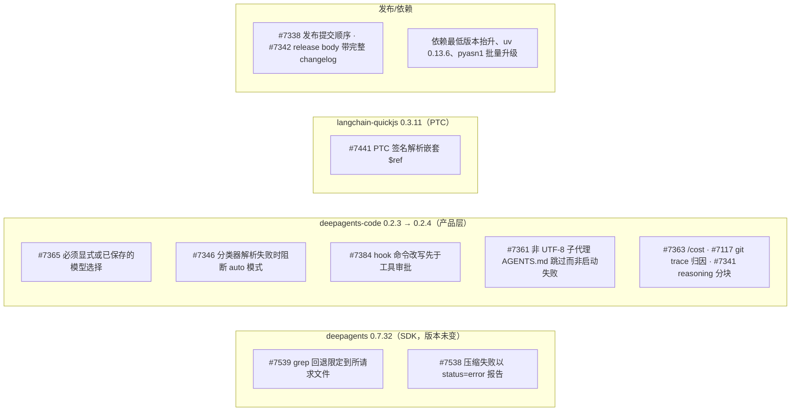
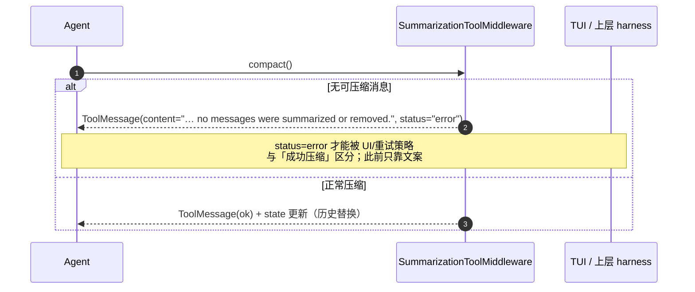
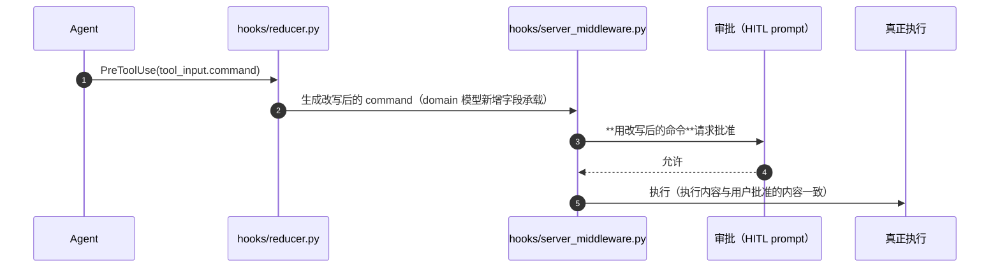
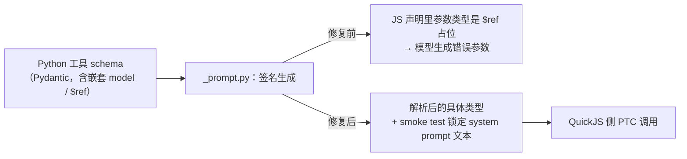
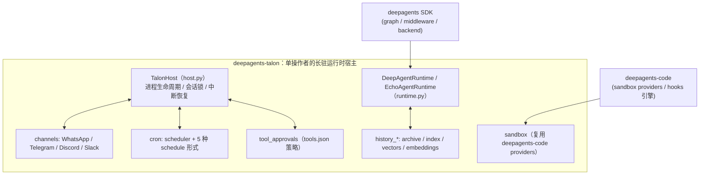

# Deep Agents 增量更新（2026-10-31 → 2026-11-04）：SDK 边界收紧、code 0.2.3/0.2.4、PTC 修复、以及被漏掉的 Talon

> **文档定位**：接续 [DEEPAGENTS_V0.7.32_UPDATE.md](./DEEPAGENTS_V0.7.32_UPDATE.md)（基线 HEAD `3a217cec7`，2026-10-31），补上那之后 69 个提交带来的变化。**旧文不删**；本文只写增量与遗漏。
> **证据基线**：`/Users/gqli/work/deepagents/deepagents` HEAD `3a0c7bb93`（2026-11-04），`git log --oneline 3a217cec7..HEAD | wc -l` = **69**。
> **版本事实**（`pyproject.toml` 实测）：`deepagents==0.7.32`（**未变**）、`deepagents-code==0.2.3→0.2.4`、`langchain-quickjs==0.3.11`、`deepagents-acp==0.0.13`、`deepagents-talon==0.1.0`（实验态）。

---

## 📋 目录

- [1. 这 69 个提交的重心在哪](#1-这-69-个提交的重心在哪)
- [2. SDK：两个「小而关键」的修复](#2-sdk两个小而关键的修复)
- [3. deepagents-code：把安全默认与可解释性固化下来](#3-deepagents-code把安全默认与可解释性固化下来)
- [4. langchain-quickjs / PTC：schema `$ref` 与超时开关](#4-langchain-quickjs--ptcschema-ref-与超时开关)
- [5. 被现有文档漏掉的包：Talon（重点）](#5-被现有文档漏掉的包talon重点)
- [6. 发布与依赖工程](#6-发布与依赖工程)
- [7. 对现有文档的校正清单](#7-对现有文档的校正清单)
- [8. 自查命令](#8-自查命令)

---

## 1. 这 69 个提交的重心在哪



按提交类型统计（`git log 3a217cec7..HEAD`）：`fix(code)` 16、`chore(deps)` 26、`docs` 9、`feat` 4、`perf`/`test`/`ci` 若干。**SDK 侧只有 2 个功能级修复**，产品层（code）才是活跃面 —— 这与旧文档「SDK 为主」的叙述比例不同，需要校正。

---

## 2. SDK：两个「小而关键」的修复

### 2.1 #7539 `FilesystemBackend` 的 grep 回退不再越界（HEAD 提交）

`libs/deepagents/deepagents/backends/filesystem.py`（Python 回退分支，rg 不可用时）：

```python
# 修复前
for fp in root.rglob("*"):
# 修复后
files = root.rglob("*") if base_full == root else (base_full,)
for fp in files:
```

| 维度 | 说明 |
|---|---|
| 症状 | 当调用方把 grep 的 `path` 指向**单个文件**时，Python 回退仍在**整个 root** 下递归，返回其他文件命中 |
| 为什么是设计问题 | `FilesystemBackend` 是 Deep Agents 的**资源抽象边界**（旧文 §8 的安全模型建立在这层）。工具语义一旦越界，模型的「我看过这个文件」结论就不可信，权限判断也随之失真 |
| 附带约束 | 回退仍受 `deadline` 保护（超时返回 partial + `truncated=True`），新增测试 26 行进 `tests/unit_tests/backends/test_filesystem_backend.py` |

> 一致性提醒：SDK 的 `grep`/`glob` 语义 = 「backend 的路由前缀内」，不是「进程 cwd 内」。这与 `CompositeBackend` 的路由语义（0.7.29 #7028 修过尾斜杠路由）属于同一族边界问题。

### 2.2 #7538 压缩失败必须以错误状态返回

`libs/deepagents/deepagents/middleware/summarization.py:SummarizationToolMiddleware`：手工 `/compact` 风格的压缩工具在「没有消息被压缩/删除」的分支里，此前返回的是**普通 ToolMessage**（内容里写了失败说明，但 `status` 仍是默认值）。现在补上 `status="error"`。



**为什么值得单列**：旧文 §7 讲摘要/offload/prompt cache 时，把压缩描述成「自动 + 手工都成功路径」。缺 error 语义会让上层把失败当成功继续，进而误判上下文预算。

---

## 3. deepagents-code：把安全默认与可解释性固化下来

0.2.3（`6884d39e1`）+ 0.2.4（`88ad30d69`）是这两天的主体。按**设计意图**归类，而不是按 PR 罗列：

### 3.1 「不许隐式选择模型」

| PR | 变化 | 代码面 |
|---|---|---|
| #7365 `98de5eb6e` | **必须有显式或已保存的模型选择**：删掉 `config.py` 里约 129 行的隐式默认/推荐逻辑，改由 `model_config.py` + `main.py` 要求显式选择；`non_interactive.py`/`headless_resume.py` 也必须拿到明确模型 | `app.py`、`config.py(-129)`、`model_config.py`、`client/{non_interactive,headless_resume}.py` |

设计含义：**「默认模型」不是一个可静默继承的属性**，而是一次必须被记录的选择。这会影响 CI/headless 脚本写法（必须显式传 model 或已有 saved selection）。

### 3.2 自动模式（auto mode）的失败方向

| PR | 变化 |
|---|---|
| #7346 `6b317a4a8` | **分类器无法解析时阻断 auto 模式**（而不是降级成「当作安全」继续）：`app.py` +127 行测试覆盖 |
| #7351 `3c7cd4bc4` | **披露继承来的分类器模型切换**（用户能看到 auto 模式实际用哪个模型判定） |

这与 deer-flow 的 TypeSafe 风险门「**错误即 deny**」是同一个方向（见 [DEERFLOW_UPDATE_2026Q4.md §5.3](../deer-flow/DEERFLOW_UPDATE_2026Q4.md)）——两个项目独立收敛到「决策组件失败 ⇒ 不放行」。

### 3.3 审批与 hook 的顺序不变量

#7384 `81177151d`：**hook 的命令改写发生在工具审批之前**。



**为什么关键**：若先批准后改写，用户批准的是 A、执行的是 B —— 审批失去意义。这条顺序不变量此前只靠约定，现在由 reducer/middleware 结构保证（+51 行测试）。

### 3.4 健壮性与可观测性

| PR | 变化 | 影响 |
|---|---|---|
| #7361 `4934d74e4` | 子代理 `AGENTS.md` **非 UTF-8 时跳过**，不再让启动失败 | 一个二进制/误存文件不该让整个 CLI 起不来（`subagents.py`） |
| #7501 `08ef3f65b` | 中断取消消息打 `lc_source` 标记 | 上层可过滤/区分「取消标记」与模型正文（`tui/textual_adapter.py`、`_constants.py`） |
| #7341 `b26e78f57` | 远程消息分块中**保留 reasoning** | 远程/hybrid 会话不再丢推理轨迹 |
| #7117 `aabaf9509` | 修正 coding-agent 的 **git trace 归因** | commit/trace 的作者归因正确 |
| #7363 `d23799b05` | `/cost` 打开 token 与成本 modal | 与 #7352（标题里成本优先）配套 |
| #7518 `c4e281131` | Windows 上**延迟 in-app uv 安装** | 避免启动期阻塞/权限问题 |
| #7344/#7355 | 自动更新**加载新版本后才确认成功**；显式更新复用新鲜信息 | 消除「报成功但其实没升级」 |
| #7499/#7498/#7497 | workspace 冲突、MCP 登录失败、`/reload` 刷新语义的说明文案 | 可解释性：错误信息可行动 |

### 3.5 0.2.3 里此前文档未覆盖的产品能力

| PR | 能力 |
|---|---|
| #7304 `f9cbdbaeb` | **用 provider 原生 tool search 延迟加载 MCP 工具 schema**（大 MCP 面的 token 成本优化） |
| #7303 `1f4237af3` | 去掉冗余 MCP 启动探测 |
| #7327 `93143ba1b` | `/tools` 头部显示 MCP 工具数量 |
| #7364 `0f803ba32` | **默认包含官方 marketplace** |
| #7332 `028439ef1` | `DEEPAGENTS_CODE_LANGSMITH_PROJECT_URL` + 缓存被拒绝的项目查询 |
| #7358 `417af26f6` | OpenRouter 上启用 Claude prompt caching |

---

## 4. langchain-quickjs / PTC：schema `$ref` 与超时开关

| PR | 变化 | 为什么不是「小 bug」 |
|---|---|---|
| #7441 `5829691de` | **PTC（programmatic tool calling）签名解析嵌套 schema `$ref`**：`_prompt.py` 重写生成逻辑，新增 smoke 测试夹具 `quickjs_system_prompt_nested_models.md`（276 行） | PTC 把工具签名翻译成 JS 可调用声明；`$ref` 未解析时，Pydantic 嵌套模型的参数形状在 JS 侧是错的，模型会**构造出无法校验的调用**。这是「类型系统跨语言一致性」问题 |
| #6958 `3b992d2d8`（10-30，旧文档窗口内但未记录） | 允许**关闭每次调用的 `timeout`** | 长耗时 JS 编排（等待外部结果）不该被 per-call 超时截断；开关归 host 策略 |



---

## 5. 被现有文档漏掉的包：Talon（重点）

`docs/deepagent-architecture/` 全部文档里**没有一处**提到 `libs/talon`，而它是 deepagents 仓库中一个独立发布的包（`deepagents-talon==0.1.0`，实验态）。



已补专门文档：**[DEEPAGENTS_TALON_ARCHITECTURE.md](./DEEPAGENTS_TALON_ARCHITECTURE.md)**（宿主模型、状态目录、checkpoint/history 双 URI、向量检索指纹与字节预算、Interrupt-and-Continue、审批策略自编辑防护、cron 时区/DST 语义、安全边界）。

**另一个必须纠正的旧文事实**：`libs/cli` / `deepagents-cli` **已经不存在**了。

```text
08e3768f7  2026-08-24  feat(cli)!: deprecate `deepagents-cli` in favor of `managed-deepagents` (#5780)
38cf3e41f  2026-08-24  release(deepagents-cli): 0.3.0 (#5782)
da67c86e5  2026-08-24  chore(repo): remove deprecated `libs/cli` package (#5791)
```

因此 `DEEPAGENTS_CLI_APP_ARCHITECTURE.md` 与 `DEEPAGENTS_FRAMEWORK_COMPLETE_DESIGN.md` 里所有 `libs/cli/deepagents_cli/` 路径、以及「`deepagents` 命令做 `init/dev/deploy`」的描述，**都指向已删除的代码**；部署编排现由 **managed deep agents** 承担。已在两篇旧文顶部加了校正注记。

其余未覆盖的小包（不影响主线，登记以免继续漏）：

| 包 | 版本 | 作用 | 现状 |
|---|---|---|---|
| `libs/acp` | 0.0.13 | **Agent Client Protocol** 连接器：在 Zed 等 ACP 编辑器里跑 Deep Agent | 仅在 prompt 文档里被顺带提到 |
| `libs/evals` | 0.0.1 | 评测集与打分 | 无文档 |
| `libs/partners/*` | — | `daytona`/`modal`/`runloop`/`vercel`/`quickjs` 等 provider 适配 | 分散在 README |

---

## 6. 发布与依赖工程

| PR | 变化 | 对文档/流程的含义 |
|---|---|---|
| #7338 `9291948ab` | 澄清 **release commit 顺序** | 多包 monorepo 发布顺序是「有坑」的，已写进 infra 文档 |
| #7342 `1cdd32b48` | CI 在 release body 里**链接完整 package changelog** | changelog 成为一等公民产物 |
| #7336/#7337/#7339/#7353 | package README ↔ changelog ↔ examples 互链 | 旧文里「去仓库找 CHANGELOG」的路径可替换为直链 |
| #7502/#7504/#7505/#7517 | 抬最低依赖：`langchain-core>=1.7.2`（code）、`quickjs-rs>=0.2.6`、`all` extras 最低版本 | 升级时注意 extras 解析变化 |
| #7487 `480a3d20f` | `uv` → 0.13.6 | 本地开发脚本基线 |
| pyasn1 0.6.4→0.6.5（13 个包）、minor-and-patch 组 7 项 | dependabot 批量 | 无设计影响，仅版本地图 |

---

## 7. 对现有文档的校正清单

| 文档 | 段落 | 校正 |
|---|---|---|
| [DEEPAGENTS_V0.7.32_UPDATE.md](./DEEPAGENTS_V0.7.32_UPDATE.md) | 文首「源码基线 `HEAD=3a217cec7`」 | 追加一行：HEAD 已推进到 `3a0c7bb93`（2026-11-04），SDK 版本仍 0.7.32，**但 code 已 0.2.4** |
| 同上 | §7 摘要/offload | 补：手工压缩失败现在以 `status="error"` 返回（#7538） |
| 同上 | §8 Filesystem/权限/Backend | 补：`grep` Python 回退曾越界到整个 root（#7539），是 backend 边界语义问题而非普通 bug |
| [DEEPAGENTS_CLI_APP_ARCHITECTURE.md](./DEEPAGENTS_CLI_APP_ARCHITECTURE.md) | 「适用版本 0.1.x」+ 2026-10-31 校正注记 | 版本基线改 `deepagents-code==0.2.4`；新增小节：模型选择必须显式（#7365）、auto 模式失败即阻断（#7346）、**hook 改写先于审批**（#7384） |
| [DEEPAGENTS_FRAMEWORK_COMPLETE_DESIGN.md](./DEEPAGENTS_FRAMEWORK_COMPLETE_DESIGN.md) | 分包地图 | 补 `libs/talon`、`libs/acp`、`libs/evals`、`libs/partners/*` 的完整清单 |
| [DEEPAGENTS_DOCUMENTATION_INDEX.md](./DEEPAGENTS_DOCUMENTATION_INDEX.md) | 索引 | 已登记本文与 Talon 文；同时修复了索引内 **25 个失效相对链接** |
| [DEEPAGENTS_MIDDLEWARE_CHAIN_DEEP_DESIGN.md](./DEEPAGENTS_MIDDLEWARE_CHAIN_DEEP_DESIGN.md) | 中间件链 | SDK 链本身无变化（0.7.32 未变）；**hook 顺序不变量属 code 层**，不要混进 SDK 链 |

---

## 8. 自查命令

```bash
cd /Users/gqli/work/deepagents/deepagents
git log -1 --format='%H %ad' --date=short          # 3a0c7bb93… 2026-11-04
git log --oneline 3a217cec7..HEAD | wc -l          # 69
grep -n '^version' libs/*/pyproject.toml libs/partners/quickjs/pyproject.toml
git show 3a0c7bb93 -- libs/deepagents/deepagents/backends/filesystem.py
git show 2c11c92ee -- libs/deepagents/deepagents/middleware/summarization.py
sed -n '1,40p' libs/code/CHANGELOG.md              # 0.2.4 / 0.2.3 全文
sed -n '17,30p' libs/talon/README.md               # Talon quickstart 与状态目录
```
