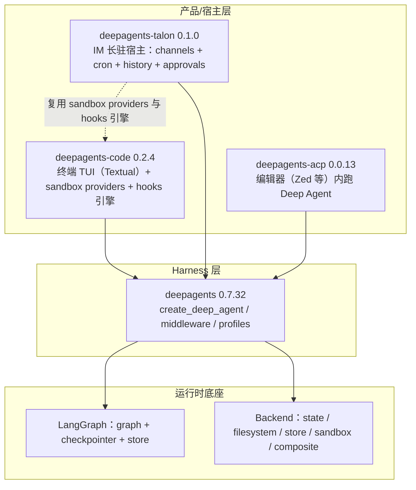
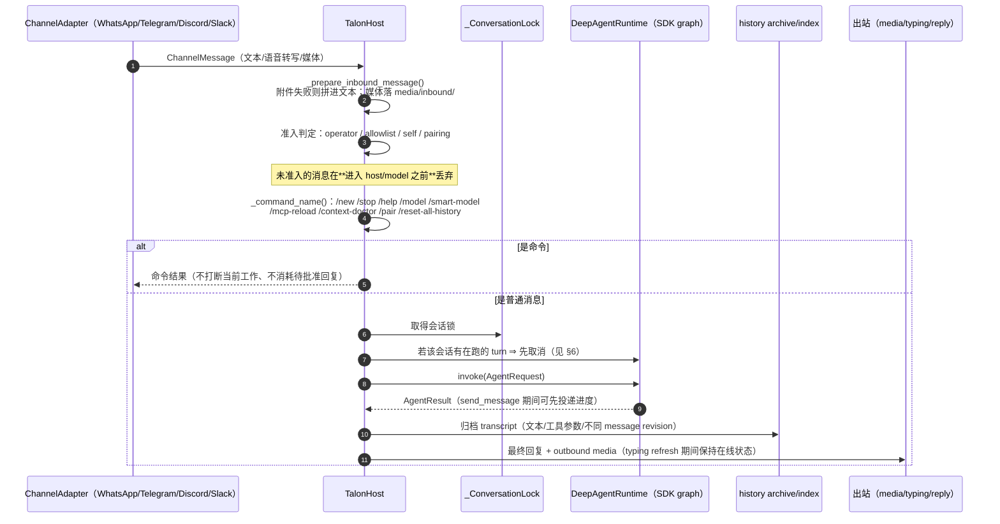
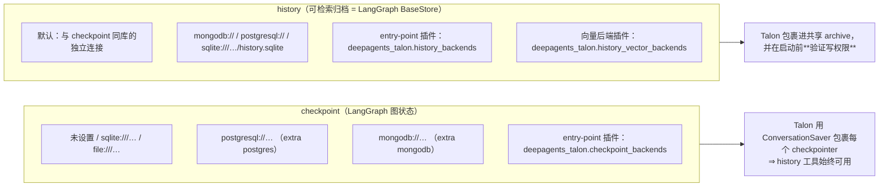
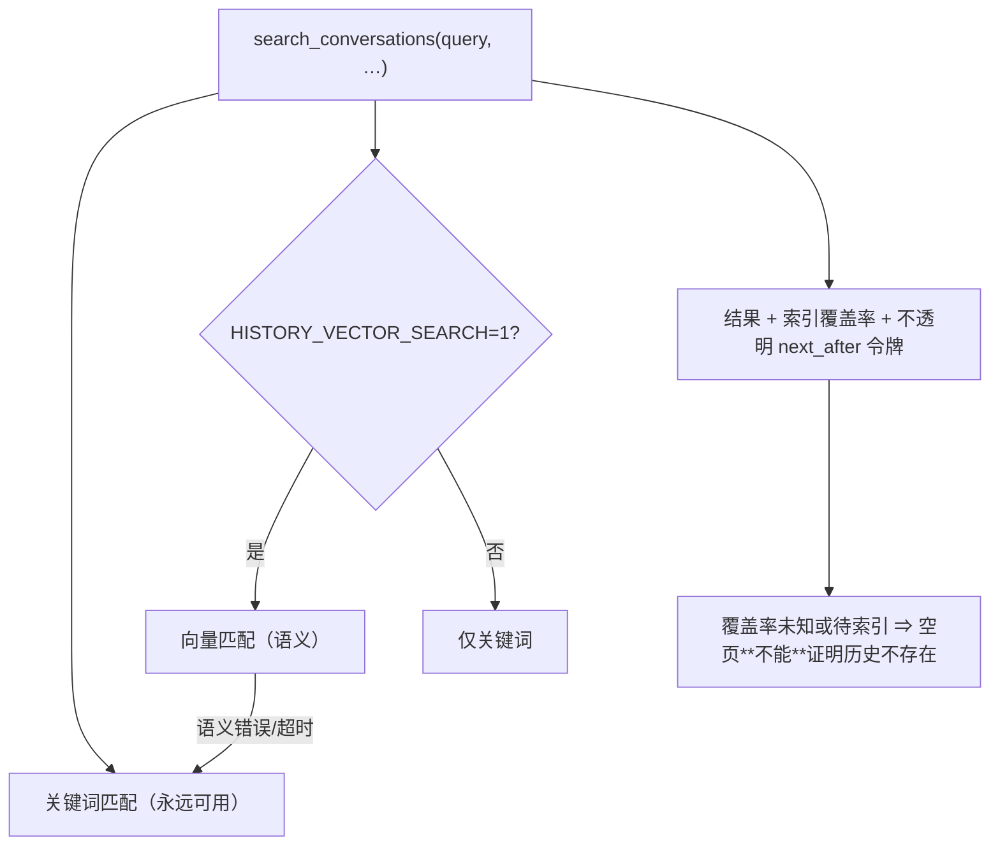
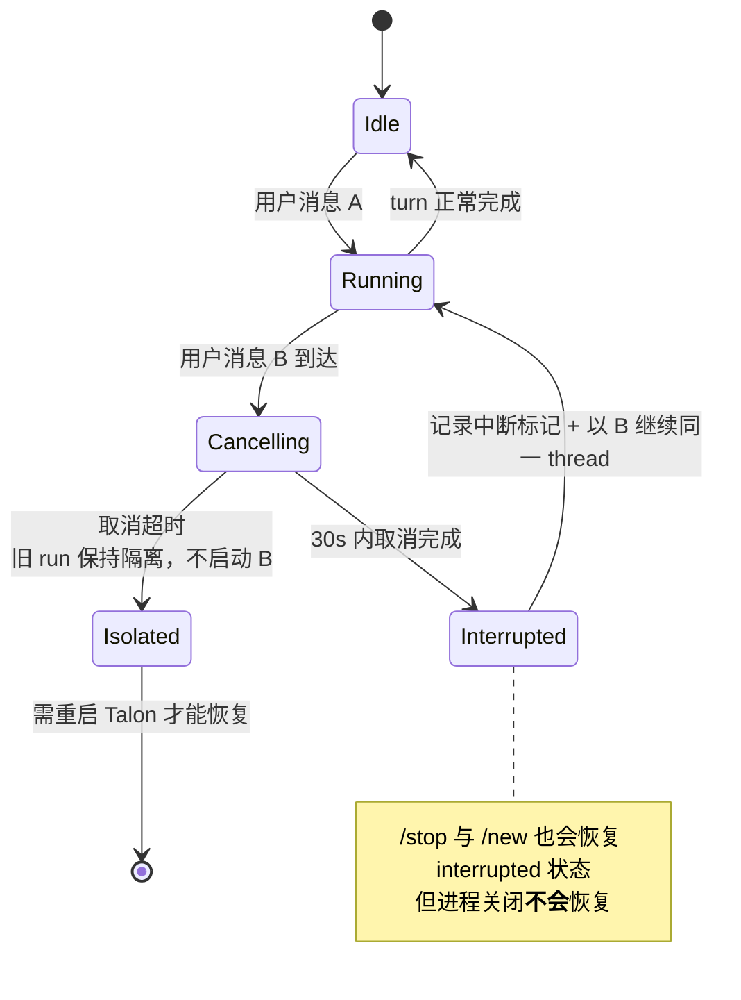
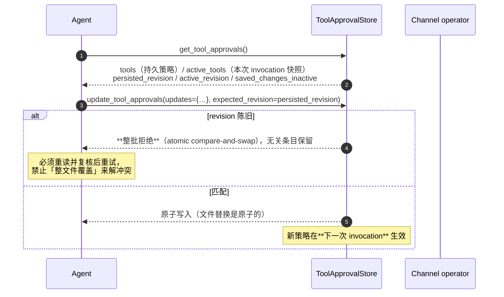
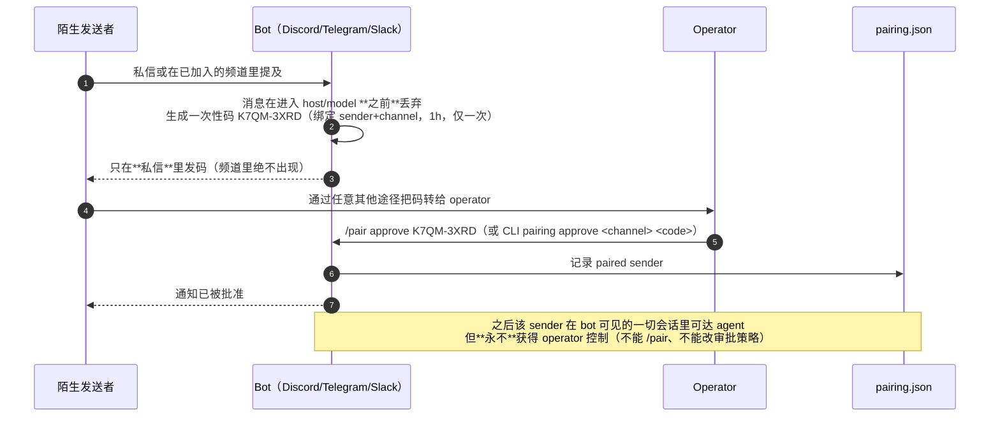
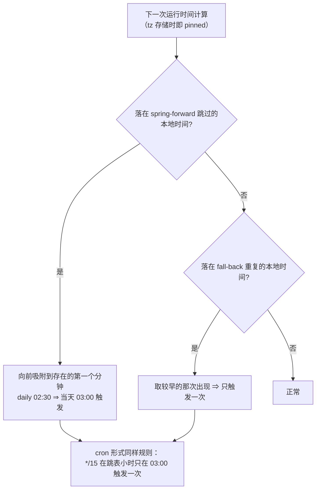
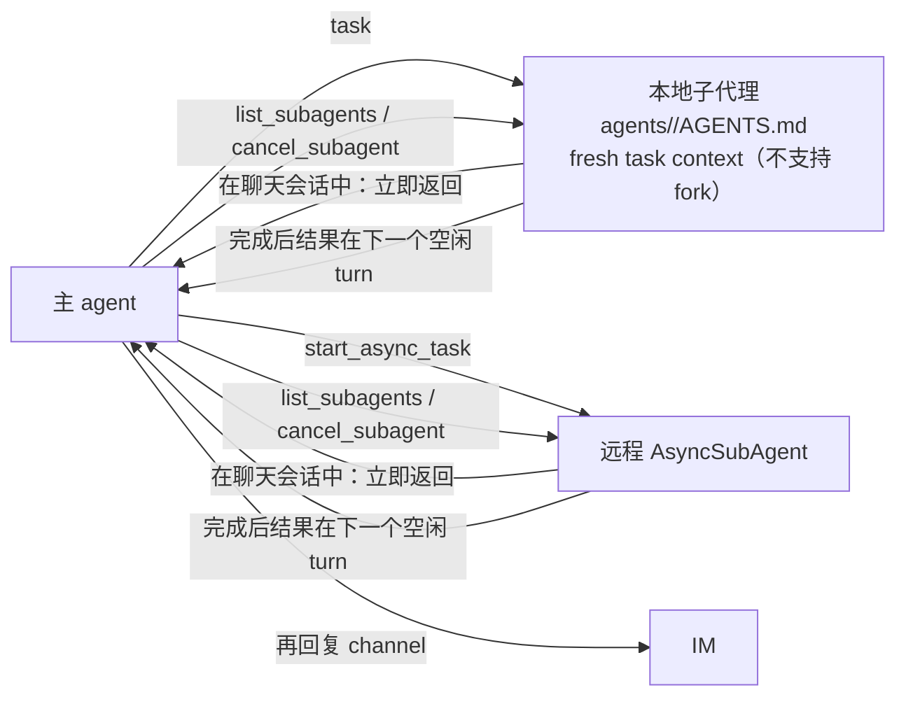
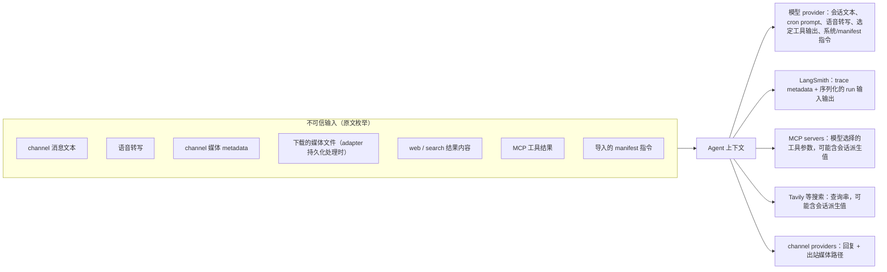

# Deep Agents Talon 架构设计（`deepagents-talon==0.1.0`，实验态）

> **为什么单独成文**：Talon 是 deepagents 仓库里独立发布的**长驻运行时宿主**（`libs/talon`），此前的 Deep Agents 文档体系完全没有覆盖它。它把「一个 Agent」变成「一个 7×24 在 IM 上待命的服务」，因此引入了一套与 SDK 完全不同的**生命周期、持久化、审批与调度**设计。
> **证据基线**：`/Users/gqli/work/deepagents/deepagents` HEAD `3a0c7bb93`（2026-11-04）；事实来源为 `libs/talon/README.md`（900+ 行）、`libs/talon/HOOKS.md` 与 `deepagents_talon/` 模块清单。
> **安全声明（原文，必须保留）**：Talon 是 **single-operator by design**，不提供多租户隔离、生产级 HITL 策略或 channel 管理员边界；channel 审批提示是「实验性便利」而**不是安全边界**；把 channel 暴露等同于把操作者的模型凭据、MCP 工具与本机资源交出去。

---

## 📋 目录

- [1. 定位：Talon 在 Deep Agents 三层里的位置](#1-定位talon-在-deep-agents-三层里的位置)
- [2. 宿主模型与一轮消息的完整时序](#2-宿主模型与一轮消息的完整时序)
- [3. 状态目录、文件权限与数据保留](#3-状态目录文件权限与数据保留)
- [4. 两套独立的持久化 URI：checkpoint 与 history](#4-两套独立的持久化-uricheckpoint-与-history)
- [5. 会话历史归档与语义检索](#5-会话历史归档与语义检索)
- [6. Interrupt-and-Continue：IM 场景的核心语义](#6-interrupt-and-continueim-场景的核心语义)
- [7. 工具审批策略（tools.json）](#7-工具审批策略toolsjson)
- [8. Sender Pairing：不改 env 不重启的准入](#8-sender-pairing不改-env-不重启的准入)
- [9. Cron：五种 schedule、扩展语法与 DST 语义](#9-cron五种-schedule扩展语法与-dst-语义)
- [10. 子代理：本地 task / 远程 async / scheduled 内联](#10-子代理本地-task--远程-async--scheduled-内联)
- [11. Hooks、MCP、沙箱与可观测性](#11-hooksmcp沙箱与可观测性)
- [12. 安全体系：不可信输入与数据出境清单](#12-安全体系不可信输入与数据出境清单)
- [13. 与其他运行时/调度器的对照](#13-与其他运行时调度器的对照)
- [14. 已知矛盾与不确定项](#14-已知矛盾与不确定项)
- [15. 源码索引](#15-源码索引)

---

## 1. 定位：Talon 在 Deep Agents 三层里的位置



| 维度 | `deepagents`（SDK） | `deepagents-code`（CLI/App） | `deepagents-talon`（宿主） |
|---|---|---|---|
| 生命周期 | 一次 `invoke` | 一个交互会话 | **进程长驻**，channel + cron 驱动 |
| 触发者 | 调用方代码 | 人在终端里 | IM 消息、定时器、后台结果 |
| 会话身份 | `thread_id` | 产品层会话文件 | `(channel, conversation_id)` → 会话锁 |
| 审批 | `interrupt_on`（graph 原语） | TUI 审批 UI | `tools.json` 策略 + channel 审批提示 |
| 持久化 | 由宿主选择 | 产品层会话 + checkpoint | `checkpoints.sqlite` + history store + `cron/jobs.json` |
| 定位 | 库 | 产品 | **实验态运行时**（alpha） |

关键：**Talon 不重新实现 agent**，它 `DeepAgentRuntime` 内部 `_create_graph()` 建的就是 SDK 图；Talon 拥有的是**宿主权**（谁可以触发、在哪个会话、用什么策略、如何恢复）。

---

## 2. 宿主模型与一轮消息的完整时序

`host.py:TalonHost`（约 2400 行）是核心。内部实体（实测类名）：

| 实体 | 作用 |
|---|---|
| `_Turn` | 一轮执行的句柄（可被下一条消息取代） |
| `_ConversationLock` | 每个 `(provider, conversation_id)` 串行化 |
| `_BackgroundRetry` / `_BackgroundRoute` | 后台结果回投主 agent 的路由与重试 |
| `_PendingToolApproval` / `_PendingAuthorization` / `_AuthorizationFlow` | 等待 channel 回复的审批与 OAuth 式流程 |
| `_ReactionAudit` | 表情回应审计（Discord/Slack 交互） |
| `_CancelOutcome`（StrEnum） | 取消结果分类（用于中断-继续判定） |
| `ScheduledRunRevokedError` | 排期运行被撤销（sender 被 revoke 等） |



注意两个「不显眼但重要」的设计：
- **`send_message(text)`**：主 agent 可在**同一轮**里向同一 chat 投递进度更新，**不结束 turn**；目的地由 host 固定，**turn 结束或被取代后发送即禁用**；没有 channel 的运行无法发送。
- **命令不打断工作**：`/help` 明确「不中断当前工作、不消耗 pending approval 或 sign-in 响应」。

---

## 3. 状态目录、文件权限与数据保留

默认 `~/.deepagents/<assistant_id>/`（`DEEPAGENTS_TALON_HOME`/`ASSISTANT_ID` 可改）：

```text
~/.deepagents/<assistant_id>/            # 目录 0700
├── AGENTS.md                            # 物化的助手指令
├── skills/                              # 留在 host（沙箱模式下也在 host）
├── agents/<name>/AGENTS.md              # 本地子代理定义
├── memory/                              # DEEPAGENTS_TALON_MEMORY_PATHS 只允许这里
├── tools.json                           # 工具审批策略（见 §7）
├── hooks.json                           # 复用 deepagents-code hook 引擎（§11）
├── pairing.json                         # paired senders（§8）
├── checkpoints.sqlite                   # LangGraph checkpoint（默认）
├── history/…                            # 归档与向量索引（fingerprint 分文件）
├── cron/jobs.json                       # 排期任务（0600）
├── channels/whatsapp/                   # LocalAuth 凭据 + Chromium profile（**不自动删**）
└── media/inbound/                       # 入站媒体，默认 24h 后启动清理
```

| 数据 | 保留策略（默认） | 设计意图 |
|---|---|---|
| `cron/jobs.json` | 启用中的任务保留；成功结束的 one-shot 与过了 `until` 的任务在**下一个 scheduler tick 删除**；最后一次运行失败的任务在启动后按 `CRON_RETENTION_DAYS=30` 删除 | 失败任务要能被看见；成功任务不累积 |
| `media/inbound/` | `INBOUND_MEDIA_RETENTION_HOURS=24`（启动时清理） | 媒体是最容易失控的磁盘占用 |
| 媒体大小 | `MAX_MEDIA_BYTES=1 GiB`；WhatsApp 再收紧到 **64 MiB** | 渠道上限差异 |
| `channels/whatsapp/` | **保留直到运维手动删除** | 自动删除会静默解绑设备 |
| 会话历史 | 无自动过期（`/reset-all-history` 才删） | 历史是 agent 可检索的资产 |

---

## 4. 两套独立的持久化 URI：checkpoint 与 history



约束（README 明示）：

| 约束 | 含义 |
|---|---|
| 「Checkpoint 与 history URI **互相独立**」；改 checkpoint URI **不迁移**旧数据 | 升级数据库要显式迁移 |
| 远程 checkpoint 的 thread id **不会自动按 assistant 命名空间隔离** ⇒ 不同 assistant 要用不同数据库 | 跨 assistant 串会话的风险；history 归档**则**按 assistant 命名空间，可共享库 |
| 只 import **选中的** checkpoint driver | 可选依赖不污染启动 |
| 插件 URI scheme 与内置冲突或重复 ⇒ **启动失败** | 不静默覆盖 |
| 「一个 assistant 的归档只允许**一个写入者**」；检索单次最多扫 500 条，超预算报错 | 有界检索 + 单写者；也意味着 `pairing pause-jobs` 只能在 Talon 停止时跑 |
| echo runtime 与未包裹的自定义 checkpointer **不支持 history 工具/reset** | 能力与后端绑定 |

---

## 5. 会话历史归档与语义检索

**归档内容**：文本、**工具调用参数**、不同的 message revision；不索引附件二进制与归档工具结果；排期运行**不新增**会话历史，也不回填旧 checkpoint。

**agent 侧工具面**：`list_conversations` / `search_conversations` / `read…`（有界分页，限当前 channel+chat）/ `delete_conversations`（当前会话受保护，须先 `/new`）。



嵌入适配器（与 history 数据库**解耦**选择）：

| Adapter | extra | 凭据 | 推理位置 |
|---|---|---|---|
| `local`（默认） | `history-local` | 无 | 本机 CPU，惰性加载 `Qwen/Qwen3-Embedding-0.6B` |
| `voyage` | `history-voyage` | `VOYAGE_API_KEY` | Voyage API |
| `openai-compatible` | `history-openai` | `OPENAI_API_KEY`/`OPENROUTER_API_KEY` | HTTPS 嵌入 API |
| `atlas` | `mongodb` | Atlas 里配置模型 | Atlas 服务端自动嵌入 |

**字节预算**（很值得记的设计）：输入按 **UTF-8 字节数**当保守 token 上界，预留 128 token 给 provider 指令；`BYTES_PER_TOKEN` 默认 **1**（假设每字节都可能成独立 token）。中文等 CJK 约 3 字节 ≈ 1 token，因此默认值把切分留到最保守的一侧；**该值参与嵌入指纹，改了会重建索引**。

**指纹与代际**：向量数据按 fingerprint 分 SQLite 文件 / PG schema / Mongo collection；改 model、endpoint、dims、prompt 或 input budget 时，若现有索引不兼容则**启动失败**，必须显式 `HISTORY_REINDEX=1` 才会删旧向量重建（可能产生费用）。>2000 维时 PostgreSQL 走精确向量检索；**元数据与向量永远用不同 Store 实例**。

超长文档：切分不丢文本，向量按长度加权平均池化（每次运行记录一次日志，因为池化后的文档要和未池化查询比较）；超长查询**退回关键词**。

---

## 6. Interrupt-and-Continue：IM 场景的核心语义

> 原文：同一会话的**新消息**取消当前 turn，在**最近已提交**的 graph checkpoint 之后记录一个中断标记，然后在**同一 thread** 上开始新消息；被取消 turn 的部分输出**不会被伪造也不会被投递**。



与 SDK `deepagents` 的 async subagent「queue without interrupting」形成对照：**同一会话内是抢占式，跨会话/后台是并存式**。

---

## 7. 工具审批策略（tools.json）

**一个 assistant 一份固定策略**：`<home>/tools.json`，扁平 JSON，**精确工具名 → bool**（`true` 需要 channel 审批提示）。没有通配模式，也没有 per-agent 策略文件。

出厂默认：

```json
{
  "update_tool_approvals": true,
  "delete_conversations": true,
  "update_mcp_server": true,
  "start_async_task": true,
  "send_message": true
}
```

语义边界（易误解处，逐条来自原文）：

| 说法 | 真相 |
|---|---|
| `false` = 工具被禁用 | ❌ `false` 只控制**是否提示**，不影响可用性/授权；未列出的工具默认 `false` |
| `send_message` 门控所有对外消息 | ❌ 只门控**进度更新**（含 Slack 提及），不门控最终回复与 host 生成消息 |
| 策略改了立刻生效 | ⚠️ **下一次 invocation** 生效；进行中的 turn/task 保留自己的**策略快照** |
| 文件坏了会用旧策略 | ❌ **fail closed**：下一次 invocation 直接失败，由运维修文件 |
| 把 `update_tool_approvals` 设成 `false` 就能静默改策略 | ❌ 策略自编辑按**编辑前**的策略校验，且必须有 operator 身份（提示为 `false` 也要 operator） |

**读-改-写的并发契约**：



Operator 判定：`self` 暴露模式下 `from_self` 消息天然合格；否则只认 `DEEPAGENTS_TALON_<CHANNEL>_OPERATOR_ID`。**chat/user 白名单与 mention 匹配都不算 operator**。未识别发送者、排期运行、detached worker、无人值守的结果跟进**都不能**编辑策略；无人值守跟进也不能发起交互式审批或授权流程。

> 与 SDK 的衔接：`DeepAgentRuntime` 已**不再接受 `interrupt_on`**，嵌入宿主改传 `approval_store=ToolApprovalStore(path)`；底层 Deep Agents 的 `interrupt_on` graph API **未变**。嵌入方必须自己提供可信的 `AgentRequest.metadata["tool_approval_operator"]`，**绝不能从模型参数或不可信入站 metadata 复制**。

---

## 8. Sender Pairing：不改 env 不重启的准入



安全要点（原文极直白）：

- 每个 sender 同时只有 1 个有效码；每个频道最多 16 个待处理码，超出**静默丢弃**。
- 只有 env operator（`…_OPERATOR_ID`）能执行 `/pair`；list/revoke 只在 DM。
- **revoke 的连带效应**：停止该 sender 用过的所有会话里的在制品（含后台 worker）——**因为后台工作属于 chat 而不是属于人**，所以会牵连别人的在制品；并暂停其创建的 cron 任务、停止其进行中的运行使其结果不投递。被暂停的任务即使该 sender 重新获批也**保持暂停**。
- 「**只 pair 你愿意把终端交出去的人**」。
- `allowlist` 模式下的 `*_MENTION_PATTERNS` 按**文本**准入，任何在该频道发言的人都能命中 ⇒ 等价于把频道开放给所有人。

---

## 9. Cron：五种 schedule、扩展语法与 DST 语义

| 形式 | 种类 | 例 |
|---|---|---|
| `in <N>{m,h}` | one-shot | `in 30m` |
| `every <N>{m,h}` | recurring（**相位锁定**上次运行） | `every 6h` |
| `at <YYYY-MM-DD> <HH:MM> <tz>` | one-shot（过去时刻在创建/编辑时即拒绝） | `at 2026-09-04 13:30 America/New_York` |
| `daily at <HH:MM> <tz>` | recurring（**按本地日期重建**下次运行，非 +24h） | `daily at 08:00 America/New_York` |
| `cron <min> <h> <dom> <mon> <dow> <tz>` | recurring | `cron */15 * * jun mon-fri America/New_York` |

crontab 扩展：`L`（月末）、`LW`（最后工作日）、`15W`（最接近 15 日的工作日）、`5L`（最后一个周五）、`2#1`（第一个周二）、`@hourly/@daily/@weekly/@monthly/@yearly`；**不支持 `@reboot`**。与 Vixie cron 一致：两个 day 字段都受限时「任一匹配即匹配」，任一以 `*` 开头则「两者都要匹配」。永不触发的表达式（`0 0 31 2 *`）在创建时**拒绝**。

DST 两条确定性规则（这是本项目最细的时区设计）：



其他语义：recurring 可带 `until`（`YYYY-MM-DD HH:MM <tz>`，含端点；早于首次运行则拒绝）；窗口内迟到的运行最多容忍 5 分钟；跨过 `until` 的漏运行**丢弃而不补投**。任务自清理：永不再运行的任务在下个 tick 删除；最后一次失败的任务保留（`list_jobs` 可看错误）直到 `CRON_RETENTION_DAYS`。

Agent 侧配套：`current_time` 工具**永远可用**，返回日期/时间/IANA 时区名，其输出直接进 schedule 字符串；host 时区无法确定时返回 `timezone: null` 并提示「问用户」，而不是猜。`create_job`/`edit_job` 返回 `upcoming`（接下来三次时间）让 agent 自查排期是否符合用户要求。调度器每 60 秒 tick，因此「落在分钟内」而非秒。

可观测性：`cron/jobs.json` 持久化 + `talon_event` JSON 日志事件：`cron.tick / dispatch / success / failure / delivery / delivery_suppressed / delivery_failure / run_timeout / job_removed`，并配合 `last_status`/`last_error`。

---

## 10. 子代理：本地 task / 远程 async / scheduled 内联



| 语义 | 聊天会话 | 排期运行（unattended） |
|---|---|---|
| `task` / `start_async_task` | 立即返回，后台跑 | **跑到完成再返回**，在同一 turn 里消费结果；无跟进 turn、无独立投递 |
| `list_subagents` / `cancel_subagent` | 可用 | **隐藏**（排期运行不拥有可检视的后台工作） |
| 并发 | 4 个同时；最多保留 128 个未处理 job；单次运行 ≤1h；结果 ≤64,000 字符 | 一次委派 ≤10 分钟（`INLINE_SUBAGENT_TIMEOUT` 可调），最多 4 个同时，超出**排队**不拒绝；整个运行 ≤30 分钟后修复 thread 并记失败 |
| 重启 | worker 与 pending 结果**只在内存**，重启即丢 | — |
| `/stop` `/new` | 取消该会话所有子代理 | — |
| 工具审批 | 仍适用；子代理需要审批时报告「无法完成该动作」 | — |

能力装配规则（容易踩）：本地子代理默认**没有工具**（`tools: [精确名]` 才给）；`web: true` 授予运行时**实际拥有**的 web 工具（不给就永远没有，**与目录名无关**）；没有自动的 general-purpose agent；每次 `task(..., tools=[...])` 可为某个任务临时加能力（含 `execute`）。

---

## 11. Hooks、MCP、沙箱与可观测性

**Hooks**（`HOOKS.md`）：**复用 `deepagents-code` 的 command-hook 引擎**，事件 `PreToolUse` / `PostToolUse` / `PostToolUseFailure`（主 agent 与本地子代理）+ `Stop`（仅主 agent）。配置 `<home>/hooks.json`，**每轮开始加载**，进行中的 turn 保留快照。命令从 stdin 收 JSON 事件，可向 stdout 回 JSON 决定；shell 调用沿用兼容名 `Bash` 与 `tool_input.command`。

> 与 deepagents-code #7384（**hook 改写先于审批**）联读：见 [DEEPAGENTS_POST_0.7.32_UPDATE.md §3.3](./DEEPAGENTS_POST_0.7.32_UPDATE.md)。Talon 侧没有独立实现，因此该顺序不变量在这里同样成立。

**MCP**：`~/.deepagents/.mcp.json`（`DEEPAGENTS_TALON_MCP_CONFIG` 可改），`"auth": "oauth"` 时 `authenticate_mcp_server` 把授权链接**直接发到来源会话**、等同一 operator 粘回完整回调 URL，**链接与回调绕过模型上下文与 trace**。也可用 chat 工具 `get_mcp_configuration`（脱敏视图）/`update_mcp_server` 增删改，默认需审批；未提示的更新若复用 `<redacted>` 值，**只能**改 `allowedTools`/`disabledTools`，其余必须保持不变（要改就得给 `${ENV_VAR}` 或让 operator 重新开审批）。`/mcp-reload` 或 `reload_mcp_configuration` 在**下一轮前**重载。

**沙箱**：`DEEPAGENTS_TALON_SANDBOX=langsmith|agentcore|daytona|modal|openshell|runloop|vercel`（复用 deepagents-code 的 providers）。

| 关键点 | 事实 |
|---|---|
| 生命周期 | 启动时创建、退出时删除；`SANDBOX_ID` 可附着既有沙箱且**永不删除** |
| 失败方向 | 沙箱起不来 ⇒ **Talon 直接退出**，**不回落 host 执行** |
| 留在 host 的 | assistant 的 `skills/` 与 `memory/`（否则技能与记忆失效）、`tools.json` 等 assistant 状态（沙箱工具**访问不到**）、**MCP 工具、web 工具、channel 媒体处理** |
| 结论 | **沙箱不是多租户边界**（因为 MCP/web/媒体仍在 host） |
| 记忆路径 | `DEEPAGENTS_TALON_MEMORY_PATHS` 或 manifest 里的路径必须落在 `<home>/memory/` 内，否则警告并忽略 |

**可观测性**：`DEEPAGENTS_TALON_AGENT_ACTIVITY_LOGGING=true` 输出 agent run / model activity / tool call 到 INFO，输入输出**脱敏并截断到 1000 字符**（仍可能含敏感数据，须限制本地日志访问）；"Thinking" 事件只报调用生命周期，**不暴露隐藏思维链**。LangSmith trace 需 `LANGSMITH_TRACING=true` + key，包裹每次 run 并附 assistant id / conversation id / trigger / 来源消息 metadata。

**运维工具**：`/context-doctor` 估算 system prompt、memory、skill index、**全部活跃工具 schema（含 MCP）**的 token 成本 + 当前会话估算 + 上次 provider 报告的输入数；不调模型、不改历史、不打断工作，**只报数量不报内容**。`/model [spec]` 会话级切换（跨 `/new` 与重启保留，按会话生效；排期任务与子代理保留自己的模型），`/smart-model` 全 assistant 的「求助模型」（`ask_for_help` 会**把问题发给另一家模型 provider**，因此**始终**要求审批提示）。

**打包的默认角色**（`deepagents_talon/defaults/`）：启动时补齐缺失的 `AGENTS.md`（main、`internal-research`、`external-research`）与 `configuration-hardening`、`safety` 两个 skill（**不覆盖**既有文件）。`external-research` 在 frontmatter 里声明 `web: true` ⇒ 构造时挂 `fetch_url` 与 Tavily `web_search`（后者仅当 `TAVILY_API_KEY` 非空）；`internal-research` 以 `tools: []` 启动。原文明确：**Prompts are not a sandbox**，注入、分类错误、共享凭据仍是运维风险。

---

## 12. 安全体系：不可信输入与数据出境清单



| 防线 | 强度 | 备注 |
|---|---|---|
| 未准入消息在进 host/model 前丢弃 | 强 | 准入判定在模型之前 |
| `tools.json` 审批 | **弱/便利** | 同 UID 的 shell 可绕过工具 API 直接改文件；本地闸门不约束不透明远程图内部调用；`start_async_task` 只门控「委托」 |
| 沙箱 | **不是多租户边界** | MCP/web/媒体仍在 host |
| 嵌入 endpoint 的 SSRF 防护 | 部分 | `BASE_URL` 必须可路由：拒环回/私有/link-local/保留地址字面量、拒 `localhost`、拒 `127.1`/`2130706433` 这类缩写；但**公网名解析到私网仍会连通**（需要解析期控制，嵌入客户端未暴露） |
| 凭据处理 | 中 | `${ENV_VAR}` 引用；MCP 配置建议放 workspace 外；`<redacted>` 复用受限；**redaction 不等于可以改存凭据** |

---

## 13. 与其他运行时/调度器的对照

| 维度 | Talon | deer-flow（Gateway scheduler） | deepagents SDK `AsyncSubAgent` |
|---|---|---|---|
| 排期形式 | `in/every/at/daily/cron` + `L/W/#` + IANA tz pinned | once/cron/interval（`croniter`），`stop_condition` 独立存储 | 无排期（由宿主触发） |
| 并发模型 | 4 个 subagent 槽；排期内联 ≤4 排队 | 全局 3 槽 + `max_concurrent_runs_per_user=2`，按 owner 公平排空 | 客户端轮询 check |
| 租约/多副本 | **无**（单宿主） | `lease_seconds=120` + `multi_instance` 声明式门禁 | 不适用 |
| 无人值守语义 | 排期运行**不委托后台**、不能编辑策略、不能发起交互审批 | stop rule 只在启动时组装进 prompt；host 错误文案有契约文件 | `queue` follow-up |
| 状态文件 | `cron/jobs.json`（0600）+ 事件日志 | `scheduled_tasks/_runs/_events` 表 + `host_notes` 契约 | 服务端 |
| 历史/记忆 | 归档 + FTS/向量 + 指纹分代 | DeerMem L0–L4（见 [DEERMEM_MEMORY_DESIGN.md](../deer-flow/DEERMEM_MEMORY_DESIGN.md)） | Store + summarization middleware |

> 结论：Talon 是**单机、单操作者、面向 IM 的运行时**；deer-flow 是**多副本、多租户的企业 Gateway**。两者的排期子系统解决同一类问题（幂等、DST、无人值守权限收缩），但把可靠性放在不同层：Talon 靠「时间语义精确 + 任务自清理」，deer-flow 靠「租约 + 数据库 + fencing」。

---

## 14. 已知矛盾与不确定项

| # | 观察 | 说明 |
|---|---|---|
| 1 | README 末尾「**Conversation persistence is intentionally not durable yet**」，但前文又有 `checkpoints.sqlite` 与「chat history survives restarts」 | 读代码上下文更像是「**运行时进程内状态**（worker、pending results、approval 挂起）不持久」，而非 checkpoint 不持久。**不要在文档里当作结论引用**，需要读 `runtime.py`/`host.py` 的恢复路径确认 |
| 2 | `agents/` 与 `skills/` 在沙箱模式下留在 host | 意味着**沙箱里的 shell 看不到技能文件内容**，技能里让 agent `read_file` 具体脚本会失败——未文档化，建议实测 |
| 3 | 「一个 assistant 的归档只允许一个写入者」与多宿主场景 | 若两个 Talon 进程共享 history URI，属未支持；`pairing pause-jobs` 只能停进程后跑，印证了单写者 |
| 4 | `history_local` 默认嵌入模型 `Qwen/Qwen3-Embedding-0.6B` 首次加载 | 冷启动延迟与磁盘占用未量化 |
| 5 | 版本 `0.1.0` + 「alpha/experimental」+ 明确不接受部分安全漏洞报告 | 任何把它当生产件的架构方案都不成立 |

---

## 15. 源码索引

| 主题 | 文件 |
|---|---|
| 宿主主循环、会话锁、中断 | `deepagents_talon/host.py`（`TalonHost`、`_Turn`、`_ConversationLock`、`_CancelOutcome`、`_scheduled_target`、`_is_operator`） |
| 运行时与图构建 | `deepagents_talon/runtime.py`（`EchoAgentRuntime`、`DeepAgentRuntime:_create_graph`、`context_doctor`、`select_model`、`recover_interrupted`） |
| 会话归档 | `archive.py`、`archive_saver.py`（`ConversationSaver`）、`store_records.py`、`store_archive_index.py`、`sqlite_history.py` |
| 历史后端与向量 | `history_backends.py`、`history_drivers.py`、`history_adapters.py`、`history_index.py`、`history_vectors.py`、`history_vector_backends.py`、`history_postgres.py`、`history_voyage.py`、`history_embeddings.py`、`history_prepared_store.py`、`history_profiles.py` |
| 排期 | `cron/{scheduler,jobs,expression,errors,tools}.py` |
| 通道 | `channels/{base,whatsapp,telegram,discord,slack}.py`、`channels/whatsapp_bridge/` |
| 审批与授权 | `tool_approvals.py`、`authorization.py`、`pairing.py`、`mcp_auth.py`、`mcp_oauth.py` |
| MCP | `mcp.py`、`mcp_config.py`、`mcp_middleware.py` |
| 子代理 | `subagents.py`、`async_subagents.py`、`background.py`、`breakout.py` |
| 其它 | `sandbox.py`、`hooks.py`、`hook_transcripts.py`、`commands.py`、`model_selection.py`、`effort.py`、`speech.py`、`media.py`、`messaging.py`、`attachments.py`、`observability.py`、`data_lifecycle.py`、`checkpoint_backends.py`、`context_doctor.py`、`clock.py`、`timezones.py`、`fleet_import.py`、`interfaces.py`、`config.py`、`defaults/{AGENTS.md,agents,skills}` |
