# Deep Agents v0.7.32 源码更新与架构补全

> **文档定位**：这是对现有 Deep Agents 设计文档的“增量校正与架构补全”，不是另起炉灶。旧文档继续保留；当旧文档与本文件冲突时，以本文件描述的当前源码为准。
>
> **源码基线**：`/Users/gqli/work/deepagents/deepagents` 当前 `HEAD=3a217cec7`，`deepagents.__version__ = 0.7.32`。HEAD 包含 `0.7.32` 发布后的未发布提交（例如 notification metadata 相关提交），因此本文分为“已发布 0.7.32”和“HEAD 已存在但尚未进入版本号”的两类结论。
>
> **适用日期**：2026-10-31。本文只根据本地源码、测试与 `libs/deepagents/CHANGELOG.md` 整理，不把 changelog 直接当成设计结论。

---

## 0. 先说结论：这次迭代到底把 Deep Agents 变成了什么

旧文档把 Deep Agents 讲成“带文件系统、Skills、子 Agent 的 LangGraph Agent”。这已经不够准确。当前实现更接近：

> **一个以 LangGraph 状态图为底座、以 middleware 作为运行时扩展层、以 backend 作为资源抽象层、以 profile 作为模型/Provider 适配层，并同时支持同步委派和远程异步任务的 Agent Harness。**

最重要的变化不是某一个工具，而是运行时的边界变清楚了：

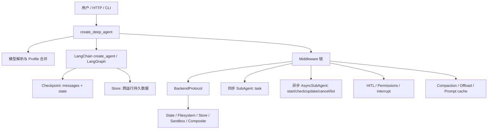

### 0.1 读者必须先建立的六个区分

| 概念 | 它解决什么问题 | 是否等于另一个概念 |
|---|---|---|
| `messages` | 对话与工具交互历史 | 不是 checkpoint；它是 checkpoint 中的一个状态字段 |
| `checkpointer` | 按 thread/run 保存和恢复图状态 | 不是文件系统，也不是长期 memory |
| `Store` | 跨运行、跨线程保存可复用数据 | 不是 `messages` 历史 |
| `BackendProtocol` | 文件/搜索/执行的统一资源接口 | 不是 LangGraph Store |
| `SubAgent` | 同一图进程内的同步委派 | 不是远程异步任务 |
| `AsyncSubAgent` | 通过 Agent Protocol/LangGraph SDK 管理后台运行 | 不是 Python 后台线程 |

### 0.2 旧文档需要纠正的核心误区

1. **中间件顺序已变化**：当前 `graph.py` 的核心链包含 `_ParentNotifierMiddleware`、异步子 Agent、profile extra、Skills、prompt caching、Memory、HITL、UnsupportedContent 和 ToolExclusion；旧文档中的 TodoList 与 Permission 位置不能直接套用当前实现。
2. **权限不再只是“最后一个权限中间件”**：文件权限在 `FilesystemMiddleware` 工具执行前检查；`permissions(mode="interrupt")` 还会被转换为 `interrupt_on`，与 `HumanInTheLoopMiddleware` 合并。
3. **Async follow-up 有两种语义**：默认 `interrupt` 会中断当前 run；`enqueue` 会在同一 remote thread 上排队，当前任务继续运行。
4. **异步任务的 task id 默认不是给用户看的**：它主要是 agent 内部协调键；除非用户明确要求或故障排查需要，不应把 task id 直接回显给用户。
5. **消息状态增长优化已经落地**：`DeepAgentState.messages` 使用 `DeltaChannel` 和 `_messages_delta_reducer`，checkpoint 不再每一步都重复复制完整消息列表。
6. **Profile 有两层**：Provider Profile 影响“如何构造模型”；Harness Profile 影响“模型已构造后，如何装配 prompt、middleware、工具和默认 general-purpose subagent”。

---

## 1. 版本与源码差异总表

### 1.1 从旧文档基线到当前代码

| 旧文档结论 | 当前实现 | 影响 |
|---|---|---|
| 适用版本 `0.5.1/0.6.6` | 发布包 `0.7.32`，HEAD 还有未发布提交 | 旧文档只能作为历史背景 |
| Async subagent 只有启动/查询 | 增加 `notify_parent`、`webhook`、`enqueue` follow-up、server cancellation、waiting 状态 | 需要把异步任务当作有生命周期的远程实体来理解 |
| `task_id` 可直接作为回复内容 | 默认从用户回复中省略 | 内部协调与用户可见输出解耦 |
| 权限只描述 allow/deny | requested path 与 symlink-resolved path 都检查；interrupt 权限转为 HITL | 防止符号链接绕过权限 |
| 摘要只替换旧消息 | 同时删除与被替换历史绑定的 reasoning blocks，并保留 resolved tool-result paths | 摘要后消息结构更可靠 |
| Backend 输出按字符限制 | `LocalShellBackend` 按 UTF-8 bytes 限制 | 多字节文本不会突破实际字节预算 |
| Profile 主要是 provider/model 参数 | Provider Profile + Harness Profile 双层注册与合并 | 模型构造与运行时脚手架解耦 |
| message reducer 默认列表式增长 | DeltaChannel + delta reducer | checkpoint 增长从 O(N²) 降到近似 O(N) |
| 导入 SDK 会顺带导入 provider SDK | `langchain_anthropic/openai` 延迟导入 | import 更轻、更快、依赖边界更干净 |

### 1.2 HEAD 中已存在但版本号尚未前进的改动

当前 HEAD 紧接着 `0.7.32` release 后包含：

- async subagent notification metadata 标记；
- summary / pinned skill / rubric revision message 使用 `add_notification_metadata`；
- rubric middleware 从 beta 走向稳定化的重构痕迹；
- Talon、QuickJS 等仓库其他模块的改动不属于 SDK 核心设计，不在本文展开。

因此，本文不会把这些 HEAD 改动写成“0.7.33 已发布”，而是明确标成 **HEAD-only**。

---

## 2. 当前整体架构：从一次请求看完整链路

### 2.1 构造期与执行期必须分开

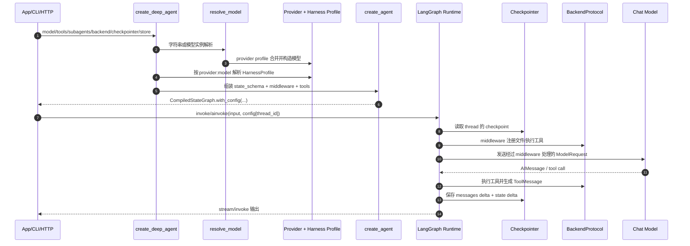

**关键理解**：`create_deep_agent()` 不是一次请求；它是构造一个可复用的 compiled graph。一次请求从 `invoke/ainvoke` 开始，`checkpointer` 才参与恢复，`Store` 和 Backend 是否参与则取决于配置与工具调用。

### 2.2 主 Agent 的真实 middleware 装配顺序

当前 `graph.py:906-1029` 的主链可以抽象为：

```mermaid
flowchart LR
    A[FilesystemMiddleware\n工具注册+权限] --> B[SubAgentMiddleware\n同步 task]
    B --> C[_ParentNotifierMiddleware\n异步结果通知]
    C --> D[Summarization\n预算/摘要/压缩]
    D --> E[PatchToolCalls\n修补悬空调用]
    E --> F{AsyncSubAgent?}
    F -->|yes| G[AsyncSubAgentMiddleware]
    F -->|no| H[Harness extra middleware]
    G --> H
    H --> I{skills?}
    I -->|yes| J[SkillsMiddleware]
    I -->|no| K[PromptCaching]
    J --> K
    K --> L{memory?}
    L -->|yes| M[MemoryMiddleware]
    L -->|no| N[HumanInTheLoop]
    M --> N
    N --> O[UnsupportedContent]
    O --> P[Custom middleware / exclusions]
    P --> Q[ToolExclusion\n最后剔除工具]
    Q --> R[create_agent]
```

> 这不是简单的“从左到右执行一次”。每个 middleware 可能实现 `before_agent`、`wrap_model_call`、工具钩子或状态 schema；模型请求往内走，模型响应与工具结果沿洋葱模型返回。

### 2.3 为什么 `ToolExclusion` 最后执行

源码在 `graph.py:985-988` 明确说明：Tool exclusion 放在 custom middleware 之后，确保自定义 `wrap_model_call` 无法把已经排除的工具重新加回模型请求。这是一个**安全优先于可扩展性**的装配决策。

---

## 3. 状态、消息、checkpoint、Store：四件事的边界

### 3.1 `DeepAgentState` 的核心形状

`graph.py` 定义：

```python
class DeepAgentState(AgentState):
    """messages 使用 DeltaChannel，减少 checkpoint 增长。"""
    messages: Required[
        Annotated[
            list[AnyMessage],
            DeltaChannel(_messages_delta_reducer, snapshot_frequency=50),
        ]
    ]
```

因此一次 run 的逻辑状态可以画成：

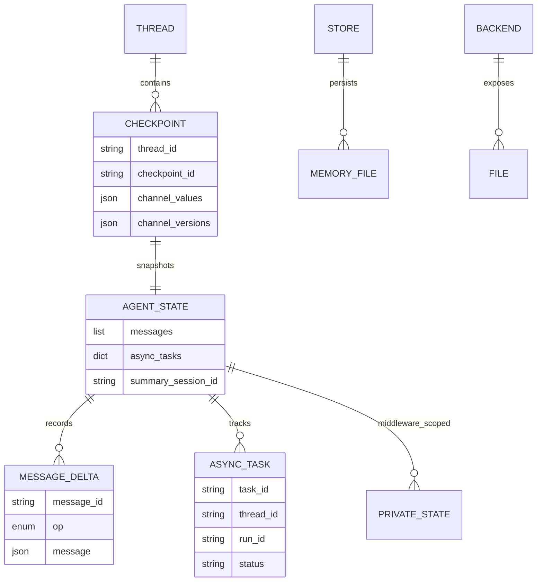

### 3.2 三种持久化路径

| 路径 | 存什么 | 生命周期 | 典型实现 |
|---|---|---|---|
| Checkpointer | 本次对话可恢复的图状态：`messages`、待办、async_tasks、middleware state | thread/run | LangGraph checkpointer |
| Store | 跨 thread/run 复用的长期数据 | namespace/key | `StoreBackend`、Memory 文件 |
| Backend | Agent 看到的文件/目录/执行环境 | 取决于 backend | `StateBackend`、`FilesystemBackend`、`SandboxBackend`、`CompositeBackend` |

**最容易误解的一点**：对话 message 当然会存，但它不是单独存到“message 数据库”。它是 `AgentState.messages`，随 checkpoint 一起由 LangGraph 持久化；`DeltaChannel` 只是优化写入/重放方式，不改变模型看到的对话语义。

### 3.3 reducer 做了什么

`_messages_delta_reducer`（`_messages_reducer.py:31-90`）的职责是：

1. 将 raw dict/string/tuple 转成 `BaseMessage`；
2. 以 message id 去重和覆盖；
3. 处理 `RemoveMessage` tombstone；
4. 遇到 `REMOVE_ALL_MESSAGES` 时重置历史；
5. 对增量 writes 进行合并，而不是每次复制完整列表。

**设计理由**：摘要、修补 tool call、offload 大工具结果都可能替换或删除历史消息，不能只做 append-only reducer。

---

## 4. Profile：模型构造与 Harness 运行时的双层适配

### 4.1 Provider Profile：模型还没构造时

源码：`profiles/provider/provider_profiles.py`。

- 通过 `register_provider_profile(key, ProviderProfile(...))` 注册；
- provider 级 key 例如 `openai`；model 级 key 例如 `openai:gpt-5`；
- `init_kwargs`、factory 输出按“后注册覆盖冲突字段”的规则合并；
- `create_deep_agent(model="provider:model")` 解析时使用。

### 4.2 Harness Profile：模型已经构造后

源码：`profiles/harness/harness_profiles.py`。

Harness Profile 可以改变：

- `base_system_prompt` / suffix；
- tool description overrides；
- `extra_middleware`；
- 默认 `general-purpose` subagent 是否启用、其 prompt、description；
- `excluded_middleware` 与 `excluded_tools`；
- inline skills 支持；
- profile-specific runtime behavior。

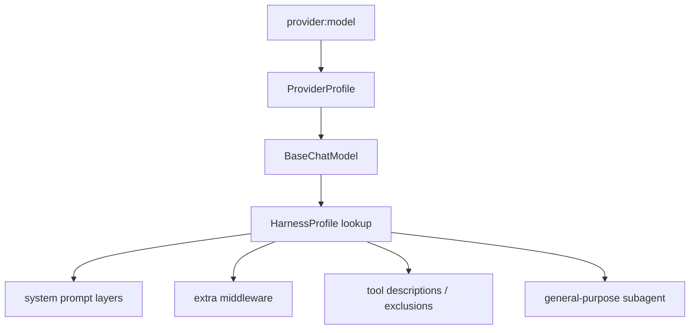

**背后的思考**：Provider Profile 解决“模型怎么创建”；Harness Profile 解决“同一个模型放入 Deep Agents 后，应该使用怎样的脚手架”。将两者混在一起会让供应商参数和 agent 行为配置互相污染。

---

## 5. 同步 SubAgent 与异步 AsyncSubAgent：两个完全不同的生命周期

### 5.1 同步 `SubAgent`：一次工具调用内嵌一张子图

`SubAgentMiddleware` 把 declarative `SubAgent` 编译为一个 `create_agent` runnable，并把它们暴露为 `task` 工具。

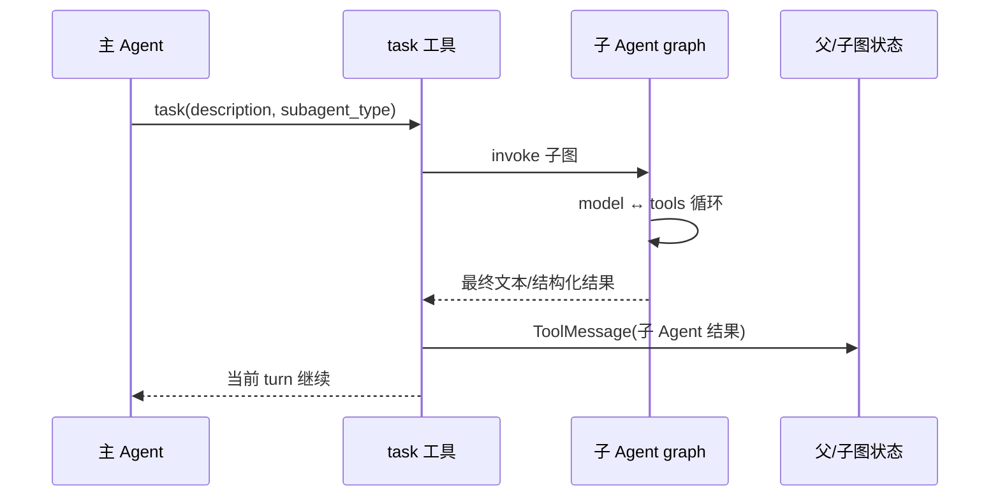

默认 isolated 模式只给子 Agent 一个任务描述；`mode="fork"` 会从父会话复制上下文，但**不会同步模型、工具、prompt 配置**。fork 代码会丢弃 `structured_response`、summary session id、pinned skill 和 rubric 等不应跨 fork 继承的字段。

### 5.2 异步 `AsyncSubAgent`：远程 thread + 多个 run

异步子 Agent 不是“开一个协程然后 await”。`AsyncSubAgentMiddleware` 通过 LangGraph SDK：

1. 创建 remote thread；
2. 创建 remote run；
3. 在父状态的 `async_tasks` 中记录 task；
4. 通过 `check/update/cancel/list` 读写远程生命周期；
5. 用 `_ParentNotifierMiddleware`、notification 或 webhook 将完成事件带回应用/父 Agent。

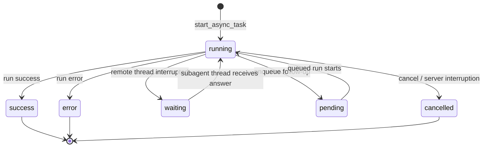

### 5.3 `AsyncTask` 实体

源码：`middleware/async_subagents.py:192-243`。

```python
{
    "task_id": thread_id,
    "agent_name": "researcher",
    "thread_id": remote_thread_id,
    "run_id": newest_run_id,
    "superseded_run_ids": [...],  # enqueue 时可能存在
    "status": "running|pending|waiting|success|error|cancelled",
    "created_at": "...",
    "last_checked_at": "...",
    "last_updated_at": "...",
}
```

`task_id` 与 `thread_id` 相同，但 `run_id` 会随着 follow-up 变化。`enqueue` 时旧 run 仍可能在执行，新 run 先是 `pending`，因此不能把“一个 task”误解成“一个 run”。

### 5.4 follow-up 的两种策略

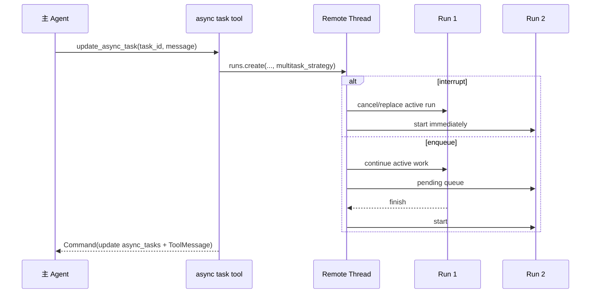

`enqueue` 的约束：同一个 task 每个 turn 只发送一个 follow-up；如果原 run 正在等待 human，queued follow-up 会启动并丢弃原来的等待请求。这个取舍是为了让“新指令优先进入队列”，而不是让远程任务永远卡在旧 HITL 上。

### 5.5 waiting / cancellation / webhook / notify_parent

- `waiting` 表示远程 run 结束但 thread 仍处于 interrupt，通常等待远程用户审批或回答；父 Agent 不能代替那个用户回答。
- server-side `interrupted` 会被映射为 `cancelled`，避免把取消误报成正常等待。
- `webhook` 让 Agent Server 在 run 完成时主动通知外部应用。
- `notify_parent=True`（默认）允许子 Agent 完成时唤醒空闲的父 Agent；若应用自己通过 webhook 交付结果，可设为 `False`。
- 远程部署可携带 `parent_thread_id`、`subagent_name` 元数据，并在本地部署/trace 开启时嵌套到父 trace；带 `url` 的远程服务器不会自动继承父 trace context。

---

## 6. 一次异步任务的端到端示例（含状态变化）

### 6.1 配置

```python
agent = create_deep_agent(
    model="anthropic:claude-sonnet-4-6",
    subagents=[{
        "name": "researcher",
        "description": "检索资料并给出证据",
        "graph_id": "researcher",
        "url": "https://agent.example.com",
        "update_strategy": "enqueue",
        "webhook": "https://app.example.com/hooks/researcher",
        "notify_parent": True,
    }],
    checkpointer=checkpointer,
)
```

### 6.2 主请求与 checkpoint 变化

```text
T0 输入:
messages = [HumanMessage("研究 A 公司最近的产品变化")]
async_tasks = {}

T1 模型调用 start_async_task:
messages += [
  AIMessage(tool_calls=[start_async_task(...)])
]

T2 工具执行后:
messages += [
  ToolMessage("Launched async subagent...", tool_call_id="...")
]
async_tasks = {
  "thread-123": {
    "task_id": "thread-123", "thread_id": "thread-123",
    "run_id": "run-1", "status": "running"
  }
}
checkpoint 保存：messages 的 delta + async_tasks 更新

T3 主 Agent 可以继续回答/做其他工具调用；它不会因为远程 run 没完成而阻塞。

T4 主 Agent 发送 follow-up:
update_async_task("thread-123", "优先比较定价")

若 enqueue:
async_tasks["thread-123"] = {
  ...,
  "run_id": "run-2",
  "status": "pending",
  "superseded_run_ids": ["run-1"]
}
messages += [ToolMessage("Follow-up queued...")]

T5 run-1 完成，run-2 开始：
status = "running"; run_id = "run-2"

T6 notification/webhook 到达，或模型主动调用 check_async_task：
check_async_task 读取 remote run + thread，而不是盲信 checkpoint 的旧 status。
status = "success"
messages += [ToolMessage("researcher completed: ...")]

T7 再次 checkpoint：
保存最新 messages、async_tasks、通知元数据；用户默认看到结果正文，不必看到 task_id。
```

### 6.3 为什么 check 工具必须读远程状态

`AsyncTask.status` 是缓存，不是事实源。`check_async_task`、`list_async_tasks` 会通过 SDK 查询最新 `Run` 和 `Thread`；如果 SDK 读取失败，则记录 warning 并返回 cached status，避免一次网络问题把 agent 状态伪装成成功。

---

## 7. 摘要、offload、消息压缩与 prompt cache

### 7.1 当前压缩链条

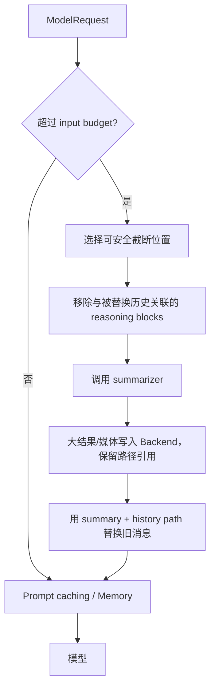

当前 `summarization.py` 还提供可选的 `SummarizationToolMiddleware`，暴露 compact 工具；自动摘要和显式 compact 共享同一套预算/截断原则。

### 7.2 offload 与消息不是同一个存储

- 消息中保留可供模型继续使用的短预览、路径或引用；
- 完整 tool result/blob 通过 `_blob_offload.py` 写入 backend；
- `resolved tool-result paths` 必须保留，否则摘要后模型无法继续定位原始结果；
- 被摘要替换的 reasoning blocks 要一起清掉，避免出现“推理引用已不存在上下文”的不一致。

### 7.3 Prompt caching 的顺序为什么重要

`graph.py` 把 Harness profile middleware 放在 Memory 之前，把 Skills 放在压缩之后、cache 之前；这样 prompt cache 的稳定前缀不容易被动态 memory 更新打破。Memory 只对 Anthropic 请求加 `cache_control`，所以可以安全地启用而不污染其他 provider。

---

## 8. Filesystem、权限、Backend：当前安全模型

### 8.1 FilesystemMiddleware 与 BackendProtocol 的关系

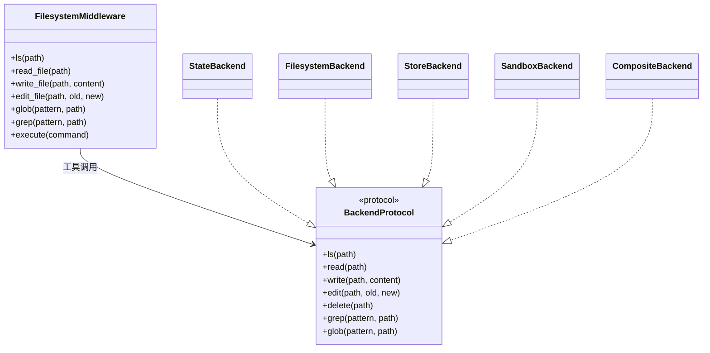

Middleware 是工具边界和安全策略；Backend 是实际资源访问。直接调用 Backend 不自动经过 middleware permissions，这一点在 `graph.py` 的参数文档中被明确写出。

### 8.2 访问一个路径时发生什么

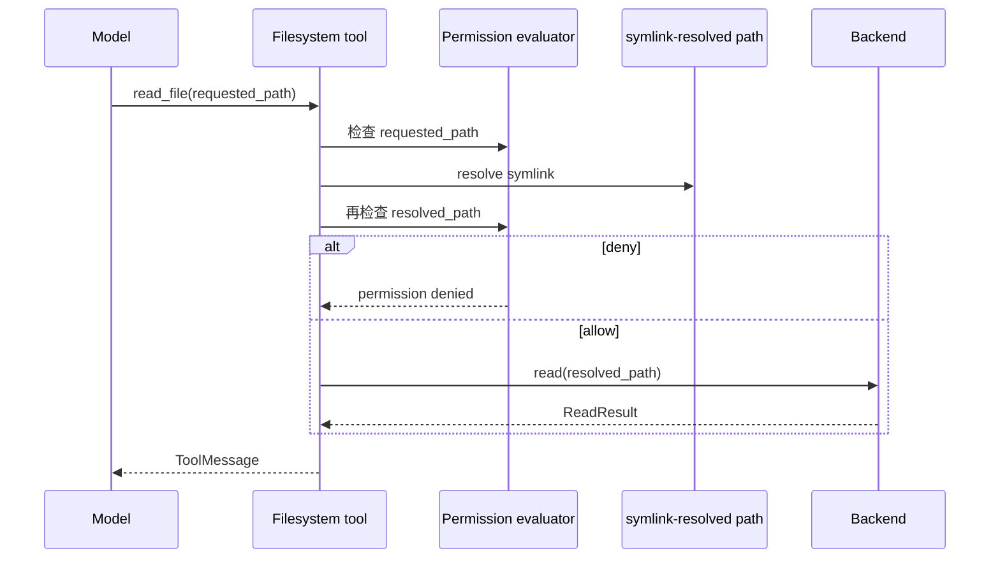

这次双重检查修复了符号链接绕过：规则不能只保护用户请求的路径，还必须保护它最终指向的真实路径。`permissions(mode="interrupt")` 会同时参与 `interrupt_on` 生成，因而“权限策略”和“HITL 审批”不再是两套互相看不见的系统。

### 8.3 Backend 的近期行为修正

- `CompositeBackend` route 不再要求 trailing slash；
- text edit 对 binary file 直接拒绝；
- in-memory grep 跳过 binary；
- sandbox grep 优先 ripgrep，跳过 `.git`；
- `LocalShellBackend` output limit 按 UTF-8 bytes 计算；
- `FileInfo.size` 语义统一为 bytes；
- `ContextHubBackend.glob(path=...)` 真正尊重 path 参数。

---

## 9. 记忆、Skills、通知元数据：当前 prompt 的新形态

### 9.1 Memory 仍然是 Backend 文件，不是消息历史

`MemoryMiddleware` 在 `before_agent` 读取配置的 memory sources，在 model request 阶段把格式化后的内容附加到 system message；memory 文件的读写走 Backend。它不会把整份长期 memory 伪装成用户消息，也不会替代 checkpointer。

### 9.2 Skills 现在可以来自 Harness Profile

`0.7.25` 起，model profile 可以声明 inline skills tool 支持。`SkillsMiddleware` 的索引仍然走 system prompt，技能正文仍然通过 `read_file` 或 skill tool 按需披露；profile 只是决定是否/怎样提供这类能力，不改变“渐进披露”的基本原则。

### 9.3 通知消息要和普通对话消息区分

当前 HEAD 正在把 summary、pinned skill、rubric revision、async subagent notification 等内部消息用 `add_notification_metadata` 标记。它们仍然可能进入 messages 状态，但 UI/应用层可以依据 metadata 将其作为运行时通知，而不是用户与模型的普通对话内容。

---

## 10. 现有文档应如何修正

### 10.1 必须把旧文档中的这些段落视为过时

- `DEEPAGENTS_MIDDLEWARE_CHAIN_DEEP_DESIGN.md` 顶部的 `deepagents==0.5.1` 与旧 middleware 顺序；
- `DEEPAGENTS_PROMPT_RUNTIME_COMPLETE.md` 中把 async task 描述为“启动后只轮询”的内容；
- `DEEPAGENTS_FRAMEWORK_COMPLETE_DESIGN.md` 中将 Permission 描述成独立末端中间件、把 `messages` 和 checkpoint 分开成两个互不相关存储的内容；
- `DEEPAGENTS_CLI_APP_ARCHITECTURE.md` 中 `0.6.6` 版本声明与“CLI 会话持久化等同 SDK checkpoint”的表述。

### 10.2 推荐的文档阅读顺序

1. 本文 §2：先看一条真实请求主链；
2. 原 `DEEPAGENTS_FRAMEWORK_COMPLETE_DESIGN.md` §三、§四、§六：理解基础图和 agent 工厂；
3. 本文 §3、§5、§7、§8：补上 state、async、压缩和安全边界；
4. 原 `DEEPAGENTS_MIDDLEWARE_CHAIN_DEEP_DESIGN.md`：查具体 middleware 钩子；
5. 原 `DEEPAGENTS_PROMPT_RUNTIME_COMPLETE.md`：查模型最终看到的 prompt/tool schema；
6. 原 `DEEPAGENTS_CLI_APP_ARCHITECTURE.md`：最后看产品层会话和配置。

---

## 11. 源码索引（按“问题”找文件）

| 想理解的问题 | 首先打开 |
|---|---|
| Agent 如何构造 | `libs/deepagents/deepagents/graph.py: create_deep_agent` |
| 消息为何增量保存 | `libs/deepagents/deepagents/_messages_reducer.py`、`graph.py: DeepAgentState` |
| 模型如何解析 | `libs/deepagents/deepagents/_models.py` |
| Provider / Harness Profile | `profiles/provider/provider_profiles.py`、`profiles/harness/harness_profiles.py` |
| 同步 task | `middleware/subagents.py: SubAgentMiddleware`, `_build_task_tool`, `create_sub_agent` |
| 异步任务状态 | `middleware/async_subagents.py: AsyncTask`、`_task_status`、`_build_check_tool` |
| follow-up 队列 | `middleware/async_subagents.py: _build_update_tool` |
| 父 Agent 通知 | `middleware/_parent_notifier.py`、`async_subagents.py: notify_parent` |
| 摘要/压缩 | `middleware/summarization.py: _DeepAgentsSummarizationMiddleware` |
| 大结果 offload | `middleware/_blob_offload.py`、`summarization.py` |
| 文件和权限 | `middleware/filesystem.py`、`middleware/_fs_interrupt.py` |
| Backend 接口 | `backends/protocol.py` |
| Composite 路由 | `backends/composite.py` |
| 状态文件 | `backends/state.py` |
| 长期 Store | `backends/store.py` |
| 沙箱执行 | `backends/sandbox.py`、`backends/local_shell.py` |
| 工具排除 | `middleware/_tool_exclusion.py` |
| prompt cache | `middleware/_prompt_caching.py` |
| 通知 metadata | `langchain_core.messages.add_notification_metadata` 的调用点 |

---

## 12. 本次更新总结

本次不是简单把版本号从 `0.6.6` 改成 `0.7.32`，而是补齐了旧文档缺失的运行时模型：

1. **补齐整体架构**：把 `create_deep_agent → middleware → LangGraph → checkpointer/store/backend → model` 串成一条主链；
2. **补齐状态边界**：明确 `messages`、checkpoint、Store、Backend 的职责和关系；
3. **补齐异步生命周期**：加入 `AsyncTask`、remote thread/run、waiting、cancelled、webhook、notify_parent、follow-up enqueue；
4. **补齐端到端例子**：展示 start、follow-up、pending、running、success 与 checkpoint/message 的变化；
5. **修正中间件顺序**：以当前 `graph.py:906-1029` 为准，不再沿用 0.5.x 的顺序；
6. **补齐安全模型**：说明 requested path + symlink-resolved path 双重权限检查及 `interrupt_on` 合并；
7. **补齐压缩与 offload**：说明 summary、reasoning block、blob path、DeltaChannel 的协作；
8. **补齐 Profile 双层设计**：Provider Profile 与 Harness Profile 的构造期/运行期分工；
9. **标明版本边界**：严格区分发布的 `0.7.32` 与当前 HEAD 的未发布改动。

> 如果后续继续升级，建议每次先更新本文的“版本基线、差异表、主链图、异步生命周期和源码索引”，再同步原有专题文档，避免专题文档各自漂移。
