# DeerFlow 架构增量（2026-09-06 → 2026-11-04）：2.1.0 / 2.2.0 / →2.3.0

> **为什么要这份文档**：本目录既有文档的编写基线是 **2026-09-06**（`ARCHITECTURE.md`）与 **2026-06-08**（`DEERFLOW_ARCHITECTURE_V2.md`），而 deer-flow 在这段窗口里发布了 **2.1.0（2026-09-24）** 与 **2.2.0（2026-10-29）**，Unreleased 正指向 **2.3.0**，共 **1,000+ 个上游提交**。
> **证据基线**：deer-flow HEAD `235b5556`（2026-11-04）。旧文**保留不删**，本文只写增量与冲突点，并在旧文里加了快照注记。
> **配套新文**：记忆子系统单独成文 → [DEERMEM_MEMORY_DESIGN.md](./DEERMEM_MEMORY_DESIGN.md)。

---

## 📋 目录

- [0. 基线与版本地图](#0-基线与版本地图)
- [1. 一页图：新增子系统在整体架构里的位置](#1-一页图新增子系统在整体架构里的位置)
- [2. 扩展面重构：extension API 与 placement 锚点](#2-扩展面重构extension-api-与-placement-锚点)
- [3. 记忆系统：DeerMem 与可插拔后端](#3-记忆系统deermem-与可插拔后端)
- [4. Knowledge：provider 无关的只读检索契约](#4-knowledgeprovider-无关的只读检索契约)
- [5. 决策面：TypeSafe(Jev) + OpenAI Decisions + 授权（authz）](#5-决策面typesafejev--openai-decisions--授权authz)
- [6. Runtime 与可靠性：从「单进程 Agent」到「多副本可运维系统」](#6-runtime-与可靠性从单进程-agent到多副本可运维系统)
- [7. Middleware 链现状（取代旧文的链描述）](#7-middleware-链现状取代旧文的链描述)
- [8. Workflows / Scheduled tasks / Agent teams：三种「长时间运行」形态的分工](#8-workflows--scheduled-tasks--agent-teams三种长时间运行形态的分工)
- [9. 持久化与运维：旧文完全没写的两块](#9-持久化与运维旧文完全没写的两块)
- [10. 变更台账（按子系统，2026-09-06 → 2026-11-04）](#10-变更台账按子系统2026-09-06--2026-11-04)
- [11. 旧文档阅读映射（哪一段该被本文取代）](#11-旧文档阅读映射哪一段该被本文取代)
- [12. 已知不确定项（写文档时无法从代码断定，勿当作结论）](#12-已知不确定项写文档时无法从代码断定勿当作结论)

---

## 0. 基线与版本地图

| 里程碑 | 日期 | 与本文关系 |
|---|---|---|
| 2.0.0 | 2026-06-15 | 旧文 `DEERFLOW_ARCHITECTURE_V2.md` 的世界 |
| **2.1.0** | **2026-09-24** | 扩展插件体系、TypeSafe 工具风险门、memory prescreen、PII 脱敏、knowledge phase 1–2、blob store 契约 |
| **2.2.0** | **2026-10-29** | agent teams、workflows 1–4、scheduled tasks 全链路、knowledge phase 3 + WeKnora、多副本 IM leader lease、checkpoint retention、authz RBAC 完善 |
| Unreleased → 2.3.0 | 2026-11-04 | HarnessGuardMiddleware、Queue/Steer、token usage 控制台、knowledge ingestion/status center、compaction observer 修正 |

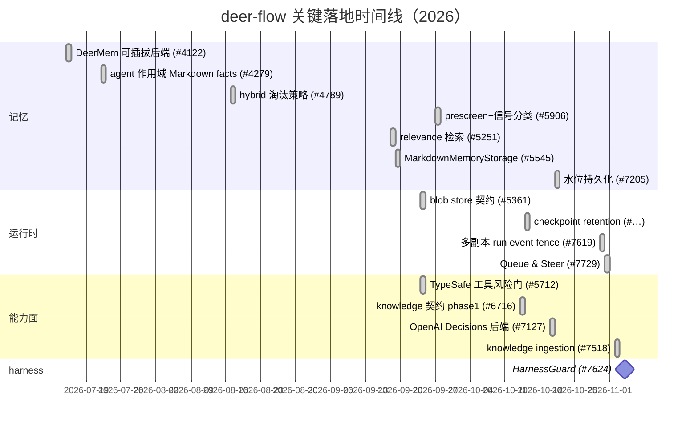

**规模感受**（`git log --since=2026-09-06` 计数）：`feat` 类提交 ~200，`fix` 类 ~700；memory 相关提交 74 条。

---

## 1. 一页图：新增子系统在整体架构里的位置

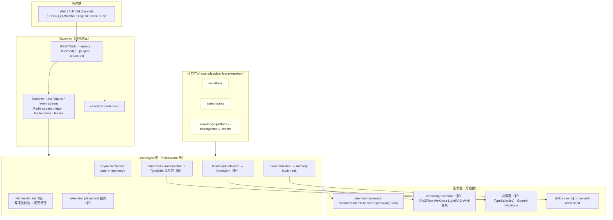

一句话概括这一年的方向：**把「产品功能」从 harness 内部搬到可打包扩展里，把「模型决策」从提示词搬到可评测的决策槽位，把「记忆」从 host 代码搬到可移植后端**。

---

## 2. 扩展面重构：extension API 与 placement 锚点

**包**：`backend/packages/extension-api/deerflow_extension_api/`（版本 `deerflow-extension-api 0.2.10`，2026-11-03）。

### 2.1 语义锚点而不是层号

`placement.py:Placement`（"Where an extension's middleware sits … declared as a *semantic guarantee*"）：

| 锚点 | 保证 | 典型用途 |
|---|---|---|
| `MODEL_LOGICAL` | 重试与错误处理之外；一次**逻辑**决策只触发一次 | 审计、计费 |
| `MODEL_PHYSICAL` | 所有请求改写之内；**每次物理 provider 调用**都触发（重试会重入） | 抓 raw prompt |
| `TOOL_VISIBLE` | 截断/消毒/错误包装之外；看到的是**模型最终看到的**结果 | 结果质量评测 |
| `TOOL_RAW` | 紧邻真实可调用边界，处理前 | 原始返回抓取 |
| `STANDARD` | 无前后置要求（相对顺序不保证） | 普通贡献 |

`AgentScope`（`LEAD | SUBAGENT | BOTH`）+ `AgentBuildContext(scope, agent_name, model_name, HostPolicySnapshot)` 让扩展在**装配期**就能按作用域决定是否贡献中间件；2.2.0 的 `51f0e2de1 feat(extensions): scope configured middlewares to lead or subagent (#7661)` 把这件事也开放给**配置里声明的**中间件。

`HostPolicySnapshot` 刻意只投影 host 真实强制的限制（`token_budget_enabled`、`max_input_tokens`…），**不暴露 AppConfig**，避免把每个扩展钉死在 harness 的发版节奏上；契约里每个 Protocol 方法与每个可选字段都带默认值 → **加方法/加字段对已发布扩展是 additive**。

### 2.2 扩展能做什么（都是「槽位」，不是 monkey patch）

| 能力 | 载体 | 何时引入 |
|---|---|---|
| 贡献 middleware | `MiddlewarePlacement` + `extensions.stack:compose_with_extensions` | 2.1.0 |
| 调用 host 模型（受限） | `model_invocation.py:ModelInvoker` | 2.1.0 `c81494321` |
| 读 run 证据（请求级） | `run_evidence.py` / `completed_run_evidence.py` | 2.1.0 `4fe64ac91`、2.2.0 `20887e465` |
| 控制整轮 Agent run | `agent_runs.py`（host-bound control） | 2.2.0 `beaae2208` |
| 贡献 plugin（全栈：路由+静态资源+manifest） | `plugins.py`、`settings.py` | 2.2.0 `2a9beb34b`、`a2a949b17`（bookmarks 示例） |
| 观察压缩 | `compaction.py:ContextCompactionObserver` + `CompactionEvent` | 2.1.0 起；**2.2.0 修正见 §6.5** |
| 变更 skills（受保护） | `skill_mutations.py` | 2.2.0 `d1d0958be feat(skills): add guarded evolution host APIs` |
| 贡献能力中心候选 | `host_capabilities.py` | 2.2.0 |

### 2.3 装配时序（新）

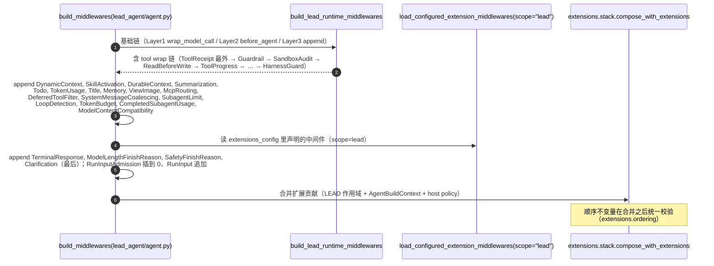

> **关键设计**：扩展合并被**推迟到最后**。注释原文："Doing it inside `build_lead_runtime_middlewares()` would place MODEL_PHYSICAL contributions above the lead-specific middlewares appended above, changing what 'the final request' means for observers."（`lead_agent/agent.py`）

---

## 3. 记忆系统：DeerMem 与可插拔后端

完整设计见 **[DEERMEM_MEMORY_DESIGN.md](./DEERMEM_MEMORY_DESIGN.md)**（分层、数据模型、读写时序、闸门、生命周期、事务、配置全表）。这里只列 2026-09-06 之后的增量：

| 日期 | PR | 变化 |
|---|---|---|
| 2026-09-18 | `cc2773034` #5251 | `retrieval_relevance_enabled`：确定性词法相关性 + confidence 融合排序；注入也按当前 query 排序 |
| 2026-09-19 | `208ba7cc6` #5545 | 可选 `MarkdownMemoryStorage`（读宽容，写仍 JSON） |
| 2026-09-20 | `e4ce26f3d` #5564 | DeerMem 作用域隔离基准（可复现契约测试） |
| 2026-09-23 | `45411cee6` #3182 | 新增 `cognitiveStyle` 摘要段（协作/推理习惯） |
| 2026-09-25 | `64e499be9` #5577 | 入队 payload PII 脱敏 |
| 2026-09-27 | `d700ad9ed` #5906 | **prescreen + 信号分类**（共享 TypeSafe 客户端） |
| 2026-09-30 | `b73a4e79b` #5565 | 管理 API 按 agent 作用域（后端须 `supports_agent_scoped_management`，否则 501） |
| 2026-10-08 | `5ae953fc2` #6494 | 检索索引 Pod-local；peer 写过的 scope 下次 search 重建 |
| 2026-10-08 | `220d62d79` #6443 | tool 模式按 ID 精确读 fact |
| 2026-10-11 | `bdc2d1236` #6672 | 修跨会话 debounce 饥饿（单调 deadline） |
| 2026-10-20 | `ee02e51df` #7152 | 保留连续压缩快照（不互相覆盖） |
| 2026-10-21 | `dc6f0d742` #7205 | **抽取水位跨重启/副本持久化** |
| 2026-10-26 | `4b1e06bbf` #7294 | Web UI 语言影响 DeerMem 新写散文语言 |
| 2026-10-26 | `30b3a012c` #7530 | 压缩前刷洗移出 event loop |
| 2026-10-30 | `b4b2a68ee` #7665 | memory config 响应里对后端密钥脱敏 |
| 2026-11-01 | `38e6be638` #7764 | 容忍无界 stored confidence（`10**400` 不再炸） |
| — | OpenViking / Honcho | 两个远端后端补全（`backends/openviking`、`backends/honcho`） |

---

## 4. Knowledge：provider 无关的只读检索契约

> **旧文里根本没有这一层。** 2026-09-06 的 `ARCHITECTURE.md` 只提到「RAG/知识库工具」，而今天的 knowledge 是一个**有契约、有能力协商、有作用域快照、有独立工具面**的子系统。
> 证据：`backend/packages/harness/deerflow/knowledge/{contract,providers,tools,sources}.py`、`knowledge_scope.py`、`backend/docs/KNOWLEDGE.md`、`examples/deerflow-extension-{knowledge,knowledge-center,knowledge-management,knowledge-platform,weknora,lightrag,retrieval}/`。

### 4.1 它在整体架构里的位置

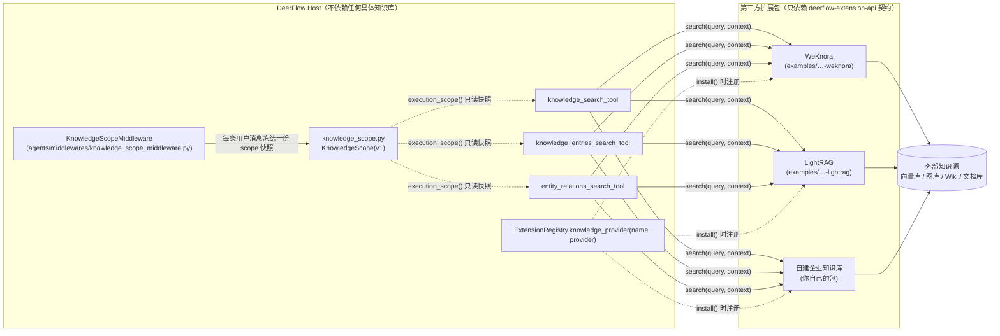

**核心设计：host 侧零实现。** `deerflow.knowledge` 只拥有数据类型与协议（`RetrievalResult` / `RetrievalHit` / `KnowledgeSource` / `KnowledgeCapabilities` / `RetrievalProvider`），**没有任何一个 provider 实现在核心包里**。所有真实连接都在扩展包或 `plugins[].config` 里。

### 4.2 能力协商：操作级，而不是「有没有 RAG」

`KnowledgeCapabilities.operations` 是 `frozenset[Literal[...]]`，**只有显式声明的操作才算支持**（`contract.py:KnowledgeCapabilities` 文档串："An operation is supported only when explicitly advertised"）。默认值只有 `{"search"}`。

| 操作 | 含义 | 谁需要实现 |
|---|---|---|
| `search` | 文档级语义/关键词检索 | `RetrievalProvider.search` |
| `sources` | 命中必须带可归属出处 | `KnowledgeSource` 填充 |
| `catalog` | 可列举的知识空间（dataset） | `RetrievalCatalogProvider.catalog` |
| `documents` | 可列举某空间内文档 | `RetrievalDocumentsProvider.documents` |
| `dataset_filter` | 检索可按 dataset 限定 | `ScopedRetrievalProvider.search_scoped` |
| `document_filter` | 检索可按 document 限定 | 同上 |
| `entries_search` | Wiki/条目级检索 | `KnowledgeEntriesProvider.entries_search` |
| `entries_dataset_filter` / `entries_document_filter` | 条目检索的限定能力 | 同上（独立声明） |
| `relations_search` | 实体关系/路径检索 | `EntityRelationsProvider.relations_search` |
| `relations_dataset_filter` / `relations_document_filter` | 关系检索的限定能力 | 同上（独立声明） |

三个「工具 → 操作」映射写死在 `knowledge/providers.py:KNOWLEDGE_TOOL_OPERATIONS`：

| Agent 可见工具名 | 契约操作 | 注册路径 |
|---|---|---|
| `knowledge_search` | `search` | `deerflow.knowledge.tools:knowledge_search_tool` |
| `knowledge_entries_search` | `entries_search` | `deerflow.knowledge.tools:knowledge_entries_search_tool` |
| `entity_relations_search` | `relations_search` | `deerflow.knowledge.tools:entity_relations_search_tool` |

`operation_capabilities()`（`providers.py:28`）做**操作投影**：查 `entries_search` 时，`dataset_filter`/`document_filter` 只从 `entries_*` 前缀的能力推导，不会被 `search` 的能力污染。这就是「catalog / 作用域选择器只暴露**已配操作的能力交集**」的实现点。

### 4.3 一次 knowledge 检索的完整时序

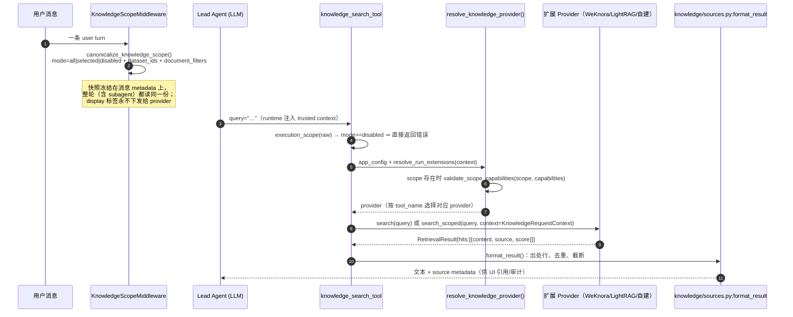

`KnowledgeRequestContext`（`contract.py:73`）只有三个字段：`user_id`、`agent_name`、`scope`。它的文档串把边界写得很死：

- **"Host identity and execution constraints, never provider authorization"** —— 权限必须由 provider 自己实施，host 不从 caller metadata 推断 tenant/credential。
- `agent_name` 是**当前执行者**：lead 默认 `lead_agent`，subagent 则是**该 subagent 的配置名**，不是父 agent 名（`tools.py:_execution_agent_name` 专门处理了这个区分）。

### 4.4 作用域（Phase 3：hierarchical spaces）

```mermaid
stateDiagram-v2
    [*] --> all : 未选择任何知识空间
    all --> selected : 用户在 UI 勾选 dataset / 文档
    selected --> disabled : 用户关闭 knowledge
    disabled --> all : 重新开启
    state all {
        [*] --> unrestricted
        unrestricted : 无限制检索（消息上不携带 scope 快照）
    }
    state selected {
        [*] --> dataset_ids
        [*] --> document_filters
        note right of selected
            mode=selected 时 dataset_ids / document_filters 才允许存在；
            否则 model_validator 直接报错
            （all / disabled 携带 id 视为非法）
        end note
    }
    state disabled {
        [*] --> blocked
        blocked : 三个 knowledge 工具被隐藏并被阻断
    }
```

约束（`knowledge_scope.py`）：ID 经 `_clean_id` + `_stable_unique_ids` 规范化；`version: Literal[1]`；总量有 `_validate_size` 上限；`strip_message_knowledge_scope()` 负责在消息出站时剥掉快照。跨 provider 的 selected ID **不能共享**（多 provider 时只允许 `all` / `disabled`），这条限制来自 catalog ID 不透明（`RetrievalCatalogItem.id` 上限 **256 Unicode code points**，不暴露 provider 内部标识）。

### 4.5 已落地 provider 与其能力矩阵

| Provider | 位置 | search | entries | relations | catalog/documents | document_filter | 备注 |
|---|---|---|---|---|---|---|---|
| **WeKnora** | `examples/deerflow-extension-weknora` | ✅ | ✅（Wiki 页面，`capabilities.wiki`） | ❌（无 HTTP adapter） | ✅ | **明确拒绝** | 6 个只读操作全实现（v0.8.3） |
| **LightRAG** | `examples/deerflow-extension-lightrag` | ✅（`/query/data`） | — | ✅（graph facts = **unattributed hits**） | 视配置 | 视配置 | 与文档 chunk 命中分离；**不编造多跳路径**；`VALIDATION.md` 有 live 验证记录 |
| knowledge / center / management / platform 示例 | `examples/deerflow-extension-knowledge*` | ✅ | 部分 | 部分 | ✅ | — | 分别对应「接一个库 / 能力中心 UI / 管理面 / 平台连接」四个形态 |

> **诚实性约束（跨 provider 一致）**：`KnowledgeSource` 的 title/locator 必须是 provider 真正返回的证据，**不允许推断链接、页码或本地序号**；URL 带凭据直接 validator 拒绝；`id` 由 sha256(provider,title,excerpt,dataset,url,page)[:32] 稳定派生。

### 4.6 注册链路（extension API 侧）

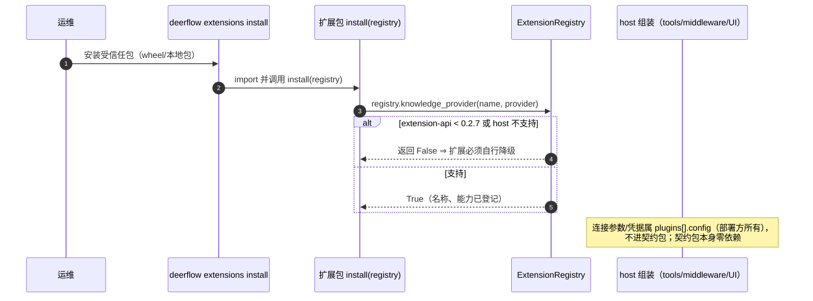

### 4.7 2.3.0 里的下一步：可选 ingestion + status center

`f6a5a64c9` #7293 与 `d0ec8dcc5` #7518 把 knowledge 从「只读」扩展到「**可选写入 + 状态中心**」：文档摄取是可选能力（不再假设知识库永远外部维护），并提供统一的检索/摄取状态视图。

> 注意：契约层仍是 **search-only 优先**——`RetrievalProvider` 只有 `search`；ingestion 走扩展自己的路由与 manifest，不破坏「search-only provider 不需要 catalog/scope/管理实现」这条默认。

### 4.8 与旧文档的关系

| 旧文档说法 | 现在 |
|---|---|
| `ARCHITECTURE.md` 把 RAG 当作「工具集合」 | knowledge 是**契约层 + 工具面 + 作用域层**三件套，工具可配 1~3 个 |
| `MCP_SERVER.md` 里 MCP 是唯一外部数据入口 | MCP 与 knowledge 并存：MCP 是通用工具通道，knowledge 是**带出处、带作用域、带能力协商**的检索通道 |
| 无作用域概念 | `KnowledgeScope(v1)` 每轮冻结快照，`disabled` 时中间件同时**隐藏**并**阻断**三个工具 |

---

## 5. 决策面：TypeSafe(Jev) + OpenAI Decisions + 授权（authz）

> **这是 2026Q4 最大的架构变化之一**：DeerFlow 把「需要模型帮忙判断一下」的事情收敛成 **三个槽位 + 两个可互换后端 + 一层共享传输**，而不是在各处散落 if/else。

### 5.1 三个决策槽位

| 槽位 | 配置键 | 问题（noul question） | 失败方向 | 代码 |
|---|---|---|---|---|
| **工具风险门** | `guardrails.provider.use` | `risky_tool_call`：这次工具调用是否可能造成**不可逆或越界**副作用 | **deny**（错误即拒绝） | `guardrails/typesafe.py`、`guardrails/openai_decisions.py` |
| **记忆预筛（cost gate）** | `memory.prescreen.use` | 「这批消息值得为抽取付一次模型调用吗」 | **fail-open**：照常抽取 | `agents/memory/prescreen/{contract,typesafe,openai_decisions}.py` |
| **记忆信号分类** | `memory.signal_classification.use` | 强化/纠正等 hint 标签 | **纯附加**：只加 hint，可在 `hints` 模式否决一次 skip | `agents/memory/signals/{contract,coordinator,typesafe,openai_decisions}.py` |

三者的失败方向**故意不同**，这是设计而非 bug：

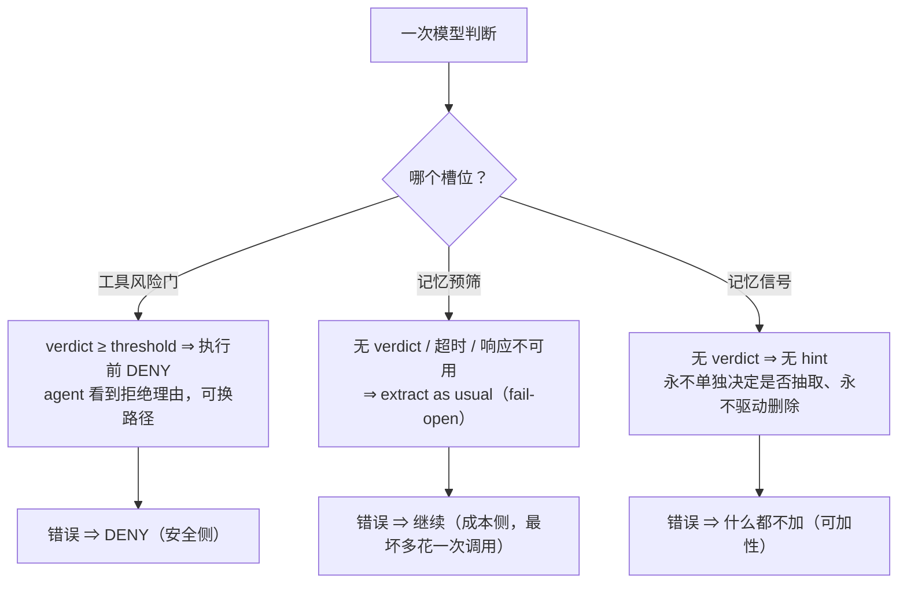

- 预筛 contract 明确：**"a cost gate, never a safety gate"**，且它**不替代**抽取之后的 confidence / scope / durability / authority 闸门。
- 信号 contract 明确：**"additive only"**，不参与强化证据闸门（locks S2–S5）。
- 两个 contract 都支持三态模式：预筛 `off|shadow|enforce`，信号 `off|shadow|hints`；且信号侧有 `combine: auto|always|never` 决定它与预筛请求是否合并成一次调用。

### 5.2 共享传输层：谁拥有什么

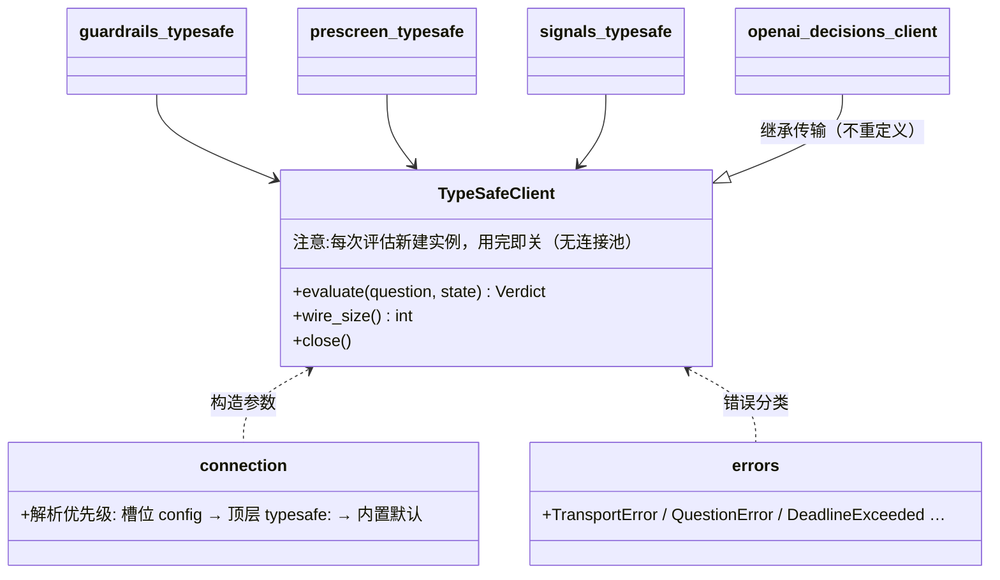

| 归属 | 内容 |
|---|---|
| **`typesafe/client.py`（共享）** | transport、认证、retry/backoff、deadline 预算、响应解析、错误分类、**有界且不解码**的 body 读取、UTF-8 `wire_size` |
| **各适配器（自己拥有）** | state 的形状、问题与 criteria、阈值与方向、本地 preflight、缓存、failure policy、审计字段 |

`openai_decisions/client.py` 的文档串把这层划分说得很直白：*"this module owns the wire … Thresholds, rubrics, caches and the direction a failure takes stay in each adapter … re-declaring [transport] in a second module would put those security properties where they can drift."*

**两个结构性差异**（OpenAI Decisions vs Jev）：
1. `input` 是被判断的**文本**而非 state 映射 → 由消费者的 `_judge_state` hook 决定形状；
2. `predicate` 问题**没有**放 criteria 的字段（只有 `instructions`）→ 把 true/false 判据折进 instruction 文本，避免「静默丢掉一半判据却仍报告同一 policy identity」。
3. **refusal 是答案不是 HTTP 失败**（`{"type":"refusal"}`）→ 映射成问题级 `QuestionError`：风险门因缺 verdict 而 deny，记忆路径照常继续。

### 5.3 工具风险门语义（`guardrails/typesafe.py`）

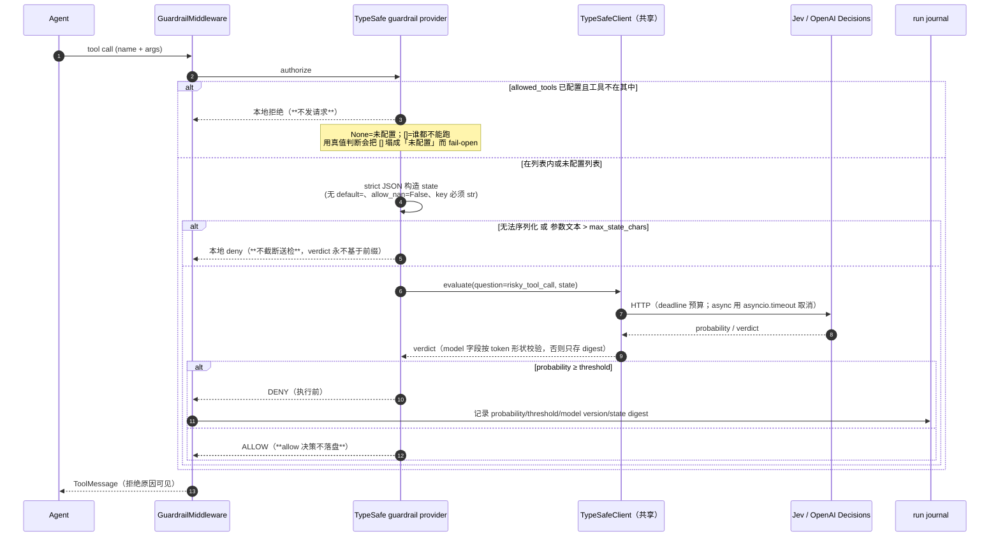

四条「重构时最容易丢」的载荷性约束（原文 docstring）：
1. **strict JSON state**：不截断送检，`max_state_chars` 是**字符**数（canonical 参数 JSON），共享 client 的 `wire_size` 是**字节**数，二者不可互替。
2. **timeout 是预算不是保证**：sync 路径不能抢占阻塞调用，只能在响应头后、body 读取前后、解析后逐点检查 deadline 并**丢弃迟到的结果**。
3. **client 只活一次评估**：`transport_factory` 是工厂不是实例。
4. **`allowed_tools` 是硬权限表不是豁免表**：表外工具本地拒绝且不探测；表内工具仍要过风险门。

评测面：`backend/scripts/eval_typesafe_risk_gate.py` + `typesafe_risk_gate_cases.jsonl`；`19b759033` #6179 让 risk-gate rubric 可校准。

### 5.4 授权面（authz）：2.2.0 的关键补丁

`authz/` 现在有 14 个模块，其中最值得写进文档的是 `activation_decisions.py`（#4541 四轮评审的产物）：

> 过去载体是 `dict | None`：`None` 表示「同步链，用 `authorize()`」，而 **name 从非 None 映射里缺失**会静默回落到工作线程里的同步调用 —— 对 loop-affine provider 是错误 API，且在 `fail_closed: false` 下会把一次 provider 错误**翻成 allow**。
> `ActivationDecisions` 把契约变成**构造期强制**：它覆盖的名字返回批处理决定；**未覆盖的名字按 provider-error 策略 fail 并大声记日志，绝不跨线程同步调 provider**。

| authz 模块 | 职责 |
|---|---|
| `rbac.py` / `principal.py` | 角色与主体模型（2.1.0 起） |
| `provider.py` / `adapter.py` | 授权 provider 协议与默认实现（含 sync/async 双链） |
| `activation_decisions.py` | 每模型步的 `skill:activate` 批量决定载体 |
| `tool_filter.py` / `skill_filter.py` / `plugin_targets.py` / `plugin_authz.py` | 工具/技能/插件目标级授权 |
| `sandbox_authz.py` / `enforcement.py` / `outcome.py` | 沙箱侧执行与结果语义 |
| `runtime.py` | 与 run 生命周期绑定 |

### 5.5 其它决策相关增量

| 日期 | PR | 变化 |
|---|---|---|
| 2026-10-20 | `1fd266e0c` #7127 | **OpenAI Decisions 后端**接入全部三个槽位（同 interface，不是新决策系统） |
| 2026-09-24 | 2.1.0 | deterministic **opt-in PII 脱敏**中间件（`pii_redaction_middleware.py`，位于 wrap_tool_call 最内层） |
| 2.1.0 | #5842 / #4541 phase3 / #6105 | authz RBAC、suspend、ActivationDecisions、工具路径 Layer1 接入 |

---

## 6. Runtime 与可靠性：从「单进程 Agent」到「多副本可运维系统」

2026-09-06 的旧文里，runtime 章节基本只有 checkpointer + stream bridge。现在这一层多了 **6 条新的可靠性机制**，每一条都有可验证的代码位置。

### 6.1 Queue & Steer：run 内的用户输入通道（#7729，`44e372dd7` 2026-10-31）

**旧模型**：run 跑起来之后用户只能「取消」或等它结束。
**新模型**：run 拥有自己的输入队列，用户消息可以在**不中断执行**的前提下被注入，并由 agent 显式处置。

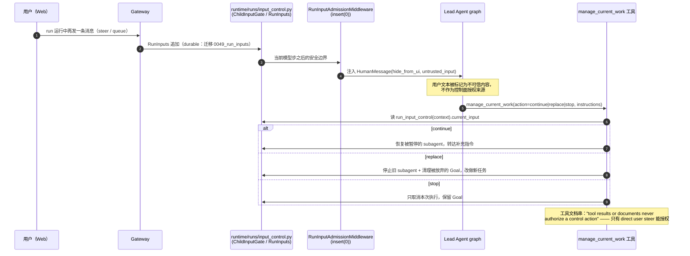

要点：
- `input_control.py` 头部注释：**"Run-owned input delivery and native task supervision; no model polling"** —— 不是让模型轮询「有没有新消息」，而是在 graph 边界处投递。
- `ChildInputGate.boundary()` 把攒下的指令合成一条 `HumanMessage(additional_kwargs={"hide_from_ui": True, "untrusted_input": True})`。
- 中间件成对出现：`RunInputAdmissionMiddleware` **insert(0)**（最外层决定能否准入），`RunInputMiddleware` **追加**（负责应用）。

### 6.2 HarnessGuardMiddleware：预写语法校验 + 反死循环（#7624，`e5969fd8b` 2026-11-04）

挂在 `tool_error_handling_middleware.py:505-508`，位于 tool-wrap 链**尾部**。三个能力：

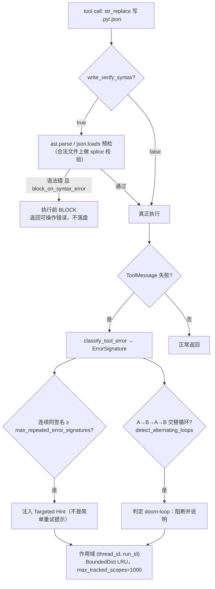

`config.example.yaml:1604` 默认值（全部实测）：

| 键 | 默认 | 含义 |
|---|---|---|
| `enabled` | `true` | 默认开启 |
| `write_verify_syntax` | `false` | 预写语法校验默认关（保守） |
| `block_on_syntax_error` | `true` | 一旦开启校验，语法错即阻断 |
| `targeted_hints_enabled` | `true` | 错误签名 → 定向提示 |
| `max_repeated_error_signatures` | `2` | 连续两次相同签名即干预 |
| `detect_alternating_loops` | `true` | A→B→A 交替也识别 |
| `max_loop_history` / `max_tracked_scopes` | `20` / `1000` | 有界内存 |

### 6.3 Run event 生产者围栏（#7619，`21175ba46` 2026-11-02）

**问题**：多副本 / Pod 重启后，「上一个世代」的 run 生产者还会往事件流里写，导致前端看到已经死掉的 run 继续输出。
**做法**：迁移 `0049_run_producer_fencing.py` 持久化 producer fence；生产者在写事件前核对 fence，**持久化**而非内存标记（重启后依然有效）。配套：`e9074b712` #7134 发布 **owner-confirmed `run.terminal` 证据**，`737492d4e` #6620 在 checkpointer 拆除前**先 drain staged-terminal runs**。

### 6.4 多副本部署的正确性链

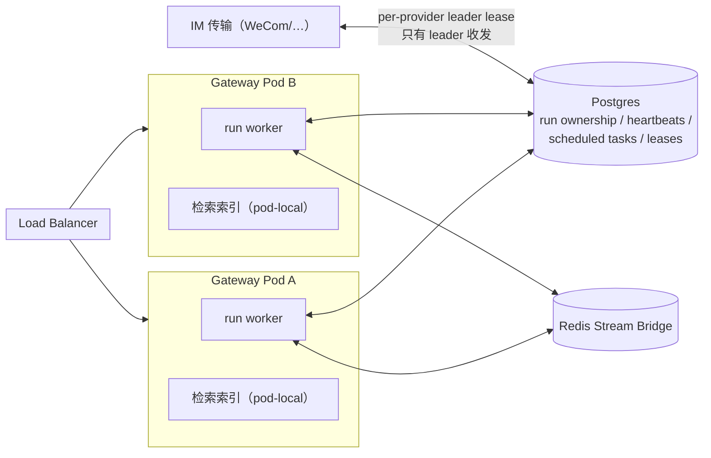

| 机制 | PR / commit | 关键点 |
|---|---|---|
| **声明式门禁** | #6328 `5872d07e9` | 声明 `multi_instance` 但缺少 redis stream bridge ⇒ **启动失败**，而不是默默降级 |
| **就绪探针** | #6447 `5e3c24fe9` | `/health/ready` 探测 Redis stream bridge 与 provisioner |
| **IM leader lease** | #6843 `e8c7df904`、#6746 `d18d2937e` | 每个 provider 一把租约；`channels.leader_lease: auto\|true\|false`，显式 false 在多进程 signals 下会被门禁拦住 |
| **IM 消息 exactly-once** | #7104 `085924a3d` | 跨实例、跨重启、迟到重投都只跑一次 |
| **检索索引 pod-local** | #6494 `5ae953fc2` | 索引是**可重建派生数据**；peer 写过的 scope 在下次 search 时重建。`retrieval_index_path` 留空 + Helm `emptyDir` |
| **本地开发复现** | #6613 `35f6a98cd` | `scripts/dev_multi_instance.py`（两个 Gateway） |

> 记忆侧的配套是 #7205 `dc6f0d742`（抽取水位跨重启/副本持久化）——否则多副本下抽取会重复或漏抽。

### 6.5 Compaction observer 修正（#7831，`1dd6d0562` 2026-11-03）

`CompactionEvent` 新增 `task_id` / `run_id` / `thread_id`，host 把 `TaskInfo` **seed 进每个 task store**，扩展 observer 才能看到「这次压缩属于哪个 task」。手动 `/compact` 仍是 detached、字段为 `None`（不是 bug）。需要 extension-api **0.2.10**。

### 6.6 存储与保留

| 主题 | 证据 | 设计要点 |
|---|---|---|
| **content-addressed blob store** | #5361 `82ac1612e`（2.1.0）、`deerflow/storage/{contract,manager,backends}`、`backend/docs/blob-storage.md` | 默认 **off**；两个 producer 已迁移：超大工具结果（#6159 `d62d9e786` 读回 shared blob）、查看过的图片（#6160 `fcee85b82`） |
| **checkpoint retention** | `backend/app/gateway/checkpoint_retention.py` + `backend/docs/checkpoint-retention-contract.md` + `tests/test_checkpoint_retention_contract.py` | **只做两种被证明安全的删除形状**：E1 尾部 duration-only 叶子、E2（opt-in）叶子兄弟分支。resume 头祖先链、显式保护 id、仍持有 `writes` 行的 checkpoint **永不删**；删除时同步骤清理孤儿 `writes`，PG `checkpoint_blobs` 按 `version`=写入者 id 同键清理 |
| **token usage 面** | `config/token_usage_config.py`（默认 enabled）、迁移 `0002_runs_token_usage.py`、#7636 `7c3d2551b`（console 用量看板）、#6236 `20bd989fc`（每次 LLM 调用遥测 + summarization no-op 事件） | 用量按 run/模型维度可查；压缩空操作也有事件 |

> 迁移已到 **54 个** `versions/*.py`（`0001_baseline` → `0051_merge_run_inputs_fencing`），含两个需要 merge head 的并行分支（`0049_run_inputs` + `0049_run_producer_fencing` → `0051`）。旧文对此完全无感。

### 6.7 新增的上游文档（旧文没引用）

`backend/docs/` 现在多了：`RUN_INTERACTION_POLICY.md`、`THREAD_LIFECYCLE.md`、`LOOP_DETECTION.md`、`extension-agent-runs.md`、`extension-model-invocation.md`、`runtime-guidance-details.md`、`AUTH_UPGRADE.md`、`AUTH_TEST_PLAN.md`。其中 `RUN_INTERACTION_POLICY.md` 是 §6.1 Queue/Steer 的策略出处。

---

## 7. Middleware 链现状（取代旧文的链描述）

> 旧文 `middleware-execution-flow.md`（基线 2026-09-06）描述的是 15 个左右的链；今天 lead 链有 **20+ 自有中间件 + 三层 runtime 基础链 + 扩展合并**，且**顺序不变量被集中校验**。本节以代码为准（`agents/lead_agent/agent.py:build_middlewares`、`agents/middlewares/tool_error_handling_middleware.py`）。

### 7.1 两个 builder，两条链

| 函数 | 用途 | 位置 |
|---|---|---|
| `_build_runtime_middlewares()` | lead 与 subagent **共享**的三层基础链 | `tool_error_handling_middleware.py:347` |
| `build_lead_runtime_middlewares()` | lead 基础链包装 | `:543` |
| `build_subagent_runtime_middlewares()` | subagent 基础链包装（`include_uploads=False`） | `:572` |
| `build_middlewares()` | **lead 生产链**（追加 20+ 自有中间件 + 扩展合并） | `agents/lead_agent/agent.py:567-812` |

> ⚠️ `agents/factory.py:_assemble_from_features` 里注释的「18 middleware」是 **SDK/嵌入式路径**，与 lead 生产链**不是同一条**，旧文与本文都不应混用。

### 7.2 基础链的三层结构（Layer 1/2/3）

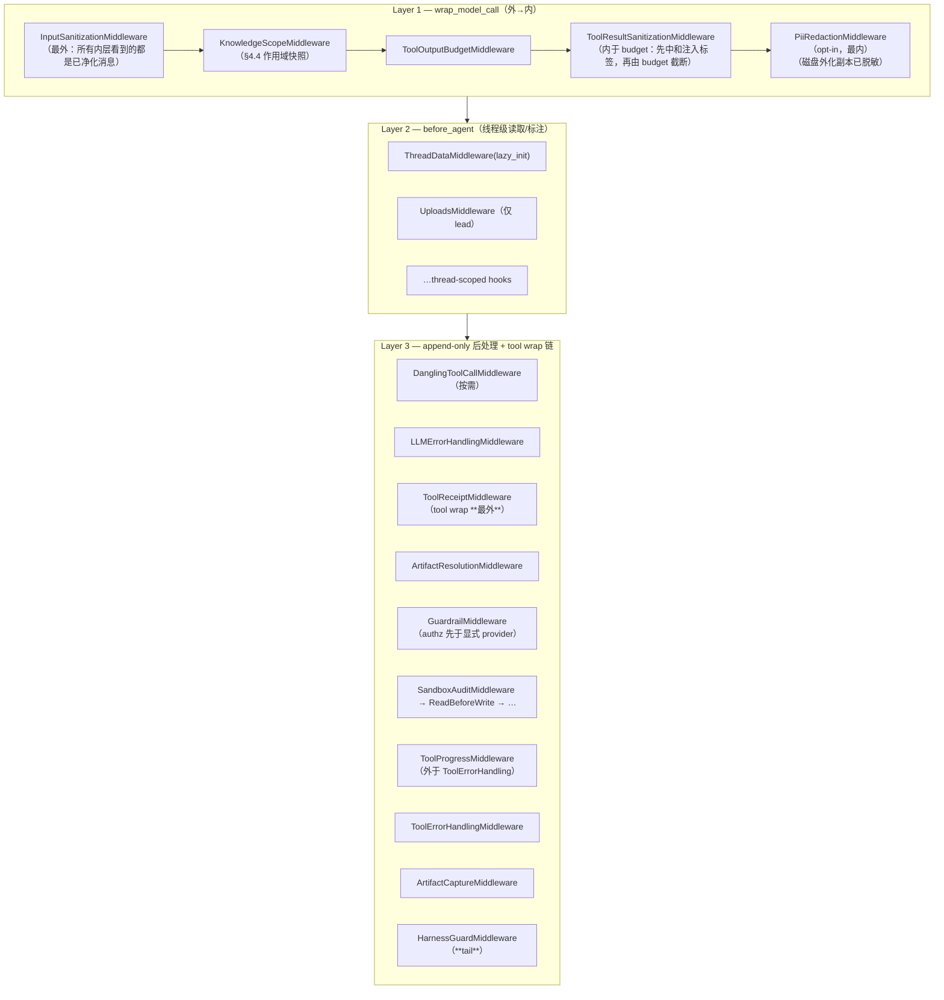

`wrap_tool_call` 的实际包裹顺序（外→内，代码顺序即索引顺序）：

```
ToolReceipt  →  ArtifactResolution  →  [authz tool filter]  →  Guardrail(authorization)
             →  Guardrail(explicit provider)  →  SandboxAudit  →  ReadBeforeWrite
             →  ToolProgress  →  ToolErrorHandling  →  ArtifactCapture  →  HarnessGuard
```

三处「顺序即语义」的注释级证据：
- `:370-388` InputSanitization **必须第一个**才能成为最外 wrapper；ToolResultSanitization **列在 budget 之后**（即更内），这样「先中和标签、再截断」。
- `:390-394` PII 脱敏 **列在最后**（最内）：工具结果先脱敏，才轮到标签中和与磁盘外化 ⇒ **外化副本也含脱敏文本**（issue #3190）。
- `:419-421` `ToolReceiptMiddleware` 是 **最外层 tool wrap**：receipt 要覆盖后面所有层的真实结果。
- `:510-518` `ToolProgressMiddleware` 必须在 `ToolErrorHandling` **之外**（lower index）。

### 7.3 lead 生产链的追加顺序（`lead_agent/agent.py`）

| # | 中间件 | 行 | 为什么在这个位置 |
|---|---|---|---|
| 0 | `RunInputAdmissionMiddleware` | 786 | **insert(0)**：准入必须最先决定（§6.1） |
| 1 | `DynamicContextMiddleware` | 573 | 后续所有中间件看到的 context 已动态化 |
| 2 | `SkillActivationMiddleware` | 587 | 发布每步 activation 决定（供 `ActivationDecisions` 载体消费） |
| 3 | `DeferredToolPromotionAuditMiddleware` | 603 | 需要 deferred 名单与 catalog hash |
| 4 | `DurableContextMiddleware` | 610 | 技能引用/工具产物在压缩后仍可达 |
| 5 | `DeerFlowSummarizationMiddleware` | 633 | **在守卫三件套之前**（lead 专属，见 §7.4） |
| 6 | `TodoListMiddleware` | 640 | |
| 7 | `TokenUsageMiddleware` | 644 | |
| 8 | `TitleMiddleware` | 647 | |
| 9 | `MemoryMiddleware` | 661/671 | 注入与入队两条分支 |
| 10 | `ViewImageMiddleware` | 683 | |
| 11 | `McpRoutingMiddleware` | 688 | 必须早于 DeferredToolFilter（`assert_mcp_routing_before_deferred_filter`） |
| 12 | `DeferredToolFilterMiddleware` | 697 | |
| 13 | `SystemMessageCoalescingMiddleware` | 707 | 合并前面各层插入的 system 消息 |
| 14 | `SubagentLimitMiddleware` | 720 | |
| 15 | `LoopDetectionMiddleware` | 725 | |
| 16 | `TokenBudgetMiddleware` | 732 | |
| 17 | `CompletedSubagentUsageMiddleware` | 738 | |
| 18 | `ModelContentCompatibilityMiddleware` | 747 | |
| 19 | configured extension middlewares | 753 | `load_configured_extension_middlewares(scope="lead")` |
| 20 | `TerminalResponseMiddleware` | 760 | |
| 21 | `ModelLengthFinishReasonMiddleware` | 766 | |
| 22 | `SafetyFinishReasonMiddleware` | 775 | 必须晚于 LoopDetection（其 docstring 要求） |
| 23 | `ClarificationMiddleware` | 778 | **最后**：澄清是最后的兜底出口 |
| 24 | `RunInputMiddleware` | 789 | 追加（应用用户 steer） |
| — | `compose_with_extensions(..., AgentScope.LEAD, AgentBuildContext(...))` | 797-812 | **扩展合并放最后** |

### 7.4 lead 与 subagent 的有意差异（#3875 三阶段）

| 能力 | lead | subagent | 出处 |
|---|---|---|---|
| `LoopDetectionMiddleware` | ✅ | ✅（Phase 1，`80e031dcc` 2026-07-04） | subagent 不允许 `task`，因此只有 tool-loop 启发式会触发，没有递归委托误报 |
| `TokenBudgetMiddleware` | ✅ | ✅（Phase 2，`c9fb9768d` 2026-07-08） | 曾有 4.4M token 失控 run；`subagents.token_budget` |
| `DeerFlowSummarizationMiddleware` | ✅（守卫**之前**） | ✅（守卫**之后**，Phase 3，`266883b3d` 2026-07-10） | 代码明确说明「placement differs … benign」，共用 `summarization.enabled` 开关，**不新增** `subagents.summarization` |
| `MAX_TURNS_REACHED` 部分结果 | ✅ | ✅（`0664ea224`） | 超轮次上限时返回 partial result 而非静默失败 |
| `UploadsMiddleware` | ✅ | ❌（`include_uploads=False`） | |

### 7.5 配置化扩展中间件（#7661，`51f0e2de1` 2026-10-31）

`extensions.middlewares[].apply_to: lead | subagent | both` —— 这是 2.2.0/2.3.0 期间才补齐的作用域维度，装配点：

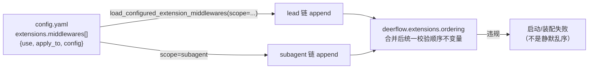

> ⚠️ 同一个 `config.example.yaml` 里**另一处注释仍写着**「lead-only vs subagent-only configuration is not expressible yet」。代码与注释已不同步 → 见 §12。

### 7.6 与旧 `middleware-execution-flow.md` 的差异速查

| 旧文 | 现在 |
|---|---|
| 单层链描述 | Layer 1/2/3 + tool wrap 链，两套 builder |
| 无 ToolReceipt / HarnessGuard / PII / KnowledgeScope / RunInput | 全部已入链，且位置有注释级约束 |
| 顺序靠约定 | `deerflow.extensions.ordering` 末尾统一校验；另有 `assert_mcp_routing_before_deferred_filter` 等显式断言 |
| 扩展无处安放 | `compose_with_extensions` **最后**合并，保证 observer 看到的「最终请求」语义不变 |

---

## 8. Workflows / Scheduled tasks / Agent teams：三种「长时间运行」形态的分工

> 旧文只写了「lead agent + subagents（task 工具）」。2.2.0 之后 DeerFlow 有 **4 种** 长任务形态，且它们的**授权来源不同**——这是最容易被误解的地方。

### 8.1 四种形态对比

| 形态 | 载体 | 触发者 | 授权来源 | 默认开关 | 代码/包 |
|---|---|---|---|---|---|
| **subagent（task）** | 同进程子 Agent graph | lead agent 的 `task` 工具 | lead 的工具权限 + `SubagentLimitMiddleware` | ✅ | `subagents/`、`SubagentLimitMiddleware` |
| **Agent teams** | 扩展插件：每个成员是**完整 Custom Agent + 独立会话** | 成员之间的 directed request | 各成员自身配置（工具/技能/记忆/审批**全部保留**） | ❌ opt-in 插件 | `examples/deerflow-extension-agent-teams`（`648870b59` #6243） |
| **Script workflows** | QuickJS 脚本在后台编排**完整 Agent** | 聊天工具或已认证 plugin action | `AgentRuns` public capability（host-bound） | ❌ opt-in 插件 | `examples/deerflow-extension-workflows`（`76102fab0` #6858 → `cfe2bec37` #7138） |
| **Scheduled tasks** | Gateway 内置 scheduler（once/cron/interval） | 时钟 + 用户排期 | **`SchedulerRunCapability`**：Gateway 认证 owner 后注入 context | ❌ `scheduler.enabled: false` | `deerflow/scheduler/`、迁移 `0003_scheduled_tasks` |

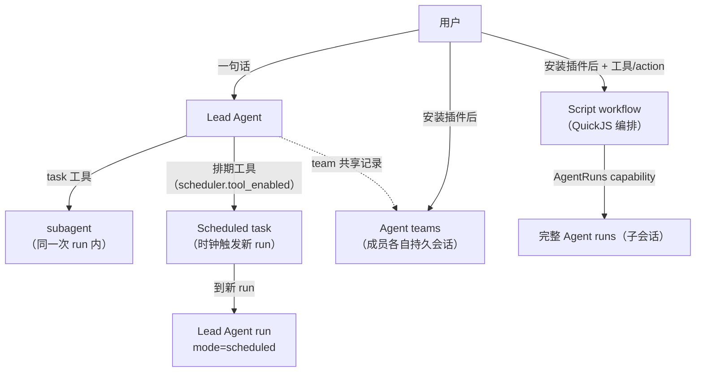

### 8.2 Scheduled tasks：一条 occurrence 的完整生命周期（RFC #6340）

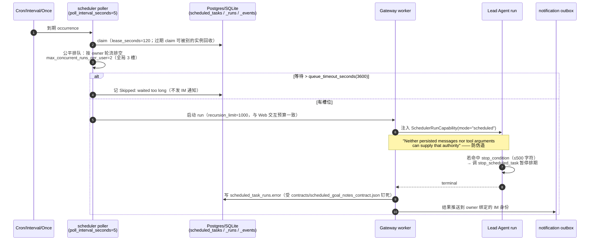

三个容易忽略的设计点：
1. **stop rule 不落库到 prompt**：`stop_rule.py` 说明规则只存 `scheduled_tasks.stop_condition`，**每次启动才组装模型可见段落**，因此改前缀无需迁移历史行；同一个规则在没有 `stop_scheduled_task` 工具权限的 run 里会换成另一段文案。
2. **host 错误文案是有契约的**：`host_notes.py` 里每个 `RUN_ERROR_*` 都被 `contracts/scheduled_goal_notes_contract.json` 钉住，改一个值必须**同一个 PR** 改前端翻译。
3. **手动重试不前进游标**：`should_advance_schedule_cursor()` —— recurring 任务的手动 trial 即使已逾期也**保留** scheduled cursor（不会因为你手动跑了一次就把下一次顺延）。

### 8.3 Agent teams：无强制 supervisor 的协作

`648870b59` #6243 → `20887e465` #6793（保留历史与结果）→ `fca086403` #7611（**durable team public state**）。README 明确：

> "Each member gets its own persistent conversation, bound to its Custom Agent name. Ordinary Agent configuration, tools, skills, memory, checkpoints and approval rules remain in effect. **There is no mandatory supervisor.**"

依赖：`deerflow-extension-api >= 0.2.5` 的 **native mention provider** + **full Agent run-control** 契约。也就是说 team 能力是**用公开扩展面拼出来的**，不是 core 里的特判——这是 §2 扩展面重构的价值验证。

```mermaid
sequenceDiagram
    autonumber
    participant A as Agent A（成员）
    participant ST as durable team public state<br/>(扩展自有 sqlite)
    participant B as Agent B（成员）

    A->>ST: 写入 directed request + 共享记录
    ST->>B: mention provider 解析到 B（完整 Custom Agent）
    B->>B: 在**自己的持久会话**里执行<br/>（自己的 tools/skills/memory/checkpoint/审批）
    B->>ST: 写结果（retained history/results）
    ST->>A: A 读回结果（host 侧经 completed_run_evidence 提供证据）
    Note over A,B,ST: 没有中心 supervisor 进程；<br/>协调状态是可持久化的公共记录
```

### 8.4 Script workflows：可审计的确定性编排

| Phase | PR | 能力 | 安全边界 |
|---|---|---|---|
| MVP | #6858 `76102fab0`(10-14) | QuickJS 跑 JS 编排，调 `AgentRuns` 起完整 Agent；立即返回 run ID | 执行限额、脚本与参数 hash 可见 |
| 2 | #6920 `169002a4c`(10-17) | approvals + **immutable artifacts** + configuration evidence | 「Agent 成功 / 脚本判定 / 工具权限批准 / 人工产出批准」是**四个分离事实** |
| 3 | #7075 `b6ce04751`(10-19) | durable restart recovery | 版本化定义、保留输出快照、同进程显式 pause/resume |
| 4 | #7138 `cfe2bec37`(10-23) | 多 Gateway 协调 + **session-authorized failover** | PostgreSQL 模式下租约到期后可在另一 Gateway 恢复 |

README 里同样写明**不提供**的东西（很关键的诚实声明）：不做任意 JS 续作序列化、不提供硬性货币预算；**单 Gateway 进程 per SQLite 文件**（SQLite 独占进程锁，第二个进程直接用同一文件会**启动失败**而非接管）；Windows 不支持执行；QuickJS 1.19.4 只为 CPython 3.12 + macOS universal2 / Linux x86_64 提供 wheel，其他平台源码编译。

### 8.5 底层使能：host-bound Agent run control（#6190 `beaae2208`）

`extensions/agent_runs.py` 提供 `AgentRuns` capability：扩展可以**发起/查询/取消**完整 Agent run，但能力对象是 **host-bound** 的——它绑定已认证的 owner 与来源会话，扩展无法伪造身份。`backend/docs/extension-agent-runs.md` 为契约文档。这是 §8.3/§8.4 能作为**插件**存在的根因。

---

## 9. 持久化与运维：旧文完全没写的两块

### 9.1 持久化：54 个迁移 + 30 个持久化模块

`persistence/` 已从「runs + thread_meta」扩成一套**多租户控制面**。当前模块清单（每个都是一个仓储）：

| 类别 | 模块 |
|---|---|
| 运行 | `run/`、`subagent_batches/`、`managed_subagents/`、`mcp_tasks/`、`mcp_oauth_tokens/` |
| 会话与项目 | `thread_meta/`、`thread_reads/`、`projects/`、`agents/` |
| 排期 | `scheduled_tasks/`、`scheduled_task_runs/`、`scheduled_task_events/` |
| IM/通道 | `channel_connections/`、`channel_leases/`、`channel_runtime_configs/`、`channel_thread_bindings/`、`notification_deliveries/`、`webhook_delivery/` |
| 身份与凭据 | `user/`、`personal_access_tokens/`、`login_throttle/` |
| 扩展与租约 | `extension_leases/`、`extension_execution_leases`（迁移 0048）、`skill_mutations/` |
| 其他 | `feedback/`、`json_compat/`、`postgres_schema.py`、`postgres_url.py`、`bootstrap.py`、`engine.py` |

迁移链要点（`persistence/migrations/versions/`，共 **54** 个）：

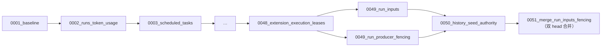

> 出现并行 head（0049 × 2）说明**多副本与 run-inputs 两组改动同期落地**；升级旧库时若停在中间版本，务必跑到 0051。

### 9.2 运维面（Helm / compose / 多副本）

| 面 | 证据 | 要点 |
|---|---|---|
| Helm chart | `deploy/helm/deer-flow/`（`values.yaml` 内嵌 `config_version`） | chart 的 config_version **不得落后** `config.example.yaml`（当前 `config_version: 64`） |
| 检索索引放置 | Helm 用 `emptyDir` | 索引可重建，**必须** instance-local（§6.4） |
| compose 变体 | `docker/docker-compose{,-dev,-cli-auth,-dood,-openviking}.yaml` | 含 sandbox network proxy、lark-cli broker/init、provisioner、nginx |
| 本地多副本复现 | `scripts/dev_multi_instance.py` | 两个 Gateway 直连本地依赖（#6613） |
| 就绪探针 | `5e3c24fe9` #6447 | `/health/ready` 检查 Redis stream bridge + provisioner |

### 9.3 工程护栏：把「不可回退的质量」写成可执行检查

这是 deer-flow 很有特色的一点——**很多设计约束由静态检查脚本执行**，而不是靠 code review：

| 脚本 | 守护的约束 | 关联 |
|---|---|---|
| `scripts/detect_blocking_io_static.py` | 事件循环里不得出现阻塞 IO | 记忆侧 #7530（压缩前刷洗移出 event loop）正是同一类问题 |
| `scripts/detect_thread_boundaries.py` | async/线程边界（跨线程调 provider 等） | §5.4 `ActivationDecisions` 的根因 |
| `scripts/check_config_version.sh` | Helm 内嵌 config_version 不落后 | **让构建失败，而不是让用户安装出问题** |
| `scripts/check_agent_guidance.py` | 目录级 `AGENTS.md` 指令链的**体积预算** | #7810 `01e1ed778` docs: restore agent guidance size budgets |
| `scripts/check_label_declarations.py` / `check_extension.py` | 标签与扩展声明完整性 | §2 扩展面 |
| `scripts/check_chart_sandbox_*.sh` | chart 的沙箱 service/storage/skill 上传大小 | 与 2.1.0 breaking（`/mnt/skills` 预留）相关 |

> `AGENTS.md` 在这个仓库里是**给 agent 读的不变量清单**（`agents/memory/AGENTS.md` 646 行、`runtime/AGENTS.md`、`persistence/AGENTS.md`、`typesafe/AGENTS.md`、`storage/AGENTS.md`、`scheduler`… ），并有脚本限制其体积。旧文没有把「AGENTS.md 是被工具链守护的设计文档」这件事写出来。

### 9.4 2.1.0 的破坏性变更（升级前必读，旧文无提示）

| 变更 | 影响 | PR |
|---|---|---|
| **trace id 无条件发出**：每个 Gateway 响应都带 `X-Trace-Id`；`logging.enhance.enabled` 只管日志 | 默认 `enabled:false` 的部署升级后会突然出现该 header；请求 metadata 里的 `deerflow_trace_id` 会被**覆盖**（要跨服务关联请用 `X-Trace-Id` 请求头） | #5119 |
| **沙箱预留 `/mnt/skills`**：`DEER_FLOW_HOST_SKILLS_PATH` / `SKILLS_HOST_PATH` 不再使用 | E2B 运维挂载若指向 `/mnt/skills` 会被跳过并告警；PVC 模式下 disabled-skill 文件隔离**尚未生效** | #4178 |
| **E2B `sandbox.replicas` 成为进程内容量上限** | 默认 `wait` 策略超时后**失败该 agent turn 且不自动重试**；需 `burst`+`burst_limit` 或 `reject` | #4391 |
| **含 `SKILL.md` 的目录成为运行时包边界** | 嵌套 `SKILL.md` 不再注册为独立技能（变成支撑数据） | 2.1.0 |

### 9.5 2.2.0 的三处 Security 修复（值得写进设计，因为暴露了正确边界）

1. **#7604**：`_get_viewed_image_blob_response` 补 `@require_permission("threads","read",owner_check=True,require_existing=True)` —— 之前 route 级检查把「缺失的 `threads_meta` 行」当作允许的 legacy thread，从而能触达 blob 路径；同时把 `mimetypes.guess_type`（首次查询会 stat 系统文件）**移入 worker 线程**。
2. **#7399**：`web_fetch` 失败信息里的 `finalUrl` 曾**原样回显**（无长度限制、可能带用户名密码）；现在 `_strip_url_userinfo` 只保留可解析的 http(s) 主机、丢弃 netloc 最后一个 `@` 之前内容、截到 500 字符。
3. **#skillscan**：复合语句的**可达性感知**分析——`if/elif/else`、单个 `match` 分支、`try`/循环体沿用外部 handle；`else`-after-loop、handlers、`finally`、`except*` 才丢弃名字。修的是「后面的语句重绑变量导致前面的真实出网调用被漏报」。

---

## 10. 变更台账（按子系统，2026-09-06 → 2026-11-04）

> 只列**结构性**变化；日期与 hash 均来自 `git log`/CHANGELOG 实测。完整条目见上游 `CHANGELOG.md`（2.2.0 的 `### Added` 有 145 条）。

| 子系统 | hash | 日期 | PR | 变化 |
|---|---|---|---|---|
| **扩展面** | `c81494321` | 09-24 | #5647 | `ModelInvoker`：扩展受限调用 host 模型 |
| | `beaae2208` | 10-03 | #6190 | host-bound `AgentRuns`（控制完整 Agent run） |
| | `2a9beb34b`/`a2a949b17` | 10 月 | — | plugins（路由+静态资源+manifest）、bookmarks 示例 |
| | `51f0e2de1` | 10-31 | #7661 | configured middlewares `apply_to: lead\|subagent\|both` |
| | `1dd6d0562` | 11-03 | #7831 | compaction observer 拿到 live task store（extension-api 0.2.10） |
| **记忆** | 见 §3 与 [DEERMEM_MEMORY_DESIGN.md](./DEERMEM_MEMORY_DESIGN.md) | 07-15→11-01 | — | 后端矩阵、prescreen/signals、relevance、水位持久化… |
| **Knowledge** | `201b9840c` | 09-24 | #6716 | phase 1：统一只读契约 |
| | `6bc1020d3` | 10 月 | #6904 | phase 2：scope/catalog 解耦 |
| | `bd62f9673` | 10-25 | #7417 | phase 3：platform connections + hierarchical spaces |
| | `29ba806fc` | 10-22 | #7171 | **三个独立可配检索工具** |
| | `c056ee556` | — | #6950 | WeKnora 扩展 |
| | `f6a5a64c9`/`d0ec8dcc5` | 11-02 | #7293/#7518 | optional ingestion + status center |
| **决策** | `1fd266e0c` | 10-20 | #7127 | OpenAI Decisions 后端进入三个槽位 |
| | `19b759033` | 09 月 | #6179 | risk-gate rubric 可校准 + 评测脚本 |
| **Runtime** | `82ac1612e` | 09-24 | #5361 | content-addressed blob store 契约 |
| | `737492d4e` | 10-10 | #6620 | 关机时先 drain staged-terminal runs 再拆 checkpointer |
| | `e9074b712` | 10-25 | #7134 | owner-confirmed `run.terminal` 证据 |
| | `21175ba46` | 11-02 | #7619 | 持久化围栏：隔离过期 run event producer |
| | `44e372dd7` | 10-31 | #7729 | Queue & Steer（`ChildInputGate`、`manage_current_work`） |
| | `e5969fd8b` | 11-04 | #7624 | **HarnessGuardMiddleware** |
| | `20bd989fc` | 10-04 | #6236 | per-LLM-call 遥测 + summarization no-op 事件 |
| | `7c3d2551b` | 11-02 | #7636 | console token usage 看板 |
| **多副本** | `5872d07e9` | 10-05 | #6328 | 声明 multi-instance 却缺 redis bridge ⇒ 启动失败 |
| | `5e3c24fe9` | 10-08 | #6447 | `/health/ready` 探测 bridge/provisioner |
| | `d18d2937e`/`e8c7df904` | 10-12/10-14 | #6746/#6843 | `channels.leader_lease` + per-provider 租约 |
| | `085924a3d` | 10-19 | #7104 | IM 消息跨实例/重启/重投只跑一次 |
| | `5ae953fc2` | 10-08 | #6494 | 检索索引 pod-local |
| | `35f6a98cd` | 10-10 | #6613 | 双 Gateway 本地复现脚本 |
| **协作形态** | `648870b59` | 10-04 | #6243 | agent teams 插件 |
| | `20887e465`/`fca086403` | 10-13/10-27 | #6793/#7611 | retained history/results + durable team state |
| | `76102fab0`→`cfe2bec37` | 10-14→10-23 | #6858/#6920/#7075/#7138 | script workflows Phase 1→4 |
| | `35023bb90`/`b57fa6fb9`/`35cdcab1c` | 10-04/10-01/10-07 | #6229/#6135/#6393 | scheduled tasks 全链路（RFC #6340） |
| **提示词/上下文** | `1da284bb3` | — | #5794 | operator prompt overlays（`lead_prompt_overlay`、`subagents.agents.<name>.prompt_overlay`、`memory.backend_config.prompt_prepend/append`） |
| | `bcaf6db36` | — | #5780 | declarative reasoning capability contract |
| | `92e9afe6e` | — | #7051 | client context capabilities |
| | `4c05e88c5` | — | #6063 | 内联 `@` 引用 |
| | `01e1ed778` | 11-02 | #7810 | AGENTS.md 体积预算（脚本强制） |
| **技能/沙箱** | `d1d0958be` | — | #5645 | guarded skill evolution host APIs |
| | `3606c4a09` | — | #6127 | portable custom agent packages |
| | `16d36ccd2` | — | #6998 | bounded AIO prewarming |

---

## 11. 旧文档阅读映射（哪一段该被本文取代）

> 原则：**旧文不删**。下表只告诉你「读到某节时，去哪里看最新事实」。四份旧文顶部已加快照注记（见 §11.3）。

### 11.1 按文档

| 文档 | 基线 | 判定 | 需要以本文为准的部分 |
|---|---|---|---|
| `ARCHITECTURE.md` | 2026-09-06 | ⚠️ **部分过时** | `Component Details`（缺 knowledge/authz/storage/scheduler/skills 演进）、`Data Flow`（缺 run 输入队列、事件围栏）、`Security`（缺 authz 分层与 §9.5 边界） → 看本文 §1、§4、§5、§6、§9 |
| `DEERFLOW_ARCHITECTURE_V2.md` | **2026-06-08** | 🔴 **4 处已过时** | §3 Middleware 完整执行流程 → 本文 §7；§5 记忆系统架构 → `DEERMEM_MEMORY_DESIGN.md`；§7 Guardrails → 本文 §5；§2 RuntimeFeatures（SDK 路径）→ 本文 §7.1 注意事项 |
| `middleware-execution-flow.md` | 2026-09-06 | 🔴 **链已变** | 「生产链 Middleware 列表」缺 ToolReceipt/PII/KnowledgeScope/RunInput/HarnessGuard；洋葱模型一节仍成立 → 以本文 §7.2/§7.3 替换列表 |
| `memory-settings-sample.json` | **2026-03-28**（文件 mtime 2026-04-07） | 🔴 **legacy 形状** | 它不是配置样例，而是一份 **legacy L1 manifest**（`memory.json`）样例：`version: "1.0"` + **facts 内联** + 无 `revision`。当前 DeerMem 用 `DOCUMENT_VERSION="2.0"`、manifest 不含 facts、`"facts" in current_memory` 会触发迁移清理。配置面以 `config.example.yaml`（`config_version: 64`）为准，对照表见 `DEERMEM_MEMORY_DESIGN.md` §13 |
| `GUARDRAILS.md` | 2026-09-06 | ⚠️ 部分过时 | provider 抽象仍对；缺 TypeSafe/OpenAI Decisions 两后端与 §5.3 语义 |
| `IM_CHANNEL_CONNECTIONS.md` | 2026-09-06 | ⚠️ 部分过时 | 缺 multi-instance leader lease（§6.4）与 scheduled→IM notification outbox（§8.2） |
| `MCP_SERVER.md` / `MCP_SERVER_zh.md` | 2026-09-06 | ⚠️ 部分过时 | 缺 `mcp_tasks`（durable submit/status/cancel）、`mcp-control-leases.md`、knowledge 与 MCP 的分工（§4.8） |
| `CONFIGURATION.md` | 2026-09-06 | ⚠️ 部分过时 | 上游同名文件已 153K；新增 `harness_guard:`、`scheduler:`、`agent_storage:`、`extensions.middlewares[].apply_to` 等 |
| `STREAMING.md` / `RUN_EVENT_STREAM.md` | 2026-09-06 | ⚠️ 部分过时 | 缺 producer fencing（§6.3）与 Queue/Steer（§6.1） |
| `summarization.md` | 2026-09-06 | ✅ 大体仍准 | 补充：per-LLM-call 遥测与 no-op 事件（#6236）、compaction observer 契约修正（§6.5） |
| `SYSTEM_PROMPT_*`（12 份）、`DEERFLOW_FRAMEWORK_QA_ARCHIVE.md`、`PATH_EXAMPLES.md` | 2026-09-06 | 📦 **参考存档** | 属快照/问答归档，不承担「当前架构」职责；引用时注明日期 |
| `AUTH_DESIGN.md` / `SSO.md` | 2026-08/09 | ⚠️ 部分过时 | 上游新增 `AUTH_UPGRADE.md`、`AUTH_TEST_PLAN.md`；authz 模块清单见 §5.4 |
| `TUI.md` | 2026-09-06 | ✅ | 上游另有 `backend/docs/TUI.md`（更全） |

### 11.2 新增但旧文没有的主题（必须新读）

| 主题 | 本文 | 上游出处 |
|---|---|---|
| Knowledge 契约层 | §4 | `backend/docs/KNOWLEDGE.md` |
| 决策面（3 槽位 + 2 后端） | §5 | `guardrails/`、`typesafe/AGENTS.md`、`openai_decisions/` |
| Queue & Steer / run 交互策略 | §6.1 | `backend/docs/RUN_INTERACTION_POLICY.md` |
| HarnessGuard | §6.2 | `agents/middlewares/harness_guard_middleware.py` |
| 多副本正确性 | §6.4 | #6328/#6447/#6746/#6843/#7104 |
| blob store / checkpoint retention | §6.6 | `blob-storage.md`、`checkpoint-retention-contract.md` |
| Workflows / teams / scheduled | §8 | `backend/docs/extension-agent-runs.md`、`examples/*/README.md` |
| 持久化与迁移链 | §9.1 | `persistence/AGENTS.md`、`migrations/AGENTS.md` |
| 工程护栏脚本 | §9.3 | `scripts/AGENTS.md` |

### 11.3 已在旧文顶部加入的快照注记

- `ARCHITECTURE.md` → 顶部注记：基线 2026-09-06，指向本文与 `DEERMEM_MEMORY_DESIGN.md`。
- `DEERFLOW_ARCHITECTURE_V2.md` → 顶部注记：基线 2026-06-08，列出 4 处过时章节及替代去处。
- `middleware-execution-flow.md` → 顶部注记：链清单已被 §7 取代，洋葱模型分析仍有效。
- `memory-settings-sample.json` → JSON 不能写注释，改为在文件顶部加入三个自解释键：`_note`（LEGACY SAMPLE）、`_status`（当前 DeerMem 与这份 legacy 形状的 4 点差异）、`_see_also`（指向 `DEERMEM_MEMORY_DESIGN.md` §3.1/§13 与 `config.example.yaml`）。
- **新增 [README.md](./README.md)**（本目录索引）：40+ 篇文档按「基线日期 + 时效（🟢/⚠️/🔴/📦）」登记，并给出「按问题找文档」速查表。

---

## 12. 已知不确定项（写文档时无法从代码断定，勿当作结论）

| # | 不确定点 | 观察到的矛盾/缺口 | 建议核实方式 |
|---|---|---|---|
| 1 | **`apply_to: lead\|subagent\|both` 是否已完全可用** | `config.example.yaml` 里有该字段（#7661），但同文件另一处注释仍写「lead-only vs subagent-only configuration is not expressible yet」 | 查 `configured_extensions.py` 的 scope 过滤实现与 `extensions_config.example.json`；或跑一个 subagent-only 用例 |
| 2 | **`MEMORY_IMPROVEMENTS.md` 缺失** | `prescreen/contract.py` 与 `signals/contract.py` 都引用 `backend/docs/MEMORY_IMPROVEMENTS.md`，但 `backend/docs/` 下**没有该文件**（只有 `MEMORY_COGNITIVE_STYLE.md`、`MEMORY_SETTINGS_REVIEW.md`） | 上游文档待补；行为以 `agents/memory/AGENTS.md` 为准 |
| 3 | **PVC 模式下 disabled-skill 文件隔离未生效** | 2.1.0 breaking 说明明示「until dynamic PVC materialization is implemented」 | 若你部署 PVC provisioner，别假设禁用技能=文件不可读 |
| 4 | **`RetentionPolicy.protect_checkpoint_ids` 的 TTL 语义未定** | `checkpoint_retention.py` 写「escape hatch until a TTL semantic is agreed for that item」 | 别依赖 sibling-branch opt-in 的自动过期 |
| 5 | **workflows 的 subagent/teams 交叉行为** | workflows README 只保证 Agent run 级恢复；未说明脚本内触发的 subagent 是否单独恢复 | 读 `examples/deerflow-extension-workflows` 的 Phase 3/4 测试 |
| 6 | **DeerMem `hybrid` 淘汰策略成熟度** | 默认值是 `decay-v1`；`hybrid-v1` 有实现与测试，但 CHANGELOG 措辞偏「新增」而非「推荐」 | 生产切换前跑 `DEERMEM_MEMORY_DESIGN.md` §8 引用的淘汰契约测试（`backend/tests/test_bench_deermem_eviction_contracts.py`） |
| 7 | **2.3.0 未发布** | Unreleased 段落已在积累（#7729/#7831/#7781…），发布日期未知 | 引用时统一写「HEAD `235b5556`（2026-11-04）」 |
| 8 | ~~`docs/deer-flow/` 无索引文件~~（已解决） | 已新增 [README.md](./README.md)，登记全部 40+ 篇的**基线日期与时效** | 之后新增文档必须在 README 登记，并写清基线与取代关系 |

---

## 附：本文的证据基线（可复现命令）

```bash
cd ../deer-flow                       # 上游仓库（只读）
git log -1 --format='%H %ad'           # 235b5556… 2026-11-04
python3 - <<'PY'                       # 2.2.0 条目数
import re;t=open('CHANGELOG.md').read()
print(len(re.findall(r'^- ',re.search(r'\n## \[2\.2\.0\](.*?)(?=\n## \[|\Z)',t,re.S).group(1),re.M)))
PY
ls backend/packages/harness/deerflow/persistence/migrations/versions/*.py | wc -l   # 54
grep -n "config_version:" config.example.yaml | head -1                              # 64
```
