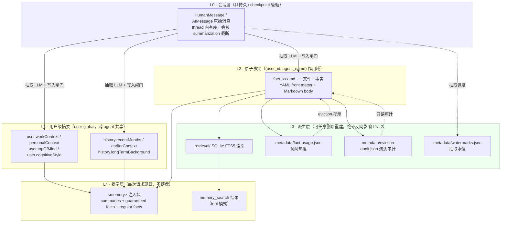
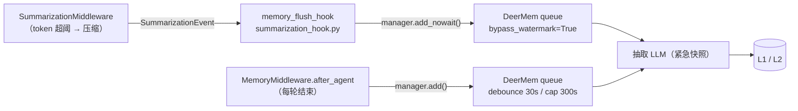
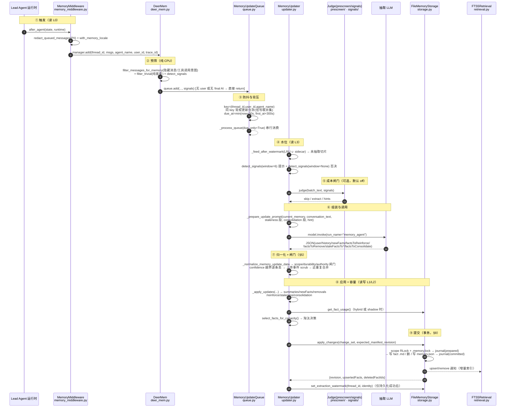
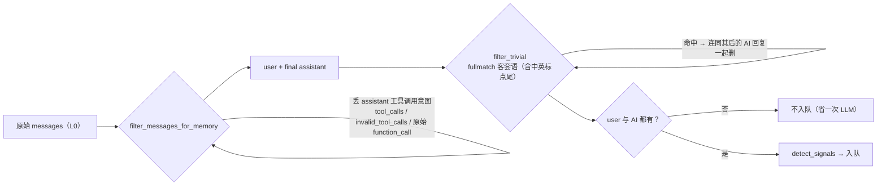
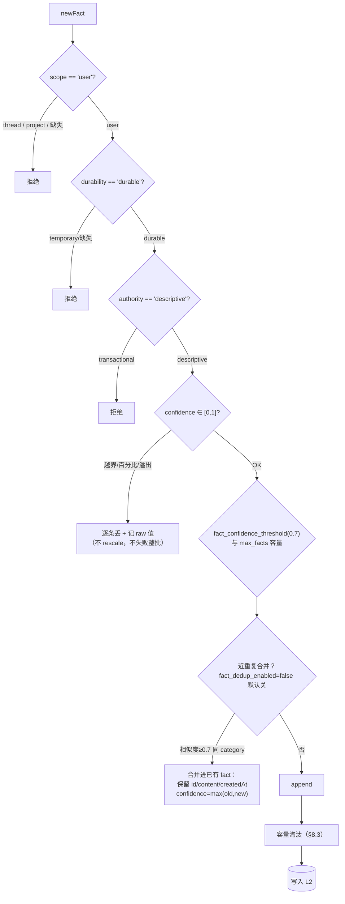
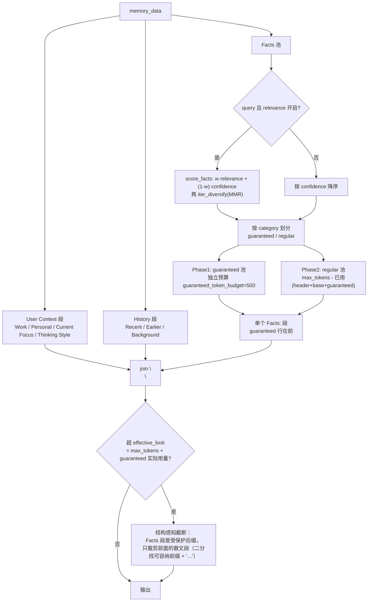
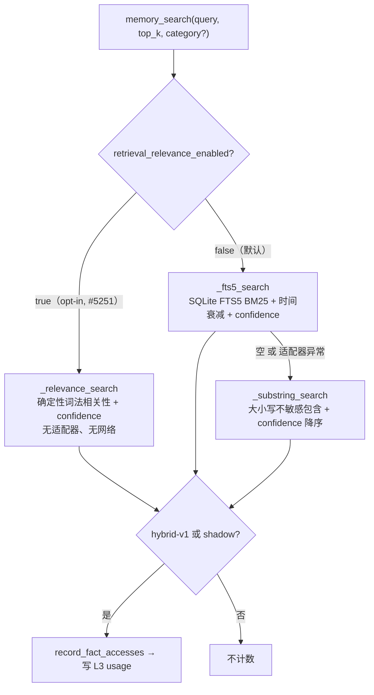
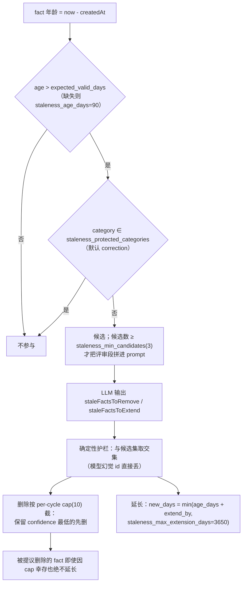
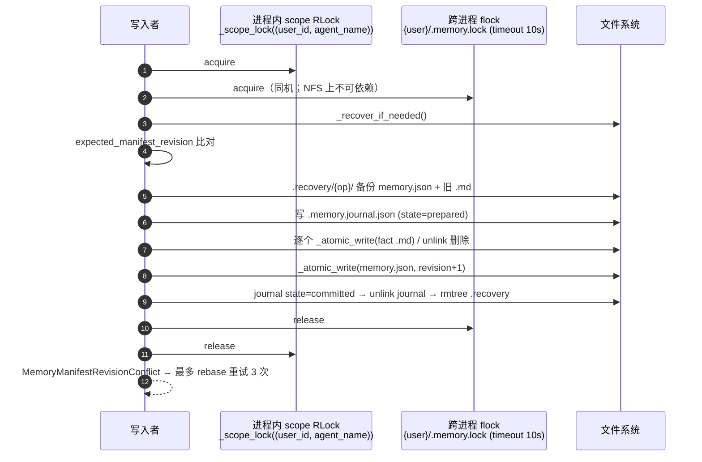
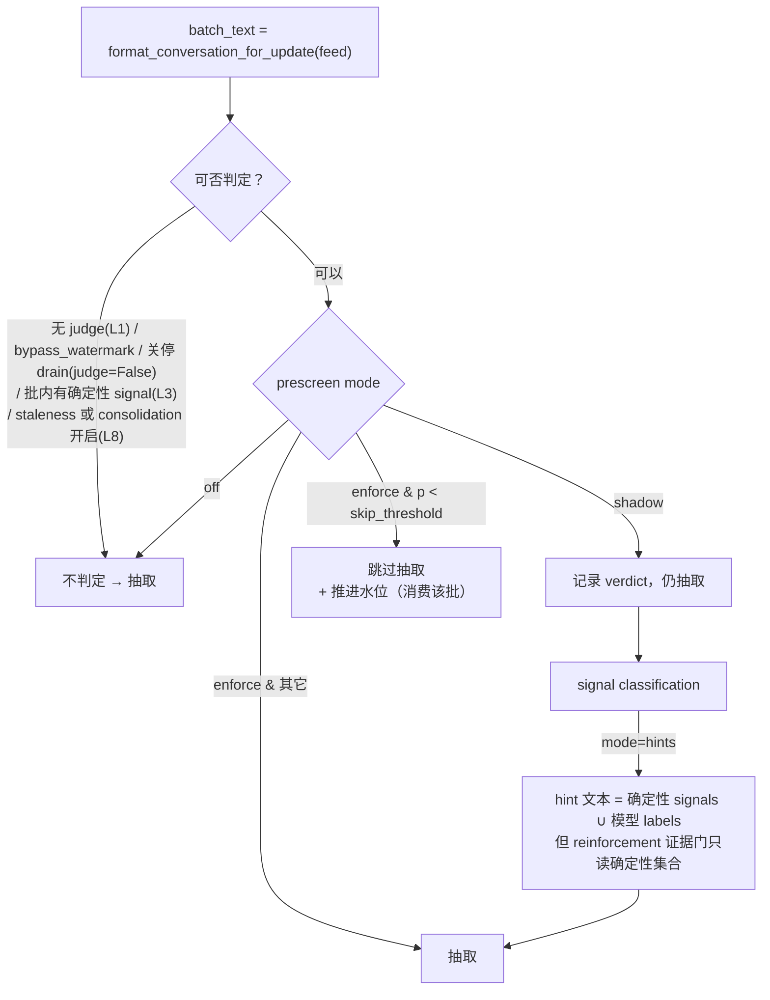

# DeerMem：deer-flow 记忆系统的完整设计

> **证据基线**：`deer-flow` HEAD `235b5556`（2026-11-04，`dddd`），里程碑 **2.2.0（2026-10-29）+ Unreleased→2.3.0**。
> **主代码路径**：`deer-flow/backend/packages/harness/deerflow/agents/memory/`（17,071 行 Python/YAML，含 DeerMem 可移植后端 8,400+ 行）。
> **本文取代**：`DEERFLOW_ARCHITECTURE_V2.md` §5「记忆系统架构」（2026-06-08 快照，已被 3 处事实推翻，见 §13）。
> **写作原则**：所有结论都带 `文件:符号` 锚点与带日期的 commit；不描述「应该怎样」，只描述「代码现在怎样」。

---

## 📋 目录

- [1. 一句话与整体分层](#1-一句话与整体分层)
- [2. 作用域模型与磁盘布局](#2-作用域模型与磁盘布局)
- [3. 数据模型：manifest / fact / sidecar 三类实体](#3-数据模型manifest--fact--sidecar-三类实体)
- [4. 写路径：从一轮对话到一条 fact](#4-写路径从一轮对话到一条-fact)
- [5. 写入闸门：LLM 说了算，但代码有一票否决](#5-写入闸门llm-说了算但代码有一票否决)
- [6. 读路径 A：注入（injection）](#6-读路径-a注入injection)
- [7. 读路径 B：检索（search）](#7-读路径-b检索search)
- [8. 记忆生命周期：过期评审、合并、容量淘汰](#8-记忆生命周期过期评审合并容量淘汰)
- [9. 事务、并发与崩溃恢复](#9-事务并发与崩溃恢复)
- [10. 成本闸门：prescreen 与 signal classification（可选）](#10-成本闸门prescreen-与-signal-classification可选)
- [11. 配置全表与部署约束](#11-配置全表与部署约束)
- [12. 后端矩阵与可观测性](#12-后端矩阵与可观测性)
- [13. 与旧文档的冲突点](#13-与旧文档的冲突点)
- [14. 端到端实例：一条记忆的完整一生](#14-端到端实例一条记忆的完整一生)
- [15. 代码索引](#15-代码索引)

---

## 1. 一句话与整体分层

**DeerMem 是 deer-flow 的默认本地记忆后端**：它把「对话」蒸馏成两类持久物——**用户级摘要（prose）** 与 **agent 作用域原子事实（fact）**——再用「预算受控的注入」和「确定性检索」把这两类东西送回模型上下文。2026-07-15 `ad45f59d6 feat(memory): pluggable memory abstraction with self-contained DeerMem backend (#4122)` 把它从 host 里剥出来，成为**不 import deer-flow 任何模块的可移植包**。

### 1.1 五层记忆模型（本文的核心心智模型）

DeerMem 不使用 episodic/semantic/procedural 的教科书命名，它的分层是**按「持久性 × 作用域 × 是否可重建」**切的：



| 层 | 存什么 | 存在哪 | 作用域 | 可否重建 | 谁写 | 谁读 |
|---|---|---|---|---|---|---|
| **L0 会话** | 原始消息、工具调用 | LangGraph checkpoint | `(thread_id)` | 不可（唯一真源） | 运行时 | 中间件、抽取 |
| **L1 摘要** | 7 段散文画像（4 user + 3 history） | `{root}/users/{uid}/memory.json` | **user 全局**（跨 agent） | 可从 L0 重抽（若 L0 还在） | 抽取 LLM（过闸门） | 注入、管理 API |
| **L2 事实** | 原子断言 + 元数据（confidence/scope/时效） | `{root}/users/{uid}/agents/{agent}/facts/{sha2-2}/{id}.md` | **(user, agent)** | 不可（用户可手工编辑） | 抽取 LLM、tool CRUD、import | 注入、检索、评审 |
| **L3 派生** | 索引、热度、审计、水位 | `{root}/users/{uid}/agents/{agent}/.metadata/`、`{root}/.retrieval/` | 混合 | **是**（删了自动重建） | storage / search | eviction、检索、重启 |
| **L4 提示** | 注入文本、搜索结果 | 内存（每请求） | 请求 | 是 | `format_memory_for_injection` | 模型 |

**三条不变量**（代码强制，不是口号）：

1. **`memory.json` 永远不存 facts，也不存 fact 索引**——只存 `version`/`revision`/`lastUpdated` 与 `user`/`history` 两段摘要。
   `storage.py:_commit_changes_locked` 写盘字典字面量只有 5 个键；旧版把 facts 塞 JSON 的布局会在读取时触发 `MemoryStorageCorruption` 并要求显式 `migrate()`。
2. **L3 绝不能改变 L1/L2 的 canonical 时间戳或 revision**——`AGENTS.md`（memory 目录）明文："Usage, audit, and per-thread extraction watermark sidecars live below the agent `.metadata/` directory. They must not change canonical Markdown timestamps or revisions."；写审计只在 canonical 持久化**成功之后**发生。
3. **排序必须确定性、无网络、无副作用**——`relevance.py` 的调用者拥有的 fact dict 是只读输入；`retrieval.py` 的 FTS5 是「派生、可重建」。

### 1.2 与 summarization / compaction 的边界（常见误解）



- **L0 被压缩前，hook 把「即将被删的消息」单独入队**，`bypass_watermark=True`：这是 one-shot 快照，**不读也不推进会话水位**——否则会用子集长度把水位倒退，下一轮就跳过未抽取的尾部（`updater.py:_do_update_memory_sync_impl` docstring 明说）。
- 2026-10-20 `ee02e51df fix(memory): preserve consecutive pre-compaction snapshots (#7152)`：连续两次压缩的快照**互不覆盖**（每次压缩删的是不同分区），且与同一 key 的 pending 常规更新也分开排队（`queue.py:_enqueue_locked`）。
- 2026-10-26 `30b3a012c fix(memory): flush pre-compaction memory off the event loop (#7530)`：紧急刷洗离开 event loop，不再阻塞 Gateway。

---

## 2. 作用域模型与磁盘布局

### 2.1 三个身份维度

| 维度 | 语义 | 解析入口 | 归一化 |
|---|---|---|---|
| `user_id` | 记忆归属人（隔离边界） | `runtime.user_context.resolve_runtime_user_id(runtime)`；Gateway 走 `_resolve_memory_user_id(request)` | `paths.py:safe_user_id`：`[A-Za-z0-9_-]`，含非法字符时追加 16 位 SHA-256 摘要（幂等，保证不同输入不撞同一个桶） |
| `agent_name` | 事实分桶（哪个自定义 agent 的记忆） | lead-agent 构造期传入 | `paths.py:validate_agent_name`：`^[A-Za-z0-9-]+$`；缺省映射到保留桶 `__default__`（不在公开命名空间内），落盘时 **小写化** |
| `thread_id` | 会话；只影响 debounce 与抽取水位，**不影响存储路径** | 中间件 | — |

关键细节（`AGENTS.md`）：
- 服务端持有的 `langgraph_auth_user_id` 优先于客户端身份，Gateway 在建图前**删除**客户端传入的同名字段；
- 无鉴权模式用 `DEFAULT_USER_ID = "default"`；
- `backend_config.storage_path` 给绝对路径即**退出**默认 per-user 根目录（运维逃生门）；
- `strict_user_scope: true` 时所有 storage scope 必须带 `user_id`（认证部署建议）。

### 2.2 磁盘布局（真实目录树）

```text
{storage_path}/                          # host 注入绝对 runtime_home；空则 $DEERMEM_DATA_DIR 或 ~/.deermem/
├── .retrieval/                          # SQLite FTS5 派生索引（多实例必须 Pod-local）
└── users/
    └── {user_id}/
        ├── memory.json                  # L1：manifest（version/revision/lastUpdated + user + history）
        ├── .memory.lock                 # 跨进程 advisory flock（仅同机有效，timeout 默认 10s）
        ├── .memory.journal.json         # 多文件事务日志（prepared → committed），崩溃恢复用
        ├── .recovery/{operationId}/     # 事务前备份（memory.json + 被改 fact 的旧 .md）
        └── agents/
            └── {agent_name}/            # 小写
                ├── facts/
                │   └── {ab}/            # sha256(fact_id)[:2] 分片
                │       └── fact_ab12….md
                └── .metadata/
                    ├── fact-usage.json      # 访问热度（hybrid-v1 的 10% 权重来源）
                    ├── eviction-audit.json  # 有界（默认 200 条/作用域）元数据审计
                    └── watermarks.json      # thread → 已抽取消息身份
```

- 路径构造全部集中在 `backends/deermem/deermem/core/paths.py`：`memory_file_path`、`agent_facts_directory`、`agent_metadata_directory`、`agent_usage_path`、`agent_eviction_audit_path`、`agent_watermark_path`、`fact_file_path`、`retrieval_index_directory`。
- **DeerMem 不 import host 的 `get_paths` / `make_safe_user_id` / `AGENT_NAME_PATTERN`**（`paths.py` 模块 docstring），可独立部署；但 sanitization 规则与 host 对齐，迁移后 per-user 桶能对上。
- 存储路径防穿越：`storage.py:_safe_relative_path` 拒绝绝对路径与 `..` 逃逸（`MemoryStorageCorruption`），因为 journal/manifest 里存的相对路径属于**不可信持久化数据**。

### 2.3 agent 作用域的管理语义（2026-09-30 `b73a4e79b feat(memory): scope management API by agent (#5565)`）

- Gateway 的读取 / reload / import / export / clear / 单 fact CRUD 都接受可选 `agent_name`；
- 后端必须显式声明 `supports_agent_scoped_management = True`（DeerMem 声明了），否则**带 scope 的请求返回 501**，而不是悄悄操作用户全局桶；
- 省略参数 = 保留旧的 default-bucket 语义；
- **scoped import 只替换该 agent 的 facts，永远保留 user 的 `user`/`history` 摘要**（即使旧 payload 传空摘要）。

---

## 3. 数据模型：manifest / fact / sidecar 三类实体

### 3.1 L1 manifest：`memory.json`

真实落盘内容（由 `storage.py:_commit_changes_locked` 末尾的字典字面量写出，`ensure_ascii=False, indent=2`）：

```json
{
  "version": "2.0",
  "revision": 17,
  "lastUpdated": "2026-11-04T09:12:33.118402Z",
  "user": {
    "workContext":       { "summary": "字节跳动 DeerFlow 核心贡献者，负责 harness 与记忆子系统；技术栈 Python/LangGraph/React。", "updatedAt": "2026-11-02T01:22:09.001Z" },
    "personalContext":   { "summary": "中英双语，偏好简洁直给的技术回答。", "updatedAt": "2026-09-18T03:10:00Z" },
    "topOfMind":         { "summary": "同时在推进三件事：DeerMem 的容量淘汰策略评测；Gateway 多副本的 run event fencing；把 knowledge 检索契约收敛为 provider 无关。", "updatedAt": "2026-11-03T12:00:00Z" },
    "cognitiveStyle":    { "summary": "先要结论再要论证；喜欢图表和对照表；会主动纠正过度概括的表述。", "updatedAt": "2026-10-21T08:00:00Z" }
  },
  "history": {
    "recentMonths":      { "summary": "近 1–3 月：重写记忆存储为 canonical Markdown；引入 hybrid-v1 淘汰策略并建评测；处理多实例与 Redis stream bridge。", "updatedAt": "2026-11-01T00:00:00Z" },
    "earlierContext":    { "summary": "3–12 月：把 memory 从 host 抽成可移植后端；FTS5 检索适配器落地。", "updatedAt": "2026-08-01T00:00:00Z" },
    "longTermBackground":{ "summary": "长期：Agent harness 与上下文工程方向，关注 token 经济性与可观测性。", "updatedAt": "2026-03-01T00:00:00Z" }
  }
}
```

要点：

| 字段 | 语义 | 代码约束 |
|---|---|---|
| `version` | 文档版本常量 `DOCUMENT_VERSION = "2.0"` | `needs_manifest_cleanup`：旧版本或含 `facts` 键 → 下次提交即重写清理 |
| `revision` | **user 级乐观并发控制**；每次真实提交 +1 | `apply_changes(expected_manifest_revision=…)`；不符 → `MemoryManifestRevisionConflict`，最多 rebase 3 次 |
| `user.*` / `history.*` | 7 个固定段，每段 `{summary, updatedAt}` + 保留扩展字段 | `_normalize_context_section` 只保证这两键，**不删未知键** |
| — | **没有 facts、没有 fact 索引** | 见 §1.1 不变量 1 |

摘要段的「内容契约」由提示词定义（`core/prompts/memory_update.chat.yaml`）：`workContext` 1–3 句、`topOfMind` 3–5 句且必须是**多个并行焦点**、`history` 按 1–3 月 / 3–12 月 / 长期 三段分层。`cognitiveStyle` 是 2026-09-23 `45411cee6 feat(memory): add cognitiveStyle for collaboration preferences (#3182)` 新增的第 4 个 user 段——它记的是「协作与推理习惯」，提示词要求**保守更新**。

### 3.2 L2 fact：一文件一事实（canonical Markdown）

`storage.py:_render_fact_markdown` 的输出格式（front matter 排除 `content`/`title`，并把 `scope` 摊平成 `user_id`/`agent_name`）：

```markdown
---
id: fact_9f3c1a7e2b
schemaVersion: 2
category: correction
confidence: 0.95
status: active
scope:
  userId: u_42
  agentName: coder
topics:
- python
- packaging
consolidatedFrom: []
lastConfirmedAt: '2026-11-03T12:00:00.000Z'
confirmationCount: 2
revision: 3
createdAt: '2026-09-30T02:11:07.000Z'
updatedAt: '2026-11-03T12:00:00.000Z'
expected_valid_days: 180
source:
  type: conversation
  threadId: thr_01J9X…
sourceError: 直接 pip install 覆盖了 uv.lock
user_id: u_42
agent_name: coder
---

# 依赖管理统一用 uv，不要用 pip

依赖管理统一用 uv，不要用 pip（会绕过 uv.lock 导致环境漂移）。
```

字段全表（校验发生在 `storage.py:_normalize_fact`，非法值抛 `ValueError`，读取期非法抛 `MemoryStorageCorruption`）：

| 字段 | 类型 | 默认 | 约束与语义 |
|---|---|---|---|
| `id` | str | `fact_{uuid4hex}` | 只允许 `[A-Za-z0-9_-]`；参与文件名与 sha256 分片 |
| `schemaVersion` | int | `2` | 写入时强制 |
| `content` | str | 必填 | strip 后非空；**用户可手工编辑**（editable JSON/MD 路径都要容错） |
| `title` | str | 由 content 首行派生（≤160 字符） | `_fact_title` |
| `category` | str | `"context"` | `CORE_CATEGORIES` = preference/correction/context/goal/behavior/cognitive/identity/constraint/decision/other；2026-10-12 `1b7ca5ecf` 起**非核心标签保留**，不再改写成 `other`；`categoryExtension` 只在 `category == "other"` 时保留 |
| `confidence` | float | `0.5` | 必须在 `[0,1]` 且非 bool；越界 → 该条**丢弃**而不是整批失败（`cd0166ae7`），且任何读取路径都要把 `10**400` 这类溢出值当不可用（`38e6be638`，2026-11-01） |
| `status` | str | `"active"` | **删除是物理删除**，只接受 `active` |
| `scope` | obj `{userId, agentName}` | 由 storage 注入 | 抽取期模型也输出一个同名标签，但那是**闸门标签，不持久化** |
| `topics` / `consolidatedFrom` | list[str] | `[]` | 必须全是字符串 |
| `lastConfirmedAt` | str ISO | 可选 | 显式确认时刻（hybrid-v1 用） |
| `confirmationCount` | int≥1 | 可选 | `_next_confirmation_count` 递增 |
| `revision` | int≥1 | `1` | **单文件乐观锁**；材料字段（除 `revision`/`updatedAt`）不变则 revision 不动、`updatedAt` 保持 |
| `createdAt` / `updatedAt` | str ISO-Z | 新建=now | `_normalize_fact` 强制为字符串 |
| `expected_valid_days` | int | 可选 | LLM 赋值（`8da7cbf02`，2026-07-16）；上限 = `staleness_age_days × staleness_max_lifetime_multiplier`（默认 90×20=1800 天），超界**静默降** |
| `consolidatedAt` | str | 有 `consolidatedFrom` 时自动补 | 合并事实的标记 |
| `source` | obj `{type, threadId}` | `{unknown, null}` | 字符串简写会被归一：`manual/consolidation/import/unknown` → 对应 type；其它字符串 → `{conversation, threadId=<该串>}` |
| `sourceError` | str | 可选 | 仅 `category == "correction"` 且在注入行里渲染成 `(avoid: …)` |

### 3.3 L3 sidecar：四类派生数据

| sidecar | 路径 | 结构 | 生命周期约束 |
|---|---|---|---|
| 访问热度 | `agents/{a}/.metadata/fact-usage.json` | `{fact_id: {accessHeat, lastAccessedAt, …}}` | 只有 `memory_search` 命中才 +1；**注入与 `get_context()` 不计数**（`AGENTS.md`）；写失败只 log，绝不让搜索丢结果（`deer_mem.py:search`） |
| 淘汰审计 | `.metadata/eviction-audit.json` | 有界事件（默认 200 条/作用域，0 关闭），**只含元数据** | 只在 canonical 持久化成功后写 |
| 抽取水位 | `.metadata/watermarks.json` | `{thread_id: ["id", "<msg id>"]}` 或 `["content", "<type>", "<sha256>"]` | 有界 `watermark_max_keys=4096`（0 无限）；**存摘要不存会话文本**；读不到时宁可重抽（over-extraction 安全，漏抽才致命） |
| FTS5 索引 | `{storage_path}/.retrieval/` | SQLite（WAL） | 派生可重建；多副本必须 instance-local（`5ae953fc2`，2026-10-08：索引 Pod-local，peer 写过的 scope 下次 search 重建） |

水位身份的选择逻辑（`updater.py:_message_identity`）：**优先 langgraph message id**，无 id 才退化为 `(type, sha256(content))`。因为 summarization 会删掉会话前缀，**基于 index 的水位会指错消息**——这是它必须基于身份而非下标的根本原因。

---

## 4. 写路径：从一轮对话到一条 fact

### 4.1 完整时序（每步标注读写的层）



### 4.2 入队阶段的过滤链（`message_processing.py`）



- 「工具调用意图」在**每个表示层**都被排除：`tool_calls`、`invalid_tool_calls`、provider 原始 `tool_calls`/`function_call`——空解析列表不能把一次尝试过的调用变成「最终回答」（`AGENTS.md`；`1523a9455`、`789bbaaa0` 2026-10-06）。
- 入队前的 **PII 脱敏**在 `memory_middleware.py:redact_queued_messages` 完成，覆盖 `invalid_tool_calls` 的参数与错误文本、legacy `function_call`（`64e499be9` 2026-09-25、`789bbaaa0`）。因为 compaction 之后马上删消息，事后的脱敏**救不回**这批 payload。
- 语言偏好：`locale.py:with_memory_locale` 在脱敏**之后**给消息副本打 `deerflow_ui_locale`，DeerMem 只在 human data message 里读它（`4b1e06bbf`，2026-10-26：Web UI 语言影响 DeerMem 新写散文的语言，但**不作为事实存储、不批量翻译**）。

### 4.3 防抖队列的真实语义（不是「重置定时器」）

`queue.py:_enqueue_locked`：

```
key       = (thread_id, user_id, agent_name)
first_at  = 同 key 首个 pending 的到达时刻（合并时保留）
due_at    = min(now + debounce_seconds(30),  first_at + max_wait_seconds(300))
```

| 机制 | 行为 | 证据 |
|---|---|---|
| 同 key 合并 | 只合并**常规**更新，signals 取并集，`first_at` 保留 | `queue.py:_enqueue_locked` |
| 紧急快照 | `due_at = now` 立即可用；与其他快照、与该 key 的常规更新**都分开** | 同上 + `ee02e51df` |
| 背压 | `queue_max_depth=1000` 到顶后，**只拒新的非信号常规更新**（`QueueFull`）；带 signal 的与紧急快照**总是准入** | 同上；DeerMem 侧 `except QueueFull: log+drop`，因为下一轮会把整段对话再喂进来 |
| 单调截止 | 别的会话不能推迟已到期项；早唤醒以 50 ms 下限重挂 | `queue.py:_rearm_timer_locked`；`bdc2d1236 fix(memory): prevent cross-conversation debounce starvation (#6672)`（2026-10-11） |
| 紧急积压告警 | 同一 key 待处理快照达 32、64、128… 时告警（只计数，不记内容） | `_EMERGENCY_BACKLOG_WARNING_DEPTH` |
| 冲刷 | `flush()` / `flush_nowait()` / `flush_sync(timeout)` 使所有 pending 立即可用；`flush_sync` 会 join 正在跑的 worker，避免「假完成」后进程退出丢数据 | `queue.py:flush_sync`；Gateway 关闭预算 `memory.shutdown_flush_timeout_seconds=30` |
| 取消 | `cancel_by_agent` 只取消**一个 user scope**内尚未被 `_process_queue` 取走的 debounce | `AGENTS.md` |

### 4.4 水位：为什么每轮传全量却不重复付费

`updater.py:_feed_after_watermark`：取 **进程内 LRU** 与 **storage sidecar** 两份水位（后者由本进程/上一进程/**共享存储根的 peer 副本**写入），各自标记一段已抽取前缀，**取更靠后的位置**起步；两份都没有（前缀被压缩删掉、或该 key 首次抽取）就喂全量。

> 失败方向被刻意选成「多抽」而不是「漏抽」：重抽只是多付一次钱，漏抽会永久丢事实。

`bypass_watermark=True`（紧急快照）完全不读不写水位（`dc6f0d742 fix(memory): persist the DeerMem extraction watermark across restarts and replicas (#7205)`，2026-10-21）。

---

## 5. 写入闸门：LLM 说了算，但代码有一票否决

抽取输出里的每条 newFact 必须带三个**只用于闸门、不持久化**的标签（`updater.py:_FACT_CLASSIFICATION_FIELDS`）：



| 闸门 | 规则 | 代码 |
|---|---|---|
| scope | 只有 `user` 级可存；`thread`/`project` 一律拒（项目内约束不得上升为用户记忆） | `_fact_scope_gate_reason` |
| durability | 只有 `durable` 可存 | `_normalize_gate_label` |
| authority | `transactional`（指令、授权、许可、"可以 force push"）永不成为长期记忆，**即使描述的是用户级策略** | 同上 |
| summary 闸门 | `user`/`history` 每段带 `shouldUpdate` 时**必须**带 `scope`+`authority`，且整段散文可注入到无关未来会话才接受 | `_summary_scope_gate_reason` |
| removal 闸门 | 矛盾删除必须带 `id`+`scope`+`reason`；`thread`/`project` 级删除 fail closed；带 `replacementFactIndex` 的替换必须**通过全部写闸门**（否则整批 fail closed，因为索引引用 newFacts 位置） | `_removal_scope_gate_reason` |
| confidence | 逐条丢并 warn 原始值；**绝不静默 rescale**（rescale 会改变阈值语义） | `_log_dropped_confidence` |
| 上传事件 scrub | 上传文件事件（`<current_uploads>` / 上传句式）从摘要与事实里剔除——上传是会话级、短暂的 | `_strip_upload_mentions_from_memory` |
| 自定义 prompt 目录 | `prompts_dir` 必须包含同样的分类字段；旧模板 → 抽取**全部 fail closed**，并有拒绝计数与高拒绝率告警 | `AGENTS.md` |

> **tool 模式（`memory.mode: tool`）的 CRUD 不走这些闸门**——模型直接调 `memory_add/update/delete`，闸门只保护被动抽取路径。

---

## 6. 读路径 A：注入（injection）

### 6.1 注入到哪里：两个不同角色的消息

`DynamicContextMiddleware`（`middlewares/dynamic_context_middleware.py`）用「ID-swap」把上下文塞进**最后一条 HumanMessage**：

```mermaid
sequenceDiagram
    autonumber
    participant DC as DynamicContextMiddleware
    participant PR as lead_agent.prompt._get_memory_context
    participant DM as DeerMem.get_context
    participant ST as storage / L1+L2
    participant CH as checkpoint

    DC->>DC: _is_user_injection_target(last HumanMessage)
    DC->>DC: _derive_injection_query(msg)  (≤上限, 优先 original_user_content)
    DC->>PR: _build_full_reminder(runtime, query=…)
    PR->>DM: manager.get_context(user_id, agent_name, query)
    DM->>ST: get_memory_data(agent 作用域 / tool 模式仅 user-global)
    ST-->>DM: {user, history, facts[]}
    DM->>DM: build_idf(corpus) → format_memory_for_injection(…)
    DM-->>PR: 注入正文
    PR-->>DC: "&lt;memory&gt;\n…\n&lt;/memory&gt;"
    DC->>CH: [SystemMessage(id=原 id, 日期 reminder),<br/>HumanMessage(id=原 id + "__memory", 记忆正文),<br/>HumanMessage(id=原 id + "__user", 真实用户消息)]
```

**权限分离是硬设计**（`_make_reminder_and_user_messages` docstring）：
- 框架自有数据（日期）放 `SystemMessage`，并带 `reminder_date` 作为权威日期；
- **记忆正文刻意放 `HumanMessage`**（id 后缀 `__memory`），因为它是用户可影响的内容，不能获得 system 权威（OWASP LLM01，#3630）；
- 该 `__memory` 消息**永不携带** `reminder_date`，因此无法伪造日期（"memory date-spoofing hole"，`#7116/#7083` 同类加固）；
- 每条注入消息带 `hide_from_ui: true` 与 provenance 标记（`ContentKind.MEMORY` / `dynamic_context_memory`）；
- agent 级 `memory_enabled: false` 时，下一次运行会对自有 `__memory` 冻结条目发 `RemoveMessage`，但保留日期提醒与真实用户消息。

### 6.2 注入正文的组装算法（`prompt.py:format_memory_for_injection`）



真实输出（`max_injection_tokens=2000`）：

```text
User Context:
- Work: 字节跳动 DeerFlow 核心贡献者，负责 harness 与记忆子系统；技术栈 Python/LangGraph/React。
- Personal: 中英双语，偏好简洁直给的技术回答。
- Current Focus: DeerMem 容量淘汰评测；Gateway 多副本 run event fencing；knowledge 检索契约收敛。
- Thinking Style: 先要结论再要论证；喜欢图表和对照表；会主动纠正过度概括的表述。

History:
- Recent: 近 1–3 月：重写记忆存储为 canonical Markdown；引入 hybrid-v1 淘汰策略…
- Earlier: 3–12 月：把 memory 从 host 抽成可移植后端；FTS5 检索适配器落地。
- Background: 长期：Agent harness 与上下文工程方向…

Facts:
- [correction | 0.95] 依赖管理统一用 uv，不要用 pip（会绕过 uv.lock 导致环境漂移）。 (avoid: 直接 pip install 覆盖了 uv.lock)
- [identity | 0.90] 用户在字节跳动担任 DeerFlow 核心贡献者。
- [preference | 0.85] 回答技术问题时偏好先给结论再给论证。
```

| 机制 | 细节 |
|---|---|
| 单 header | `"Facts:\n"` 最多出现一次；段间分隔只由最终 `"\n\n".join(sections)` 产生（修过双 `\n\n` bug） |
| guaranteed 语义 | 常见情况下 guaranteed 行**挤占** regular 行（总输出仍 ≤ `max_tokens`）；只有当 guaranteed 行本身把输出顶过 `max_tokens` 时才真正"加量"（`effective_limit = max_tokens + guaranteed_actual_usage`） |
| 不做静默升级 | `_category_match` 用**原始** `category`（不 `or "context"`），所以缺 category 的 legacy fact 不会被误送进 `guaranteed_categories=["context"]` 的池 |
| 兜底 | 主路径任何异常 → `_fallback_format_facts` 单遍 confidence 排序，且兜底行同样享受「受保护后缀」待遇 |
| XSS/越狱 | `_format_fact_line` 对 `content`、`category`、`sourceError` 做 `html.escape(quote=False)`，防止 `</memory></system-reminder>` 关闭块把后续文本搬出信任区（#4028/#4060 同源） |
| 计数方式 | `token_counting: tiktoken`（准确，但首次可能下载 BPE 数据 → 受限网络会阻塞；`char` 为无网络 CJK 感知估算） |

**middleware 模式 vs tool 模式的注入差异**（`deer_mem.py:get_context`）：

| 模式 | 注入内容 | facts 去哪了 |
|---|---|---|
| `middleware`（默认） | user 摘要 + history 摘要 + **该 agent 的 facts** | 直接进 prompt |
| `tool` | **仅 user-global 摘要** | 留在 `memory_search` / `memory_get` 后面，避免 prompt 与检索结果重复 |

### 6.3 超时与失败策略

- 注入在 worker 里跑并带超时；是否把超时当致命错误由**后端策略**决定：`MemoryManager.read_failures_are_fatal_for_config()`（默认沿用 legacy `failure_policy.read == "fail_closed"`，未知策略 fail closed）；
- 策略解析**只允许用内存里的配置**（不得做 I/O）；冷后端返回 unknown；
- `_get_memory_context` 对 `MemoryReadError` 直接上抛，对其它异常按策略决定吞或抛。

---

## 7. 读路径 B：检索（search）

### 7.1 三条策略与回退链



| 策略 | 打分公式 | 关键点 |
|---|---|---|
| FTS5（默认） | `score = (-bm25) × time_decay + confidence × 0.2`；`time_decay = 1`（<30 天）否则 `exp(-0.01 × (age_days-30))` | `retrieval.py:_compute_final_score`；**踩过的坑**：曾经 `bm25(…, 0.0, 0.0, …)` 把 k1 设成 0，等于把 BM25 全部清零，排序退化成 confidence×0.2 —— 现改用无参形式让 SQLite 默认 k1=1.2/b=0.75 生效 |
| 相关性（opt-in） | `combined = w·relevance + (1-w)·confidence`，`w = retrieval_relevance_weight`（默认 0.5）；relevance = **IDF² 加权的查询覆盖率** `sqrt(Σ匹配权重 / Σ全部权重)` | `relevance.py:lexical_relevance`；整串包含算 1 个匹配单位（保证未分词的 CJK 也能得分）；**前缀匹配要求一个完整 token 是另一个的前缀**，共享 4 字符桶不算（Postman ≠ PostgreSQL）；重复词不能替代缺失词 |
| 子串（兜底） | 包含匹配后按 confidence 降序 | `f4d10ef42 fix(memory): read the complete scope in the substring search fallback (#6732)`（2026-10-12） |

索引一致性（`storage.py:_dispatch_retrieval_notifications` / `rebuild_index`）：
- 每次 search 前比较该 scope manifest 的签名 `(mtime_ns, size, revision)`，签名变了（peer 写过）就重建该 scope；自己写过的不会重建；
- 重建的「行替换 + 发布」在 `_rebuild_publish_lock` 下是一个整体，重叠刷新按安装顺序发布；
- 提升受 generation 栅栏保护：并发改动无法证明与已发布快照兼容时，**忘记**该 scope 的签名而不是跳过。
- Gateway 启动调度 `DeerMem.warm_retrieval()` 但不拖慢 readiness；关闭时给 retrieval 预热 1 秒，**给 canonical memory flush 留满配置超时**。

### 7.2 tool 模式下的五个工具（`memory/tools.py`）

| 工具 | 语义 | 边界 |
|---|---|---|
| `memory_search` | 走当前后端的 `search()` | 后端必须 `supports_search=True`，否则实例化即报错（mode=tool 的硬前置） |
| `memory_get` | 按 **精确 fact id** 读（`220d62d79 feat(memory): add scoped fact lookup by ID (#6443)`，2026-10-08） | 越权与不存在返回**同一个** not-found，避免探测 |
| `memory_add` / `memory_update` / `memory_delete` | 直接改 L2 | **不过 §5 闸门**（模型自主）；需要 agent scope 的后端未声明支持则返回 JSON error |

---

## 8. 记忆生命周期：过期评审、合并、容量淘汰

三件事都**复用同一次抽取 LLM 调用**（`staleness_review.yaml` / `consolidation.yaml` 段被拼进 `memory_update` 的用户消息），因此没有额外 API 成本。

### 8.1 Staleness review（默认开启）



创建期的 `expected_valid_days` 上限 = `staleness_age_days × staleness_max_lifetime_multiplier` = 90×20 = 1800 天（提示词按 ≤14 / 15–60 / 60–180 / 180–365 / >365 五档指导模型赋值）。
`338cd26dc fix(memory): drop unusable numbers in stale extensions and consolidation confidence (#7442)`（2026-10-25）把模型给的坏数字（NaN/Inf/负数）当作「不可用」而不是崩溃。

### 8.2 Consolidation（默认关闭，因为**有损**）

| 规则 | 细节 |
|---|---|
| 触发 | 某 category 的 fact 数 ≥ `consolidation_min_facts`(8)；每轮最多 `consolidation_max_groups_per_cycle`(3) 组；每组 ≤ `consolidation_max_sources`(8) 个源 |
| 校验 | 源 fact 必须存在且**跨组不重叠**；apply 期强制源数与 confidence 限制 |
| 合并结果 | `consolidatedFrom` 记录源 id；`createdAt` 取**最新**源；下一次评审期限取**最早**源的（`8511fa6aa fix(memory): consolidated facts inherit expected_valid_days from sources (#4225)`） |
| 有损性 | 源 fact 被替换，只保留 id 谱系 → 默认 `consolidation_enabled: false` |

### 8.3 容量淘汰（`core/eviction.py`，2026-08-17 `5ffaa09f5 feat(memory): add hybrid fact eviction policy (#4789)`）

所有路径（自动抽取、手工、tool、import）共用同一个策略实现。

| 策略 | 分数 | 备注 |
|---|---|---|
| `confidence`（默认） | `score = confidence` | 完全保持历史行为 |
| `hybrid-v1`（opt-in） | `score = 0.65·confidence + 0.25·confirmationFreshness + 0.10·accessHeat` | 权重和必须 =1.0（`DeerMemConfig` 校验器）；半衰期：确认 90 天、访问 30 天（`_decay`）；并为 `correction` 类别保留 `min(10, ceil(max_facts×0.10))` 个槽位，**未被占用的槽立刻回到普通竞争** |

- 排名按**记录位置**而不是 `fact_id`（同一 id 可能在快照里重复；`346ff7b25 fix(memory): rank capacity eviction per record, not per fact_id (#7454)`，2026-10-25）。
- `fact_eviction_shadow_enabled: true` 时**按 confidence 执行**，但把 hybrid 的分歧写进 `eviction-audit.json` 供离线比较（评测脚本 `backend/scripts/benchmark/deermem_eviction/`）。
- 「确认」只能由**确定性信号**产生：`factsToReinforce` 只提供 fact 绑定；证据门是「最近 6 条过滤消息里存在命中 reinforcement pattern 的 human 消息」，**不要求信号与 fact 逐一匹配**（模型负责绑定，代码负责证据）；且只计**真实存在**的 id（`updater.py:_apply_updates`）。

---

## 9. 事务、并发与崩溃恢复

### 9.1 三层锁 + 两级 revision



| 机制 | 语义 | 代码 |
|---|---|---|
| manifest revision | user 级事务串行化；`expected_revision` 不符 → `MemoryManifestRevisionConflict` | `_commit_changes_locked` |
| fact revision | 单文件乐观锁；`upsert_revisions[id]=None` 表示「必须不存在」 | `_normalize_fact`、`apply_changes` |
| rebase 条件 | 仅当 **没有摘要改动** 且 所有 delete/upsert 都带 fact revision 时才允许 rebase（否则可能把 peer 的写覆盖掉） | `apply_changes` 的 `allow_manifest_rebase` + `safe_delete_rebase`/`safe_upsert_rebase` |
| 增量提交 | 明确**不是** load-all/replace-all：未改动的 fact 文件不打开、不备份、不重写、不重索引 | `_commit_changes_locked` docstring |
| no-op 提交 | 材料相同 → revision 不变，**也不推进索引签名** | 同上 + `_dispatch_retrieval_notifications` |
| 崩溃恢复 | journal `state=prepared` → 用 `.recovery/` 里的备份回滚 memory.json 与旧 .md，并删掉本次新建的 fact；`state=committed` → 只做清理；未知 state → `MemoryStorageCorruption` | `_recover_if_needed` |
| 原子写 | 临时文件 + `fsync` + rename + `fsync` 父目录 | `_atomic_write`、`_fsync_parent_directory` |
| BOM / 编码 | 读用 `utf-8-sig`（Windows 编辑器加的 BOM 不算损坏），写用 UTF-8；不可解码的摘要 → 隔离为 `memory.json.corrupt-<ts>` 后重建（`2174c1d81`、`#7083`、`#7116`） | `_load_memory_file`、`_parse_fact_markdown` |
| 损坏 vs 暂缺 | 扫描期发现 fact 已被并发删除（`lexists` 复查）→ 视为已删除；存在但读不动（悬空符号链接）→ 损坏 | `_parse_listed_fact`；`1f7600e35` |

### 9.2 存储实现可插拔

| `storage_class` | 行为 |
|---|---|
| `""` / `file`（默认） | `FileMemoryStorage`：摘要 JSON，损坏即 `MemoryStorageCorruption` |
| `markdown`（opt-in，`208ba7cc6` 2026-09-19） | `MarkdownMemoryStorage`：**写仍是 JSON**，读宽容——接受 Markdown 里唯一的 ` ```memory-json ` 围栏块（先 `raw_decode` 再校验闭合围栏，保证内嵌反引号与后续围栏无损），坏 JSON/非法 UTF-8 → 隔离后重建 |
| 点分路径 | 任意 `MemoryStorage` 子类；无效后端 **fail fast** |

---

## 10. 成本闸门：prescreen 与 signal classification（可选）

2026-09-27 `d700ad9ed feat(memory): add Jev pre-screening and signal classification over a shared TypeSafe client (#5906)`。两者都是 **host 侧槽位**，通过一个注入的 `judge(context) -> verdict` 钩子进入 DeerMem（**vendored 后端不 import host 判定类型**，与 `extraction_callback` 同样的边界）。默认 `off`，`off` 不解析类路径、不构造对象、不校验凭据。



| 不变量 | 含义 |
|---|---|
| **成本闸门，不是安全边界** | 它不 gate 任何执行或写入，也不替代 §5 的任何闸门。任何失败方向（异常/超时/坏响应/超限/无 verdict）都是「照常抽取」，判定失败=「无意见」 |
| `max_state_chars` 是**字符数**、按 side 计、**不截断** | 判定文本就是抽取器会看到的文本，不引入第二次截断；共享客户端的 `wire_size`（UTF-8 字节）不替代任何消费者的上限（CJK 会提前 3 倍触发回退） |
| `request_failed` ≠ `no_verdict` | 端点不可达/非 200/坏 body/超时 = `request_failed`（适配器**传播** `TypeSafeError`）；`no_verdict` 只用于「envelope 到了但这侧没答」 |
| 只有 `enforce + skip` 改变持久化 | 且必须**推进水位**，否则每轮重新判定更长的批、digest 缓存永不命中 |
| `enforce` 受评测门控 | `scripts/eval_memory_prescreen.py`：需要 ≥200 条**经人工复核确认「无值得记」**的 skip、以及节省量证据（调用数/token/判定延迟 p50/p95/无网络基线），缺任一为 `INSUFFICIENT` |
| `hints` 需要**独立**数据集 | 该评测不能替代 §6 的信号分类证据；因此 `hints` 在未获得证据前保持 off/shadow |
| 配置热更新 | `memory.prescreen`/`signal_classification` 变更时 `get_memory_manager()` 通过 `MemoryManager.refresh_judge` 重建并注入；签名包含顶层 `typesafe:` 连接块与**已解析**凭据指纹（轮换 key 会失效旧 judge）；安装前**重新校验 config generation**，回滚（`enforce`→`off`）后不再装上先前构建的 judge |

---

## 11. 配置全表与部署约束

`memory` 段（`config.example.yaml`）只承载 host 共享字段；**DeerMem 私有配置全在 `memory.backend_config`**，由 `DeerMemConfig.from_backend_config` 解析（未知键 warn 后忽略，`None` 值回落到默认——YAML 里只写了注释的子键会渲染成 `null`）。

### 11.1 host 层

| 键 | 默认 | 说明 |
|---|---|---|
| `enabled` | true | 总开关 |
| `injection_enabled` | true | 关掉即完全去掉注入块 |
| `manager_class` | `deermem` | 注册名或 `MemoryManager` 子类点分路径 |
| `mode` | `middleware` | `tool` 为实验性：模型自主读写；mem0 这类需要会话级抽取的后端可在 tool 模式保留被动写入 |
| `shutdown_flush_timeout_seconds` | 30.0 | Gateway 优雅关闭时冲刷 pending 的硬预算，必须小于 K8s `terminationGracePeriodSeconds` |
| `prescreen` / `signal_classification` | 注释掉=off | 见 §10；**egress 警告**：判定会把 user + final assistant 文本发到 TypeSafe，是抽取模型之外的第二个目的地，`pii_redaction_middleware` 不覆盖这条路径 |

### 11.2 DeerMem 层（按功能分组）

| 组 | 键 = 默认 |
|---|---|
| 存储 | `storage_path=""`（空=host 注入 base_dir；非空即根目录）· `storage_class="file"` · `strict_user_scope=false` · `manifest_filename="memory.json"`（必须纯 `.json` 文件名）· `file_lock_timeout_seconds=10`（1–120）· `watermark_max_keys=4096` |
| 检索 | `retrieval_adapter="fts5"`（空=禁用；或点分 `RetrievalPort` 工厂）· `retrieval_index_path=""` · `retrieval_relevance_enabled=false` · `retrieval_relevance_weight=0.5` · `retrieval_diversity_weight=0.0` |
| 去重 | `fact_dedup_enabled=false` · `fact_dedup_similarity_threshold=0.7`（0.5–1.0，token-Jaccard，同 category，保留旧 id/content/createdAt，confidence 取 max） |
| 队列 | `debounce_seconds=30`（1–300）· `max_wait_seconds=300` · `queue_max_depth=1000`（0=无限） |
| 容量 | `max_facts=100`（10–500）· `fact_confidence_threshold=0.7` · `fact_eviction_policy="confidence"` · `fact_eviction_shadow_enabled=false` · `eviction_confidence_weight=0.65` + `eviction_confirmation_weight=0.25` + `eviction_access_weight=0.10`（**和必须=1.0**）· `eviction_confirmation_half_life_days=90` · `eviction_access_half_life_days=30` · `eviction_correction_reserved_fraction=0.10` · `eviction_correction_reserved_max=10` · `eviction_audit_max_entries=200` |
| 注入 | `max_injection_tokens=2000` · `token_counting="tiktoken"`（受限网络建议 `char`）· `guaranteed_categories=["correction"]` · `guaranteed_token_budget=500` |
| 评审 | `staleness_review_enabled=true` · `staleness_age_days=90` · `staleness_min_candidates=3` · `staleness_max_removals_per_cycle=10` · `staleness_protected_categories=["correction"]` · `staleness_max_lifetime_multiplier=20.0` · `staleness_max_extension_days=3650` |
| 合并 | `consolidation_enabled=false` · `consolidation_min_facts=8` · `consolidation_max_groups_per_cycle=3` · `consolidation_max_sources=8` |
| 模型与钩子 | `model={provider,model,api_key,base_url,temperature}`（全空 → host 工厂注入默认 chat model 作 `host_llm`；standalone 无模型则抽取时 raise）· `prompt_prepend` / `prompt_append`（包在 `memory_update` 首条 system 消息两侧，不改 human 消息与缓存模板，改动需**重建后端**）· `extraction_callback`（host 注入的观测钩子）· `judge` · `should_keep_hidden_message` · `trace_context_manager` |
| 外部化 | `patterns_dir=None`（覆盖 correction/reinforcement/… yaml，指定则文件必须齐全）· `prompts_dir=None`（自定义 `memory_update.chat.yaml` 等，**必须含分类字段**否则写全部 fail closed） |

### 11.3 多副本 / 容器部署的硬约束

| 约束 | 原因 |
|---|---|
| `retrieval_index_path` 必须 **instance-local**（Helm 用 `emptyDir`） | SQLite WAL 不支持网络文件系统；共享索引会让 peer 互相重建/删除（`5ae953fc2`，2026-10-08） |
| `.memory.lock` 只在**同一台机器**有效 | `fcntl` advisory lock；跨机并发写需要外部序列化 |
| 抽取水位可跨重启/副本 | sidecar 持久化（`dc6f0d742`） |
| 关闭顺序 | Gateway 预留完整超时给 canonical memory flush，**之后**才关派生 SQLite 连接 |

---

## 12. 后端矩阵与可观测性

### 12.1 四个可选后端 + noop（`memory/backends/`）

| 能力 | deermem | mem0 | honcho | openviking | noop |
|---|---|---|---|---|---|
| 存储位置 | 本地 Markdown+JSON | 远端 Mem0 | 远端 Honcho HTTP | 远端 OpenViking Session | 无 |
| `supports_search` | ✅ | ✅ | ✅ | ✅ | ❌ |
| `supports_agent_scoped_management` | ✅ | 部分（否则 501） | ❌ | ❌ | ❌ |
| 记忆粒度 | fact + 摘要 | record | user model 派生 | session/overview | — |
| tool 模式保留被动写入 | ✅ | ✅ | 视配置 | 仅限 middleware 模式 | — |
| 读失败策略 | 默认 fail open | 可 `failure_policy.read=fail_closed`，JSON 解码/结构错误统一收敛为 `Mem0APIError` | fail closed（缺 user 即无记忆） | `startup_policy=fail_fast` | — |
| 关键约束 | 见 §11.3 | 分页必须整页校验，坏页不得发布半份清单 | 每 user 一个 workspace；增量捕获按 `deerflow_source_id`，**绝不按文本去重**；单批 ≤100 条消息；lookup ≤10 页 | 一个 DeerFlow thread ↔ 一个稳定 Session；游标 hash-only 存 `{storage_path}/openviking/sessions/` | 契约测试基准 |

`MemoryManager` 契约的分层设计（`manager.py`）也值得注意：**tier-1 抽象方法只有 `add` 与 `get_context`**，tier-2 管理操作与 tier-3 可选钩子都有默认实现；`supports_search` 声明位与实际是否覆写 `search()` 会**在实例化时交叉校验**，防止漂移。

### 12.2 可观测性

| 信号 | 来源 |
|---|---|
| 抽取 LLM span | `MemoryCallbacks.on_memory_llm_call/on_memory_llm_result`（host 注入 `LangfuseMemoryCallbacks`），`run_name="memory_update"`→`memory_agent` |
| 抽取指标 | `updater._emit_extraction_metrics`：confidence 分布、**scope 闸门各拒绝原因计数**、`mutations_accepted`（**只在真实 apply 成功点计数**，容量淘汰掉的 newFact 不算，持久化失败则**不发布**该计数） |
| 判定记录 | prescreen/signals 每轮落一条含 `fallback_reason` 的记录，使设计 §5 的「本地回退」总体可数 |
| 容量审计 | `.metadata/eviction-audit.json`（纯元数据，有界） |
| 检索状态 | `storage.retrieval_status()`、Gateway memory status API（`b4b2a68ee` 起对后端密钥脱敏） |
| 可复现评测 | `backend/scripts/benchmark/deermem_eviction/`（hybrid 策略评测，含 PR#4789 复现配置与结果）、`deermem_scope_isolation/`（作用域隔离契约）、`scripts/eval_memory_prescreen.py` |

---

## 13. 与旧文档的冲突点

`docs/deer-flow/DEERFLOW_ARCHITECTURE_V2.md` §5（2026-06-08 快照）以下三处已与源码不符，阅读时以本文为准（旧文保留作历史快照，已加澄清注记）：

| 旧文断言 | 现状 | 证据 |
|---|---|---|
| 防抖会「取消旧定时器并重新计时」（T+30 → T+40 → T+50） | **不会无限推迟**：`due_at = min(now+debounce, first_at+max_wait)`，且「保留更早的已挂起唤醒」防止频繁到达把到期项饿死 | `queue.py:_enqueue_locked` / `_rearm_timer_locked`；`bdc2d1236` |
| `queue.add_nowait(..., correction_detected=, reinforcement_detected=)` | 签名早已改为 `signals: frozenset[str]`（6 类信号，不止 correction/reinforcement），且队列由 **DeerMem 私有**，host 只能通过 `MemoryManager` 调用 | `queue.py:_enqueue_locked`、`deer_mem.py:add_nowait`、`ad45f59d6` |
| 「三层架构 = Summarization / flush hook / MemoryUpdateQueue」 | 那是**触发链**，不是记忆分层。真正的分层是 L0 会话 / L1 摘要 / L2 canonical facts / L3 派生 / L4 提示（§1.1），且写入还有闸门、水位、事务、生命周期四个正交子系统 | `storage.py`、`updater.py`、`eviction.py` |
| 隐含「记忆 = memory.json 一个文件」 | v2.0 manifest **不含 facts**；facts 是分片 Markdown，一文件一事实，可手工编辑 | `storage.py:_render_fact_markdown`、`4bf028d04 feat(memory): add incremental agent-scoped Markdown fact storage (#4279)`（2026-07-22） |

`docs/deer-flow/memory-settings-sample.json`（`lastUpdated: 2026-03-28`，文件名易误解）**不是配置样例，而是一份 legacy L1 manifest 样例**（即 `memory.json` 的落盘内容）：

| 该样例 | 当前 DeerMem（`storage.py`） | 后果 |
|---|---|---|
| `"version": "1.0"` | `DOCUMENT_VERSION = "2.0"` | 加载时 `needs_manifest_cleanup` 命中 → 下次提交重写为 2.0 |
| facts **内联**在 manifest 的 `facts` 数组里 | manifest **不含 facts**；每条 fact 一个 canonical Markdown 文件 + sidecar 索引（§3.2、§1.1 不变量 1） | `"facts" in current_memory` 触发清理迁移 |
| 无 `revision` 键 | `revision` 是 user 级乐观并发控制（§3.1） | 缺省按 0 处理，首次真实提交后递增 |
| `user` 三段（workContext/personalContext/topOfMind） | `user` 四段（新增 `cognitiveStyle`）+ `history` 三段 | 旧文件按缺段兼容读取，不会报错 |

配置面的唯一权威是 `deer-flow/config.example.yaml` 的 `memory:` 段（`config_version: 64`），完整表见本文 §11；`manager_class`/`backend_config` 这层抽象在 2026-07-15 才引入，早于该日期的任何配置片段都不可信。

---

## 14. 端到端实例：一条记忆的完整一生

场景：`user_id=u_42`，自定义 agent `coder`（→ 存储桶 `coder`），`thread_id=thr_01J9`，UI 语言 `zh-CN`。默认配置（`middleware` 模式、`max_facts=100`、`staleness_review_enabled=true`、`consolidation_enabled=false`、`fact_dedup_enabled=false`、`fact_eviction_policy=confidence`）。

### T0（11-03 11:58）一轮对话结束

```
HumanMessage  "以后这个仓库别用 pip 了，统一用 uv，pip 会绕过 uv.lock 把环境搞乱。"
AIMessage     tool_calls=[bash "pip install requests"]      ← 有工具调用意图
ToolMessage   "Successfully installed requests-2.32.3"
AIMessage     "已按你的要求改用 uv：`uv add requests`。之前的 pip 安装确实覆盖了 uv.lock。"  ← final，无 tool_calls
```

### T1 `MemoryMiddleware.after_agent`（读 L0）

| 步骤 | 结果 |
|---|---|
| `filter_messages_for_memory` | AIMessage(带 `tool_calls`) 与 ToolMessage **被丢**（工具调用意图不是最终回答） |
| `filter_trivial` | 无命中 |
| 结构校验 | 有 human ✅、有 final ai ✅ → 继续 |
| `detect_signals(window=6)` | `{"correction"}`（命中 `correction.yaml` 的中文模式） |
| `redact_queued_messages` | 无 PII 命中，原样 |
| `with_memory_locale` | human 副本打 `deerflow_ui_locale="zh-CN"` |
| `manager.add(...)` | `user_id=u_42`、`agent_name="coder"`、`trace_id` 在**入队时**捕获（Timer 线程不继承 ContextVar） |

### T2 队列（debounce）

```
key      = ("thr_01J9", "u_42", "coder")
first_at = 11:58:00   due_at = 12:13:00   # min(now+30s, first_at+300s) = first_at+300s
```
11:59 与 12:05 该会话又来了两轮 → 同 key **合并**（signals 并集仍为 `{correction}`），`first_at` 不变，`due_at` 仍 12:13（**不是** 12:35）。

### T3 抽取（12:13，读 L3 水位）

`messages[-N]` 中上次已抽取的最后一条身份 = `("id","lc_msg_0077")` → 只喂 0078 之后的 4 条（L0→抽取的增量）。批内 `detect_signals(window=None)` 命中 `correction` ⇒ **prescreen 即使开启也会被 L3 否决**（默认 off，无影响）。

### T4 抽取 LLM 输出（节选）

```json
{
  "user":   { "workContext": {"summary": "…", "shouldUpdate": false, "scope": "user", "authority": "descriptive"} },
  "history":{ "recentMonths": {"summary": "…把该仓库的包管理统一到 uv…", "shouldUpdate": true,
                                 "scope": "user", "authority": "descriptive"} },
  "newFacts": [
    {"content":"该仓库依赖管理统一用 uv，不要用 pip（pip 会绕过 uv.lock 导致环境漂移）。",
     "category":"correction","confidence":0.95,"expected_valid_days":180,
     "sourceError":"直接 pip install 覆盖了 uv.lock",
     "scope":"user","durability":"durable","authority":"descriptive"},
    {"content":"当前任务：把 requests 加进 pyproject 依赖。",
     "category":"goal","confidence":0.9,"scope":"thread","durability":"temporary","authority":"descriptive"},
    {"content":"用户允许直接 force push 该分支。",
     "category":"behavior","confidence":0.9,"scope":"user","durability":"durable","authority":"transactional"},
    {"content":"用户偏好简洁回答。","category":"preference","confidence":0.55,
     "scope":"user","durability":"durable","authority":"descriptive"}
  ],
  "factsToReinforce": [],
  "factsToRemove": []
}
```

### T5 闸门结果（§5）

| # | 判定 | 原因 |
|---|---|---|
| 1 | ✅ 写入 | 三标签齐、confidence 0.95 ≥ 0.7、`expected_valid_days=180 ≤ creation_cap(1800)` |
| 2 | ❌ 拒 | `scope=thread` + `durability=temporary` → 计数 `facts.scope += 1`、`facts.durability += 1` |
| 3 | ❌ 拒 | `authority=transactional`（授权类内容永不成为长期记忆）→ `facts.authority += 1` |
| 4 | ❌ 丢 | confidence 0.55 < `fact_confidence_threshold=0.7` → **静默跳过**（不计数为 scope 拒绝） |

`mutations_accepted = 1`（只算真实落盘）。

### T6 提交（写 L1+L2，revision 17→18）

```text
users/u_42/memory.json                      revision 18
  history.recentMonths.updatedAt = 2026-11-03T12:13:44Z   ← 摘要层（L1）变化
users/u_42/agents/coder/facts/7a/fact_9f3c1a7e2b.md       ← 新 fact（L2）
users/u_42/.memory.journal.json                          ← 提交结束已 unlink
```

`_normalize_fact` 在提交时补齐：`schemaVersion=2`、`status=active`、`revision=1`、`updatedAt=createdAt`、`topics=[]`、`consolidatedFrom=[]`、`scope={u_42, coder}`、`source={conversation, thr_01J9}`。
提交成功后才：`set_extraction_watermark("thr_01J9", ("id","lc_msg_0081"))` 写 L3、`_dispatch_retrieval_notifications` 增量索引该 fact。

### T7 下一次 run 的注入（读 L1+L2 → 写 L4）

```text
<memory>
User Context:
- Work: 字节跳动 DeerFlow 核心贡献者…
History:
- Recent: …把该仓库的包管理统一到 uv…
Facts:
- [correction | 0.95] 该仓库依赖管理统一用 uv，不要用 pip（pip 会绕过 uv.lock 导致环境漂移）。 (avoid: 直接 pip install 覆盖了 uv.lock)
</memory>
```

它作为 `HumanMessage(id="lc_msg_0090__memory")` 注入；日期 reminder 走 `SystemMessage`；两者都 `hide_from_ui`。guaranteed 段（`correction`）优先占用 500 token 子预算，因此**不会被 regular facts 挤掉**。

### T8 检索命中（11-20，读 L2/L3 → 写 L3）

`memory_search("依赖 安装", top_k=5)` → 默认 FTS5：`(-bm25)×1.0 + 0.95×0.2`（fact 年龄 17 天 <30 ⇒ 无衰减）。因为策略是 `confidence`，**不写 usage**。若切到 `hybrid-v1`，命中会写 `.metadata/fact-usage.json`，为淘汰提供 10% 的 accessHeat。

### T9 显式确认（12-10，reinforcement）

用户说"对，就用 uv，别改回去"。确定性 gate 在最近 6 条过滤 human 消息里命中 `reinforcement.yaml`，模型把该信号绑定到 `fact_9f3c1a7e2b` 且 `scope=user`、`reason` 非空 ⇒ 该 fact 得到 `lastConfirmedAt=2026-12-10T…Z`、`confirmationCount=2`、`revision` 1→2。**注入本身不构成确认**（提示词与代码双重禁止）。

### T10 过期评审（2027-05，年龄 ~220 天 > `expected_valid_days=180`）

该 fact 进入 staleness 候选（类别 `correction` **在 `staleness_protected_categories` 里** ⇒ 实际上**永远不能成为删除目标**，但可被延长）。本轮抽取调用附带评审段，模型可 `staleFactsToExtend: {extend_by_days: 365}` ⇒ `expected_valid_days = min(220+365, 3650) = 585`。

### T11 容量淘汰（若 `max_facts` 打满）

| 策略 | 该 fact 的命运 |
|---|---|
| `confidence` | score=0.95 → 排在前列，保留 |
| `hybrid-v1` | `0.65×0.95 + 0.25×confirmationFreshness(≈0.94, 距上次确认 5 天/半衰期 90 天) + 0.10×accessHeat` ≈ 0.86；且 `correction` 类别可占用预留槽 `min(10, ceil(100×0.10))=10` 中的一席 |

被淘汰时写 `.metadata/eviction-audit.json`：`{fact_id, category, score, components{...}}`，**不记录 content**。

### 各层状态变化总览

| 时刻 | L0 会话 | L1 摘要 | L2 fact | L3 派生 | L4 注入 |
|---|---|---|---|---|---|
| T1 | 4 条消息 | — | — | — | — |
| T3 | 前缀可能被压缩 | — | — | 读水位 | — |
| T6 | 不变 | recentMonths 更新、rev 17→18 | +1 文件（100 里第 37 个） | +索引行、+水位 | — |
| T7 | 注入消息进 checkpoint（`__memory`） | 读 | 读 | 读 | ✅ 出现 |
| T8 | 一次 tool 调用 | — | 读 | （hybrid 时）+usage | 搜索结果 |
| T9 | 新一轮对话 | 不变 | 同文件 revision→2、confirmationCount→2 | 索引行刷新 | 内容更"可信" |
| T10 | — | 不变 | `expected_valid_days` 180→585 | — | 仍存在 |
| T11 | — | 不变 | 文件被 unlink（物理删除） | 索引 remove + usage/audit 清理 | 消失 |

---

## 15. 代码索引

| 主题 | 文件:符号 |
|---|---|
| 契约 | `agents/memory/manager.py:MemoryManager`（tier-1 `add`/`get_context`；`supports_search`/`supports_agent_scoped_management`/`requires_passive_writes_in_tool_mode`；`refresh_judge`；`get_memory_manager` 单例与热更新） |
| 被动写入触发 | `agents/middlewares/memory_middleware.py:MemoryMiddleware.after_agent/aafter_agent`、`redact_queued_messages` |
| 注入 | `agents/middlewares/dynamic_context_middleware.py:DynamicContextMiddleware._build_full_reminder/_make_reminder_and_user_messages/_derive_injection_query`、`agents/lead_agent/prompt.py:_get_memory_context` |
| 压缩钩子 | `agents/memory/summarization_hook.py:memory_flush_hook` |
| DeerMem 门面 | `agents/memory/backends/deermem/deer_mem.py:DeerMem`（`add`/`add_nowait`/`_prepare_update`/`get_context`/`search`/`warm_retrieval`/`shutdown_flush`/fact CRUD） |
| 配置 | `backends/deermem/deermem/config.py:DeerMemConfig`（+ `DeerMemModelConfig`、`from_backend_config`） |
| 路径与身份 | `backends/deermem/deermem/core/paths.py`（`safe_user_id`/`validate_agent_name`/`fact_file_path`/`retrieval_index_directory`） |
| canonical 存储 | `backends/deermem/deermem/core/storage.py:FileMemoryStorage`（`apply_changes`/`_commit_changes_locked`/`_recover_if_needed`/`_normalize_fact`/`_render_fact_markdown`/`search_facts`/`rebuild_index`/sidecar 读写）；`markdown_storage.py:MarkdownMemoryStorage` |
| 队列 | `backends/deermem/deermem/core/queue.py:MemoryUpdateQueue`（`_enqueue_locked`/`_rearm_timer_locked`/`_process_queue`/`flush_sync`/`cancel_by_agent`） |
| 抽取与闸门 | `backends/deermem/deermem/core/updater.py:MemoryUpdater`（`_do_update_memory_sync_impl`/`_feed_after_watermark`/`_prepare_update_prompt`/`_apply_updates`/`_fact_scope_gate_reason`/`_select_stale_candidates`/`_select_consolidation_candidates`/`_select_for_capacity`） |
| 消息处理与信号 | `backends/deermem/deermem/core/message_processing.py`（`filter_messages_for_memory`/`filter_trivial`/`detect_signals`/`SIGNAL_NAMES`）+ `core/message_patterns/*.yaml` |
| 注入格式化 | `backends/deermem/deermem/core/prompt.py:format_memory_for_injection/_format_fact_line/_select_fact_lines/format_conversation_for_update` + `core/prompts/*.yaml` |
| 检索 | `backends/deermem/deermem/core/retrieval.py:FTS5Retrieval/FTS5RetrievalAdapter`；`core/relevance.py`（`tokenize`/`build_idf`/`lexical_relevance`/`score_facts`/`iter_diversify`） |
| 容量策略 | `backends/deermem/deermem/core/eviction.py:select_facts_for_capacity` |
| 成本闸门 | `agents/memory/prescreen/{contract,typesafe,openai_decisions}.py`、`agents/memory/signals/{contract,coordinator,typesafe}.py`、`agents/memory/judging.py` |
| 工具模式 | `agents/memory/tools.py:get_memory_tools` |
| 评测 | `backend/scripts/benchmark/deermem_eviction/`、`backend/scripts/benchmark/deermem_scope_isolation/`、`backend/scripts/eval_memory_prescreen.py`、`backend/scripts/migrate_memory_markdown.py` |
| 上游文档 | `backend/docs/MEMORY_COGNITIVE_STYLE.md`、`backend/docs/MEMORY_SETTINGS_REVIEW.md`、`backend/docs/CONFIGURATION.md`（`memory:` 段）、`frontend/src/content/{en,zh}/harness/memory.mdx` |
| 运维约定 | `agents/memory/AGENTS.md`（646 行，模块级不变量清单，排障时先读） |

> **阅读顺序建议**：`agents/memory/AGENTS.md`（不变量）→ 本文 §1/§2（分层与作用域）→ `updater.py`（写）→ `prompt.py`（读）→ `storage.py`（持久化）→ `eviction.py`（生命周期）。
