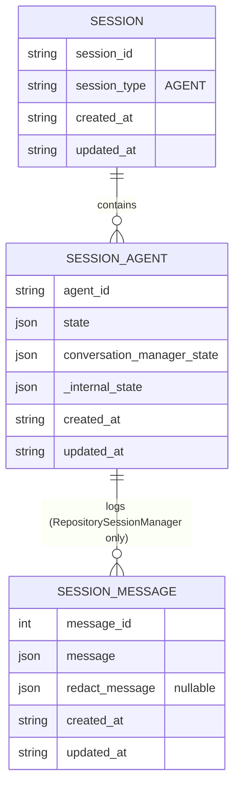
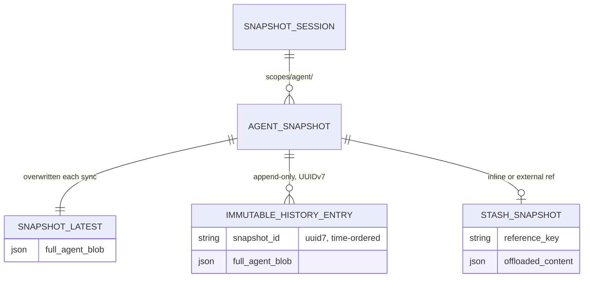
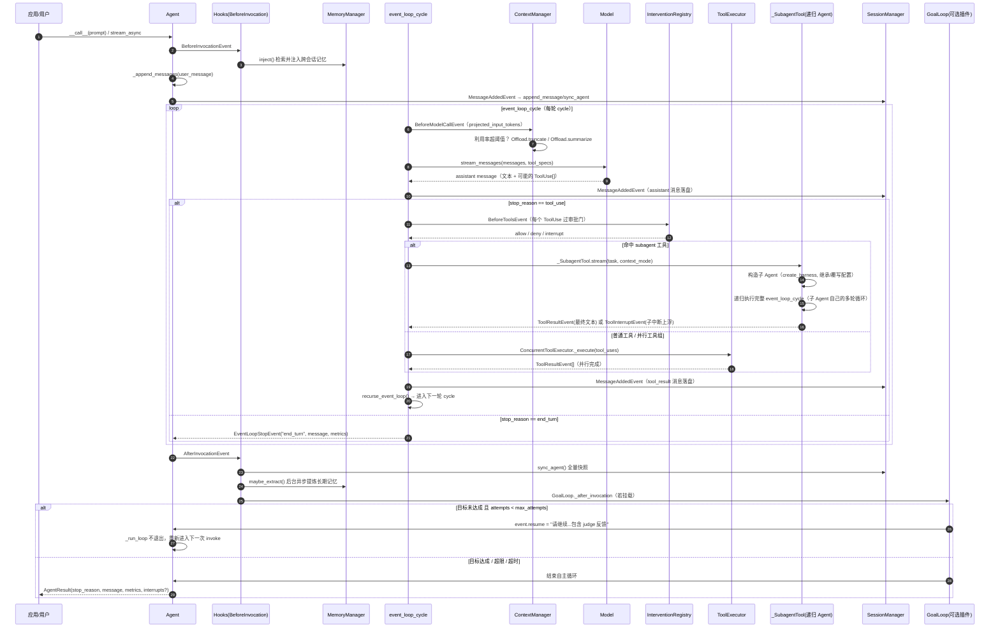
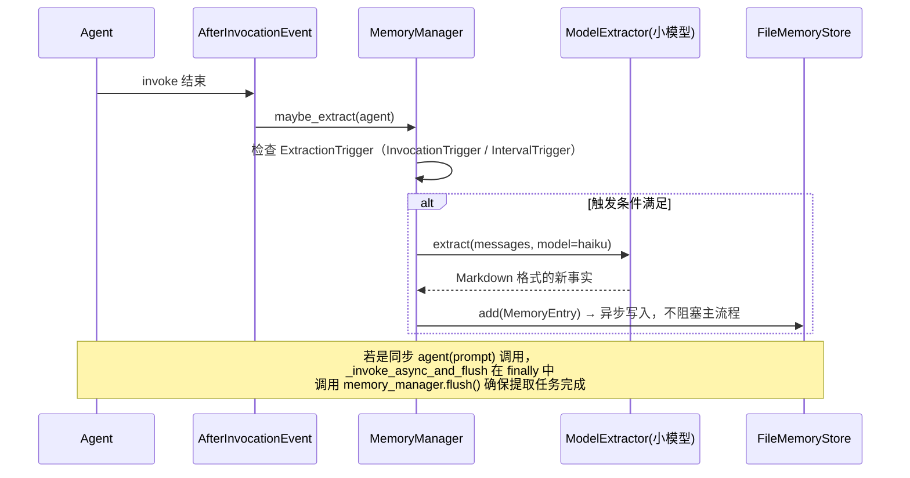
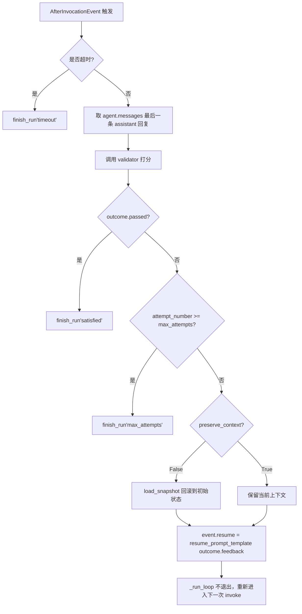
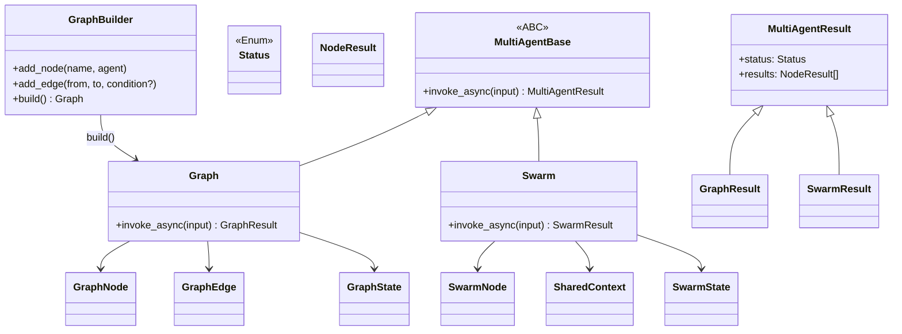

# Strands Harness SDK —— 补充篇：类图/实体图、端到端流程、Session/Memory/压缩举例、Goal/Plan、主子 Agent、核心 Prompt

> 本文是 [ARCHITECTURE.md](./ARCHITECTURE.md) 的补充，聚焦该文档中偏简化或未展开的八块内容。
> 所有源码引用均来自 `/Users/gqli/work/deepagents/harness-sdk`（独立仓库，含 `strands-py` + `harness-py`）的实际代码，**经过一次 Explore 子代理的逐文件核实**，并在文中明确标注了与 ARCHITECTURE.md 原文不一致的地方（见 [§0 勘误](#0-与-architecturemd-的勘误)）。
>
> 本文不重复 ARCHITECTURE.md 已经讲清楚的内容，只补完整图、补真实细节、补缺失主题。

---

## 目录

- [§0 与 ARCHITECTURE.md 的勘误](#0-与-architecturemd-的勘误)
- [§1 完整类图 / 实体图](#1-完整类图--实体图)
- [§2 完整端到端流程（含 Goal Loop / Subagent 分支）](#2-完整端到端流程含-goal-loop--subagent-分支)
- [§3 Session 设计与 JSONL/JSON 落盘举例](#3-session-设计与-jsonljson-落盘举例)
- [§4 Memory 设计与落盘举例](#4-memory-设计与落盘举例)
- [§5 压缩方案（ContextManager 真实实现）](#5-压缩方案context-manager-真实实现)
- [§6 Goal 流程（GoalLoop）](#6-goal-流程goalloop)
- [§7 Plan 流程（Todos，不存在独立 Plan 插件）](#7-plan-流程todos不存在独立-plan-插件)
- [§8 主子 Agent 设计思路](#8-主子-agent-设计思路)
- [§9 核心 Prompt（HARNESS_CONTRACT 完整真实文本）](#9-核心-prompthARNESS_CONTRACT-完整真实文本)

---

## §0 与 ARCHITECTURE.md 的勘误

ARCHITECTURE.md 是基于源码行为描述撰写的，大方向正确，但以下几处的**具体格式/路径/命名**与真实源码不符，阅读时请以本节为准：

| ARCHITECTURE.md 中的描述 | 真实源码情况 | 源码依据 |
|---|---|---|
| Session 落盘为 `session.json` + `messages/000000.json`（零填充数字命名）| 存在**两套机制**：①旧的 `FileSessionManager`：逐消息 JSON，文件名是 `message_<id>.json`（非零填充）；②新的、推荐的 `SnapshotSessionManager`：**不是逐消息文件**，是整体打包的 `snapshot_latest.json` + `immutable_history/snapshot_<uuid7>.json` | `strands-py/src/strands/session/file_session_manager.py:28-43,100-117`；`strands-py/src/strands/session/snapshot_session_manager.py:1-19,116-124` |
| `Stash` 位于 `strands/experimental/context_manager/stash.py` | 真实路径是 `strands/_context_manager/stash.py`；`experimental/context_manager/` 下只有一个 `__init__.py` 做 re-export，没有 `stash.py` | `strands-py/src/strands/experimental/context_manager/__init__.py:10-16` |
| `"auto"`/`"agentic"` 预设定义在 `presets.py` | 这两个字符串是 `ContextManager.from_strategy()` 处理的顶层 `context_manager=` 参数值，定义在 `context_manager.py`。`presets.py` 里实际是另外四个"策略预设"：`proactive_summarization`/`large_tool_offloading`/`overflow_protection`/`stale_tool_cleanup` | `strands-py/src/strands/_context_manager/context_manager.py:36-44,118-158`；`_context_manager/presets.py:26-31` |
| （隐含）文档未提及 Goal 循环的具体实现名 | 真实存在且确实叫 `GoalLoop`，但它是 **strands-py 的 vended plugin**（`strands/vended_plugins/goal/plugin.py`），harness-py 没有自己的同名封装，是直接复用上游能力 | `strands-py/src/strands/vended_plugins/goal/plugin.py:197-233,295-371` |
| （隐含）文档未提及独立的 "Plan" 概念 | **不存在**独立的 Plan 插件/工具。harness-py 的 `plugins/` 目录只有 `environment.py` 和 `todos.py` 两个文件；"计划管理"功能完全由 `Todos` 插件 + `todo_write` 工具承担 | `harness-py/src/strands_harness/plugins/todos.py` |

---

## §1 完整类图 / 实体图

ARCHITECTURE.md §1.2 和图集 G2 给出的是简化类图（只有 4-5 个字段）。下面是覆盖 Agent 运行时全部关键协作对象的完整版本，并补充了此前完全没有出现的 Session/Snapshot 实体关系图。

### 1.1 Agent 运行时完整类图

```mermaid
classDiagram
    class Agent {
        +messages: Message[]
        +model: Model | ModelRouter
        +system_prompt: str
        +tool_registry: ToolRegistry
        +tool_executor: ToolExecutor
        +hooks: HookRegistry
        +session_manager: SessionManager?
        +memory_manager: MemoryManager?
        +_context_manager: ContextManager?
        +conversation_manager: ConversationManager
        +_intervention_registry: InterventionRegistry
        +_middleware_registry: MiddlewareRegistry
        +_interrupt_state: _InterruptState
        +_concurrency: _ConcurrencyManager
        +event_loop_metrics: EventLoopMetrics
        +state: AgentState
        +sandbox: Sandbox?
        +agent_id: str
        +session_id: str
        +__call__(input) AgentResult
        +invoke_async(input) AgentResult
        +stream_async(input) AsyncIterator~TypedEvent~
        +load_snapshot(snapshot)
        +shutdown_async()
    }

    class ToolRegistry {
        +registry: dict~str, AgentTool~
        +register(tool)
        +process_tools(tools)
        +get_all_tool_specs() ToolSpec[]
    }
    class AgentTool {
        <<Protocol>>
        +tool_name: str
        +tool_spec: ToolSpec
        +tool_type: str
        +stream(tool_use, invocation_state) ToolGenerator
    }
    class _SubagentTool {
        +_pending: dict~str, Agent~
        +_max_depth: int
        +_builder: Callable
        +stream(tool_use, invocation_state) ToolGenerator
    }
    AgentTool <|.. _SubagentTool

    class SessionManager {
        <<ABC>>
        +session_id: str
        +initialize(agent)
        +append_message(message, agent)
        +sync_agent(agent)
        +redact_latest_message(redact, agent)
    }
    class RepositorySessionManager {
        +session_repository: SessionRepository
        +append_message(message, agent)
        +sync_agent(agent)
    }
    class FileSessionManager {
        +storage_dir: str
    }
    class SnapshotSessionManager {
        +storage: Any
        +save_latest_on: "message"|"invocation"
        +append_message(message, agent)  "no-op"
        +sync_agent(agent)  "overwrite snapshot_latest"
    }
    SessionManager <|-- RepositorySessionManager
    RepositorySessionManager <|-- FileSessionManager
    SessionManager <|-- SnapshotSessionManager

    class Session {
        +session_id: str
        +session_type: SessionType
        +created_at: str
        +updated_at: str
    }
    class SessionAgent {
        +agent_id: str
        +state: dict
        +conversation_manager_state: dict
        +_internal_state: dict
        +created_at: str
        +updated_at: str
    }
    class SessionMessage {
        +message: Message
        +message_id: int
        +redact_message: Message?
        +created_at: str
        +updated_at: str
    }
    Session "1" --> "1..*" SessionAgent
    SessionAgent "1" --> "0..*" SessionMessage

    class MemoryManager {
        +stores: MemoryStore[]
        +injection: MemoryInjectionConfig
        +inject(agent)
        +maybe_extract(agent)
        +flush()
    }
    class MemoryStore {
        <<Protocol>>
        +name: str
        +writable: bool
        +search(query, options) MemoryEntry[]
        +add(entry)
    }
    class FileMemoryStore {
        +storage: LocalFileStorage
        +extraction: ExtractionConfig?
        +max_search_results: int
    }
    class _ReadOnlyStore {
        +writable: false
        +extraction: None
        +search(query, options) MemoryEntry[]
    }
    MemoryStore <|.. FileMemoryStore
    MemoryStore <|.. _ReadOnlyStore
    MemoryManager --> "1..*" MemoryStore

    class ContextManager {
        +_strategies: ContextStrategy[]
        +_stash: Stash?
        +from_strategy(strategy) ContextManager
        +_on_before_model_call(event)
        +_on_after_model_call(event)
        +_on_message_added(event)
    }
    class ContextStrategy {
        <<Protocol>>
        +should_run(utilization, projected) bool
        +apply(agent) bool
    }
    class TruncateStrategy {
        +preview_tokens: int
        +when(threshold, utilization, preserve_recent)
    }
    class SummarizeStrategy {
        +model: Model?
        +when(threshold, utilization, preserve_recent)
    }
    class EmergencyTruncateStrategy {
        +_EMERGENCY_REMOVAL_RATIO: 0.2
    }
    class DropStrategy
    ContextStrategy <|.. TruncateStrategy
    ContextStrategy <|.. SummarizeStrategy
    ContextStrategy <|.. EmergencyTruncateStrategy
    ContextStrategy <|.. DropStrategy
    ContextManager --> "0..*" ContextStrategy
    ContextManager --> "0..1" Stash

    class Stash {
        +storage: Any
        +session_id: str
        +agent_id: str
        +store(block_id, block_index, data) str
        +store_message(message, skip_ids)
        +retrieve(reference) Any
        +list() str[]
        +take_snapshot() dict
        +load_snapshot(entries)
    }

    class HookRegistry {
        +add_callback(event_type, callback, order)
        +invoke_callbacks_async(event) tuple
    }
    class InterventionRegistry {
        +handlers: InterventionHandler[]
        +evaluate(tool_use) InterventionResult
    }
    class InterventionHandler {
        <<ABC>>
        +name: str
        +on_before_tool(event) InterventionResult
    }
    class HumanInTheLoop
    class CedarAuthorization
    InterventionHandler <|-- HumanInTheLoop
    InterventionHandler <|-- CedarAuthorization
    InterventionRegistry --> "0..*" InterventionHandler

    class GoalLoop {
        +goal: str | Validator
        +judge: JudgeConfig?
        +max_attempts: int
        +timeout: float
        +preserve_context: bool
        +_runs: dict
        +init_agent(agent)
    }

    class Todos {
        +name: str
        +state_key: "todos"
        +init_agent(agent)
        +todo_write(todos, tool_context) str
    }

    Agent --> ToolRegistry
    Agent --> SessionManager
    Agent --> MemoryManager
    Agent --> ContextManager
    Agent --> HookRegistry
    Agent --> InterventionRegistry
    Agent ..> GoalLoop : "plugin (optional)"
    Agent ..> Todos : "plugin (optional)"
```



**读图要点**：

- `SessionManager` 有**两条继承链**：`RepositorySessionManager → FileSessionManager`（逐消息持久化，旧机制）和 `SnapshotSessionManager`（整体快照，新推荐机制），二者不是同一套序列化格式，见 §3。
- `ContextManager` 不直接持有压缩算法，而是持有一组 `ContextStrategy`（`TruncateStrategy`/`SummarizeStrategy`/`EmergencyTruncateStrategy`/`DropStrategy`），`Offload.truncate(...)`/`Offload.summarize(...)`/`Offload.drop(...)` 是构造它们的工厂方法。
- `GoalLoop` 和 `Todos` 都是 `Plugin`，不是 `Agent` 的直接字段，而是通过 `agent.hooks.add_callback(...)` 挂到 Hook 系统上——`Agent` 类上看不到它们的引用，只有在 `agent.plugins` 列表里能找到。

### 1.2 Session / Snapshot 实体关系图（修正版）

ARCHITECTURE.md 图集 G5 的 ER 图过于简化且对应的是旧机制。下面分别给出两套持久化机制的真实实体关系：





**关键差异**：`RepositorySessionManager`（旧）把一次对话拆成"1 个 Agent 元数据 + N 条消息文件"，`append_message` 是真实的增量写入；`SnapshotSessionManager`（新）把整个 Agent（含 messages、state、conversation_manager_state、必要时内联的 stash 数据）打成**一个 blob**，`append_message` 是 no-op，真正的写入靠 `sync_agent` 无条件整体覆盖 `snapshot_latest`，并视配置追加一条 `immutable_history/snapshot_<uuid7>.json`（用于 time-travel 回滚）。

---

## §2 完整端到端流程（含 Goal Loop / Subagent 分支）

ARCHITECTURE.md §1.3 的时序图只覆盖了"模型 ↔ 工具"主循环，没有画出 Goal Loop 驱动的多轮自主循环、Subagent 递归、Session/Memory 的精确挂钩时机。下图把这些全部画全：



**几个容易忽略的时机点**：

1. **Memory 的注入发生在 `BeforeInvocationEvent`**，即每次 `invoke()`/每轮自主循环开始前（而非每个 cycle），但由于 `trigger="everyTurn"` 配置，工具循环中间的每次模型调用也会重新渲染注入内容（通过 `ContextInjector`，不是 `BeforeInvocationEvent`，细节见 §4）。
2. **Session 的写入点有两处**：assistant 消息生成后、tool_result 消息生成后，都各触发一次 `MessageAddedEvent`——这意味着一次"模型调用 + 工具调用"的组合至少触发 2 次持久化尝试（具体是否真的落盘取决于用的是 `RepositorySessionManager` 还是 `SnapshotSessionManager`，见 §3）。
3. **Subagent 递归**本质是在父 Agent 的工具执行阶段里，完整地跑了一遍子 Agent 自己的 `event_loop_cycle` 多轮循环（子 Agent 可能自己也调用模型 5-10 次），父 Agent 只在 `ToolResultEvent` 里看到子 Agent 的最终文本。
4. **GoalLoop 的循环不经过 `event_loop_cycle`**，而是在更外层的 `AfterInvocationEvent`/`_run_loop` 层面工作：它判断"这整次 invoke 的最终回复"是否满足目标，不满足就把 `event.resume` 设成新的 user 消息，让 `_run_loop` 把这次 invoke 当成"未结束"，继续发起新一轮 `event_loop_cycle` 序列（而不是单纯 recurse 一个 cycle）。

---

## §3 Session 设计与 JSONL/JSON 落盘举例

> 勘误：源码中 **没有 JSONL 格式**（JSON Lines，一行一个 JSON 对象）。无论新旧机制，落盘单元都是**独立的 JSON 文件**（`json.dump(..., indent=2)` 或 `json.dumps(...).encode("utf-8")`）。下文举例均以真实格式给出。

Strands 的 Session 持久化有两套互不兼容的实现，分别举例说明。

### 3.1 旧机制：`FileSessionManager`（逐消息 JSON 文件）

**目录结构**（源码：`strands-py/src/strands/session/file_session_manager.py:28-43`）：

```
~/.strands/sessions/
└── session_<session_id>/
    ├── session.json                 # Session 级元数据
    └── agents/
        └── agent_<agent_id>/
            ├── agent.json            # SessionAgent 元数据（state、conversation_manager_state）
            └── messages/
                ├── message_0.json
                ├── message_1.json
                ├── message_2.json
                └── message_3.json
```

**以一次"分析 AAPL"对话为例，逐条消息文件内容：**

`message_0.json`（用户提问）：
```json
{
  "message_id": 0,
  "message": {
    "role": "user",
    "content": [{"text": "分析一下 AAPL 的股价"}]
  },
  "redact_message": null,
  "created_at": "2026-10-21T09:00:00.000000+00:00",
  "updated_at": "2026-10-21T09:00:00.000000+00:00"
}
```

`message_1.json`（助手回复 + 工具调用）：
```json
{
  "message_id": 1,
  "message": {
    "role": "assistant",
    "content": [
      {"text": "我来查一下 AAPL 当前价格"},
      {"toolUse": {"toolUseId": "tu-001", "name": "fetch_stock_price", "input": {"symbol": "AAPL"}}}
    ]
  },
  "redact_message": null,
  "created_at": "2026-10-21T09:00:02.000000+00:00",
  "updated_at": "2026-10-21T09:00:02.000000+00:00"
}
```

`message_2.json`（工具结果）：
```json
{
  "message_id": 2,
  "message": {
    "role": "user",
    "content": [
      {"toolResult": {"toolUseId": "tu-001", "status": "success", "content": [{"text": "AAPL: $192.50"}]}}
    ]
  },
  "redact_message": null,
  "created_at": "2026-10-21T09:00:03.000000+00:00",
  "updated_at": "2026-10-21T09:00:03.000000+00:00"
}
```

`agent.json`：
```json
{
  "agent_id": "agent-xyz",
  "state": {"todos": []},
  "conversation_manager_state": null,
  "_internal_state": {},
  "created_at": "2026-10-21T09:00:00.000000+00:00",
  "updated_at": "2026-10-21T09:00:03.000000+00:00"
}
```

**`append_message` 与 `sync_agent` 的真实差异**（`repository_session_manager.py:78-96,117-192`）：

- `append_message`：每次都真实新建一个 `message_<n>.json`，`n` 单调递增，是真正意义上的"增量写"。
- `sync_agent`：**会先比较 `state`/`interrupt_state`/`conversation_manager_state` 的版本号**，只有真的变化才重写 `agent.json`；没有变化时记一条 debug 日志 `"skipping sync, no changes detected"` 后直接返回——这是一个未在 ARCHITECTURE.md 中提到的优化，避免无意义 I/O。

写盘机制：`tempfile.mkstemp` 创建临时文件 → 写入 → `os.replace` 原子替换，目录权限 `0o700`，并带有 symlink 攻击防护检查。

### 3.2 新机制（推荐）：`SnapshotSessionManager`（整体快照 JSON）

**目录结构**（源码：`snapshot_session_manager.py:116-124`）：

```
<storage_root>/<session_id>/scopes/agent/<agent_id>/snapshots/
├── snapshot_latest.json                              # 每次 sync_agent 整体覆盖
└── immutable_history/
    ├── snapshot_01933b5e-7a2c-7f1a-9c3e-1a2b3c4d5e6f.json   # UUIDv7，按时间排序，用于 time-travel
    ├── snapshot_01933b5e-9d4e-7a2b-8e1f-2b3c4d5e6f7a.json
    └── ...
```

**同一场"分析 AAPL"对话，`snapshot_latest.json` 的内容（整体打包，不是逐条）：**

```json
{
  "agent_id": "agent-xyz",
  "session_id": "stock-analysis-001",
  "messages": [
    {"role": "user", "content": [{"text": "分析一下 AAPL 的股价"}]},
    {
      "role": "assistant",
      "content": [
        {"text": "我来查一下 AAPL 当前价格"},
        {"toolUse": {"toolUseId": "tu-001", "name": "fetch_stock_price", "input": {"symbol": "AAPL"}}}
      ]
    },
    {
      "role": "user",
      "content": [{"toolResult": {"toolUseId": "tu-001", "status": "success", "content": [{"text": "AAPL: $192.50"}]}}]
    },
    {"role": "assistant", "content": [{"text": "AAPL 当前价格为 $192.50。"}]}
  ],
  "state": {"todos": []},
  "conversation_manager_state": null,
  "interrupt_state": {"activated": false, "pending": {}},
  "stash": {
    "mode": "external_ref",
    "references": []
  },
  "updated_at": "2026-10-21T09:00:05.000000+00:00"
}
```

`sync_agent` 的行为是**无条件重写**（不像旧机制那样做变更检测），每次调用都整体序列化当前 Agent 并覆盖 `snapshot_latest.json`。若配置了 snapshot trigger（例如"每 N 轮"或"显式调用"），还会在 `immutable_history/` 下追加一条带 UUIDv7 的只增快照，用于支持"回滚到某个历史时间点"（`load_snapshot`）。

**`append_message` 在这套机制下是 no-op**（源码原文见下），消息级持久化改由 `MessageAddedEvent` 钩子驱动——即：消息真正落盘，靠的还是每次 `sync_agent` 整体重写，不是逐条 append：

```python
def append_message(self, message: Message, agent: LocalAgent, **kwargs: Any) -> None:
    """No-op — snapshots capture the whole agent.

    Per-message persistence under the "message" strategy is handled by the
    MessageAddedEvent hook, not by this method.
    """
```

### 3.3 两套机制该怎么选

| 维度 | `FileSessionManager`（旧） | `SnapshotSessionManager`（新，推荐） |
|---|---|---|
| 单元 | 逐消息文件 | 整体 blob |
| I/O 模式 | 增量 append + 条件 sync | 无条件整体覆盖 |
| 历史回滚 | 不支持 | 支持（`immutable_history/` + `load_snapshot`） |
| 多智能体（Graph/Swarm）| 不支持 | 支持（`take_snapshot`/`load_snapshot` 顶层函数） |
| 大对话的写放大 | 低（只写新消息） | 高（每次全量重写，消息越多越贵） |
| 适用场景 | 单 Agent、消息量很大、关心单条写入成本 | 需要 time-travel / 多智能体编排 / 希望状态强一致 |

---

## §4 Memory 设计与落盘举例

ARCHITECTURE.md §2.4 已经讲了 `MemoryManager` 的工作原理和 `FileMemoryStore` 的 Markdown 落盘格式，这里补充**注入机制的真实实现路径**，纠正一个容易混淆的点。

### 4.1 Memory 注入 ≠ Todos/Environment 注入

ARCHITECTURE.md 提到记忆、环境、任务表都"通过用户消息前缀注入"，但三者的底层机制并不相同：

- **MemoryManager.inject()**：发生在 `BeforeInvocationEvent`，直接修改 `current_messages`（即将要 append 进 `agent.messages` 的那批消息）。**这意味着记忆注入的内容会被写入持久化历史**（Session 里能看到）。
- **Todos / EnvironmentContext**：使用 `ContextInjector`，挂在 `BeforeModelCallEvent`，只修改**发给模型的临时消息副本**，**从不写入 `agent.messages`**，因此 Session 落盘的历史里看不到这些注入内容。

这是一个有意的设计差异：记忆代表"应该被记住的上下文"，值得持久化；日期、任务表每轮都变，持久化只会造成历史膨胀。

### 4.2 一次记忆注入的完整 JSON 示例

延续"分析 AAPL/TSLA"场景，假设 `.agent/memory/user-preferences.md` 已经积累了用户偏好。三天后新会话，用户发消息"分析一下 GOOG"：

**`BeforeInvocationEvent` 触发前，原始 user 消息：**
```json
{"role": "user", "content": [{"text": "分析一下 GOOG"}]}
```

**`MemoryManager.inject()` 执行后（写入 `current_messages`，会被持久化）：**
```json
{
  "role": "user",
  "content": [
    {
      "text": "<memory>\n[memory] 用户偏好：简洁回答，不要解释。(source: memory, relevance: 0.92)\n[memory] 用户常用模型：claude-fable-5。(source: memory, relevance: 0.85)\n</memory>\n\n分析一下 GOOG"
    }
  ]
}
```

**这条消息会原样出现在 Session 落盘文件里**（无论是 `message_N.json` 还是 `snapshot_latest.json` 的 `messages` 数组），下次恢复会话时，Agent 能看到自己过去确实注入过这段记忆。

### 4.3 后台提取的时序



---

## §5 压缩方案（ContextManager 真实实现）

ARCHITECTURE.md §2.5 描述的策略管道大方向正确，这里给出**真实的类名、参数、常量值**，并补一个完整的"压缩前 → 压缩后"消息数组对比示例。

### 5.1 真实模块结构

```
strands/_context_manager/                 ← 真实实现（experimental/context_manager/ 只是 re-export 外壳）
├── context_manager.py                    ← ContextManager 主类 + from_strategy() 预设解析
├── stash.py                               ← Stash（L1 持久化存储）
├── types.py                               ← ContextStrategy 等协议定义
├── presets.py                             ← 四个"策略预设名"（非 auto/agentic）
├── retrieval_tool.py                      ← retrieve_context 工具
├── methods/
│   ├── truncate.py                        ← TruncateConfig
│   └── summarize.py                       ← SummarizeConfig
├── strategies/offload/
│   ├── base.py                            ← OffloadTarget / OffloadConditions
│   ├── truncate.py                        ← TruncateStrategy + EmergencyTruncateStrategy
│   ├── summarize.py                       ← SummarizeStrategy
│   ├── drop.py                            ← DropStrategy
│   └── __init__.py                        ← Offload 工厂（.truncate/.summarize/.drop）
└── modes/agentic/agentic_context.py       ← "agentic" 模式下注入给模型的工具
```

### 5.2 "auto" / "agentic" 的真实定义（`context_manager.py`）

```python
_AUTO_TRUNCATE_THRESHOLD = 1_500       # auto 模式：工具结果超过 1500 token 才截断
_AGENTIC_TRUNCATE_THRESHOLD = 8_000    # agentic 模式：阈值放宽到 8000 token
_TRUNCATE_PREVIEW_TOKENS = 750         # 截断后保留的预览长度
_AUTO_SUMMARIZE_UTILIZATION = 0.85     # auto 模式：利用率达 85% 才主动摘要

CONTEXT_MANAGER_PRESETS: tuple[str, ...] = ("auto", "agentic")

@staticmethod
def from_strategy(strategy):
    if strategy == "auto":
        return ContextManager()  # 等价于下面的默认构造
    if strategy == "agentic":
        agentic_strategies = [
            Offload.truncate("tool_results", {"preview_tokens": _TRUNCATE_PREVIEW_TOKENS})
                .when(threshold=_AGENTIC_TRUNCATE_THRESHOLD),
            Offload.summarize("*").when(utilization=1, preserve_recent=4),
        ]
        return ContextManager(strategies=agentic_strategies)

# ContextManager() 无参构造时的默认 "auto" 策略组：
user_strategies = [
    Offload.truncate("tool_results", {"preview_tokens": _TRUNCATE_PREVIEW_TOKENS})
        .when(threshold=_AUTO_TRUNCATE_THRESHOLD),
    Offload.summarize("*").when(utilization=_AUTO_SUMMARIZE_UTILIZATION, preserve_recent=4),
]
```

**`"agentic"` 模式的额外能力**：注入三个模型可直接调用的工具——`summarize_context`、`truncate_context`、`pin_context`——以及一个 `create_token_usage_middleware()`，往对话里插入 `<context-status>` 块汇报实时 token 用量，**让模型自己决定何时压缩**，而不是完全由策略管道自动触发。这是 `"auto"` 模式完全没有的能力。

### 5.3 压缩前后的完整消息数组对比

假设一个长时间运行的 Agent 在读取了一个 50,000 token 的大文件后，历史如下（简化展示，省略早期若干轮）：

**压缩前（触发 `Offload.truncate("tool_results")`，工具结果 12,000 token > 1,500 阈值）：**

```json
[
  {"role": "user", "content": [{"text": "读取 report.csv 并分析"}]},
  {
    "role": "assistant",
    "content": [{"toolUse": {"toolUseId": "tu-010", "name": "read", "input": {"path": "report.csv"}}}]
  },
  {
    "role": "user",
    "content": [
      {"toolResult": {
        "toolUseId": "tu-010",
        "status": "success",
        "content": [{"text": "<... 12,000 token 的完整 CSV 文本 ...>"}]
      }}
    ]
  }
]
```

**压缩后（`TruncateStrategy.apply()` 执行）**：原始内容被整体写入 `Stash`（`stash.store_message(...)`），`agent.messages` 中对应的 `toolResult` 文本块被替换为**预览 + 可检索引用**：

```json
[
  {"role": "user", "content": [{"text": "读取 report.csv 并分析"}]},
  {
    "role": "assistant",
    "content": [{"toolUse": {"toolUseId": "tu-010", "name": "read", "input": {"path": "report.csv"}}}]
  },
  {
    "role": "user",
    "content": [
      {"toolResult": {
        "toolUseId": "tu-010",
        "status": "success",
        "content": [{"text": "[内容已截断，原始 12,000 token。预览（前 750 token）：\n<CSV 前 750 token 内容...>\n\n完整内容可通过 retrieve_context('stash://tu-010_0') 检索]"}]
      }}
    ]
  }
]
```

当利用率继续上升触及 85% 阈值，`SummarizeStrategy.apply()` 会进一步把**更早的多轮对话**（保留最近 4 轮）替换为一条 LLM 生成的摘要消息：

**摘要触发前**（假设历史里还有更早的 6 轮对话）：
```json
[
  {"role": "user", "content": [{"text": "分析 AAPL"}]},
  {"role": "assistant", "content": [{"text": "AAPL 当前 $192.50，技术面偏强。"}]},
  {"role": "user", "content": [{"text": "再分析 TSLA"}]},
  {"role": "assistant", "content": [{"text": "TSLA 当前 $245.30，近期波动较大。"}]},
  "...（中间还有工具调用等）",
  {"role": "user", "content": [{"text": "读取 report.csv 并分析"}]},
  "...（上面展示的截断后 toolResult）..."
]
```

**摘要触发后**（旧历史被一条摘要消息替代，最近 4 轮原样保留）：
```json
[
  {
    "role": "user",
    "content": [{"text": "[历史摘要] 用户此前已请求分析 AAPL（$192.50，技术面偏强）和 TSLA（$245.30，波动较大）。"}]
  },
  {"role": "user", "content": [{"text": "读取 report.csv 并分析"}]},
  "...（最近 4 轮原样保留，含上面已截断的 toolResult）..."
]
```

被替换掉的原始消息全文都存入 `Stash`（`strands/_context_manager/stash.py`），以 `block_id_block_index` 为 key 做命名空间化存储（`context/<session_id>/scopes/agent/<agent_id>/`），模型可以随时用 `retrieve_context` 工具按引用取回原文——这是"摘要 + 可检索"而非"摘要 + 丢弃"的关键设计。

当以上两级压缩都不够、模型 API 仍返回 `ContextWindowOverflowException` 时，管道末尾永远追加的 `EmergencyTruncateStrategy` 兜底：直接丢弃最旧的 **20%**（`_EMERGENCY_REMOVAL_RATIO = 0.2`）消息，不保留预览也不摘要，保证下一次调用一定能塞进上下文窗口。

---

## §6 Goal 流程（GoalLoop）

### 6.1 定位

`GoalLoop` **不是** harness-py 的产物，而是 `strands-py` 的一个 vended plugin：`strands.vended_plugins.goal.plugin.GoalLoop`。harness-py 没有对它做任何封装，用户要用的话需要自己从 `strands.vended_plugins.goal` 导入并作为 `plugins=[...]` 传给 `create_harness`。

### 6.2 构造签名

```python
class GoalLoop(Plugin):
    def __init__(
        self,
        goal: str | Validator,
        *,
        judge: JudgeConfig | None = None,
        max_attempts: int | float = float("inf"),
        timeout: float = float("inf"),
        name: str = "strands:goal-loop",
        preserve_context: bool = True,
        resume_prompt_template: Callable[[str | None], str | list[ContentBlock]] | None = None,
    ) -> None: ...
```

- `goal`：自然语言描述的目标（会内部构造一个临时 judge Agent，用 `structured_output_model=JudgeOutcome` 打分），或者直接传一个自定义 `Validator` 函数。
- `max_attempts` / `timeout`：双重保险，防止无限循环。
- `preserve_context=False`：每次重试前 `agent.load_snapshot(run.initial_snapshot)` 回滚到首次模型调用前的状态（配合 `SnapshotSessionManager` 的 time-travel 能力）。
- 同一个 Agent 只能挂一个 `GoalLoop`（内部用 `weakref.WeakSet` 防重复挂载）。

### 6.3 工作流程



**核心机制**（`plugin.py:295-371`）：`GoalLoop` 把自己注册为 `AfterInvocationEvent` 的回调。每次一整轮 `invoke()`（可能内部已经包含多个 `event_loop_cycle`）结束后，它检查最新的 assistant 回复是否满足目标；不满足就把 `event.resume` 设置成新的 user 消息（由 `resume_prompt_template` 根据 judge 的反馈生成），这个 `resume` 字段正是 `_run_loop` 判断"是否继续下一轮 invoke"的信号（见 ARCHITECTURE.md §2.2 的 `_run_loop` 代码）。

这意味着 **GoalLoop 循环的粒度是"整次 invoke"，不是"单个 cycle"**——它不修改 `event_loop_cycle` 内部的工具循环逻辑，只是在更外层反复发起新的 invoke，直到目标达成或撞上限制。

### 6.4 使用示例

```python
from strands_harness import create_harness
from strands.vended_plugins.goal import GoalLoop

agent = create_harness(
    instructions="你是代码审查助手，持续修复 lint 错误直到全部通过。",
    builtin_tools={"shell": True},
    plugins=[
        GoalLoop(
            goal="运行 `npm run lint` 退出码为 0，且输出中不含 error",
            max_attempts=5,
            timeout=300,
        )
    ],
)

result = agent("修复这个项目里的所有 lint 错误")
# Agent 会自主修复 → 跑 lint → 不通过则继续修复，最多 5 次或 300 秒
```

---

## §7 Plan 流程（Todos，不存在独立 Plan 插件）

### 7.1 澄清

harness-py 的 `plugins/` 目录下只有 `environment.py` 和 `todos.py` 两个文件，**没有任何名为 `plan.py`/`planning.py` 的模块**。常见产品语境里的"Plan"功能，在 Strands Harness 里由 `Todos` 插件 + `todo_write` 工具承担。

### 7.2 真实实现

```python
class TodoItem(TypedDict):
    content: str
    activeForm: str
    status: Literal["pending", "in_progress", "completed"]

class Todos(Plugin):
    def __init__(self, *, name: str = _DEFAULT_NAME, state_key: str = "todos") -> None: ...

    def init_agent(self, agent: Agent) -> None:
        # 注册一个 ContextInjector，trigger="everyTurn"
        ContextInjector(
            self._render_reminder,
            name=f"{self._name}:injector",
            trigger="everyTurn",
        ).init_agent(agent)
        # todo_write 工具会自动注册到 agent

    @tool(name="todo_write", context="tool_context")
    def todo_write(self, todos: list[TodoItem], tool_context: ToolContext) -> str: ...
```

### 7.3 设计思路

1. **状态存在 `agent.state["todos"]`**，不是独立的持久化存储；它会随 Session 的 `sync_agent()` 一起落盘（因为 `state` 是 `SessionAgent` 的字段之一，见 §1.1 类图）。
2. **展示是临时注入，不进历史**：`ContextInjector` 的注入内容只影响"即将发给模型的消息副本"，不写入 `agent.messages`，所以 Session 文件里看不到"当前任务列表"这段文本反复出现——每次都是实时渲染。
3. **`trigger="everyTurn"` 而非 `"userTurn"`**：因为任务表可能在一次 invoke 内的工具循环中间被 `todo_write` 更新（比如模型刚完成一项任务就调用 `todo_write` 标记完成），下一轮模型调用（还在同一次 invoke 里）必须立刻看到最新状态，不能等到下次用户发消息。
4. **没有"计划生成"这一步**：`Todos` 插件本身不负责"把一个大任务拆解成清单"——这件事完全由模型自己决定何时调用 `todo_write`、写什么内容。插件只负责"存储 + 再呈现"，不负责"规划"。这是一个有意的最小化设计：规划能力完全来自系统提示（HARNESS_CONTRACT 的 "Acting" 一节要求"持续工作直到任务完全解决"）和模型自身的推理能力，而非额外的规划算法。

### 7.4 一次任务清单的渲染示例

模型调用 `todo_write` 后：

```python
# 模型发出的 ToolUse
{"toolUseId": "tu-020", "name": "todo_write", "input": {
    "todos": [
        {"content": "分析 AAPL 技术面", "activeForm": "分析 AAPL 技术面", "status": "completed"},
        {"content": "分析 TSLA 技术面", "activeForm": "正在分析 TSLA 技术面", "status": "in_progress"},
        {"content": "生成对比报告", "activeForm": "生成对比报告", "status": "pending"},
    ]
}}
```

`todo_write` 的返回值（进入 tool_result，让模型自我核对）：
```
2 todos remaining
[completed] 分析 AAPL 技术面
[in_progress] 正在分析 TSLA 技术面
[pending] 生成对比报告
```

下一轮模型调用前，`ContextInjector` 渲染并临时注入（不写入历史）：
```
<system-reminder>
Your current todo list:
  [completed] 分析 AAPL 技术面
  [in_progress] 正在分析 TSLA 技术面
  [pending] 生成对比报告
Keep it up to date with todo_write as you work.
</system-reminder>
```

---

## §8 主子 Agent 设计思路

ARCHITECTURE.md §2.8 已经详细讲解了 Axis 系统和 `_fork_messages`，这里补充真实签名细节和 Graph/Swarm 的真实类结构，并总结设计思路。

### 8.1 Axis 四个类的真实定义（已核实与文档一致）

```python
@dataclass(frozen=True)
class Fixed:
    """开发者固定值；轴不产生模型侧参数。"""
    value: Any = None

@dataclass(frozen=True)
class Inherit:
    """子 Agent 继承父 Agent 的值；轴不产生模型侧参数。"""

@dataclass(frozen=True)
class Open:
    """模型可自由填写字符串；轴产生一个 string 类型参数。"""

@dataclass(frozen=True)
class Choice:
    """模型从枚举中选择；轴产生一个 enum 类型参数。"""
    options: Sequence[Option]
    multiple: bool = False
```

配套的 `Option`（`name`/`value`/`description`）用于定义 `Choice` 的候选项及其在 schema 里的描述文字。

### 8.2 `_resolve_spec` 的真实签名

```python
def _resolve_spec(
    raw: Mapping[str, Any],
    *,
    presets: Mapping[str, Preset],
    default_preset: str | None,
    instructions: Any,
    tools: Any,
    mcp_servers: Any,
    model: Any,
    context: Any,
    allowed_tools: Sequence[str] | None,
    allowed_mcp: Sequence[str] | None,
) -> AgentSpec: ...
```

按轴独立判定优先级（模型提供的值 > Preset 配置 > Fixed/Inherit 默认），ARCHITECTURE.md 举的例子（instructions 走 Open 被模型覆盖、tools 走 Preset 默认、context 走 Preset 默认）与真实实现一致。

### 8.3 `_fork_messages` 的真实行为

```python
def _fork_messages(parent: Agent | None, last_n: int | None) -> list[Message]: ...
```

两个过滤规则在源码里确认成立：
- 丢弃所有 `reasoningContent` 块（跨模型不兼容，Bedrock 甚至会直接报错 "User messages cannot contain reasoning content"）
- 丢弃没有对应 `toolResult` 的 `toolUse`（当前委派调用本身，以及尚未应答的并行同级调用）

内容经过 `copy.deepcopy`，隔离子 Agent 可能的 guardrail redaction 等副作用，防止污染父 Agent 的历史。

### 8.4 多智能体编排（Graph/Swarm）的真实类结构

路径：`strands-py/src/strands/multiagent/{base.py, graph.py, swarm.py, _snapshot.py, spec.py, a2a/}`



`_snapshot.py` 提供顶层函数 `take_snapshot(orchestrator, *, app_data=None)` / `load_snapshot(orchestrator, snapshot)`，是 `SnapshotSessionManager` 持久化 Graph/Swarm 编排状态时内部调用的函数——这也解释了为什么 §3 说"Graph/Swarm 只支持 `SnapshotSessionManager`"：旧的 `FileSessionManager` 没有对接这套多智能体快照 API。

### 8.5 三种委派模式的设计取舍（设计思路总结）

| 模式 | 粒度 | 上下文隔离 | 适用场景 |
|---|---|---|---|
| `subagent` 工具（Axis 系统）| 父模型按需动态决策 | 子 Agent 独立上下文，三种共享模式可选 | 任务边界不固定、希望模型自己判断要不要拆分 |
| `Graph`（有向图）| 开发者预先编排 | 每个节点是独立 Agent，边决定数据流 | 固定流水线（研究→分析→写作），可追踪可审计 |
| `Swarm`（共享工具池）| 运行时动态路由 | 所有 Agent 可互相委派 | 专家池场景，不确定该先调用谁 |

设计上三者不是互斥的三层架构，而是**不同确定性程度的委派机制**：`subagent` 工具最灵活（模型决定一切），`Graph` 最确定（开发者决定一切），`Swarm` 介于两者之间。深度限制（`DEFAULT_SUBAGENT_MAX_DEPTH = 2`）只约束 `subagent` 工具这一条线，不影响 Graph/Swarm 的节点数量。

---

## §9 核心 Prompt（`HARNESS_CONTRACT` 完整真实文本）

ARCHITECTURE.md 引用的版本是中文翻译+转述，下面给出 `harness-py/src/strands_harness/prompt.py` 的**完整英文原文**（已逐字核实，源文件用行尾 `\` 续行，实际渲染为无额外空格的连续文本）：

```python
HARNESS_CONTRACT = """\
You are an agent. Keep working until the task is fully resolved before ending your turn. \
Only stop to ask the user when you are blocked on a decision or information that is \
genuinely theirs to provide.

# Acting
 - Once you have enough to act on, act. Do not ask for confirmation of steps you can verify \
yourself, and do not re-derive facts you have already established.
 - Explore before you change anything: understand the surrounding context and conventions, \
then make changes that fit them.
 - Treat a task as done only when you have verified it, not when it looks plausible. If you \
cannot verify, say so.

# Tools
 - Prefer the dedicated tool for a job over improvising with a general one.
 - Independent tool calls can be issued together in a single turn; run them in parallel rather than serially.
 - A denied or failed tool call is information: adjust your approach, do not retry it verbatim.
 - <system-reminder> tags in messages and tool results are injected by the harness, not the user.

# Safety
 - For actions that are hard to reverse or that reach outside the local environment, confirm \
first unless you have been explicitly told to proceed. Approval in one context does not carry \
to the next.
 - Report outcomes faithfully: if something fails, say so with the output; if you skipped a \
step, say that; when something is done and verified, state it plainly without hedging.

# Context management
When the conversation grows long, older turns may be summarized and large tool results moved out of \
the immediate context, with a way to retrieve them. Work as if the full history remains available; you \
do not need to wrap up early or hand off mid-task."""
```

**模块 docstring 对这段契约的定位**（直接决定了它为什么这样写）：

> "`HARNESS_CONTRACT` is a model-neutral behavioral contract that gets disciplined, agentic behavior out of a capable model... It asserts no identity or domain; those belong in the consumer's `instructions`."

即：**这段契约不包含任何身份、领域信息**，只讲"作为一个 Agent 应该如何行动"的通用行为模式，身份和领域完全交给调用方的 `instructions` 参数（见 ARCHITECTURE.md §IV.3 的四条设计原则，与此一致）。

### `build_system_prompt` 真实实现

```python
def build_system_prompt(
    instructions: str | None = None,
    context_parts: list[str] | None = None,
) -> str:
    """Assemble the harness contract, an optional domain block, and per-request context.

    Args:
        instructions: A domain block appended after the contract: identity, scope, and any
            task-specific policy the consumer wants the agent to follow.
        context_parts: Additional blocks appended last, e.g. a current timestamp or
            request-scoped hints supplied by a serving layer.
    """
    parts = [HARNESS_CONTRACT]
    if instructions:
        parts.append(instructions)
    if context_parts:
        parts.extend(context_parts)
    return "\n\n".join(parts)
```

拼装顺序固定为：`[契约] → [领域 instructions] → [运行时 context_parts]`，各段用两个换行符连接。这个顺序本身也是设计决策的一部分：**通用行为规范在最前面**（最稀少改动、最适合被提示缓存命中），**领域身份在中间**，**易变的运行时上下文在最后**（如时间戳、请求 ID），把"容易变化的内容"推到 prompt 末尾，是为了让提示缓存的公共前缀尽可能长。

---

*本文基于一次针对 `/Users/gqli/work/deepagents/harness-sdk` 真实源码的 Explore 核实撰写（2026-10-21），所有标注"真实"的代码片段均逐文件核对过，未核实到的内容已在 §0 中明确列出差异。如后续源码变更，请重新核实本文引用的文件路径与行号。*
