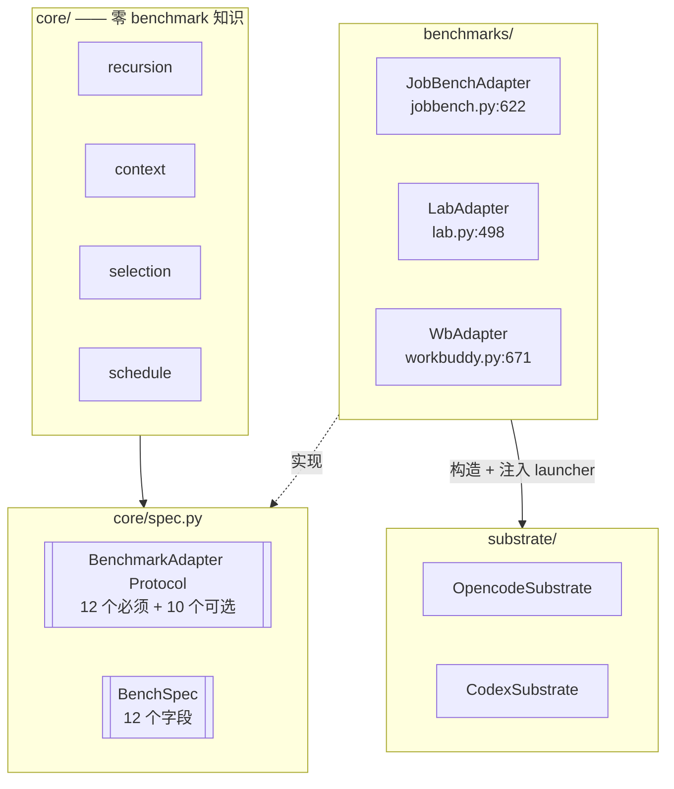
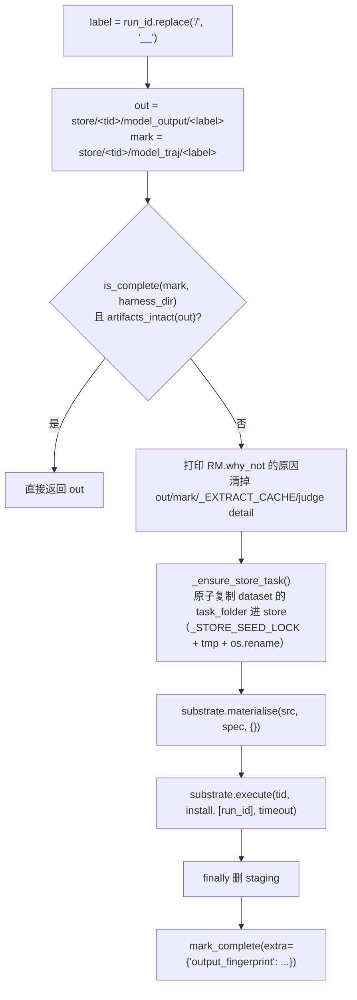
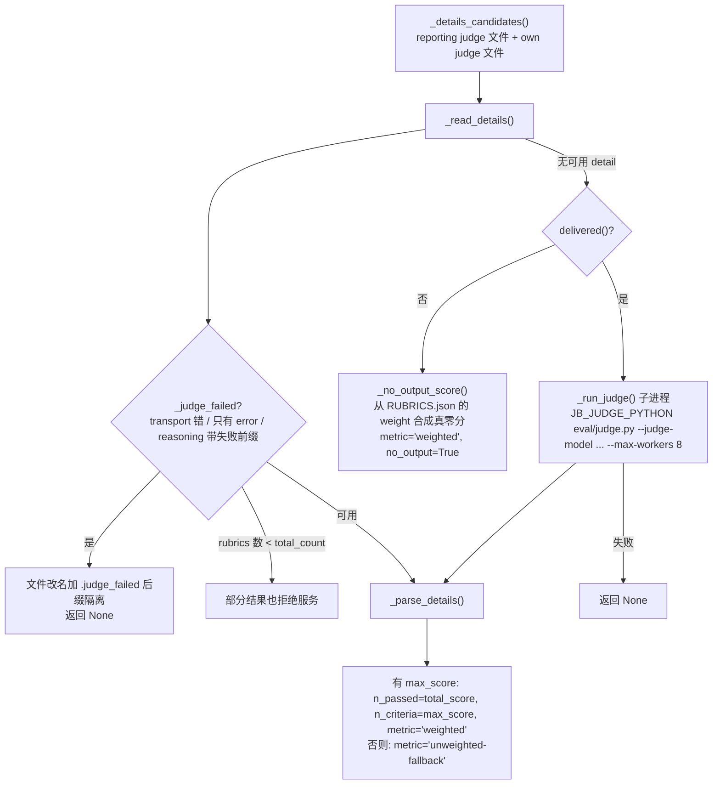
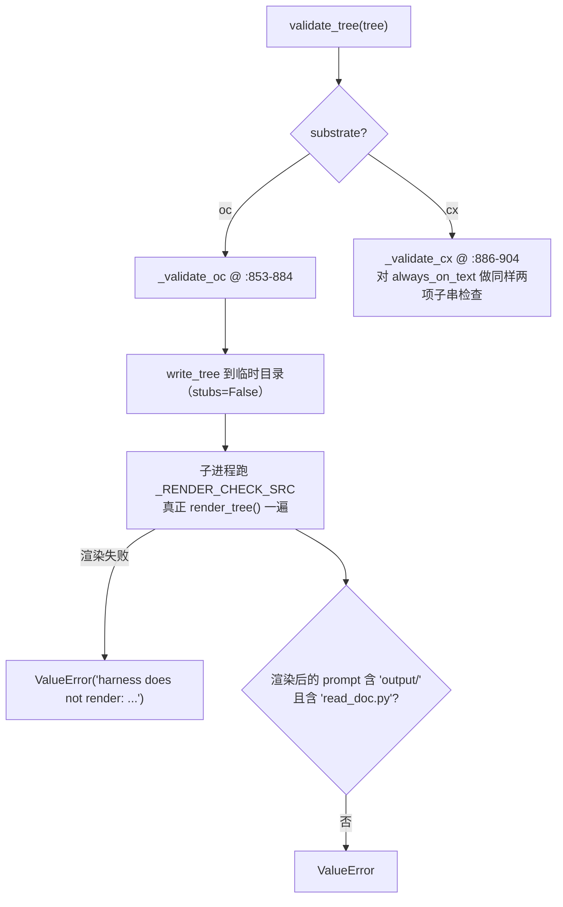
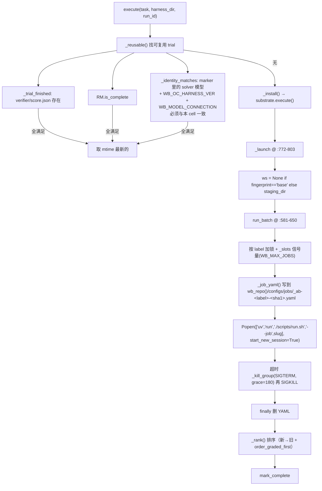
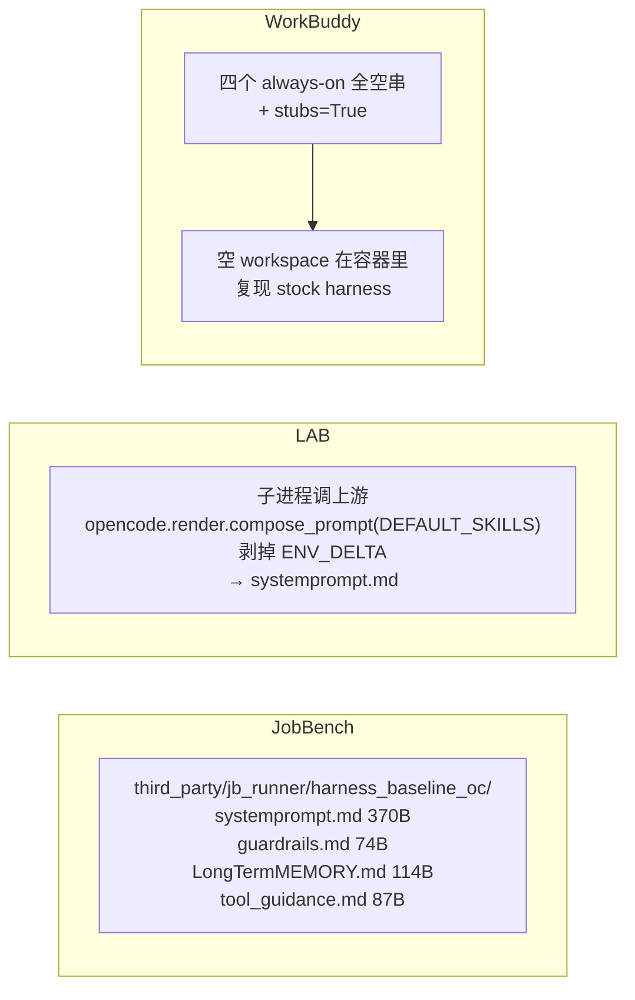
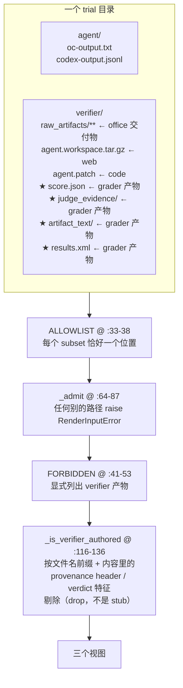

# 专题：Benchmark 适配层

> **源码核验**：`harness2` @ `1cfe254`。回主文档：[ARCHITECTURE.md](./ARCHITECTURE.md)
>
> 本文展开 `harness2/benchmarks/` 的三个 adapter。核心论点：**`BenchmarkAdapter` 这个 12 方法的 Protocol 是否真的够用**——三个形态差异极大的 benchmark 接进来，方法层没有任何一处 if。

## 目录

- [1. 接缝回顾](#1-接缝回顾)
- [2. BenchSpec 取值对照](#2-benchspec-取值对照)
- [3. 逐 adapter 实现地图](#3-逐-adapter-实现地图)
- [4. 可选扩展方法实现矩阵](#4-可选扩展方法实现矩阵)
- [5. 三个 benchmark 的形态差异](#5-三个-benchmark-的形态差异)
- [6. 开关的动机：state_deliverable / proposer_deliverables / reserved_scripts](#6-开关的动机)
- [7. third_party 的两种接入方式](#7-third_party-的两种接入方式)
- [8. tasks.py：唯一的任务发现](#8-taskspy唯一的任务发现)
- [9. wb_render.py：一个专属渲染器为什么必要](#9-wb_renderpy一个专属渲染器为什么必要)
- [10. 接一个新 benchmark 的检查清单](#10-接一个新-benchmark-的检查清单)

---

## 1. 接缝回顾



唯一的分派点是 `cli/_common.py:45` 的 `make_adapter`，三个 adapter 全部**函数内 lazy import**——单个 benchmark 没装不会拖垮其他命令。

必须实现的 12 个方法（`core/spec.py:200-250`）按职责分四组：

| 组 | 方法 |
|---|---|
| 任务发现 | `tasks(split)` / `domain_of(task_id)` / `task_prompt(task_id)` / `task_files(task_id)` |
| 执行 | `execute(task_id, harness_dir, run_id)` / `delivered(run_dir)` / `base_harness()` |
| 读回 | `trajectory(run_dir, obs_trunc)` / `deliverable_text(run_dir)` / `deliverable_files(run_dir)` |
| 约束与评分 | `validate_tree(tree)` / `score(run_dir, task_id)` |

---

## 2. BenchSpec 取值对照

| 字段 | **jb**（`make_spec` @ `jobbench.py:508-522`） | **lab**（`lab_spec` @ `lab.py:478-495`） | **wb**（`spec_for` @ `workbuddy.py:653-668`） |
|---|---|---|---|
| `name` | `"jb"` | `"lab"` | `f"wb-{subset}"` → `wb-office`/`wb-web`/`wb-code` |
| `runs_root` | `config.RUNS/"jb"` | `config.RUNS/"lab"` | `config.RUNS/"wb"/subset` |
| `install_mode` | oc→`workspace_agents_md`，cx→`codex_root` | oc→`workspace_config`，cx→`codex_root` | oc→`home_dir_jinja`，cx→`codex_root` |
| `prompts` | `jobbench_prompts()` | `LAB_BASE` | `workbuddy_prompts(subset)` |
| `domain_word` | `"profession"` | `"practice area"` | `"category"` |
| `leak_globs` | `("RUBRICS.json", "eval_result/**", "expected/**", "reference/**")` | `("task.json",)` | code: `("tests/**","solution/**","environment/**")`；web/office: `("tests/**","environment/**")` |
| `allow_subagents` | `substrate == "oc"` | 恒 `False` | `substrate == "oc"` |
| `reserved_scripts` | `frozenset()` | `_runtime_scripts()`（oc 时） | `frozenset()` |
| `proposer_deliverables` | `"contents"` | `"contents"` | **code 用 `"names"`**，其余 `"contents"` |
| `state_deliverable` | `False` | `False` | **`True`** |
| `obs_trunc` | `config.JB_OBS_TRUNC` = 50000 | `50_000` | `50_000` |

> **注意 `BenchSpec.domain_word` 与 `BenchPrompts.domain_word` 是两个不同的字段**。后者才是插进提示词的那个：jb `"occupational domain"`（`jobbench.py:102`）、lab `"practice area"`（`lab.py:56`）、wb 按 subset 取 `"role"` / `"web-work category"` / `"office-work category"`（`workbuddy.py:171,214,262`）。

`prompt_pack` / `selection_conformance` 的分布：**只有 JobBench 用 `prompt_pack="tts"` + `selection_conformance="value_only"`**（`jobbench.py:145-146`）；lab/wb 走默认 `adapt`/`full`。`selection_lead` 只有 jb（`:136`）和 wb-web（`:239`）设置。

---

## 3. 逐 adapter 实现地图

### 3.1 `JobBenchAdapter`（`jobbench.py:622-1162`）

模块 docstring（`:16-19`）点出一个特殊设计：**dataset-addressed run store**——所有 cell 共享 `runs/jb/dataset/`，run_id 退化成 label。

| 方法 | 行 | 要点 |
|---|---|---|
| `__init__` | 625-642 | 按 substrate 选 launcher；默认 timeout `oc=2400, cx=3600`（`:499`） |
| `tasks` | 644-645 | `select(discover("jb"), split, split_file, benchmark="jb")` |
| `domain_of` | 647-648 | `task_id.split("/",1)[0]` = 职业目录名（occupation） |
| `task_prompt` | 656-664 | `dataset/main/<tid>/task_folder/TASK_INSTRUCTIONS.txt` 原文 |
| `task_files` | 666-668 | `.../task_folder` 目录 |
| `execute` | 717-757 | 见下 |
| `delivered` | 775-776 | run_dir 下有任意文件即为已交付 |
| `trajectory` | 869-880 | `model_traj/<label>/*.jsonl` 中 mtime 最新的一个，`max_chars=8_000_000` |
| `deliverable_text` | 945-948 | `self._extract(d)["flat"]` |
| `base_harness` | 950-958 | `third_party/jb_runner/{harness_baseline_oc, codex_base_harness}`，先过 `HT.is_tree` |
| `validate_tree` | 960-962 | **显式 no-op** |
| `score` | 1146-1162 | 见下 |

**`execute` 的执行链路**：



注意 **runmark 落在 traj 目录，不在 out 目录**（`:680-681`）。`output_fingerprint` 仅在 `delivered()` 为真时非 None（`:759-760`）。

**两个 launcher**：

| | `_launch_opencode` @ `:786-806` | `_launch_codex` @ `:808-830` |
|---|---|---|
| runner | **包内** `benchmarks/jb_opencode_runner.py` | `third_party/jb_runner/run_benchmark_codex_cli_adapt.sh` |
| 渲染 | `render_opencode_tree()`（`:457-494`）把 c1..c8 树渲染成 `AGENTS.md` + `.opencode/skills/` + `.opencode/agent/` + `scripts/` + `.opencode/plugin/*.ts` | staging_dir 直接当 `HARNESS_RENDER_DIR` |
| 契约 | 环境变量：`TASK_IDS`/`LABEL`/`HARNESS_RENDER_DIR`/`TASKS_BASE_DIR`/`OPENCODE_DIR`/`MODEL_ID`/`TIMEOUT_PER_TASK`/`MAX_RETRIES`/... | 加 `HARNESS2_CODEX_BIN`/`BENCHMARK_MODELS`/`VERTEX_PROXY_KEY` |
| wall | `2*t + 600` | `t + 600` |

`_run_runner`（`:832-849`）用 `run_detached`（`:55-69`）起独立进程组，超时 `killpg(SIGKILL)`；**超时转成 RuntimeError 并故意不打 mark**（`:845-849`）。

`_require_artifacts`（`:851-867`）注释说了一条重要判据（`:856-859`）：**trajectory 不等于 liveness**——它区分「有 trajectory 但无交付物」与「agent 死了」。

**交付物提取**（`:882-948`）：`_extract` 在子进程里 `importlib` 加载 `jb_repo()/eval/judge.py`，调用它自己的 `convert_file_to_text` / `extract_all_file_contents` / `collect_image_paths`，解释器优先用 `JB_JUDGE_PYTHON`。如果 judge 的 extractor 缺依赖（`_extractor_lacks_deps` @ `:554-559` 检测 `[ERROR: ... not available]` 字样），退回 `_raw_extract`（`:913-934`）：纯 `read_text`，每文件 200k 截断。

**`score`**（`:1146-1162`）：



**两种 metric 是 report 混合单位告警的来源**（`core/report.py:155-164`）——weighted 和 unweighted 在 JobBench 上约差 20 个点。

### 3.2 `LabAdapter`（`lab.py:498-1002`）

| 方法 | 行 | 要点 |
|---|---|---|
| `__init__` | 506-534 | `skill_mode ∈ {native, inline}`（class docstring `:501-503` 警告切换会移动基线）；`_results_root = RUNS/lab/results/{oc,cx}` |
| `tasks` | 536-537 | `select(discover("lab"), ...)` |
| `domain_of` | 539-540 | `task_id.split("/",1)[0]` = **practice area** |
| `_task_json` | 552-557 | **唯一读 task.json 的地方**，读完立刻 `data.pop("criteria")` |
| `task_prompt` | 559-578 | 渲染无答案的 markdown，`max_chars=12_000` |
| `task_files` | 580-583 | `tasks/<tid>/documents`（data room） |
| `execute` | 588-624 | 见下 |
| `delivered` | 756-758 | `run_dir/output/**` 下有文件 |
| `trajectory` | 760-766 | `opencode_session.jsonl` / `codex_session.jsonl`，`max_chars=10**9` |
| `deliverable_files` | 768-798 | 见下 |
| `base_harness` | 820-843 | 见下 |
| `validate_tree` | 845-904 | 见下 |
| `score` | 961-1002 | 见下 |

**`_task_json` 的边界设计**（`:552-557`）：criteria 就藏在 `task.json` 里，所以这个函数读完立刻 pop 掉。配合 `leak_globs=("task.json",)`，形成双保险。

**`execute`**（`:588-624`）的一个额外检查（`:611-616`）：**强制 `out/metrics.json` 存在**。runner 在 session 流无可解析事件时拒绝写它，所以这种失败不能被缓存。之后 `_check_tool_gate`（`:906-929`）比对 `workspace/opencode.json` 的 `tools` 与 `permission` 两个 allowlist 是否一致。

**`_install`**（`:626-638`）：`harness_dir=None` 时返回 `Install(staging_dir=self.base_harness(), fingerprint="base", extras={"harness":"base"})`——**base 是一个值**，由 launcher 决定在各 substrate 上「base」是什么。

**`deliverable_files`**（`:768-798`）：子进程跑 `_EXTRACT_SRC`（`:326-361`），顶层 `from evaluation.scoring import _read_file_as_text`——**用 judge 自己的 reader**。import 失败整体非零退出让调用方 `raise`（`:330-332` 注释说明），只有单文件读失败才退回后缀白名单。

`LAB_DELIV_CAP = 60000` 的理由写在注释里（`:336-338`）：judge 读整份文件，不设 cap 会让 improver/selector 看到的与 judge 评的不一致；但完全不截断又爆上下文。

**`base_harness`**（`:820-843`）每进程每 pid 物化一次：

| substrate | 路径 | 内容 |
|---|---|---|
| oc | `runs_root/_base_harness_<skill_mode>_<pid>` | `systemprompt.md` = 子进程调上游 `opencode.render.compose_prompt(DEFAULT_SKILLS, skill_mode)` 再剥掉尾部 `ENV_DELTA`（`:432-452`），其余三个 always-on 为空串 |
| cx | `runs_root/_base_harness_cx_<pid>` | `AGENTS.md` = `CODEX_BASE_BODY` 硬编码正文（`:292-323`） |

**`validate_tree`**（`:845-904`）——LAB 是唯一有实质 benchmark 特有约束的 adapter：



理由写在错误文本里：相对写路径不会被自动路由到 `output/`（`:875-878`）；`read` 工具解析不了 docx/pdf/pptx/xlsx，会静默读出二进制噪声（`:879-882`）。

**`score`**（`:961-1002`）：没有 `scores.json` 就跑 `LAB_PYTHON -u -m evaluation.run_eval --run-id <绝对 run_dir> --task <tid> --judge-model ...`，日志重定向到 `run_dir/judge.log`。docstring（`:963-965`）特别说明传**绝对** run dir 的原因：`run_eval` 会把自己的 `RESULTS_DIR` 和它 join，绝对右操作数胜出。

### 3.3 `WbAdapter`（`workbuddy.py:671-1004`）

一个实例 = 一个 `(subset, substrate)` cell。

| 方法 | 行 | 要点 |
|---|---|---|
| `tasks` | 691-694 | `benchmark=f"wb-{subset}"`（split 文件按 subset 分开校验） |
| `domain_of` | 696-697 | **直接从 `task.toml` 的 `metadata.category`（web/office）或 `metadata.role`（code）读**，不是路径推导 |
| `task_prompt` | 705-709 | `tasks/<tid>/instruction.md` 原文 |
| `task_files` | 711-714 | 整个 task 目录，答案键靠 `leak_globs` 在复制前剥离 |
| `execute` / `execute_many` | 805-857 | 见下 |
| `delivered` | 859-861 | `RENDER.body_chars(run_dir, subset) >= 200`——**只数渲染后 artifact 正文字符，不数文件数** |
| `trajectory` | 863-872 | `agent/oc-output.txt` / `codex-output.jsonl`，`max_chars = TRAJ_MAX_CHARS = 2_000_000` |
| `deliverable_files` / `deliverable_listing` / `deliverable_text` | 874-884 | 全部委托 `wb_render` 的三个视图 |
| `deliverable_assets` | 886-890 | 仅 office：原始 xlsx/pptx 路径 |
| `base_harness` | 892-923 | **故意的空树**：oc 四个 always-on 全空串 + `stubs=True`；cx 一行通用 `AGENTS.md` |
| `validate_tree` | 925-933 | oc 才检查：`OC.assert_jinja_safe(OC.compose_prompt(staged))` |
| `score` | 986-1004 | 见下 |

**label 的强校验**（`_label` @ `:716-724`）：`run_id.replace("/","__")` + `__x{k}`（k>1 时），并**强制**校验前缀 `f"{spec.name}-{substrate}-"`，否则抛错——label 只能由 `core.schedule.ns` 构造。

**Harbor 批次执行**：



`_job_yaml`（`:493-562`）按 substrate 选 harness slug：

| substrate | slug | 关键 override |
|---|---|---|
| oc（有 ws） | `oc-harness/<ver>` | `OPENCODE_VARIANT=high`、`WB_HARNESS_WS`、`prompt_template_path`（指向 `_composed/prompt.j2`——这正是 `home_dir_jinja` install mode 的产物） |
| oc（base） | `opencode/<ver>` | 同上减去 ws |
| cx | `codex-harness/<ver>` | bind-mount `CODEX_DIST → /opt/codex`、`extra_allowed_hosts: host.docker.internal`、注入 `VERTEX_PROXY_KEY`/`CODEX_BRIDGE_URL` |

**`execute_many`**（`:826-857`）：k 个副本一个批次；**只给本次产出的 trial 打 mark**（`if not RM.read_mark(t)`）。docstring（`:834-836`）说明理由：被 kill 的批次残留不能被洗成新身份。

**`score`**（`:986-1004`）——**不起 judge 子进程**。WB 的评分由 Harbor 的 verifier 在 trial 内部完成，adapter 只读 `run_dir/verifier/score.json`。两道闸门：

1. `not delivered() and self._killed(run_dir)`（`:966-984`，倒着扫 capture stream，最后一个 JSON 行是 error 对象 → 被 provider 掐断）→ 返回 `None`，**不把 verifier 的 0 当真分**。
2. payload 缺失/不可解析/`score_from_payload` 返回 None → `None`。

`score_from_payload`（`:408-419`）复刻 bench scorer 的优先级 `reward > overall > test_pass_rate > tests_passed/tests_total`，**越界值拒绝而非 clamp**。返回 `{n_passed: round(sc*100), n_criteria: 100, all_pass: sc>=1.0, raw_score: sc}`——把 [0,1] 连续分数映射到百分比刻度，与 jb/lab 的「通过数/总数」语义不同。

---

## 4. 可选扩展方法实现矩阵

| 方法 | jb | lab | wb | core 消费点 |
|---|---|---|---|---|
| `prompts_for` | `jobbench.py:653` | `lab.py:545` | `workbuddy.py:702` | `spec.py:253` |
| `execute_many` | — | — | `workbuddy.py:826` | `schedule.py:437` |
| `reference_domain_order` | `jobbench.py:650` | `lab.py:542` | `workbuddy.py:699` | `schedule.py:171,769` |
| `artifacts_intact` | `jobbench.py:762` | `lab.py:748` | — | `schedule.py:404` |
| `deliverable_listing` | — | — | `workbuddy.py:878` | `context.py:339` |
| `deliverable_images` | `jobbench.py:941` | `lab.py:810` | — | `context.py:380` |
| `deliverable_assets` | — | — | `workbuddy.py:886`（仅 office） | `context.py:261`, `selection.py:195` |
| `deliverable_assets_note` | — | — | — | `selection.py:169`（回落 `_DEFAULT_ASSETS_NOTE`） |
| `deliverable_assets_line` | — | — | — | `selection.py:176`（回落 `_DEFAULT_ASSETS_LINE`） |
| `deliverable_assets_reference_only` | — | — | — | `selection.py:308`（`getattr(..., False)`） |
| `preflight`（非 Protocol 成员） | `jobbench.py:964` | `lab.py:931` | `workbuddy.py:934` | `preflight.py:52` |

**后三个 asset 钩子没有任何 adapter 实现**，core 全部走默认分支。它们是为将来需要定制 selector 看到的资产措辞而留的。

> `prompts_for` 的一个实际落差：JobBench 的 `prompts_for`（`:653-654`）把 `domain` 和 `profession` 两个实参传同一个值（职业目录名）。而 `JOBBENCH_DOMAINS` 的键是 SOC 组名（`"Business / Financial Ops"` 等，`:150-188`），所以 `_lookup`（`:84-91`）必然 miss 返回 `""`——**DOMAIN LENS 文本在当前数据集布局下是死路径**，实际只有 `JOBBENCH_PROFESSIONS`（`:191-363`）命中。LAB 的两层 overlay（practice area + work_type）都真实命中。

---

## 5. 三个 benchmark 的形态差异

| | JobBench | LAB | WorkBuddy |
|---|---|---|---|
| 领域 | 专业工作（职业） | 法律工作 | office / web / code |
| 数据集根 | `jb_repo()/dataset/main/<profession>/<taskN>/` | `lab_repo()/tasks/<practice-area>/<task>/` | `wb_repo()/datasets/wb-bench-<subset>-v1.0/tasks/<task>/` |
| 发现锚点 | `*/*/task_folder/TASK_INSTRUCTIONS.txt`（`tasks.py:32`） | `*/*/task.json`（`tasks.py:38`） | `*/task.toml` + 强制 `instruction.md`（`tasks.py:44-50`） |
| domain 概念 | occupation（职业目录名） | practice area | role（code）/ category（web、office），从 toml metadata 读 |
| task id 形状 | `profession/taskN`（含 `/`） | `practice-area/task`（含 `/`） | 扁平目录名 |
| 交付物载体 | `model_output/<label>/` 整个目录，任意格式（xlsx/docx/csv/py/md） | `run_dir/output/` 下 task.json 点名的精确文件名 | **三种完全不同**：office = `verifier/raw_artifacts/**`；web = `verifier/agent.workspace.tar.gz`；code = `verifier/agent.patch`（`wb_render.py:33-38`） |
| 提取路径 | judge 的 `convert_file_to_text`（子进程 `JB_JUDGE_PYTHON`） | judge 的 `evaluation.scoring._read_file_as_text`（子进程 `LAB_PYTHON`） | **自己的 `wb_render`**（正向 allowlist + verifier 产物隔离） |
| 评分形状 | weighted `total_score/max_score`（+ unweighted fallback） | `n_passed/n_criteria/all_pass` | 连续 [0,1] → ×100 |
| 评分来源 | 外部 judge CLI，adapter 主动起进程 | 外部 `evaluation.run_eval`，adapter 主动起进程 | Harbor verifier 已写好，adapter **只读** |
| 执行环境 | 本地进程 | 本地进程 | **Docker 容器（Harbor 批次）** |
| base harness | **版本控制里的实体内容**（上游 baseline 提示词） | 从上游代码现场组装 | **故意的空树** |

三种 `base_harness()` 形态值得单独说明：



WB 能用空树当 base，是因为 `OcHarnessAgent` / `CodexHarnessAgent`（overlay 进上游的 `wb_runner/agents/`）读 `WB_HARNESS_WS` 把 harness workspace 打成 tar 注入容器——**空 workspace 就等于 stock harness**。

---

## 6. 开关的动机

### 6.1 `state_deliverable=True`（仅 WB）

消费点：`core/selection.py:134-152` 和 `core/schedule.py:398-399`。

WB 的 code subset 交付物是一个 patch，web 是一个 tarball。当一个 rollout 什么文件都没产出时，候选池会空掉，selection 就无候选可比。开了这个开关后，selection 退而把**会话 transcript 自身**当候选证据，并把 `sel.evidence` 标成 `"trajectory"`；`_resume` 在采纳时也相应地读 trajectory 而非 `deliverable_text`。

jb 的 `delivered()` 是「有任意文件」、lab 是「`output/` 有文件」——这两个 benchmark 的任务定义里「没文件」就等于真失败，所以不开。

### 6.2 `proposer_deliverables="names"`（仅 WB-code）

消费点：`core/context.py:144` → `_write_rollout(..., names_only)` → `deliverable_listing`。

code subset 的交付物是针对**真实仓库**的 diff。把 diff 全文塞给 proposer 既无意义（proposer 改的是 harness，不是题解）又有泄漏答案的风险，所以只给从 `diff --git ... b/<path>` 抽出的文件名（`wb_render.py:426-436`）。

`_WITHHELD_NOTE`（`core/context.py:351-361`）解释了更具体的原因：

> on this benchmark the extracted-deliverable tree lives inside the same trial directory as the grader's own output, so serving file bodies here once served the grader's pass rate and failed-check names along with them.

### 6.3 `reserved_scripts`（仅 LAB-oc）

消费点：`core/recursion.py:126` → `tree.validate(reserved_scripts=RESERVED_SCRIPTS | spec.reserved_scripts)` → `tree._check_script_refs`（`:321-333`）。

harness 文本里引用了一个自己没 ship 的脚本本来是错误。但 LAB 的 opencode runtime 会把 `harness/skills/*/scripts/*.py`（含 `read_doc.py`）注入每个 workspace，所以这些名字要豁免。

刻意**从上游目录派生而非手写列表**（`lab.py:457-459`）：手写集合会悄悄过期，而过期只表现为大量 `fell_back`。`_require_runtime_scripts`（`:464-475`）在 preflight 阶段拒绝空集合。

### 6.4 `leak_globs` 的粒度差异

| benchmark | 挡什么 | 额外防线 |
|---|---|---|
| jb | `RUBRICS.json` + 三个评测产物目录 | — |
| lab | 仅 `task.json`（criteria 藏在里面） | `_task_json` 在读取边界就 `pop("criteria")` |
| wb | 按 subset 挡 `tests/**` / `solution/**` / `environment/**` | `wb_render.FORBIDDEN`（`:41-53`）+ `_is_verifier_authored`（`:116-136`） |

---

## 7. third_party 的两种接入方式

```
third_party/
├── jb_runner/                              ← Job-Bench/job-bench-eval 派生
│   ├── run_benchmark_codex_cli_adapt.sh    (559 行)
│   ├── harness_baseline_oc/                ★ 版本控制里的 baseline harness
│   │   ├── systemprompt.md  guardrails.md  LongTermMEMORY.md
│   │   ├── tool_descriptions/tool_guidance.md
│   │   ├── harness.yaml                    ← c1..c8 的 manifest（含 c2 不可注入的声明）
│   │   └── plugin/ scripts/ sub_agents/    (各含 README.md 占位)
│   └── codex_base_harness/AGENTS.md
├── lab_runner/                             ← harveyai/harvey-labs 派生
│   ├── opencode/{render.py, run_opencode.py, session.py, render_tree.py, scripts/read_doc.py}
│   ├── adapt_runs_cx/run_codex_lab.py
│   └── tts_lab/
├── wb_runner/                              ← Tencent/workbuddy-bench 派生
│   ├── agents/{oc_agent, oc_harness_agent, codex_agent, codex_harness_agent}.py
│   └── configs/harnesses/{opencode, oc-harness, codex-harness}/
├── patches/                                4 个 .diff
└── licenses/
```

**方式一：直接按绝对路径调用，不进上游仓库**（JobBench）

```python
# benchmarks/jobbench.py:46-52
_RUNNER_DIR = config.THIRD_PARTY / "jb_runner"
OC_RUNNER = Path(__file__).resolve().parent / "jb_opencode_runner.py"   # 包内
CX_RUNNER = _RUNNER_DIR / "run_benchmark_codex_cli_adapt.sh"
OC_BASE_HARNESS = _RUNNER_DIR / "harness_baseline_oc"
CX_BASE_HARNESS = _RUNNER_DIR / "codex_base_harness"
```

注意 **oc 侧的 runner 是 harness2 自己写的包内文件**，只有 cx 侧用 third_party 的 shell 脚本。

**方式二：overlay 复制进上游 checkout**（LAB / WB，`install.py:125-148`）

| 上游 | 源 → 目标 |
|---|---|
| `harvey-labs` | `lab_runner/opencode` → `<repo>/opencode`；`lab_runner/tts_lab` → `<repo>/external/tts_lab`；`lab_runner/adapt_runs_cx` → `<repo>/external/adapt_runs_cx` |
| `workbuddy-bench` | `wb_runner/agents` → `<repo>/src/workbuddy_bench/agents`；`wb_runner/configs/harnesses` → `<repo>/configs/harnesses` |

所以 `lab.py:641` 调的是 `config.lab_repo()/"opencode"/"run_opencode.py"`——路径在 `dependencies/harvey-labs/` 下，内容来自 overlay。`_require_runner`（`lab.py:423-429`）的错误文本直说了这件事：

> The upstream clone does not track it at the pinned commit; it ships as the tracked overlay `third_party/lab_runner/`

WB 更间接：不直接调 runner 文件，而是 `uv run ./scripts/run.sh --job <slug>`（上游自带），由 job YAML 里的 `harness:` slug 选中 overlay 进来的 agent 类（`oc-harness/_defaults.yaml` 的 `import_path: workbuddy_bench.agents.oc_harness_agent:OcHarnessAgent`）。

`install.py:37-41` 的 `RUNNERS` 只抽样三个文件做「这份拷贝有没有 third_party」的探测。

---

## 8. `tasks.py`：唯一的任务发现

> 88 行。docstring（`:15`）：不内置任何任务清单。

```python
# tasks.py:26-59
def discover(bench, subset) -> dict[task_id, domain]:
```

三个 benchmark 的目录/文件约定**硬编码在这一个函数里**。wb 分支额外解析 `task.toml` 的 `metadata.role` / `metadata.category`，空串或非字符串直接 `ValueError`，缺 `instruction.md` 直接 `FileNotFoundError`（`:44-51`）。空结果统一抛出带 `harness2-setup <bench>` 修复指令的错误（`:54-58`）。

**三个 adapter 的 `tasks()` / `domain_of()` / `reference_domain_order()` 全部建在这一个函数上**——所以 domain 的权威定义只有一处。

```python
# tasks.py:62-88
def select(tasks, split, path, benchmark) -> list[str]:
```

| 校验 | 行 |
|---|---|
| `split ∈ {all, train, test}` | `:65` |
| 无 split 文件时只允许 `all`（并提示 `scripts/split_tasks.py`） | `:66-70` |
| split 文件必须自述 `benchmark` 字段匹配 | `:73-74` |
| train/test 必须是字符串列表 | `:76-80` |
| 不得内部重复、不得互相重叠 | `:81-84` |
| 不得包含数据集里不存在的 id | `:85-87` |

返回总是 `sorted(...)`——Protocol 侧的要求「stable order, library state must be reproducible」（`core/spec.py:208`）就落在这里。

---

## 9. `wb_render.py`：一个专属渲染器为什么必要

> 577 行。`workbuddy.py` 的模块 docstring（`:18-19`）：*Everything a model sees of a deliverable comes through `wb_render`.*

WB 需要自己的渲染器，是因为它的 trial 目录结构带来一个其他 benchmark 没有的问题：**Harbor 的 verifier 把 judge evidence 写进同一个 trial 目录**。



**正向 allowlist 而非黑名单**：`_admit`（`:64-87`）对不在 allowlist 里的路径直接抛 `RenderInputError`。`FORBIDDEN` 是额外的显式列表，`_is_verifier_authored` 是第三层（按内容特征）。`render_report`（`:350-363`）额外返回 quarantine log。

三个视图：

| 视图 | 函数 | 消费方 |
|---|---|---|
| contents | `render` / `flat_text` @ `:344-378` | selector（`deliverable_text`） |
| names | `listing` @ `:422-457` | proposer（`deliverable_listing`，仅 code subset） |
| 字符数 | `body_chars` @ `:381-388` | `delivered()` 的判据——**刻意排除 `flat_text` 的 "## Files produced" 索引** |

二进制渲染（`_xlsx_text` @ `:181-206`、`_pptx_text` @ `:224-240`）：本地缺 openpyxl/python-pptx 时经 `_bridge`（`:316-341`）走 `config.WB_RENDER_PY` 子进程。**拒绝降级成 stub**，错误文本（`:319-326`）说明理由：一个渲染不出来的 workbook 与「什么都没产出」不可区分，会静默清空整个 office subset 的证据。

这与 LAB 的 `deliverable_files` 失败就 `raise` 是同一条原则——见主文档 [§15.1](./ARCHITECTURE.md#151-关键设计模式) 的「拒绝静默降级」。

---

## 10. 接一个新 benchmark 的检查清单

按依赖顺序：

**第一步：任务发现**

- [ ] 在 `tasks.py:discover` 里加一个分支：目录约定 + domain 的来源（路径段还是元数据文件）。
- [ ] 确认 `select()` 返回 `sorted()`——library 状态的可复现性依赖它。
- [ ] 决定 `domain_of` 的分组单元是什么（practice area / occupation / role / sector）。它决定了 library 的隔离粒度。

**第二步：BenchSpec**

- [ ] `leak_globs`：列出所有答案键路径。**在写任何执行代码之前先定这个**。
- [ ] `install_mode`：从 4 个里选，要与你的 substrate 匹配。
- [ ] `BenchPrompts`：至少填 `work`。注意 6 个字段会被构造期反作弊扫描（不能含 benchmark/evaluation/grader/rubric/score）。
- [ ] `obs_trunc >= 10_000`。
- [ ] `allow_subagents` / `reserved_scripts` 按 runtime 实际情况。

**第三步：执行与读回**

- [ ] `base_harness()`：三种形态里选一种（tracked 实体 / 现场组装 / 空树）。必须过 `HT.is_tree`。
- [ ] `execute()`：**必须按 run_id 幂等**。用 `runmark.is_complete` + `mark_complete`，并考虑实现 `artifacts_intact`。
- [ ] **超时不要打 marker**。
- [ ] `trajectory()`：渲染成统一语法。`obs_trunc` 作用于单条 observation，整条不截断。
- [ ] `deliverable_text()` / `deliverable_files()`：**优先用 judge 自己的 reader**，这样 improver 看到的与 judge 评的一致。
- [ ] `delivered()`：想清楚「没产出」在你的 benchmark 里是真失败还是正常情况。后者要开 `state_deliverable`。

**第四步：约束与评分**

- [ ] `validate_tree()`：benchmark 特有的环境不变量。**错误消息会被原文回灌给模型**，所以要写成可操作的指令，并解释为什么。no-op 也是合法选项（JobBench 就是）。
- [ ] `score()`：失败返回 `None` 而不是 0。区分「judge 挂了」和「真的是 0 分」。给 `raw` 里带 `metric` 字段，让 report 能检测混合单位。

**第五步：接线**

- [ ] `cli/_common.py:make_adapter` 加分派（lazy import）。
- [ ] `cli/_common.py:BENCHES` 加名字。
- [ ] `preflight.py:check` 加 benchmark 专属检查。
- [ ] `install.py` 加 clone/patch/overlay（如果有上游仓库）。
- [ ] `config.py` 加 pin 和 origin。

**验证**

- [ ] `harness2-check --bench <new>` 全绿。
- [ ] `harness2 --bench <new> --k 1 --dry-run` 打出预期的任务流。
- [ ] `harness2 --bench <new> --k 1 --max-tasks 1`——检查 `summary.json` 里 `ledger.R == 4` 且 `ledger.P == 3`。
- [ ] 检查 `context/` 目录树：证据是否完整、有没有泄漏（跳闸器会帮你，但它响了说明读取路径有问题）。
