# Hermes Agent 设计说明（人话 + 图）

> **怎么读**：先看本文件。每个模块都有 **架构图 / 类图 / 时序图**，用白话说明「谁干什么」。  
> **源码**：`hermes-dev/hermes-agent/`  
> **原文深潜**（表格、长代码、历史考古，图都还在）：[`archive/legacy/`](archive/legacy/)  
> **分卷深潜** [`volumes/`](volumes/MANIFEST.md)：每卷按 [`VOLUME_STANDARD.md`](volumes/VOLUME_STANDARD.md) 写（**范本**：[卷二 Surface](volumes/02-surface-and-presentation.md)）。`archive/legacy/` 为考古，与卷冲突时以卷 + 源码为准。

---

## 📋 目录

**全书章序**（与 [volumes/MANIFEST.md — 📋 总目录](volumes/MANIFEST.md#-总目录全书) 同步；分卷深潜点章节内锚点）：

- [第1章：项目概览与 Hermes 整体架构](volumes/01-platform-and-architecture.md#sec-ch1)（**模块地图 + 三张整体图**）
- [第2章：Surface 呈现与 callback](volumes/02-surface-and-presentation.md#本卷目录)
- [第3章：运行时与会话循环](volumes/03-runtime-session-and-loop.md#本卷目录)
- [第4章：Tool / Skills / MCP](volumes/05-capabilities-extensions.md#本卷目录)
- [第5章：端到端流程（完整）](#21-端到端流程图)
- [第6章：Prompt / Memory 与 Message](volumes/04-prompt-and-context.md#本卷目录)
- [第7章：多 Agent、Kanban 与 MoA](volumes/07-multi-agent-and-kanban.md#本卷目录)
- [第8章：Gateway、安全与 Plan](volumes/06-gateways-channels-and-hitl.md#sec-g1)
- [附录：索引与对照](volumes/09-reference-history-and-versions.md#本卷目录)

**本页速览**（入门读这里，再进上表各章）：

1. [一句话](#1-一句话)
2. [开篇三张图](#2-开篇三张图)
3. [内核时序（不是端到端）](#3-内核时序不是端到端)
4. [Surface：人在哪看](#4-surface人在哪看) → 第2章
5. [Gateway：IM 怎么收发](#5-gatewayim-怎么收发) → 第8章
6. [Memory：记什么、何时读写](#6-memory记什么何时读写) → 第6章
7. [工具、Skills、MCP](#7-工具skillsmcp) → 第4章
8. [多 Agent 与 Kanban](#8-多-agent-与-kanban) → 第7章
9. [安全和后台审查](#9-安全和后台审查) → 第8章
10. [2026 新模块](#10-2026-新模块旧文档没有)
11. [和 AgentScope 对照](#11-和-agentscope-对照)
12. [分卷 MANIFEST](#12-还要看哪篇原文)

---

## 1. 一句话

**Hermes 是一个「一个内核、很多入口」的自改进 Agent。**

内核只有一套：`AIAgent` 经 **`turn_facade`** 准入一轮对话（**`DurableTurnLease`**），再交给 `conversation_loop`；循环里调模型、跑工具、写会话库。一轮内部又拆成很多 `agent/turn_*.py`（压缩、工具轮、恢复、收尾），不再堆在一个超大文件里。展开见 [卷三 · 运行时](volumes/03-runtime-session-and-loop.md)（第2–3章循环；**[第4章压缩](volumes/03-runtime-session-and-loop.md#sec-ch4)**；**[第6章 Session/Memory/HITL](volumes/03-runtime-session-and-loop.md#sec-ch6)**）。  
CLI、TUI、Desktop、网页、飞书/Telegram 等 **都不自己跑 ReAct**，只负责把话送进来、把进度和回复画出去。

---

## 2. 开篇三张图 {#2-开篇三张图}

先看完这三张，再往下翻各模块。三张图回答的问题不一样：

| 图 | 回答 |
|----|------|
| **端到端流程图** | 一句话从用户进来，到回复回到同一侧，经过哪些调用 |
| **整体架构图** | 这些调用落在哪一层、哪个目录 |
| **整体类图** | 类之间谁持有谁、谁调用谁的方法 |

### 2.1 端到端流程图

两条入口在 `AIAgent.run_conversation` 汇合，出来再按入口分叉。这是端到端，不是内核循环内部的时序。

**忙时用户又发一条**（queue / steer / 打断）发生在 **汇合之前** 或 **同一轮内的 `steer()`**，不会画进下图的 `LOOP` 方框；见 [卷一 §2.3](volumes/01-platform-and-architecture.md#sec-2-3)、[卷二 §3.0](volumes/02-surface-and-presentation.md#30-忙时再点发送用户话排队不是-messagedelta-的-queuedelta)、[卷三 §1.6](volumes/03-runtime-session-and-loop.md#06-用户消息队列-不在-本卷-while-里为何端到端图看不见)。

> **三张整体图（端到端 / 四层架构 / 类图）的权威正文**在 [卷一 第1章](volumes/01-platform-and-architecture.md#sec-ch1)。下文 §2 为速览副本，与卷一同步维护。

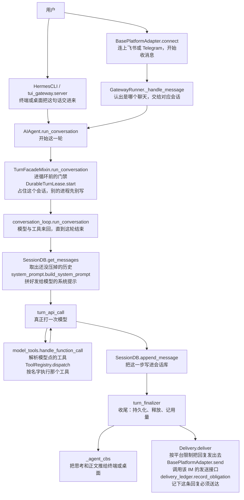

定时任务走另一条进同一内核：`cron.scheduler_tick.tick` → `cron.scheduler.run_job` → `AIAgent.run_conversation`，结果进 `cron.delivery_queue`，不经过 `GatewayRunner._handle_message`。看板上的任务也是一条入口，但是先由网关里的调度器拉起一个 CLI 子进程，再进同一个 `run_conversation`，见 [2.2](#22-整体架构图)。

### 2.2 整体架构图

同一条链路按层切开：人在哪说话、谁接入、谁跑循环、存在哪。

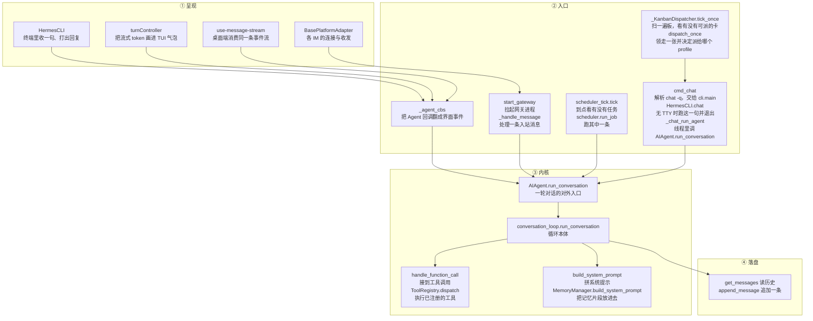

看板和 cron、IM 不是同一种进法。`_KanbanDispatcher` 挂在网关进程里，`tick_once` 对每块板调 `dispatch_once`：领到一张可派的卡之后，`_default_spawn` 拉起子进程

`hermes -p <profile> --cli chat -q "work kanban task <id>"`

`--cli` 强制走经典 CLI，不进 Ink TUI。环境变量 `HERMES_SESSION_SOURCE=kanban`、`HERMES_KANBAN_TASK` 由调度器写上。子进程里的调用是：

1. `hermes_cli.main.cmd_chat` 解析 `chat -q`，把这句话放进 `query`。
2. `cli.main` 用 `_build_cli_from_args` 建一个 `HermesCLI`，再交给 `_run_single_query_mode`。
3. worker 没有 TTY，所以不会把这句话种进交互会话。`-q` 也不是 `-Q`（安静模式）。安静模式才会直接 `cli.agent.run_conversation`（`_run_quiet_single_query`）。看板走的是下面这条，好让任务日志里看得到工具过程。
4. `_run_single_query_mode` 调 `HermesCLI.chat`（`CLIChatTurnMixin`）。`chat` 先 `_init_agent` 建好 `AIAgent`，再开线程跑 `_chat_run_agent`。
5. `_chat_run_agent` 调 `self.agent.run_conversation`。从这里起和终端里打一句话是同一个入口。

这条链路不进 `GatewayRunner._handle_message`，也不占用网关正在听 IM 的那条连接。人在看板上看到的是任务状态，不是这条会话的聊天气泡。

| 层 | 人话 | 代码 |
|----|------|------|
| 呈现 | 把字和思考过程画出来 | `cli.py`、`ui-tui/`、`apps/desktop/`、`tui_gateway/` |
| 入口 | 把一句话送进内核，再把回复送回去。看板是第四条：调度器不自己跑循环，只拉起 worker | `gateway/run.py`、`gateway/platforms/`、`cron/`、`gateway/kanban_watchers_dispatcher.py`、`hermes_cli/kanban_db_dispatch.py` |
| 内核 | 拼提示、问模型、跑工具，直到这轮结束 | `run_agent.py` 是壳；循环在 `agent/conversation_loop.py` |
| 落盘 | 消息和检索 | `hermes_state.py`、`hermes_state_messages.py` |

### 2.3 整体类图

图中心是 **`AIAgent` 这个对象**。它身上挂着这一聊的模型、工具、`session_id` 和回调。`run_conversation` 不是它自己写的方法，而是从 `TurnFacadeMixin` **继承**来的。`conversation_loop` 不是类，是模块里的函数，由 Mixin **调用**，并把这个 `AIAgent` 实例当第一个参数传进去。

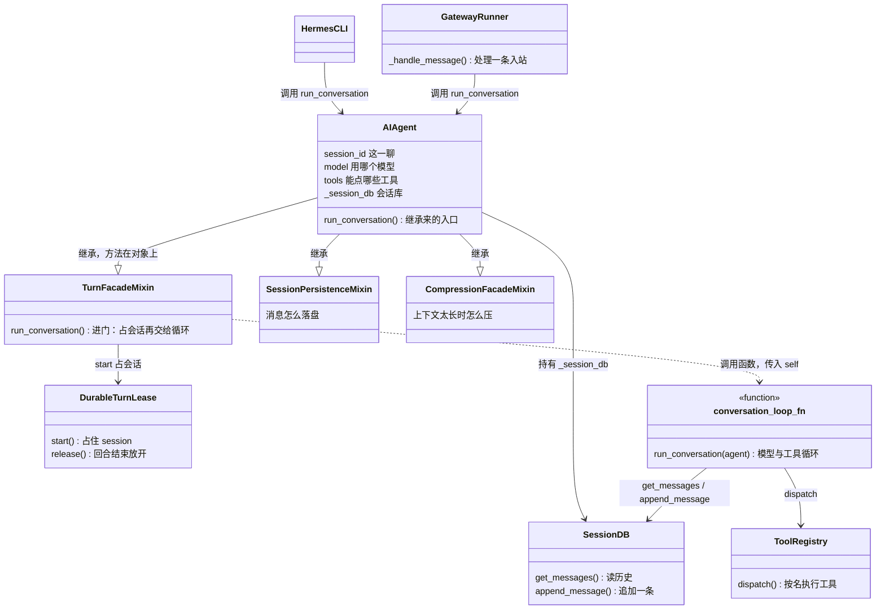

直接拿到一个 `AIAgent` 再调 `run_conversation` 的类，仍是终端侧的 `HermesCLI` / `tui_gateway`，以及 IM 侧的 `GatewayRunner._handle_message`。看板 worker 不是第三种类：`_default_spawn` 拉起的就是 `HermesCLI`，由 `HermesCLI.chat` → `_chat_run_agent` 进入 `run_conversation`。工具不直接被循环点名，先过 `model_tools.handle_function_call`，再 `ToolRegistry.dispatch`。

### 2.4 为什么 `run_conversation` 有两层

对外只有一个入口：`agent.run_conversation(...)`。对内拆成「能不能开这轮」和「这轮怎么跑」。同名是故意的，调用方不用知道后面还有一个函数。

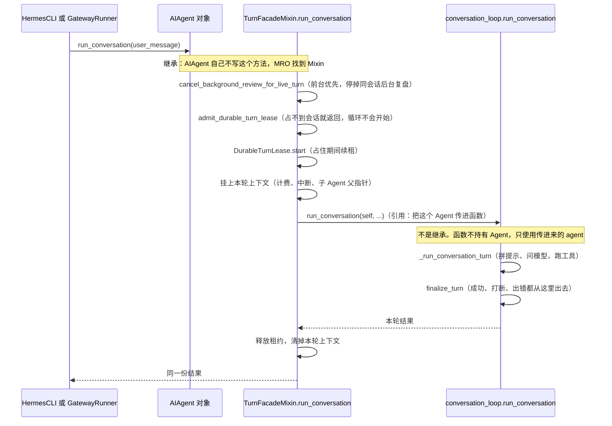

| | 关系 | 作用 | 为什么要这一层 |
|--|------|------|----------------|
| **`AIAgent`** | 实体。一串 Mixin 拼出来的类 | 装着这一聊的状态：模型、工具、会话、回调 | 所有入口共用一个对象，行为才一致 |
| **`TurnFacadeMixin`** | **继承**。`class AIAgent(..., TurnFacadeMixin, ...)` | `run_conversation` 负责进门：停后台复盘、抢 `DurableTurnLease`、设本轮上下文，然后调用下一层 | 这些事包住整个循环，包括提前返回。写在循环里面，抢不到锁时循环已经开始了 |
| **`conversation_loop.run_conversation`** | **引用**。Mixin 里 `from agent.conversation_loop import run_conversation`，再 `run_conversation(self, ...)` | 干活：`_run_conversation_turn` 做模型与工具来回，任何出口都经 `finalize_turn` | 循环太长，不再做成 `AIAgent` 的一个方法。函数第一参数就是那个 Agent，读的仍是对象上的状态 |

Mixin 在这里的意思：一块只通过 `self` 工作的行为，混进 `AIAgent`，不单独 new 一个门面对象。会话落盘是 `SessionPersistenceMixin`，压缩入口是 `CompressionFacadeMixin`，进门是 `TurnFacadeMixin`。调用方看到的仍是一个 `AIAgent`。

这样拆，是因为以前整轮对话都堆在 `run_agent.py` 里。拆开之后：类文件保持「这个对象是什么」，循环文件保持「一轮怎么跑」，进门逻辑保持「什么情况下根本不该跑」。

---

## 3. 内核时序（不是端到端） {#3-内核时序不是端到端}

上一节的流程图已经把「从用户到回复」走完。下面这张 **只放大内核**：`run_conversation` 进去之后，模型与工具怎么来回。它不是端到端，出站的 `Delivery.deliver` / 界面刷新不在这张图里。

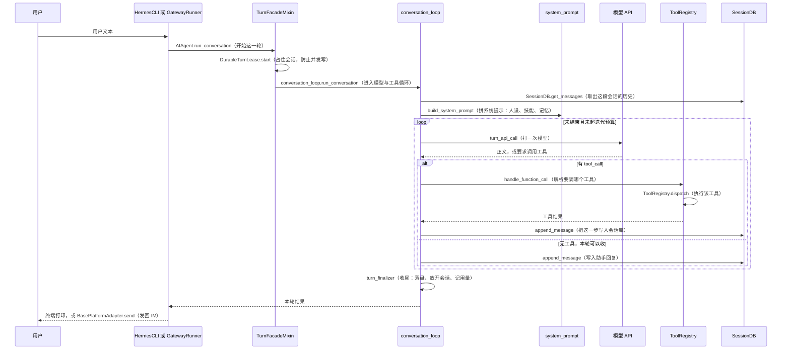

**更细的一轮 + hook 点位**（租约、`build_turn_context`、`pre_llm_call` / `pre_api_request` / 工具前后 hook、与呈现 callback 分工）：[卷三第2–3章](volumes/03-runtime-session-and-loop.md#sec-ch2)。**压缩、Session 行、Memory、HITL**：[卷三第4章与第6章](volumes/03-runtime-session-and-loop.md#sec-ch4)。**含 UI 的端到端**（`message.delta` 等）：[卷二 §3.4](volumes/02-surface-and-presentation.md#34-端到端时序platform-callback-与-plugin-hook-同图)。

人话版步骤：

1. **先拼上下文**：系统提示（人设、技能索引、记忆片段）+ 这段会话里还没压掉的消息。太长就先压缩，避免把窗口撑爆。  
2. **问模型**：模型要么直接说话，要么点名要跑哪个工具。  
3. **跑工具**：终端、读文件、搜网、委派子 Agent 等都在这里。危险操作可以卡住等人点批准（HITL）。  
4. **把工具结果塞回对话**，再问模型，直到它不再要工具，或迭代次数用完。  
5. **收尾**：消息进 SQLite；该同步到外部记忆的再异步写；Surface 上把「思考过程」和正文画出来。

待办板（`TodoStore`）是 **这一轮 Agent 自己的小清单**，不是另一套「先出计划再执行」的独立引擎。模型用 `todo` 工具自己记步骤。

---

## 4. Surface：人在哪看

终端和 TUI/Desktop 不是同一条回调。终端在本进程里 `HermesCLI.chat` → `_chat_run_agent` → `run_conversation(stream_callback=...)`，等待/推理/正文分别走 `thinking_callback` / `reasoning_callback` / `stream_delta_callback`（无 JSON-RPC event 帧）。TUI 和 Desktop 把 `prompt.submit` 交给 **呈现网关**（`tui_gateway`）的 `_run_prompt_submit`：构造时 `**_agent_cbs(sid)` 展开 platform callback（清单见卷二 §5.2、§5.4.1），正文走每轮 `_invoke_agent` 的 `stream_callback`（`_stream` → `message.delta`）。客户端经 **stdio 或 WebSocket** 收同一套 `method: "event"`；TUI 用 `createGatewayEventHandler`，Desktop 用 `handleMessageStreamEvent`。

要点索引（展开、时序图、对照表均在 [卷二 · 多 Surface](volumes/02-surface-and-presentation.md)）：

- **§2.1** — `_run_prompt_submit`、`_chat_run_agent`、`createGatewayEventHandler` 各管哪一段。
- **§3.4** — 端到端时序图（注册 + 一轮）：Platform callback 与 plugin hook 同屏、工具阻塞 RPC 放大图、时间点清单表。
- **§2.2** — `sid`（UI 窗口）、`session_key`（库里的 stored id）、`AIAgent.session_id`（记忆/压缩）不要混用。
- **§0.1** — Hermes 指什么、架构 A/B、网关进程定义、子命令对应几个 OS 进程；**§0.3–0.4** — `AIAgent` 实例寿命与「注册一次」。
- **§5.0–5.3** — `_agent_cbs` 是什么、注册/回调微观路径（含 `_emit_reasoning_delta` 等网关卡，非裸 `_emit`）。
- **§5.2** — `_agent_cbs(sid)` 返回的 **每个键** 与 wire/RPC（权威表）。
- **§5.4.1** — `AIAgent._CALLBACK_PARAMS` **全集** + 呈现网关 / CLI / IM 谁接线。
- **§5.5–5.7** — 每轮 `stream_callback`；callback vs plugin hook 为何两套、能否用 built-in hook 统一、与 AgentScope 式 middleware 的对照（§5.7）。

---

## 5. Gateway：IM 怎么收发

IM **不会**自己去 `import` Gateway。启动时 Gateway 把「有消息就叫我」交给各个平台适配器；适配器收到 Telegram/飞书等推送后再 **回调回来**。

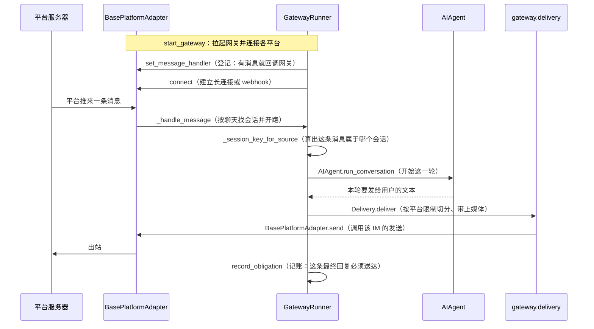

和 AgentScope 的差别（避免混文档）：

| | Hermes | AgentScope |
|--|--------|------------|
| 长连接谁持有 | **跑 Gateway 的那个进程**里的适配器 | 可以拆到独立 channel worker |
| 回复怎么回去 | 同进程 `delivery` / `delivery_ledger` | `session_events` 总线 + 跑 Agent 的节点 REST |
| 会话正忙再来一条 | Gateway 自己的会话与队列策略 | 忙则 inbox，空闲才 wakeup |

出站要保证「该发的最终回复别丢」，所以有 **投递账本** `delivery_ledger`，不是发完就忘。

---

## 6. Memory：记什么、何时读写

> **系统提示三段、缓存、`api_content` 侧车、插件 section**：展开见 [卷四 · Prompt 与上下文](volumes/04-prompt-and-context.md)（§0 澄清、§4 权威表）。下面表仍保留「记忆四轨」总览。

这里有四样东西，名字都像「记忆」，落点和时机不一样。先对上号再看图。

| 叫什么 | 存在哪 | 里面是什么 | 这一轮怎么读到 | 什么时候写 | 写完这一轮的系统提示会变吗 |
|--------|--------|------------|----------------|------------|----------------------------|
| 会话原文 | `SessionDB` 里这条会话的消息 | 你说的、模型回的、工具结果 | 每轮开头把还在的消息拼进发给模型的 `messages` | 循环里 `append_message`，当场落库 | 不会进系统提示。下一轮作为历史消息读到 |
| 内置记忆 | `$HERMES_HOME/memories/MEMORY.md` 和 `USER.md` | `MEMORY`：环境里的稳定事实。`USER`：这个人是谁。条目用 `§` 隔开，默认大约 2200 / 1375 字 | 会话开始 `MemoryStore.load_from_disk` 拍一张快照。`format_for_system_prompt` **只返回这张快照**，放进系统提示的 volatile 段 | 模型调用 `memory` 工具：`add` / `replace` / `remove`，立刻写盘 | **本会话不变。** 中途改文件，前缀缓存还是旧快照。只有上下文压缩走 `invalidate_system_prompt` 时才重新 `load_from_disk` |
| 外部记忆 | 配置 `memory.provider`，**最多一个**（mem0、Honcho 等） | 那个后端自己的库 | 进工具循环前 `prefetch_all`。搜到的文字贴在**这一轮用户消息的 `api_content`** 上，不写进系统提示，也不改会话库里的原文 | 这一轮正常结束：`_sync_external_memory_for_turn` → `sync_all`。中途打断的回合不写 | 系统提示不变。下一轮 `prefetch` 才可能搜到刚同步的内容 |
| 旧对话检索 | 同一份 `SessionDB` 的全文索引 | 以前各次会话的原文。看板、子 Agent、tool 来源默认不进搜索；cron 能搜到但排序靠后 | **模型自己调用** `session_search` 才查。不是每轮自动塞进提示 | 不另写一份。会话落盘时索引就有了 | 查到的结果作为工具返回，回到这一轮 |

内置两份文件和外部后端是并排的，不是「六选一」。外部没配时，`MemoryManager` 就是空的，只剩 `MEMORY.md` / `USER.md`。

### 6.1 一轮里按时间发生的事

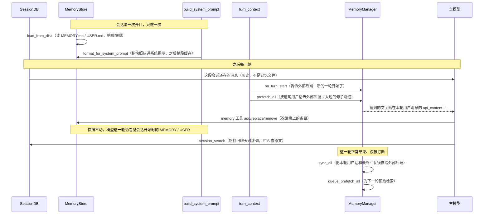

压缩是唯一会换系统提示的正常时机：先 `MemoryManager.on_pre_compress` 让外部后端有机会抽出要点，再 `invalidate_system_prompt` → `MemoryStore.load_from_disk`，新快照才进下一次 `build_system_prompt`。

### 6.2 谁在写 MEMORY.md / USER.md

三条路，都进同一对文件：

1. **对话中模型自己调 `memory` 工具。** 可能要过人审（`write_approval`）。通过才 `MemoryStore.add` / `replace` / `remove`。
2. **后台审查。** 默认每 10 个带记忆工具的用户回合（`nudge_interval`），`_tick_memory_nudge` 为真，回合结束后另起一个 Agent，只复盘记忆和技能。它也可以调 `memory`。无人值守时 `add` 可以直接写；`replace` / `remove` 先暂存，等人批，避免后台把条目改丢。
3. **你自己改文件，或 `/memory`。** 磁盘会变。正在进行的会话仍用旧快照，要等压缩或新会话才读到新内容。

`USER.md` 记的是人（称呼、偏好）。`MEMORY.md` 记的是环境事实。后台审查的提示里把这两条分开，避免把「用户喜欢什么」写进环境笔记。

### 6.3 和会话原文的边界

`SessionDB` 是这段聊天的逐字稿，每轮都完整带上（太长才压缩成摘要）。`MEMORY.md` 是从很多轮里挑出来、希望以后每次开口都看见的短条目。`session_search` 是在逐字稿里回头找，找到再当工具结果用，不会自动变成系统提示。

---

## 7. 工具、Skills、MCP

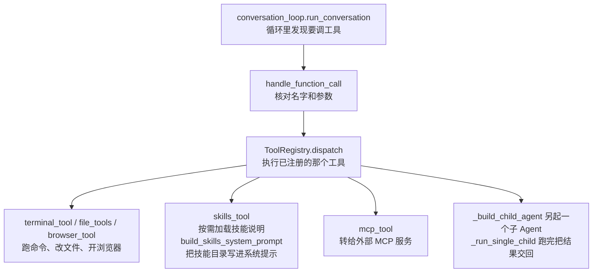

| 东西 | 人话 |
|------|------|
| **工具** | 模型能点的按钮：跑命令、改文件、搜网… 注册表扫描 `tools/` 自动挂上 |
| **Skill** | 一份「遇到这类事按这个步骤做」的说明（兼容 agentskills.io）。不是第二个 Agent 进程，是 **提示 + 可选脚本** |
| **MCP** | 别人写的工具服务，Hermes 当客户端连上去，工具列表并进同一次模型调用 |
| **插件** | 换记忆后端、换压缩引擎、加钩子；钩子可以改本轮发给模型的额外说明 |

子 Agent（`delegate`）是 **再起一个 AIAgent**，有自己的会话状态，干完把结果交回父对话。父对话的记忆管理器默认 **不** 整包继承给孩子。

---

## 8. 多 Agent 与 Kanban

两条线，不要当成一个东西：

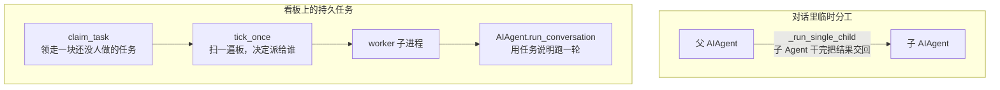

| | 对话里 delegate | Kanban |
|--|-----------------|--------|
| 活多久 | 这一轮或异步子任务 | 任务存在数据库里，可跨天 |
| 谁调度 | 父模型决定叫谁 | Dispatcher 按状态把任务派给 worker |
| 人怎么看 | 聊天里的进度；新版本可看子 Agent 实况 | 看板 / REST / `hermes kanban` |

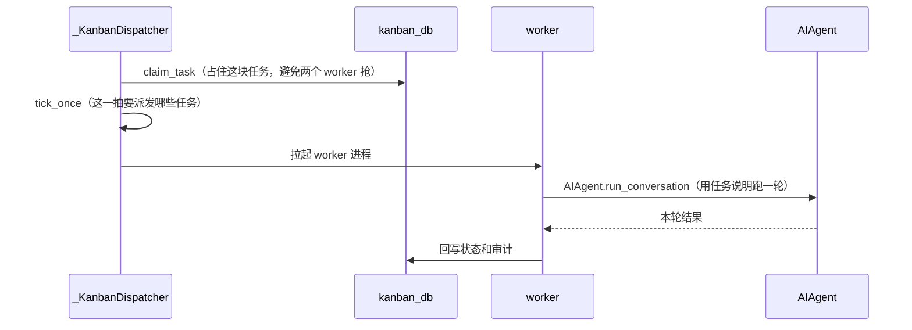

---

## 9. 安全和后台审查

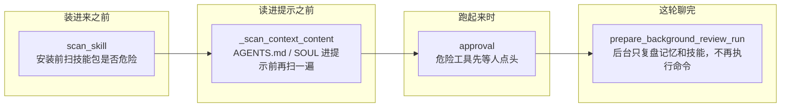

后台审查 **不是** 把你的整段操作再跑一遍。条件够了才在后台再开一个 Agent，工具面收得很窄，避免它一边「复盘」一边又去执行命令。

---

## 10. 2026 新模块（旧文档没有）

旧中文文档停在 **0.19 / 2026-07** 前后，把主循环写成「一个 `conversation_loop.py` 包办一切」。当前仓库（`__release_date__` 2026.9.24，且 `agent/` 已有 **280+** 文件）把能力拆到边上。下面这些是旧文里没有或只剩一行的模块。

### 10.1 一轮对话被拆成流水线

人话：进门、干活、收尾分开。进门要占住这个会话（别两个进程同时写同一聊）；干活仍是 `conversation_loop`；干活内部的压缩、拼请求、跑工具、出错重试、写用量，各是一个 `turn_*.py`。

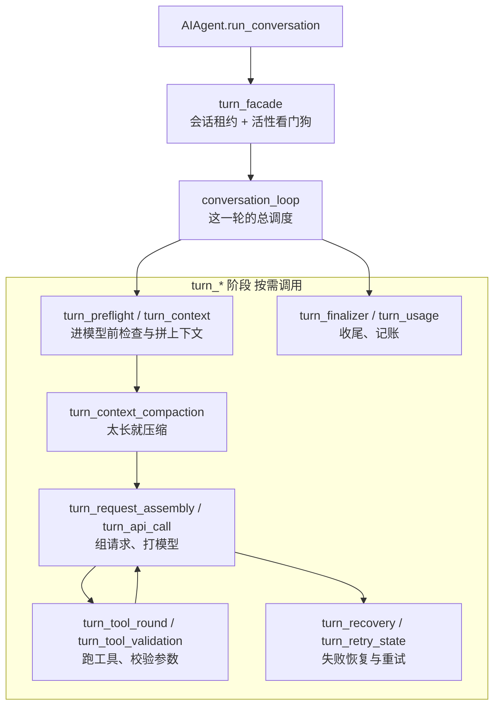

| 文件族 | 干什么 |
|--------|--------|
| `agent/turn_facade.py` + `turn_facade_lease.py` | 跨进程 **会话租约**：同一 `session` 不能两轮同时写；看门狗防止卡死 |
| `agent/conversation_loop.py` | 仍是一轮的总循环（模型 ↔ 工具） |
| `agent/turn_*.py`（30+） | 从循环里拆出的步骤，避免再涨成单文件上万行 |
| `agent/conversation_compression*.py` + `context_compressor*.py` | 压缩单独成族：预检、摘要、Codex 专用、遥测 |

设计上有一条硬规矩（仓库 `AGENTS.md`）：**一段对话的提示前缀尽量别改**，否则模型缓存失效、费用翻倍。中途改人设、改工具集，默认留到 **下一会话**；唯一常态例外是 **上下文压缩**。

### 10.2 包管理 `pm/`（不再手 pip）

人话：Hermes 自己的 Python 环境、锁文件、修坏掉的依赖，都走 `hermes pm`，不要对 Hermes 的 venv 直接 `pip install`。

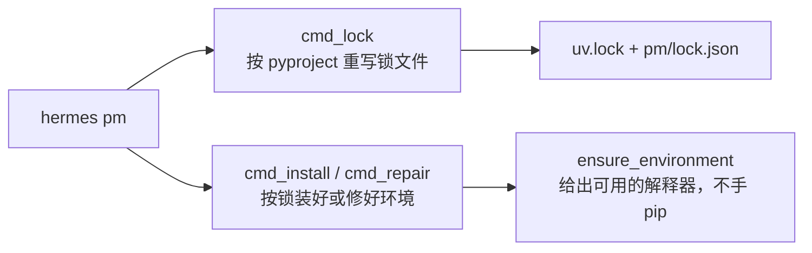

| 命令方向 | 作用 |
|----------|------|
| `lock` | 按 `pyproject.toml` 重锁依赖（依赖带上界，防供应链） |
| `install` / `repair` | 按锁文件装好或修好环境 |
| `doctor` / `gc` | 检查、清理 |

插件自己的 Python 依赖可以有自己的策略；**Hermes 核心依赖**还有约 14 天的「新包隔离窗口」。

### 10.3 本机事实 `hermes_platform/`

人话：问「这台机器是什么系统、什么 CPU、在不在 WSL/Termux」只走这里。这里 **只查询、不安装、不下载**。桌面客户端在另一台电脑、SSH 终端在远端，都 **不是** 这里要回答的对象。

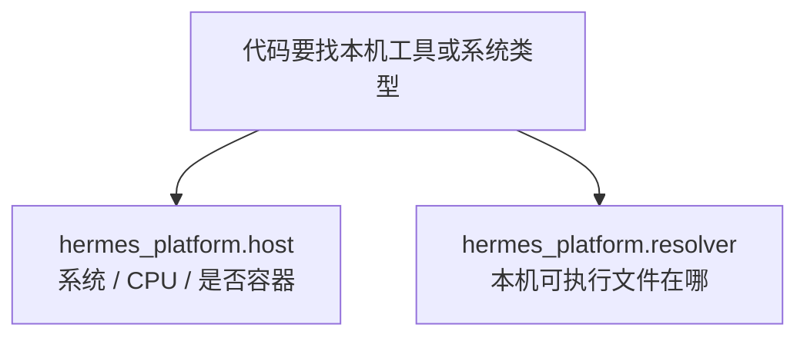

### 10.4 插件目录：能力搬出核心

人话：新能力优先是 **插件或 Skill**，不要再往核心塞一个工具。记忆后端（Honcho、mem0、hindsight 等）已从仓库里的 `plugins/memory/` 挪到 **`plugin-catalog/*.yaml`**，用户家里如果还开着旧配置，更新时会自动把对应插件装上。

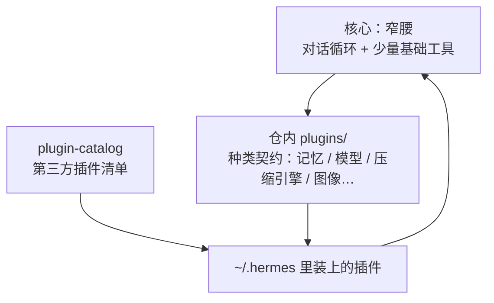

仍留在仓里的插件类型包括：上下文压缩引擎、图像/视频生成、看板、可观测性、部分平台。**新的第三方记忆产品不要再提交进 `plugins/memory/`。**

### 10.5 定时任务不再是「到点起一个 Agent」

`cron/` 已是一套调度器：谁有权跑、失败怎么记、结果进哪个聊天、worker 可以拆进程。

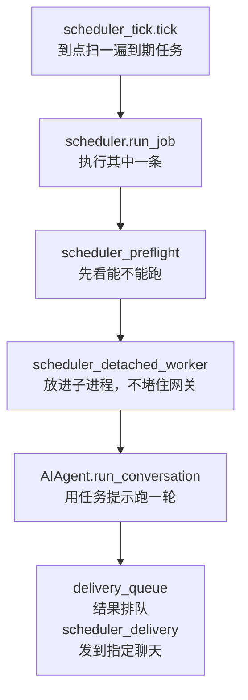

| 模块 | 人话 |
|------|------|
| `scheduler.py` + `scheduler_tick.py` | 时钟与本轮调度 |
| `scheduler_detached_worker.py` | 任务在子进程跑，不堵死 Gateway |
| `delivery_queue.py` + `scheduler_delivery.py` | 跑完的结果排队发到指定聊天 |
| `blueprint_catalog.py` | 任务模板，不是手写一条 prompt 了事 |
| `quota_hold.py` / `incidents.py` | 配额与故障记录 |

### 10.6 其它边角（旧总览表里没有）

| 模块 | 人话 |
|------|------|
| `gateway/relay/` | 实验性中继；一轮对话可带 `relay_metadata` |
| `gateway/browser_control_broker.py` | 浏览器控制从「工具直接开」变成可经网关经纪 |
| `gateway/delivery_ledger.py` | 出站义务账本：最终回复必须发出去 |
| `native/fts5_cjk` | 会话全文搜索的中日韩分词扩展 |
| `providers/` | 模型供应商插件的基类（具体供应商走插件，不堆在核心） |
| `apps/bootstrap-installer` | 安装器，和 Desktop 壳分开 |
| `hermes_cli/cli_*_mixin.py` | CLI 子命令按 mixin 拆开，`main.py` 不再无限涨 |

---

## 11. 和 AgentScope 对照

读 `docs/agentscope/AGENTSCOPE.md` 时可以这样对上号：

| 你想理解的事 | AgentScope | Hermes |
|--------------|------------|--------|
| 一轮 ReAct | `Agent.reply_stream`（库，不写会话库） | `conversation_loop.run_conversation`（函数，循环里就写 `SessionDB`） |
| 谁触发、谁落盘 | `ChatService.run` 调 `reply_stream`，自己 `upsert_message` | CLI / Gateway 调 `AIAgent.run_conversation`，落盘在循环内部 |
| 会话库 | `Storage`，App 层持有 | `SessionDB`，挂在 `AIAgent._session_db` 上 |
| 直播给前端 | MessageBus + SSE | Gateway/TUI 回调 + WebSocket |
| IM | `ChannelGateway` + 出站 `ChannelClients` | `GatewayRunner` + `delivery` |

启动、收、发的对照图：[CHANNEL_AGENTSCOPE_VS_HERMES.md](../../compare/CHANNEL_AGENTSCOPE_VS_HERMES.md)。
| 先计划再执行 | 默认没有；可选 Task 工具 / SOP | 默认没有；`todo` 工具 / Plan **skill**（提示层） |

### 11.1 循环和会话读写是不是同一层

不一样。Hermes 把「想和调工具」和「把消息写入会话库」放在同一次 `conversation_loop.run_conversation` 里。AgentScope 把这两件事拆开：库里的 `Agent` 只产出事件，App 里的 `ChatService` 负责写入 `Storage`。

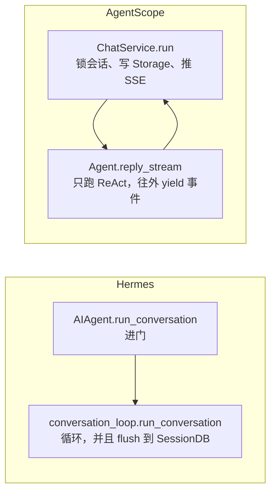

| | Hermes | AgentScope |
|--|--------|------------|
| 循环是不是类 | 不是。`conversation_loop` 是模块，`run_conversation(agent, ...)` 是函数 | `Agent` 是类，`reply_stream` 是它的方法 |
| 循环里碰不碰会话库 | 碰。循环中改消息列表，并用 `agent._flush_messages_to_session_db` 写 `SessionDB`（`_session_db` 在 `AIAgent` 上） | 不碰。`reply_stream` 不调用 `Storage` |
| 谁保证「跑完一定落盘」 | 循环自己的 `finalize_turn`，以及进门时的租约 | `ChatService._run_impl` 在 `reply_stream` 之外 `upsert_message`，并持有 `session_lock` |
| 多入口怎么共用 | CLI、Gateway、Cron 都拿同一个 `AIAgent`，落盘逻辑不用再写一遍 | HTTP、Channel、定时任务都进 `ChatService.run`，Agent 可以不带数据库跑 |

Hermes 这样设计，是因为没有单独的 App 服务层：进程里就是这个 Agent 对象。把读写留在循环里，换入口不用再接一套存储。代价是循环和 SQLite 绑在一起，不能像 AgentScope 那样拿一个纯 `Agent` 在脚本里跑、存储完全由外面决定。

AgentScope 反过来：库要能嵌进别的产品，所以 `Agent` 只负责这一轮推理；生产环境的会话、锁、SSE 都在 `ChatService`。同一套 `reply_stream` 可以没有 `Storage`。

---

## 12. 还要看哪篇原文

本文件只画清 **模块边界和主路径**。字段级、威胁正则、Kanban 每条 API 仍在归档里，图没有删：

| 模块 | 归档全文 |
|------|----------|
| 内核循环、Todo、压缩 | [archive/legacy/AGENT_LOOP_ARCHITECTURE.md](archive/legacy/AGENT_LOOP_ARCHITECTURE.md) |
| 架构长文与目录地图 | [archive/legacy/ARCHITECTURE.md](archive/legacy/ARCHITECTURE.md) |
| Surface 细节 | [archive/legacy/SURFACE_ARCHITECTURE.md](archive/legacy/SURFACE_ARCHITECTURE.md) |
| Gateway | [archive/legacy/CLI_GATEWAY_SYSTEM.md](archive/legacy/CLI_GATEWAY_SYSTEM.md) |
| Memory / Tools / Skills / MCP | `archive/legacy/` 下同名文件 |
| Kanban 深图 | [archive/legacy/KANBAN_MULTIAGENT_DEEP_ANALYSIS.md](archive/legacy/KANBAN_MULTIAGENT_DEEP_ANALYSIS.md) |
| 安全扫描 | [archive/legacy/SECURITY_SCAN_DEEP_ANALYSIS.md](archive/legacy/SECURITY_SCAN_DEEP_ANALYSIS.md) |

`volumes/` 是上述全文的按卷拼接，章节标题被降了一级，**不适合当「图说」来读**。以本文件 + `archive/legacy/` 为准。

---

## 增补：短版全景之后，如何深入实现

上面的“分卷只是拼接”是早期形态；本轮新增了独立专题与源码审计。**短版读本仍保留，深读以 [分卷总入口](volumes/README.md) 为准**，与归档有冲突时回到本地源码核对。

| 看懂主线之后还没弄明白的问题 | 新专题 |
|---|---|
| 客户端、协议、账号池、模型降级为何不能混为一谈 | [卷十：模型后端](volumes/10-model-backends-and-resilience.md) |
| shell 是否持久、路径映射、前后台任务与退出清理 | [卷十一：执行后端](volumes/11-terminal-execution-backends.md) |
| 定时任务成功不等于通知成功；插件安装不等于切换生效 | [卷十二：自动化与包运行时](volumes/12-automation-and-package-runtime.md) |
| profile 归属、secret fallback、日志/监控/账本的区别 | [卷十三：支撑底座](volumes/13-config-secrets-and-observability.md) |
| 插件卸载不应删除别人的注册；subagent handle 不是永久会话 | [卷五 §7](volumes/05-capabilities-extensions.md#cap-plugin-lifecycle) · [卷七 §6](volumes/07-multi-agent-and-kanban.md#multi-runtime-boundaries) |

哪些模块还没有深入到全部分支，见 [覆盖审计与后续清单](volumes/SOURCE_AUDIT.md#audit-next)。
