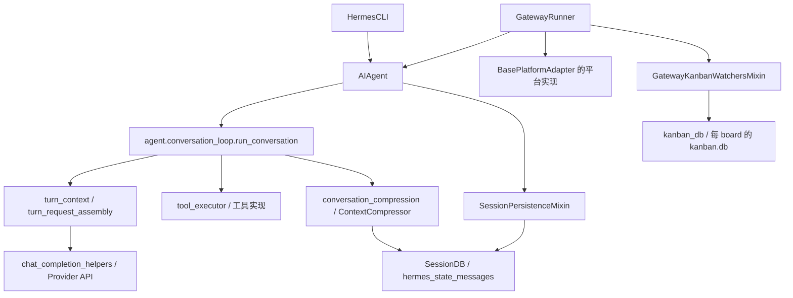
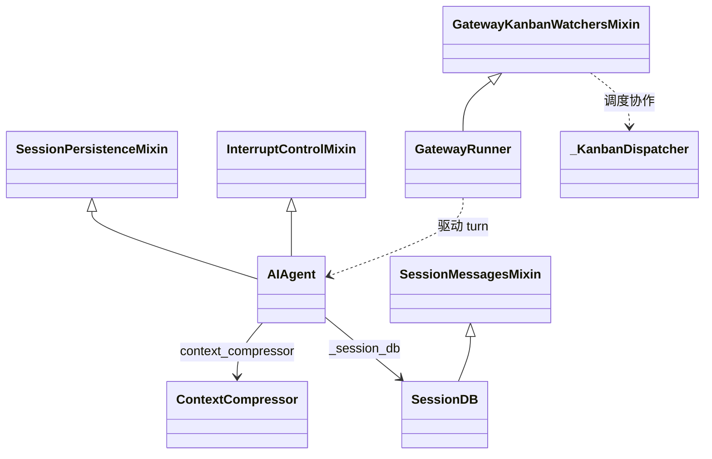
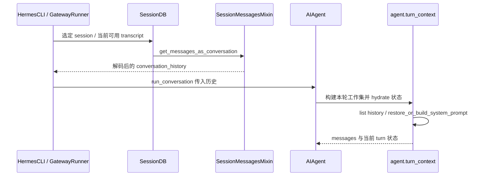
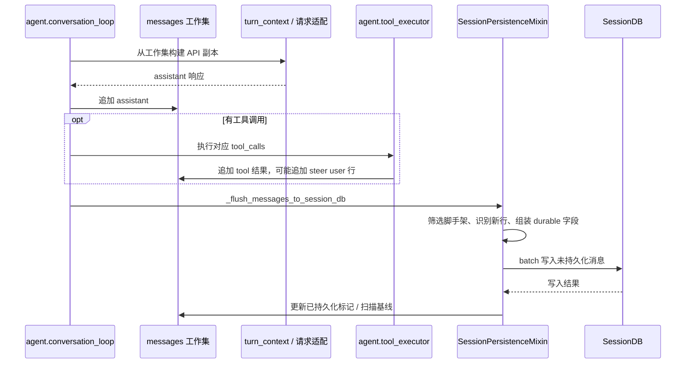
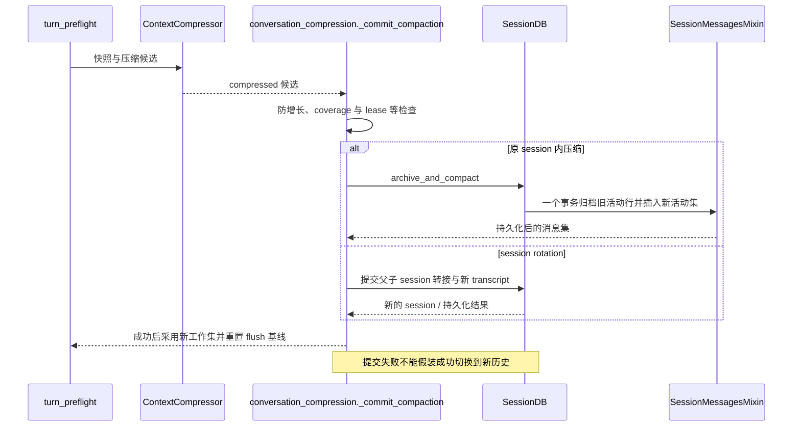
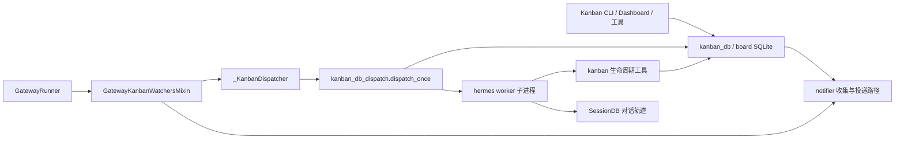
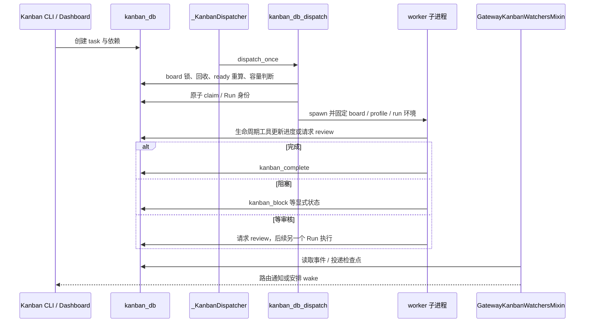
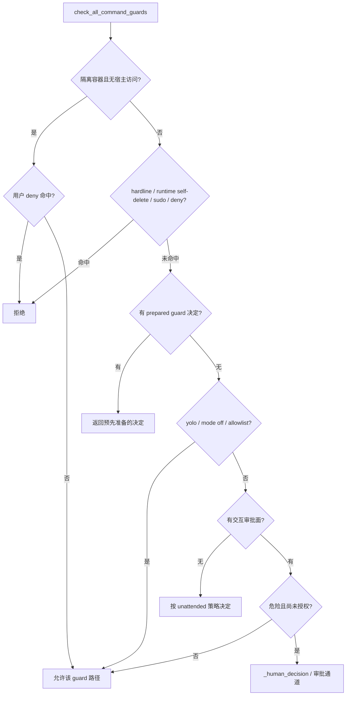

# 当前实现导读：从运行入口到消息、能力与持久任务

> 核对日期：2026-10-15。源码基线：`60d00c5633ad76f3dd8e3ecd79f77f1c6f8e6fdd`。
> 本文是本轮重点链路的源码校订，不代表全部旧教程的逐行认证。旧教程保留解释与示例；阅读顺序及核对范围见 [总目录](README.md) 和 [校订记录](REVIEW_AND_CHANGES.md)。

<a id="1-系统由谁负责入口运行时能力与状态"></a>
<a id="section-1"></a>

<a id="目录"></a>
## 目录

<!-- visible-toc:start -->
- [1. 系统由谁负责：入口、运行时、能力与状态](#section-1)
- [2. 工作区 message：不是数据库行，也不是最终请求体](#section-2)
- [3. 启动与重启：从 SessionDB 恢复工作集](#section-3)
- [4. 普通推理：工具、投影与增量 flush](#section-4)
- [5. 压缩：轻量裁剪、摘要与事务提交](#section-5)
  - [5.1 不要把三个名字都叫“轻量压缩”](#section-5-1)
  - [5.2 压缩提交后，工作集与数据库都可能变化](#section-5-2)
  - [5.3 active / compacted 不是“所有旧行统一两个开关”](#section-5-3)
- [6. 外部 context：位置、围栏和持久化](#section-6)
- [7. Steer：两处当轮注入与收尾补发](#section-7)
- [8. 多代理：共享引擎，不共享默认预算对象](#section-8)
- [9. Kanban：持久任务的模块和完整生命周期](#section-9)
  - [9.1 模块与实体对应](#section-9-1)
  - [9.2 从创建到完成](#section-9-2)
  - [9.3 旧稿需要带条件阅读的规则](#section-9-3)
- [10. 审批：规则、等待现场、关联与恢复边界](#section-10)
  - [10.1 终端命令的完整检查入口](#section-10-1)
  - [10.2 一次需要审批的终端调用怎样继续](#section-10-2)
  - [10.3 什么不是上述“同栈继续”](#section-10-3)
- [11. Telegram、Memory 与扩展：三组容易混淆的边界](#section-11)
- [12. 继续读旧教程时，怎样判断示例是否适用](#section-12)
<!-- visible-toc:end -->

## 1. 系统由谁负责：入口、运行时、能力与状态

先把四个问题分开：**谁接收用户输入、谁执行本轮推理、谁提供工具、谁保存结果**。它们可以在同一进程中协作，但不拥有同一种状态。



核心类型关系如下（只展示本章需要的继承与持有关系，不冒充全部继承树）：



图中的下划线名称是**模块或函数**，不是虚构的类。`SessionDB` 存对话；`kanban.db` 存任务、运行与事件，不能互相替代。外部 Provider、工具副作用与消息写库也不是一个分布式事务。

<a id="current-messages"></a>
<a id="2-工作区-message不是数据库行也不是最终请求体"></a>
<a id="section-2"></a>
## 2. 工作区 message：不是数据库行，也不是最终请求体

“工作区 message”是本文对本轮 `messages: list[dict]` 的称呼，**不是名为 WorkspaceMessage 的源码类**，更不是 Hermes Workspace 前端产品里的对象。

| 数据层 | 代表字段 / 内容 | 谁消费 | 不能做的假设 |
|---|---|---|---|
| SessionDB 消息行 | id、session_id、active、compacted、content、api_content、工具与 reasoning sidecar | 历史展示、检索、恢复、并发写入控制 | 一行原样就是 API message |
| 运行工作集 | role、content、tool_calls、tool_call_id，以及恢复身份、持久化标记、api_content 等 | 推理、工具执行、压缩、flush | 每个内部字段都能发给模型 |
| 请求投影 | 按路由清理、替换与适配后的消息和请求参数 | Provider API | 所有 Provider 都用完全相同的载荷 |

```python
# 说明性示例，不表示所有字段在每条消息上同时出现。
user_row = {
    "role": "user",
    "content": "帮我检查部署配置",  # 展示/持久化的用户原文
    "api_content": "帮我检查部署配置\n\n外部检索的辅助上下文",
    # 恢复/flush 还可能附带内部身份信息，发送前会处理。
}
# build_api_messages 在副本上消费 api_content：
api_row = {"role": "user", "content": user_row["api_content"]}
# 原始 user_row.content 没变，但 user_row 确实可以带有新的 sidecar。
```

源码定位：`agent/turn_context.py::build_api_messages`、`substitute_api_content`，`agent/turn_request_assembly.py::assemble_api_request`，`agent/chat_completion_helpers.py::build_api_kwargs`。投影还涉及 reasoning 载体及角色/工具关联的清理，不能用上述两行示例替代完整实现。

<a id="current-restore"></a>
<a id="3-启动与重启从-sessiondb-恢复工作集"></a>
<a id="section-3"></a>
## 3. 启动与重启：从 SessionDB 恢复工作集

**恢复历史 ≠ 恢复 Python 现场。** 重启后可以恢复可见消息、system 配置及持久化 sidecar；已经消失的线程、Queue/Event、工具栈和未消费邮箱不会仅靠读消息自动复活。



- `get_messages` 默认排除 inactive/compacted 行；是否跨祖先读取由调用参数及当前会话关系决定。
- `get_messages_as_conversation` 是恢复投影入口之一，不是直接把 SQLite 的所有列 `SELECT *` 发给模型。
- `turn_context` 中 `messages = list(conversation_history)` 是新建列表，**不等于所有 dict 都已深复制**。到请求投影又有单独的消息复制与字段过滤。
- 恢复后的持久化身份/标记用于避免重复 flush；不能把恢复历史当作“全是本轮新消息”。
- Gateway 的 transcript 入口见 `gateway/session_transcript.py`。不同 Surface 的 session 选择、重试/undo 处理不应硬画成完全相同的单一入口函数。

<a id="current-flush"></a>
<a id="4-普通推理工具投影与增量-flush"></a>
<a id="section-4"></a>
## 4. 普通推理：工具、投影与增量 flush

常规 flush 是把**应当持久化而尚未落库的消息**写进去；不是每次都删除旧历史后全量重插。



该图是普通路径，不枚举 turn-start 写入、错误修复重扫、DB session 已被压缩迁移等分支。实现位于 `agent/session_persistence.py` 的 `_db_flush_collect`、`_db_flush_write`、`SessionPersistenceMixin._flush_messages_to_session_db_unlocked` 等。

**flush 和模型调用不是一一对应。** turn-start、工具边界及收尾有各自持久化需求；单个 API 请求也不是一个完整用户 turn。用户原文与请求内容不同，`durable_user_row_content` 会分别处理 `content` 与 `api_content`。

<a id="current-compaction"></a>
<a id="5-压缩轻量裁剪摘要与事务提交"></a>
<a id="section-5"></a>
## 5. 压缩：轻量裁剪、摘要与事务提交

<a id="51-不要把三个名字都叫轻量压缩"></a>
<a id="section-5-1"></a>
### 5.1 不要把三个名字都叫“轻量压缩”

| 机制 | 调 LLM 吗 | 作用与入口 |
|---|---|---|
| 工具结果确定性裁剪 | 否 | `ContextCompressor.prune_tool_results_only`；由 `proactive_prune_tokens` 开启，构造默认 0 表示关闭 |
| 完整压缩中的旧工具结果预处理 | 该预处理本身不调 | `ContextCompressor.compress` 的准备过程；随后才是摘要等完整处理 |
| micro compact / 滚动摘要 | 不能一概视为不调 | 是摘要压缩语义，不能因为名字有 micro 就等同截断 tool 文本 |

独立裁剪的确定性操作也不只是“把大 tool 文本截短”：源码列出了完全相同结果去重、非保护尾部大结果缩写、非尾部过大 tool-call 参数裁剪，以及旧图片载荷退休等步骤。尾部保护不是每步一刀切：无损精确去重可以作用到保护尾部；不要把“保留最近 N 条”误解为它们每个字段都永不变化。

**有 DB 时的轻量裁剪提交**发生在 `prune_tool_results_only` 内部：先检查回收量/重新触发门槛，再按 coverage 与 watermark 调用 `archive_and_compact`。失败或过时返回原列表与 0；成功 stamping 后返回新列表。调用方检查“非零结果且返回了新列表”才替换工作集。没有 LLM 调用，不代表不修改持久历史。

`agent/turn_preflight.py::compress_after_tool_results` 区分完整压缩判断与确定性裁剪回退；完整压缩可能因锁、冷却、尝试次数、真实 usage 等条件无法进行。**不能概括成“每轮固定先轻量，仍超 token 才唯一调用 LLM”**。同样，保留尾部的粒度和条件要看实际算法，不能只记成“最近 N 条”。

<a id="52-压缩提交后工作集与数据库都可能变化"></a>
<a id="section-5-2"></a>
### 5.2 压缩提交后，工作集与数据库都可能变化



`_commit_compaction` 对 in-place 路径重新 stamping 已持久化标记并重设 flush 基线，否则后续普通 flush 会把压缩集再插一遍。未配置 SessionDB 时也有内存压缩路径；上图限定**有 DB 的提交路径**。

<a id="53-active--compacted-不是所有旧行统一两个开关"></a>
<a id="section-5-3"></a>
### 5.3 active / compacted 不是“所有旧行统一两个开关”

| 旧行的含义 | 典型归档结果 | 为什么 |
|---|---|---|
| 已被摘要覆盖的旧活动历史 | active=0，compacted=1 | 原文保留用于检索，不再加入当前请求 |
| 被原样携带的尾部/并发新增消息的旧副本 | active=0，compacted=0 | 是已被新副本替代，不是被摘要吸收；避免检索重复 |
| 新摘要、保留尾部、被安全合并的并发尾部 | 新 active 行 | 新的活动工作集，ID 不一定还是旧 ID |

`SessionMessagesMixin.archive_and_compact` 接受覆盖集合、watermark/租约等约束：摘要期间到达的新消息不能凭“旧 SQL 全部归档”就悄悄丢掉。本文表格描述当前协议语义，具体行 ID 与展示投影需跟随返回值重新定位。

<a id="current-context"></a>
<a id="6-外部-context位置围栏和持久化"></a>
<a id="section-6"></a>
## 6. 外部 context：位置、围栏和持久化

**当前源码的重要细节：不是所有注入上下文都自动套 `<memory-context>`。**

`compose_multimodal_context_part` 先对 external prefetch 调 `build_memory_context_block`，再与插件返回文本拼接。`compose_user_api_content` 把该片段追加在用户原文之后。简化示例：

```text
用户原文：请检查 deployment.yaml

<memory-context>
外部记忆检索：该项目部署在测试集群
</memory-context>

插件 pre_llm_call context：本次关联工单 DEPLOY-42
```

- 记忆围栏包裹**外部记忆预取部分**；插件文本在围栏外。插件自己返回标签当然可以，但那是插件自己的输出。
- 对字符串 user，组合版本可以挂在工作区消息 `api_content` 上；DB 支持该 sidecar，重启可重放一致字节。**不覆盖原始 content，不等于不改工作区对象，也不等于不持久化。**
- 对 list 类型的多模态内容，当前实现走 text-part 路径；不要将字符串 sidecar 示例机械推广到所有内容类型。
- `pre_llm_call` 的 turn-context 调用不应误读为“每次 ReAct 模型迭代都重新调用一次”。生命周期以 `agent/turn_context.py` 为准。
- ephemeral system 是另一种注入位置，不能与 user context/sidecar 混为一谈。

<a id="current-steer"></a>
<a id="7-steer两处当轮注入与收尾补发"></a>
<a id="section-7"></a>
## 7. Steer：两处当轮注入与收尾补发

当前设计已在 [Agent Loop §3.2.2](AGENT_LOOP_ARCHITECTURE.md#322-steer-机制) 原位置重写：

1. pre-API：在最新 tool 后插入 `steer_user_row`；没有 tool 则 requeue。
2. post-tool：batch 尾追加新的 user 行；不覆写 tool.content。
3. 收尾：`result.pending_steer` 交回调用入口，Gateway 安排下一 turn。

前两处 marker 一致，但**第三处是后续 turn 的交付，不是同一条 API message 的第三个拼装点**。旧稿“永远不新建 user”“最终答案后可能永远丢在邮箱”的说法均不再适用。

<a id="current-delegation"></a>
<a id="8-多代理共享引擎不共享默认预算对象"></a>
<a id="section-8"></a>
## 8. 多代理：共享引擎，不共享默认预算对象

`tools/delegate_tool.py::_build_child_agent` 明确传 `iteration_budget=None`；`agent/agent_init.py::init_agent` 创建新的预算对象。

| 配置 | 当前源码值 / 规则 | 边界 |
|---|---|---|
| `AIAgent` 构造默认 max_iterations | `sys.maxsize` | 具体 CLI/Gateway 配置可覆盖，并不承诺所有入口无限 |
| delegate 默认 | `DEFAULT_MAX_ITERATIONS = 250` | `delegation.max_iterations` 配置优先 |
| 工具调用传 max_iterations | 当前 delegate 路径以配置为权威 | 不能照旧例认为模型能随意改上限 |
| 子 Agent budget | 独立对象 | 手工显式传共享对象是另一种构造方式，不是当前 delegate 默认 |
| 子 Agent Memory | `skip_memory=True` 等限制 | 不代表禁止一切文件、检索或跨会话信息流 |

主/子共用 `run_conversation`，通过参数、工具集、路由、session 和 prompt 控制边界。旧例 `AIAgent(max_iterations=90)` 可作为人为配置示例，不能再称为构造默认。源码个别旧注释也仍写 shared；本次以**实际构造参数与函数体**为依据，不以注释字面作判断。

<a id="current-kanban"></a>
<a id="9-kanban持久任务的模块和完整生命周期"></a>
<a id="section-9"></a>
## 9. Kanban：持久任务的模块和完整生命周期

<a id="91-模块与实体对应"></a>
<a id="section-9-1"></a>
### 9.1 模块与实体对应



- `GatewayKanbanWatchersMixin` 在 `gateway/kanban_watchers.py`，`_KanbanDispatcher` 在 `gateway/kanban_watchers_dispatcher.py`。
- `dispatch_once` 在 `hermes_cli/kanban_db_dispatch.py`，不是名为 KanbanDispatcherWatcher 的源码类。
- Task 是长期任务；Run 是一次执行/审核尝试；SessionDB 是该 worker 的对话记录。三者不能用一个 session_id 或“子代理”概念合并。

<a id="92-从创建到完成"></a>
<a id="section-9-2"></a>
### 9.2 从创建到完成



<a id="93-旧稿需要带条件阅读的规则"></a>
<a id="section-9-3"></a>
### 9.3 旧稿需要带条件阅读的规则

- `max_spawn` 限制单 board 在途并发，`max_in_progress` 是 host-wide 约束；profile 帽另有 per-board 统计口径，不能统称“每 tick 最多 spawn N 个”。
- 审核会占用调度容量，有独立 Run；不是 UI 把 running 改为 done 的别名。
- worker exit=0 而任务仍 running 是**生命周期协议违规**，不是自然成功；需要显式 complete/block/review。
- `scheduled` 出现在状态集合，不代表当前已具备 `wake_at` 自动唤醒器。
- claim lease、expected_run_id、PID 身份检查用于阻止旧 worker 越权更新新 Run。单独看到 task_id 不足以证明可写所有执行结果。
- 事件、UI 实时更新、notify、wake 是不同层；检查点和重试不应描述为外部消息严格 exactly-once。
- triage 分解与 Swarm 都会产生任务图；“父任务永远先等所有孩子”不是统一规则。详见 [卷七的当前任务图和生命周期](../../volumes/07-multi-agent-and-kanban.md)。

旧深潜中的 dispatch 伪代码只适合解释 CAS/依赖思想，不是可复制替换当前调度器的完整算法。

<a id="current-approval"></a>
<a id="10-审批规则等待现场关联与恢复边界"></a>
<a id="section-10"></a>
## 10. 审批：规则、等待现场、关联与恢复边界

<a id="101-终端命令的完整检查入口"></a>
<a id="section-10-1"></a>
### 10.1 终端命令的完整检查入口

完整入口是 `tools/approval.py::check_all_command_guards`；`check_dangerous_command` 是模式检查路径，不能据它画完整安全链。



这是该函数的规则，不是“整个 terminal 的全部防线”：terminal 还可能有预执行/脚本内容检查，插件 `pre_tool_call` 也能阻断或升级决策。显式 `force` 等工具分支要单独看调用方，不能借图推导成“所有调用永不绕过”。

**容器分支的精确含义**：当前函数先检查容器豁免，该分支仍执行用户 deny，但不再走普通 `_floor_block`。因此“所有容器都先执行 hardline”与“容器跳过包括 deny 在内的所有检查”都不准确。宿主挂载导致 has_host_access 时不能套用该豁免。

<a id="102-一次需要审批的终端调用怎样继续"></a>
<a id="section-10-2"></a>
### 10.2 一次需要审批的终端调用怎样继续

例子条件：普通宿主环境、未命中硬拒绝/allowlist、yolo/off 未启用，危险模式命中，存在 CLI 或 Gateway 审批面。

1. 模型发出 terminal tool call，执行器持有原始 `tool_call_id`。
2. guard 要求人确认。CLI 的 `_approval_callback` 在 `Queue.get` 等；Gateway 有通知回调时可在 Event 上等。
3. UI 收到选择，将结果送回原等待对象。Gateway 按 `session_key` 和审批 `request_id` 寻址；**审批 request_id 不是模型 tool_call_id**。
4. **同一个工具调用栈**拿到结果：批准则继续执行；拒绝/超时则形成 blocked 等工具结果。
5. 执行器把结果与原 tool_call_id 关联，追加到 messages，推理继续。不是把 `/approve` 作为新 user 消息让模型自己猜应重做哪个工具。

CLI 的当前方法定义在 `hermes_cli/cli_modal_mixin.py::CLIModalMixin`。Gateway 等待与解析见 `tools/approval_gateway_wait.py`、`tools/approval.py::resolve_gateway_approval`。

<a id="103-什么不是上述同栈继续"></a>
<a id="section-10-3"></a>
### 10.3 什么不是上述“同栈继续”

无在线等待通道的 pending 分支、Memory/Skill 等 staged-write 审批、进程重启后的恢复分别有不同载荷和生命周期。保存 pending 不会保存 Python 栈；对 durable staged payload 的批准执行，也不是复活之前的 Queue/Event。审批、clarify、interrupt、undo/restore 要分别建模。

<a id="current-extensions"></a>
<a id="11-telegrammemory-与扩展三组容易混淆的边界"></a>
<a id="section-11"></a>
## 11. Telegram、Memory 与扩展：三组容易混淆的边界

1. **Topic 与 Kanban**：`TelegramAdapter` 位于 `plugins/platforms/telegram/adapter.py`。论坛话题的 `message_thread_id` 与原生 DM topic 的 `direct_messages_topic_id` 有不同语义；路由会话分开不等于文件/凭据/进程隔离。
2. **Session 与 built-in memory**：MEMORY.md / USER.md 属于 Profile 的持久记忆，不会因为换一个 Topic 自动复制成互不相干的记忆。Session Search 是历史检索；Optional External Provider 又是另一套可选路径。压缩摘要不等于这三层中的全部。
3. **Tool / Skill / MCP / Plugin**：Tool 是执行接口；Skill 提供按需加载的知识与流程；MCP 引入远端工具/资源；Plugin 提供 Hook 和扩展注册等。Hook context、可执行工具与记忆 Provider 的扩展点不等价。

旧文写 `~/.hermes` 时，应理解为默认位置示例；实际 Profile/HERMES_HOME 路由可以改变根目录。旧文静态 Hook 表不代表永久完整集合，以 `hermes_cli/plugins.py` 的实际注册约束为准。

<a id="current-evidence"></a>
<a id="12-继续读旧教程时怎样判断示例是否适用"></a>
<a id="section-12"></a>
## 12. 继续读旧教程时，怎样判断示例是否适用

- **可以直接用来建立心智模型**：模块职责、分层、同一引擎的配置隔离、线程等待与持久化任务的区别。
- **需要沿源码确认**：默认值、环境变量、完整 Schema、策略优先级、注册集合、精确 Prompt 字节、私有函数路径与行号。
- **只作为历史材料**：外部产品性能比较、热度/星数、版本发布史、旧 UI 路径与旧源码长段摘录；本次未联网核验这些外部事实，也未重新测量性能。
- 本轮只修改文档，不修改 Hermes 源码，不执行危险命令，不声称审批、Kanban 或 Provider 已通过端到端运行测试。

补充源码入口及各文档审阅范围见 [校订记录](REVIEW_AND_CHANGES.md)。

<!-- 旧目录与迁移章节锚点兼容；完整内容入口见文首目录及主题迁移表。 -->
<a id="current-boundaries"></a>
