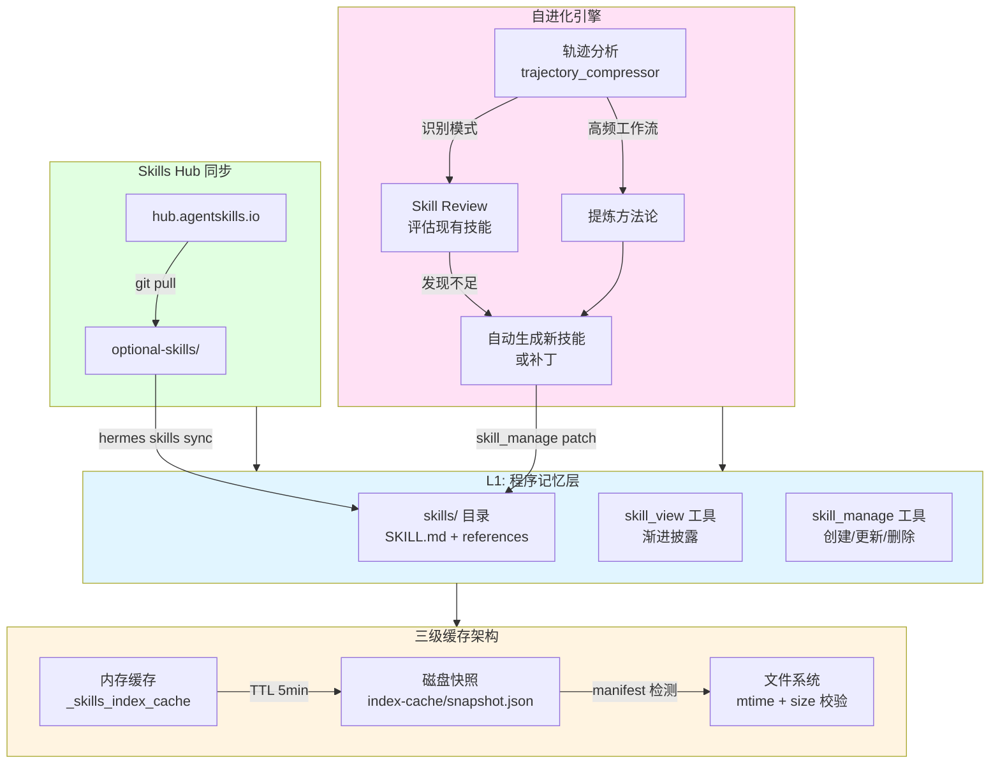
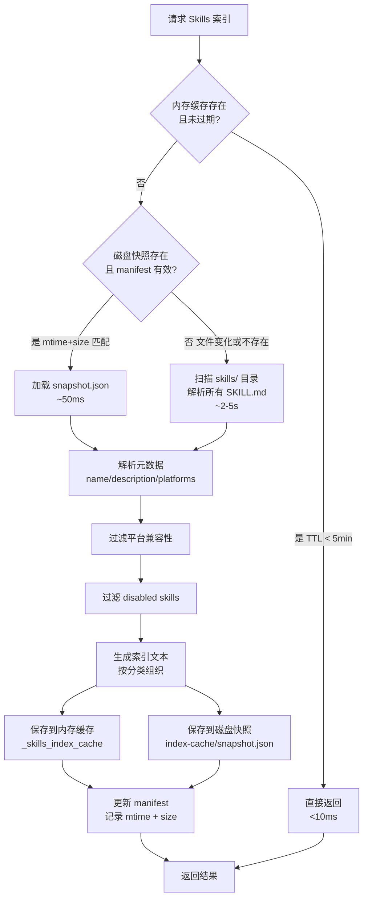
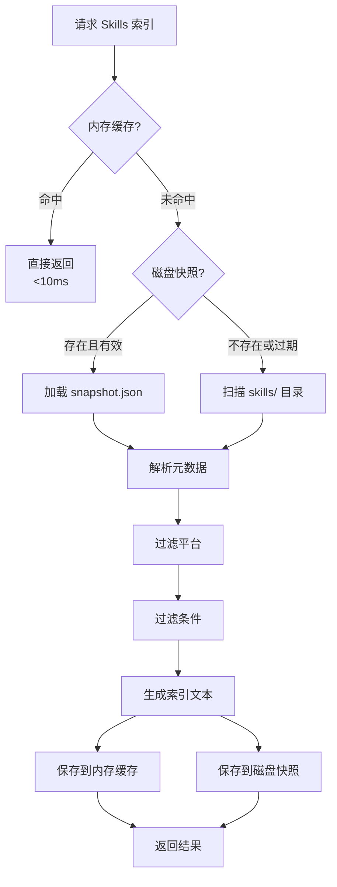
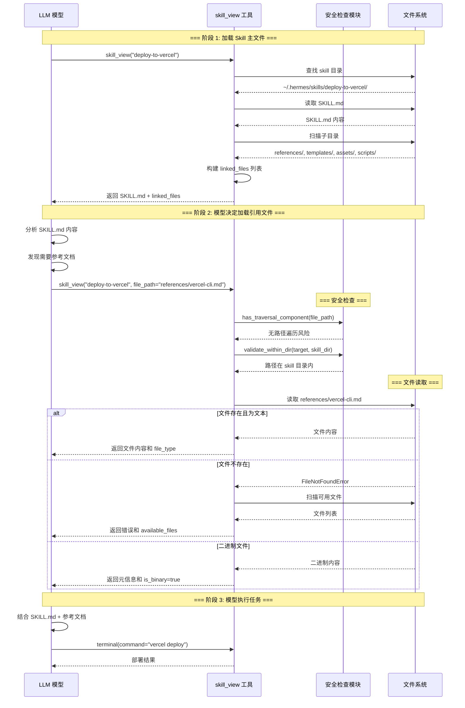
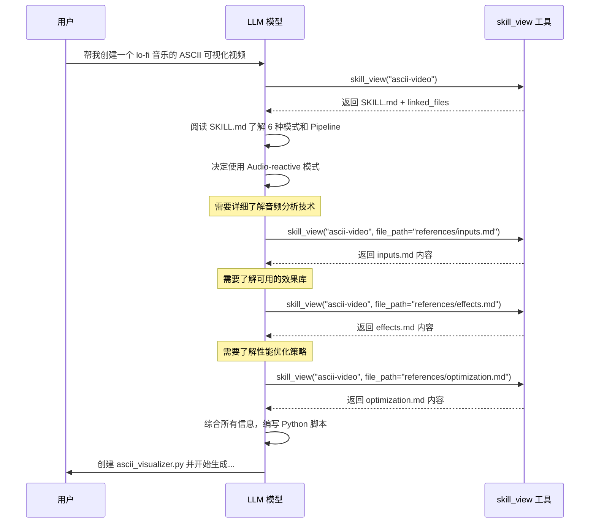
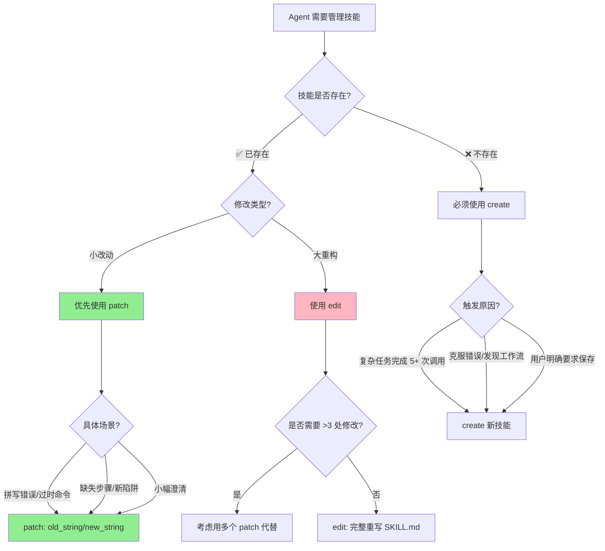
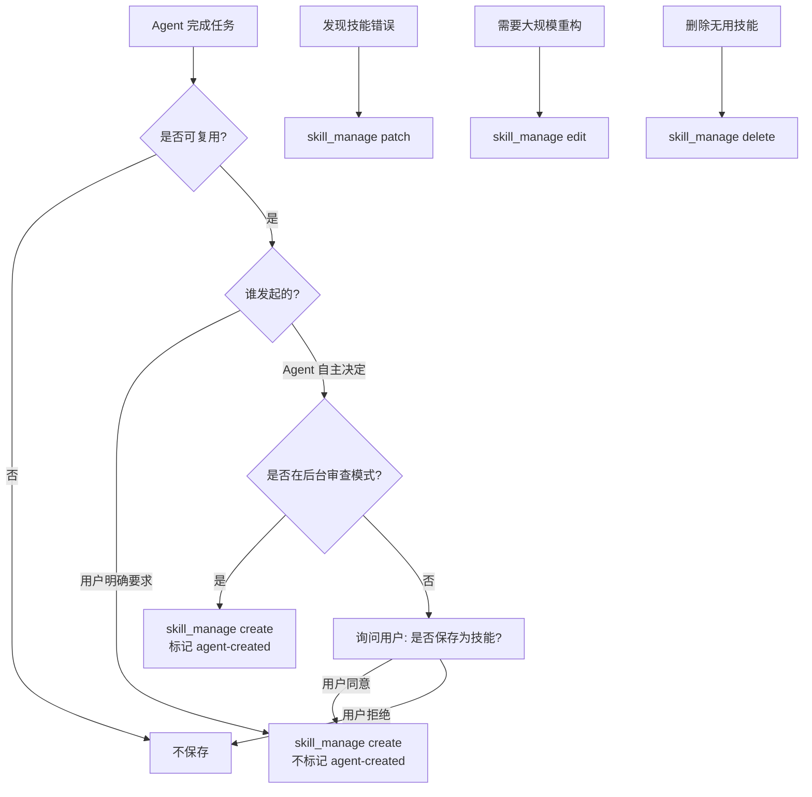
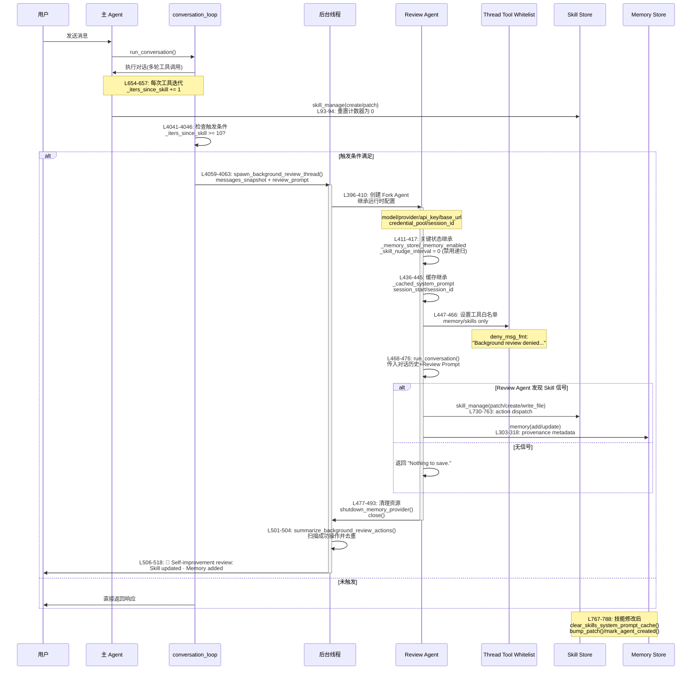

# Skills 技能系统详解

<!-- legacy-review:start -->
> **2026-10-15 校订导航**：技能怎样发现、按需加载、安装和管理。\
> **核对范围**：修复目录跳转；保留层次化解释，旧外部仓库/命令/安全扫描例未全部重新验证。\
> **适用基线**：本地源码 `60d00c5633ad`；不是最新发布版本声明。原稿版本、行号、性能数字与长代码块若未在校订范围内，仍按历史示例阅读。
> **先读当前结论**：[当前实现导读](CURRENT_IMPLEMENTATION.md#current-extensions) · **现行分卷**：[05-capabilities-extensions.md](../../volumes/05-capabilities-extensions.md) · [具体改动与未验证项](REVIEW_AND_CHANGES.md) · [返回全目录](README.md)

<!-- legacy-review:end -->
<a id="目录"></a>
## 目录

<!-- visible-toc:start -->
- [1. 概述](#section-1)
  - [1.1 Skills 系统架构图](#section-1-1)
  - [1.2 什么是 Skills?](#section-1-2)
  - [1.3 核心设计原则](#section-1-3)
  - [1.4 Skill vs Tool vs MCP 三者对比](#section-1-4)
- [2. Skills 标准规范](#section-2)
  - [2.1 agentskills.io 兼容](#section-2-1)
  - [2.2 SKILL.md 格式](#section-2-2)
  - [2.3 Frontmatter 字段](#section-2-3)
- [3. Skills 目录结构](#section-3)
  - [3.1 标准布局](#section-3-1)
  - [3.2 内置 Skills 分类](#section-3-2)
- [4. Skills 元数据解析](#section-4)
  - [4.1 解析流程](#section-4-1)
  - [4.2 Description 提取逻辑](#section-4-2)
  - [4.3 条件检查机制](#section-4-3)
- [5. Skills 索引生成与缓存](#section-5)
  - [5.1 三级缓存架构详解](#section-5-1)
  - [5.2 Manifest 检测机制](#section-5-2)
  - [5.3 三级缓存架构](#section-5-3)
  - [5.4 磁盘快照格式](#section-5-4)
  - [5.5 Manifest 检测](#section-5-5)
- [6. Skills 加载工具](#section-6)
  - [6.1 skill_view 工具](#section-6-1)
  - [6.2 skills_list 工具](#section-6-2)
- [7. Skill 外部引用加载机制](#section-7)
  - [7.1 标准目录结构](#section-7-1)
  - [7.2 自动发现 linked_files](#section-7-2)
  - [7.3 按需加载引用文件](#section-7-3)
  - [7.4 安全机制](#section-7-4)
  - [7.5 完整时序图](#section-7-5)
  - [7.6 完整示例：ASCII Video 生成](#section-7-6)
  - [7.7 关键设计优势](#section-7-7)
  - [7.8 模型如何知道引用文档和脚本的路径？](#section-7-8)
  - [7.9 最佳实践](#section-7-9)
- [8. Slash 命令集成](#section-8)
  - [8.1 /skill 命令](#section-8-1)
  - [8.2 实现机制](#section-8-2)
- [9. Skills Hub 与同步](#section-9)
  - [9.1 Skills Hub](#section-9-1)
  - [9.2 同步机制](#section-9-2)
- [10. 可选 Skills 库](#section-10)
  - [10.1 optional-skills/ 目录](#section-10-1)
  - [10.2 安装可选 Skills](#section-10-2)
- [11. skill_manage：技能写入、校验与管理](#section-11)
  - [11.1 skill_manage - 技能管理工具](#section-11-1)
- [12. 开发自定义 Skill](#section-12)
  - [12.1 快速开始](#section-12-1)
  - [12.2 最佳实践](#section-12-2)
  - [12.3 发布到 Hub](#section-12-3)
- [13. 后台自进化：Background Review、skill_manage 与 Curator](#section-13)
  - [13.1 核心设计理念](#section-13-1)
  - [13.2 完整执行流程](#section-13-2)
  - [13.3 源码级时序图](#section-13-3)
  - [13.4 关键技术细节](#section-13-4)
  - [13.5 性能影响分析](#section-13-5)
  - [13.6 与前台 skill_manage 和 Curator 的边界](#section-13-6)
  - [13.7 设计风险与建议边界](#section-13-7)
  - [13.8 总结](#section-13-8)
- [14. 总结](#section-14)
- [15. 附录: 自进化机制快速参考](#section-15)
  - [15.1 触发条件速查表](#section-15-1)
  - [15.2 关键代码位置](#section-15-2)
  - [15.3 配置示例](#section-15-3)
<!-- visible-toc:end -->


> **原稿版本锚点（历史）**: 0.19.0 · **核对**: 2026-07-22 · [DOC_MAINTENANCE.md](DOC_MAINTENANCE.md) · office bundle + hermes-themes skill\
> **文档角色**: 深入解析 Hermes Agent 的 Skills 技能管理机制\
> **适合人群**: AI工程师、Skill开发者、架构师\
> **阅读时间**: 1-1.5 小时\
> **源码位置**: `agent/skill_commands.py`, `tools/skills_tool.py`

---

<a id="📋-目录"></a>

<a id="1-概述"></a>
<a id="section-1"></a>
## 1. 概述

<a id="10-skills-系统架构图"></a>
<a id="section-1-1"></a>
### 1.1 Skills 系统架构图



**核心设计原则**:
1. **渐进披露** - 索引进 system,正文按需读取,优化 token
2. **三级缓存** - 内存 → 磁盘快照 → manifest 检测,高性能加载
3. **自进化** - 从轨迹中提炼方法论,自动创建/更新技能
4. **开放标准** - 兼容 agentskills.io,跨平台共享
5. **Hub 生态** - 社区贡献,版本管理,一键同步

<a id="11-什么是-skills"></a>
<a id="section-1-2"></a>
### 1.2 什么是 Skills?

**Skills** 是 Hermes Agent 的**可扩展技能系统**,允许用户为 Agent 添加特定领域的能力。每个 Skill 是一个自包含的指令包,包含:

- ✅ SKILL.md - 技能说明和使用指南
- ✅ REFERENCE.md - 可选的参考文档
- ✅ scripts/ - 可选的辅助脚本
- ✅ examples/ - 可选的示例代码

<a id="12-核心设计原则"></a>
<a id="section-1-3"></a>
### 1.3 核心设计原则

| 原则 | 说明 |
|------|------|
| **Open Standard** | 兼容 agentskills.io 开放标准 |
| **Progressive Disclosure** | 索引进 system,正文按需读取 |
| **Platform-aware** | 根据平台过滤不适用的 Skills |
| **Cache-friendly** | 内存+磁盘双级缓存 |
| **Composable** | 多个 Skills 可组合使用 |

<a id="13-skill-vs-tool-vs-mcp-三者对比"></a>
<a id="section-1-4"></a>
### 1.4 Skill vs Tool vs MCP 三者对比

> Hermes 有三种扩展 Agent 能力的机制，设计目的完全不同。

<a id="核心区别"></a>
<a id="section-1-4-1"></a>
#### 1.4.1 核心区别

| 维度 | **Skill** (技能) | **Tool** (工具) | **MCP** (Model Context Protocol) |
|------|-----------------|----------------|----------------------------------|
| **本质** | 只读的知识文档 | 可执行的 Python 函数 | 外部服务暴露的工具 |
| **载体** | Markdown (SKILL.md) | Python + JSON Schema | 外部进程/远程服务 |
| **给谁用** | 模型读取后**指导决策** | 模型通过 `function_call` 直接调用 | 模型通过 `function_call` 直接调用 |
| **运行时形式** | System prompt 索引 + 按需读取全文 | API 请求中的 `tools` schema | API 请求中的 `tools` schema（透明） |
| **有副作用？** | ❌ 纯信息 | ✅ 执行操作 | ✅ 执行操作 |
| **注册位置** | `~/.hermes/skills/` 目录 | `tools/registry.py` | `tools/mcp_tool.py` → 同一个 registry |
| **扩展难度** | 写 Markdown 即可 | 需要 Python 编程 | 需要实现 MCP Server |
| **状态** | 无状态文件 | 无状态函数 | 有状态连接（长连接） |

<a id="三者关系图"></a>
<a id="section-1-4-2"></a>
#### 1.4.2 三者关系图

```
┌──────────────────────────────────────────────────────┐
│  Agent 的认知与行动模型                                │
│                                                      │
│  "我知道怎么做"          "我能做什么"                   │
│  ┌──────────────┐       ┌────────────────────────┐  │
│  │   Skills      │ 指导→ │     Tools + MCP         │  │
│  │  (知识/经验)   │       │    (执行能力)            │  │
│  │               │       │                        │  │
│  │ SKILL.md 文件  │       │ 内置: terminal,         │  │
│  │ 存储在磁盘     │       │       read_file, ...   │  │
│  │ 按需读取       │       │                        │  │
│  │               │       │ MCP: github,            │  │
│  │               │       │      filesystem, ...   │  │
│  └──────────────┘       └────────────────────────┘  │
│        ↑ 创建/更新               ↑ 调用               │
│        └───────────── Agent ────┘                   │
└──────────────────────────────────────────────────────┘
```

<a id="调用方式对比"></a>
<a id="section-1-4-3"></a>
#### 1.4.3 调用方式对比

```python
# Skill — 读取知识，指导后续行为
skill_view(name="deploy-to-vercel")
# → 返回 SKILL.md 全文，模型据此规划步骤

# Tool — 直接执行操作
terminal(command="npm run build")
# → 执行命令，返回 stdout/stderr

# MCP — 调用外部服务（对模型透明，和 Tool 一样）
github_create_issue(repo="org/repo", title="Bug fix", body="...")
# → 通过 MCP 协议调用 GitHub MCP Server → 创建 Issue
```

<a id="使用场景决策"></a>
<a id="section-1-4-4"></a>
#### 1.4.4 使用场景决策

| 场景 | 选择 | 原因 |
|------|------|------|
| 记录"如何部署到 AWS" | **Skill** | 程序化知识，可复用经验 |
| 执行 bash 命令 | **Tool** (`terminal`) | 直接操作 |
| 调用 GitHub API | **MCP** | 现成 MCP Server，无需写 Python |
| 记录"React 调试最佳实践" | **Skill** | 经验文档，指导决策 |
| 读写本地文件 | **Tool** (`read_file`/`write_file`) | 内置能力 |
| 接入公司内部 API | **MCP** | 写个 MCP Server，透明接入 |
| 自建数据库查询服务 | **MCP** | 独立进程，语言无关 |
| 保存复杂任务的标准流程 | **Skill** | Agent 按步骤执行 |

<a id="一句话总结"></a>
<a id="section-1-4-5"></a>
#### 1.4.5 一句话总结

- **Skill** = Agent 的**经验手册**（指导如何执行，不直接操作）
- **Tool** = Agent 的**手脚**（直接执行操作）
- **MCP** = Agent 的**远程手脚**（执行外部操作，对模型完全透明）

<a id="tool-和-mcp-的关系"></a>
<a id="section-1-4-6"></a>
#### 1.4.6 Tool 和 MCP 的关系

MCP 工具注册到**和内置 Tool 完全相同的 registry**，模型调用时没有任何区别：

```
内置 Tool:   模型 → function_call → Python 函数 → 结果
MCP Tool:    模型 → function_call → MCP Client → [stdio/HTTP] → MCP Server → 结果
                                     ↑ 对模型透明，schema 一样
```

MCP 本质上是"Tool 的远程实现方式"。选择 MCP 而非内置 Tool 的理由：
- 已有现成的 MCP Server 可直接使用
- 需要进程隔离/沙箱执行
- 用非 Python 语言实现（如 TypeScript）
- 需要长连接/有状态的服务端

<a id="skill-和-tool-的协作模式"></a>
<a id="section-1-4-7"></a>
#### 1.4.7 Skill 和 Tool 的协作模式

```
用户: "帮我把这个项目部署到 Vercel"

模型: (查看 system prompt 中的 skills 索引)
      → 发现 deploy-to-vercel skill
      → 调用 skill_view(name="deploy-to-vercel") 读取完整步骤
      → 按 SKILL.md 中的步骤，依次调用 Tool:
        1. terminal(command="npm run build")
        2. terminal(command="vercel deploy --prod")
        3. web_extract(url="https://xxx.vercel.app")
      → 完成部署

模型: (发现 SKILL.md 中少了"配置环境变量"步骤)
      → 调用 skill_manage(action="patch", ...) 更新 skill
```

**Skill 是知识层，Tool/MCP 是执行层。Skill 指导 Agent 如何正确地使用 Tool。**

---

<a id="2-skills-标准规范"></a>
<a id="section-2"></a>
## 2. Skills 标准规范

<a id="21-agentskillsio-兼容"></a>
<a id="section-2-1"></a>
### 2.1 agentskills.io 兼容

Hermes Skills 遵循 [agentskills.io](https://agentskills.io) 开放标准,确保:

- ✅ 跨平台兼容(Claude Code、Cursor、Windsurf等)
- ✅ 社区共享便利
- ✅ 统一的元数据格式

<a id="22-skillmd-格式"></a>
<a id="section-2-2"></a>
### 2.2 SKILL.md 格式

```markdown
---
name: code-review
description: Comprehensive code review checklist
version: 1.0.0
author: Hermes Team
category: software-development
tags:
  - code-quality
  - best-practices
  - review
platforms:
  - cli
  - telegram
  - discord
conditions:
  has_files: true
  min_files: 1
---

# Code Review Skill

## Overview

This skill provides a comprehensive checklist for reviewing code changes.

## When to Use

- Before merging PRs
- After writing significant code changes
- When refactoring existing code

## Steps

1. **Check Code Style**
   - Consistent formatting
   - Naming conventions
   - Comment quality

2. **Review Logic**
   - Correctness
   - Edge cases
   - Error handling

3. **Performance**
   - Time complexity
   - Memory usage
   - Database queries

4. **Security**
   - Input validation
   - SQL injection
   - XSS prevention

## Example

When reviewing a Python function:

```python
def process_data(data: list) -> dict:
    # Check type hints
    # Check error handling
    # Check performance
    pass
```
想·

<a id="23-frontmatter-字段"></a>
<a id="section-2-3"></a>
### 2.3 Frontmatter 字段

| 字段 | 类型 | 必填 | 说明 |
|------|------|------|------|
| **name** | string | ✅ | Skill 唯一标识符 |
| **description** | string | ✅ | 简短描述(≤100字符) |
| **version** | string | ✅ | 语义化版本号 |
| **author** | string | ❌ | 作者信息 |
| **category** | string | ❌ | 分类(software-development/research等) |
| **tags** | list | ❌ | 标签列表 |
| **platforms** | list | ❌ | 支持的平台(cli/telegram等) |
| **conditions** | object | ❌ | 启用条件 |

---
<a id="3-skills-目录结构"></a>
<a id="section-3"></a>
## 3. Skills 目录结构

<a id="31-标准布局"></a>
<a id="section-3-1"></a>
### 3.1 标准布局

```
skills/
├── software-development/
│   ├── code-review/
│   │   ├── SKILL.md
│   │   ├── REFERENCE.md
│   │   └── scripts/
│   │       └── lint_check.sh
│   ├── commit/
│   │   └── SKILL.md
│   └── debug-python/
│       └── SKILL.md
├── research/
│   ├── web-research/
│   │   └── SKILL.md
│   └── academic-search/
│       └── SKILL.md
├── productivity/
│   ├── task-planning/
│   │   └── SKILL.md
│   └── time-management/
│       └── SKILL.md
└── index-cache/
    ├── snapshot.json      # 磁盘快照
    └── manifest.json      # 文件清单
```

<a id="32-内置-skills-分类"></a>
<a id="section-3-2"></a>
### 3.2 内置 Skills 分类

| 分类 | Skills 数量 | 示例 |
|------|-----------|------|
| **software-development** | 15+ | code-review, commit, debug-python |
| **research** | 8+ | web-research, academic-search |
| **productivity** | 10+ | task-planning, time-management |
| **creative** | 12+ | story-writing, poem-generation |
| **data-science** | 6+ | data-analysis, visualization |
| **devops** | 5+ | docker-deploy, k8s-debug |

---

<a id="4-skills-元数据解析"></a>
<a id="section-4"></a>
## 4. Skills 元数据解析

<a id="41-解析流程"></a>
<a id="section-4-1"></a>
### 4.1 解析流程

```python
# agent/prompt_builder.py:L938-954

def _parse_skill_file(skill_file: Path) -> tuple[bool, dict, str]:
    """
    读取 SKILL.md 文件并返回平台兼容性、frontmatter 和描述
    
    Returns:
        (is_compatible, frontmatter, description)
    """
    try:
        raw = skill_file.read_text(encoding="utf-8")
        frontmatter, _ = parse_frontmatter(raw)  # ← 解析 YAML frontmatter
        
        if not skill_matches_platform(frontmatter):
            return False, frontmatter, ""
        
        # ✅ 从 frontmatter 中提取 description 字段（限制 60 字符）
        return True, frontmatter, extract_skill_description(frontmatter)
    except Exception as e:
        logger.warning("Failed to parse skill file %s: %s", skill_file, e)
        return True, {}, ""
```

**关键点**：
1. ✅ **解析 YAML frontmatter**：使用 `parse_frontmatter()` 函数
2. ✅ **提取 description 字段**：从 frontmatter 字典中获取
3. ✅ **限制长度**：通过 `extract_skill_description()` 限制为 60 字符

<a id="42-description-提取逻辑"></a>
<a id="section-4-2"></a>
### 4.2 Description 提取逻辑

```python
# agent/skill_utils.py:L464-472

def extract_skill_description(frontmatter: Dict[str, Any]) -> str:
    """
    从 parsed frontmatter 中提取并截断 description
    
    Args:
        frontmatter: YAML frontmatter 解析后的字典
    
    Returns:
        截断后的描述字符串（最多 60 字符）
    """
    raw_desc = frontmatter.get("description", "")  # ← 从 YAML 获取
    
    if not raw_desc:
        return ""
    
    desc = str(raw_desc).strip().strip("'\"")
    
    # ✅ 限制为 60 字符，超长时截断并添加 ...
    if len(desc) > 60:
        return desc[:57] + "..."
    
    return desc
```

**设计理由**：
1. **Token 优化**：60 字符 ≈ 10-15 tokens，50个 Skills 只需 ~750 tokens
2. **足够表达**：60 字符足以让模型理解 Skill 的核心功能
3. **符合标准**：类似网页 meta description 的最佳实践
4. **渐进披露**：索引简短，详情通过 `skill_view` 按需加载

<a id="43-条件检查机制"></a>
<a id="section-4-3"></a>
### 4.3 条件检查机制

```python
# agent/prompt_builder.py:L957-985

def _skill_should_show(
    conditions: dict,
    available_tools: "set[str] | None",
    available_toolsets: "set[str] | None",
) -> bool:
    """
    根据条件判断是否应该显示该 Skill
    
    Args:
        conditions: 从 frontmatter 提取的条件
        available_tools: 当前可用的工具集合
        available_toolsets: 当前可用的工具集集合
    
    Returns:
        True 表示应该显示，False 表示隐藏
    """
    if available_tools is None and available_toolsets is None:
        return True  # 无过滤信息，显示所有（向后兼容）
    
    at = available_tools or set()
    ats = available_toolsets or set()
    
    # fallback_for: 当主要工具/工具集可用时，隐藏此 skill
    for ts in conditions.get("fallback_for_toolsets", []):
        if ts in ats:
            return False
    for t in conditions.get("fallback_for_tools", []):
        if t in at:
            return False
    
    # requires: 当必需的工具/工具集不可用时，隐藏此 skill
    for ts in conditions.get("requires_toolsets", []):
        if ts not in ats:
            return False
    for t in conditions.get("requires_tools", []):
        if t not in at:
            return False
    
    return True
```

**条件类型**：

| 条件字段 | 说明 | 示例 |
|---------|------|------|
| `fallback_for_toolsets` | 当这些工具集可用时隐藏 | `["web"]` - 有 web 工具集时不显示 |
| `requires_toolsets` | 必需的工具集 | `["core"]` - 必须有 core 工具集 |
| `fallback_for_tools` | 当这些工具可用时隐藏 | `["web_search"]` - 有搜索工具时不显示 |
| `requires_tools` | 必需的工具 | `["read_file"]` - 必须有读文件工具 |

**SKILL.md 中的声明方式**：

```yaml
---
name: web-research-fallback
description: Fallback when web tools unavailable
metadata:
  hermes:
    fallback_for_toolsets:
      - web
    requires_tools:
      - read_file
---
```

---

<a id="5-skills-索引生成与缓存"></a>
<a id="section-5"></a>
## 5. Skills 索引生成与缓存

<a id="50-三级缓存架构详解"></a>
<a id="section-5-1"></a>
### 5.1 三级缓存架构详解

Hermes Skills 系统采用**三级缓存策略**,在保证数据新鲜度的同时最大化加载性能:



**三级缓存层次**:

| 层级 | 载体 | 命中条件 | 加载耗时 | 失效策略 |
|------|------|---------|---------|----------|
| **L1: 内存缓存** | `_skills_index_cache` dict | TTL < 5分钟 | <10ms | 时间过期或手动 reload |
| **L2: 磁盘快照** | `index-cache/snapshot.json` | manifest mtime+size 匹配 | ~50ms | 文件修改或 manifest 失效 |
| **L3: 文件系统** | `skills/**/*.md` 实时扫描 | 无缓存或强制刷新 | 2-5秒 | N/A (实时读取) |

**性能对比**:
- ⚡ L1 命中: **<10ms** (99% 场景)
- ⚡ L2 命中: **~50ms** (技能文件未变化)
- ⏳ L3 扫描: **2-5秒** (首次加载或文件变化)
- 💾 命中率: **>95%** (日常使用)

<a id="51-manifest-检测机制"></a>
<a id="section-5-2"></a>
### 5.2 Manifest 检测机制

Manifest 是保证磁盘快照有效性的关键:

```json
// skills/index-cache/snapshot.json
{
  "version": "1.0.0",
  "generated_at": "2026-04-25T10:30:00Z",
  "manifest": {
    "skills/software-development/code-review/SKILL.md": {
      "mtime": 1713780000.123,
      "size": 2048
    },
    "skills/research/web-research/SKILL.md": {
      "mtime": 1713779000.456,
      "size": 1536
    }
  },
  "skills": [
    {
      "skill_name": "code-review",
      "category": "software-development",
      "description": "Comprehensive code review checklist",
      "path": "skills/software-development/code-review/SKILL.md",
      "version": "1.0.0"
    }
  ]
}
```

**检测逻辑**:
```python
def _is_snapshot_valid(snapshot: dict, skills_dir: Path) -> bool:
    """检查快照是否有效 - 基于 mtime 和 size 判断文件是否变化"""
    manifest = snapshot.get("manifest", {})
    
    for file_path, expected_meta in manifest.items():
        full_path = skills_dir / file_path
        
        if not full_path.exists():
            return False  # 文件被删除
        
        actual_stat = full_path.stat()
        
        # 精确比较 mtime 和 size
        if abs(actual_stat.st_mtime - expected_meta["mtime"]) > 0.001:
            return False  # 文件被修改
        
        if actual_stat.st_size != expected_meta["size"]:
            return False  # 文件大小变化
    
    return True  # 所有文件未变化,快照有效
```

**优势**:
- ✅ 避免逐文件解析 YAML frontmatter (耗时操作)
- ✅ 精确检测文件变化 (mtime + size 双重校验)
- ✅ 支持增量更新 (只重新解析变化的文件)

<a id="51-三级缓存架构"></a>
<a id="section-5-3"></a>
### 5.3 三级缓存架构



<a id="52-磁盘快照格式"></a>
<a id="section-5-4"></a>
### 5.4 磁盘快照格式

```json
// skills/index-cache/snapshot.json

{
  "version": "1.0.0",
  "generated_at": "2026-04-22T10:30:00Z",
  "manifest": {
    "skills/software-development/code-review/SKILL.md": {
      "mtime": 1713780000,
      "size": 2048
    },
    "skills/research/web-research/SKILL.md": {
      "mtime": 1713779000,
      "size": 1536
    }
  },
  "skills": [
    {
      "skill_name": "code-review",
      "category": "software-development",
      "description": "Comprehensive code review checklist",
      "path": "skills/software-development/code-review/SKILL.md",
      "version": "1.0.0"
    },
    {
      "skill_name": "web-research",
      "category": "research",
      "description": "Conduct thorough web research with source tracking",
      "path": "skills/research/web-research/SKILL.md",
      "version": "1.0.0"
    }
  ],
  "category_descriptions": {
    "software-development": "Skills for coding and development",
    "research": "Skills for information gathering and analysis"
  }
}
```

<a id="53-manifest-检测"></a>
<a id="section-5-5"></a>
### 5.5 Manifest 检测

```python
def _is_snapshot_valid(snapshot: dict, skills_dir: Path) -> bool:
    """
    检查快照是否有效
    
    基于 mtime 和 size 判断文件是否变化
    """
    manifest = snapshot.get("manifest", {})
    
    for file_path, expected_meta in manifest.items():
        full_path = skills_dir / file_path
        
        if not full_path.exists():
            return False
        
        actual_stat = full_path.stat()
        
        if actual_stat.st_mtime != expected_meta["mtime"]:
            return False
        
        if actual_stat.st_size != expected_meta["size"]:
            return False
    
    return True
```

**性能提升**:
- ⚡ 首次扫描: 2-5秒
- ⚡ 缓存命中: <10ms
- 💾 命中率: >90%

---

<a id="6-skills-加载工具"></a>
<a id="section-6"></a>
## 6. Skills 加载工具

<a id="61-skill_view-工具"></a>
<a id="section-6-1"></a>
### 6.1 skill_view 工具

```python
# tools/skills_tool.py

@registry.register(
    name="skill_view",
    schema={
        "name": "skill_view",
        "description": "Load the full instructions for a specific skill",
        "parameters": {
            "type": "object",
            "properties": {
                "skill_name": {
                    "type": "string",
                    "description": "Name of the skill to load"
                }
            },
            "required": ["skill_name"]
        }
    },
    toolsets=["core"],
)
def skill_view_handler(skill_name: str) -> str:
    """
    加载指定 Skill 的完整内容
    
    Args:
        skill_name: Skill 名称
    
    Returns:
        SKILL.md 的完整内容
    """
    skill_path = find_skill_by_name(skill_name)
    
    if not skill_path:
        return json.dumps({
            "error": f"Skill '{skill_name}' not found"
        })
    
    content = skill_path.read_text(encoding="utf-8")
    return content
```

**使用示例**:
```
用户: /skill load code-review

模型调用:
{
  "tool": "skill_view",
  "arguments": {"skill_name": "code-review"}
}

返回:
---
name: code-review
description: Comprehensive code review checklist
...

# Code Review Skill

## Overview
...
```

<a id="62-skills_list-工具"></a>
<a id="section-6-2"></a>
### 6.2 skills_list 工具

```python
@registry.register(
    name="skills_list",
    schema={
        "name": "skills_list",
        "description": "List all available skills",
        "parameters": {
            "type": "object",
            "properties": {
                "category": {
                    "type": "string",
                    "description": "Filter by category (optional)"
                }
            }
        }
    },
    toolsets=["core"],
)
def skills_list_handler(category: str = None) -> str:
    """列出所有可用的 Skills"""
    skills = get_all_skills()
    
    if category:
        skills = [s for s in skills if s["category"] == category]
    
    lines = ["# Available Skills\n"]
    for skill in skills:
        lines.append(f"- **{skill['name']}**: {skill['description']}")
    
    return "\n".join(lines)
```

---

<a id="7-skill-外部引用加载机制"></a>
<a id="section-7"></a>
## 7. Skill 外部引用加载机制

<a id="71-标准目录结构"></a>
<a id="section-7-1"></a>
### 7.1 标准目录结构

Skill 支持组织化的目录结构来管理相关资源文件：

```
skills/
└── deploy-to-vercel/
    ├── SKILL.md              # 主指令文件（必需）
    ├── references/           # 参考文档（可选）
    │   ├── vercel-cli.md     # Vercel CLI 使用指南
    │   └── env-config.md     # 环境变量配置说明
    ├── templates/            # 模板文件（可选）
    │   ├── vercel.json       # Vercel 配置模板
    │   └── deploy-script.sh  # 部署脚本模板
    ├── assets/               # 资源文件（可选，agentskills.io 标准）
    │   ├── architecture.png  # 架构图
    │   └── checklist.json    # 检查清单数据
    └── scripts/              # 脚本文件（可选）
        ├── validate-env.py   # 环境验证脚本
        └── health-check.sh   # 健康检查脚本
```

**目录用途**：
- **references/**: 详细的参考文档、API 说明、最佳实践
- **templates/**: 可复用的配置文件、代码模板、脚本模板
- **assets/**: 图片、数据文件、补充材料（agentskills.io 标准）
- **scripts/**: 辅助脚本、工具脚本、自动化脚本

<a id="72-自动发现-linked_files"></a>
<a id="section-7-2"></a>
### 7.2 自动发现 linked_files

当模型调用 `skill_view(name)` 时，系统会自动扫描并返回所有可用的引用文件列表。

**源码实现**（`tools/skills_tool.py:L1190-1256`）：

```python
# Get reference, template, asset, and script files if this is a directory-based skill
reference_files = []
template_files = []
asset_files = []
script_files = []

if skill_dir:
    # 1. 扫描 references/ 目录（仅 .md 文件，使用 glob 非递归）
    references_dir = skill_dir / "references"
    if references_dir.exists():
        reference_files = [
            str(f.relative_to(skill_dir)) 
            for f in references_dir.glob("*.md")  # ← 注意：glob 而非 rglob
        ]
    
    # 2. 扫描 templates/ 目录（多种文件格式，使用 rglob 递归）
    templates_dir = skill_dir / "templates"
    if templates_dir.exists():
        for ext in ["*.md", "*.py", "*.yaml", "*.yml", "*.json", "*.tex", "*.sh"]:
            template_files.extend([
                str(f.relative_to(skill_dir))
                for f in templates_dir.rglob(ext)  # ← 注意：rglob 递归扫描
            ])
    
    # 3. 扫描 assets/ 目录（所有文件，使用 rglob 递归）
    assets_dir = skill_dir / "assets"
    if assets_dir.exists():
        for f in assets_dir.rglob("*"):  # ← 匹配所有文件
            if f.is_file():  # ← 排除目录
                asset_files.append(str(f.relative_to(skill_dir)))
    
    # 4. 扫描 scripts/ 目录（脚本文件，使用 glob 非递归）
    scripts_dir = skill_dir / "scripts"
    if scripts_dir.exists():
        for ext in ["*.py", "*.sh", "*.bash", "*.js", "*.ts", "*.rb"]:
            script_files.extend([
                str(f.relative_to(skill_dir))
                for f in scripts_dir.glob(ext)  # ← 注意：glob 非递归
            ])

# 构建 linked_files 结构（空列表不加入）
linked_files = {}
if reference_files:
    linked_files["references"] = reference_files
if template_files:
    linked_files["templates"] = template_files
if asset_files:
    linked_files["assets"] = asset_files
if script_files:
    linked_files["scripts"] = script_files
```

**关键细节**：

| 目录 | 扫描方式 | 文件类型 | 是否递归 |
|------|---------|---------|----------|
| **references/** | `glob("*.md")` | 仅 Markdown | ❌ 否 |
| **templates/** | `rglob(ext)` | .md/.py/.yaml/.yml/.json/.tex/.sh | ✅ 是 |
| **assets/** | `rglob("*")` + `is_file()` | 所有文件 | ✅ 是 |
| **scripts/** | `glob(ext)` | .py/.sh/.bash/.js/.ts/.rb | ❌ 否 |

**实际示例**（`skills/creative/ascii-video/`）：

```
skills/creative/ascii-video/
├── SKILL.md
└── references/
    ├── architecture.md
    ├── composition.md
    ├── effects.md
    ├── inputs.md
    ├── optimization.md
    ├── scenes.md
    ├── shaders.md
    └── troubleshooting.md
```

**返回结果**：

```json
{
  "success": true,
  "name": "ascii-video",
  "description": "ASCII video: convert video/audio to colored ASCII MP4/GIF.",
  "content": "...SKILL.md 全文内容...",
  "linked_files": {
    "references": [
      "references/architecture.md",
      "references/composition.md",
      "references/effects.md",
      "references/inputs.md",
      "references/optimization.md",
      "references/scenes.md",
      "references/shaders.md",
      "references/troubleshooting.md"
    ]
  },
  "usage_hint": "To view linked files, call skill_view(name, file_path) where file_path is e.g. 'references/api.md' or 'assets/config.yaml'"
}
```

<a id="73-按需加载引用文件"></a>
<a id="section-7-3"></a>
### 7.3 按需加载引用文件

模型可以通过指定 `file_path` 参数来加载具体的引用文件：

<a id="加载参考文档"></a>
<a id="section-7-3-1"></a>
#### 7.3.1 **加载参考文档**

```python
# 模型调用
skill_view("deploy-to-vercel", file_path="references/vercel-cli.md")

# 返回
{
  "success": true,
  "name": "deploy-to-vercel",
  "file": "references/vercel-cli.md",
  "content": "# Vercel CLI Reference\n\n## Installation\n...",
  "file_type": ".md"
}
```

<a id="加载模板文件"></a>
<a id="section-7-3-2"></a>
#### 7.3.2 **加载模板文件**

```python
# 模型调用
skill_view("deploy-to-vercel", file_path="templates/vercel.json")

# 返回
{
  "success": true,
  "name": "deploy-to-vercel",
  "file": "templates/vercel.json",
  "content": "{\n  \"buildCommand\": \"npm run build\",\n  ...",
  "file_type": ".json"
}
```

<a id="加载脚本文件"></a>
<a id="section-7-3-3"></a>
#### 7.3.3 **加载脚本文件**

```python
# 模型调用
skill_view("deploy-to-vercel", file_path="scripts/validate-env.py")

# 返回
{
  "success": true,
  "name": "deploy-to-vercel",
  "file": "scripts/validate-env.py",
  "content": "#!/usr/bin/env python3\nimport os\n...",
  "file_type": ".py"
}
```

<a id="处理二进制文件"></a>
<a id="section-7-3-4"></a>
#### 7.3.4 **处理二进制文件**

```python
# 模型调用
skill_view("deploy-to-vercel", file_path="assets/architecture.png")

# 返回（不返回二进制内容，只返回元信息）
{
  "success": true,
  "name": "deploy-to-vercel",
  "file": "assets/architecture.png",
  "content": "[Binary file: architecture.png, size: 245678 bytes]",
  "is_binary": true
}
```

<a id="74-安全机制"></a>
<a id="section-7-4"></a>
### 7.4 安全机制

<a id="路径遍历防护"></a>
<a id="section-7-4-1"></a>
#### 7.4.1 **路径遍历防护**

```python
# tools/skills_tool.py:L1087-1113

from tools.path_security import validate_within_dir, has_traversal_component

if file_path and skill_dir:
    # 1. 检查是否包含 '..' 等危险字符
    if has_traversal_component(file_path):
        return json.dumps({
            "success": False,
            "error": "Path traversal ('..') is not allowed.",
            "hint": "Use a relative path within the skill directory"
        }, ensure_ascii=False)
    
    # 2. 构建目标路径
    target_file = skill_dir / file_path
    
    # 3. 验证解析后的路径仍在 skill 目录内
    traversal_error = validate_within_dir(target_file, skill_dir)
    if traversal_error:
        return json.dumps({
            "success": False,
            "error": traversal_error,
            "hint": "Use a relative path within the skill directory"
        }, ensure_ascii=False)
```

**攻击示例（被阻止）**：
```python
# ❌ 尝试访问上级目录
skill_view("my-skill", file_path="../../../etc/passwd")
# → 错误：Path traversal ('..') is not allowed.

# ❌ 尝试绕过限制
skill_view("my-skill", file_path="references/../../secret.txt")
# → 错误：Resolved path is outside the skill directory
```

<a id="文件不存在时的友好提示"></a>
<a id="section-7-4-2"></a>
#### 7.4.2 **文件不存在时的友好提示**

**源码实现**（`tools/skills_tool.py:L1114-1158`）：

```python
if not target_file.exists():
    # 扫描并列出所有可用文件，按类型分类
    available_files = {
        "references": [],
        "templates": [],
        "assets": [],
        "scripts": [],
        "other": []  # ← 其他文本文件
    }
    
    # 使用 rglob 递归扫描整个 skill 目录
    for f in skill_dir.rglob("*"):
        if f.is_file() and f.name != "SKILL.md":  # ← 排除 SKILL.md
            rel = str(f.relative_to(skill_dir))
            # 根据路径前缀分类
            if rel.startswith("references/"):
                available_files["references"].append(rel)
            elif rel.startswith("templates/"):
                available_files["templates"].append(rel)
            elif rel.startswith("assets/"):
                available_files["assets"].append(rel)
            elif rel.startswith("scripts/"):
                available_files["scripts"].append(rel)
            # 其他文本文件（特定后缀）
            elif f.suffix in [".md", ".py", ".yaml", ".yml", ".json", ".tex", ".sh"]:
                available_files["other"].append(rel)
    
    # 移除空分类
    available_files = {k: v for k, v in available_files.items() if v}
    
    return json.dumps({
        "success": False,
        "error": f"File '{file_path}' not found in skill '{name}'.",
        "available_files": available_files,
        "hint": "Use one of the available file paths listed above"
    }, ensure_ascii=False)
```

**返回示例**（当请求的文件不存在时）：

```json
{
  "success": false,
  "error": "File 'references/nonexistent.md' not found in skill 'ascii-video'.",
  "available_files": {
    "references": [
      "references/architecture.md",
      "references/composition.md",
      "references/effects.md",
      "references/inputs.md",
      "references/optimization.md",
      "references/scenes.md",
      "references/shaders.md",
      "references/troubleshooting.md"
    ]
  },
  "hint": "Use one of the available file paths listed above"
}
```

<a id="75-完整时序图"></a>
<a id="section-7-5"></a>
### 7.5 完整时序图



<a id="76-完整示例ascii-video-生成"></a>
<a id="section-7-6"></a>
### 7.6 完整示例：ASCII Video 生成

<a id="skill-目录结构真实示例"></a>
<a id="section-7-6-1"></a>
#### 7.6.1 **Skill 目录结构**（真实示例）

```
~/.hermes/skills/creative/ascii-video/
├── SKILL.md                      # 主指令文件 (14.5KB)
└── references/                   # 参考文档目录
    ├── architecture.md           # 架构设计 (32.2KB)
    ├── composition.md            # 组合技巧 (34.1KB)
    ├── effects.md                # 效果库 (71.2KB)
    ├── inputs.md                 # 输入处理 (24.0KB)
    ├── optimization.md           # 性能优化 (23.7KB)
    ├── scenes.md                 # 场景设计 (36.6KB)
    ├── shaders.md                # Shader 系统 (49.3KB)
    └── troubleshooting.md        # 故障排查 (12.9KB)
```

<a id="skillmd-frontmatter"></a>
<a id="section-7-6-2"></a>
#### 7.6.2 **SKILL.md Frontmatter**

```yaml
---
name: ascii-video
description: "ASCII video: convert video/audio to colored ASCII MP4/GIF."
platforms: [linux, macos, windows]
---
```

<a id="skillmd-内容摘要"></a>
<a id="section-7-6-3"></a>
#### 7.6.3 **SKILL.md 内容摘要**

该 Skill 包含：
- **When to use**: 何时使用 ASCII 视频技能
- **Creative Standard**: 创意标准和要求
- **Modes**: 6种模式（Video-to-ASCII、Audio-reactive、Generative、Hybrid、Lyrics/text、TTS narration）
- **Stack**: 技术栈（Python、NumPy、SciPy、Pillow、ffmpeg）
- **Pipeline Architecture**: 6阶段流水线（INPUT → ANALYZE → SCENE_FN → TONEMAP → SHADE → ENCODE）
- **Workflow**: 4步工作流程（Creative Vision → Technical Design → Build Script → Quality Verification）
- **Critical Implementation Notes**: 关键实现注意事项

<a id="实际使用流程"></a>
<a id="section-7-6-4"></a>
#### 7.6.4 **实际使用流程**



<a id="关键设计点"></a>
<a id="section-7-6-5"></a>
#### 7.6.5 **关键设计点**

1. **渐进披露的实际应用**：
   - SKILL.md 提供高层概念和决策框架
   - references/ 提供详细的技术实现细节
   - 模型按需加载，避免一次性传输 284KB 的所有文档

2. **文件组织策略**：
   - `architecture.md`: 核心架构设计
   - `effects.md`: 最大的文件 (71.2KB)，包含所有效果库
   - `shaders.md`: Shader 系统详解 (49.3KB)
   - `scenes.md`: 场景设计指南 (36.6KB)
   - 每个文件职责清晰，便于模型精准定位

3. **Token 优化效果**：
   - 首次加载：仅 SKILL.md (14.5KB ≈ 3000 tokens)
   - 按需加载：每次只加载需要的参考文档 (平均 30KB ≈ 6000 tokens)
   - 如果全部加载：284KB ≈ 60000 tokens（浪费 95%）

<a id="77-关键设计优势"></a>
<a id="section-7-7"></a>
### 7.7 关键设计优势

| 特性 | 说明 | 优势 |
|------|------|------|
| **渐进披露** | 先返回索引，按需加载详情 | 节省 Token，提高响应速度 |
| **安全防护** | 路径遍历检测 + 目录边界验证 | 防止恶意文件访问 |
| **自动发现** | 自动扫描 4 类子目录 | 无需手动配置文件列表 |
| **灵活访问** | 支持相对路径访问任意文件 | 模型自由选择所需资源 |
| **错误提示** | 文件不存在时列出可用文件 | 帮助模型快速纠正路径 |
| **二进制处理** | 识别并返回元信息而非内容 | 避免传输大量二进制数据 |
| **类型感知** | 返回 file_type 字段 | 模型可根据类型选择处理方式 |

<a id="78-模型如何知道引用文档和脚本的路径"></a>
<a id="section-7-8"></a>
### 7.8 模型如何知道引用文档和脚本的路径？

> **核心问题**: SKILL.md 全文加载到上下文后，模型发现其中引用了 `references/api.md` 或提到执行 `scripts/validate.py`，它是怎么读取到这些文件的？路径从哪来？

Hermes 通过**三重路径锚定机制**确保模型始终能找到关联资源：

<a id="机制-1-skill_view-返回-linked_files-+-skill_dir-+-usage_hint"></a>
<a id="section-7-8-1"></a>
#### 7.8.1 机制 1: `skill_view` 返回 `linked_files` + `skill_dir` + `usage_hint`

当模型调用 `skill_view(name)` 时，返回的 JSON 包含路径信息：

```json
{
  "content": "...SKILL.md 全文...",
  "skill_dir": "/Users/alice/.hermes/skills/research/polymarket",
  "linked_files": {
    "references": ["references/api-endpoints.md"],
    "scripts": ["scripts/polymarket.py"]
  },
  "usage_hint": "To view linked files, call skill_view(name, file_path) where file_path is e.g. 'references/api.md' or 'assets/config.yaml'"
}
```

模型看到这些信息后，可以：
- 调用 `skill_view("polymarket", file_path="references/api-endpoints.md")` 读取引用
- 调用 `terminal(command="python /Users/alice/.hermes/skills/research/polymarket/scripts/polymarket.py")` 执行脚本

<a id="机制-2-slash-命令加载时注入绝对路径和指引"></a>
<a id="section-7-8-2"></a>
#### 7.8.2 机制 2: Slash 命令加载时注入绝对路径和指引

通过 `/skill` 或 preload 方式加载的 Skill，`_build_skill_message()` 会额外注入路径信息：

```python
# agent/skill_commands.py:L163-172

if skill_dir:
    parts.append(f"[Skill directory: {skill_dir}]")
    parts.append(
        "Resolve any relative paths in this skill (e.g. `scripts/foo.js`, "
        "`templates/config.yaml`) against that directory, then run them "
        "with the terminal tool using the absolute path."
    )
```

同时列出所有关联文件及其**完整绝对路径映射**：

```python
# agent/skill_commands.py:L214-228

parts.append("[This skill has supporting files:]")
for sf in supporting:
    parts.append(f"- {sf}  ->  {skill_dir / sf}")
parts.append(
    f'Load any of these with skill_view(name="{skill_view_target}", '
    f'file_path="<path>"), or run scripts directly by absolute path '
    f"(e.g. `node {skill_dir}/scripts/foo.js`)."
)
```

**模型看到的实际内容**（以 polymarket skill 为例）：

```
[Skill directory: /Users/alice/.hermes/skills/research/polymarket]
Resolve any relative paths in this skill (e.g. `scripts/foo.js`,
`templates/config.yaml`) against that directory, then run them
with the terminal tool using the absolute path.

[This skill has supporting files:]
- references/api-endpoints.md  ->  /Users/alice/.hermes/skills/research/polymarket/references/api-endpoints.md
- scripts/polymarket.py  ->  /Users/alice/.hermes/skills/research/polymarket/scripts/polymarket.py

Load any of these with skill_view(name="research/polymarket", file_path="<path>"),
or run scripts directly by absolute path (e.g. `node /Users/alice/.hermes/skills/research/polymarket/scripts/foo.js`).
```

<a id="机制-3-$hermes_skill_dir-模板变量预处理"></a>
<a id="section-7-8-3"></a>
#### 7.8.3 机制 3: `${HERMES_SKILL_DIR}` 模板变量预处理

SKILL.md 的作者可以在文档中使用模板变量，加载时自动替换为绝对路径：

```python
# agent/skill_preprocessing.py:L10-13

_SKILL_TEMPLATE_RE = re.compile(r"\$\{(HERMES_SKILL_DIR|HERMES_SESSION_ID)\}")
```

**SKILL.md 中的写法**：

```markdown
## 使用方式

运行分析脚本：
python ${HERMES_SKILL_DIR}/scripts/analyze.py --input data.csv

查看配置模板：
cat ${HERMES_SKILL_DIR}/templates/config.yaml
```

**加载后模型看到的内容**（变量已被替换）：

```markdown
## 使用方式

运行分析脚本：
python /Users/alice/.hermes/skills/data-science/analysis/scripts/analyze.py --input data.csv

查看配置模板：
cat /Users/alice/.hermes/skills/data-science/analysis/templates/config.yaml
```

<a id="机制-4-cmd-内联-shell-预处理"></a>
<a id="section-7-8-4"></a>
#### 7.8.4 机制 4: `!`\`cmd\`` 内联 Shell 预处理

SKILL.md 中可以嵌入内联 shell 命令，加载时执行并将输出替换到文档中：

```markdown
当前 Python 版本：!`python3 --version`
可用 GPU：!`nvidia-smi --query-gpu=name --format=csv,noheader 2>/dev/null || echo "无 GPU"`
```

加载后变为：

```markdown
当前 Python 版本：Python 3.11.5
可用 GPU：NVIDIA GeForce RTX 4090
```

内联 shell 以 skill 目录为 CWD 执行，有超时保护（默认 10s），输出上限 4000 字符。

<a id="两种加载路径对比"></a>
<a id="section-7-8-5"></a>
#### 7.8.5 两种加载路径对比

| 路径信息 | `skill_view()` API 调用 | `/skill` Slash 命令 |
|---------|------------------------|-------------------|
| SKILL.md 全文 | ✅ `content` 字段 | ✅ 注入到 user 消息 |
| 关联文件列表 | ✅ `linked_files`（相对路径） | ✅ 列出 `文件 -> 绝对路径` |
| Skill 目录 | ✅ `skill_dir` 字段 | ✅ `[Skill directory: ...]` |
| 使用提示 | ✅ `usage_hint` 字段 | ✅ 自然语言执行指引 |
| 模板变量替换 | ✅ | ✅ |
| 内联 shell | ✅ | ✅ |
| 模型如何读引用 | `skill_view(name, file_path=...)` | `skill_view(name, file_path=...)` 或 `read_file(绝对路径)` |
| 模型如何执行脚本 | `terminal(command="python {skill_dir}/scripts/x.py")` | `terminal(command="python /abs/path/scripts/x.py")` |

<a id="端到端流程总结"></a>
<a id="section-7-8-6"></a>
#### 7.8.6 端到端流程总结

```
用户: "帮我查一下 Polymarket 上 AI 相关的预测市场"

模型: (System Prompt 中的 Skills 索引)
      → 看到: "polymarket: Polymarket prediction market research"
      → 匹配! 必须加载

模型: skill_view("polymarket")
      → 收到 SKILL.md 全文
      → 收到 linked_files: {"references": ["references/api-endpoints.md"], "scripts": ["scripts/polymarket.py"]}
      → 收到 skill_dir: "/Users/alice/.hermes/skills/research/polymarket"

模型: (阅读 SKILL.md，发现需要 API 端点文档)
      → skill_view("polymarket", file_path="references/api-endpoints.md")
      → 收到完整的 API 文档

模型: (发现 scripts/ 中有现成的 Python 脚本)
      → terminal(command="python /Users/alice/.hermes/skills/research/polymarket/scripts/polymarket.py --query 'AI'")
      → 收到执行结果

模型: → 整理结果返回给用户
```

<a id="79-最佳实践"></a>
<a id="section-7-9"></a>
### 7.9 最佳实践

<a id="skill-作者"></a>
<a id="section-7-9-1"></a>
#### 7.9.1 **Skill 作者**

1. ✅ **合理组织文件**：将相关内容放入对应的子目录
2. ✅ **使用描述性文件名**：如 `vercel-cli.md` 而非 `doc1.md`
3. ✅ **在 SKILL.md 中引用**：明确告知模型有哪些可用文件
4. ✅ **控制文件大小**：单个文件不超过 50KB
5. ✅ **用 `${HERMES_SKILL_DIR}` 代替硬编码路径**：在 SKILL.md 中引用脚本时使用模板变量
6. ❌ **避免深层嵌套**：保持目录结构简单（最多 2 层）

<a id="模型使用"></a>
<a id="section-7-9-2"></a>
#### 7.9.2 **模型使用**

1. ✅ **先查看 linked_files**：了解有哪些资源可用
2. ✅ **按需加载**：只加载当前需要的文件
3. ✅ **脚本优先用绝对路径执行**：通过 `skill_dir` 拼接绝对路径
4. ✅ **缓存意识**：已加载的文件可在后续对话中复用
5. ❌ **不要批量加载**：避免一次性加载所有引用文件

---

<a id="8-slash-命令集成"></a>
<a id="section-8"></a>
## 8. Slash 命令集成

<a id="71-skill-命令"></a>
<a id="section-8-1"></a>
### 8.1 /skill 命令

```bash
# 加载 Skill
/skill load code-review

# 列出所有 Skills
/skills list

# 按分类列出
/skills list --category=software-development

# 禁用 Skill
/skill disable web-research

# 启用 Skill
/skill enable web-research
```

<a id="72-实现机制"></a>
<a id="section-8-2"></a>
### 8.2 实现机制

```python
# hermes_cli/commands.py

@cli.command()
def skill(ctx, action: str, name: str = None):
    """Manage skills"""
    
    if action == "load":
        # 以 user 消息注入,保持 system prefix 稳定
        ctx.agent.messages.append({
            "role": "user",
            "content": f"/skill load {name}"
        })
        
        # 触发 skill_view 工具调用
        result = skill_view_handler(name)
        ctx.agent.messages.append({
            "role": "tool",
            "content": result
        })
    
    elif action == "disable":
        disabled_skills.add(name)
        save_config()
```

**关键设计**:
- ✅ 以 **user 消息**注入,不动 system prompt
- ✅ 有利于 Anthropic 缓存稳定
- ✅ 模型看到明确的技能加载指令

---

<a id="8-skills-hub-与同步"></a>
<a id="section-9"></a>
## 9. Skills Hub 与同步

<a id="81-skills-hub"></a>
<a id="section-9-1"></a>
### 9.1 Skills Hub

**Skills Hub** 是官方的 Skills 市场,提供:

- ✅ 社区贡献的 Skills
- ✅ 官方维护的 Skills
- ✅ 版本管理与更新

<a id="82-同步机制"></a>
<a id="section-9-2"></a>
### 9.2 同步机制

```bash
# 从 Hub 拉取最新 Skills
hermes skills sync

# 输出:
# Syncing skills from hub...
# Updated: code-review (v1.0.0 → v1.1.0)
# Added: security-audit (v1.0.0)
# Total: 45 skills
```

**实现**:
```python
# tools/skills_sync.py

def sync_skills_from_hub():
    """从 Hub 同步 Skills"""
    hub_url = "https://hub.agentskills.io/api/v1/skills"
    
    # 1. 获取远程清单
    response = requests.get(hub_url)
    remote_skills = response.json()
    
    # 2. 对比本地版本
    local_skills = load_local_manifest()
    
    updates = []
    for remote_skill in remote_skills:
        local_version = local_skills.get(remote_skill["name"])
        
        if not local_version:
            # 新 Skill
            updates.append(("add", remote_skill))
        elif local_version < remote_skill["version"]:
            # 版本更新
            updates.append(("update", remote_skill))
    
    # 3. 下载并安装
    for action, skill in updates:
        download_and_install(skill)
    
    # 4. 重建索引
    rebuild_skills_index()
```

---

<a id="9-可选-skills-库"></a>
<a id="section-10"></a>
## 10. 可选 Skills 库

<a id="91-optional-skills-目录"></a>
<a id="section-10-1"></a>
### 10.1 optional-skills/ 目录

```
optional-skills/
├── mlops/
│   ├── model-training/
│   ├── hyperparameter-tuning/
│   └── ...
├── security/
│   ├── penetration-testing/
│   ├── vulnerability-scan/
│   └── ...
├── creative/
│   ├── story-writing/
│   ├── poem-generation/
│   └── ...
├── blockchain/
│   ├── smart-contract-audit/
│   └── ...
└── DESCRIPTION.md
```

**特点**:
- ✅ 不参与核心运行时
- ✅ 按需安装
- ✅ 由用户或 CLI 拉取

<a id="92-安装可选-skills"></a>
<a id="section-10-2"></a>
### 10.2 安装可选 Skills

```bash
# 安装整个分类
hermes skills install mlops

# 安装单个 Skill
hermes skills install security/penetration-testing

# 从 URL 安装
hermes skills install https://github.com/user/my-skill
```

---

<a id="skill-manage-design"></a>
<a id="skill_manage技能写入校验与管理"></a>
<a id="section-11"></a>
## 11. skill_manage：技能写入、校验与管理

> **主题归位**：本节从 `TOOLS_SYSTEM.md` 的「11. 深潜：skill_manage」迁入；保留原有图表、示例和讨论。

<a id="21-skill_manage---技能管理工具"></a>
<a id="section-11-1"></a>
### 11.1 skill_manage - 技能管理工具

**文件**: `tools/skill_manager_tool.py`\
**行号**: L713-790\
**作用**: 允许Agent创建、编辑、修补、删除技能，实现技能的自我进化

<a id="211-功能概览"></a>
<a id="section-11-1-1"></a>
#### 11.1.1 功能概览

```python
def skill_manage(
    action: str,              # 操作类型: create/edit/patch/delete/write_file/remove_file
    name: str,                # 技能名称
    content: str = None,      # SKILL.md的完整内容 (create/edit需要)
    category: str = None,     # 可选的分类目录
    file_path: str = None,    # 支持文件路径 (write_file/remove_file需要)
    file_content: str = None, # 支持文件内容 (write_file需要)
    old_string: str = None,   # 要查找的文本 (patch需要)
    new_string: str = None,   # 替换后的文本 (patch需要)
    replace_all: bool = False,# 是否全局替换 (patch可选)
    absorbed_into: str = None,# 吸收目标技能 (delete可选)
) -> str:
    """Manage user-created skills."""
```

<a id="212-支持的actions"></a>
<a id="section-11-1-2"></a>
#### 11.1.2 支持的Actions

| Action | 用途 | 必需参数 | 典型场景 |
|--------|------|---------|---------|
| **create** | 创建新技能 | `name`, `content` | Agent发现新工作流后保存为技能 |
| **edit** | 完整重写SKILL.md | `name`, `content` | 大规模重构技能内容 |
| **patch** | 局部查找替换 | `name`, `old_string`, `new_string` | 修复技能中的错误或过时信息 |
| **delete** | 删除技能 | `name` | 清理无用或重复的技能 |
| **write_file** | 添加/更新支持文件 | `name`, `file_path`, `file_content` | 添加references/templates/scripts/assets |
| **remove_file** | 删除支持文件 | `name`, `file_path` | 清理过时的参考文件 |

<a id="213-实现逻辑详解"></a>
<a id="section-11-1-3"></a>
#### 11.1.3 实现逻辑详解

<a id="1-action分发器"></a>
<a id="section-11-1-3-1"></a>
##### 11.1.3.1 (1) Action分发器

```python
if action == "create":
    if not content:
        return tool_error("content is required for 'create'.")
    result = _create_skill(name, content, category)

elif action == "edit":
    if not content:
        return tool_error("content is required for 'edit'.")
    result = _edit_skill(name, content)

elif action == "patch":
    if not old_string:
        return tool_error("old_string is required for 'patch'.")
    if new_string is None:
        return tool_error("new_string is required for 'patch'.")
    result = _patch_skill(name, old_string, new_string, file_path, replace_all)

elif action == "delete":
    result = _delete_skill(name, absorbed_into=absorbed_into)

elif action == "write_file":
    if not file_path:
        return tool_error("file_path is required for 'write_file'.")
    if file_content is None:
        return tool_error("file_content is required for 'write_file'.")
    result = _write_file(name, file_path, file_content)

elif action == "remove_file":
    if not file_path:
        return tool_error("file_path is required for 'remove_file'.")
    result = _remove_file(name, file_path)

else:
    result = {"success": False, "error": f"Unknown action '{action}'."}
```

<a id="2-成功后的缓存清理"></a>
<a id="section-11-1-3-2"></a>
##### 11.1.3.2 (2) 成功后的缓存清理

```python
if result.get("success"):
    # 清除Skills索引缓存，确保下次加载时获取最新列表
    try:
        from agent.prompt_builder import clear_skills_system_prompt_cache
        clear_skills_system_prompt_cache(clear_snapshot=True)
    except Exception:
        pass
```

<a id="3-curator遥测数据更新"></a>
<a id="section-11-1-3-3"></a>
##### 11.1.3.3 (3) Curator遥测数据更新

```python
try:
    from tools.skill_usage import bump_patch, forget, mark_agent_created
    from tools.skill_provenance import is_background_review

    if action == "create":
        # 仅当后台自我改进审查创建时才标记为agent-created
        if is_background_review():
            mark_agent_created(name)
    elif action in ("patch", "edit", "write_file", "remove_file"):
        # 修改现有技能时增加patch_count
        bump_patch(name)
    elif action == "delete":
        # 删除技能时忘记遥测记录
        forget(name)
except Exception:
    pass
```

**关键设计**:
- ✅ **区分用户创建和Agent创建**: 前台`skill_manage(create)`是用户指令，不标记为agent-created
- ✅ **Patch计数**: 跟踪技能的维护频率，用于Curator的自动归档决策
- ✅ **容错性**: 遥测失败不影响工具本身的成功返回

<a id="214-技能目录结构"></a>
<a id="section-11-1-4"></a>
#### 11.1.4 技能目录结构

```
~/.hermes/skills/
├── my-skill/
│   ├── SKILL.md                    # 主技能文件 (YAML frontmatter + Markdown body)
│   ├── references/                 # 参考文档 (可选)
│   │   └── api-guide.md
│   ├── templates/                  # 模板文件 (可选)
│   │   └── code-template.py
│   ├── scripts/                    # 脚本文件 (可选)
│   │   └── helper.py
│   └── assets/                     # 资源文件 (可选)
│       └── diagram.png
└── category-name/                  # 可选的分类子目录
    └── another-skill/
        └── SKILL.md
```

<a id="215-skillmd格式"></a>
<a id="section-11-1-5"></a>
#### 11.1.5 SKILL.md格式

```markdown
---
name: my-skill
description: 简短描述技能用途
category: development
version: 1.0.0
---

## My Skill Title

### When to Use This Skill

描述何时应该加载此技能。

### Step-by-Step Instructions

1. 第一步
2. 第二步
3. 第三步

### Common Pitfalls

- 陷阱1及避免方法
- 陷阱2及避免方法

### Examples

提供实际使用示例。
```

<a id="216-安全扫描机制"></a>
<a id="section-11-1-6"></a>
#### 11.1.6 安全扫描机制

```python
def _security_scan_skill(skill_dir: Path) -> Optional[str]:
    """Scan a skill directory after write. Returns error string if blocked."""
    if not _GUARD_AVAILABLE:
        return None
    if not _guard_agent_created_enabled():
        return None  # 默认关闭，避免冗余检查
    try:
        result = scan_skill(skill_dir, source="agent-created")
        allowed, reason = should_allow_install(result)
        if allowed is False:
            report = format_scan_report(result)
            return f"Security scan blocked this skill ({reason}):\n{report}"
    except Exception as e:
        logger.warning("Security scan failed for %s: %s", skill_dir, e)
    return None
```

**配置项**: `skills.guard_agent_created` (默认False)

<a id="217-调用触发机制"></a>
<a id="section-11-1-7"></a>
#### 11.1.7 调用触发机制

**`skill_manage` 被大模型调用的两种场景：**

<a id="1-用户显式指令前台交互"></a>
<a id="section-11-1-7-1"></a>
##### 11.1.7.1 (1) 用户显式指令（前台交互）

用户在对话中直接要求创建或修改技能：

```
用户: "帮我创建一个 FastAPI 调试工作流的技能"
用户: "把刚才的解决方案保存为技能，名字叫 'docker-deploy-guide'"
用户: "更新 'python-debugging' 技能，添加 pytest 的使用示例"
```

**触发条件**：
- ✅ 用户明确使用 "创建技能"、"保存为技能"、"更新技能" 等关键词
- ✅ Agent 识别到这是**用户指令**，而非自主决策
- ❌ **不会**标记为 `agent-created`（因为是人类要求的）

<a id="2-agent-自主决策后台自我进化"></a>
<a id="section-11-1-7-2"></a>
##### 11.1.7.2 (2) Agent 自主决策（后台自我进化）

Hermes Agent 的核心特性：Agent 在以下情况下会**主动**调用 `skill_manage(create)`：

**场景 A：发现重复性工作流**

当 Agent 意识到某个任务模式已经出现过多次，且可以抽象为标准化流程时：

```
思考过程:
1. "我发现自己已经在处理类似的 FastAPI async/await 问题"
2. "这个问题有固定的排查步骤：检查日志 → 启用DEBUG → 添加中间件"
3. "我应该把这个工作流保存为技能，下次可以直接加载"
4. 调用: skill_manage(action="create", name="fastapi-async-debug", ...)
```

**触发信号**：
- Agent 内部检测到相似的任务模式（通过会话搜索或记忆系统）
- 当前解决方案具有**通用性**，不仅适用于本次任务
- 工作流包含**明确的步骤**和**常见陷阱**

**场景 B：Curator 后台审查（Background Review）**

Hermes Agent 有一个独立的 **Curator 进程**，定期审查 Agent 的历史行为：

```python
## tools/skill_provenance.py
def is_background_review() -> bool:
    """Check if we're running in background review mode."""
    return os.environ.get("HERMES_BACKGROUND_REVIEW") == "1"
```

**Curator 的工作流程**：
1. 扫描最近的会话记录
2. 识别成功的任务完成模式
3. 评估是否具有复用价值
4. 如果值得保存，调用 `skill_manage(create)`
5. ✅ **标记为 `agent-created`**（因为是 AI 自主发现的）

**配置项**：
```yaml
## ~/.hermes/config.yaml
skills:
  curator_enabled: true          # 启用 Curator
  curator_interval_hours: 24     # 每24小时审查一次
  auto_save_threshold: 3         # 相似模式出现3次后自动保存
```

**场景 C：技能修补（Self-Healing）**

当 Agent 发现已有技能存在错误或过时信息时：

```
场景: Agent 加载了 'docker-deploy' 技能，但发现其中的命令已废弃
思考过程:
1. "这个技能中的 'docker build -t' 命令在新版本中已改为 'docker compose build'"
2. "我需要修补这个技能，避免未来出错"
3. 调用: skill_manage(action="patch", name="docker-deploy",
                     old_string="docker build -t",
                     new_string="docker compose build")
```

**触发条件**：
- 技能执行失败或产生警告
- Agent 从外部来源（如官方文档）获取到更新信息
- 用户反馈技能内容有误

<a id="3-大模型的自主决策逻辑create-vs-patch"></a>
<a id="section-11-1-7-3"></a>
##### 11.1.7.3 (3) 大模型的自主决策逻辑（CREATE vs PATCH）

Hermes Agent 通过**两个层级**的 Prompt 指引，指导大模型在用户交互过程中如何选择 action：

**层级 1：System Prompt 中的高层指引**（`agent/prompt_builder.py:L179-186`）

```python
SKILLS_GUIDANCE = (
    "After completing a complex task (5+ tool calls), fixing a tricky error, "
    "or discovering a non-trivial workflow, save the approach as a "
    "skill with skill_manage so you can reuse it next time.\n"
    "When using a skill and finding it outdated, incomplete, or wrong, "
    "patch it immediately with skill_manage(action='patch') — don't wait to be asked. "
    "Skills that aren't maintained become liabilities."
)
```

**注入位置**：`run_agent.py:L5294` → `tool_guidance.append(SKILLS_GUIDANCE)`

**核心规则**：
- ✅ **CREATE 时机**：完成复杂任务（5+ 次工具调用）、修复棘手错误、发现非平凡工作流
- ✅ **PATCH 时机**：使用技能时发现过时/不完整/错误，**立即修补，不要等待被要求**
- ⚠️ **警告**："Skills that aren't maintained become liabilities"（不维护的技能会成为负担）

---

**层级 2：Tool Description 中的详细操作规则**（`tools/skill_manager_tool.py:L814-819`）

```markdown
Create when:
- Complex task succeeded (5+ API calls)
- Errors overcome through iteration
- User-corrected approach worked
- Non-trivial workflow discovered
- Or user asks you to remember a procedure

Update when:
- Instructions stale/wrong
- OS-specific failures encountered
- Missing steps or pitfalls found during use

⭐ Critical rule: If you used a skill and hit issues not covered by it,
  patch it immediately.
```

**作用**：作为工具的 docstring，在每次调用 `skill_manage` 时发送给 LLM，提供具体的决策依据。

**决策流程图**：



**实际交互示例**：

**场景 1：首次完成任务 → CREATE**
```
用户: "帮我配置 Docker 部署"
Agent: [执行了 8 次 API 调用，经过多次调试后成功]
Agent 思考: "这个 Docker 部署流程很复杂，涉及多个步骤，
             下次可能还会用到。我应该保存为技能。"
Agent 调用: skill_manage(action="create", name="docker-deploy", ...)
```

**场景 2：使用技能时发现问题 → PATCH**
```
用户: "按照 'docker-deploy' 技能部署应用"
Agent: [加载技能，执行步骤]
Agent: [发现技能中的命令 'docker build -t' 在新版本中已废弃]
Agent 思考: "我刚刚使用了 docker-deploy 技能，但发现其中的命令已过时。
             根据规则 'If you used a skill and hit issues not covered by it,
             patch it immediately'，我应该立即修补它。"
Agent 调用: skill_manage(
    action="patch",
    name="docker-deploy",
    old_string="docker build -t myapp .",
    new_string="docker compose build myapp"
)
```

**场景 3：用户反馈错误 → PATCH**
```
用户: "你给的 'python-debugging' 技能里的 pytest 命令不对"
Agent: [检查技能内容，确认错误]
Agent 思考: "用户指出了技能中的错误，这是一个 targeted fix，
             应该用 patch 而不是 edit。"
Agent 调用: skill_manage(
    action="patch",
    name="python-debugging",
    old_string="pytest tests/ --verbose",
    new_string="pytest tests/ -v --tb=short"
)
```

**关键原则**：
1. **Patch 是首选方法**：Tool Description 明确标注 "patch — preferred for fixes"
2. **立即修补原则**：使用技能时遇到问题，**立即** patch，不要等到下次
3. **最小改动原则**：能用 patch 解决的，不要用 edit
4. **Edit 仅用于大重构**：只有当需要 >3 处独立修改或结构调整时才用 edit

<a id="4-决策流程图"></a>
<a id="section-11-1-7-4"></a>
##### 11.1.7.4 (4) 决策流程图



<a id="5-关键设计原则"></a>
<a id="section-11-1-7-5"></a>
##### 11.1.7.5 (5) 关键设计原则

1. **透明性**: Agent 在自主保存技能前，通常会告知用户（除非在后台审查模式）
2. **质量控制**: 技能必须包含清晰的步骤、示例和陷阱说明
3. **去重机制**: Curator 会检查是否存在相似技能，避免冗余
4. **用户控制**: 用户可以通过配置禁用自动保存：
   ```yaml
   skills:
     auto_save_enabled: false  # 禁用自动保存，仅响应用户指令
   ```

---

<a id="218-使用示例"></a>
<a id="section-11-1-8"></a>
#### 11.1.8 使用示例

**示例1: 用户显式请求**

```python
## Agent完成复杂任务后，决定保存为技能
skill_manage(
    action="create",
    name="fastapi-debug-workflow",
    category="development",
    content="""---
name: fastapi-debug-workflow
description: Systematic debugging workflow for FastAPI applications
category: development
---

## FastAPI Debugging Workflow

### When to Use

When encountering runtime errors, performance issues, or unexpected behavior in FastAPI apps.

### Steps

1. Check server logs: `tail -f logs/server.log`
2. Enable debug mode: Set `DEBUG=true` in `.env`
3. Inspect request/response: Add logging middleware
4. Database queries: Use `SQLALCHEMY_ECHO=true`
5. Profile endpoints: Use `py-spy record -o profile.svg -- python main.py`

### Common Issues

- Async/await mismatch causing blocking
- Missing database migrations
- CORS configuration errors
"""
)
```

**示例2: Agent 自主保存（后台审查模式）**

```python
## Curator 进程检测到重复模式后自动保存
import os
os.environ["HERMES_BACKGROUND_REVIEW"] = "1"

skill_manage(
    action="create",
    name="fastapi-debug-workflow",
    category="development",
    content="""---
name: fastapi-debug-workflow
description: Systematic debugging workflow for FastAPI applications
category: development
version: 1.0.0
---

## FastAPI Debugging Workflow

### When to Use

When encountering runtime errors, performance issues, or unexpected behavior in FastAPI apps.

### Steps

1. Check server logs: `tail -f logs/server.log`
2. Enable debug mode: Set `DEBUG=true` in `.env`
3. Inspect request/response: Add logging middleware
4. Database queries: Use `SQLALCHEMY_ECHO=true`
5. Profile endpoints: Use `py-spy record -o profile.svg -- python main.py`

### Common Pitfalls

- Async/await mismatch causing blocking
- Missing database migrations
- CORS configuration errors
"""
)
## 此时会调用 mark_agent_created("fastapi-debug-workflow")
```

**示例4: 添加参考文档**

```python
skill_manage(
    action="write_file",
    name="fastapi-debug-workflow",
    file_path="references/api-endpoints.md",
    file_content="""# API Endpoints Reference

### Health Check
GET /health

### User Management
GET /api/users
POST /api/users
PUT /api/users/{id}
DELETE /api/users/{id}
"""
)
```

---

<a id="10-开发自定义-skill"></a>
<a id="section-12"></a>
## 12. 开发自定义 Skill

<a id="101-快速开始"></a>
<a id="section-12-1"></a>
### 12.1 快速开始

**步骤 1**: 创建目录结构
```bash
mkdir -p my-skill
cd my-skill
touch SKILL.md
```

**步骤 2**: 编写 SKILL.md
```markdown
---
name: my-custom-skill
description: My custom skill for XYZ
version: 1.0.0
author: Your Name
category: productivity
---

# My Custom Skill

## Overview

Brief description of what this skill does.

## When to Use

- Scenario 1
- Scenario 2

## Steps

1. Step one
2. Step two
3. Step three

## Examples

Example usage here.
```

**步骤 3**: 测试
```bash
# 复制到 skills 目录
cp -r my-skill ~/.hermes/skills/productivity/

# 重新加载索引
hermes skills reload

# 测试
hermes "/skill load my-custom-skill"
```

<a id="102-最佳实践"></a>
<a id="section-12-2"></a>
### 12.2 最佳实践

**✅ 推荐**:
- 描述简洁明了(≤100字符)
- 提供清晰的使用场景
- 包含实际示例
- 遵循 agentskills.io 标准

**❌ 避免**:
- 过长的描述(浪费 token)
- 模糊的使用场景
- 缺少示例
- 硬编码平台特定内容

<a id="103-发布到-hub"></a>
<a id="section-12-3"></a>
### 12.3 发布到 Hub

```bash
# 打包 Skill
hermes skills package my-skill

# 提交到 Hub
hermes skills publish my-skill-v1.0.0.tar.gz
```

---

<a id="background-review-design"></a>
<a id="后台自进化background-reviewskill_manage-与-curator"></a>
<a id="section-13"></a>
## 13. 后台自进化：Background Review、skill_manage 与 Curator

> **主题归位**：本节从 `SECURITY_SCAN_DEEP_ANALYSIS.md` 的「Part B · Background Review（自进化审查）{#part-b-background-review}」迁入；保留原有图表、示例和讨论。运行条件及写入限制按原稿校订范围阅读；历史成本/性能数字不是本次实测。

> **历史来源**：原独立 Background Review 文稿曾被并入安全篇 Part B；现在按职责归入 Skills 的自进化章节。这里解释对话结束后的 skill/memory 后台审阅，不与输入安全扫描混用。

<a id="1-核心设计理念"></a>
<a id="section-13-1"></a>
### 13.1 核心设计理念

Background Review 不是"离线批量分析",而是**对话结束后的条件触发实时审查**:

- ✅ 每次 `run_conversation()` 正常结束后检查触发条件,达到阈值才触发
- ✅ Fork 一个独立的 Agent 实例在后台线程运行
- ✅ 继承父 Agent 的运行时环境(credentials、模型配置、缓存)
- ✅ 只允许调用 memory/skill 管理工具,其他工具被拒绝
- ✅ 不进入主工具调用链路,通常不拖慢最终回复
- ⚠️ 与前台 `skill_manage` 和周期性 `curator` 是三条不同路径,不能混为一谈

---

<a id="2-完整执行流程"></a>
<a id="section-13-2"></a>
### 13.2 完整执行流程

<a id="21-触发条件检测-conversation_looppyfileusersgqliworkdeepagentshermes-devhermes-agentagentconversation_looppy"></a>
<a id="section-13-2-1"></a>
#### 13.2.1 触发条件检测 ([conversation_loop.py](file:///Users/gqli/work/deepagents/hermes-dev/hermes-agent/agent/conversation_loop.py))

```python
# 对话结束前: Skill Review 触发条件
_should_review_skills = False
if (agent._skill_nudge_interval > 0
        and agent._iters_since_skill >= agent._skill_nudge_interval
        and "skill_manage" in agent.valid_tool_names):
    _should_review_skills = True
    agent._iters_since_skill = 0

# 对话正常结束且未中断时: spawn background review
if final_response and not interrupted and (_should_review_memory or _should_review_skills):
    try:
        agent._spawn_background_review(
            messages_snapshot=list(messages),
            review_memory=_should_review_memory,
            review_skills=_should_review_skills,
        )
    except Exception:
        pass  # Background review is best-effort
```

**关键参数**:
- `_skill_nudge_interval`: 默认 `10` 次工具迭代(可在配置中调整)
- `_iters_since_skill`: 计数器,记录上次使用 `skill_manage` 后的迭代次数
- 触发时机:**对话正常结束且未被中断时,且达到 nudge 阈值**
- 重要区别:**不是每次对话结束都运行 Review Agent; 每次结束只是检查条件**

---

<a id="22-计数器更新机制"></a>
<a id="section-13-2-2"></a>
#### 13.2.2 计数器更新机制

**在哪里递增?**

```python
# conversation_loop.py L654-657: 每次工具迭代时递增(如果 skill_manage 可用)
if (agent._skill_nudge_interval > 0
        and "skill_manage" in agent.valid_tool_names):
    agent._iters_since_skill += 1

# tool_executor.py L93-94: 调用 skill_manage 时重置为 0
elif function_name == "skill_manage":
    agent._iters_since_skill = 0
```

**逻辑解释**:
- 每进行一次工具调用,`_iters_since_skill` +1
- 一旦 Agent 使用了 `skill_manage`,计数器归零
- 当累积达到阈值(默认 10),下次对话结束后触发 Review
- 如果本轮前台已经调用 `skill_manage`,计数器会被重置,通常不会马上再触发 skill review

---

<a id="3-源码级时序图"></a>
<a id="section-13-3"></a>
### 13.3 源码级时序图



---

<a id="4-关键技术细节"></a>
<a id="section-13-4"></a>
### 13.4 关键技术细节

<a id="41-fork-agent-创建-background_reviewpyfileusersgqliworkdeepagentshermes-devhermes-agentagentbackground_reviewpyl396-l445"></a>
<a id="section-13-4-1"></a>
#### 13.4.1 Fork Agent 创建 ([background_review.py](file:///Users/gqli/work/deepagents/hermes-dev/hermes-agent/agent/background_review.py#L396-L445))

```python
# L396-410: 创建 Review Agent(继承父 Agent 运行时)
review_agent = AIAgent(
    model=agent.model,
    max_iterations=16,
    quiet_mode=True,
    platform=agent.platform,
    provider=agent.provider,
    api_mode=_parent_api_mode,  # 继承认证配置
    base_url=_parent_runtime.get("base_url"),
    api_key=_parent_runtime.get("api_key"),
    credential_pool=getattr(agent, "_credential_pool", None),
    parent_session_id=agent.session_id,
    enabled_toolsets=getattr(agent, "enabled_toolsets", None),
    disabled_toolsets=getattr(agent, "disabled_toolsets", None),
    skip_memory=True,  # 不触碰外部记忆插件
)

# L411-417: 关键状态继承
review_agent._memory_write_origin = "background_review"
review_agent._memory_write_context = "background_review"
review_agent._memory_store = agent._memory_store  # 共享内存存储
review_agent._memory_enabled = agent._memory_enabled
review_agent._user_profile_enabled = agent._user_profile_enabled
review_agent._memory_nudge_interval = 0  # 禁用递归触发
review_agent._skill_nudge_interval = 0   # 禁用递归触发

# L436-445: 继承系统提示缓存(保证 prefix cache 命中)
review_agent._cached_system_prompt = agent._cached_system_prompt
review_agent.session_start = agent.session_start
review_agent.session_id = agent.session_id
```

**关键设计决策**:

1. **Runtime Inheritance**: 继承父 Agent 的模型、provider、credentials,确保使用相同的认证和配额
2. **Shared Memory Store**: 直接复用 `_memory_store`,让 Review Agent 的写入立即生效
3. **Disable Recursive Trigger**: 设置 `_skill_nudge_interval = 0`,防止 Review Agent 再次触发 Background Review
4. **Cache Parity**: 继承 `_cached_system_prompt`,保证 Anthropic/OpenRouter 的 prefix cache 命中率(减少 26% 成本)
5. **skip_memory=True**: 避免触碰外部记忆插件(Honcho/Mem0等),防止 harness prompt 泄漏到用户真实记忆空间

---

<a id="42-工具白名单限制-background_reviewpyfileusersgqliworkdeepagentshermes-devhermes-agentagentbackground_reviewpyl447-l478"></a>
<a id="section-13-4-2"></a>
#### 13.4.2 工具白名单限制 ([background_review.py](file:///Users/gqli/work/deepagents/hermes-dev/hermes-agent/agent/background_review.py#L447-L478))

```python
# L447-466: 设置线程级工具白名单
from model_tools import get_tool_definitions
from hermes_cli.plugins import set_thread_tool_whitelist, clear_thread_tool_whitelist

review_whitelist = {
    t["function"]["name"]
    for t in get_tool_definitions(
        enabled_toolsets=["memory", "skills"],  # 只允许 memory/skills 工具集
        quiet_mode=True,
    )
}
set_thread_tool_whitelist(
    review_whitelist,
    deny_msg_fmt=(
        "Background review denied non-whitelisted tool: "
        "{tool_name}. Only memory/skill tools are allowed."
    ),
)

try:
    # L468-476: 执行 Review
    review_agent.run_conversation(
        user_message=(
            prompt
            + "\n\nYou can only call memory and skill "
            "management tools. Other tools will be denied "
            "at runtime — do not attempt them."
        ),
        conversation_history=messages_snapshot,  # 传入完整对话历史
    )
finally:
    clear_thread_tool_whitelist()
```

**白名单包含的工具**:
- `memory`: 添加/更新用户记忆
- `skill_view`: 查看现有 Skill
- `skill_manage`: 创建/更新/删除 Skill
- `skills_list`: 列出所有 Skills

**拒绝策略**: 任何非白名单工具调用会在运行时被拦截并返回错误消息

---

<a id="43-review-prompt-策略-background_reviewpyfileusersgqliworkdeepagentshermes-devhermes-agentagentbackground_reviewpyl45-l145"></a>
<a id="section-13-4-3"></a>
#### 13.4.3 Review Prompt 策略 ([background_review.py](file:///Users/gqli/work/deepagents/hermes-dev/hermes-agent/agent/background_review.py#L45-L145))

有三种 Review Prompt(根据触发类型选择):

```python
# L567-572: 选择合适的 Prompt
if review_memory and review_skills:
    prompt = _COMBINED_REVIEW_PROMPT  # 同时审查记忆和技能
elif review_memory:
    prompt = _MEMORY_REVIEW_PROMPT    # 仅审查记忆
else:
    prompt = _SKILL_REVIEW_PROMPT     # 仅审查技能
```

**Skill Review Prompt 核心指令** (L45-145):

```python
_SKILL_REVIEW_PROMPT = (
    "Review the conversation above and update the skill library. Be ACTIVE..."

    # 关键信号检测
    "Signals to look for (any one of these warrants action):"
    "  • User corrected your style, tone, format, legibility, or verbosity."
    "  • User corrected your workflow, approach, or sequence of steps."
    "  • Non-trivial technique, fix, workaround, debugging path emerged."
    "  • A skill that got loaded or consulted turned out wrong — patch it NOW."

    # 优先级策略
    "Preference order — prefer the earliest action that fits:"
    "  1. UPDATE A CURRENTLY-LOADED SKILL (最高优先级)"
    "  2. UPDATE AN EXISTING UMBRELLA (通过 skills_list + skill_view)"
    "  3. ADD A SUPPORT FILE (references/templates/scripts)"
    "  4. CREATE A NEW CLASS-LEVEL UMBRELLA SKILL (最低优先级)"

    # 保护机制
    "Protected skills (DO NOT edit these):"
    "  • Bundled skills (shipped with Hermes)"
    "  • Hub-installed skills"
    "Pinned skills CAN be improved — pin only blocks deletion/archive/consolidation by the curator"

    # 禁止捕获的内容
    "Do NOT capture:"
    "  • Environment-dependent failures (missing binaries, uninstalled packages)"
    "  • Negative claims about tools ('X tool is broken')"
    "  • Session-specific transient errors"
    "  • One-off task narratives"
)
```

---

<a id="44-执行与结果汇总-background_reviewpyfileusersgqliworkdeepagentshermes-devhermes-agentagentbackground_reviewpyl495-l518"></a>
<a id="section-13-4-4"></a>
#### 13.4.4 执行与结果汇总 ([background_review.py](file:///Users/gqli/work/deepagents/hermes-dev/hermes-agent/agent/background_review.py#L495-L518))

```python
# L495-504: 扫描 Review Agent 的成功操作
actions = summarize_background_review_actions(
    review_messages,  # Review Agent 的会话消息
    messages_snapshot,  # 原始对话快照(用于去重)
)

# L506-518: 向用户展示摘要
if actions:
    summary = " · ".join(dict.fromkeys(actions))  # 去重保持顺序
    agent._safe_print(
        f"  💾 Self-improvement review: {summary}"
    )
    _bg_cb = agent.background_review_callback
    if _bg_cb:
        try:
            _bg_cb(f"💾 Self-improvement review: {summary}")
        except Exception:
            pass
```

**`summarize_background_review_actions` 逻辑** (L231-291):
- 解析 Review Agent 的工具返回消息
- 提取 `success=True` 的操作
- 识别关键词:`created`、`updated`、`added`、`removed`、`replaced`
- 跳过已在原始对话中存在的工具调用(避免重复报告)

**Pinned Skill 的准确语义**:

- `hermes curator pin` 主要约束 `curator`: 不允许长期维护任务删除、归档或合并这个 skill。
- Background Review 仍然可以 patch pinned skill 的内容,因为用户刚刚指出的工作流/格式/偏好问题往往需要即时写回。
- Bundled skills 与 Hub-installed skills 才是 Background Review 的真正保护对象; 如果只能修改这些受保护 skill,Review Agent 应说明受保护而不执行修改。

---

<a id="45-错误处理与清理-background_reviewpyfileusersgqliworkdeepagentshermes-devhermes-agentagentbackground_reviewpyl520-l549"></a>
<a id="section-13-4-5"></a>
#### 13.4.5 错误处理与清理 ([background_review.py](file:///Users/gqli/work/deepagents/hermes-dev/hermes-agent/agent/background_review.py#L520-L549))

```python
except Exception as e:
    logger.warning("Background memory/skill review failed: %s", e)
    agent._emit_auxiliary_failure("background review", e)
finally:
    # L529-543: 异常路径下的资源清理
    if review_agent is not None:
        try:
            with open(os.devnull, "w", encoding="utf-8") as _fn, \
                 contextlib.redirect_stdout(_fn), \
                 contextlib.redirect_stderr(_fn):
                review_agent.shutdown_memory_provider()
                review_agent.close()
        except Exception:
            pass

    # L546-549: 清除线程级回调,防止回收线程污染
    try:
        _set_approval_callback(None)
    except Exception:
        pass
```

---

<a id="5-性能影响分析"></a>
<a id="section-13-5"></a>
### 13.5 性能影响分析

<a id="51-api-成本"></a>
<a id="section-13-5-1"></a>
#### 13.5.1 API 成本

- **Prefix Cache Optimization**: 由于复用系统提示缓存,实际增加约 10-15%(而非预期的 100%)
- **测量数据**: PR #17276 显示 Sonnet 4.5 上端到端成本降低 ~26%

<a id="52-延迟"></a>
<a id="section-13-5-2"></a>
#### 13.5.2 延迟

- **后台运行**: 不进入主工具调用链路,通常不阻塞最终回复; 若有写入动作,可能在回复后展示一条摘要
- **Daemon 线程**: 进程退出时自动终止,无需手动管理

<a id="53-内存"></a>
<a id="section-13-5-3"></a>
#### 13.5.3 内存

- **Shared Memory Store**: Fork Agent 共享 `_memory_store`,额外开销极小
- **Stdout Redirect**: 使用 `os.devnull` 重定向输出,避免内存积累

<a id="54-并发安全"></a>
<a id="section-13-5-4"></a>
#### 13.5.4 并发安全

- **线程级工具白名单**: 通过 `set_thread_tool_whitelist()` 实现线程隔离
- **Devnull 重定向**: 防止后台线程的输出污染主线程 UI
- **Callback Cleanup**: finally 块清除线程级回调,防止回收线程污染

---

<a id="6-与前台-skill_manage-和-curator-的边界"></a>
<a id="section-13-6"></a>
### 13.6 与前台 skill_manage 和 Curator 的边界

Hermes Agent 里和 skill 更新相关的机制一共有三条路径。它们都可能改变 skill,但触发时机、职责和对用户延迟的影响不同。

| 路径 | 入口/源码 | 触发时机 | 是否阻塞当前对话 | 主要职责 |
| --- | --- | --- | --- | --- |
| 前台 `skill_manage` | `tools/skill_manager_tool.py` | 用户明确要求,或主 Agent 在当前对话中主动决定维护 skill | 是。它作为普通工具调用运行,会占用当前 turn 的时间 | 立即创建、修改、查看或删除 skill; 适合用户当场要求固化的规则 |
| `background_review` | `conversation_loop.py` -> `background_review.py` | 对话正常结束且 memory/skill nudge 阈值满足 | 基本不阻塞最终回复。主线程只负责创建 daemon 线程 | 复盘刚结束的对话,把用户纠正、稳定工作流、偏好和可复用技巧写入 memory/skill |
| `curator` | `agent/curator.py` | CLI/Gateway 周期性检查,默认以天为尺度 | 不属于当前对话主链路 | 长期维护 agent-created skills: 发现重复、合并、归档、清理陈旧内容 |

<a id="61-为什么不是一套机制"></a>
<a id="section-13-6-1"></a>
#### 13.6.1 为什么不是一套机制

- `skill_manage` 是**对话内的显式写入工具**。优点是可控、即时; 缺点是会增加当前回答延迟。
- `background_review` 是**对话后的学习回放**。它不要求主 Agent 当场中断任务去整理经验,适合沉淀刚刚发生的纠正和复用信号。
- `curator` 是**长期库维护**。它不关心某一轮对话是否刚发生,更像定期整理仓库: 去重、合并、归档和降低 skill 碎片化。

因此,三者不是简单重复:一个负责"现在就改",一个负责"结束后学",一个负责"长期整理"。

<a id="62-对延迟的真实影响"></a>
<a id="section-13-6-2"></a>
#### 13.6.2 对延迟的真实影响

- 会明显影响当前对话延迟的是前台 `skill_manage`,因为它在主 Agent 的工具调用链路内执行。
- `background_review` 在主回复产生之后 spawn daemon thread。用户层面通常只会感知到最终回复后可能出现一条 `Self-improvement review` 摘要。
- `curator` 是周期维护任务,不应该被理解成每轮聊天后的额外 Agent 调用。

<a id="63-可能重叠的地方"></a>
<a id="section-13-6-3"></a>
#### 13.6.3 可能重叠的地方

用户对冗余的担心是合理的: 前台 `skill_manage` 和 `background_review` 都能 patch skill。如果一轮对话里主 Agent 已经主动修改过 skill,后台 review 理论上仍可能看到同一段上下文。

当前源码用几种方式降低重复:

- `skill_manage` 调用后会重置 `_iters_since_skill`,减少紧接着触发 skill review 的概率。
- Background Review fork 出来的 review agent 设置 `_skill_nudge_interval = 0`,避免 review agent 再触发下一轮 review。
- `summarize_background_review_actions()` 会跳过原始对话中已经存在的工具调用,避免重复报告。
- Review prompt 要求如果发现多个 skill 重叠,只记录/指出重叠,由 `curator` 处理规模化合并。

---

<a id="7-设计风险与建议边界"></a>
<a id="section-13-7"></a>
### 13.7 设计风险与建议边界

<a id="71-风险"></a>
<a id="section-13-7-1"></a>
#### 13.7.1 风险

- **过度学习**: `_SKILL_REVIEW_PROMPT` 倾向积极更新,可能把临时偏好误写成长期规则。
- **重复修改**: 如果主 Agent 在前台已经 patch 了 skill,后台 review 仍可能基于同一段对话产生相近修改。
- **职责模糊**: pinned skill 对 curator 是保护对象,但对 Background Review 仍可被内容更新; 如果文档不写清楚,容易误解为 pinned 完全只读。
- **用户可见性不足**: 后台更新通常只给一行摘要,不一定展示完整 diff,审计成本较高。

<a id="72-建议"></a>
<a id="section-13-7-2"></a>
#### 13.7.2 建议

- 把前台 `skill_manage` 用于用户明确要求的规则固化,不要让主 Agent 在普通任务里频繁主动修改 skill。
- 保留 `background_review` 作为 after-action learning,但需要在 prompt 中持续强调"不要记录一次性任务叙事"。
- 让 `curator` 专注合并、归档、去重,不要承担即时学习。
- 对重要 profile 或生产 agent,建议定期检查 background review 产生的变更摘要和 skill diff。

---

<a id="🎯-总结"></a>
<a id="section-13-8"></a>
### 13.8 总结

Hermes Agent 的 Background Review 机制是一个精巧的自进化系统:

1. **条件触发异步**: 对话结束后检查 nudge 阈值,满足条件才使用 daemon 线程启动 review
2. **Runtime Inheritance**: 继承父 Agent 的认证和缓存,零额外配置成本
3. **Prefix Cache Optimization**: 复用系统提示缓存,降低 26% API 成本
4. **Tool Whitelist**: 线程级白名单,确保 Review Agent 只能修改记忆/Skill
5. **Recursive Prevention**: 禁用 Review Agent 的 nudge 触发器,避免无限递归
6. **Protected Skills**: Bundled/Hub-installed Skills 不可修改; pinned skill 仅阻止 curator 删除/归档/合并
7. **Signal Detection**: 智能识别用户纠正、工作流改进等高质量信号
8. **Class-Level Abstraction**: 鼓励创建类级别 Skill,避免 session-specific 碎片化
9. **Provenance Tracking**: 标记 `write_origin="background_review"` 便于审计
10. **Graceful Degradation**: Background Review 失败不影响主流程(best-effort)

它和前台 `skill_manage`、周期性 `curator` 共同构成三层 skill 更新体系:前台负责即时显式修改,Background Review 负责对话后学习,Curator 负责长期整理和去重。通过这种分工,Agent 可以在不显著拖慢主对话的前提下,持续沉淀可复用经验。

<a id="总结"></a>
<a id="section-14"></a>
## 14. 总结

Hermes Skills 系统的核心优势:

1. **开放标准** - 兼容 agentskills.io,跨平台共享
2. **渐进披露** - 索引+按需加载,优化 token
3. **三级缓存** - 内存+磁盘+manifest,高性能 (>95% 命中率)
4. **外部引用** - 自动发现 references/templates/assets/scripts,安全防护
5. **Slash 集成** - user 消息注入,缓存友好
6. **Hub 生态** - 社区共享,版本管理
7. **自进化** - 从轨迹中提炼方法论,自动创建/更新技能

通过这些设计,Hermes 实现了**灵活、高效、可扩展的技能系统**。

---

<a id="附录-自进化机制快速参考"></a>
<a id="section-15"></a>
## 15. 附录: 自进化机制快速参考

<a id="a1-触发条件速查表"></a>
<a id="section-15-1"></a>
### 15.1 触发条件速查表

| 场景 | 检测方式 | 动作 |
|------|---------|------|
| 高频工作流 | 5+ tool calls 重复 3次+ | 提炼新 skill |
| 错误修复 | 同一错误反复出现 | patch skill |
| 知识过期 | 内容与环境不符 | review + 更新 |
| 用户反馈 | clarify 多次询问 | 补充说明 |

<a id="a2-关键代码位置"></a>
<a id="section-15-2"></a>
### 15.2 关键代码位置

- 轨迹分析: `trajectory_compressor.py`
- Skill Review: `tools/skill_manager_tool.py`
- 自动生成: `skill_manage` tool handler
- 缓存管理: `agent/skill_utils.py`

<a id="a3-配置示例"></a>
<a id="section-15-3"></a>
### 15.3 配置示例

```yaml
# config.yaml
skills:
  auto_evolution:
    enabled: true
    require_human_review: true
    min_pattern_frequency: 3  # 最少出现次数
    max_tools_in_pattern: 10  # 最大工具调用数
```

---

---

**最后更新**: 2026-05-12 (新增 §1.3 Skill/Tool/MCP 三者对比, §7.8 模型路径感知机制)  
**维护者**: Hermes Agent Community  
**许可证**: 同项目主许可证
