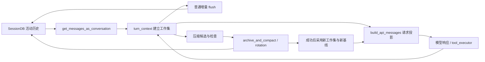

# Session 存储与 Auxiliary 旁路子系统

<!-- legacy-review:start -->
> **2026-10-15 校订导航**：状态归谁管：恢复、普通 flush 与压缩提交。\
> **核对范围**：增加 DB→工作集、普通 flush、压缩提交三条链路及状态差异。\
> **适用基线**：本地源码 `60d00c5633ad`；不是最新发布版本声明。原稿版本、行号、性能数字与长代码块若未在校订范围内，仍按历史示例阅读。
> **先读当前结论**：[当前实现导读](CURRENT_IMPLEMENTATION.md#current-restore) · **现行分卷**：[03-runtime-session-and-loop.md](../../volumes/03-runtime-session-and-loop.md) · [具体改动与未验证项](REVIEW_AND_CHANGES.md) · [返回全目录](README.md)

<!-- legacy-review:end -->

## 目录

<!-- visible-toc:start -->
- [1. 为何单独成篇](#section-1)
- [2. `hermes_state` 包（会话真源）](#section-2)
- [3. 工作区 message 的三条核心链路](#section-3)
- [4. `agent/auxiliary_*`（旁路模型调用）](#section-4)
- [5. 与 Gateway / Surface 的交界](#section-5)
- [6. 文档维护](#section-6)
<!-- visible-toc:end -->

> **状态**: Canonical（2026-10 增补）  
> **源码根**: `hermes-dev/hermes-agent/`  
> **关联**: [MEMORY_SYSTEM.md](MEMORY_SYSTEM.md) · [CLI_GATEWAY_SYSTEM.md](CLI_GATEWAY_SYSTEM.md) · [AGENT_LOOP_ARCHITECTURE.md](AGENT_LOOP_ARCHITECTURE.md)

---

## 1. 为何单独成篇

0.15 之后主循环迁入 `conversation_loop.py`；**0.19+ → 工作区 HEAD** 继续把 **SessionDB** 拆成 `hermes_state_*` 包，并把 **压缩 / 搜索 / 结构化输出** 等旁路 LLM 收敛到 `agent/auxiliary_*`。旧文档仍写「单文件 `hermes_state.py` ~6k 行 + `auxiliary_client.py`」已不准确。

---

## 2. `hermes_state` 包（会话真源）

| 模块 | 职责 |
|------|------|
| `hermes_state.py` | 对外 façade / `SessionDB` 入口（薄聚合） |
| `hermes_state_sessions.py` | 会话 CRUD、元数据 |
| `hermes_state_messages.py` | 消息正文、`api_content` sidecar |
| `hermes_state_schema.py` | 表结构、迁移 |
| `hermes_state_wal.py` · `hermes_state_dbfile.py` | SQLite WAL、文件布局 |
| `hermes_state_fts.py` · `hermes_state_search.py` | FTS5 / session_search 索引 |
| `hermes_state_compression.py` | 落盘压缩相关 |
| `hermes_state_gateway.py` · `hermes_state_telegram.py` | 网关 / Telegram 专题键 |
| `hermes_state_rewind.py` · `hermes_state_tool_retries.py` | `/undo`、工具重试状态 |
| `hermes_state_usage.py` | 用量记账缓存 |
| `hermes_state_lockguard.py` · `hermes_state_lockowners.py` | 并发读写的锁语义 |
| `hermes_state_maintenance.py` · `hermes_state_repair.py` · `hermes_state_health.py` | `doctor`、自愈、健康探针 |
| `hermes_state_registry.py` · `hermes_state_holders.py` | 进程内注册表、持有者 |
| 其它 `hermes_state_*.py` | 身份、标题、时间线、profile 修复、可移植导出等 |

**读代码建议**：从 `hermes_state.py` 的 `SessionDB` 公开方法往下跳；Gateway 会话键见 `gateway/session.py` + `hermes_state_gateway.py`。

---

## 3. 工作区 message 的三条核心链路

这里的“工作区”指 Agent 运行中的 `messages: list[dict]`，不是独立的 WorkspaceMessage 类。

| 链路 | 当前入口 | 工作集怎么变 | DB 怎么变 |
|---|---|---|---|
| 启动 / 重启恢复 | `SessionMessagesMixin.get_messages_as_conversation` → 调用入口传 history → `agent.turn_context` | 解码历史，建立新列表并 hydrate 状态，追加本轮 user | 读取活动历史；不是恢复线程栈，也不把所有 inactive 行塞回请求 |
| 普通推理 flush | `SessionPersistenceMixin._flush_messages_to_session_db_unlocked` | 追加 assistant/tool/user，成功写库后更新持久化标记 | 增量批量写入；不把全表旧消息统一设 inactive |
| 推理中压缩提交 | `conversation_compression._commit_compaction` → `archive_and_compact` 或 rotation | 候选提交成功后采用新消息集，重新建立 flush 基线 | 原 session 事务归档/重插，或父子 session 转接；覆盖集合与并发尾部受到保护 |

`active=0, compacted=1` 表示被摘要覆盖的旧行，不表示所有旧行。原样携带的尾部或并发新增消息的旧副本可为 `active=0, compacted=0`，新副本继续 active。普通 flush、轻量 prune 和完整摘要压缩不是同一个数据库操作。

字段、sidecar、请求投影、租约与失败边界详见 [当前实现 §2–§6](CURRENT_IMPLEMENTATION.md#current-messages)。

## 4. `agent/auxiliary_*`（旁路模型调用）

主对话模型之外的 LLM 调用（压缩摘要、session_search 总结、vision 旁路、结构化输出、Codex/Anthropic 特殊线等）集中在 **auxiliary 子系统**，避免 `conversation_loop` 膨胀。

| 方向 | 代表模块 |
|------|----------|
| 统一入口 | `auxiliary_client.py`、`auxiliary_wire.py` |
| 配置与健康 | `auxiliary_task_config.py`、`auxiliary_health.py`、`auxiliary_unavailable.py` |
| 流式与降级 | `auxiliary_stream_watchdog.py`、`auxiliary_fallback_recovery.py` |
| Provider 特化 | `auxiliary_codex_response.py`、`auxiliary_plugin_oauth.py`、`auxiliary_local_runtime.py` |
| 结构化 / reasoning | `auxiliary_structured_output.py`、`auxiliary_reasoning_floor.py` |

配置键通常挂在 `cli-config.yaml` 的 `auxiliary.*`（如 `session_search.max_concurrency`），详见 [TOOLS_SYSTEM.md](TOOLS_SYSTEM.md) session_search 节与 [MEMORY_SYSTEM.md](MEMORY_SYSTEM.md)。

---

## 5. 与 Gateway / Surface 的交界

| 能力 | 模块 |
|------|------|
| 出站义务 / 漏发检测 | `gateway/delivery_ledger.py` |
| 浏览器远程控制 | `gateway/browser_control_broker.py` |
| TUI 桥（86+ 模块） | `tui_gateway/`（见 [SURFACE_ARCHITECTURE.md](SURFACE_ARCHITECTURE.md)） |
| 安装版本戳 | `hermes_cli/steward.py`、`read_install_stamp`（`__version__` 懒加载） |

---

## 6. 文档维护

更新 Session 行为时：**改本文 + `MEMORY_SYSTEM` + `CLI_GATEWAY` §4** 中与 `SessionDB` 相关的段落；勿再在 `ARCHITECTURE.md` §11 重复展开每个 `hermes_state_*` 文件。
