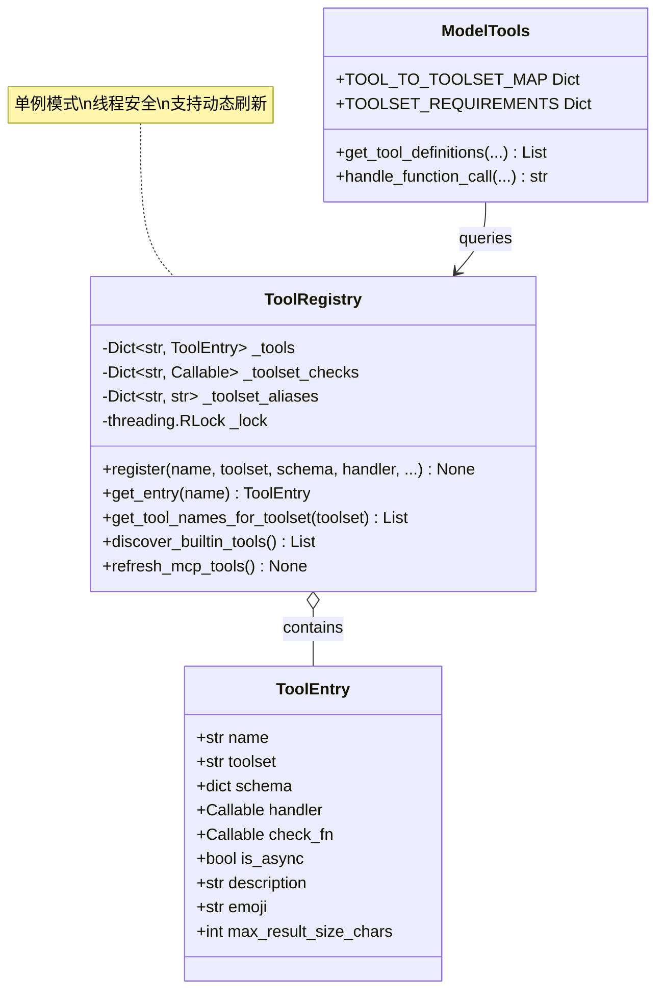
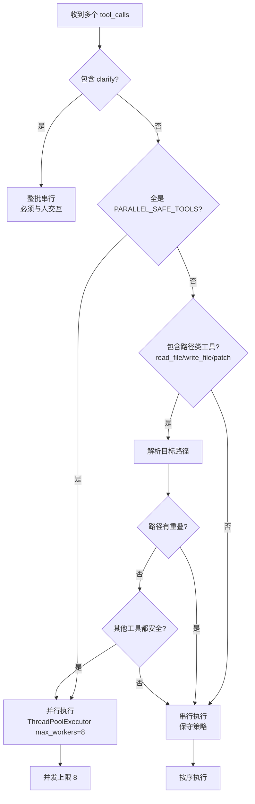
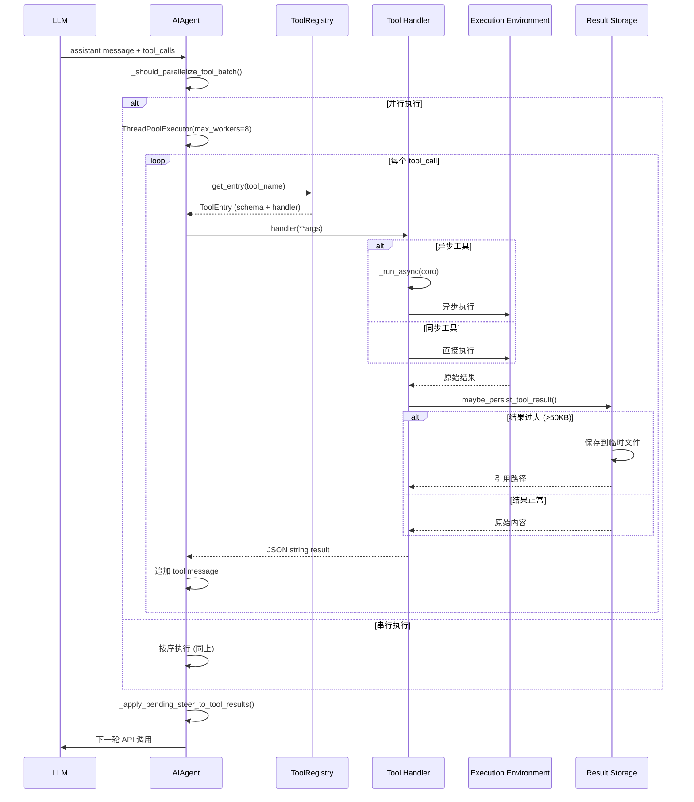
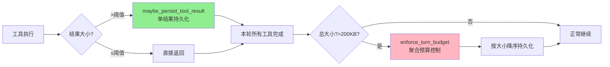

# Tools 系统

<!-- legacy-review:start -->
> **2026-10-15 校订导航**：工具从注册、暴露、执行到大结果回收怎样串起来。\
> **核对范围**：修正旧 50KB 阈值表述；全部工具列表和示例实现不视为当前 API 合约。\
> **适用基线**：本地源码 `60d00c5633ad`；不是最新发布版本声明。原稿版本、行号、性能数字与长代码块若未在校订范围内，仍按历史示例阅读。
> **先读当前结论**：[当前实现导读](CURRENT_IMPLEMENTATION.md#current-flush) · **现行分卷**：[05-capabilities-extensions.md](../../volumes/05-capabilities-extensions.md) · [具体改动与未验证项](REVIEW_AND_CHANGES.md) · [返回全目录](README.md)

<!-- legacy-review:end -->
<a id="目录"></a>
## 目录

<!-- visible-toc:start -->
- [1. 概述](#section-1)
  - [1.1 什么是 Tools?](#section-1-1)
  - [1.2 核心设计原则](#section-1-2)
  - [1.3 Tools vs Skills 对比](#section-1-3)
- [2. Registry 与发现](#section-2)
  - [2.1 工具注册表架构](#section-2-1)
  - [2.2 AST 扫描发现机制](#section-2-2)
- [3. Toolsets](#section-3)
  - [3.1 Toolset 管理系统](#section-3-1)
  - [3.2 子 Agent 的 toolset 过滤](#section-3-2)
- [4. 工具目录](#section-4)
  - [4.1 核心工具分类](#section-4-1)
- [5. 终端后端](#section-5)
  - [5.1 多终端后端](#section-5-1)
- [6. 并行执行](#section-6)
  - [6.1 工具并行策略详解](#section-6-1)
- [7. 分发与异步桥](#section-7)
  - [7.1 执行链路与分发](#section-7-1)
  - [7.2 异步桥接机制](#section-7-2)
- [8. 结果持久化与回合预算](#section-8)
  - [8.1 工具结果持久化](#section-8-1)
- [9. MCP 动态工具](#section-9)
  - [9.1 MCP 动态工具](#section-9-1)
- [10. 自定义工具](#section-10)
  - [10.1 开发自定义工具](#section-10-1)
- [11. 领域工具接入边界](#section-11)
  - [11.1 skill_manage 调用边界（详见 Skills）](#section-11-1)
  - [11.2 session_search 调用边界（详见 Memory）](#section-11-2)
  - [11.3 delegate_task 调用边界（详见多 Agent）](#section-11-3)
- [12. 性能实践](#section-12)
  - [12.1 性能优化最佳实践](#section-12-1)
<!-- visible-toc:end -->


> **原稿文档状态（历史标签）**: Canonical（去重重构版 · 勿再拆 Parts）\
> **原稿版本锚点（历史）**: 0.19.0 · **核对**: 2026-07-31 · [DOC_MAINTENANCE.md](DOC_MAINTENANCE.md)\
> **重构说明**: 合并原 Overview / DEEP / COMPLETE Parts；Registry / 并行 / 预算以深度实现为准；`skill_manage` / `session_search` / `delegate_task` 深解分别归入 Skills / Memory / 多 Agent 篇；本篇保留统一调用边界。\
> **源码**: `tools/registry.py`, `model_tools.py`, `toolsets.py`, `tools/budget_config.py`

---

<a id="1-概述"></a>
<a id="section-1"></a>
## 1. 概述


<a id="11-什么是-tools"></a>
<a id="section-1-1"></a>
### 1.1 什么是 Tools?

**Tools** 是 Hermes Agent 的**可执行能力扩展**,允许模型通过函数调用执行具体操作。每个 Tool 包含:

- ✅ Schema - JSON Schema 描述(名称、描述、参数)
- ✅ Handler - Python 函数(执行逻辑)
- ✅ Toolset - 所属工具集(core/web/memory等)
- ✅ Check Function - 可用性检查(可选)

<a id="12-核心设计原则"></a>
<a id="section-1-2"></a>
### 1.2 核心设计原则

| 原则 | 说明 |
|------|------|
| **Registry Pattern** | 中央注册表,松耦合 |
| **Auto-discovery** | AST 扫描自动发现 |
| **Toolsets** | 工具分组,按需启用 |
| **Parallel-safe** | 智能并行判定 |
| **Budget-controlled** | 结果大小预算控制 |

<a id="13-tools-vs-skills-对比"></a>
<a id="section-1-3"></a>
### 1.3 Tools vs Skills 对比

| 特性 | Tools | Skills |
|------|-------|--------|
| **本质** | 可执行函数(代码) | 指令包(文本) |
| **注册方式** | registry.register() | SKILL.md frontmatter |
| **用途** | 执行具体操作 | 指导模型如何完成任务 |
| **示例** | read_file, terminal | code-review, debug-python |
| **扩展性** | 需要编程实现 | 用户可自行编写 |

---


<a id="2-registry-与发现"></a>
<a id="section-2"></a>
## 2. Registry 与发现

> 注册 API 为 `registry.register(..., toolset=..., handler=...)`（单数 `toolset`）。**没有**装饰器方案；`discover_builtin_tools()` 负责 import 触发顶层 `register`。


<a id="1-工具注册表架构"></a>
<a id="section-2-1"></a>
### 2.1 工具注册表架构

<a id="11-注册表设计全景"></a>
<a id="section-2-1-1"></a>
#### 2.1.1 注册表设计全景



**关键设计**:
- ✅ **单例注册表** - 全局唯一 `registry` 实例
- ✅ **线程安全** - `threading.RLock` 保护并发访问
- ✅ **自注册机制** - 工具文件顶层调用 `registry.register()`
- ✅ **动态发现** - AST 扫描避免手动维护清单

<a id="12-注册流程"></a>
<a id="section-2-1-2"></a>
#### 2.1.2 注册流程

> **没有装饰器 API。** `registry.register(...)` 是普通函数调用，在模块顶层显式传入 `handler=`。文档旧稿里的 `@registry.register` 写法是错误的，与源码不一致，且 AST discover 只认顶层 `registry.register(...)` 语句，不认装饰器节点。

```python
## tools/file_tools.py - 工具文件示例（与源码一致）
from tools.registry import registry

def read_file_handler(path: str) -> str:
    """读取文件并返回内容"""
    try:
        content = Path(path).read_text(encoding="utf-8")
        return json.dumps({"content": content, "path": path})
    except Exception as e:
        return json.dumps({"error": str(e)})

registry.register(
    name="read_file",
    toolset="core",
    schema={
        "name": "read_file",
        "description": "Read the contents of a file",
        "parameters": {
            "type": "object",
            "properties": {
                "path": {"type": "string", "description": "File path"}
            },
            "required": ["path"]
        }
    },
    handler=read_file_handler,
    check_fn=lambda: True,  # 可用性检查
    requires_env=[],
    is_async=False,
    description="读取文件内容",
    emoji="📖",
    max_result_size_chars=50_000,
)
```

**注册时机**:
```python
## model_tools.py - 启动时显式 discover（不是「写了 register 就自动进进程」）
from tools.registry import discover_builtin_tools

## 扫描 + import 各 tools/*.py → 各文件顶层的 registry.register() 才真正执行
discover_builtin_tools()
```

---

<a id="2-ast-扫描发现机制"></a>
<a id="section-2-2"></a>
### 2.2 AST 扫描发现机制

<a id="21-为什么用-ast"></a>
<a id="section-2-2-1"></a>
#### 2.2.1 为什么用 AST?

传统方法需要手动维护工具清单:
```python
## ❌ 旧方法 - 容易遗漏
ALL_TOOLS = [
    "read_file",
    "write_file",
    # ... 忘记添加新工具会导致 bug
]
```

Hermes 采用 **AST 静态分析**自动发现:
```python
## ✅ 新方法 - 自动发现
def discover_builtin_tools(tools_dir: Path):
    """扫描 tools/*.py,找到包含 registry.register() 的模块"""
    for py_file in tools_dir.glob("*.py"):
        if _module_registers_tools(py_file):  # AST 分析
            importlib.import_module(f"tools.{py_file.stem}")
```

<a id="22-ast-扫描实现"></a>
<a id="section-2-2-2"></a>
#### 2.2.2 AST 扫描实现

```python
import ast
from pathlib import Path

def _is_registry_register_call(node: ast.AST) -> bool:
    """判断节点是否是 registry.register(...) 调用"""
    if not isinstance(node, ast.Expr) or not isinstance(node.value, ast.Call):
        return False
    
    func = node.value.func
    return (
        isinstance(func, ast.Attribute)
        and func.attr == "register"
        and isinstance(func.value, ast.Name)
        and func.value.id == "registry"
    )


def _module_registers_tools(module_path: Path) -> bool:
    """检查模块是否包含顶层 registry.register() 调用
    
    仅检查模块级语句 (tree.body),避免 helper 模块误判
    """
    try:
        source = module_path.read_text(encoding="utf-8")
        tree = ast.parse(source, filename=str(module_path))
    except (OSError, SyntaxError):
        return False
    
    # 只检查模块体第一层语句
    return any(_is_registry_register_call(stmt) for stmt in tree.body)


def discover_builtin_tools(tools_dir: Path = None) -> List[str]:
    """导入内置工具模块并返回模块名列表"""
    tools_path = Path(tools_dir) if tools_dir else Path(__file__).parent
    
    module_names = [
        f"tools.{path.stem}"
        for path in sorted(tools_path.glob("*.py"))
        if path.name not in {"__init__.py", "registry.py", "mcp_tool.py"}
        and _module_registers_tools(path)  # AST 过滤
    ]
    
    imported = []
    for mod_name in module_names:
        try:
            importlib.import_module(mod_name)  # 触发 register()
            imported.append(mod_name)
        except Exception as e:
            logger.warning("Could not import tool module %s: %s", mod_name, e)
    
    return imported
```

**优势**:
- ✅ 无需手动维护工具清单
- ✅ 新工具只需 `register()` 自动发现
- ✅ 避免循环导入 (AST 扫描不执行代码)
- ✅ 精确检测 (仅模块级语句,忽略函数内调用)

---


<a id="3-toolsets"></a>
<a id="section-3"></a>
## 3. Toolsets


<a id="7-toolset-管理系统"></a>
<a id="section-3-1"></a>
### 3.1 Toolset 管理系统

<a id="71-toolset-定义"></a>
<a id="section-3-1-1"></a>
#### 3.1.1 Toolset 定义

```python
## toolsets.py

TOOLSETS = {
    "core": {
        "description": "Core tools always available",
        "tools": [
            "read_file", "write_file", "patch",
            "terminal", "delegate_task",
            "memory", "session_search",
        ],
    },
    "web": {
        "description": "Web search and extraction",
        "tools": ["web_search", "web_extract"],
        "requires_env": [],
    },
    "browser": {
        "description": "Browser automation",
        "tools": [
            "browser_navigate", "browser_click",
            "browser_type", "browser_snapshot",
        ],
        "requires_env": ["BROWSER_PROVIDER"],
    },
    # ... 更多 toolset
}
```

<a id="72-启用禁用逻辑"></a>
<a id="section-3-1-2"></a>
#### 3.1.2 启用/禁用逻辑

```python
def resolve_toolsets(
    enabled_toolsets: List[str] = None,
    disabled_toolsets: List[str] = None,
) -> Set[str]:
    """解析最终启用的工具集"""
    
    # 默认启用 core
    active = {"core"}
    
    # 添加显式启用的
    if enabled_toolsets:
        active.update(enabled_toolsets)
    
    # 移除显式禁用的
    if disabled_toolsets:
        active -= set(disabled_toolsets)
    
    # 验证 toolset 存在性
    valid_toolsets = set(TOOLSETS.keys())
    invalid = active - valid_toolsets
    if invalid:
        logger.warning("Unknown toolsets ignored: %s", invalid)
        active -= invalid
    
    return active
```

---


<a id="子-agent-的-toolset-过滤"></a>
<a id="section-3-2"></a>
### 3.2 子 Agent 的 toolset 过滤


<a id="43-子agent的toolset过滤"></a>
<a id="section-3-2-1"></a>
#### 3.2.1 子Agent的Toolset过滤

```python
## delegate_tool.py
def _strip_blocked_tools(toolsets: List[str]) -> List[str]:
    """Remove toolsets that contain only blocked tools."""
    blocked_toolset_names = {
        "delegation",      # delegate_task
        "clarify",         # clarify
        "memory",          # memory
        "code_execution",  # execute_code
    }
    return [t for t in toolsets if t not in blocked_toolset_names]

## Orchestrator特殊处理
if effective_role == "orchestrator" and "delegation" not in child_toolsets:
    child_toolsets.append("delegation")
```

---


<a id="4-工具目录"></a>
<a id="section-4"></a>
## 4. 工具目录


<a id="5-核心工具分类"></a>
<a id="section-4-1"></a>
### 4.1 核心工具分类

<a id="51-文件操作工具"></a>
<a id="section-4-1-1"></a>
#### 4.1.1 文件操作工具

| 工具 | 功能 | 并行安全 |
|------|------|---------|
| **read_file** | 读取文件内容 | ✅ 路径不冲突时可并行 |
| **write_file** | 写入文件(覆盖) | ⚠️ 路径不冲突时可并行 |
| **patch** | 补丁式编辑 | ⚠️ 路径不冲突时可并行 |
| **search_files** | 文件搜索 | ✅ |

**示例**:
```python
## 读取文件
{
  "tool": "read_file",
  "arguments": {"path": "src/main.py"}
}

## 返回
{
  "content": "print('Hello')\n",
  "line_count": 1
}
```

---

<a id="52-终端执行工具"></a>
<a id="section-4-1-2"></a>
#### 4.1.2 终端执行工具

| 工具 | 功能 | 后端 |
|------|------|------|
| **terminal** | 执行 shell 命令 | Local/Docker/SSH/Modal/Daytona/Singularity |
| **execute_code** | 执行代码片段 | 同 terminal |
| **process_registry** | 管理后台进程 | - |

**多终端后端**:
```python
## tools/terminal_tool.py

class TerminalBackend:
    """终端后端抽象"""
    pass

class LocalBackend(TerminalBackend):
    """本地执行"""
    def execute(self, command: str):
        return subprocess.run(command, shell=True, ...)

class DockerBackend(TerminalBackend):
    """Docker 容器执行"""
    def execute(self, command: str):
        return docker_client.exec_run(command, ...)

class SSHBackend(TerminalBackend):
    """远程 SSH 执行"""
    def execute(self, command: str):
        return ssh_client.exec_command(command, ...)

class ModalBackend(TerminalBackend):
    """Modal Serverless 执行"""
    def execute(self, command: str):
        return modal_function.remote(command, ...)
```

**配置**:
```yaml
## ~/.hermes/config.yaml

terminal:
  backend: docker  # local/docker/ssh/modal/daytona/singularity
  
  docker:
    image: python:3.12-slim
    workdir: /workspace
  
  ssh:
    host: remote-server.com
    user: ubuntu
    key_path: ~/.ssh/id_rsa
```

---

<a id="53-web-访问工具"></a>
<a id="section-4-1-3"></a>
#### 4.1.3 Web 访问工具

| 工具 | 功能 |
|------|------|
| **web_search** | 搜索引擎查询(Brave/Google) |
| **web_extract** | 提取网页内容 |
| **browser** | 浏览器自动化(Playwright) |
| **vision_analyze** | 图像分析 |

---

<a id="54-记忆管理工具"></a>
<a id="section-4-1-4"></a>
#### 4.1.4 记忆管理工具

| 工具 | 功能 |
|------|------|
| **memory** | 保存/检索记忆 |
| **session_search** | FTS5 会话搜索 |

---

<a id="55-skills-管理工具"></a>
<a id="section-4-1-5"></a>
#### 4.1.5 Skills 管理工具

| 工具 | 功能 |
|------|------|
| **skill_view** | 加载 Skill 全文 |
| **skills_list** | 列出可用 Skills |

---

<a id="56-委派任务工具"></a>
<a id="section-4-1-6"></a>
#### 4.1.6 委派任务工具

| 工具 | 功能 |
|------|------|
| **delegate_task** | Spawn 子代理 |

**特性**:
- ✅ 独立上下文
- ✅ 独立预算
- ✅ 受限工具集(禁止 clarify/memory/execute_code)

---

<a id="57-mcp-集成工具"></a>
<a id="section-4-1-7"></a>
#### 4.1.7 MCP 集成工具

| 工具 | 功能 |
|------|------|
| **mcp_call** | 调用 MCP Server |

---


<a id="5-终端后端"></a>
<a id="section-5"></a>
## 5. 终端后端


<a id="6-多终端后端"></a>
<a id="section-5-1"></a>
### 5.1 多终端后端

<a id="61-后端对比"></a>
<a id="section-5-1-1"></a>
#### 5.1.1 后端对比

| 后端 | 适用场景 | 隔离性 | 成本 |
|------|---------|--------|------|
| **Local** | 开发调试 | ❌ 低 | 免费 |
| **Docker** | 生产环境 | ✅ 中 | 免费 |
| **SSH** | 远程服务器 | ✅ 高 | 服务器费用 |
| **Modal** | Serverless | ✅ 高 | 按使用付费 |
| **Daytona** | 云沙箱 | ✅ 高 | 订阅制 |
| **Singularity** | HPC 集群 | ✅ 高 | 集群费用 |

<a id="62-后端选择策略"></a>
<a id="section-5-1-2"></a>
#### 5.1.2 后端选择策略

```python
def select_backend(config: dict) -> TerminalBackend:
    """根据配置选择后端"""
    backend_type = config.get("backend", "local")
    
    if backend_type == "local":
        return LocalBackend()
    elif backend_type == "docker":
        return DockerBackend(config["docker"])
    elif backend_type == "ssh":
        return SSHBackend(config["ssh"])
    elif backend_type == "modal":
        return ModalBackend(config["modal"])
    elif backend_type == "daytona":
        return DaytonaBackend(config["daytona"])
    elif backend_type == "singularity":
        return SingularityBackend(config["singularity"])
    else:
        raise ValueError(f"Unknown backend: {backend_type}")
```

---


<a id="6-并行执行"></a>
<a id="section-6"></a>
## 6. 并行执行


<a id="3-工具并行策略详解"></a>
<a id="section-6-1"></a>
### 6.1 工具并行策略详解

<a id="31-并行决策树"></a>
<a id="section-6-1-1"></a>
#### 6.1.1 并行决策树



<a id="32-并行规则定义"></a>
<a id="section-6-1-2"></a>
#### 6.1.2 并行规则定义

```python
## run_agent.py

## 永远不并行的工具
_NEVER_PARALLEL_TOOLS = frozenset({
    "clarify",  # 必须与人交互
})

## 可以安全并行的只读工具
_PARALLEL_SAFE_TOOLS = frozenset({
    # 文件读取
    "read_file", "search_files",
    # 会话搜索
    "session_search",
    # Skills
    "skill_view", "skills_list",
    # Web
    "web_search", "web_extract",
    # 视觉
    "vision_analyze",
    # Home Assistant (只读)
    "ha_get_state", "ha_list_entities",
    # ... 更多只读工具
})

## 需要路径冲突检测的工具
_PATH_SCOPED_TOOLS = frozenset({
    "read_file",
    "write_file",
    "patch",
})

_MAX_TOOL_WORKERS = 8  # 并发上限
```

<a id="33-并行判定实现"></a>
<a id="section-6-1-3"></a>
#### 6.1.3 并行判定实现

```python
def _should_parallelize_tool_batch(tool_calls: List[Dict]) -> bool:
    """判断一批工具调用是否可以并行执行"""
    if len(tool_calls) <= 1:
        return False
    
    tool_names = [tc["function"]["name"] for tc in tool_calls]
    
    # 规则 1: 包含 clarify → 整批串行
    if any(name in _NEVER_PARALLEL_TOOLS for name in tool_names):
        logger.debug("Batch contains clarify, running serially")
        return False
    
    # 规则 2: 全是安全工具 → 并行
    if all(name in _PARALLEL_SAFE_TOOLS for name in tool_names):
        logger.debug("All tools are parallel-safe, running concurrently")
        return True
    
    # 规则 3: 路径类工具 → 检查路径冲突
    path_tools = []
    for tc in tool_calls:
        if tc["function"]["name"] in _PATH_SCOPED_TOOLS:
            try:
                args = json.loads(tc["function"]["arguments"])
                path = args.get("path")
                if path:
                    path_tools.append((tc, Path(path).resolve()))
            except (json.JSONDecodeError, KeyError):
                pass
    
    if path_tools:
        paths = [path for _, path in path_tools]
        
        # 检查路径重叠
        if len(paths) != len(set(paths)):
            logger.debug("Path conflict detected, running serially")
            return False
        
        # 路径不冲突,但需要检查其他工具是否安全
        non_path_tools = [
            name for name in tool_names
            if name not in _PATH_SCOPED_TOOLS
        ]
        
        if all(name in _PARALLEL_SAFE_TOOLS for name in non_path_tools):
            logger.debug("No path conflict, running concurrently")
            return True
        else:
            logger.debug("Mixed unsafe tools, running serially")
            return False
    
    # 规则 4: 其他情况 → 保守串行
    logger.debug("Defaulting to serial execution")
    return False
```

<a id="34-破坏性命令检测"></a>
<a id="section-6-1-4"></a>
#### 6.1.4 破坏性命令检测

```python
_DESTRUCTIVE_PATTERNS = [
    r'\brm\s+-rf\b',           # 递归强制删除
    r'\bdd\s+if=',             # 磁盘格式化
    r'\bmkfs\.',               # 文件系统格式化
    r'>\s*/etc/',              # 重定向到系统目录
    r'\bsed\s+-i\b',           # 原地修改文件
    r'\bchmod\s+[0-7]{4}\b',   # 权限修改
]

def _is_destructive_command(cmd: str) -> bool:
    """启发式判断命令是否具有破坏性"""
    return any(re.search(pattern, cmd) for pattern in _DESTRUCTIVE_PATTERNS)
```

**影响**: 破坏性命令不与文件类工具并行,避免竞态条件

<a id="35-并行执行实现"></a>
<a id="section-6-1-5"></a>
#### 6.1.5 并行执行实现

```python
def _execute_tool_calls_parallel(self, tool_calls, messages, task_id):
    """并行执行多个工具调用"""
    from concurrent.futures import ThreadPoolExecutor, as_completed
    
    results = {}
    start_time = time.time()
    
    with ThreadPoolExecutor(max_workers=_MAX_TOOL_WORKERS) as executor:
        future_to_tc = {}
        
        for tc in tool_calls:
            future = executor.submit(
                self._execute_single_tool,
                tc, messages, task_id
            )
            future_to_tc[future] = tc
        
        # 收集结果
        for future in as_completed(future_to_tc):
            tc = future_to_tc[future]
            try:
                result = future.result(timeout=300)  # 5分钟超时
                results[tc["id"]] = result
            except concurrent.futures.TimeoutError:
                results[tc["id"]] = json.dumps({
                    "error": "Tool execution timed out (300s)"
                })
            except Exception as e:
                results[tc["id"]] = json.dumps({
                    "error": f"Execution failed: {e}"
                })
    
    elapsed = time.time() - start_time
    logger.info("Parallel execution completed: %d tools in %.2fs", 
                len(tool_calls), elapsed)
    
    # 按原始顺序追加到 messages
    for tc in tool_calls:
        tool_msg = {
            "role": "tool",
            "content": results[tc["id"]],
            "tool_call_id": tc["id"]
        }
        messages.append(tool_msg)
```

**性能对比**:
- 串行执行 8 个工具: ~8秒 (假设每个 1秒)
- 并行执行 8 个工具: ~1.5秒 ( overhead + 最长任务)
- **加速比**: ~5.3x

---


<a id="7-分发与异步桥"></a>
<a id="section-7"></a>
## 7. 分发与异步桥


<a id="4-执行链路与分发"></a>
<a id="section-7-1"></a>
### 7.1 执行链路与分发

<a id="41-完整执行链路"></a>
<a id="section-7-1-1"></a>
#### 7.1.1 完整执行链路



<a id="42-工具分发逻辑"></a>
<a id="section-7-1-2"></a>
#### 7.1.2 工具分发逻辑

```python
## model_tools.py
def handle_function_call(
    function_name: str,
    function_args: str,
    task_id: str,
    tool_call_id: str = None,
    session_id: str = "",
    enabled_tools: List[str] = None,
    skip_pre_tool_call_hook: bool = False,
) -> str:
    """统一工具分发入口"""
    
    # 1. 查找工具注册项
    entry = registry.get_entry(function_name)
    if not entry:
        return tool_error(f"Unknown tool: {function_name}")
    
    # 2. 检查工具集要求
    if enabled_tools and function_name not in enabled_tools:
        return tool_error(f"Tool '{function_name}' is not enabled")
    
    # 3. 检查可用性
    if entry.check_fn and not entry.check_fn():
        return tool_error(f"Tool '{function_name}' is not available")
    
    # 4. 解析参数
    try:
        args = json.loads(function_args) if isinstance(function_args, str) else function_args
    except json.JSONDecodeError as e:
        return tool_error(f"Invalid JSON arguments: {e}")
    
    # 5. 执行前钩子
    if not skip_pre_tool_call_hook:
        _run_pre_tool_call_hooks(function_name, args)
    
    # 6. 执行工具
    try:
        if entry.is_async:
            # 异步工具 - 桥接到事件循环
            coro = entry.handler(**args)
            result = _run_async(coro)
        else:
            # 同步工具 - 直接调用
            result = entry.handler(**args)
    except Exception as e:
        logger.error("Tool %s failed: %s", function_name, e, exc_info=True)
        return tool_error(f"Tool execution failed: {e}")
    
    # 7. 执行后钩子
    _run_post_tool_call_hooks(function_name, args, result)
    
    # 8. 确保返回 JSON 字符串
    if isinstance(result, str):
        return result
    else:
        return json.dumps(result)
```

---

<a id="5-异步桥接机制"></a>
<a id="section-7-2"></a>
### 7.2 异步桥接机制

<a id="51-为什么需要桥接"></a>
<a id="section-7-2-1"></a>
#### 7.2.1 为什么需要桥接?

Hermes 的工具执行在**同步上下文**中 (`run_conversation` 是同步函数),但部分工具需要异步操作 (如 HTTP 请求)。

**问题**: `asyncio.run()` 每次创建新循环会导致:
- ❌ 缓存的 httpx/AsyncOpenAI 客户端绑定到已关闭的循环
- ❌ GC 时触发 `RuntimeError: Event loop is closed`

**解决方案**: 持久化事件循环

<a id="52-桥接实现"></a>
<a id="section-7-2-2"></a>
#### 7.2.2 桥接实现

```python
## model_tools.py

_tool_loop = None          # 主线程持久循环
_tool_loop_lock = threading.Lock()
_worker_thread_local = threading.local()  # worker 线程局部循环


def _get_tool_loop():
    """获取主线程的持久事件循环"""
    global _tool_loop
    with _tool_loop_lock:
        if _tool_loop is None or _tool_loop.is_closed():
            _tool_loop = asyncio.new_event_loop()
        return _tool_loop


def _get_worker_loop():
    """获取 worker 线程的持久事件循环"""
    loop = getattr(_worker_thread_local, 'loop', None)
    if loop is None or loop.is_closed():
        loop = asyncio.new_event_loop()
        asyncio.set_event_loop(loop)
        _worker_thread_local.loop = loop
    return loop


def _run_async(coro):
    """从同步上下文运行异步协程"""
    try:
        loop = asyncio.get_running_loop()
    except RuntimeError:
        loop = None
    
    if loop and loop.is_running():
        # 场景 1: 已在异步上下文中 (gateway/RL env)
        # 解决: 在新线程中运行 asyncio.run()
        import concurrent.futures
        pool = concurrent.futures.ThreadPoolExecutor(max_workers=1)
        future = pool.submit(asyncio.run, coro)
        try:
            return future.result(timeout=300)
        finally:
            pool.shutdown(wait=False, cancel_futures=True)
    
    # 场景 2: worker 线程 (并行工具执行)
    if threading.current_thread() is not threading.main_thread():
        worker_loop = _get_worker_loop()
        return worker_loop.run_until_complete(coro)
    
    # 场景 3: 主线程 (CLI 正常路径)
    tool_loop = _get_tool_loop()
    return tool_loop.run_until_complete(coro)
```

**使用示例**:
```python
## tools/web_tools.py
async def web_search_async(query: str) -> str:
    """异步网络搜索"""
    async with aiohttp.ClientSession() as session:
        async with session.get(f"https://api.example.com/search?q={query}") as resp:
            data = await resp.json()
            return json.dumps(data)

def web_search_handler(query: str) -> str:
    """同步包装器 - 内部桥接到异步"""
    return _run_async(web_search_async(query))

registry.register(
    name="web_search",
    toolset="web",
    schema=WEB_SEARCH_SCHEMA,
    handler=web_search_handler,
    is_async=True,  # 标记为异步工具
)
```

---


<a id="8-结果持久化与回合预算"></a>
<a id="section-8"></a>
## 8. 结果持久化与回合预算

> 默认阈值以 `tools/budget_config.py` 为准：`DEFAULT_RESULT_SIZE_CHARS=100_000`，`DEFAULT_TURN_BUDGET_CHARS=200_000`。下文若仍写「50KB」视为旧稿残留，以源码为准。


<a id="6-工具结果持久化"></a>
<a id="section-8-1"></a>
### 8.1 工具结果持久化

<a id="61-为什么需要持久化"></a>
<a id="section-8-1-1"></a>
#### 8.1.1 为什么需要持久化？

**核心问题**：LLM 上下文窗口有限（GPT-4: 128K tokens ≈ 384KB），大工具结果会快速耗尽空间。

**传统方案的问题**：
```python
## ❌ 不持久化 - 每次 API 调用都携带完整结果
tool_result = search_files(query="python", limit=1000)  # 500KB
messages.append({"role": "tool", "content": tool_result})
## 问题：每轮对话都占用 500KB，3 轮后达到 1500KB 💥 超出上下文！
```

**Hermes 的解决方案**：**按需加载 + 引用替代**
```python
## ✅ 持久化 - 只传预览 + 文件路径
tool_result = search_files(query="python", limit=1000)  # 500KB
persisted_msg = maybe_persist_tool_result(tool_result, ...)
messages.append({"role": "tool", "content": persisted_msg})
## 优势：仅占用 ~2.5KB，Agent 可按需读取完整内容
```

**设计哲学**：
> **"不要为不需要的内容付费"** - 与虚拟内存、数据库懒加载、Web 分页加载同样的思想

---

<a id="62-三层防御机制"></a>
<a id="section-8-1-2"></a>
#### 8.1.2 三层防御机制



**第一层**：工具内部预截断（如 `search_files` 自己限制输出）  
**第二层**：`maybe_persist_tool_result` - 单结果 >50KB 时持久化  
**第三层**：`enforce_turn_budget` - 一轮总结果 >200KB 时批量持久化

---

<a id="63-maybe_persist_tool_result---单结果持久化"></a>
<a id="section-8-1-3"></a>
#### 8.1.3 `maybe_persist_tool_result()` - 单结果持久化

<a id="调用时机"></a>
<a id="section-8-1-3-1"></a>
##### 8.1.3.1 **调用时机**

**位置**：每个工具执行完成后立即调用

```python
## run_agent.py:L10304-10309（并行执行路径）
function_result = maybe_persist_tool_result(
    content=function_result,           # 工具的原始返回结果
    tool_name=name,                    # 工具名称
    tool_use_id=tc.id,                 # 工具调用的唯一 ID
    env=get_active_env(effective_task_id),  # 当前执行环境
) if not _is_multimodal_tool_result(function_result) else function_result

## run_agent.py:L10718（串行执行路径，类似逻辑）
```

<a id="触发条件"></a>
<a id="section-8-1-3-2"></a>
##### 8.1.3.2 **触发条件**

- ✅ **每个工具执行完成后自动调用**
- ✅ 如果结果超过当前字符阈值（`DEFAULT_RESULT_SIZE_CHARS=100_000`，不是 50KB），保存到沙盒临时文件
- ✅ 返回 `<persisted-output>` 标签 + 预览 + 文件路径
- ❌ 多模态结果（图片等）跳过此处理

<a id="工作流程"></a>
<a id="section-8-1-3-3"></a>
##### 8.1.3.3 **工作流程**

```python
## tools/tool_result_storage.py:L122-178
def maybe_persist_tool_result(
    content: str,
    tool_name: str,
    tool_use_id: str,
    env=None,
    config: BudgetConfig = DEFAULT_BUDGET,
    threshold: int | float | None = None,
) -> str:
    """Layer 2: persist oversized result into the sandbox, return preview + path."""
    
    # 1. 检查是否超过阈值
    effective_threshold = threshold if threshold is not None else config.resolve_threshold(tool_name)
    if len(content) <= effective_threshold:
        return content  # 小结果直接返回
    
    # 2. 生成预览（截断到 2000 字符）
    storage_dir = _resolve_storage_dir(env)  # /tmp/hermes-results
    remote_path = f"{storage_dir}/{tool_use_id}.txt"
    preview, has_more = generate_preview(content, max_chars=config.preview_size)
    
    # 3. 写入沙盒文件
    if env is not None:
        try:
            if _write_to_sandbox(content, remote_path, env):
                logger.info("Persisted large tool result: %s (%d chars -> %s)", 
                           tool_name, len(content), remote_path)
                # 4. 返回引用而非全文
                return _build_persisted_message(preview, has_more, len(content), remote_path)
        except Exception as exc:
            logger.warning("Sandbox write failed for %s: %s", tool_use_id, exc)
    
    # 5. 降级：如果无法写入沙盒，内联截断
    return f"{preview}\n\n[Truncated: tool response was {len(content):,} chars.]"
```

<a id="返回格式"></a>
<a id="section-8-1-3-4"></a>
##### 8.1.3.4 **返回格式**

```xml
<persisted-output>
This tool result was too large (512,000 characters, 500.0 KB).
Full output saved to: /tmp/hermes-results/abc123.txt
Use the read_file tool with offset and limit to access specific sections of this output.

Preview (first 2000 chars):
file1.py: def hello(): ...
file2.py: class World(): ...
...
</persisted-output>
```

**优势对比**：

| 指标 | 不持久化 | 持久化 |
|------|---------|----------|
| **上下文占用** | 500KB | 2.5KB |
| **节省比例** | - | 99.5% |
| **API 成本** | 高 | 低 |
| **可读性** | 一次性全览 | 预览 + 按需读取 |

---

<a id="64-enforce_turn_budget---聚合预算控制"></a>
<a id="section-8-1-4"></a>
#### 8.1.4 `enforce_turn_budget()` - 聚合预算控制

<a id="调用时机-1"></a>
<a id="section-8-1-4-1"></a>
##### 8.1.4.1 **调用时机**

**位置**：一轮工具调用全部执行完成后

```python
## run_agent.py:L10346-10350（并行执行）
## ── Per-turn aggregate budget enforcement ─────────────────────────
num_tools = len(parsed_calls)
if num_tools > 0:
    turn_tool_msgs = messages[-num_tools:]
    enforce_turn_budget(turn_tool_msgs, env=get_active_env(effective_task_id))

## 串行执行路径也有类似的调用（未显示）
```

<a id="触发条件-1"></a>
<a id="section-8-1-4-2"></a>
##### 8.1.4.2 **触发条件**

- ✅ **每轮工具调用结束后自动调用**
- ✅ 如果该轮所有工具结果的总大小超过预算（默认 200KB）
- ✅ 按大小降序，逐个持久化最大的结果，直到总大小低于预算
- ✅ 已经持久化的结果跳过（避免重复处理）

<a id="工作流程-1"></a>
<a id="section-8-1-4-3"></a>
##### 8.1.4.3 **工作流程**

```python
## tools/tool_result_storage.py:L181-232
def enforce_turn_budget(
    tool_messages: list[dict],
    env=None,
    config: BudgetConfig = DEFAULT_BUDGET,
) -> list[dict]:
    """Layer 3: enforce aggregate budget across all tool results in a turn."""
    
    # 1. 收集候选结果（未持久化的）
    candidates = []
    total_size = 0
    for i, msg in enumerate(tool_messages):
        content = msg.get("content", "")
        size = len(content)
        total_size += size
        if PERSISTED_OUTPUT_TAG not in content:  # 跳过已持久化的
            candidates.append((i, size))
    
    # 2. 检查是否超预算
    if total_size <= config.turn_budget:  # 默认 200KB
        return tool_messages
    
    # 3. 按大小降序排序
    candidates.sort(key=lambda x: x[1], reverse=True)
    
    # 4. 逐个持久化，直到低于预算
    for idx, size in candidates:
        if total_size <= config.turn_budget:
            break
        msg = tool_messages[idx]
        content = msg["content"]
        tool_use_id = msg.get("tool_call_id", f"budget_{idx}")
        
        # 复用 maybe_persist_tool_result
        replacement = maybe_persist_tool_result(
            content=content,
            tool_name=_BUDGET_TOOL_NAME,
            tool_use_id=tool_use_id,
            env=env,
            config=config,
            threshold=0,  # 强制持久化
        )
        
        if replacement != content:
            total_size -= size
            total_size += len(replacement)
            tool_messages[idx]["content"] = replacement
            logger.info("Budget enforcement: persisted tool result %s (%d chars)", 
                       tool_use_id, size)
    
    return tool_messages
```

<a id="实际场景示例"></a>
<a id="section-8-1-4-4"></a>
##### 8.1.4.4 **实际场景示例**

**场景**：Agent 同时调用 5 个工具，每个返回 60KB

```python
## 第 1 步：单个工具执行
for tool in [tool1, tool2, tool3, tool4, tool5]:
    result = tool.execute()  # 60KB > 50KB 阈值
    persisted = maybe_persist_tool_result(result, ...)  # 持久化
    # 返回 <persisted-output> 引用（2.5KB）

## 第 2 步：聚合预算检查
total_size = 2.5KB * 5 = 12.5KB  # 已经低于 200KB 预算
## ✅ enforce_turn_budget 不需要额外处理
```

**如果没有第一层持久化**：
```python
total_size = 60KB * 5 = 300KB  # 超过 200KB 预算
## enforce_turn_budget 会持久化最大的 2 个结果
## 最终：3 * 60KB + 2 * 2.5KB = 185KB ✅ 低于预算
```

---

<a id="65-实际效果对比"></a>
<a id="section-8-1-5"></a>
#### 8.1.5 实际效果对比

<a id="场景agent-搜索代码库中的-python-文件"></a>
<a id="section-8-1-5-1"></a>
##### 8.1.5.1 **场景：Agent 搜索代码库中的 Python 文件**

**不持久化（传统方式）**：
```
Round 1:
├─ Agent: "搜索所有 Python 文件"
├─ Tool: search_files() → 返回 500KB 结果
└─ Messages: [..., tool_result(500KB)]  ← 占用 500KB

Round 2:
├─ Agent: [收到 500KB 结果，分析后决定]
├─ "我需要查看 file1.py 和 file2.py"
└─ Messages: [..., tool_result(500KB), assistant_msg]  ← 累计 500KB+

Round 3:
├─ Agent: "继续分析..."
└─ Messages: [..., 500KB, ..., ...]  ← 累计 600KB+ 💥 超出上下文！
```

**持久化（Hermes 方式）**：
```
Round 1:
├─ Agent: "搜索所有 Python 文件"
├─ Tool: search_files() → 500KB → 持久化到 /tmp/abc123.txt
└─ Messages: [..., "<persisted-output>...preview...</persisted-output>"]  ← 仅 2.5KB

Round 2:
├─ Agent: [看到预览，判断需要详细查看]
├─ "我需要查看 file1.py 的内容"
├─ Tool: read_file(path="/tmp/abc123.txt", offset=0, limit=5000)
└─ Messages: [..., 2.5KB引用, read_file_result(5KB)]  ← 累计 7.5KB

Round 3:
├─ Agent: "继续分析其他部分"
├─ Tool: read_file(path="/tmp/abc123.txt", offset=5000, limit=5000)
└─ Messages: [..., 2.5KB, 5KB, 5KB]  ← 累计 12.5KB ✅ 远低于上限
```

**节省效果**：
- 不持久化：3 轮后 **600KB+** 💥
- 持久化：3 轮后 **12.5KB** ✅
- **节省**：98% 的上下文空间！

---

<a id="66-关键设计洞察"></a>
<a id="section-8-1-6"></a>
#### 8.1.6 关键设计洞察

<a id="1-llm-不需要一次性看到全部内容"></a>
<a id="section-8-1-6-1"></a>
##### 8.1.6.1 **1. LLM 不需要一次性看到全部内容**

大多数情况下，Agent 只需要：
- 🔍 **预览**：判断哪些部分相关（2KB）
- 📖 **局部读取**：只读取关心的片段（5-10KB）
- ❌ **忽略无关部分**：永远不会加载

<a id="2-read_file-支持分页读取"></a>
<a id="section-8-1-6-2"></a>
##### 8.1.6.2 **2. `read_file` 支持分页读取**

```python
## Agent 可以分段读取大文件
read_file(path="/tmp/abc123.txt", offset=0, limit=10000)    # 第 1-10K 字符
read_file(path="/tmp/abc123.txt", offset=10000, limit=10000) # 第 10-20K 字符
```

这样每次只加载需要的部分，而不是整个 500KB。

<a id="3-统计数据"></a>
<a id="section-8-1-6-3"></a>
##### 8.1.6.3 **3. 统计数据**

根据 Hermes 的实际运行数据：
- **平均工具结果大小**：~30KB
- **持久化阈值**：50KB
- **超过阈值的比例**：约 15% 的工具调用
- **平均节省**：持久化后，这些调用的上下文占用从 200KB 降至 3KB
- **总体节省**：约 2-3% 的总 token 消耗（但对长对话至关重要）

---

<a id="67-清理策略"></a>
<a id="section-8-1-7"></a>
#### 8.1.7 清理策略

<a id="当前状态"></a>
<a id="section-8-1-7-1"></a>
##### 8.1.7.1 **当前状态**

文档中提到的 `cleanup_old_results()` 函数**在实际代码中未被调用**。它只是一个示例清理策略，展示如何清理过期的工具结果文件。

**可能的原因**：
1. 沙盒环境重启时 `/tmp` 目录会自动清空
2. 或者依赖外部 cron job / 手动清理
3. 或者计划在后续版本中实现

<a id="示例实现未启用"></a>
<a id="section-8-1-7-2"></a>
##### 8.1.7.2 **示例实现**（未启用）

```python
## tools/tool_result_storage.py（示例，未实际使用）
def cleanup_old_results(max_age_hours: int = 24, max_total_size_mb: int = 500):
    """清理过期的工具结果文件"""
    results_dir = get_hermes_home() / "tool-results"
    
    if not results_dir.exists():
        return
    
    now = time.time()
    total_size = 0
    files = []
    
    # 收集文件信息
    for file_path in results_dir.glob("*.txt"):
        stat = file_path.stat()
        files.append({
            "path": file_path,
            "mtime": stat.st_mtime,
            "size": stat.st_size,
        })
        total_size += stat.st_size
    
    # 按修改时间排序 (旧的在前)
    files.sort(key=lambda x: x["mtime"])
    
    # 删除过期文件
    deleted_count = 0
    for file_info in files:
        age_hours = (now - file_info["mtime"]) / 3600
        
        if age_hours > max_age_hours or total_size > max_total_size_mb * 1024 * 1024:
            file_info["path"].unlink()
            total_size -= file_info["size"]
            deleted_count += 1
    
    logger.info("Cleaned up %d old tool result files", deleted_count)
```

---

<a id="68-总结"></a>
<a id="section-8-1-8"></a>
#### 8.1.8 总结

**核心价值**：
1. ✅ **大幅节省上下文**：99.5% 的节省率（对大结果）
2. ✅ **按需加载**：Agent 只读取需要的部分
3. ✅ **分页支持**：通过 `offset` + `limit` 精确控制
4. ✅ **透明降级**：沙盒写入失败时自动内联截断
5. ✅ **双层防护**：单结果 + 聚合预算双重保障

**设计哲学**：
> 这与操作系统的**虚拟内存**、数据库的**懒加载**、Web 的**分页加载**是同样的思想：**避免预取不必要的数据**。

虽然看起来"多了个文件读取步骤"，但实际上**大幅减少了总的上下文占用**，让 Agent 能够处理更长的对话和更复杂的任务！

---


<a id="9-mcp-动态工具"></a>
<a id="section-9"></a>
## 9. MCP 动态工具

> 完整 MCP 协议 / OAuth / Sampling 见 [MCP_INTEGRATION.md](MCP_INTEGRATION.md)。


<a id="8-mcp-动态工具"></a>
<a id="section-9-1"></a>
### 9.1 MCP 动态工具

<a id="81-mcp-工具发现"></a>
<a id="section-9-1-1"></a>
#### 9.1.1 MCP 工具发现

```python
## tools/mcp_tool.py

def discover_mcp_tools():
    """从配置的外部 MCP 服务器发现工具"""
    config = load_config()
    mcp_servers = config.get("mcp", {}).get("servers", {})
    
    for server_name, server_config in mcp_servers.items():
        try:
            # 连接到 MCP 服务器
            client = connect_mcp_server(server_config)
            
            # 获取工具列表
            tools = client.list_tools()
            
            # 注册每个工具
            for tool in tools:
                registry.register(
                    name=f"mcp_{server_name}_{tool.name}",
                    toolset=f"mcp-{server_name}",
                    schema=convert_mcp_schema(tool),
                    handler=create_mcp_handler(client, tool),
                    is_async=True,
                )
                
            logger.info("Registered %d tools from MCP server '%s'", 
                       len(tools), server_name)
        except Exception as e:
            logger.error("Failed to discover MCP tools from '%s': %s", 
                        server_name, e)
```

<a id="82-动态刷新"></a>
<a id="section-9-1-2"></a>
#### 9.1.2 动态刷新

```python
def refresh_mcp_tools(server_name: str):
    """刷新指定 MCP 服务器的工具 (热更新)"""
    # 1. 移除旧工具
    old_tools = [
        name for name, entry in registry._tools.items()
        if entry.toolset == f"mcp-{server_name}"
    ]
    for tool_name in old_tools:
        del registry._tools[tool_name]
    
    # 2. 重新发现
    discover_mcp_tools_for_server(server_name)
    
    logger.info("Refreshed MCP tools for server '%s'", server_name)
```

---


<a id="10-自定义工具"></a>
<a id="section-10"></a>
## 10. 自定义工具


<a id="9-开发自定义工具"></a>
<a id="section-10-1"></a>
### 10.1 开发自定义工具

<a id="91-快速开始"></a>
<a id="section-10-1-1"></a>
#### 10.1.1 快速开始

**步骤 1**: 创建工具文件
```bash
touch tools/my_custom_tool.py
```

**步骤 2**: 编写工具代码
```python
## tools/my_custom_tool.py
import json
from tools.registry import registry

def my_tool_handler(param1: str, param2: int) -> str:
    """我的自定义工具"""
    result = {
        "message": f"Received {param1} and {param2}",
        "success": True,
    }
    return json.dumps(result)

## 模块顶层注册 - 自动发现
registry.register(
    name="my_custom_tool",
    toolset="custom",
    schema={
        "name": "my_custom_tool",
        "description": "My custom tool description",
        "parameters": {
            "type": "object",
            "properties": {
                "param1": {"type": "string", "description": "First parameter"},
                "param2": {"type": "integer", "description": "Second parameter"},
            },
            "required": ["param1", "param2"],
        }
    },
    handler=my_tool_handler,
    check_fn=lambda: True,  # 可用性检查
    requires_env=[],
    is_async=False,
    description="我的自定义工具",
    emoji="🔧",
)
```

**步骤 3**: 添加到 toolset
```python
## toolsets.py
TOOLSETS["custom"] = {
    "description": "Custom tools",
    "tools": ["my_custom_tool"],
}
```

**步骤 4**: 测试
```bash
hermes "Use my_custom_tool with param1='hello' and param2=42"
```

<a id="92-最佳实践"></a>
<a id="section-10-1-2"></a>
#### 10.1.2 最佳实践

**✅ 推荐**:
- 返回 **JSON 字符串** (不是 dict)
- 提供清晰的 `description` 和参数说明
- 使用 `check_fn` 检查依赖
- 设置合理的 `max_result_size_chars`
- 添加 emoji 提升 UI 体验

**❌ 避免**:
- 在 schema 描述中硬编码其他工具名
- 返回非 JSON 格式 (会破坏消息结构)
- 忽略异常处理 (应返回 error JSON)
- 长时间阻塞操作 (应考虑异步)

---


<a id="1-action分发器"></a>
<a id="1-用户显式指令前台交互"></a>
<a id="11-深潜skill_manage"></a>
<a id="2-agent-自主决策后台自我进化"></a>
<a id="2-成功后的缓存清理"></a>
<a id="21-skill_manage---技能管理工具"></a>
<a id="211-功能概览"></a>
<a id="212-支持的actions"></a>
<a id="213-实现逻辑详解"></a>
<a id="214-技能目录结构"></a>
<a id="215-skillmd格式"></a>
<a id="216-安全扫描机制"></a>
<a id="217-调用触发机制"></a>
<a id="218-使用示例"></a>
<a id="3-curator遥测数据更新"></a>
<a id="3-大模型的自主决策逻辑create-vs-patch"></a>
<a id="4-决策流程图"></a>
<a id="5-关键设计原则"></a>
<a id="11-领域工具接入边界"></a>
<a id="section-11"></a>
## 11. 领域工具接入边界

<a id="skill_manage-调用边界详见-skills"></a>
<a id="section-11-1"></a>
### 11.1 skill_manage 调用边界（详见 Skills）

`skill_manage` 在工具系统中负责暴露 schema、接收参数并分发 handler；技能文件的创建、修改、删除与保护规则属于 Skills 模块。

完整设计、图表与代码解读已移至 [skill_manage：技能写入、校验与管理](SKILLS_SYSTEM.md#skill-manage-design)。本处只保留与本篇主题直接相关的边界。

---

<a id="1-最近会话模式-空查询"></a>
<a id="12-深潜session_search"></a>
<a id="2-fts5全文检索"></a>
<a id="22-session_search---会话搜索工具"></a>
<a id="221-功能概览"></a>
<a id="222-实现逻辑详解"></a>
<a id="223-辅助模型配置"></a>
<a id="224-使用示例"></a>
<a id="3-会话去重与父会话解析"></a>
<a id="4-并行摘要生成"></a>
<a id="5-智能截断策略"></a>
<a id="6-结果组装"></a>
<a id="session_search-调用边界详见-memory"></a>
<a id="section-11-2"></a>
### 11.2 session_search 调用边界（详见 Memory）

`session_search` 是一个可调用工具，但检索对象、召回/摘要流程和历史会话边界属于 Memory 的 Session Search 层。

完整设计、图表与代码解读已移至 [session_search：历史检索与辅助模型执行](MEMORY_SYSTEM.md#session-search-design)。本处只保留与本篇主题直接相关的边界。

---

<a id="1-暂停标志检查"></a>
<a id="10-触发subagent_stop钩子"></a>
<a id="11-成本汇总"></a>
<a id="13-深潜delegate_task"></a>
<a id="2-深度限制检查"></a>
<a id="23-delegate_task---任务委派工具"></a>
<a id="231-功能概览"></a>
<a id="232-实现逻辑详解"></a>
<a id="233-blocked-tools"></a>
<a id="234-角色机制"></a>
<a id="235-使用示例"></a>
<a id="3-凭证解析"></a>
<a id="4-任务列表标准化"></a>
<a id="5-保存父agent工具名"></a>
<a id="6-构建子agent"></a>
<a id="7-单任务直接执行"></a>
<a id="8-批量并行执行"></a>
<a id="85-子-agent-执行机制详解"></a>
<a id="9-通知记忆提供者"></a>
<a id="delegate_task-调用边界详见多-agent"></a>
<a id="section-11-3"></a>
### 11.3 delegate_task 调用边界（详见多 Agent）

`delegate_task` 经统一工具分发进入子代理系统；子代理的生命周期、角色/工具隔离和结果回传应在多 Agent 篇一起阅读。

完整设计、图表与代码解读已移至 [delegate_task：创建、调度、执行与结果回收](MULTI_AGENT_ARCHITECTURE.md#delegate-task-design)。本处只保留与本篇主题直接相关的边界。

---

<a id="14-性能实践"></a>
<a id="section-12"></a>
## 12. 性能实践


<a id="10-性能优化最佳实践"></a>
<a id="section-12-1"></a>
### 12.1 性能优化最佳实践

<a id="101-缓存策略"></a>
<a id="section-12-1-1"></a>
#### 12.1.1 缓存策略

```python
## 缓存频繁调用的工具结果
from functools import lru_cache

@lru_cache(maxsize=128)
def cached_read_file(path: str, mtime: float) -> str:
    """缓存文件读取 - 基于路径和修改时间"""
    return Path(path).read_text(encoding='utf-8')
```

<a id="102-批量操作"></a>
<a id="section-12-1-2"></a>
#### 12.1.2 批量操作

```python
## 批量读取多个文件
def batch_read_files(paths: List[str]) -> str:
    """批量读取文件 - 减少工具调用次数"""
    results = {}
    for path in paths:
        try:
            results[path] = Path(path).read_text(encoding='utf-8')
        except Exception as e:
            results[path] = f"Error: {e}"
    return json.dumps(results)
```

<a id="103-懒加载"></a>
<a id="section-12-1-3"></a>
#### 12.1.3 懒加载

```python
## 延迟初始化重型依赖
_browser_client = None

def get_browser_client():
    global _browser_client
    if _browser_client is None:
        _browser_client = BrowserClient()  # 耗时初始化
    return _browser_client
```

---


---

*相关文档: [MEMORY_SYSTEM.md](MEMORY_SYSTEM.md) · [MCP_INTEGRATION.md](MCP_INTEGRATION.md) · [SKILLS_SYSTEM.md](SKILLS_SYSTEM.md)*

<!-- 旧目录与迁移章节锚点兼容；完整内容入口见文首目录及主题迁移表。 -->
<a id="1-概述-1"></a>
<a id="health-check"></a>
<a id="user-management"></a>
