# 卷一 · 平台：Hermes 项目整体架构与入口

> **卷标准**：[`VOLUME_STANDARD.md`](VOLUME_STANDARD.md) · **完成度**：[`MANIFEST.md`](MANIFEST.md)  
> **本卷边界**：**整个 `hermes-agent` 项目** 的分层、模块、端到端流程、整体类图；以及各 **入口** 如何汇到 `AIAgent.run_conversation`。呈现细节 → [卷二](02-surface-and-presentation.md)；循环细节 → [卷三](03-runtime-session-and-loop.md)。  
> **权威源码**：`hermes-dev/hermes-agent/`（下文包名均相对此根）  
> **相邻卷**：[02 Surface](02-surface-and-presentation.md) · [03 循环](03-runtime-session-and-loop.md) · [HERMES.md 速览](../HERMES.md)

---

## 📋 目录

- [第1章：项目概览与 Hermes 整体架构](#sec-ch1)
  - [1.1 项目定位（产品能力）](#sec-1-1)
  - [1.2 仓库模块地图（包 ↔ 职责）](#sec-1-2)
  - [1.3 核心模块关系图](#sec-1-3)
  - [1.4 关键组件一览](#sec-1-4)
  - [1.5 四层运行时架构](#sec-1-5)
  - [1.6 端到端流程图](#sec-1-6)
  - [1.7 数据流转全景（不省略旁路）](#sec-1-7)
    - [1.7.1 核心步骤（调用树）](#sec-1-7-1)
    - [1.7.2 入站与门面](#sec-1-7-2)
    - [1.7.3 轮初与 while](#sec-1-7-3)
    - [1.7.4 收尾、出站、drain](#sec-1-7-4)
  - [1.8 整体类图](#sec-1-8)
    - [1.8.1 谁持有谁](#sec-1-8-1)
    - [1.8.2 人机壳](#sec-1-8-2)
    - [1.8.3 IM 网关与出站](#sec-1-8-3)
    - [1.8.4 内核 AIAgent](#sec-1-8-4)
    - [1.8.5 SessionDB](#sec-1-8-5)
    - [1.8.6 工具、记忆、插件](#sec-1-8-6)
    - [1.8.7 定时、看板、房间](#sec-1-8-7)
  - [1.9 为什么 `run_conversation` 有两层](#sec-1-9)
  - [1.10 边上子系统（pm / 插件 / cron / 平台）](#sec-1-10)
  - [1.11 Session 模块（会话原文与租约）](#sec-1-11)
  - [1.12 Memory 模块（四轨：原文 / 内置 / 外部 / FTS）](#sec-1-12)
- [第2章：多入口、出站与权威表](#sec-ch2)
  - [2.1 汇合与出站分叉](#sec-2-1)
  - [2.2 入口类型与 OS 进程](#sec-2-2)
  - [2.3 忙时用户跟进（进门之前）](#sec-2-3)
    - [2.3.2 跟进槽在入口，steer 在内核](#sec-2-3-2)
  - [2.4 入口权威表](#sec-2-4)
  - [2.5 平行入口专卷索引](#sec-2-5)
  - [2.6 入口的上游项目](#sec-2-6)
- [第3章：读哪一卷、去哪 grep](#sec-ch3)

---

<a id="sec-ch1"></a>

## 第1章：项目概览与 Hermes 整体架构

本章回答：**Hermes 这个仓库是什么产品、有哪些模块、数据怎么从人走到盘再走回去。**  
不是只画 `conversation_loop`。Agent 循环只是第③层；呈现、IM、cron、看板、插件、审批、记忆、包管理都在同一张图里。

<a id="sec-1-1"></a>

### 1.1 项目定位（产品能力）

**Hermes**（`hermes-agent`）是一个 **「一个内核、很多入口」** 的自改进 Agent **运行时 + 产品壳**。内核只有一套 ReAct；CLI / TUI / Desktop / IM / cron / 看板 **都不自己实现** 模型循环。

| # | 能力 | 落点 |
|---|------|------|
| 1 | **本地对话** | `hermes --cli chat` / Ink TUI：本进程或 spawn `tui_gateway` |
| 2 | **桌面 / 远程呈现** | `apps/desktop` + `tui_gateway`（stdio 或 WebSocket）；可选 **compute host** 子进程隔离 |
| 3 | **IM 网关** | `hermes gateway`：`GatewayRunner` + `gateway/platforms/`（Telegram / 飞书 / WhatsApp / 微信 / Signal / QQ…） |
| 4 | **定时任务** | `cron/`：调度、配额、incident、`delivery_queue` 出站 |
| 5 | **看板多 Agent** | `_KanbanDispatcher` spawn `hermes --cli chat -q` worker |
| 6 | **工具 / Skills / MCP** | `tools/` 注册表 + `skills/` + MCP 客户端 |
| 7 | **记忆四轨** | SessionDB 原文、`MEMORY.md`/`USER.md`、外部 `memory.provider`、FTS `session_search` |
| 8 | **安全与 HITL** | 技能扫描、上下文扫描、`approval`、后台复盘 |
| 9 | **插件与目录** | 仓内 `plugins/` 契约 + `plugin-catalog/*.yaml` 第三方清单 |
| 10 | **IDE / 批处理** | `acp_adapter`（ACP）、`batch_runner.py` |
| 11 | **本机事实与包管理** | `hermes_platform/`（只查询）、`hermes pm`（`pm/`，不手 pip） |

**硬规矩**（仓库 `AGENTS.md`）：会话 **系统提示前缀尽量不改**（前缀缓存）；中途改人设/工具集默认留到下一会话；常态例外是 **上下文压缩**。

<a id="sec-1-2"></a>

### 1.2 仓库模块地图（包 ↔ 职责）

路径相对 `hermes-dev/hermes-agent/`。**一行一个真实目录/文件族**，避免「四层」把半个仓库吞掉。

| 包 / 文件 | 职责 | 深潜 |
|-----------|------|------|
| `cli.py` + `hermes_cli/` | 终端 CLI mixin：chat、session、slash、voice | 卷二 §4 |
| `ui-tui/` | Ink TUI 壳（Node）；不持有 `AIAgent` | 卷二 |
| `apps/desktop/` | Electron 壳；`handleMessageStreamEvent` | 卷二 §6–§9 |
| `tui_gateway/` | **呈现网关**：JSON-RPC + `_emit`；`prompt.submit` | 卷二 |
| `gateway/` | **IM 网关**：`GatewayRunner`、delivery、hosted rooms、kanban 调度 | 卷六 |
| `gateway/platforms/` | 各 IM 适配器（`base.py` + telegram/飞书/微信/WhatsApp/Signal/QQ…） | 卷六 |
| `cron/` | 调度器、detached worker、`delivery_queue`、blueprint、配额 | 卷六 §5 |
| `acp_adapter/` | Agent Client Protocol（IDE） | 卷二 §12 |
| `batch_runner.py` | 数据集批跑，`platform=batch` | 卷三 §8 |
| `run_agent.py` | `AIAgent` 壳（Mixin 拼装） | 本节 §1.8 |
| `agent/` | 循环、`turn_*`、压缩、API 适配、background review | 卷三、卷四 |
| `model_tools.py` | `handle_function_call` 入口 | 卷五 |
| `tools/` | 工具实现 + `registry.py` + `approval.py` + delegate | 卷五、卷八 |
| `skills/` + `optional-skills/` | Skill 包（提示 + 脚本） | 卷五 |
| **Session** `hermes_state*.py` | `SessionDB`：消息原文、会话行、FTS、租约、WAL | **§1.11**、卷三 |
| **Memory** `tools/memory_tool_store.py` + `agent/memory_manager.py` | 内置 md 快照 + 外部 provider prefetch/sync | **§1.12**、卷四 |
| `plugins/` | 仓内插件契约（压缩引擎、图像、看板、观测…） | 卷五 |
| `plugin-catalog/` | 第三方插件 YAML 清单（记忆后端不进核心） | 本节 §1.10 |
| `providers/` | 模型供应商插件基类 | — |
| `hermes_platform/` | **本机** OS/CPU/可执行文件查询，不安装 | 本节 §1.10 |
| `pm/` | `hermes pm`：锁文件、venv、doctor | 本节 §1.10 |
| `native/fts5_cjk` | 会话 FTS 中日韩分词 | 卷四/五记忆 |
| `web/` + `website/` | Dashboard 页面 / 文档站 | 卷二 |
| `evals/` | 评测 | — |
| `optional-mcps/` | 可选 MCP 服务清单 | 卷五 |

<a id="sec-1-3"></a>

### 1.3 核心模块关系图

**产品级**运行时怎么接在一起。Agent loop 只是 `agent/` 中间一块。  
对照 §1.2：**运行时包都要能指到框**。拆成 **两张竖图**（上：谁汇进 `AIAgent`；下：`AIAgent` 旁边挂什么），避免九宫格横铺。

**故意不画：** `tests/`、`docker/`、`locales/`、`scripts/`、`website/`、`evals/`、`assets/`、`nix/`。`optional-skills` / `optional-mcps` 并进 skills / MCP。`native/fts5_cjk` 并进 Session FTS。

忙时用户跟进队列 **不是独立包**：挂在入口对象上（② 入口层），见 [§2.3](#sec-2-3)。

#### 1.3.1 谁汇进内核（单列；三条入口并行，图上按阅读顺序叠）

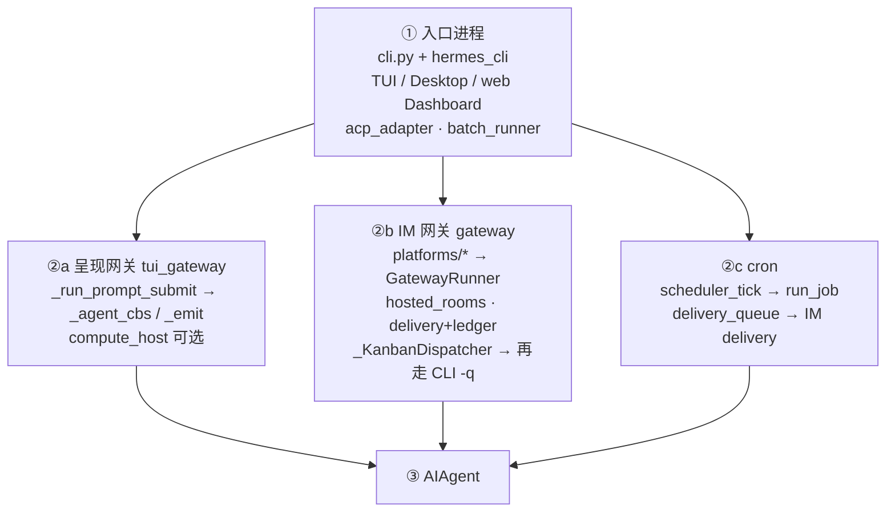

并行的是 **TGW / IM / cron 三条边**，不是九个包横排。看板：网关里的 dispatcher **spawn CLI**，不走 `GatewayRunner._handle_message`。

#### 1.3.2 内核往下挂什么（单列）

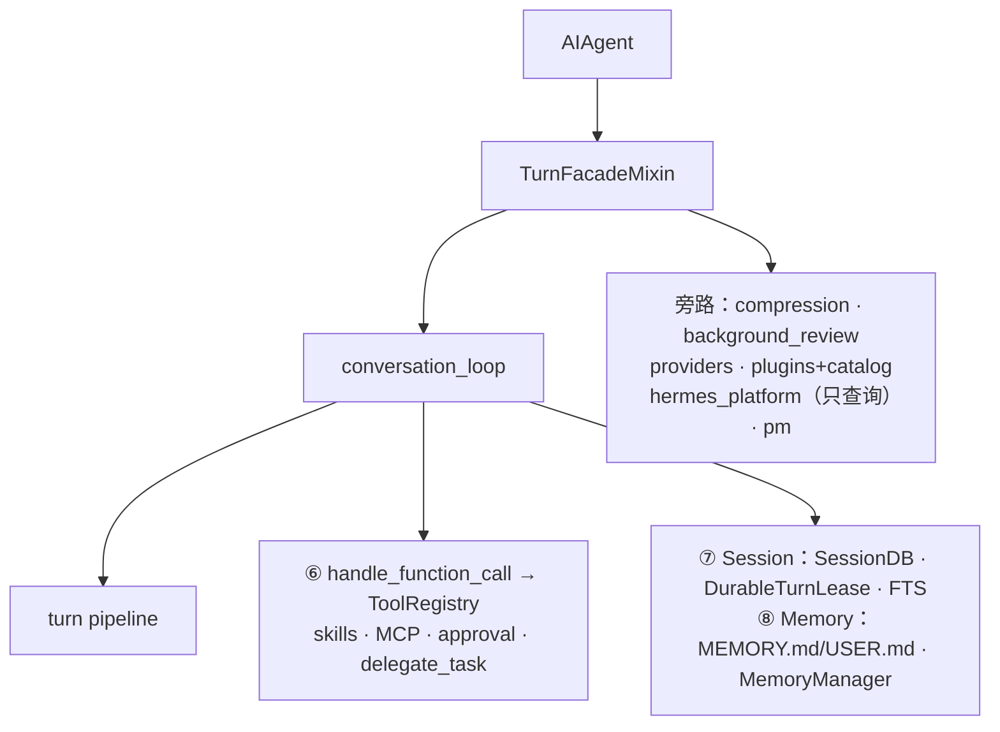

<a id="sec-1-4"></a>

### 1.4 关键组件一览

| 组件 | 位置 | 职责 |
|------|------|------|
| `HermesCLI` | `cli.py` + `hermes_cli/cli_*_mixin.py` | 终端入口；看板 worker 复用同一类 |
| `tui_gateway.server` | `tui_gateway/` | JSON-RPC；`_sessions[sid]`；`_emit` |
| `GatewayRunner` | `gateway/run.py` | IM 会话槽、忙时策略、调 `run_conversation` |
| `BasePlatformAdapter` | `gateway/platforms/base.py` | 各 IM 收发；`_pending_messages` |
| `Delivery` / `delivery_ledger` | `gateway/delivery.py` | 出站切分、媒体、**必达记账** |
| `AIAgent` | `run_agent.py` | 模型、工具、session、callback 的实体 |
| `TurnFacadeMixin` | `agent/turn_facade.py` | 进门：停复盘、抢租约、再调循环函数 |
| `conversation_loop.run_conversation` | `agent/conversation_loop.py` | **函数**（不是类）：模型 ↔ 工具 |
| `DurableTurnLease` | `agent/turn_facade_lease.py` | 跨进程 session 写锁 |
| `SessionDB` | `hermes_state*.py` | 消息、会话行、FTS、租约表 |
| `ToolRegistry` | `tools/registry.py` | 按名 dispatch |
| `MemoryManager` / `MemoryStore` | `agent/memory_manager.py` 等 | 外部记忆 prefetch/sync；内置 md 快照 |
| `_KanbanDispatcher` | `gateway/kanban_watchers_dispatcher.py` | 扫板、spawn CLI `-q` |
| `HostSupervisor` | `tui_gateway/host_supervisor.py` | compute host 子进程 |
| `HermesACPAgent` | `acp_adapter/server.py` | IDE ACP |

<a id="sec-1-5"></a>

### 1.5 四层运行时架构

呈现 → 入口 → 内核 → 落盘。这是 **运行时切面**，和 §1.2 仓库包表互补：看板是 **调度器拉起 CLI 子进程**，不占用 IM 长连接。

呈现 → 入口 → 内核 → 落盘；看板是 **调度器拉起 CLI 子进程**，不占用 IM 长连接。

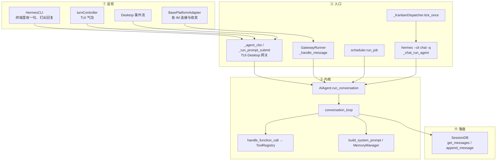

**看板 worker 路径（第四条入口，易漏）**：`_KanbanDispatcher` 在网关进程里 `tick_once` → `dispatch_once` 领任务 → `_default_spawn` 执行：

`hermes -p <profile> --cli chat -q "work kanban task <id>"`

环境变量 `HERMES_SESSION_SOURCE=kanban`、`HERMES_KANBAN_TASK` 由调度器写入。子进程：`cmd_chat` → `_run_single_query_mode` → `HermesCLI.chat` → `_chat_run_agent` → `run_conversation`（与终端同入口，**不进** `GatewayRunner._handle_message`）。人在看板上看的是 **任务状态**，不是 IM 气泡。详 [卷七 §4](07-multi-agent-and-kanban.md#4-看板-worker-端到端)。

<a id="sec-1-6"></a>

### 1.6 端到端流程图（完整调用链）

从 **用户** 到 **回复回到同一侧**；忙时 queue 在汇合 **之前**（[§2.3](#sec-2-3)），不画进 `LOOP` 方框。

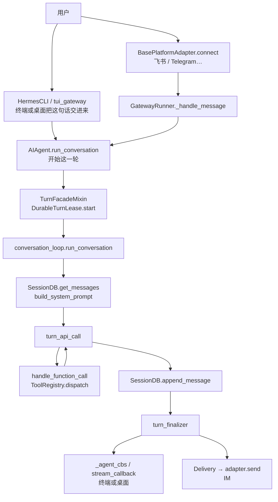

定时任务：`cron.scheduler_tick` → `run_job` → `run_conversation` → `cron.delivery_queue`（不经 IM handler）。Batch / ACP / Room 等汇合点 → [§2.5](#sec-2-5)。

<a id="sec-1-7"></a>

### 1.7 数据流转全景（不省略旁路）

§1.6 是缩略图。本节按源码 **一条用户话从进门到出站** 的真实顺序。  
hook 函数名放大 → [卷三 §3](03-runtime-session-and-loop.md#3-端到端时序一轮--单次迭代hook-点位)；callback 名 → [卷二 §3.4](02-surface-and-presentation.md#34-端到端时序platform-callback-与-plugin-hook-同图)。

<a id="sec-1-7-1"></a>

#### 1.7.1 核心步骤（调用树；注释是这一步的作用）

主路径与 `agent/conversation_loop.py` 的 `while` 一致。`normalize_model_response` 在 `_run_api_retry_loop` **返回之后**。

**follow-up 队列在各自入口**（本轮结束后再开一轮）。**steer / redirect 不进这些槽**，槽在正在跑的 `AIAgent` 上。

```text
入口（follow-up 槽在这里）
  ├─ CLI _chat_run_agent                         # follow-up：_pending_input，这轮打完再开一轮
  ├─ tui_gateway _run_prompt_submit              # follow-up：queued_prompt，收尾再取出
  ├─ GatewayRunner._handle_message               # 一条 IM 消息对上哪一聊，并决定现在进不进内核
  │    ├─ _session_key_for_source                # 同一聊天永远打到同一个 Agent
  │    └─ busy_input_mode                        # 这轮还在跑：打断、排队，还是塞进当前轮
  │         ├─ interrupt                         # 让内核取消当前 HTTP 或工具，这句话再开一轮
  │         ├─ queue                             # follow-up：_pending_messages，这轮结束再跑
  │         ├─ steer → AIAgent.steer             # 写入 _pending_steer；失败才退回 _pending_messages
  │         └─ redirect → AIAgent.redirect       # 不进入口槽：正在打模型就取消这次请求；正在跑工具就退化成 steer
  ├─ HermesACPAgent.prompt                       # follow-up：queued_prompts
  ├─ cron scheduler_tick → run_job               # 到点自己开一轮，不等人发消息
  └─ _KanbanDispatcher → hermes --cli chat -q    # 领一块看板任务，用 CLI 子进程跑完

TurnFacadeMixin.run_conversation                 # 所有入口进同一扇门：先确认这轮允许跑
  ├─ cancel_background_review_for_live_turn      # 真人这句不能和后台复盘抢同一个会话
  ├─ admit_durable_turn_lease                    # 两个进程不能同时改同一条会话
  │    └─ carry_unadmitted_user_message          # 抢不到锁：这句用户话先扛走，不丢、也不进 loop
  ├─ DurableTurnLease.start                      # 长轮一直续租，崩了别人才能把锁抢走
  └─ conversation_loop.run_conversation          # 真正跑这一轮：备上下文、问模型、跑工具、落盘
       └─ _run_conversation_turn
            ├─ [optional] _decode_inline_moa_turn    # 这条消息若是多模型合议，先拆出 moa 配置
            ├─ _try_refresh_env_client_credentials   # 设置里刚改的密钥，这一轮就能用
            ├─ build_turn_context                    # 发给模型之前，把历史、人设、记忆备齐
            │    ├─ recover_rotated_compression_session  # 压缩换过会话的，先跟到新行
            │    ├─ _refresh_mcp_tools_between_turns     # 上一轮新装的工具，这一轮能调
            │    ├─ _bind_turn_identity                  # 给这一轮一个 id，对得上是哪一句
            │    ├─ append 本轮 user                     # 把这句话放进即将发给模型的消息
            │    ├─ restore_or_build_system_prompt       # 拼系统提示；记忆用开场快照，缓存才稳
            │    ├─ _ensure_session_row                   # 库里先有这一聊；提示好了再写
            │    ├─ flush 未占到租约的用户行             # 上次没抢到锁的那句，现在补进库
            │    ├─ run_turn_start_compaction            # 历史太长先摘要，否则塞不进窗口
            │    ├─ pre_llm_call                         # 插件在模型看见之前还能补上下文
            │    ├─ prefetch_all                         # 外部记忆只贴在这句用户话上
            │    └─ _maybe_title_session_at_turn_start   # 还没标题就后台起一个，不挡这轮
            ├─ [optional] begin_voice_turn_route     # 语音这轮改走语音模型，轮末再换回
            ├─ [optional] _codex_app_server_turn     # 整轮交给 Codex 子进程，不走下面的 while
            ├─ [optional] play_prelude               # 进模型前按脚本先跑几步工具
            └─ while 迭代预算 …                      # 模型还要工具就再问一次，直到答完或次数用尽
                 ├─ begin_iteration                  # 记这是第几次问模型，次数用尽就停
                 ├─ prepare_iteration                # 组下一次请求前，把上一轮工具结果收进即将发出的消息
                 │    └─ _drain_pending_steer     # 吃掉 _pending_steer，贴到最新一条工具结果后面
                 ├─ assemble_api_request             # 拼出这一次真正要发的请求
                 ├─ run_preflight_gate               # 发出去之前看会不会爆窗口，爆了先压再发
                 ├─ announce_api_call                # 告诉界面：开始想了
                 ├─ _run_api_retry_loop              # 这一次调用失败就重试，成功才离开
                 │    ├─ nous_rate_limit_guard       # 被限流就先别打
                 │    ├─ build_api_request           # 收成供应商要的请求体；插件可改
                 │    ├─ perform_api_call            # 打模型；字在这时就流回界面，不等收尾
                 │    │    └─ redirect 撞上响应      # 丢掉这次过期响应，带着纠正重新请求
                 │    ├─ check_api_response          # 响应是不是空的、坏的、被截断
                 │    ├─ handle_api_interrupt        # 硬停：结束这轮；若是 redirect 则保留纠正并重试
                 │    └─ handle_api_error            # 分成可重试、换路、或这轮结束
                 ├─ apply_retry_restarts             # 该换模型或压缩重来的，回到 while 顶
                 ├─ normalize_model_response         # 各家响应收成统一的 assistant 消息
                 └─ run_tool_round | finish_text_response
                      ├─ run_tool_round              # 模型点了工具就执行，结果写回再让它看
                      │    ├─ validate_tool_calls    # 参数不合法的不执行
                      │    ├─ 先落盘 tool_call 行    # 工具还没跑，库里已经有这次调用，崩了能续
                      │    ├─ _execute_tool_calls    # 真正执行
                      │    │    ├─ approval          # 危险操作先等人点头
                      │    │    ├─ 安全扫描          # 拦住危险技能或投毒上下文
                      │    │    ├─ delegate_task     # 派一个子 Agent，做完把结果交回来
                      │    │    ├─ session_search    # 模型主动搜旧对话，不自动塞进提示
                      │    │    └─ memory 工具       # 立刻改 MEMORY.md；这轮系统提示不变
                      │    ├─ apply_pending_steer_to_tool_results  # 这批工具跑完，把 _pending_steer 贴进 tool 结果
                      │    └─ compress_after_tool_results  # 工具输出太长就地收一收
                      └─ finish_text_response        # 模型不再要工具：这就是给用户的答复
                           └─ turn_stop_gates        # 结束前还可以再验一次，验完可能重新进 while
                 └─ handle_outer_loop_error          # 上面抛了：能继续就继续，否则跳出 while
            └─ finalize_turn                        # 这轮收口：整形给用户的字、写入库、记外部记忆
                 ├─ apply_llm_output_transform      # 插件改最后给人看的文字
                 ├─ _micro_compact_after_turn       # 轮末顺手收一截历史，仍算同一轮
                 ├─ _persist_session                # 把这轮对话写进 SessionDB，崩了也能续
                 ├─ on_session_end                  # 通知插件：这一轮结束了
                 ├─ _drain_pending_steer            # 没吃掉的 steer 放进 result，交给入口当下一句
                 ├─ end_voice_turn_route             # 语音模型用完，下一轮回到主模型
                 ├─ _sync_external_memory_for_turn  # 把这一轮交给外部记忆；被打断的不写
                 └─ _spawn_background_review        # 人已经看到回复之后，后台再决定要不要改记忆或技能
       └─ export_current_turn_boundary             # 告诉入口：用户这句话在历史的第几行
  └─ finally 释放租约                               # 别的进程才能接着写这个会话

出站
  ├─ 流式（在 perform_api_call 当时）              # 终端 callback / _emit 已经在画字，不等收尾
  ├─ 最终一条                                      # IM 走 Delivery + ledger；cron 走 delivery_queue
  ├─ 入口接住 result.pending_steer                 # TUI 把它再放回 queued_prompt，当下一句
  └─ drain 入口 follow-up 槽                       # 只取 _pending_input / queued_prompt / _pending_messages，再开一轮
```
follow-up 队列在各自入口：CLI 是 _pending_input，TUI / Desktop 是 queued_prompt，IM 是 _pending_messages，ACP 是 queued_prompts。本轮结束后再开一轮。

steer 不进这些槽。 入口调用 AIAgent.steer，文本进内核的 _pending_steer。1.7.1 里现在写了内核吃掉它的三处：

prepare_iteration 里 _drain_pending_steer：组下一次请求前，贴到最新一条工具结果后面
run_tool_round 里 apply_pending_steer_to_tool_results：这批工具跑完再贴一次
finalize_turn 里剩下的 _drain_pending_steer：变成下一句用户话
IM 的 busy_input_mode=steer 只是去调 AIAgent.steer；调用失败才退回 _pending_messages。
steer 的三处都在内核：`prepare_iteration` 里组请求前吃一次，`run_tool_round` 里工具批结束后再吃一次，`finalize_turn` 把剩下的交给下一句。Desktop `queueDelta` 是合 token，不是 follow-up 槽。租约是 SessionDB 写锁，不是 UI `running`。

<a id="sec-1-7-2"></a>

#### 1.7.2 入站与门面

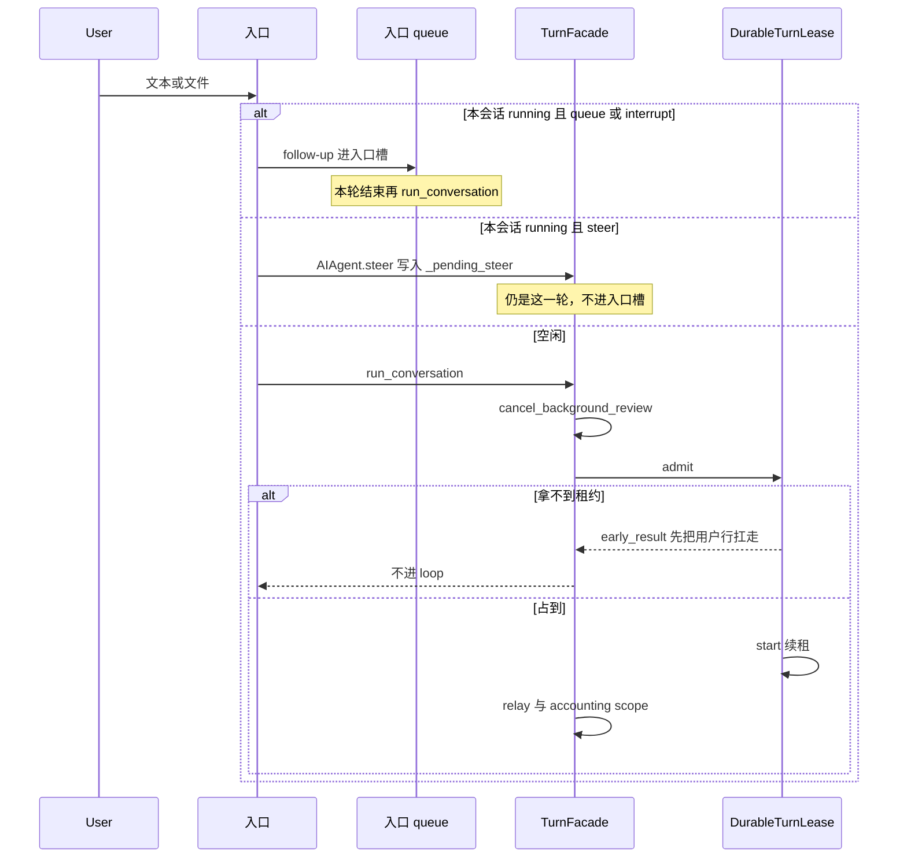

cron / 看板 **没有** 这张图左边的 IM handler：job 或 CLI `-q` 直接从 #5 进。

<a id="sec-1-7-3"></a>

#### 1.7.3 轮初与 while

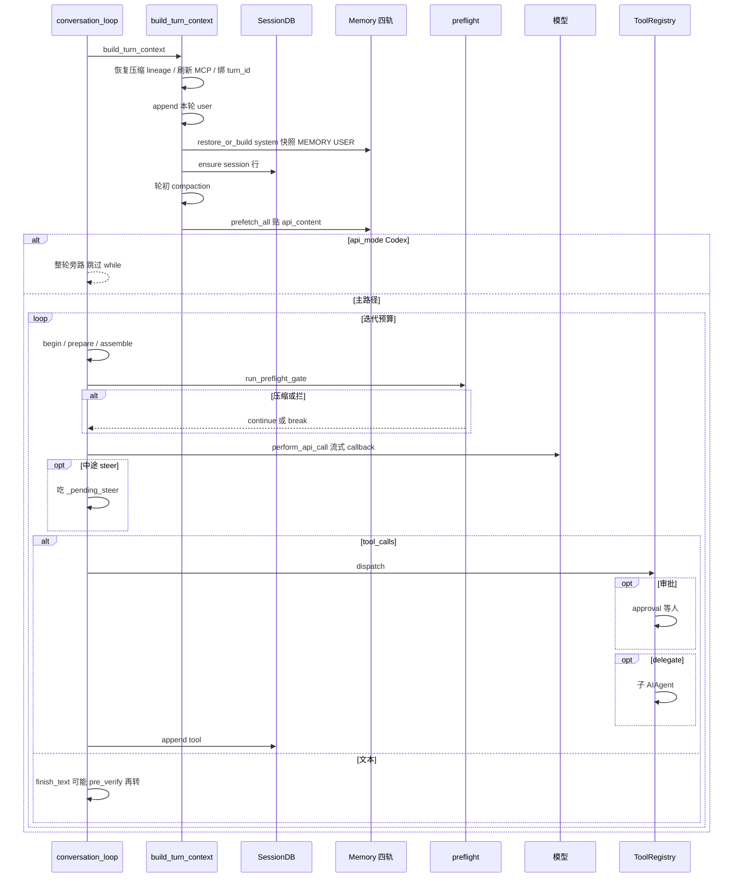

<a id="sec-1-7-4"></a>

#### 1.7.4 收尾、出站、drain

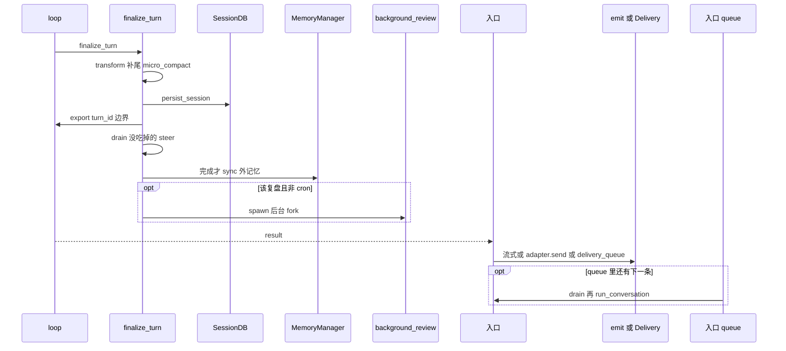

要点：

1. **用户 queue 在 #3 / #40**，不在 while。  
2. **写库在循环里**（#13、#28、#32），没有单独 `ChatService`。  
3. **MEMORY.md 快照本轮不变**（#12 vs #27e）。  
4. **出站与入站不是对称的**：cron 出站走 `delivery_queue`；IM 走 `Delivery`+ledger。

<a id="sec-1-8"></a>

### 1.8 整体类图

类图只画一条关系上的重点。基类很多时，图后面用表把其余的补全。继承是空心三角，持有和调用是箭头。

<a id="sec-1-8-1"></a>

#### 1.8.1 谁持有谁

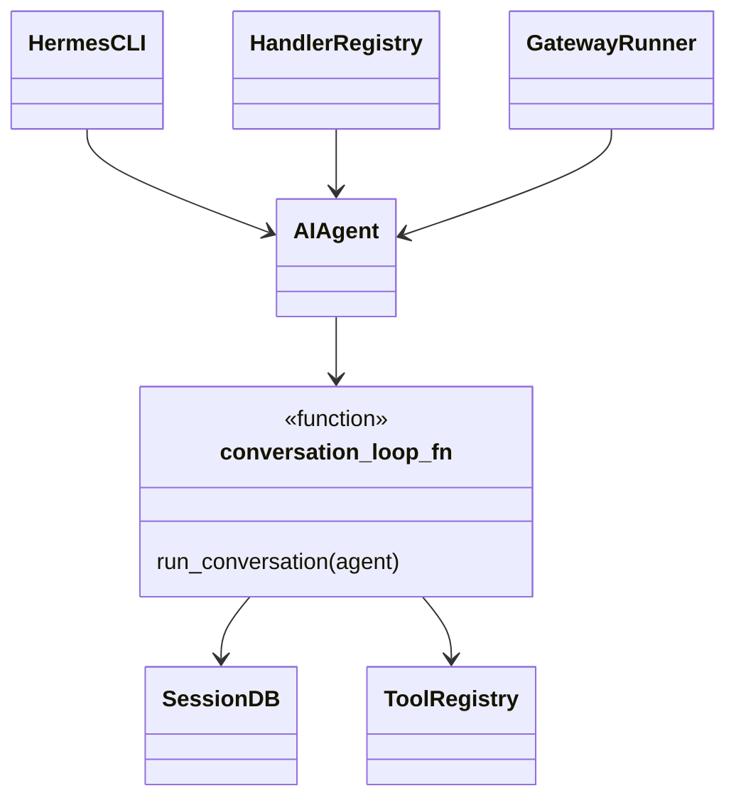

| 还有谁 | 持有什么 |
|--------|----------|
| `HermesACPAgent` | `AIAgent`，每个 ACP session 一个 |
| `BatchRunner` | `AIAgent`，每行一个 |
| `_CronAgentSetup` | `AIAgent`，定时任务自己的进程里建 |
| `_KanbanDispatcher` | 拉起 `HermesCLI`，不自己持有 Agent |
| `HostedRoomService` | 把一句提交到 `HandlerRegistry` |
| `AIAgent` | 还持有 `MemoryManager`、`ContextCompressor` |
| `PluginManager` | 把插件工具挂进 `ToolRegistry` |

<a id="sec-1-8-2"></a>

#### 1.8.2 人机壳

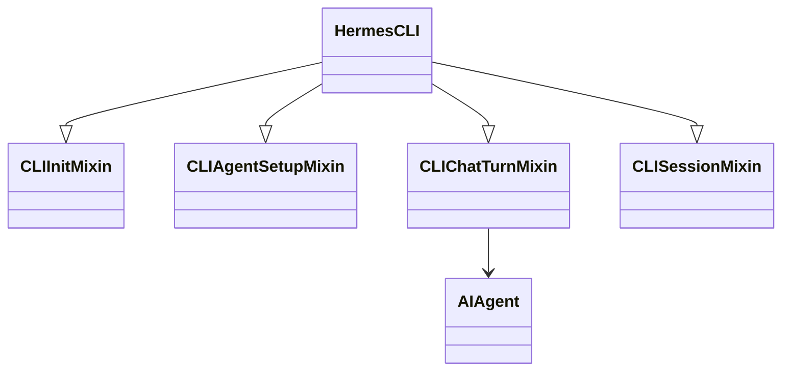

进程里只有一个 `HermesCLI`。下面这些是它的基类，方法都落在这一个对象上。

| 基类 | 这块管什么 |
|------|------------|
| `CLIInitMixin` | 构造：显示选项、模型与提供方、工具集、检查点、会话库和界面状态 |
| `CLIAgentSetupMixin` | 建 `AIAgent`，续聊时把会话画出来；用之前重新解析凭据 |
| `CLIChatTurnMixin` | `chat()`，把这一句送进 `run_conversation` |
| `CLITuiRuntimeMixin` | 经典终端的主循环：排空 `_pending_input`、横幅、信号、退出 |
| `CLITuiMixin` | `prompt_toolkit` 的输入框、按键和浮层 |
| `CLITerminalMixin` | 终端重绘、窗口缩放、剪贴板；输出坏了就停画 |
| `CLIStreamMixin` | 流式正文、推理预览、工具进度、忙碌时的转圈 |
| `CLIStatusBarMixin` | 状态栏、这一轮小结 |
| `CLIModalMixin` | 盖在输入上的框：澄清、审批、sudo、命令面板、外部编辑器 |
| `CLICommandsMixin` | `/` 命令的处理函数 |
| `CLISessionMixin` | 新建、恢复、保存、撤销、重试、手动压缩、退出摘要 |
| `CLIModelSwitchMixin` | `/model` 切换，以及切换时的运行时快照 |
| `CLIVoiceMixin` | 录音、语音转文字、文字转语音、打断、唤醒词 |
| `CLIBillingMixin` | 账单和订阅 |
| `CLIInfoMixin` | 横幅、帮助、工具列表、用量、重载技能和 MCP |
| `CLILoopsMixin` | 目标、心跳、循环，以及几个简单的斜杠命令包装 |
| `CLIProcessNotificationsMixin` | 子代理通知算不算这一会话的；对不上就丢掉 |

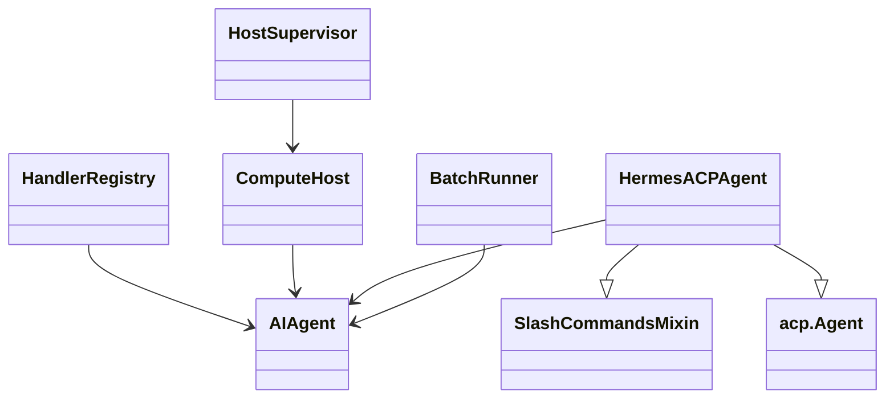

<a id="sec-1-8-3"></a>

#### 1.8.3 IM 网关与出站

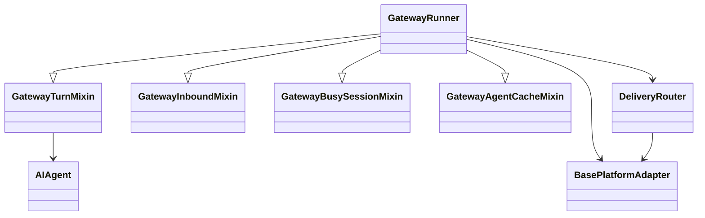

| 基类 | 这块管什么 |
|------|------------|
| `GatewayTurnMixin` | 一轮：组好 Agent，调用 `run_conversation`，把回复交出去 |
| `GatewayInboundMixin` | 入站管道：`_handle_message`、文本和媒体、插件注入 |
| `GatewayBusySessionMixin` | 忙时队列、槽位占用、斜杠分发 |
| `GatewayAgentCacheMixin` | 按会话槽缓存 Agent、模型覆盖、租约 |
| `GatewayAdapterLifecycleMixin` | 适配器连接、拆掉、断线重连 |
| `GatewayStartupMixin` | 启动、恢复、交接 |
| `GatewayShutdownMixin` | 停止、排空、重启 |
| `GatewayAuthorizationMixin` | 谁可以跟这个机器人说话 |
| `GatewaySlashCommandsMixin` | IM 上的 `/` 命令 |
| `GatewayVoiceMixin` | IM 上的语音 |
| `GatewayTopicThreadsMixin` | 电报话题、Discord 自动线程 |
| `GatewaySessionWatchersMixin` | 会话清扫、卡住检测、目录刷新 |
| `GatewayNotificationsMixin` | 完成通知、媒体、异步委派的回送 |
| `GatewayGoalsMixin` | 目标、心跳、循环到点再唤醒 |
| `GatewayConfigLoadersMixin` | 忙时模式、推理、超时、回退这些配置 |
| `GatewayKanbanWatchersMixin` | 看板的监视、通知、调度循环 |
| `GatewayProfileReconcileMixin` | 运行中增减正在服务的配置档 |
| `GatewayPluginRewireMixin` | 插件加载后，把该档的适配器重新接上 |

出站记账是一组函数，在 `gateway/delivery_ledger.py`：`record_obligation`、`mark_delivered`。`DeliveryRouter` 切长度和媒体，账本负责没送成要重试。

| 适配器 | 继承 | 这条通道 |
|--------|------|----------|
| `APIServerAdapter` | `OpenAICompatRoutesMixin`、`BasePlatformAdapter` | 网关里的 HTTP 口，`/v1/chat/completions`；`send()` 是空的 |
| `TelegramAdapter` | `TelegramHeldInboundMixin`、`BasePlatformAdapter` | 电报 |
| `DiscordAdapter` | 四个 Discord Mixin、`BasePlatformAdapter` | Discord |
| `SlackAdapter` | `BasePlatformAdapter` | Slack |
| `FeishuAdapter` | `BasePlatformAdapter` | 飞书 |
| `DingTalkAdapter` | `BasePlatformAdapter` | 钉钉 |
| `WeComAdapter` | 流、媒体、发送队列、准入、`BasePlatformAdapter` | 企业微信智能机器人 |
| `WecomCallbackAdapter` | `BasePlatformAdapter` | 企业微信自建应用回调 |
| `WeixinAdapter` | `OwnAccessPolicyMixin`、`BasePlatformAdapter` | 微信个人 |
| `QQAdapter` | `OwnAccessPolicyMixin`、`BasePlatformAdapter` | QQ |
| `WhatsAppAdapter` | `WhatsAppBehaviorMixin`、`BasePlatformAdapter` | WhatsApp 本机桥 |
| `WhatsAppCloudAdapter` | `WhatsAppBehaviorMixin`、`BasePlatformAdapter` | WhatsApp Cloud |
| `SignalAdapter` | `BasePlatformAdapter` | Signal |
| `BlueBubblesAdapter` | `BasePlatformAdapter` | iMessage · BlueBubbles |
| `PhotonAdapter` | `BasePlatformAdapter` | iMessage · Photon |
| `YuanbaoAdapter` | `BasePlatformAdapter` | 元宝 |
| `LineAdapter` | `BasePlatformAdapter` | LINE |
| `GoogleChatAdapter` | `BasePlatformAdapter` | Google Chat |
| `TeamsAdapter` | `BasePlatformAdapter` | Teams |
| `MatrixAdapter` | `BasePlatformAdapter` | Matrix |
| `MattermostAdapter` | `BasePlatformAdapter` | Mattermost |
| `IRCAdapter` | `BasePlatformAdapter` | IRC |
| `EmailAdapter` | `BasePlatformAdapter` | 邮件 |
| `SmsAdapter` | `BasePlatformAdapter` | 短信 |
| `SimplexAdapter` | `BasePlatformAdapter` | SimpleX |
| `NtfyAdapter` | `BasePlatformAdapter` | ntfy |
| `BuzzAdapter` | `BasePlatformAdapter` | Buzz |
| `A2AAdapter` | `BasePlatformAdapter` | A2A |
| `RaftAdapter` | `BasePlatformAdapter` | Raft，只收「该醒了」 |
| `WebhookAdapter` | `BasePlatformAdapter` | 通用 HTTP |
| `MSGraphWebhookAdapter` | `BasePlatformAdapter` | Microsoft Graph 回调 |

每条和公共合同不同的地方在 [卷六第7章](06-gateways-channels-and-hitl.md#sec-g7)。它们都登记在 `PlatformRegistry`。

<a id="sec-1-8-4"></a>

#### 1.8.4 内核 AIAgent

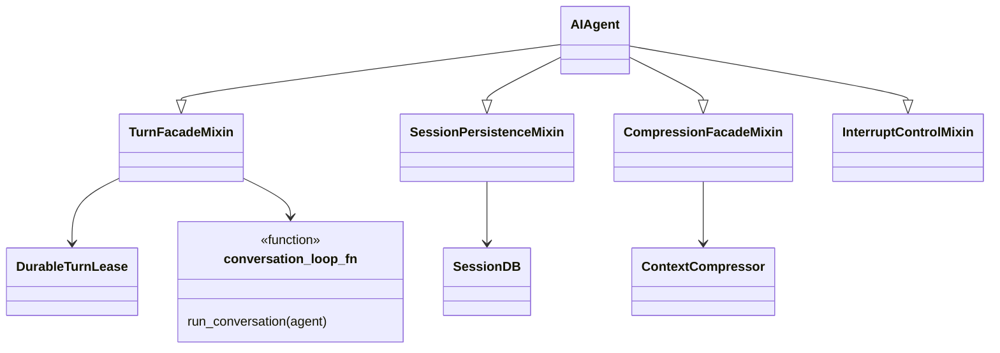

| 基类 | 这块管什么 |
|------|------------|
| `TurnFacadeMixin` | 进门：停后台复盘、抢租约，再调用循环函数 |
| `SessionPersistenceMixin` | 消息怎么落进 `SessionDB` |
| `CompressionFacadeMixin` | 上下文太长时交给 `ContextCompressor` |
| `InterruptControlMixin` | `steer` / `redirect`，槽是 `_pending_steer` |
| `ClientLifecycleMixin` | 模型客户端的建连和关掉 |
| `StreamDeliveryMixin` | 流式 token 交给入口 callback |
| `StatusOutputMixin` | 状态行 |
| `ApiRequestHooksMixin` | 组请求前后的钩子 |
| `ApiErrorSummaryMixin` | 把接口错误收成一句 |
| `TurnExplainersMixin` | 这一轮在干什么的说明 |
| `ActivityTrackingMixin` | 活动心跳 |
| `RateLimitCreditsMixin` | 限流和额度 |
| `VisionMessagePrepMixin` | 视觉消息在发出前的整理 |
| `ReasoningParamsMixin` | 推理参数 |

`ContextCompressor` 再继承这些：

| 基类 | 这块管什么 |
|------|------------|
| `ContextEngine` | 压缩引擎的接口 |
| `SummaryDispatchMixin` | 把中间一段交给模型做摘要 |
| `PreLlmSkipMixin` | 能不调模型压缩就不调 |
| `MicroCompactionMixin` | 小步压缩 |
| `CompressionTelemetryMixin` | 压缩打点 |

循环函数再调用 `SessionDB` 和 `ToolRegistry`。两层 `run_conversation` 的时序在 [§1.9](#sec-1-9)。

<a id="sec-1-8-5"></a>

#### 1.8.5 SessionDB

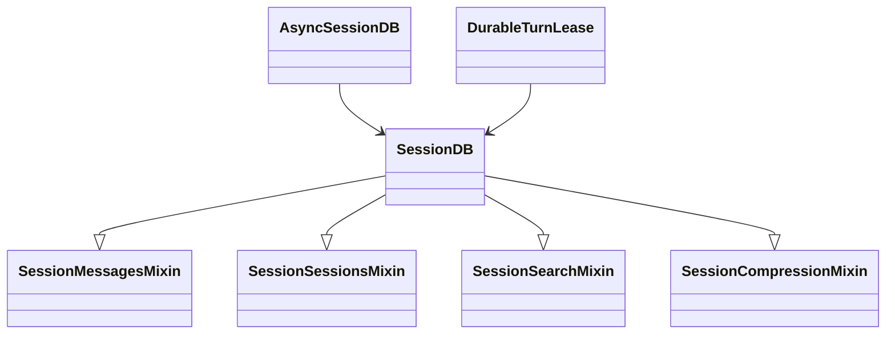

| 基类 | 这块管什么 |
|------|------------|
| `SessionMessagesMixin` | 追加、替换、回溯消息，续聊时读回对话 |
| `SessionSessionsMixin` | 会话行：创建、生命周期、列表、删除 |
| `SessionSearchMixin` | 按全文检索查旧对话 |
| `SessionFtsSetupMixin` | 检索表和触发器的建立与维护 |
| `SessionSchemaMixin` | 建表和迁移 |
| `SessionCompressionMixin` | 压缩谱系、冷却计数、锁 |
| `SessionGatewayMixin` | 路由索引、心跳、交接 |
| `SessionPortabilityMixin` | 会话搬进搬出 |
| `SessionTelegramTopicsMixin` | 电报话题和会话的绑定 |
| `SessionMaintenanceMixin` | 过期清理、把陈旧会话归档、收紧库文件 |
| `SessionUsageMixin` | 按模型记 token 和计费 |
| `SessionTitlesMixin` | 标题的生成和沿谱系查找 |
| `SessionRewindMixin` | 从某一句用户话起软删除 |
| `SessionCoverageMixin` | 覆盖度辅助 |
| `SessionProfileRepairMixin` | 配错配置档时的查找、改标、切开 |
| `SessionToolRetriesMixin` | 工具重试结果记在工具行上 |

<a id="sec-1-8-6"></a>

#### 1.8.6 工具、记忆、插件

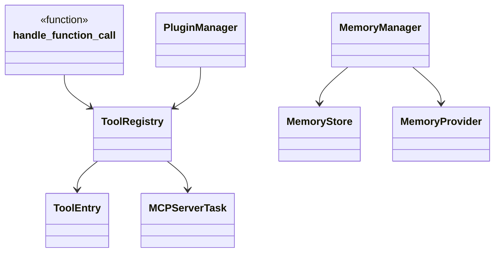

| 类 | 基类 | 这块管什么 |
|----|------|------------|
| `MCPServerTask` | `MCPServerRunMixin`、`MCPServerTransportMixin`、`MCPServerHealthMixin` | 一个 MCP 服务进程：跑起来、传输、健康 |
| `PluginManager` | `PluginLoaderMixin`、`PluginDispatchMixin`、`PluginLedgerMixin` | 加载插件、分发 hook、记账 |
| `PluginManager` | 持有 `LoadedPlugin`、`PluginContext` | 已加载的插件和它的上下文 |

<a id="sec-1-8-7"></a>

#### 1.8.7 定时、看板、房间

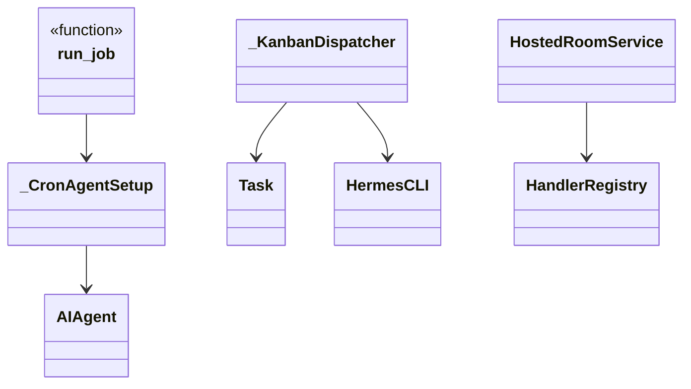

| 类 | 关系 | 这块管什么 |
|----|------|------------|
| `jobs` | `run_job` 到点来读它 | 定时任务库，`cron/jobs.py` |
| `_save_compose_deliver` | `run_job` 跑完调用 | 存输出、拼通知、送出 |
| `_RunDelivery` | 被上面这个函数填写 | 这一次投递的结果 |
| `Run` | `Task` 持有 | 看板上一张卡的一次执行 |
| `Comment` | `Task` 持有 | 卡上的评论 |
| `Attachment` | `Task` 持有 | 卡上的附件 |
| `Event` | `Task` 持有 | 卡上的事件 |
| `HostedRoomRuntime` | 持有 `HostedRoomService` | 房间运行时 |
| `GatewayKanbanWatchersMixin` | 持有 `_KanbanDispatcher` | 网关进程里把调度器拉起来 |

<a id="sec-1-9"></a>

### 1.9 为什么 `run_conversation` 有两层

对外只有一个入口：`agent.run_conversation(...)`。对内拆成「能不能开这轮」和「这轮怎么跑」。同名是故意的。

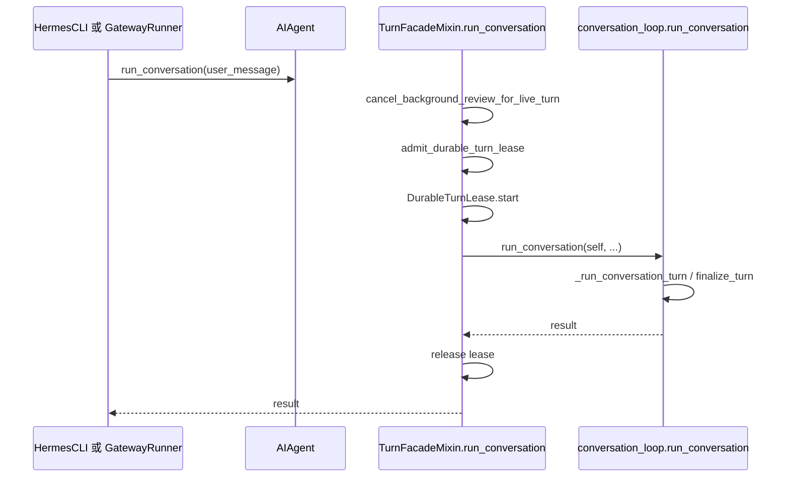

| 层 | 关系 | 作用 |
|----|------|------|
| **`AIAgent`** | 实体 | 模型、工具、会话、callback |
| **`TurnFacadeMixin`** | 继承 | 进门：停复盘、抢租约、设本轮上下文 |
| **`conversation_loop.run_conversation`** | 函数调用 | `while` 迭代、工具轮、压缩、收尾 |

| | 关系 | 为什么要这一层 |
|--|------|----------------|
| **`AIAgent`** | 实体 | 所有入口共用一个对象，callback/工具/session 才一致 |
| **`TurnFacadeMixin`** | **继承** | 抢租约、停复盘必须包住整个循环；写在 loop 里则抢不到锁时循环已开始 |
| **`conversation_loop.run_conversation`** | **引用函数** | 循环太长，不再做成 `AIAgent` 的一个方法；第一参数仍是那个 Agent |

会话落盘是 `SessionPersistenceMixin`，压缩入口是 `CompressionFacadeMixin`，进门是 `TurnFacadeMixin`。调用方看到的仍是一个 `AIAgent`。以前整轮堆在 `run_agent.py`；拆开后：类文件 = 对象是什么，循环文件 = 一轮怎么跑，门面 = 什么情况下根本不该跑。

内核 **放大时序**（hook 点位）→ [卷三 §3](03-runtime-session-and-loop.md#3-端到端时序一轮--单次迭代hook-点位)。

<a id="sec-1-10"></a>

### 1.10 边上子系统（pm / 插件 / cron / 平台）

这些 **不是** loop 的注释，是仓库里并列的产品面。

**包管理 `pm/`** — `hermes pm lock|install|repair|doctor`。核心依赖走锁文件 + 隔离窗口；不要对 Hermes venv 手 `pip install`。

**本机事实 `hermes_platform/`** — 只查询 OS/CPU/可执行文件路径；**不安装**。Desktop 在另一台机器、SSH 远端，都不是它要回答的对象。

**插件** — 核心保持窄腰。仓内 `plugins/`：压缩引擎、图像/视频、看板、观测、部分平台。记忆后端（mem0、Honcho…）在 **`plugin-catalog/*.yaml`**，用户侧安装；不要再往 `plugins/memory/` 提交新产品。

**cron** — 不是「到点 new 一个 Agent」：`scheduler_tick` → `run_job` → 可选 `scheduler_detached_worker` → `run_conversation` → `delivery_queue` / `scheduler_delivery`。另有 blueprint、配额、incident。

**一轮拆成 `turn_*.py`** — `turn_facade` 租约 → `conversation_loop` 调度 → `turn_preflight` / `turn_context` / compaction / `turn_api_call` / `turn_tool_round` / `turn_recovery` / `turn_finalizer`。详 [卷三 §4](03-runtime-session-and-loop.md#4-turn_py-权威表阶段--职责--扩展点)。

<a id="sec-1-11"></a>

### 1.11 Session 模块（会话原文与租约）

**Session 不是「记忆」。** 它是这一聊的 **逐字稿 + 跨进程写锁 + 全文检索索引**。类：`SessionDB`（`hermes_state.py` 拼 Mixin）；挂在 `AIAgent._session_db`。

| 概念 | 是什么 | 源码 |
|------|--------|------|
| **会话行** | `session_id` / `session_key` 一行元数据（标题、cwd、压缩 lineage） | `hermes_state_sessions.py` |
| **消息表** | user / assistant / tool 原文；循环里 `get_messages` / `append_message` | `hermes_state_messages.py` |
| **turn lease** | 同一 `conversation_id` 同时最多一个 holder 写库 | `session_turn_leases` + `DurableTurnLease` |
| **FTS** | 旧对话检索；模型调 `session_search` 才查，不自动进 system | `hermes_state_search.py`、`native/fts5_cjk` |
| **压缩** | 默认**原地**压（`session_id` 不变）；关掉 `compression.in_place` 才裂变出新行。原话归档在库里 | [卷三第4章](03-runtime-session-and-loop.md#sec-ch4)、[6.7](03-runtime-session-and-loop.md#sec-6-7) |

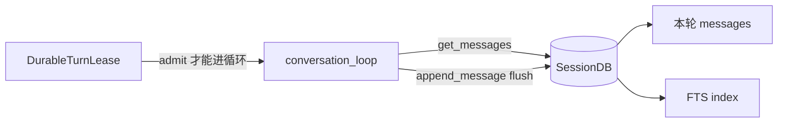

**三种 id 不要混**（呈现层）：`sid`（TUI 窗口 8 位）、`session_key`（库 stored id）、`AIAgent.session_id`（记忆/压缩头）。IM 用 `_session_key_for_source`。→ [卷二 §2.2](02-surface-and-presentation.md#22-三种会话标识_agent_cbssid-里的-sid-是哪一个)、[卷三 §1.2](03-runtime-session-and-loop.md#02-durableturnlease跨进程占坑)。

和 AgentScope：Hermes **循环内写 SessionDB**；AgentScope `reply_stream` 不碰 Storage，由 `ChatService` 写。

<a id="sec-1-12"></a>

### 1.12 Memory 模块（四轨：原文 / 内置 / 外部 / FTS）

四样东西都叫「记忆」，**落点和时机不同**。Session 原文见 §1.11；下面三条才是 Memory 产品面。

| 轨 | 存在哪 | 这一轮怎么读 | 何时写 | 写完本轮 system 变吗 |
|----|--------|--------------|--------|----------------------|
| **会话原文** | SessionDB 消息 | 每轮 `get_messages` 进 `messages` | `append_message` | 否（当历史，不进 system） |
| **内置 MEMORY/USER** | `$HERMES_HOME/memories/MEMORY.md`、`USER.md` | 会话开始 `MemoryStore.load_from_disk` **快照** → system volatile | `memory` 工具 add/replace/remove **立刻写盘** | **本会话不变**；要等压缩 `invalidate_system_prompt` 或新会话 |
| **外部 provider** | `memory.provider` **最多一个**（mem0 / Honcho…，插件目录） | `prefetch_all` 贴在本轮用户 `api_content`，**不进 system、不改 SessionDB** | 轮正常结束 `sync_all`；打断不写 | 否；下一轮 prefetch 才可能搜到 |
| **旧对话 FTS** | 同一 SessionDB 索引 | 模型调 `session_search` | 落盘时索引已有 | 否；当工具结果回来 |

`USER.md` = 人；`MEMORY.md` = 环境事实。外部没配时 `MemoryManager` 为空，只剩两份 md。

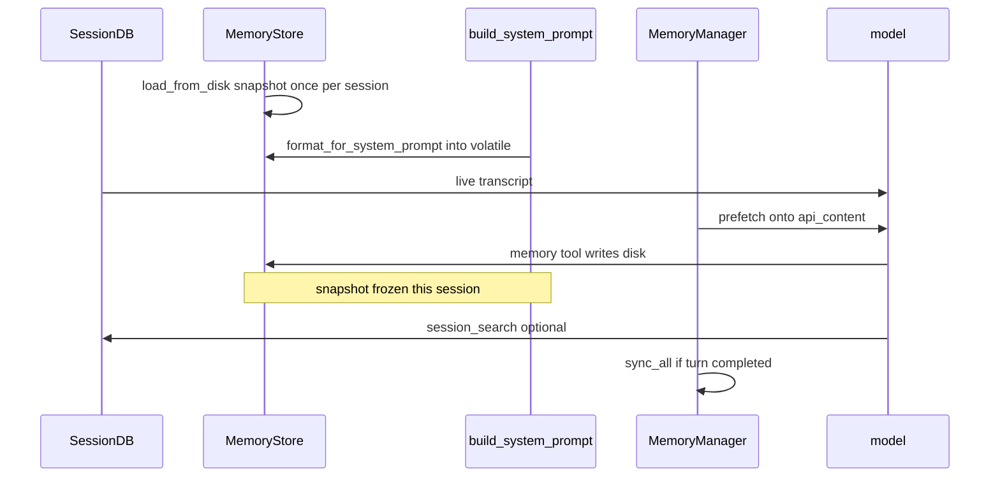

谁写 md：① 对话里 `memory` 工具（可 `write_approval`）② 后台复盘 fork（约每 10 个带 memory 的用户回合）③ 人手改文件或 `/memory`。压缩时 `MemoryManager.on_pre_compress` 再 `invalidate`。

**讲透（本仓库卷三）**：[Memory 三层与冻结快照](03-runtime-session-and-loop.md#sec-6-4)、[HITL 闸门](03-runtime-session-and-loop.md#sec-6-3)、[压缩方案与例子](03-runtime-session-and-loop.md#sec-ch4)。**拼进 system 的格式**：[卷四](04-prompt-and-context.md)。**工具 API**：[卷五 §4.4](05-capabilities-extensions.md#44-记忆)。

---

<a id="sec-ch2"></a>

## 第2章：多入口、出站与权威表

<a id="sec-2-1"></a>

### 2.1 汇合与出站分叉

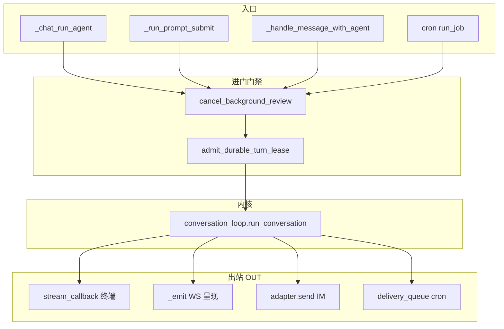

| OUT | 消费者 | 锚点 |
|-----|--------|------|
| TERM | 终端 | `HermesCLI` callbacks |
| WS/stdio | Ink/Desktop | `tui_gateway._emit` |
| IM | 平台 | `delivery_ledger` → `send` |
| cron | 配置通道 | `delivery_queue` |

<a id="sec-2-2"></a>

### 2.2 入口类型与 OS 进程

| 入口类型 | 典型进程 | `run_conversation` 调用点 | 共享 SessionDB 租约 |
|----------|----------|---------------------------|---------------------|
| CLI 交互 | 1× Python | `_chat_run_agent` | 常是 |
| CLI `-q` | 短进程 | `_run_single_query_mode` | 常一次性 |
| 呈现网关 | UI + `tui_gateway` | `_run_prompt_submit` | 是 |
| IM 网关 | `gateway` | `_handle_message_with_agent` | 是 |
| cron | scheduler | `run_job` | 视 job |
| Kanban worker | 子进程 `chat -q` | 同 CLI | worker session |
| ACP | `acp_adapter` | `HermesACPAgent.prompt` | 是 |
| Batch | `batch_runner` workers | worker 内 | 每 task |
| Compute host | 父+子进程 | `_submit_prompt_to_compute_host` | 父 vouch |
| Hosted Room | 网关 + room DB | `prompt.submit` + `_hosted_task` | 卷六 §6 |

呈现 `tui_gateway/` 与 IM `gateway/` 是两套服务。

<a id="sec-2-3"></a>

### 2.3 忙时用户跟进（进门之前）

主图 **不画**「用户又发了一条」。忙时再来一句有两条路，槽不在同一个地方：

- **跟进槽在各自入口**：记下下一句，**本轮结束**后再开一次 `run_conversation`。
- **steer 在内核**：`AIAgent.steer` 写入正在跑的那个 Agent 的 `_pending_steer`，**本轮内**吃掉，不新开一轮。

内核没有统一 inbox。入口上的 `busy_input_mode=steer` 只是「去调内核 `steer()`」；调用失败才退回该入口自己的跟进槽。

#### 2.3.1 几种 queue 别混

| 层 | 是什么 | 去哪读 |
|----|--------|--------|
| 用户跟进队列 | 忙时下一句用户话 | §2.3.2 |
| `DurableTurnLease` 等待 | 跨进程占 session 写库 | [卷三 §1.2](03-runtime-session-and-loop.md#sec-1-2) |
| 呈现 `queueDelta` | 合并 `message.delta` | 卷二 §6 |
| 插件流队列 | `enqueue_plugin_stream_hook` | 卷二 §5 |
| cron `delivery_queue` | 定时 **出站** | 卷六 §5 |

<a id="sec-2-3-2"></a>

#### 2.3.2 跟进槽在入口，steer 在内核

**跟进槽**挂在入口对象上，不进 SessionDB。本轮 `run_conversation` 返回后，入口 drain 这个槽，用里面的文本再调一次 `run_conversation`。

| 入口 | 槽 | drain |
|------|----|-------|
| IM | `adapter._pending_messages[session_key]` | `_spawn_drain_task` |
| CLI | `HermesCLI._pending_input` | 终端这一轮打完 |
| TUI / Desktop / Room | `session["queued_prompt"]` | `_drain_queued_prompt` |
| ACP | `queued_prompts` | 当前 prompt 收尾 |

**steer** 的槽在内核：`AIAgent.steer`（`agent/interrupt_control.py`）把文本拼进 `AIAgent._pending_steer`。工具批结束后贴到 tool 结果上，或下一次组请求前吃掉。轮末还没吃掉的，`finalize_turn` 里 `_drain_pending_steer` 放进 result，才变成下一轮的用户句。

IM `busy_input_mode`（`/busy`，默认 **interrupt**）是入口策略，不是第三种槽：

| 模式 | 落点 |
|------|------|
| **queue** | 写入上表那个跟进槽 |
| **interrupt** | 打断当前轮；子代理或压缩中途可降级成 queue |
| **steer** | 调 `running_agent.steer(text)` → `_pending_steer`；失败再写入 `_pending_messages` |

对照：[卷二 §3.0](02-surface-and-presentation.md#30-忙时再点发送用户话排队不是-messagedelta-的-queuedelta)、[卷六第5章](06-gateways-channels-and-hitl.md#sec-g5)。

#### 2.3.3 进门之前分叉图

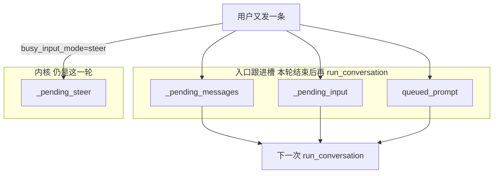

<a id="sec-2-4"></a>

### 2.4 入口权威表

| 入口 | 进程 | 进门函数 | 新建 Agent？ | `platform` | 忙时跟进 | 出站 |
|------|------|----------|--------------|------------|----------|------|
| CLI `chat` | 终端 | `_chat_run_agent` | 常复用 | `cli` | `_pending_input` | TERM |
| CLI `-q` | 短进程 | `_run_single_query_mode` | 常新建 | `cli` | — | TERM |
| 呈现网关 | `tui_gateway` | `_run_prompt_submit` | 每 `sid` | `desktop`/`tui` | `queued_prompt` | `_emit` |
| IM | `gateway` | `_handle_message_with_agent` | 每 slot | 平台名 | `_pending_messages` | `send` |
| cron | scheduler | `run_job` | job 内 | 配置 | — | delivery_queue |
| Kanban | 子进程 | `chat -q` | worker 内 | `cli`+kanban env | — | 看板 DB |
| ACP | `acp_adapter` | `HermesACPAgent.prompt` | 每 session | `acp` | `queued_prompts` | ACP 流 |
| Batch | `batch_runner` | worker | 每行 | `batch` | — | 文件 |
| Room | 网关+SQLite | `prompt.submit`+`_hosted_task` | 同 `sid` | 同左 | 同 TUI | 群通道 |
| Compute host | 父+子 | `_submit_prompt_to_compute_host` | 子进程 | 同左 | 同 TUI | 镜像 `_emit` |

每扇门前面站着哪个产品，见 [§2.6](#sec-2-6)。

<a id="sec-2-5"></a>

### 2.5 平行入口专卷索引

| 入口 | 专卷 |
|------|------|
| **每个门户的设计（壳 + 每条 IM + cron/room/看板）** | [卷六第7章](06-gateways-channels-and-hitl.md#sec-g7) |
| delegate_task | [卷七 §3](07-multi-agent-and-kanban.md#3-端到端delegate_taskhook--呈现) |
| background_review | [卷八 §3](08-security-and-governance.md#3-后台复盘background-review) |
| cron 深潜 | [卷六 §5](06-gateways-channels-and-hitl.md#5-cron定时任务与-delivery_queue) |
| ACP / compute host | [卷二 §11–12](02-surface-and-presentation.md#11-compute-hostturn-隔离子进程) |
| Batch / Codex | [卷三第5章](03-runtime-session-and-loop.md#sec-ch5)（§5.0 分叉图；Batch 仍 while；Codex 看 `api_mode`） |
| Hosted Room | [卷六 §6](06-gateways-channels-and-hitl.md#6-hosted-room群聊托管) |

<a id="sec-2-6"></a>

### 2.6 入口的上游项目

这些项目自己不跑模型循环。人在它们的界面里打一句话，它们把这句话送进 §2.4 的某一扇门。仓内壳在 `hermes-agent/` 里；同级产品在 `hermes-dev/` 旁边，本地端口见 `hermes-dev/PORTS.md`。

有两个都叫桌面的产品。`hermes-agent/apps/desktop` 是官方 Electron，直接连呈现网关。`hermes-dev/hermes-desktop` 是社区的 Hermes One，本机聊天连 Dashboard 的 `/api/ws`。

```mermaid
flowchart TD
    OFF["官方壳：CLI / Ink TUI / apps/desktop / Dashboard :9119"]
    ONE["社区 Desktop<br/>hermes-desktop"]
    WS["Workspace :3000"]
    WUI["WebUI"]
    STU["Studio（Ekko Studio）"]
    AION["AionUi"]
    TGW["呈现网关 _run_prompt_submit"]
    API["gateway 里的 API Server<br/>POST /v1/chat/completions :8642"]
    CLI["CLI _chat_run_agent"]
    AA["AIAgent.run_conversation"]

    OFF --> TGW
    ONE --> TGW
    WS --> API
    WUI --> AA
    STU --> AA
    STU --> CLI
    AION --> CLI
    TGW --> AA
    API --> AA
    CLI --> AA
```

| 上游 | 路径 | 进的门 | 怎么接上 |
|------|------|--------|----------|
| 命令行 | `hermes-agent` 的 `cli.py` | CLI `_chat_run_agent` | 本进程终端。看板 worker、Studio 的 `ekko-studio cli` 也是拉起这条 |
| Ink TUI | `ui-tui/` | 呈现网关 `_run_prompt_submit` | stdio 上的 JSON-RPC |
| 官方 Desktop | `apps/desktop/` | 同上 | WebSocket 或 stdio，同一套 JSON-RPC |
| Dashboard | `hermes-agent` 内，默认 `:9119/chat` | 同上 | 页里嵌 `hermes --tui` 的 PTY。社区 Desktop 的本机聊天连这里的 `/api/ws` |
| 社区 Desktop（Hermes One） | `hermes-dev/hermes-desktop` | Dashboard `/api/ws` → 呈现网关 | 安装并配置 `~/.hermes` 里的 Hermes Agent。消息平台另开 gateway 进程，由这个壳去配 |
| Workspace | `hermes-dev/hermes-workspace`，默认 `:3000` | API Server | `HERMES_API_URL` 指向 `hermes gateway run`（默认 `:8642`）。聊天是 `POST /v1/chat/completions`，头里带会话号。会话、记忆、技能、任务再打同一网关上的 Hermes 接口。不走 IM 适配器 |
| WebUI | `hermes-dev/hermes-webui` | 直接 `AIAgent.run_conversation` | 自己的 Python 进程里构造 `AIAgent`（`api/routes.py`、`api/streaming.py`）。不经过 CLI、呈现网关、`GatewayRunner`。和 CLI 共用 `~/.hermes` |
| Studio（现名 Ekko Studio，仓库仍在 `hermes-studio`） | `hermes-dev/hermes-studio` | 聊天走内置 WebUI 那条，直接 `run_conversation`；要消息平台时 `modules/hermes` 拉起 `hermes gateway run`；看板用 Hermes Kanban CLI | 自己的会话库在 `~/.hermes-web-ui`。Hermes 的 `state.db` 只给历史接口只读。桌面版把 Hermes 运行时打进包，数据仍在 `~/.hermes` |
| AionUi | `hermes-dev/AionUi` | 本机已安装的 Hermes Agent，作为外部代理之一 | 和 Claude Code、Codex 并列，由它检测到再拉起。不进呈现网关，也不走 IM 适配器 |

IM 各通道的上游是平台自己的长连接或回调（电报、飞书、Slack 等），见 [卷六第7章](06-gateways-channels-and-hitl.md#sec-g7)。cron 的上游是调度器时钟。

---

<a id="sec-ch3"></a>

## 第3章：读哪一卷、去哪 grep

| 主题 | 卷 |
|------|-----|
| **Session / Memory 模块（本卷总览）** | [§1.11](#sec-1-11) · [§1.12](#sec-1-12) |
| Surface、callback | [02](02-surface-and-presentation.md#本卷目录) |
| 循环、`turn_*.py`、租约 | [03](03-runtime-session-and-loop.md#本卷目录) |
| Prompt / 每 API 上下文 | [04](04-prompt-and-context.md#本卷目录) |
| 工具 / MCP / Skills / 记忆执行 | [05](05-capabilities-extensions.md#本卷目录) |
| IM、cron、Room | [06](06-gateways-channels-and-hitl.md#本卷目录) |
| delegate、看板、MoA | [07](07-multi-agent-and-kanban.md#本卷目录) |
| 审批、扫描、后台复盘 | [08](08-security-and-governance.md#本卷目录) |

**grep 起点**：`run_agent.py`、`agent/turn_facade.py`、`agent/conversation_loop.py`、`cli.py`、`gateway/run.py`、`tui_gateway/prompt_turn.py`、`cron/scheduler.py`、`tools/registry.py`。

全书 📋 总目录：[MANIFEST](MANIFEST.md#-总目录全书)。


---

<a id="source-supplement"></a>

## 增补：把“Agent 主循环”放回完整系统

前文已经解释请求汇入 `AIAgent.run_conversation`。仍容易漏掉的是：**主循环只是一台发动机，不是整辆车。** 输入/交付、模型连接、执行环境、安装发布、配置身份各有自己的生命周期；只理解 while loop，无法解释“任务成功却没通知”“插件装好了却没生效”等问题。

### A. 整体责任地图：四条主线、两套底座

```mermaid
flowchart TB
    U["用户 / IDE / IM"] --> S["Surface / ACP / Gateway：接收与呈现"]
    S --> A["Agent：回合、上下文、工具循环"]
    C["Cron：调度长期任务"] --> A
    A --> M["模型后端：route、client、transport、凭据"]
    A --> T["能力层：tool / skill / MCP / plugin"]
    T --> E["执行后端：本机 / 容器 / 远端环境"]
    C --> D["交付队列：领取、发送、确认或 unknown"]
    D --> S
    P["包运行时 PM：验证、暂存、发布选中版本"] -.-> T
    I["身份底座：home / profile / secret scope"] -.-> A
    I -.-> M
    I -.-> E
    O["观测底座：日志 / monitoring / 持久账本"] -.-> A
    O -.-> C
    O -.-> D
```

这是**职责关系图**，不是逐函数调用图；实线表示主要请求/结果关系，虚线表示依赖或支撑。PM 的发布会影响后续能力加载，不表示每次工具调用都运行一次安装器。观测图中三类信息也不写入同一个存储。

| 责任线 | 最重要的区分 | 深读 |
|---|---|---|
| 对话 | 会话历史 ≠ 本次请求已转换的协议对象 | [03](03-runtime-session-and-loop.md) · [04](04-prompt-and-context.md) · [10](10-model-backends-and-resilience.md) |
| 能力 | 能力注册 ≠ 插件模块加载 ≠ 已获得调用许可 | [05 §7](05-capabilities-extensions.md#cap-plugin-lifecycle) · [08](08-security-and-governance.md) |
| 执行 | 命令返回 ≠ shell 永久保持 ≠ 远端资源已删除 | [11](11-terminal-execution-backends.md) |
| 自动化 | 计划时间槽 ≠ execution ≠ delivery | [12](12-automation-and-package-runtime.md) |
| 身份 | profile 身份 ≠ 进程环境变量 ≠ 账号池选择 | [13](13-config-secrets-and-observability.md) · [10 §4](10-model-backends-and-resilience.md#backend-credentials) |
| 观测 | 日志 ≠ 非持久 monitoring ≠ 可恢复账本 | [13 §4](13-config-secrets-and-observability.md#support-observability) |

### B. “状态存在哪”比“类叫什么”更重要

| 状态 | 典型所有者/边界 | 能否据此承诺重启恢复 |
|---|---|---|
| 会话与消息 | SessionDB 等持久状态层，见卷三 | 要看该入口何时写入和如何恢复；不是每个临时字段都入库 |
| 本次请求、transport 转换、SDK client | Agent/请求运行时 | 不能把内存对象视为永久存档 |
| 插件注册及所有权代际 | registry / PluginContext / ReplacementCoordinator | 描述当前进程的注册关系，不是包发布账本 |
| public subagent handle | SubagentLifecycleService 的进程内 registry | 不能跨重启仅凭旧 handle 找回子任务 |
| 命令进程及 shell 初始化快照 | Environment / process 管理 | 后台持久选项与会话身份都要核对，不存在统一的永久 shell |
| Cron 执行与交付 | execution ledger / delivery queue | 持久化支持恢复判断，但 uncertain send 必须保留 unknown |
| 包选择与发布事务 | 配置快照、journal、receipt | 与插件当前进程是否已加载是两回事 |

**一句话结论**：理解全系统要同时追踪“请求怎么走、状态谁拥有、失败谁裁决、重启靠什么证据恢复”。接着按 [全书大纲](README.md#book-outline) 阅读；想查未掌握的模块，从 [覆盖审计](SOURCE_AUDIT.md#audit-next) 进入，而不是盲目把所有文件再按目录读一遍。
