# 卷二 · 多 Surface：一句话怎么画出来

> **卷标准**：[`VOLUME_STANDARD.md`](VOLUME_STANDARD.md) · **完成度**：[`MANIFEST.md`](MANIFEST.md) 中 **达标（范本）**  
> **本卷边界**：呈现层（CLI / TUI / Desktop / 呈现网关 `tui_gateway`），不含 IM `gateway/`。  
> **权威源码**：`tui_gateway/`、`hermes_cli/cli_*`、`agent/stream_delivery.py`、`agent/agent_init.py`（`_CALLBACK_PARAMS`）  
> **相邻卷**：[01 入口](01-platform-and-architecture.md) · [03 循环](03-runtime-session-and-loop.md) · [06 IM](06-gateways-channels-and-hitl.md)

这一卷只讲呈现层的设计：谁持有 `AIAgent`，一轮字从哪进来，三种事件分别谁发、谁画。源码目录不作为正文。原文 `archive/legacy/SURFACE_ARCHITECTURE.md` 是路径和职责表，没有时序；下面按当前 `hermes-agent` 的调用重写。

两条路，不要画成同一条总线：

- **终端 CLI** 进程里自己持有 `HermesCLI` 和 `AIAgent`。`HermesCLI.chat` 开线程 `_chat_run_agent`，直接把 `stream_callback` 交给 `run_conversation`。不经过 `tui_gateway`。
- **TUI 和 Desktop** 不自己跑循环。它们经 JSON-RPC（stdio 或 WebSocket）连 **呈现网关**（源码包 `tui_gateway/`，见 [§0.1](#01-hermes-是什么几个进程在网关进程里跑指什么)）：`prompt.submit` 在 **那个 Python 进程**里进 `_run_prompt_submit` → `run_conversation`；界面壳只收 `_emit` 事件。创建 `AIAgent` 时用 `_agent_cbs(sid)`；正文流是 `_invoke_agent` 的 `_stream` → `message.delta`。

---

## 本卷目录

**章节安排（为何不是「从 §1 顺读到 §10」）**

| 块 | 节 | 作用 |
|----|-----|------|
| **澄清** | [§0](#0-先澄清进程-_emit-注册寿命) | 进程数、双网关、`_emit`、Agent 寿命——读任何图之前先看 |
| **总览** | [§1](#1-架构) · [§2](#2-谁调用谁) | 两层架构图 + 入口函数与三种 `sid` |
| **主路径 E2E** | [§3](#3-tui--desktop一轮怎么走完)（核心 [§3.4](#34-端到端时序platform-callback-与-plugin-hook-同图)） | TUI/Desktop 一轮；callback 与 hook 同图 |
| **对照路径** | [§4](#4-cli不经过这套-websocket) | 终端 CLI，不经过 `tui_gateway` |
| **权威深潜** | [§5](#5-_agent_cbs是什么怎么注册怎么被调到)（表 [§5.2](#52-_agent_cbssid-返回的-dict-里有什么)、[§5.4.1](#541-_callback_params-全集谁接线)） | 全量 callback；故意放在 §3 之后，避免未看图就先背表 |
| **界面专题** | [§6](#6-desktop-画一句正文从-messagedelta-到气泡)–[§10](#10-tui-上的-widget-插在哪) | Desktop / 皮肤 / 远程 / Widget——可跳读 |
| **平行呈现** | [§11](#11-compute-hostturn-隔离子进程) · [§12](#12-acpide-呈现与忙时策略) | compute host；ACP IDE |

**建议路径**

1. **第一次读（约 30 分钟）**：§0 → §1 → §2 → §3.4 表 D → §5.2 扫一眼键名。  
2. **只关心 CLI**：§0.1 架构 A 行 → §4 → §5.7 末表「CLI 与网关」。  
3. **和卷三/卷五对齐 hook**：§3.4 → §5.6–§5.7。  
4. **忙时排队**：§3.0（与 [卷一 §2.3.2](01-platform-and-architecture.md#sec-2-3-2) 呼应）。

### 目录（锚点跳转）

- **§0** [先澄清：进程 · `_emit` · 注册寿命](#0-先澄清进程-_emit-注册寿命)  
  - [0.1](#01-hermes-是什么几个进程在网关进程里跑指什么) Hermes / 进程 / 呈现网关 vs IM 网关  
  - [0.2](#02-_emit-是什么) `_emit` 与 Transport（stdio / WS）  
  - [0.3](#03-注册一次跟-agent-同寿命到底指什么) 「注册一次」指 Agent 实例  
  - [0.4](#04-agent-对象活多久和几个进程别混) Agent 对象寿命  
- **§1** [架构](#1-架构)  
- **§2** [谁调用谁](#2-谁调用谁) · [2.1](#21-时序图里常见的入口函数只指谁开跑这一轮) 入口 · [2.2](#22-三种会话标识_agent_cbssid-里的-sid-是哪一个) 三种 id  
- **§3** [TUI / Desktop 一轮](#3-tui--desktop一轮怎么走完) · [3.0](#30-忙时再点发送用户话排队不是-messagedelta-的-queuedelta) 忙时排队 · [3.4](#34-端到端时序platform-callback-与-plugin-hook-同图) E2E A–D  
- **§4** [CLI](#4-cli不经过这套-websocket)  
- **§5** [`_agent_cbs` 深潜](#5-_agent_cbs是什么怎么注册怎么被调到) · [5.2](#52-_agent_cbssid-返回的-dict-里有什么) · [5.4.1](#541-_callback_params-全集谁接线) · [5.7](#57-platform-callback-与-plugin-hook-为什么两套都有) hook 对照  
- **§6–§10** [Desktop 气泡](#6-desktop-画一句正文从-messagedelta-到气泡) · [三种 delta](#7-三种往外冒的字不是一种) · [皮肤](#8-皮肤怎么换到所有界面) · [远程后端](#9-desktop-连远程后端) · [TUI Widget](#10-tui-上的-widget-插在哪)  
- **§11–§12** [Compute host](#11-compute-hostturn-隔离子进程) · [ACP](#12-acpide-呈现与忙时策略)

---

## 0. 先澄清：进程 · `_emit` · 注册寿命

### 0.1 Hermes 是什么、几个进程、「在网关进程里跑」指什么

#### Hermes 先说清楚

**Hermes** 在这里指仓库里的 **`hermes` 命令行程序**（`hermes-agent` 包）：你执行的不同子命令，决定 **Agent 跑在哪个操作系统进程里、界面怎么连上去**。  
内核只有一套：`AIAgent.run_conversation`（模型 + 工具 + 写 SessionDB）。**没有**「TUI 版 Agent」和「CLI 版 Agent」两套循环，差别只在 **谁持有这个对象、字怎么画到屏幕上**。

#### 两种架构（先记这个，再看表）

| 架构 | 你怎么进 | OS 进程大概几个 | Agent 在哪 |
|------|----------|-----------------|------------|
| **A. 单进程终端** | `hermes chat`、`hermes --cli chat`、`hermes chat -q` | **1 个 Python** | 就在这个进程里的 `HermesCLI` + `AIAgent`；一轮走 `_chat_run_agent` |
| **B. 壳 + Python 后端** | `hermes --tui`、Desktop、`hermes dashboard` / `serve` | **至少 2 个**：Ink 或 Electron **+** 一个 Python 后端 | **只在 Python 后端**里；壳只发 RPC、收事件 |

IM（Telegram 等）是 **第三种入口**：长驻 **IM 网关**（`gateway/run.py` 的 `GatewayRunner`，`start_gateway` 拉起），**不是**下面说的 `tui_gateway`（见卷六）。

#### 「网关」在 Hermes 里有两个名字，别混

口语里的 **「网关」** 在仓库里其实对应 **两套不同的 Python 服务**。本卷（Surface / TUI / Desktop）写的几乎都是左边这一列：

| 本卷简称 | 源码包 / 入口 | 干什么 | 典型启动 |
|----------|---------------|--------|----------|
| **呈现网关**（文中有时写「tui_gateway 后端」「Python 呈现后端」） | **`tui_gateway/`**，核心 `server.py` | **UI 和 Agent 之间的桥**：收 `session.create` / `prompt.submit` 等 JSON-RPC，维护 `_sessions`，建 `AIAgent`，跑 `_run_prompt_submit`，用 `_emit` 把流式结果推回 Ink/Desktop | `python -m tui_gateway.entry`；或 `hermes dashboard` / `serve`、Desktop 后端 |
| **IM 网关** | **`gateway/`**，`GatewayRunner`、`start_gateway` | **Telegram / 飞书等与 Agent 之间的桥**：长连接收消息 → `_handle_message` → `run_conversation` → 平台 `send` | `hermes gateway` / 守护进程式 `start_gateway` |

**不是**下面这些东西（容易误会）：

- **不是** Nginx、Kong、Envoy 那种「反向代理 / API 网关」。
- **不是** 泛指「任何一个跑 Python 的进程」——只有跑着 **`tui_gateway` 模块**、对外讲 **JSON-RPC + event** 的那一个，才是本卷说的 **呈现网关**。

可以记成：**呈现网关 = 给 TUI/Desktop 用的后端服务进程**；源码目录名就叫 `tui_gateway`（TUI gateway），历史命名，和 IM 的 `gateway/` 并列但无关。

#### 呈现网关进程里有什么

架构 **B** 里，**呈现网关** = **一个 OS 进程**，里面加载了 `tui_gateway`（入口常见为 `tui_gateway.entry`）。典型怎么起来：

- `hermes --tui`：Ink（Node）**spawn** `python -m tui_gateway.entry`，stdio 连父子进程
- Desktop / `hermes serve`：单独 Python 进程，WebSocket 连 UI

这个进程里才有：`_sessions`、`_make_agent`、**`_run_prompt_submit`**、`AIAgent.run_conversation`、`_emit`。  
**Ink、Electron 窗口不是呈现网关**——它们不 `import run_agent`，只当客户端。

#### 「在网关进程里跑」一句话

在本卷语境下，这句话 **默认指呈现网关（`tui_gateway`）**：用户在 TUI/Desktop 里点发送，**真正执行** `_run_prompt_submit` → `run_conversation` 的是 **这个 Python 进程**；不是 Ink/Electron 那个壳进程。

#### 你用的子命令 → 几个进程（常见）

「Hermes 启动有几个进程」**没有固定数字**：同一套代码，子命令不同，进程数就不同。下表只列 **主路径**（实际还可能 + MCP/Codex 子进程、看板 worker、cron 等）。

| 你执行的命令 | 会有哪些 OS 进程 | `_run_prompt_submit` 会不会跑到 |
|--------------|------------------|----------------------------------|
| `hermes --cli chat` | 1× Python | **不会**（本进程用 `_chat_run_agent`） |
| `hermes chat -q "…"` | 1× Python，说完就退出 | **不会** |
| `hermes --tui` | Node（Ink）+ 1× **呈现网关** Python 子进程 | **会**，在 `tui_gateway` 子进程 |
| Hermes Desktop（本机） | Electron + 1× **呈现网关** Python 后端 | **会**，在后端 |
| `hermes dashboard` / `serve` | 1× **呈现网关** Python 服务 + 浏览器/客户端 | **会**，在服务进程 |
| `start_gateway`（**IM 网关**，非 tui_gateway） | 1× Python | **通常不会**（走 `_handle_message`） |
| 看板 worker | 调度方 + 每个任务 1× `hermes chat -q` 子进程 | worker 里 **不会** |

**多 tab / 多会话**：**一个** 呈现网关 Python 进程里可以挂 **多个** `AIAgent`（每个 UI `sid` 一个），不是「一个 Hermes 安装 = 一个 Agent」。

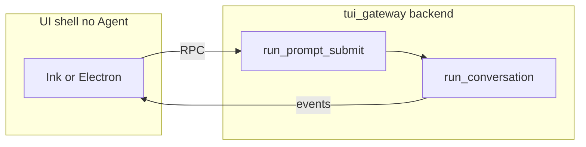

架构 **A** 没有中间这层：用户输入和 `run_conversation` 同在 **一个** Python 方框里。

### 0.2 `_emit` 是什么

**定义**：`tui_gateway/server.py` 里的模块级函数 `_emit(event: str, sid: str, payload: dict | None = None) -> bool`。

**作用**：把 **呈现网关（`tui_gateway`）** 里发生的事 **推给 UI 客户端**，不是打印日志、也不是调模型。它是 TUI/Desktop 路径上 **后端 → 界面** 的统一出口。

**呈现网关 ≠ 一定是 WebSocket。** 网关是 **Python 进程 + 同一套 JSON-RPC 协议**；线和物理连接由 **Transport** 决定，常见两种：

| 谁连上来 | 线是什么 | 双向怎么走 |
|----------|----------|------------|
| **`hermes --tui`（Ink）** | 父子进程 **stdio 管道**（一行一条 JSON） | Ink 写请求到 stdin → 网关 `dispatch`；网关 `_emit` → `write_json` 写到 stdout → Ink `onEvent` |
| **Desktop / dashboard / `serve`** | **WebSocket**（也常叠 HTTP 起页面） | 浏览器/Electron 发 WS 帧（请求）；网关 `_emit` 用 **同一条 WS** 推 `method: "event"` |

`ws.py` 里写得很直白：**线上协议与 stdio 相同**（newline-delimited JSON-RPC；连上后发 `gateway.ready`）。所以：

- **「后端推前端」** = 网关用 **`_emit` → `write_json`** 往当前会话的 **Transport** 写一帧 JSON（不是 `print` 到终端日志）。
- **「前端调后端」** = 同一根线反方向发 **带 `id` 的请求**（如 `prompt.submit`），网关 `dispatch` 处理后再回响应。
- 你看到的 **WS** 只是 Desktop/浏览器那条部署；**TUI 根本不用 WS**，用管道照样推 `message.delta`。

**做的事（两步）**：

1. 可选静音：`event_presentation_muted(event, sid)` 为真则直接返回（诊断/通知策略）。
2. 组帧并写出：`_event_frame` 生成 JSON-RPC **通知**：
   ```json
   { "jsonrpc": "2.0", "method": "event", "params": { "type": "message.delta", "session_id": "<sid>", "payload": { ... } } }
   ```
   再交给 `write_json(frame)`。

**`write_json` 怎么送到对的窗口**：看 `params.session_id`（即 `sid`）→ 查 `_sessions[sid]["transport"]` → 对该会话绑定的 **Transport**（stdio 管道或某条 WS）写一行 JSON。没有会话级 transport 时退回当前上下文 transport 或模块默认 stdio（TUI 子进程模式）。

**谁调用 `_emit`**：主要是 `_agent_cbs` 闭包、`_invoke_agent._stream`、`tool_*` 处理函数、会话生命周期（`session.info`）、皮肤 `skin.changed`（无 sid 时用 `_broadcast_global_event`）等。**`AIAgent` 内核本身不 import `_emit`**；只有网关卡住的 callback 里才会调到。

**和 RPC 请求的区别**：客户端 **请求** 是 `prompt.submit`（带 `id`，要等响应）；`_emit` 发的是 **`method: "event"` 的服务器推送**（通常无 `id`），客户端在 `onEvent` / `createGatewayEventHandler` 里消费。

### 0.3 「注册一次、跟 Agent 同寿命」到底指什么？

[§5.1](#51-完整流程从开窗到回调注册--运行) 里的 **注册** = 某一次 `AIAgent(..., **_agent_cbs(sid))`（或 CLI 里 `_init_agent` 传入的一串 `*_callback`），把函数 **写成这个对象上的属性**。

- **同寿命的是 `AIAgent` 这个 Python 对象**，不是「你装了一次 Hermes 就永远不变」，也不是「整个 OS 进程只能有一个 Agent」。
- **回调** = 对象活着期间，每一轮 `run_conversation`、每个 token/工具步去 **调这些属性**；每轮还会 **临时** 挂上 `stream_callback`（回合结束清掉），不算重新 `_agent_cbs`。

不要和下面两层混：

| 层级 | 是什么 | 典型多长 |
|------|--------|----------|
| **OS 进程** | 一个 `python` / `node` / Electron | 你退出 TUI、关 Desktop、停 `serve`，进程就结束 |
| **`AIAgent` 实例** | 进程里的一个对象，挂着 callback 属性 | 见下表；换模型、`/new`、关 tab 可能 **重建** → **重新注册** |
| **一轮对话 turn** | 一次 `prompt.submit` 或一次 `chat` 里的一句 | 秒～分钟；只换 `stream_callback`，一般不重建 Agent |

#### TUI / Desktop（每个 `sid` 一个 Agent）

| 时刻 | 发生什么 |
|------|----------|
| **出生** | `session.create` 登记 `_sessions[sid]`（此时常 `agent=None`）→ `_schedule_agent_build` 或首条 `prompt.submit` 触发 `_start_agent_build` → `_make_agent` → `**_agent_cbs(sid)`** → `session["agent"]` |
| **活着** | 同一 `sid` 下多次 `prompt.submit` 共用这一个 `AIAgent`；`_agent_cbs` **不会**每轮再跑 |
| **死亡** | `session.close`、`/new` 关窗、断线回收（视 `close_on_disconnect`）→ `agent.close()`，从 registry 摘掉 |
| **重建** | 例如 `/model` 换路由：`_rebuild_session_agent` 再 `_make_agent`（**新的** `**_agent_cbs(sid)`**），旧实例 `close` |

一个 **网关 Python 进程** 里可以同时有 **多个 `sid`、多个 `AIAgent`**（多 tab / 多会话），每个在 **自己的** `_make_agent` 时各注册一套闭包（同一个 `sid` 不会混）。

#### 终端 CLI（一个 `HermesCLI` 通常一个 `cli.agent`）

| 时刻 | 发生什么 |
|------|----------|
| **出生** | 第一次需要时 `HermesCLI._init_agent()` → `AIAgent(..., thinking_callback=self._on_thinking, …)`（**不用** `_agent_cbs`，但是「每个实例一套 callback」） |
| **活着** | 交互模式下多句 `chat` 共用同一个 `cli.agent` |
| **死亡 / 重建** | `/new`、`/model`、`/reasoning` 等调 `_retire_agent` → `cli.agent = None`；下一句再 `_init_agent` **新建** Agent |
| **进程结束** | 你退出 `hermes chat`，整个 Python 进程退出，Agent 随之消失 |

`hermes chat -q` / 看板 worker：**子进程**里 `_init_agent` 一次 → 跑一轮 → **进程退出**，Agent 只活这一轮。

#### 和 §5.1「注册 / 回调」的对应

- **注册**：`_make_agent` / `_init_agent` 那一次。  
- **回调**：该 Agent 存在期间，循环里反复 `agent.thinking_callback` 等 + 每轮 `stream_callback`。

### 0.4 Agent 对象活多久（和「几个进程」别混）

进程数见 [§0.1](#01-hermes-是什么几个进程在网关进程里跑指什么)。这里只补 **同一个进程里 `AIAgent` 实例** 何时新建/销毁（决定 `_agent_cbs` 会不会再做一次）：

- **TUI/Desktop 每个 `sid`**：`session.create` 后 `_make_agent` 挂上 Agent；`session.close` 或换模型重建时 `close` 再 `**_agent_cbs**`。同一 `sid` 下多次 `prompt.submit` **共用**一个 Agent。
- **CLI**：`cli.agent` 懒创建；`/new`、`/model` 等 `_retire_agent` 后下一句再 `_init_agent`。
- **`-q` / 看板 worker**：子进程里建一次 Agent，进程退出即结束。

细节表在 [§0.3](#03-注册一次跟-agent-同寿命到底指什么)（「注册一次」指的是 **Agent 实例**，不是 Hermes 安装包）。

---

## 1. 架构

内核只有 `AIAgent.run_conversation`。下面三张图是它的三种画法：终端自己跑、自己画；TUI 和 Desktop 只发一句、只收事件；IM 这一轮就在网关进程里跑，Agent 调用的是网关事先赋上的函数，函数只入队，改窗口的是旁边的排水任务。

终端，一个 Python 进程：

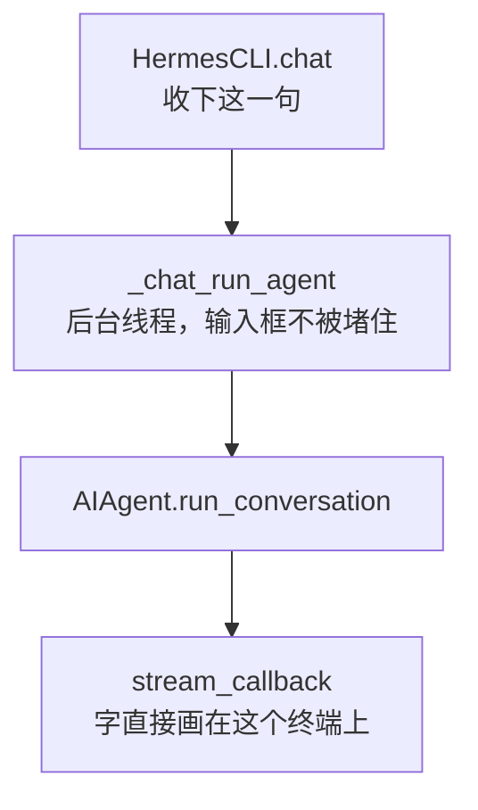

TUI / Desktop，壳和呈现网关是两个进程：

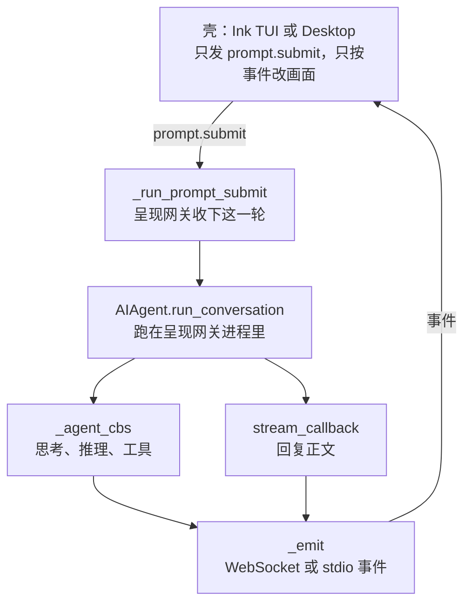

`_agent_cbs` 在呈现网关创建 `AIAgent` 时用 `**_agent_cbs(sid)` 装进去。它不负责最终回复的逐字正文。正文是 `_invoke_agent` 传给 `run_conversation` 的 `stream_callback`。两条都进 `_emit`，壳再按事件类型改画面：TUI 是 `createGatewayEventHandler`，Desktop 是 `handleMessageStreamEvent`。

IM，人已经在 `GatewayRunner` 进程里。进度不走 `_emit`。网关开跑前把函数赋到 Agent 上；Agent 调用这些函数只是入队；改聊天窗口的是这一轮旁边的排水任务，它调平台适配器。

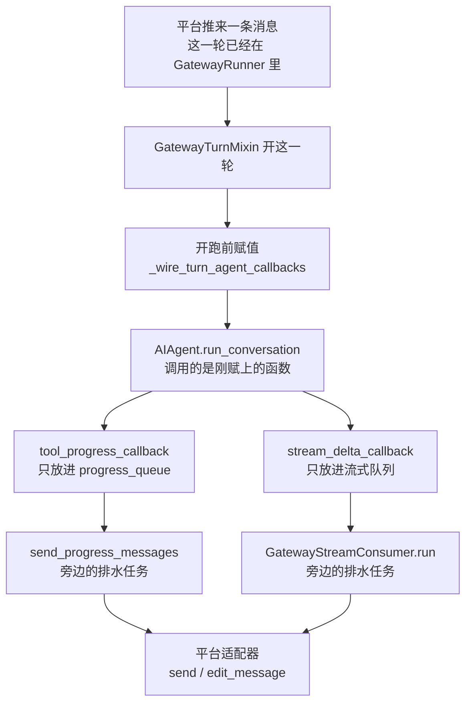

这些函数不写进 Agent 的构造。每一轮 `GatewayTurnRunner._wire_turn_agent_callbacks` 重新赋一次，换会话、关进度都不用换掉缓存里的那个 Agent。赋值发生在 `run_conversation` 之前。循环里 Agent 调用函数之后回到循环，排水任务是 `run_turn` 在同一轮旁边起的：`send_progress_messages` 取 `progress_queue`，`GatewayStreamConsumer.run` 取流式队列。

Agent 上的槽位是全入口共用的一套名字，写在 `agent/agent_init.py` 的 `_CALLBACK_PARAMS` 里，没有以 `im_` 开头的专用回调。IM 的 `AIAgent` 在 `_build_fresh_agent` 里构造，不传任何一个回调（`quiet_mode=True` 只是初始化时不往终端打印）。真正的赋值全在这一轮的 `_wire_turn_agent_callbacks`。`run_conversation` 也不传 `stream_callback`。

每一轮都赋上的：

| 槽位 | 赋上的函数 | 函数做什么 |
|------|------------|------------|
| `tool_progress_callback` | `GatewayTurnRunner.progress_callback`（`run_turn` 先放进 `turn_ctx.progress_callback`） | 子代理失败先发一条通知。工具开始时把短语写到适配器的 live status。`tool.started` 组一行放进 `progress_queue`；进度关掉、工具是 `clarify`、Slack 原生卡片、或已经中断，则不放。思考文字（事件 `_thinking`）只有该平台打开了才放进同一队列 |
| `status_callback` | `_status_callback_sync` | 静音或没有状态适配器就返回。否则把状态文案交给 `_send_or_update_status_coro`：适配器能改就改同一条，否则 `send` |
| `notice_callback` | `_notice_callback_sync` | 额度、耗尽、恢复这类带外通知渲染成一行，调度 `_deliver_platform_notice` |
| `event_callback` | `_event_callback_sync` | 把 `(event_type, context)` 交给已加载的 hooks，在网关 loop 上 `emit` |
| `clarify_callback` | `_clarify_callback_sync` | 每个问题先停掉正在流的气泡，再 `send_clarify`（或编号文本），停住等回答，返回 `{answers, outcome}` |
| `background_review_callback` | `_make_bg_review_callbacks` 返回的 `send` | 「Memory updated」先攒着。主回复发出后，适配器的 post-delivery 钩子调用配对的 `release`，再把攒下的文本发出去 |

按平台或开关才赋上的：

| 槽位 | 赋上的函数 | 什么时候赋、函数做什么 |
|------|------------|------------------------|
| `stream_delta_callback` | 这一轮现写的 `stream_delta_cb` | 流式开着，且适配器能改消息或有原生草稿。本轮还有效时，对 `GatewayStreamConsumer.on_delta` 和/或流式 TTS 的 `on_delta` 各放一个片段 |
| `interim_assistant_callback` | 这一轮现写的 `interim_assistant_cb` | 平台打开了 interim，且不是心跳。已经流过的正文只断段；否则 `on_commentary`。没有流式消费者就 `_send_status_text` |
| `tool_start_callback` | `combined_tool_start_callback` | 仅 Discord 语音确认或 Slack 原生任务卡。语音：`play_ack_in_voice` 只说一次。Slack：把带真实 `tool_call_id` 的 `tool.started` 放进 `progress_queue` |
| `tool_complete_callback` | `native_tool_complete_callback` | 仅 Slack 原生任务卡。把带同一个 `tool_call_id` 的 `tool.completed` 放进 `progress_queue` |
| `step_callback` | `_step_callback_sync` | 仅加载了 hooks。调度 `hooks.emit("agent:step", …)`，带上迭代号和上一批工具名 |
| `_on_session_title` | 只认 `title_source == "llm"` 的 lambda | 仅 Telegram topic、Discord 自动线程、relay Discord。调度对应平台的改名 |

明确写成 `None`、或构造后从未赋值因而保持 `None` 的槽位：`notice_clear_callback`（发出去的消息收不回）、`thinking_callback`、`reasoning_callback`、`reaction_callback`、`tool_gen_callback`、`tool_result_metadata_callback`，以及 `read_terminal_callback`、`read_preview_callback`、`drive_preview_callback`、`read_window_below_callback`、`connection_callback`、`tour_callback`、`setup_choose_callback`。思考开关是布尔 `thinking_progress`，不是 `thinking_callback`。

`mute_notification_reply` 时，`tool_progress_callback`、`tool_start_callback`、`tool_complete_callback`、`stream_delta_callback`、`interim_assistant_callback` 再置回 `None`，`thinking_progress` 置 `False`。`status_callback`、`notice_callback`、`event_callback`、`step_callback`、`clarify_callback` 仍留着。

审批不走这些槽位。`_run_conversation_with_approval` 用 `register_gateway_notify(session_key, _approval_notify_sync)` 单独注册，见 [卷六第8章](06-gateways-channels-and-hitl.md#sec-g8)。一轮结束的最终回复也不是槽位，是这一轮自己 `adapter.send`。

「正在输入」不是上表里的回调。这一轮开始时网关自己调 `adapter.send_typing`，进度气泡刷新后也会再调一次。

后台任务（`quiet_mode`）和不能改消息的 Webhook 不起进度队列和流式消费者，只在结束时 `send` 最终结果。IM 审批卡是另一条，停在工具执行里，见 [卷六第8章](06-gateways-channels-and-hitl.md#sec-g8)。

---

## 2. 谁调用谁

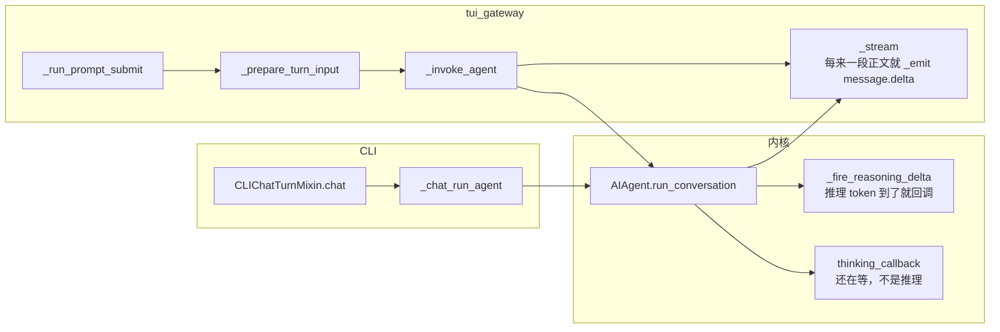

### 2.1 时序图里常见的入口函数（只指「谁开跑这一轮」）

这里只列 **服务端** 把用户输入送进 `run_conversation` 的入口。网关 `_emit` 推回界面之后，TUI/Desktop **怎么按 `event.type` 画** 在 [§3.1](#31-客户端同一条电线两种壳)（`createGatewayEventHandler`、`handleMessageStreamEvent`），不要在本节提前记函数名。

| 符号 | 位置 | 作用 |
|------|------|------|
| **`_run_prompt_submit`** | `tui_gateway/prompt_turn.py` | TUI/Desktop **一轮**的网关入口：收下 `prompt.submit`（或自动续聊、队列 drain 等等价路径）→ `message.start` → `_prepare_turn_input` → `_invoke_agent` → `message.complete`。Agent 在 **网关进程**里跑。 |
| **`_chat_run_agent`** | `hermes_cli/cli_chat_turn_mixin.py`（`HermesCLI`） | 终端 **一轮**的 Agent 线程体：`chat` 开后台线程调用它，绑定审批/vault 等 thread-local 回调，再 `run_conversation(..., stream_callback=turn.stream_callback)`。不经过 `tui_gateway`。 |

---

### 2.2 三种会话标识（`_agent_cbs(sid)` 里的 `sid` 是哪一个）

网关里同时存在三种 id，日志里常一起出现（例如 `ui_session` / `session_key` / `agent_session_id`）：

| 标识 | 谁 mint | 典型值 | 用途 |
|------|---------|--------|------|
| **`sid`** | `session.create` → `uuid.uuid4().hex[:8]`（`_new_runtime_ids`） | 8 位十六进制 | `_sessions[sid]` 的 key；**所有 WS `event.params.session_id`**；`_emit(event, sid, …)` 路由到「这一扇 TUI 窗口 / 这一条 Desktop 连接」 |
| **`session_key`**（响应里的 `stored_session_id`） | `_new_session_key()` | `YYYYMMDD_HHMMSS_xxxxxx` | SessionDB 持久化、sidebar、`run_conversation(task_id=…)`、IM 路由身份 |
| **`AIAgent.session_id`** | 构造时传入，网关多为 `session_id or key` | 常与 `session_key` 相同 | 记忆、压缩续聊、DB 行；**压缩轮转后可能变**，`sid` 一般不变 |

`_agent_cbs(sid)` 捕获的是 **UI 运行时 id**，不是把 `session_key` 写进每个 WebSocket 帧。`clarify_callback` 等阻塞式 RPC（`server_requests.send(..., sid, …)`）也按 `sid` 找「哪扇窗在答题」。

---

## 3. TUI / Desktop：一轮怎么走完

### 3.0 忙时再点发送：用户话排队（不是 `message.delta` 的 queueDelta）

端到端主路径（下图）假设 **一次 `prompt.submit` → 一次 `run_conversation`**。若 `session["running"]` 已为真（上一轮 `_invoke_agent` 还没跑到 `message.complete`），新来的 submit **通常不会** 立刻再开一轮 Agent，而是：

1. **`_enqueue_prompt`**（`tui_gateway/session_auto_continue.py`）写入 `session["queued_prompt"]` 或 `queued_prompts`（纯文本可合并进同一槽）。
2. 当前轮在 `prompt_turn` 收尾释放 `running` 后，**`_chain_post_turn`** 按顺序：遗留 `pending_steer` 再入队 → **`_drain_queued_prompt`** → 必要时再 `_run_prompt_submit`（链式 follow-up）。

这与 **Desktop 客户端** 里把 token 攒进 `queuedDeltasRef` 的 **`queueDelta`** 无关（那是出站渲染批处理，见 §6）。

| 符号 | 位置 | 作用 |
|------|------|------|
| `_enqueue_prompt` | `session_auto_continue.py` | 忙时把用户话钉在 session 字典里 |
| `_drain_queued_prompt` | 同上 | `running` 释放后认领队列头，触发下一轮 submit |
| `_chain_post_turn` | `prompt_turn.py` | complete 后串联 steer 重排队、drain、goal、通知 |

CLI 终端不走 `tui_gateway` 队列，而用 **`HermesCLI._pending_input`** + **`busy_input_mode`**（`queue` / `steer` / `interrupt`）→ [卷一 §2.3.2](01-platform-and-architecture.md#sec-2-3-2)。IM → [卷六](06-gateways-channels-and-hitl.md) + [对比文](../../compare/CHANNEL_AGENTSCOPE_VS_HERMES.md)。

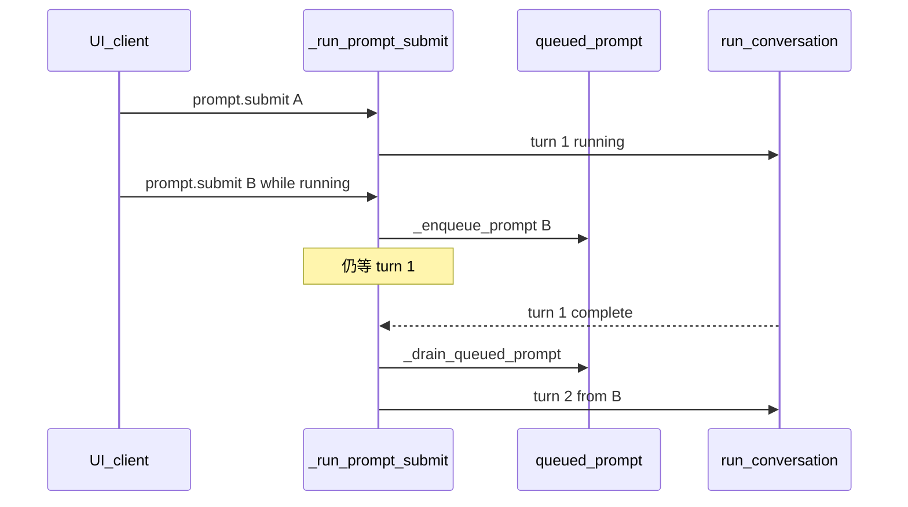

---

界面只发一次提交时，走下面主路径。网关线程里跑完，再用事件把过程推回去。`sid` 是这一扇窗口，事件都带它，所以多窗口不会画串。

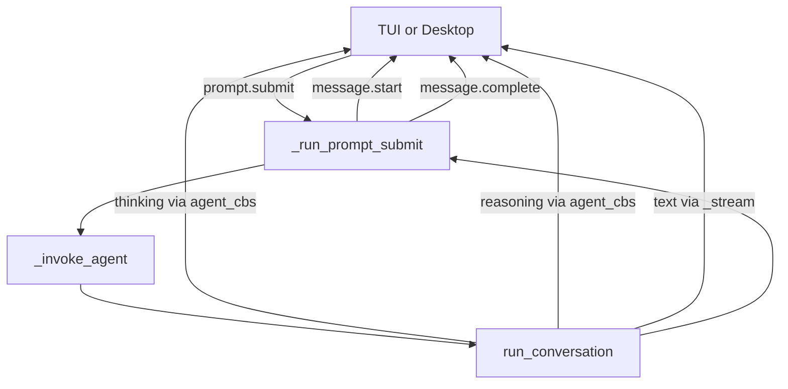

上图只画到「网关往 UI 推了什么 **事件名**」。下面补 **客户端收到之后干什么**，以及 **为什么工具是另一条线**（和 [§0.2 `_emit`](#02-_emit-是什么)、[§5 `_agent_cbs`](#5-_agent_cbs-是什么怎么注册怎么被调到) 是同一根线）。

### 3.1 客户端：同一条电线，两种壳

网关推出来的每一帧都是 [§0.2](#02-_emit-是什么) 里的 JSON-RPC `method: "event"`，`params.type` 就是事件名（`message.delta`、`tool.start`…），`params.session_id` 是 `sid`。

TUI 和 Desktop **不各自实现 Agent 循环**。它们只做两件事：

1. **发请求**：`prompt.submit`（等 RPC 响应表示「收下了」）。
2. **听推送**：连接上（stdio 或 WebSocket）之后，对每一帧 `event` 调一个总入口，按 `type` 改本地状态，界面重画。

| 壳 | 总入口（你读代码时搜这些名字） | 状态落在哪 |
|----|--------------------------------|------------|
| **Ink TUI** | `createGatewayEventHandler` 返回的 `onEvent` | `turnController`（当前轮的气泡、thinking 块、工具卡片等） |
| **Desktop** | `handleGatewayEvent` → `handleMessageStreamEvent` | 当前会话 `messages` 里那条助手消息的 **parts**（正文 part、reasoning part、tool part…） |

所以不是「突然冒出三个函数」：**时序图里的 `thinking.delta` / `reasoning.delta` / `message.delta`，就是 `params.type` 的三个取值**；TUI 用 `switch (event.type)` 进不同分支，Desktop 用一张 `HANDLERS` 表做同样的事。协议只有一套（网关 `_emit` 定死的名字），只是 React/Ink 的变量名不同。

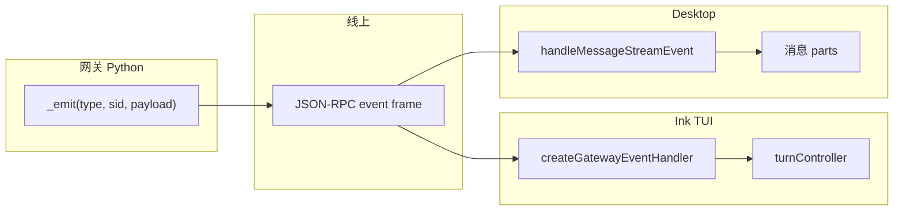

### 3.2 一轮里常见事件：谁发、客户端画在哪

#### 先弄清「网关谁 `_emit`」这一列

**推事件到 UI 的函数永远只有一个**：`tui_gateway/server.py` 里的 **`_emit(event, sid, payload)`**（[§0.2](#02-_emit-是什么)）。  
表里 **不是**「有很多个不同的 emit 函数」，而是：**这类 `params.type` 之前，网关里是哪段代码触发的**——最后一跳都是 `_emit("某种.type", sid, …)`。

记两条上游：

| 上游从哪来 | 谁最后调用 `_emit` | 管哪些 `params.type` |
|------------|-------------------|----------------------|
| **一轮的「外壳」** | `_run_prompt_submit` 自己直接写 | `message.start`、`message.complete`（本轮开始/结束） |
| **Agent 在跑循环** | 创建 Agent 时挂上的 **callback**（来自 `_agent_cbs`） | `thinking.delta`、`reasoning.delta`、`tool.start` / `tool.complete`、通知等 |
| **Agent 在跑循环** | 每轮 `_invoke_agent` 注册的 **`_stream`**（`stream_callback`） | **`message.delta`（正文 token）** |

箭头 `→` 读法：**Agent 循环里调了 `thinking_callback`** → `_agent_cbs` 造的闭包 → **`_agent_thinking_update(sid, …)`**（presentation 策略）→ 必要时 **`_emit("thinking.delta", …)`**。推理同理经 **`_emit_reasoning_delta`**，见 [§5.2](#52-_agent_cbssid-返回的-dict-里有什么)。

把 [§3 时序图](#3-tui--desktop一轮怎么走完) 和客户端对上号（同一轮里可能交错多次）：

| `params.type` | 网关里谁先动起来（最后都是 `_emit`） | 内容上是什么 | TUI 大致做什么 | Desktop 大致做什么 |
|---------------|--------------------------------------|--------------|----------------|-------------------|
| `message.start` | **`_run_prompt_submit`** 里直接 `_emit` | 这轮助手气泡开始 | 标记 busy、开新块 | `turnLive`、准备 pending 助手消息 |
| `thinking.delta` | 循环 → **`agent.thinking_callback`**（`_agent_cbs` 挂上） | **还在等**（慢、重试），不是模型推理 | 状态行 / 等待动画 | 底部等待行，**不进对话正文** |
| `reasoning.delta` | 循环 → **`agent.reasoning_callback`**（`_agent_cbs` 挂上） | 模型 **推理 token** | `recordReasoningDelta` → thinking 面板 | 写成 **reasoning part** |
| `message.delta` | 循环 → **`_stream`**（本轮 `stream_callback`，**不是** `_agent_cbs`） | **要给用户看的正文** token | 追加当前回复文本 | `queueDelta` → 助手 **正文 part** |
| `tool.start` / `tool.complete` | 循环 → **`tool_start_callback` / `tool_complete_callback`**（`_agent_cbs` → `_on_tool_*`） | 工具名、参数、结果摘要 | 插/更新 **工具卡片** | `upsertToolCall` → **tool part** |
| `message.complete` | **`_run_prompt_submit`** 收尾时直接 `_emit` | 本轮结束、最终文本 | 关 busy、落 transcript | 封住当前助手消息 |

同一轮还可能收到 **`tool.generating`**、**`notification.show` / `notification.clear`**、**`status.update`**、**`reaction`**、**`message.interim`** 等；触发链与网关卡函数见 [§5.2](#52-_agent_cbssid-返回的-dict-里有什么)，不必全部记进上表。

读表时记住两条分工（前面 §5 也说过，这里换成「从 UI 往回看」）：

- **「字」分三类通道**：等待文案（thinking）、推理（reasoning）、正文（message.delta）。正文 **只**走每轮注册的 `_stream` → `message.delta`。
- **「工具」是独立事件**：工具在 `tool_executor` 里跑，开始/结束时调的是创建 Agent 时挂好的 `tool_start_callback` / `tool_complete_callback`（来自 `_agent_cbs`），里面 `_emit("tool.start" | "tool.complete")`。它们 **不会**经过 `_stream`，所以 **不会**变成 `message.delta`——否则你会看到「工具名和 stdout 混在同一段 Markdown 里」。客户端因此用 **单独的分支** 画工具块，而不是 `appendAssistantDelta`。

若一轮里先 `tool.start` 再若干 `message.delta`，Desktop 会先 `flushQueuedDeltas` 再画工具块，避免工具卡片插到正文中间错乱（见 [§6](#6-desktop-画一句正文从-messagedelta-到气泡)）。

### 3.3 和纯终端对比（为什么这段只讲 TUI/Desktop）

`hermes chat` **没有** `_emit`，也没有 `createGatewayEventHandler`。同一个 `AIAgent` 在 **本进程**里用 `thinking_callback` / `reasoning_callback` 直接改终端 UI，`stream_callback` 直接打印。下一节 [§4](#4-cli不经过这套-websocket) 专讲那条路。

### 3.4 端到端时序：Platform callback 与 Plugin hook 同图

**范围**：TUI / Desktop **一轮**（`prompt.submit` → `message.complete`），Agent 已在 `_make_agent` 时挂好 `_agent_cbs(sid)`（[§5.1](#51-完整流程从开窗到回调注册--运行)）。**内核循环与 hook 触发顺序在 CLI / IM 上相同**；差别只是 Platform callback 的实现：网关里 `CB → _emit → UI`，终端里 `CB → _on_thinking` / Rich，IM 里 `CB → Delivery.send`（无 `message.delta` 帧）。

**图例**

| 符号 | 含义 |
|------|------|
| **CB** | `agent.*_callback`（构造时来自 `_agent_cbs` 或 CLI 手写） |
| **HK** | `invoke_hook(name, …)` / `VALID_HOOKS`（[§5.7](#57-platform-callback-与-plugin-hook-为什么两套都有)） |
| **GW** | `tui_gateway`：`_run_prompt_submit`、`_invoke_agent`、`_emit` |
| 虚线 `HK-->>HK` | 流式 hook **异步入队**（`plugin_stream_hooks`），不挡 token 路径 |

#### A. 开窗注册（每 `sid` 一次，非每轮）

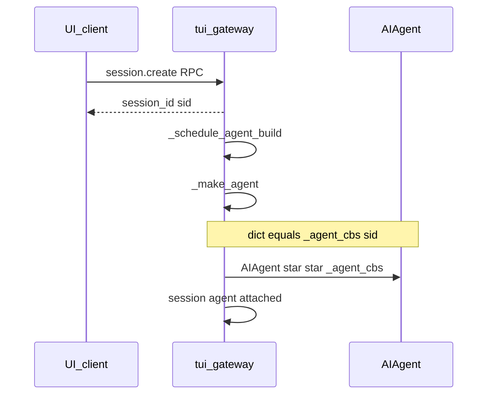

#### B. 一轮外壳：从提交到 `message.complete`

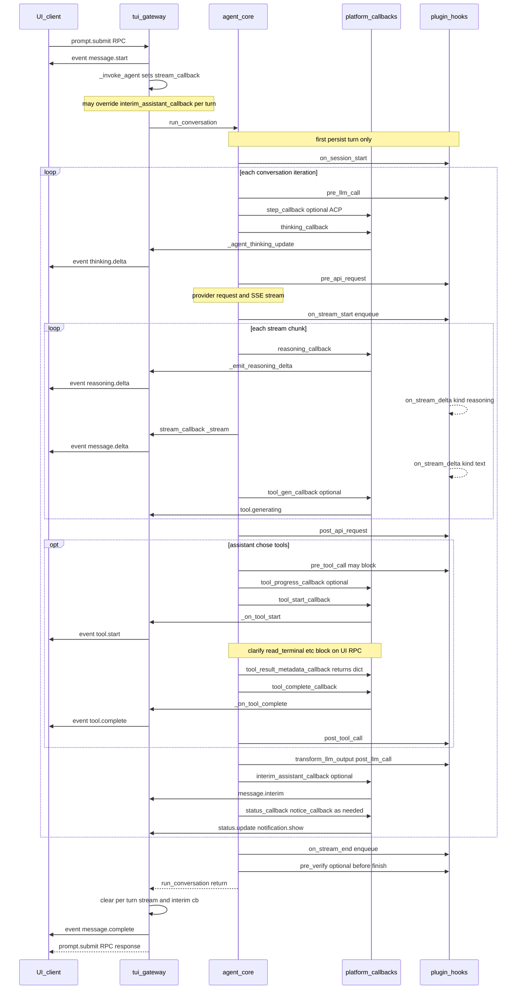

#### C. 单次工具调用放大（与 B 中 `opt` 块一致）

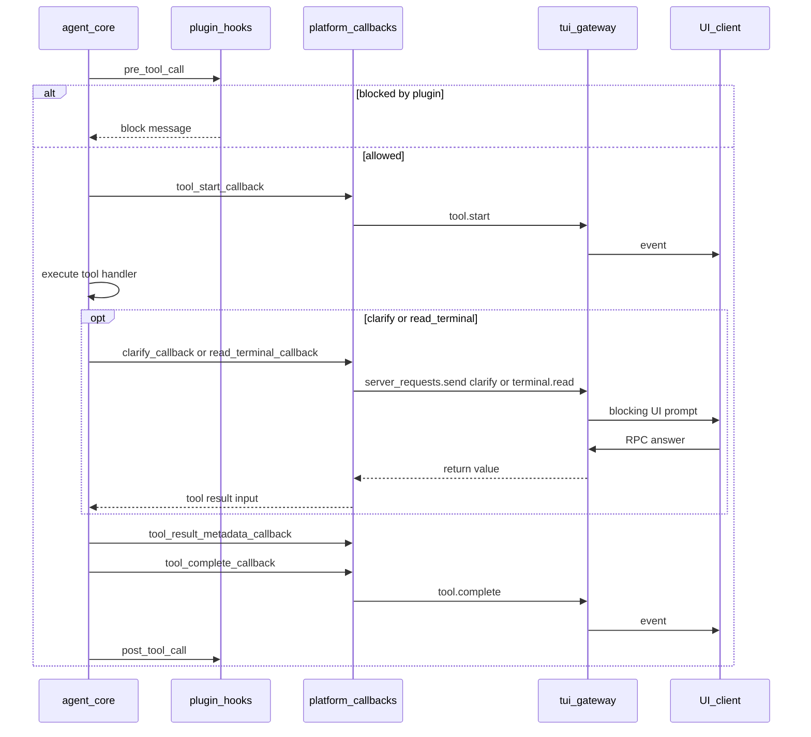

#### D. 时间点清单（对照源码搜）

按 **一轮内时间顺序** 排列；同一毫秒可能交错多次（多 chunk、多工具）。「呈现事件」仅 TUI/Desktop 经 GW `_emit`；CLI 同序 **CB**，无事件名。

| 阶段 | Platform callback（CB） | Plugin hook（HK） | 呈现事件 / 备注 |
|------|-------------------------|-------------------|-----------------|
| `session.create` 后 | `_make_agent` 写入全部 `*_callback` | — | 无 |
| `prompt.submit` 入口 | — | — | `message.start`（GW 直接 `_emit`） |
| `_invoke_agent` | 设 `stream_callback=_stream`；可覆盖 `interim_assistant_callback` | — | — |
| `run_conversation` 开头 | `status_callback` 回放压缩警告等 | `on_session_start`（首 persist 轮） | `status.update` |
| 每轮迭代开始 | `step_callback`（ACP 等） | `pre_llm_call` | — |
| 等模型前 | `thinking_callback` | — | `thinking.delta` |
| 每次 HTTP 调提供商前 | — | `pre_api_request` | — |
| 流开始 | — | `on_stream_start`（队列） | — |
| 每个推理 chunk | `reasoning_callback` | `on_stream_delta`（`kind=reasoning`，队列） | `reasoning.delta` |
| 每个正文 chunk | `stream_callback`（+ CLI 的 `stream_delta_callback`） | `on_stream_delta`（`kind=text`，队列） | `message.delta` |
| 工具名生成中 | `tool_gen_callback` | — | `tool.generating` |
| 工具进度 | `tool_progress_callback` | — | `tool.progress` / `todo.updated` / … |
| 每个 tool call 前 | — | `pre_tool_call`（可 block） | — |
| 工具开跑 | `tool_start_callback` | — | `tool.start` |
| 阻塞式 GUI 工具 | `clarify_callback` / `read_*` / `setup_choose` / `tour` / `connection_callback` | — | RPC + 部分 `connection.request` |
| 工具结果进 transcript 前 | `tool_result_metadata_callback`（**return**） | `transform_tool_result` 等 | 通常无 `_emit` |
| 工具结束 | `tool_complete_callback` | `post_tool_call` | `tool.complete` |
| HTTP 返回后 | — | `post_api_request` | — |
| 助手段收尾 | `interim_assistant_callback` | `on_interim_message` | `message.interim` |
| 积分 / 通知 | `notice_callback` / `notice_clear_callback` | — | `notification.show` / `clear` |
| 流结束 | — | `on_stream_end`（队列） | — |
| 回合结束前 | — | `transform_llm_output` → `post_llm_call` | — |
| 验证 nudge | — | `pre_verify` | — |
| 一轮结束 | — | — | `message.complete`；清 `_stream_callback` |

**未画进 B 图但存在的 hook**（会话 / 网关 / 辅助 LLM）：`on_session_end`、`on_session_finalize`、`pre_auxiliary_call` / `post_auxiliary_call`（压缩、标题等）、`pre_gateway_dispatch`（IM 入站）、`api_request_error`、`transform_api_error_classification` 等——见 `hermes_cli/plugins.py` 的 `VALID_HOOKS`。

**CLI 同一内核**：把表中「呈现事件」列换成「终端 Rich / reasoning box」；无 GW 参与者。  
**IM**：同序 CB 多为 `GatewayRunner` 注入的 Delivery；无 Ink/Desktop 事件表，hook 与工具前后关系不变。

---

## 4. CLI：不经过这套 WebSocket

`hermes chat` 没有 `tui_gateway`。`cli.main` 建 `HermesCLI` 之后：

- 有 TTY、又不是 `-Q`：交互循环，每一句仍进 `HermesCLI.chat`。
- `chat -q` 且没有 TTY（看板 worker 就是这样）：`_run_single_query_mode` 调一次 `HermesCLI.chat` 然后退出。
- `-Q` / 安静模式：不走 `chat`，`_run_quiet_single_query` 直接 `cli.agent.run_conversation`。

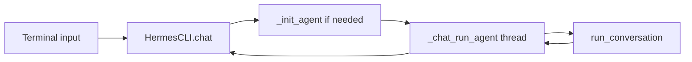

终端上：**等待**走 `thinking_callback`（`_on_thinking`），**推理**走 `reasoning_callback`，**正文**走 `stream_delta_callback`（开 streaming 时）和/或每轮 `stream_callback`——都在本进程画，**没有** `tui_gateway` 的 `method: "event"` 帧（也就没有 `reasoning.delta` 这种 `params.type`）。

---

## 5. `_agent_cbs`：是什么、怎么注册、怎么被调到

**文档约定（callback 清单）**：呈现网关侧以 **`tui_gateway/agent_callbacks.py::_agent_cbs`** 为准；`AIAgent` 可挂的属性名以 **`agent/agent_init.py::_CALLBACK_PARAMS`** 为准。本卷 **§5.2**（`_agent_cbs` 返回的每个键）与 **§5.4.1**（`_CALLBACK_PARAMS` 全集与谁接线）是权威段落；其它小节若出现「闭包 = 直接 `_emit(事件名)`」的简写，一律以 §5.2 的 **网关卡** 列为准。

**不是新方案**：`thinking_callback`、`reasoning_callback`、`stream_callback` 等是 **`AIAgent` 自 v0.18 呈现层升级以来就有的构造/运行期注入点**（内核 `conversation_loop` / `stream_delivery` / `tool_executor` 按属性名调用）。`tui_gateway` 的 **`_agent_cbs(sid)`** 是把同一套属性接到 `_emit` 的工厂，也不是本轮新加的 API。较早文档里已用「callback → Gateway 事件」描述过，例如 [`archive/legacy/SURFACE_ARCHITECTURE.md`](../archive/legacy/SURFACE_ARCHITECTURE.md) §2–§3；若你之前只读 **IM 卷**（`GatewayRunner`、`Delivery`）或 **Channel 对比文**，可能几乎见不到这些词——那些文讲的是 **通道入站/出站**，不是 TUI/Desktop 的 **呈现适配器**。本卷 **§5** 是把源码里一直存在的 `_CALLBACK_PARAMS` / `_agent_cbs` **系统写全**；「**Platform callback**」是相对 **`invoke_hook` / `VALID_HOOKS`（插件 hook）** 的称呼，用来区分 **宿主接线** 与 **可插拔扩展**，不是第三种运行时机制。

这一节只讲 **TUI / Desktop 呈现网关** 那条路。终端 CLI **没有** `_agent_cbs`，而是 `HermesCLI._init_agent` 里手写 `thinking_callback=self._on_thinking` 等（见 [§4](#4-cli不经过这套-websocket)）。

### 5.0 先用三句话记住它

1. **`_agent_cbs` 是一个普通 Python 函数**（在 `tui_gateway/agent_callbacks.py`），**不是** `AIAgent` 的字段，也 **不是** 构造参数名。签名是 `_agent_cbs(sid: str) -> dict`。
2. 它 **只做一件事**：根据「这一扇 UI 窗口的 `sid`」，**造出一包小函数**（闭包），每个闭包调用 **网关卡函数**（再 `_emit` 或 `server_requests.send`）。例如 `thinking_callback` → `_agent_thinking_update(sid, text)` → 可能 `_emit("thinking.delta", …)`；`reasoning_callback` → `_emit_reasoning_delta`（`show_reasoning` 关则不发）。
3. 网关 **`_make_agent` 创建 `AIAgent` 时** 把这包函数 **拆开** 塞进构造参数：`AIAgent(..., **_agent_cbs(sid))`。`init_agent` 把它们变成 `agent.thinking_callback`、`agent.reasoning_callback` 等 **属性**。之后 **`conversation_loop` 只认这些属性名**，到点了就 `agent.reasoning_callback(text)`，**不知道** WebSocket、也不知道 `_agent_cbs` 存在过。

可以把它想成：**给「内核」装的一排电话键**——键的标签是 `thinking_callback`、`tool_start_callback`…；`_agent_cbs(sid)` 负责把每个键的线路接到 **「窗口 sid」对应的 Transport 出口**（stdio 或 WS，见 [§0.2](#02-_emit-是什么)）。内核只按标签拨号。

**正文逐字回复不在这排键里**：最终助手字走每轮 `_invoke_agent` 传入的 `stream_callback`（内部 `_emit("message.delta")`）。`_agent_cbs` 管的是等待文案、推理、工具、通知、以及要等用户点选的 `clarify` 等。

### 5.1 完整流程：从开窗到回调（注册 + 运行）

下面是一条线拉通 **注册**（每个 `AIAgent` 实例创建时一次，见 [§0.3](#03-注册一次跟-agent-同寿命到底指什么)）和 **回调**（该实例活着期间，每一轮、每个 token/工具步都可能触发）。

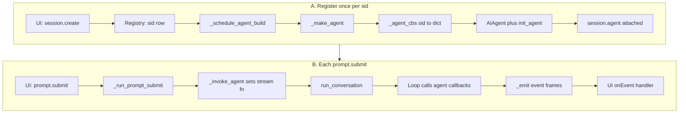

线上事件名带点号，例如 `thinking.delta`、`message.delta`、`tool.start`（见 [§3.2](#32-一轮里常见事件谁发客户端画在哪)）。上图节点用简写，避免部分 Mermaid 渲染器解析失败。

**阶段对照（方便对着代码搜）：**

| 阶段 | 发生什么 | 关键符号 |
|------|----------|----------|
| 开窗 | 客户端拿到 `session_id`（即 `sid`） | `methods_session._create_session` |
| 排队建 Agent | 不阻塞 UI 绘画 | `_schedule_agent_build(sid)` |
| **注册 callback** | `dict = _agent_cbs(sid)` → `AIAgent(**dict)` | `_make_agent` |
| 存起来 | `_sessions[sid]["agent"]` | `_init_session` / build 完成路径 |
| 用户说话 | 网关里跑一轮 | `_run_prompt_submit` → `_invoke_agent` |
| **触发 callback** | 循环里 `getattr(agent, "…_callback")(...)` | `status_output`、`stream_delivery`、`tool_executor` 等 |
| 推到界面 | `_emit(type, sid, payload)` | `server._emit` → `write_json` |

注册 **不会** 每轮重做；`prompt.submit` 只会换每轮的 `stream_callback`（和可选的 `interim_assistant_callback` 覆盖）。

### 5.2 `_agent_cbs(sid)` 返回的 `dict` 里有什么

权威源码：`tui_gateway/agent_callbacks.py::_agent_cbs`（在 `_make_agent` 里 `AIAgent(..., **_agent_cbs(sid))` 展开）。下面表格与 **当前仓库键集合一一对应**；§5.5 只讲登记时机，**不再重复一张简表**。

**约定（读表用）：**

| 列 | 含义 |
|----|------|
| **网关卡** | 闭包调用的函数（`sid` 已闭包捕获） |
| **方向** | **推** = 单向 `_emit` 或 fire-and-forget 请求；**阻** = `server_requests.send` / `_ask`，工具线程阻塞等 UI 回包；**返** = 同步 `return dict`，**不**发呈现事件（给内核拼 tool result） |
| **典型 wire** | JSON-RPC 事件 `params.type` 或 **request method**（双向） |

`_CALLBACK_PARAMS`（`agent/agent_init.py`）里还有 `step_callback`、`stream_delta_callback`、`event_callback` 等名字——**`_agent_cbs` 不会填它们**，构造后保持 `None`（网关正文走每轮 `stream_callback`，见 §5.4）。

| `dict` 键（→ `agent.*`） | 闭包调用 | 方向 | 典型 wire / RPC | 备注 |
|--------------------------|----------|------|-----------------|------|
| `tool_start_callback` | `_on_tool_start(sid, tc_id, name, args)` | 推 | `tool.start` | 受 `tool_progress_mode` / 部分工具强制生命周期影响 |
| `tool_complete_callback` | `_on_tool_complete(sid, …)` | 推 | `tool.complete` | 可附带 summary、verbose 尾等 |
| `tool_result_metadata_callback` | `_prepare_tool_result_metadata(sid, …)` | **返** | （无） | 在 complete 前把 metadata 塞进 session；供 tool 消息组装 |
| `tool_progress_callback` | `_on_tool_progress(sid, event_type, …)` | 推 | `tool.progress` 等 | 按 `event_type` 分发（含 `todo.updated`、`tool.output_risk`、`moa.*`、`reasoning.available` 等） |
| `tool_gen_callback` | `_tool_progress_enabled(sid) and _emit("tool.generating", …)` | 推 | `tool.generating` | 未开 tool progress 时短路，不 `_emit` |
| `thinking_callback` | `_agent_thinking_update(sid, text)` | 推 | `thinking.delta` | 内层 `_agent_presentation_enabled`（含 diagnostic / mute） |
| `reasoning_callback` | `_emit_reasoning_delta(sid, text)` | 推 | `reasoning.delta` | `show_reasoning` 为假则 **return**，不 `_emit` |
| `reaction_callback` | `_emit("reaction", sid, {"kind": kind})` | 推 | `reaction` | 内核 affection 检测（如 ily / good bot） |
| `status_callback` | `_agent_status_update(sid, kind, text)` | 推 | `status.update` | 经 `_status_update`；warning 类受 TUI 通知策略过滤 |
| `notice_callback` | `_agent_notice_update(sid, n)` | 推 | `notification.show` | `AgentNotice` → payload |
| `notice_clear_callback` | `_emit("notification.clear", …)` | 推 | `notification.clear` | 按 `key` 撤通知 |
| `clarify_callback` | `_clarify_block(sid, questions)` | **阻** | request `clarify` | 返回 `{"answers", "outcome"}` |
| `read_terminal_callback` | `_read_block("terminal.read", 30)` | **阻** | request `terminal.read` | Desktop/TUI 读终端窗格 |
| `read_preview_callback` | `_read_block("preview.read", 45)` | **阻** | request `preview.read` | 预览页读正文，超时更长 |
| `drive_preview_callback` | `_preview_action_request(sid, payload)` | **阻** | preview 动作 RPC 梯 | `drive_preview` / `annotate_preview` |
| `read_window_below_callback` | `_ask("window.read", sid, {}, timeout=30)` | **阻** | request `window.read` | Desktop 枚举本机窗口 |
| `connection_callback` | `_emit("connection.request", …) and None` | 推 | `connection.request` | 卡片驱动；工具侧另等 `connection.respond` |
| `tour_callback` | `_tour_request(sid, payload)` | **阻** | tour 相关 request | Desktop driver.js 导览 |
| `setup_choose_callback` | `_setup_choose_request(sid, payload)` | **阻** | request `setup_choose` | Desktop 设置向导选项 |
| `interim_assistant_callback` | `_emit("message.interim", …)` | 推 | `message.interim` | **仅当** `_load_interim_assistant_messages()` 为真时写入 dict；且每轮可能被 `_invoke_agent` 覆盖（§5.5） |

与源码结构一致的骨架（键顺序与文件一致，省略仅实现细节）：

```python
def _agent_cbs(sid: str) -> dict:
    def _read_block(method: str, timeout: int):
        return lambda start=None, count=None: _ask(method, sid, {...}, timeout=timeout)

    callbacks = {
        "tool_start_callback": ...,
        "tool_complete_callback": ...,
        "tool_result_metadata_callback": ...,
        "tool_progress_callback": ...,
        "tool_gen_callback": ...,
        "thinking_callback": lambda text: _agent_thinking_update(sid, text),
        "reaction_callback": lambda kind: _emit("reaction", sid, {"kind": kind}),
        "reasoning_callback": lambda text: _emit_reasoning_delta(sid, text),
        "status_callback": lambda kind, text=None: _agent_status_update(sid, kind, text),
        "notice_callback": lambda n: _agent_notice_update(sid, n),
        "notice_clear_callback": lambda key: _emit("notification.clear", sid, {"key": key}),
        "clarify_callback": lambda questions: _clarify_block(sid, questions),
        "read_terminal_callback": _read_block("terminal.read", 30),
        "read_preview_callback": _read_block("preview.read", 45),
        "drive_preview_callback": lambda payload: _preview_action_request(sid, dict(payload)),
        "read_window_below_callback": lambda: _ask("window.read", sid, {}, timeout=30),
        "connection_callback": lambda payload: _emit("connection.request", sid, dict(payload)) and None,
        "tour_callback": lambda payload: _tour_request(sid, payload),
        "setup_choose_callback": lambda payload: _setup_choose_request(sid, payload),
    }
    if _load_interim_assistant_messages():
        callbacks["interim_assistant_callback"] = lambda text, *, already_streamed=False: _emit(
            "message.interim", sid, {"text": str(text), "already_streamed": bool(already_streamed)})
    return callbacks
```

`**dict` 的键名必须与 `_CALLBACK_PARAMS` 中的名字一致**，否则 `init_agent` 不会 `setattr` 到 `AIAgent` 上。

### 5.3 一次「推理 token」从模型到 TUI 的微观路径

把「注册」和「回调」连成一条链（与源码一致）：

1. **注册时**（`_make_agent` → `_agent_cbs(sid)`）：  
   `agent.reasoning_callback` = `lambda text: _emit_reasoning_delta(sid, text)`（`sid` 闭包抓住，见 [§2.2](#22-三种会话标识_agent_cbssid-里的-sid-是哪一个)）。
2. **运行时**（Agent 内核）：提供商流里出现推理片段 → `StreamDeliveryMixin._fire_reasoning_delta` → **`self.reasoning_callback(text)`**（内核只知道这个名字，不知道 `_emit`）。
3. **网关卡**（`agent_callbacks._emit_reasoning_delta`）：若 `_session_show_reasoning(sid)` 为假 → **return，不推 UI**；否则 **`_emit("reasoning.delta", sid, {"text": text, …})`**。
4. **客户端**：Ink/Desktop 收到 `params.type == "reasoning.delta"` → 更新 thinking 面板 / reasoning part。

**和 §5.2 简写图的差别**：教学里有时写成 `lambda text: _emit("reasoning.delta", …)` 少画一层；**仓库里推理必经 `_emit_reasoning_delta`**，用来尊重 `display.show_reasoning` 等会话设置。`thinking` 同理，经 `_agent_thinking_update` 而不是裸 `_emit`。

内核 **自始至终** 只调 `agent.reasoning_callback`；**sid 只在网关闭包和 `_emit` 里出现**，多窗口不会串台。

### 5.4 `AIAgent` 构造：callback 如何进到对象上

`run_agent.py` 里的 `AIAgent.__init__` 几乎是转发器：收集关键字参数后调用 `agent.agent_init.init_agent`。其中与呈现相关的一整组名字在 **`_CALLBACK_PARAMS`** 里枚举，逐个 `setattr(agent, name, value)`，未传入则为 `None`：

`tool_progress_callback`、`tool_start_callback`、`tool_complete_callback`、`tool_result_metadata_callback`、`thinking_callback`、`reasoning_callback`、`clarify_callback`、`read_terminal_callback`、`read_preview_callback`、`drive_preview_callback`、`read_window_below_callback`、`connection_callback`、`tour_callback`、`setup_choose_callback`、`step_callback`、`stream_delta_callback`、`interim_assistant_callback`、`status_callback`、`notice_callback`、`notice_clear_callback`、`event_callback`、`reaction_callback`、`tool_gen_callback`（完整元组见 `agent_init._CALLBACK_PARAMS`）。

**没有**名为 `_agent_cbs` 的构造参数。网关侧是工厂函数 `tui_gateway/agent_callbacks.py::_agent_cbs(sid) -> dict`，在 `_make_agent` 里 **`**_agent_cbs(sid)` 展开**成上面的各个 `*_callback` 关键字。

另外还有 **每轮** 才挂上的正文路径：`run_conversation(..., stream_callback=…)` → `StreamDeliveryMixin` 上的 `_stream_callback`（`turn_finalizer` 回合结束清掉）。CLI 还可以在构造时设 **`stream_delta_callback`**（token 流画终端）；网关正文 **不**走 `stream_delta_callback`，而走 `_invoke_agent` 里现写的 `_stream`。

#### 上游两条构造路径

| 路径 | 谁 `new AIAgent` | Callback 从哪来 |
|------|------------------|-----------------|
| **TUI / Desktop 网关** | `tui_gateway/server.py::_make_agent(sid, key, …)` | `**_agent_cbs(sid)`；`session_id` 多为 `session_id or key`；`platform` 为 `desktop` / `tui` 等 |
| **终端 / `chat -q` / 看板 worker** | `hermes_cli/cli_agent_setup_mixin.py::_init_agent` | 逐项传入：`thinking_callback=self._on_thinking`、`reasoning_callback=…`、`clarify_callback=…`、`tool_*`、`notice_*`、`stream_delta_callback`（开 streaming 时）等；**无** `_agent_cbs` |
| **IM** | `GatewayRunner` 等 | 另有把 Agent 输出接到 `Delivery` 的映射（不进 `tui_gateway` WS） |

`_make_agent` 里还会 `register_from_config` 加载 **shell_hooks**（配置里的 shell 集成），与 **plugin hook** 也不是同一条总线。

#### 5.4.1 `_CALLBACK_PARAMS` 全集：谁接线

`init_agent` 只为 `_CALLBACK_PARAMS` 里的名字 `setattr`。**不在**该元组里、但和呈现同样重要的还有每轮 **`agent._stream_callback`**（`run_conversation` 参数，网关里由 `_invoke_agent._stream` 写入）。

| `agent` 属性 | `_agent_cbs` | 呈现网关（TUI/Desktop） | 终端 CLI（典型） | IM `GatewayRunner`（典型） | 内核侧谁调（节选） |
|--------------|:------------:|-------------------------|------------------|----------------------------|-------------------|
| `tool_progress_callback` | ✓ | `_on_tool_progress` → 多种 `tool.*` / `todo.updated` / `moa.*` 等 | 常 `None` 或 inline diff 相关 | 部分平台 API run 自建 | `tool_executor`、流式工具输出 |
| `tool_start_callback` | ✓ | `_on_tool_start` → `tool.start` | `_on_tool_start`（inline diff 开） | Delivery 映射 | `tool_executor` |
| `tool_complete_callback` | ✓ | `_on_tool_complete` → `tool.complete` | 配对 complete | Delivery | `tool_executor` |
| `tool_result_metadata_callback` | ✓ | `_prepare_tool_result_metadata`（**返** dict，不 `_emit`） | 通常 `None` | 通常 `None` | `tool_executor`（complete 前） |
| `tool_gen_callback` | ✓ | 条件 `_emit("tool.generating")` | 通常 `None` | 通常 `None` | `StreamDeliveryMixin._fire_tool_gen_started` |
| `thinking_callback` | ✓ | `_agent_thinking_update` → `thinking.delta` | `_on_thinking` | 平台 thinking 文案 | `turn_api_call`、`turn_iteration_prep` 等 |
| `reasoning_callback` | ✓ | `_emit_reasoning_delta` → `reasoning.delta` | `_current_reasoning_callback()` | 常保留或关掉 | `_fire_reasoning_delta` |
| `reaction_callback` | ✓ | `_emit("reaction")` | 通常 `None` | 通常 `None` | `turn_context` affection 检测 |
| `status_callback` | ✓ | `_agent_status_update` → `status.update` | `_emit_status` 路径 | 部分剥离 | `status_output`、压缩完成等 |
| `notice_callback` | ✓ | `_agent_notice_update` → `notification.show` | 有则 `_emit_notice` | 常关掉 clear | `status_output._emit_notice` |
| `notice_clear_callback` | ✓ | `_emit("notification.clear")` | 有 | IM 常 `None` | credits / notice 恢复 |
| `clarify_callback` | ✓ | `_clarify_block` → RPC `clarify` | `_clarify_callback` / oneshot 变体 | `_clarify_callback_sync` | clarify 工具 |
| `read_terminal_callback` | ✓ | `_ask("terminal.read")` | 通常 `None`（无呈现网关） | `None` | `read_terminal` 工具 |
| `read_preview_callback` | ✓ | `_ask("preview.read")` | `None` | `None` | preview 读工具 |
| `drive_preview_callback` | ✓ | `_preview_action_request` | `None` | `None` | drive/annotate preview |
| `read_window_below_callback` | ✓ | `_ask("window.read")` | `None` | `None` | `read_window_below` 工具 |
| `connection_callback` | ✓ | `_emit("connection.request")` | 构造时可选 | 卡片面 | connectors 工具 |
| `tour_callback` | ✓ | `_tour_request` | `None` | `None` | tour 工具 |
| `setup_choose_callback` | ✓ | `_setup_choose_request` → `setup_choose` | `None` | `None` | setup_choose 工具 |
| `interim_assistant_callback` | 条件 ✓ | 配置开则构造；**每轮** `_invoke_agent` 可覆盖 | 通常 `None` | 视平台 | `StreamDeliveryMixin` interim 路径 |
| `stream_delta_callback` | — | **`None`**（正文走 `_stream_callback`） | `_stream_delta`（streaming 开） | API run 可自建 | `_fire_stream_delta` 与 `_stream_callback` 并列 |
| `step_callback` | — | **`None`** | 通常 `None` | 通常 `None` | `turn_iteration_prep`（ACP 适配器会挂） |
| `event_callback` | — | **`None`** | 通常 `None` | **每轮** `run_turn_runner` 挂 `session:compress` 等 | 压缩 / codex 生命周期 |
| *(每轮)* `_stream_callback` | — | `_invoke_agent._stream` → `message.delta` | `_chat_run_agent` 传入 | Delivery 文本 | `_deliver_to_stream_callbacks` |

「✓」= `_agent_cbs(sid)` 的 `dict` 里 **固定或条件** 提供该键；「—」= 构造时不提供，保持 `None`（除非别的宿主后来 `setattr`）。

### 5.5 登记时机（与 §5.1 流程图的关系）

`_agent_cbs(sid)` **不会**自己 `setattr` 到 Agent 上；只有 `_make_agent` → `AIAgent(..., **_agent_cbs(sid))` → `init_agent` 这一条链会写属性。闭包抓住的是 **§2.2** 的 UI **`sid`**（不是 `session_key`）。Agent 活着期间这些函数不变，**不**随 `prompt.submit` 重建。

正文流不在这张表里。`stream_callback` 是 `run_conversation` 的参数，`turn_context` 把它放到 `agent._stream_callback`，`turn_finalizer` 在回合结束时清掉，避免漏到下一轮。TUI/Desktop 的 `_invoke_agent` 每轮现写一个 `_stream`，那个函数才 `_emit("message.delta")`。

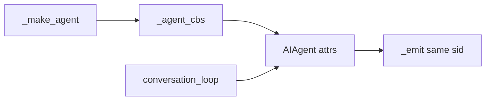

**`_agent_cbs` 写了哪些键、每个闭包调谁、推什么事件**：见 [§5.2](#52-_agent_cbssid-返回的-dict-里有什么) 主表（勿用「一律 `_emit(事件名)`」的简写——`thinking` / `reasoning` / `status` / `notice` 都经网关卡函数）。

**每轮会动、不在 `_agent_cbs` 里登记的：**

| 机制 | 谁写 | 作用 |
|------|------|------|
| `agent._stream_callback` | `_invoke_agent` → `run_conversation(stream_callback=…)` | 正文 token → `message.delta`；回合结束 `turn_finalizer` 清空 |
| `interim_assistant_callback` | 构造时可能来自 §5.2 条件分支；**每轮** `_invoke_agent` 可覆盖后再清空 | 避免过期闭包在回合之间误触发 |

### 5.6 循环里谁在什么时候叫

调用点在循环内部，没有统一的 hook 总线。名字对上了就叫。

| 调用点 | 典型 callback | 呈现网关最后一跳（节选） |
|--------|---------------|--------------------------|
| `turn_api_call` / `turn_iteration_prep` | `thinking_callback` | `thinking.delta`（经 `_agent_thinking_update`） |
| `StreamDeliveryMixin._fire_reasoning_delta` | `reasoning_callback` | `reasoning.delta`（经 `_emit_reasoning_delta`） |
| `StreamDeliveryMixin._fire_tool_gen_started` | `tool_gen_callback` | `tool.generating`（受 tool progress 开关） |
| `_deliver_to_stream_callbacks` | `_stream_callback` / `stream_delta_callback` | 网关：**仅** `_stream_callback` → `message.delta` |
| `tool_executor` | `tool_start` / `tool_complete` / `tool_progress` / `tool_result_metadata` | `tool.start` / `tool.complete` / 多种 progress；metadata **不** `_emit` |
| `status_output` | `status_callback` / `notice_*` | `status.update` / `notification.show` / `notification.clear` |
| `turn_context` affection | `reaction_callback` | `reaction` |
| clarify / read_* / tour / setup 工具 | 对应 `*_callback` | 阻塞 RPC（§5.2 **阻** 行） |
| connectors | `connection_callback` | `connection.request`（+ 客户端 `connection.respond`） |
| 压缩 / codex（多出现在 IM） | `event_callback` | 不进 `tui_gateway` 事件表 |
| ACP 会话 | `step_callback` | 不进呈现网关默认接线 |

同一路径上，插件还可异步收到 `on_stream_delta`（与 UI 无关，见 §5.7）。

插件那条 `enqueue_plugin_stream_hook` 和界面回调是扇出的两侧。界面回调在出 token 的线程上同步执行。插件回调进自己的队列，满了丢最旧的，不能把模型流堵住。

### 5.7 Platform callback 与 Plugin hook 为什么两套都有

#### 直觉上像一回事吗？

像。很多 harness（AgentScope 的 `MiddlewareBase` / `register_hook`、其它框架的「事件总线」）会把 **观测、改请求、改工具结果** 都收成一层 hook。Hermes 在 **内核热路径** 上确实也有这一层：`invoke_hook(name, …)` + `VALID_HOOKS`（见 `hermes_cli/plugins.py`）。

但 Hermes **另外** 保留了一整组 **`AIAgent.*_callback`**（§5.2、§5.4.1），由 **宿主**（`HermesCLI`、`tui_gateway._agent_cbs`）在构造时注入——这不是「少写了一个 built-in plugin」，而是刻意拆开的 **呈现适配器（adapter）** 与 **可插拔扩展（plugins）**。

#### 能不能只留 hook，用内置 presenter plugin 画 UI？

**理论上可以**：例如注册一个永远启用的 built-in 插件，在 `on_stream_delta` 里 `_emit`，在 `pre_tool_call` 旁路里画工具卡。工程上 Hermes **没有** 这么做，原因集中在 **契约**，而不只是历史包袱：

| 需求 | Platform callback 现形 | 仅用 `VALID_HOOKS` 的缺口 |
|------|------------------------|---------------------------|
| **零插件也要能跑产品** | TUI/Desktop/CLI 不依赖 `plugins` 清单 | 若 UI 只在 hook 里，等于把宿主降级成「必须加载的内置插件」，启动顺序、失败面、测试替身都更绕 |
| **每类呈现语义只有一个消费者** | 每个 `*_callback` 通常 **一个** 函数（构造时写入） | hook **同名多个** subscriber；谁先画、谁改流、冲突规则要另写 |
| **热路径同步画字** | `reasoning_callback` / `_stream_callback` 在出 token 线程 **同步** `_emit` 或写终端 | `on_stream_delta` **入队 + 独立线程**（`plugin_stream_hooks`），**不能改流内容**；拿它顶替 UI 会多一跳延迟且仍挡不住「要同步 `_emit`」 |
| **双向阻塞 RPC** | `clarify_callback`、`read_*`、`setup_choose`、`tour` 等 **`return` 用户答案** | 多数 hook 是 **observe** 或 **directive**（block/rewrite）；没有一等公民「卡住工具线程直到 Electron 点完」——那是 **server request** 语义，不是 `invoke_hook` 默认模型 |
| **按 Surface 换线** | CLI `_on_thinking` vs 网关 `_agent_thinking_update` → 不同线，**同一内核** | 用 hook 统一也要在 hook 里再分 `platform`，本质上仍是 adapter，只是名字改成 hook |
| **改执行 vs 只展示** | callback 里 clarify 等 **参与工具结果** | `pre_tool_call` 能 block；**不能**替代 `tool_result_metadata_callback` 这种 **返 dict 给内核** 的缝 |

所以：**时机上大量重叠，语义上不是子集关系**。重叠的是「同一时刻附近内核发生了什么事」；不重叠的是 **谁消费、几个消费者、能否阻塞等 UI、能否改 token 流、是否必须无插件存在**。

#### callback 时机 hook 都有点位吗？

**部分有、部分没有**——用「邻近事件」对照（不是 1:1 替换）：

| Platform callback（节选） | 邻近的 plugin hook | 关系 |
|---------------------------|-------------------|------|
| `tool_start` / `tool_complete` | `pre_tool_call` / `post_tool_call` | 工具 **前后**；hook 可 block/改参，callback 负责 **呈现**（卡片、Delivery） |
| `stream_*` / `_stream_callback` | `on_stream_start` / `on_stream_delta` / `on_stream_end` | **同一段字**；callback **同步** 进 UI，stream hook **旁路观察** |
| `interim_assistant_callback` | `on_interim_message` |  interim 旁白；hook 不驱动 Ink/React 树 |
| `thinking_callback` / `reasoning_callback` | `on_stream_delta`（`kind=reasoning` 等） | 等待/推理字；**无** 名为 `on_thinking` 的对等 hook |
| `status_callback` / `notice_*` | （无对等 hook） | 状态行、积分通知走 `status_output` → callback |
| `clarify_callback` / `read_*` / `connection_callback` | （无对等 hook） | **阻塞式宿主 RPC**；插件用 `pre_tool_call` 拦工具 ≠ 帮用户答题 |
| `event_callback`（IM 压缩等） | `on_session_*`、部分 gateway hook | 会话生命周期，不是 TUI 呈现 |

内核 **同一次工具调用** 里常见顺序：先 `invoke_hook("pre_tool_call")`（可拦）→ 跑工具 → `tool_start_callback`（画）→ … → `tool_complete_callback` → `post_tool_call`。**hook 在前、呈现 callback 在旁**，不是二选一。

#### 和 AgentScope / 其它 harness 怎么比？

AgentScope 等往往把 **Studio、通道、中间件** 收进 **一条 middleware 链**（文档里也称 Hook），产品 UI 和扩展共用「注册一个 middleware」。Hermes 的分工更接近：

- **`_*_callback`** = **宿主适配器**（终端 / 呈现网关 / IM Delivery），保证 **开箱即用**、**单消费者**、**同步/阻塞 RPC**；
- **`invoke_hook`** = **第三方扩展总线**（多订阅、超时、可 transform/block），且 **流式观察** 刻意不在热路径改字。

若你设计新 harness，**可以** 只保留 hook + 一个 built-in `PresenterMiddleware`；Hermes 选的是 **把 Presenter 钉在 `AIAgent` 构造参数上**，插件留在旁边，避免「没装内置插件就黑屏」和「两个插件抢着 `_emit`」。

两者都会在 Agent 跑的时候被叫到，但 **消费者、契约、能否改执行** 不同。Hook **不能**替代 `_agent_cbs`：没有装 plugin 时 TUI/Desktop 仍要靠 callback → `_emit` 才能画界面；hook 是给 **第三方扩展** 的观测/拦截总线（`VALID_HOOKS` 全集见 `hermes_cli/plugins.py`）。

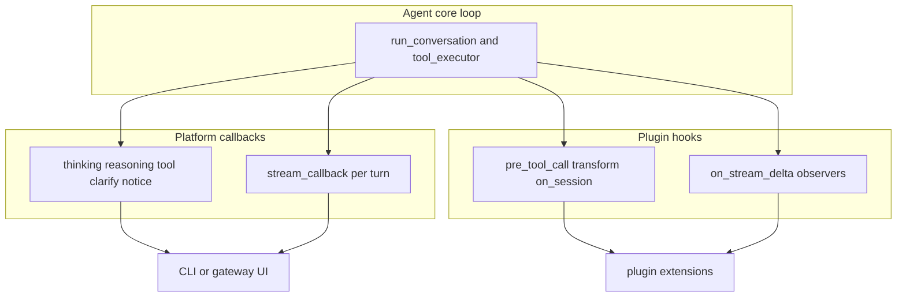

| 维度 | **Agent callbacks**（`_agent_cbs` / `HermesCLI._on_*`） | **Plugin hooks**（`hermes_cli.plugins.invoke_hook`） |
|------|--------------------------------------------------------|------------------------------------------------------|
| 谁注册 | 宿主：网关或 CLI，**每个 `AIAgent` 一套** | `plugins` 清单，`VALID_HOOKS` 中的名字 |
| 目的 | 把内核状态接到 **既定 UI/通道**（终端、WS、阻塞 RPC） | 扩展：拦工具、改参数、观测生命周期、改错误分类等 |
| 每种类型数量 | 通常 **一个**（构造时写入） | 同名 hook **多个** plugin |
| 能否改执行 | 多数 **只展示**；`clarify_callback`、`read_*`、`setup_choose` 等 **同步等 UI** 返回 | `pre_tool_call` 可 block；`transform_llm_output` 可改文本 |
| 流式 token | `reasoning_callback` + `stream_callback` / `stream_delta_callback` **在热路径同步** | `on_stream_*` 经 `agent/plugin_stream_hooks.py` **入队、独立线程**；**不能改流内容** |
| 失败 | 吞异常，不打断循环 | hook 有 `plugins.hook_callback_timeout`；流 hook 失败走 warn-once |

同一段正文 token（`StreamDeliveryMixin._fire_stream_delta`）典型顺序：先 `_deliver_to_stream_callbacks`（界面），再 `_enqueue_stream_hook("on_stream_delta", kind=text)`（插件）。推理 token 在 `_fire_reasoning_delta` 里：`reasoning_callback` 同步，可选再 enqueue `kind=reasoning` 的 `on_stream_delta`。

**客户端** 的 `createGatewayEventHandler` / `handleMessageStreamEvent` 处在 **更下游**：消费已经 `_emit` 出来的 JSON-RPC 事件，与 Python 侧 `thinking_callback` 不是同一层。

#### CLI 与网关：同一类事件谁接

| 用户可见内容 | 终端 CLI | TUI/Desktop 网关 |
|--------------|----------|-------------------|
| 等待/慢/重试文案 | `thinking_callback` → `_on_thinking` | `_agent_cbs` → `thinking.delta` |
| 推理 token | `reasoning_callback` | `reasoning.delta` |
| 正文 token | `stream_delta_callback` 或本轮 `stream_callback` | **仅** `_invoke_agent._stream` → `message.delta` |
| 工具生命周期 | `_on_tool_*`（可选 inline diff） | `_agent_cbs` → `tool.start` / `tool.complete` / progress |
| 插件旁观流 | `on_stream_delta`（若注册） | 同上，与 UI 无关 |

---

## 附录 · 界面与部署专题（§6–§10）

以下各节 **不新增** 运行时契约，是对 §3–§5 在客户端侧的放大；做 UI 或运维时再读即可。

## 6. Desktop 画一句正文：从 `message.delta` 到气泡

下面只跟一句助手正文。推理走 `appendReasoningDelta`，工具走 `upsertToolCall`，分叉在 `handleMessageStreamEvent`，后面的入队方式相同。

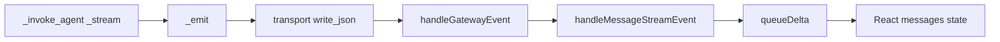

`message.start` 先到时，`handleMessageStreamEvent` 把这个会话标成 `busy`、`turnLive`。之后每个 `message.delta` 不直接改 React 状态：`queueDelta` 把字附在 `queuedDeltasRef` 里，`scheduleDeltaFlush` 用定时器合并。到点 `flushQueuedDeltas` 调 `mutateStream`，`updateSessionState` 改 `messages` 里那条 `pending` 的助手消息。组件靠这份状态重画。

工具事件不进这个队列。`upsertToolCall` 先 `flushQueuedDeltas`，再立刻 `mutateStream`，避免工具块画到它前面的正文前面。

`thinking.delta` 在桌面上不进对话气泡。`handleMessageStreamEvent` 只把它交给 `setSessionProviderWait`，写在线程底部的等待行。

---

## 7. 三种「往外冒的字」不是一种

| 事件 | 谁发出 | 是什么 | 界面怎么用 |
|------|--------|--------|------------|
| `thinking.delta` | `_agent_cbs` 的 `thinking_callback` | 还在等：慢、重试、状态句 | TUI 可画在状态上。Desktop 多数帧是等待动画，不写进对话正文 |
| `reasoning.delta` | `reasoning_callback` ← `_fire_reasoning_delta` | 模型的推理 token | TUI `recordReasoningDelta` 累进 thinking 面板。Desktop 写成消息的 reasoning part。`display.show_reasoning` 关掉则 `_emit_reasoning_delta` 直接返回 |
| `message.delta` | `_invoke_agent._stream` | 要给用户看的正文 | 两边都追加到当前回复。`message.complete` 到来时这段字已经在屏幕上 |

下一轮还要带上推理的提供商（需要 `reasoning_content` 的那类），在进下一次模型调用前把 thinking 抄回消息。抄的是会话里的字段，不是再发一次界面事件。抄丢了，多轮工具链会断。

---

## 8. 皮肤怎么换到所有界面

皮肤是一份 YAML，不是每个界面各写一套色。`hermes_cli/skin_engine.py` 的 `load_skin` 读 `display.skin`。网关起来后 `_ensure_skin_watcher` 约每 0.5 秒看配置和皮肤文件的 mtime，变了就 `_emit("skin.changed")`。TUI 的 `fromSkin`、Desktop 的皮肤模块收到后重绘，不用重启进程，也不用重跑 Agent。

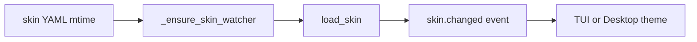

---

## 9. Desktop 连远程后端

Desktop 有本地、云、SSH 三种把 WebSocket 接到后端的方式。SSH 这条不是再实现一个 Agent：桌面在远端拉起 `hermes serve`，带一次性 session token；远端 `web_server` 验过 token 之后，后面的 `prompt.submit` 和 `message.delta` 与连本地 Dashboard 相同。

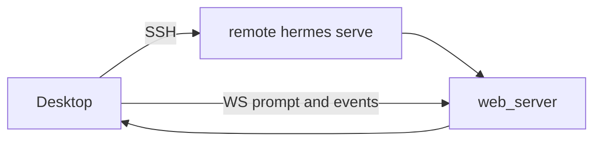

---

## 10. TUI 上的 Widget 插在哪

Widget 不进 `run_conversation`。`defineWidgetApp` 登记一个小界面：`modal` 占住输入，`ambient` 停在边上。slash 补全读的就是这张登记表。用户放到 `$HERMES_HOME/tui-widgets/*.mjs` 的文件被扫进来热加载。它改的是 TUI 画布，不改 Agent 的工具循环。

---

## 11. Compute host（turn 隔离子进程）

**是什么**：Dashboard 配置 `turn_isolation` 时，呈现网关 **不在本进程** 建 `AIAgent`，而把一轮打成 `turn.start` 帧交给 **`HostSupervisor` 拉起的子进程**（compute host）。父进程仍持有 `_sessions[sid]`、Transport 和 **`_emit`**；子进程跑 `run_conversation`，事件经 **`compute_host_bridge`** 镜像回父进程的 WebSocket/stdio。

| 项 | 说明 |
|----|------|
| **判定** | `_session_uses_compute_host(session)`：`turn_isolation` 且（`_compute_host_active` 或 lazy 会话尚未 in-process Agent） |
| **提交** | `methods_prompt._submit_prompt_to_compute_host` ← `_run_prompt_submit` 分支（与 in-process `_invoke_agent` 并列） |
| **租约** | 父进程 `active_session_lease` **vouch** 给子进程，避免双占 `session_turn_leases`（`compute_host_bridge._active_session_lease_vouch`） |
| **打断** | `session_lifecycle`：`interrupt` → `_get_compute_host_supervisor().interrupt(sid)`；忙时 `queued_prompt` drain 可走 host 路径（`session_auto_continue`） |
| **和 §9「远程 serve」** | §9 是 **整台** 远端 `hermes serve`；compute host 是 **本机** 子进程隔离，协议仍是 `tui_gateway` JSON-RPC |

权威：`tui_gateway/compute_host_bridge.py`、`host_supervisor.py`、`session_lifecycle.py`、`methods_prompt.py`。

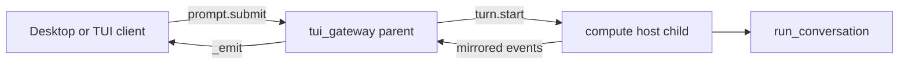

---

## 12. ACP：IDE 呈现与忙时策略

**是什么**：`acp_adapter/server.py` 的 **`HermesACPAgent`** 把 Hermes 暴露成 **Agent Client Protocol**（编辑器/IDE 插件连上来）。内核仍是 `AIAgent.run_conversation`；呈现不走 `_emit`，而走 ACP **`session_update`**（`make_message_cb`、`make_thinking_cb`、`make_step_cb` 等，`acp_adapter/events.py`）。

| 项 | 说明 |
|----|------|
| **进程** | 常独立 `python -m acp_adapter`；`ThreadPoolExecutor` 跑同步 `run_conversation` |
| **会话** | `SessionManager`：`session_id` = ACP 句柄；`new_session` / `load_session` / `resume_session` 建 Agent |
| **进门** | `prompt()` → `_claim_turn_or_queue` → `_run_agent_turn` → `run_conversation` |
| **忙时** | `state.queued_prompts`；支持 **`agent.redirect`** 的 active-turn 纠偏（对齐网关 steer 语义） |
| **取消** | `cancel()` → `cancel_event` + `request_hard_interrupt` + `interrupt_for_session`（delegate 子任务） |
| **审批** | `_run_agent_turn` 内绑 `terminal_tool.set_approval_callback` + `edit_approval_requester` |
| **与卷二 §5** | 同一 `_CALLBACK_PARAMS` 名字，接线在 `_wire_turn_callbacks` 一轮安装，不是 `_agent_cbs` |

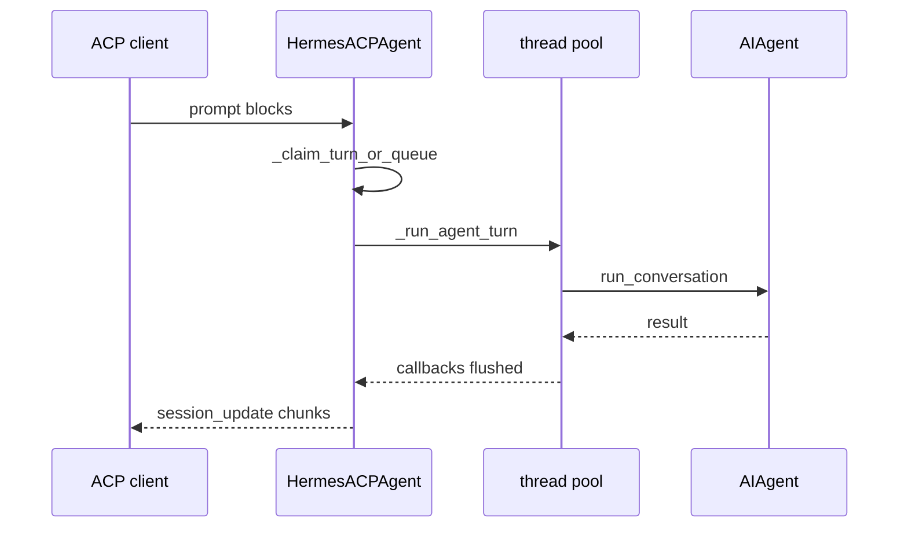

权威：`acp_adapter/server.py`、`session.py`、`events.py`、`permissions.py`。
