# 卷三 · 运行时：一轮里面谁在干活

> **卷标准**：[`VOLUME_STANDARD.md`](VOLUME_STANDARD.md) · **完成度**：[`MANIFEST.md`](MANIFEST.md) — **达标**  
> **本卷边界**：从 `AIAgent.run_conversation` 进门到 `finalize_turn` 出门；**呈现** callback / 大部分用户可见 hook 的 **全表与时序** 见 [卷二 §3.4](02-surface-and-presentation.md#34-端到端时序platform-callback-与-plugin-hook-同图)。  
> **权威源码**：`agent/turn_facade.py`、`agent/turn_facade_lease.py`、`agent/conversation_loop.py`、`agent/turn_*.py`、`hermes_state`（`SessionDB`）  
> **相邻卷**：[01 入口](01-platform-and-architecture.md) · [02 Surface](02-surface-and-presentation.md) · [04 Prompt](04-prompt-and-context.md) · [05 能力](05-capabilities-extensions.md)

对外公开入口是 **`TurnFacadeMixin.run_conversation`**（`agent/turn_facade.py`），实现落在 **`agent/conversation_loop.run_conversation`**。进门先 **占跨进程会话租约**，再 **`build_turn_context`（每轮一次）**，然后 **`while` 迭代**（每次模型调用 + 可选工具轮），最后 **`finalize_turn`**。循环内读写 **`SessionDB`**。

**压缩、Session 行、Memory、HITL** 的机制和例子在本卷 **[第4章](#sec-ch4)**、**[第6章](#sec-ch6)**。压缩成功后 **`invalidate_system_prompt`** 时系统提示怎么重建 → [卷四 §0.4](04-prompt-and-context.md#04-何时-invalidatesystemprompt)。

**文档约定**：循环旁路（Batch、Codex）以本卷第5章与源码为准。

---

## 本卷目录

- [第1章：一轮是什么](#sec-ch1)
  - [1.1 会话、一轮、一次迭代](#sec-1-1)
  - [1.2 跨进程租约](#sec-1-2)
    - [1.2.1 怎么占坑，是不是 session 锁](#sec-1-2-1)
  - [1.3 task_id、turn_id、api_request_id、session_id](#sec-1-3)
  - [1.4 压缩落在一轮的哪三个时刻](#sec-1-4)
  - [1.5 进门先停后台复盘，再占租约](#sec-1-5)
  - [1.6 用户跟进队列在入口，不在 while 里](#sec-1-6)
- [第2章：一轮从进门走到 finalize_turn](#sec-ch2)
  - [2.1 阶段图上的名字都是函数](#sec-2-1)
  - [2.2 五层调用](#sec-2-2)
  - [2.3 时序：进 while、一次迭代、轮末](#sec-2-3)
    - [2.3.1 进 while 之前](#sec-2-3-1)
    - [2.3.2 一次迭代](#sec-2-3-2)
    - [2.3.3 跳出 while](#sec-2-3-3)
    - [2.3.4 每一步的 hook 和 callback](#sec-2-3-4)
- [第3章：turn_*.py 每个文件管哪一段](#sec-ch3)
  - [3.1 主路径上的文件](#sec-3-1)
  - [3.2 失败、溢出、用量、恢复](#sec-3-2)
  - [3.3 没有 class Turn](#sec-3-3)
    - [3.3.1 调用图](#sec-3-3-1)
    - [3.3.2 主路径调用顺序](#sec-3-3-2)
    - [3.3.3 每个文件谁调用](#sec-3-3-3)
- [第4章：压缩方案](#sec-ch4)
  - [4.1 压的是这一聊的消息，不是 Memory](#sec-4-1)
  - [4.2 什么时候压](#sec-4-when)
  - [4.3 头、摘要、尾巴，两种落库](#sec-4-scheme)
  - [4.4 举例释义](#sec-4-example)
  - [4.5 失败、冷却、手动压缩](#sec-4-fail)
  - [4.6 循环不看来源](#sec-4-2)
<!-- compression-toc:start -->
  - [4.7 轻量整理：两条整理路径与发送投影](#sec-4-lightweight)
  - [4.8 内存 messages、DB 行与 API 请求的两次投影](#sec-4-projection)
  - [4.9 压缩提交如何归档旧行、插入新工作集](#sec-4-db-commit)
  - [4.10 工具结果从内存到 DB 的逐行例子](#sec-4-message-example)
  - [4.11 工作区 message 对象、字段与身份](#sec-4-working-object)
  - [4.12 链路一：重启后从 SessionDB 重建工作集](#sec-4-restart-chain)
  - [4.13 链路二：未压缩回合的增量 flush](#sec-4-normal-flush) — [4.13.0 心智模型](#sec-4-13-0) · [4.13.1 识别未写](#sec-4-13-1) · [4.13.3 走读示例](#sec-4-13-3)
  - [4.14 链路三：压缩时内存与 DB 怎么换](#sec-4-compaction-flush) — [4.14.0 vs flush](#sec-4-14-0) · [4.14.1 原地走读](#sec-4-14-1) · [4.14.2 rotation](#sec-4-14-2)
  - [4.15 发送、结果回交、崩溃与隔离边界](#sec-4-lifecycle-boundaries)
  - [4.16 外部 Memory 与插件 context 的注入、内存与回放](#sec-4-context-injection)
<!-- compression-toc:end -->
- [第5章：Batch 和 Codex 旁路](#sec-ch5)
  - [5.0 conversation_loop 分叉（api_mode vs platform）](#sec-5-0)
  - [5.1 Batch：仍走 while](#sec-5-1)
  - [5.2 Codex：`codex_app_server` 旁路 vs `codex_responses` 在 while 内](#sec-5-2)
- [第6章：AIAgent 上有什么，历史、HITL、Memory、Session 怎么裂](#sec-ch6)
  - [6.1 类上的字段和方法](#sec-6-1)
  - [6.2 对话历史不在 self.messages](#sec-6-2)
  - [6.3 HITL：审批、澄清、打断](#sec-6-3)
    - [6.3.1 三种停法](#sec-6-3-1)
    - [6.3.2 审批堵在工具线程](#sec-6-3-2)
    - [6.3.3 命令先过地板，再问人](#sec-6-3-3)
    - [6.3.4 拒绝之后这一轮还在](#sec-6-3-4)
  - [6.4 Memory：三层，不是会话表](#sec-6-4)
    - [6.4.1 内置文件存什么、不存什么](#sec-6-4-1)
    - [6.4.2 冻结快照](#sec-6-4-2)
    - [6.4.3 会话检索](#sec-6-4-3)
    - [6.4.4 外部 provider](#sec-6-4-4)
  - [6.5 压缩裂变和子代理裂变](#sec-6-5)
  - [6.6 一轮示例：每步之后库里有什么](#sec-6-6)
  - [6.7 SessionDB 在平常、压缩、原地压缩、子代理、branch、撤回时的行](#sec-6-7)
  - [6.8 自我进化不写进这一聊的消息表](#sec-6-8)
- [附录：按源码路径 grep](#sec-appendix)

**怎么读**

| 你想弄清 | 先读 |
|----------|------|
| 一轮、租约、跟进队列不在 while 里 | 第1章 |
| `turn_*.py` 谁在什么时候被调 | 第2章 → 第3章 |
| 压缩阈值、原地 vs 裂变、逐行例子 | **第4章**（尤其 [4.4](#sec-4-example)） |
| 审批堵在哪、Memory 三层、Session 库里长什么样 | **第6章**（[6.3](#sec-6-3)–[6.7](#sec-6-7)） |
| IM 审批卡怎么画、闸门顺序 | [卷六第8章](06-gateways-channels-and-hitl.md#sec-g8) + [卷八 §2](08-security-and-governance.md#2-端到端危险终端命令cli--im) |
| 后台复盘（自我进化的一条腿） | [6.8](#sec-6-8) → [卷八 §3.0 端到端](08-security-and-governance.md#sec-8-br-flow) |
| Skills / Curator / Trajectory 长文 | [卷五附录 B](05-memory-architecture-and-evolution.md) |
| `memory` 工具参数、外部 provider 清单与配置 | [卷五附录 Memory](05-memory-system-reference.md) · [§4.4](05-capabilities-extensions.md#44-记忆) |

<a id="sec-ch1"></a>
<a id="0-先澄清一轮一次迭代租约与-id"></a>
## 第1章：一轮是什么

这一章只分清尺度和进门条件：什么叫一轮，租约锁的是哪一行，用户又发来的话排在哪。模型循环从第2章开始。

<a id="sec-1-1"></a>
<a id="01-三个时间尺度"></a>
### 1.1 会话、一轮、一次迭代

| 尺度 | 英文/符号 | 含义 | 典型时长 |
|------|-----------|------|----------|
| **会话** | `agent.session_id` + `SessionDB` 一行 | 多轮聊天持久化边界 | 天～月 |
| **一轮（turn）** | 一次 `run_conversation(...)` 调用 | 用户 **一条** 输入（或等价）到助手 **本轮结束** | 秒～分钟 |
| **一次迭代（iteration）** | 循环里 `api_call_count += 1` | **一次** 组请求 → 调提供商 → 收响应 → 跑工具或结束文本 | 秒内多次 |

一轮里可以有 **多次迭代**（模型要工具就再来一轮 API）。`agent.max_iterations` 与 `iteration_budget` 限制的是 **迭代次数**，不是「用户发了几次消息」。

<a id="sec-1-2"></a>
<a id="02-durableturnlease跨进程占坑"></a>
### 1.2 跨进程租约：同一会话不能两个进程同时写库

桌面 / CLI resume / 网关等 **共享同一 `state.db` 会话行** 时，不能两个进程同时 load→跑→flush。

| 概念 | 源码 | 作用 |
|------|------|------|
| 准入 | `turn_facade_lease.admit_durable_turn_lease` | 拿不到租约 → **early_result**（超时/被打断），不进入循环 |
| 租约对象 | `DurableTurnLease` | `start` 后周期性 **续租**；**失租** 可中断当前 turn（`session turn lease lost`） |
| 释放 | `finalize_turn` / façade `finally` | 回合结束放开，下一 prompt 才能 admit |

租约与 **呈现层 `sid`** 无关：租约键是 **`session_id`（库里的会话）**；TUI 的 8 位 `sid` 见 [卷二 §2.2](02-surface-and-presentation.md#22-三种会话标识_agent_cbssid-里的-sid-是哪一个)。

<a id="sec-1-2-1"></a>
#### 1.2.1 怎么占坑，是不是 session 锁

**可以这么理解（口语）**：对 **同一份 `state.db`、同一个会话身份（`session_id`，压缩 lineage 下会映射到稳定的 `conversation_id`）**，在任意时刻 **最多只有一个「holder」** 拥有 **turn lease**——别的进程想 `run_conversation` 要么 **等**，要么 **拿不到准入**。

这不是 Python 的 `threading.Lock`，而是 **SQLite 里一行租约记录** + 写路径校验：

| 机制 | 说明 |
|------|------|
| **存哪** | 表 `session_turn_leases`（`hermes_state_common.py` 建表）；键是 **`conversation_id`**（由 `session_id` 解析，含压缩分段时的 lineage root） |
| **怎么占** | `SessionDB.acquire_session_turn_lease(session_id, holder, …)` → 内部 `try_acquire`：过期行清理后 **`_claim_lease_row`**，同一 `conversation_id` 上 **INSERT/抢占** 成功才算占到 |
| **holder 是谁** | 字符串，形如 `pid=…:turn=<relay_turn_id>:platform=…`（见 `turn_facade_lease.admit_durable_turn_lease`），用来区分 **哪一进程、哪一轮** |
| **TTL** | 默认 **`LEASE_TTL_SECONDS = 300`**（5 分钟）；占坑后 **`DurableTurnLease` 后台定时 `refresh_session_turn_lease`**（默认约 60s 一次），长 turn 不会中途过期 |
| **别人来了怎么办** | `acquire` 带 **`LEASE_WAIT_SECONDS = 1800`**（最多等 30 分钟），轮询重试；等待时可通过 `status_callback` 提示「另一个 Hermes 进程正在用这个会话」。用户 `/stop` 可通过 `should_abort` **放弃等待** |
| **怎么放** | 回合结束 `lease.release()` → `DELETE … WHERE holder = ?`；进程崩溃没 release 时，**过期** 或 **holder 里 pid 已死** 的行会被下次 acquire 清掉/抢占 |
| **占住以后管什么** | 往 SessionDB **追加/改写 transcript** 时，若带了 `turn_lease_holder` 但行上 holder 不匹配或已过期 → **`SessionTurnLeaseLostError`**，本轮写入被拒绝（防止你已经失租还在 flush）。没有活跃租约时，**别的写入**也会被挡（「Session has an active turn lease」） |

**「同一个 session 同时只能有一个进程在跑？」**

- **对（共享 DB 的典型场景）**：两个 Desktop/CLI/网关 **进程** 连 **同一个 `session_id` 的库**，第二个在 `admit_durable_turn_lease` 会 **阻塞或失败**，不会和两个进程一起进 `conversation_loop` 乱写。
- **同一进程**：一般 **一个 `AIAgent` 实例** 一次只跑一个 `run_conversation`；租约主要是防 **跨进程**，不是替代 Python 线程锁。
- **不启用租约**：`agent._session_db is None`、`persist_disabled`，或 DB 没有 `acquire_session_turn_lease` 实现时，`admit_durable_turn_lease` **直接放行**（单进程、无持久化 fork 等）。

**和「会话正在 running」UI 标志的区别**：网关 `_sessions[sid].running` 是 **呈现层** 别重复点发送；**turn lease** 是 **持久化层** 别两个 OS 进程写坏同一条会话。两者常同时出现，但不是同一把锁。

<a id="sec-1-3"></a>
<a id="03-一轮里的相关-id"></a>
### 1.3 task_id、turn_id、api_request_id、session_id

| 字段 | 谁 mint | 用途 |
|------|---------|------|
| **`task_id`** | 入口传入或 `uuid`（façade） | 看板、relay、部分日志；网关常传 `session_key` |
| **`turn_id`** | `turn_context._bind_turn_identity` | 本轮边界；写入 result 的 `turn_id`、`current_turn_user_idx` |
| **`api_request_id`** | `"{turn_id}:api:{api_call_count}"` | 单次 HTTP 调用的 hook 关联 |
| **`session_id`** | Agent 构造 / 压缩轮转 | `SessionDB` 主键语义；压缩后可能变 **新 session 行** |

`export_current_turn_boundary` 在 `run_conversation` 返回前把 **`turn_id` + `current_turn_user_idx`** 钉在 result 上，供网关/客户端对齐「这一轮的用户行」。

<a id="sec-1-4"></a>
<a id="04-压缩-vs-一轮"></a>
### 1.4 压缩落在轮初、迭代前、轮末，仍是同一轮

| 时机 | 模块 | 对一轮的影响 |
|------|------|----------------|
| **轮初** | `turn_context_compaction.run_turn_start_compaction` | 在 `build_turn_context` 末尾；改写 `messages`。默认原地，不换 `session_id`。方案见 [第4章](#sec-ch4) |
| **迭代前** | `run_preflight_gate` 内压力链 | 可能触发 **mid-turn** 压缩后继续或 `break` |
| **轮末** | `turn_finalizer._micro_compact_after_turn` | 微压缩；与「用户可见的一轮」仍算同一 `run_conversation` |

上面三格只是 **在一轮时间轴上钉三个钩子**；阈值怎么算、头/摘要/尾怎么切、`in_place` 与裂变 `session_id` 的逐行例子、失败冷却，都在 **[第4章 压缩方案](#sec-ch4)**（建议直接读 [4.2–4.4](#sec-4-when)）。

压缩后 **`invalidate_system_prompt`** → 下一轮（或同轮重建路径）才重拼系统提示 → [卷四 §0.4](04-prompt-and-context.md#04-何时-invalidatesystemprompt)。

<a id="sec-1-5"></a>
<a id="05-门面-run_conversation-进门两件事图里那句白话"></a>
### 1.5 进门先停后台复盘，再占租约

`TurnFacadeMixin.run_conversation`（`agent/turn_facade.py`）在真正调用 `conversation_loop` **之前**先做两件互不相关的事：

**① 停掉同会话的后台复盘（background review）**

- **后台复盘是什么**：上一轮正常结束后，`turn_finalizer` 可能起一个 **守护线程**，再 fork 一个 **很受限的** `AIAgent`，在后台问「要不要把记忆/技能写进 store」。它 **不改** 你正在聊的主对话 transcript，也不抢主循环的画屏（见 `agent/background_review.py` 模块注释）。
- **复盘 fork 会不会走 platform callback？** **不会接到主会话那套。** `build_cache_parity_fork` / `_fork_init_kwargs` **不传** `thinking_callback`、`reasoning_callback`、`stream_callback` 等（`init_agent` 里全是 `None`）；`run_conversation` 也 **不传** `stream_callback`。`quiet_mode=True`，`suppress_status_output=True`，复盘线程里还有 **`thread_scoped_silence`**（只闷复盘线程的 stdout）。因此 **不会** `_emit` `thinking.delta` / `message.delta`，也 **不会** 调父 Agent 上 `_agent_cbs` 挂的那些闭包。复盘结束后若有动作摘要，走的是 **父 Agent** 上的 **`background_review_callback`**（网关里常写成 `_emit("review.summary", …)`），不是 `_CALLBACK_PARAMS` 里那一组。Plugin hook（如 `on_stream_delta`）在进程内仍 **可能** 被复盘 fork 的 `run_conversation` 触发，那是扩展总线，与 TUI 呈现 callback 无关。
- **为什么要先停**：用户又发了一条 **live turn**（真人正在等的这一轮）时，不能让后台复盘和主循环 **同时** 用同一个 `session_id`、同一套运行时去抢模型/写库。所以进门第一行代码是 `cancel_background_review_for_live_turn(self)`：给正在跑的复盘发取消，**最多等约 2 秒**让它收尾；超时也会 **放行** live turn，避免「复盘卡住用户输入」（foreground priority，#84423）。
- **和「占租约」无关**：这是 **同进程里** 主线程 vs 后台线程的优先级，不是两个 OS 进程。

**② 占租约（`admit_durable_turn_lease`）**

- **解决什么问题**：Desktop / CLI resume / 网关等可能 **多个 Hermes 进程** 打开 **同一个 SessionDB 会话行**（同一个 `session_id`）。若两个进程同时 load→跑→flush，会交错写消息、损坏历史。
- **怎么做**：在 `state.db` 里对这条会话做 **`acquire_session_turn_lease`**：当前进程拿到 **holder**（含 pid + `relay_turn_id`），别的进程要跑同一 session 会 **等**（最长约 `LEASE_WAIT_SECONDS`，等待时可能 `status` 提示「另一个进程正在用这个会话」），或拿不到则 **直接返回** `early_result`，**不进** `conversation_loop`。
- **`DurableTurnLease`**：占住之后还有 **续租线程** + 可选 **存活看门狗**；回合在 `finalize_turn` / façade `finally` **释放**。

记法：**先清后台杂活，再拿跨进程写锁，然后才 `run_conversation` 跑模型。**

<a id="sec-1-6"></a>
<a id="06-用户消息队列-不在-本卷-while-里为何端到端图看不见"></a>
### 1.6 用户跟进队列在入口，不在 while 里

| 问题 | 答案 |
|------|------|
| Hermes 有没有「忙时再发一条」的队列？ | **有**，在 **入口层**（IM 适配器、CLI `_pending_input`、TUI `queued_prompt`），见 [卷一 §2.3](01-platform-and-architecture.md#sec-2-3) |
| 为什么第2章时序从 `run_conversation` 起笔？ | 本卷边界是 **单次** `run_conversation` 进门到 `finalize_turn`；排队发生在 **第二次** 调用之前，或 mid-turn **`steer()`** 进同一轮 |
| `DurableTurnLease` 是用户队列吗？ | **否**。它是 **跨进程写库互斥**；等待租约像「排队」，但不是把用户话排进 follow-up 列表 |
| 和 Pi `whenBusy: followUp` 比？ | Hermes **没有** 内核级 durable inbox；follow-up 语义由 **各入口** 的 dict / `Queue` + drain 实现 |

**mid-turn 纠偏（仍在本轮内）**：`AIAgent.steer` / `redirect` → `_pending_steer` 或取消当前 API → 卷一 §2.3.2「内核 mid-turn」；**不** 新开 `run_conversation`。

**呈现侧另两种 queue**（易混）：Desktop `queueDelta`、插件 `enqueue_plugin_stream_hook` → [卷二 §3.2 / §5](02-surface-and-presentation.md)，与用户跟进无关。

---

<a id="sec-ch2"></a>
<a id="1-架构流程"></a>
## 第2章：一轮从进门走到 finalize_turn

一次 `run_conversation` 里面的阶段、谁调用谁、hook 落在哪一步。

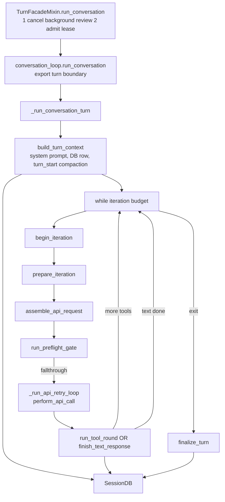

`agent/turn_*.py` 是循环里的 **阶段函数**，不是第二个 Agent 类。`conversation_loop` 用 `_run_phase(fn, agent, s)` 统一驱动各阶段。

<a id="sec-2-1"></a>
<a id="11-图里的名字是函数还是对象为什么在别的端到端图里没见过"></a>
### 2.1 阶段图上的名字都是函数，不是 Turn 对象

**结论**：上图 **每一个方框（除 `SessionDB`）都能在仓库里 `grep` 到**；多数是 **模块级函数**，少数是 **方法 / 内部 dataclass**。没有叫 `Turn` 的业务实体类——文件名里的 `turn_` 表示 **「一轮对话里的一个阶段」**，不是 ORM 里的 Turn 表。

| 图节点（简写） | 真实存在？ | 种类 | 定义位置 | 谁调用 |
|----------------|------------|------|----------|--------|
| `TurnFacadeMixin.run_conversation` | ✓ | **实例方法** | `agent/turn_facade.py` | CLI / 网关 / IM 入口 |
| `conversation_loop.run_conversation` | ✓ | **函数** | `agent/conversation_loop.py` | 门面方法里 `from … import run_conversation` |
| `_run_conversation_turn` | ✓ | **函数**（私有） | 同文件 | 上面的 `run_conversation` |
| `build_turn_context` | ✓ | **函数** | `agent/turn_context.py` | `_run_conversation_turn` 开头 **每轮一次** |
| `TurnContext`（图里没画） | ✓ | **dataclass** | `turn_context.py` | `build_turn_context` 的 **返回值**，字段拷进 `_LoopState` |
| `while iteration budget` | ✓ | **循环** | `conversation_loop._run_conversation_turn` | 条件：`api_call_count` + `iteration_budget` |
| `begin_iteration` | ✓ | **函数** | `agent/turn_iteration_prep.py` | `while` 里 `_run_phase(begin_iteration, …)` |
| `prepare_iteration` | ✓ | **函数** | 同文件 | 每迭代 `_run_phase(prepare_iteration, …)` |
| `assemble_api_request` | ✓ | **函数** | `agent/turn_request_assembly.py` | 每迭代 `_run_phase(assemble_api_request, …)` |
| `run_preflight_gate` | ✓ | **函数** | `agent/turn_preflight_gate.py` | 每迭代 `_run_phase(run_preflight_gate, …)` |
| `_run_api_retry_loop` | ✓ | **函数** | `conversation_loop.py` | `while` 内；内部调 `perform_api_call` |
| `perform_api_call` | ✓ | **函数** | `agent/turn_api_call.py` | 重试循环里（图可合并写成 `_run_api_retry_loop`） |
| `run_tool_round` | ✓ | **函数** | `agent/turn_tool_round.py` | 有 `tool_calls` 时 `_run_phase(run_tool_round, …)` |
| `finish_text_response` | ✓ | **函数** | `agent/turn_final_response.py` | 无工具时 `_run_phase(finish_text_response, …)` |
| `finalize_turn` | ✓ | **函数** | `agent/turn_finalizer.py` | 跳出 `while` 后 **一次** |
| `SessionDB` | ✓ | **类** | `hermes_state` | Agent 持有 `_session_db` |
| `_LoopState`（图里没画） | ✓ | **dataclass** | `conversation_loop.py` | 整轮循环的局部状态袋；`_run_phase` 读写它 |

`turn_api_call` 在 **HERMES.md / 卷一** 的端到端图里会出现，因为它是「打一次模型」的口语名；**`begin_iteration` / `prepare_iteration` 等是卷三这一层才拆开的子步骤**——外层文档故意不画，否则一张图会多出十几个框。

**文档分层（为什么你之前在端到端里没看到）**

| 层级 | 典型图在哪 | 画到哪一层 | 例子 |
|------|------------|------------|------|
| **产品端到端** | `HERMES.md` §2.1、卷一 §1 | 用户 → 入口 → **`run_conversation`** → 出站（`_agent_cbs` / `Delivery`） | 不进入 `while` 里每个 `_run_phase`；**忙时跟进**在入口排队 → [卷一 §2.3.3](01-platform-and-architecture.md#sec-2-3-3) |
| **呈现端到端** | 卷二 §3、§3.4 | `prompt.submit` → **`run_conversation`** → `message.delta` / hook | 忙时再 `submit` 先 `queued_prompt` drain，见卷二 §3.0 |
| **内核放大** | 本卷第2章 | **`_run_conversation_turn` 内部** 阶段函数 | 你问的这张架构图 |

对照 **卷一 / HERMES 内核序图** 里的 `turn_api_call`：在实现上 ≈ **`announce_api_call` → `perform_api_call`（+ `turn_api_request` / `turn_response_intake`）** 这一截；卷三把它拆成迭代前的多个函数，便于对着 `agent/turn_*.py` 改代码。

**在源码里一眼定位主 while**（`conversation_loop._run_conversation_turn` 末尾）：

```text
while …:
    _run_phase(begin_iteration, agent, s)
    _run_phase(prepare_iteration, agent, s)
    _run_phase(assemble_api_request, agent, s)
    _pg = _run_phase(run_preflight_gate, agent, s)
    …
    _run_phase(announce_api_call, agent, s)
    early_result = _run_api_retry_loop(agent, s)   # → perform_api_call
    …
    _run_phase(run_tool_round | finish_text_response, agent, s)
result = finalize_turn(agent, …)
```

---

<a id="sec-2-2"></a>
<a id="2-谁调用谁"></a>
### 2.2 五层调用：门面方法、循环函数、主 while、轮初、轮末

| 符号 | 文件 | 作用 |
|------|------|------|
| **`run_conversation`（方法）** | `turn_facade.py` | 租约、relay scope、调 `conversation_loop.run_conversation` |
| **`run_conversation`（函数）** | `conversation_loop.py` | 包一层 `export_current_turn_boundary`、失败 turn 封口 |
| **`_run_conversation_turn`** | `conversation_loop.py` | `build_turn_context` + **主 while** + `finalize_turn` |
| **`build_turn_context`** | `turn_context.py` | 每轮一次：身份、历史、系统提示、轮初压缩、`pre_llm_call` |
| **`finalize_turn`** | `turn_finalizer.py` | 落盘、flush 租约、`post_llm_call` / `transform_llm_output`、可选 `on_session_end` |

入口如何把字符串送进这里：[卷一](01-platform-and-architecture.md)。**`stream_callback`** 在 `build_turn_context` 里绑到 agent（网关每轮 `_invoke_agent` 覆盖），在 `stream_delivery` 热路径消费，见卷二。

---

<a id="sec-2-3"></a>
<a id="3-端到端时序一轮--单次迭代hook-点位"></a>
### 2.3 时序：进 while、一次迭代、轮末

**呈现 callback**（`thinking_callback`、`tool_*`、`stream_callback`…）在卷二 §3.4 已画全。本图只补 **循环内核** 与 **plugin hook**；两者在工具步 **扇出**（先 `pre_tool_call`，再 `tool_start_callback`）。

<a id="sec-2-3-1"></a>
<a id="31-从-run_conversation-到进入-while"></a>
#### 2.3.1 进 while 之前：系统提示、会话行、pre_llm_call

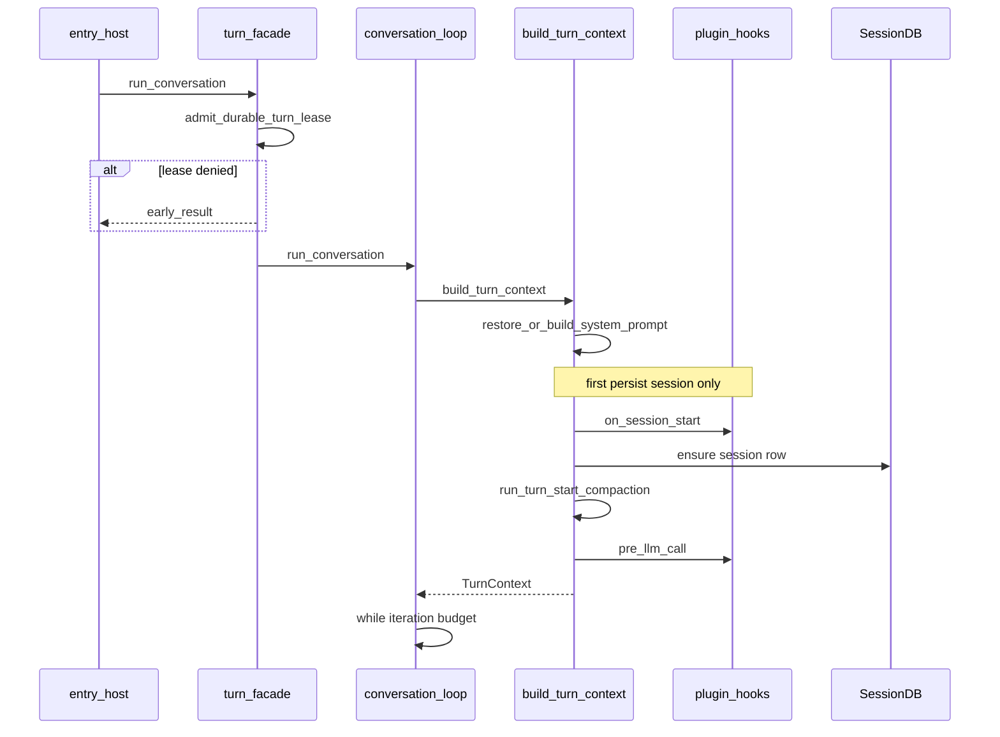

`on_session_start` 在 **系统提示首次建立/恢复路径** 上触发（`conversation_loop._restore_or_build_system_prompt` 链），**不是**每个用户消息都触发；Bot Chat 能力刷新重建 prompt 时 **故意不** 重放 `on_session_start`（注释：continuation）。

<a id="sec-2-3-2"></a>
<a id="32-单次迭代api--工具或结束"></a>
#### 2.3.2 一次迭代：组请求、preflight、调模型、跑工具或结束

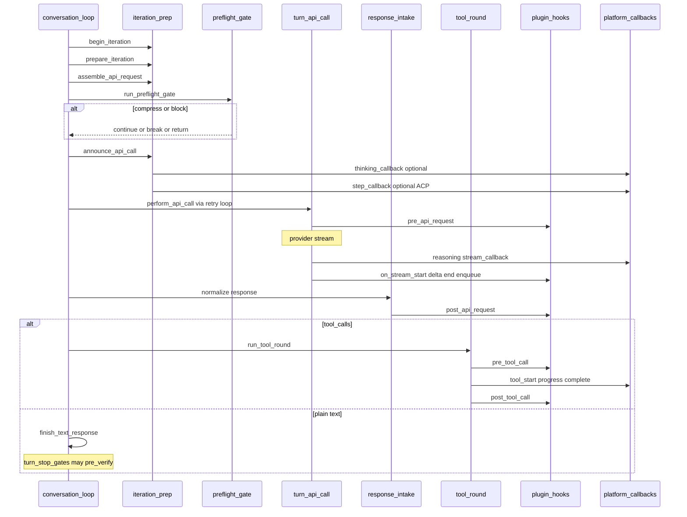

迭代结束但 **while 仍继续** 时，不会跑 `finalize_turn`；只有跳出 while 后才 **收尾一次**。

<a id="sec-2-3-3"></a>
<a id="33-轮末收尾"></a>
#### 2.3.3 跳出 while：flush、hook、导出 turn 边界

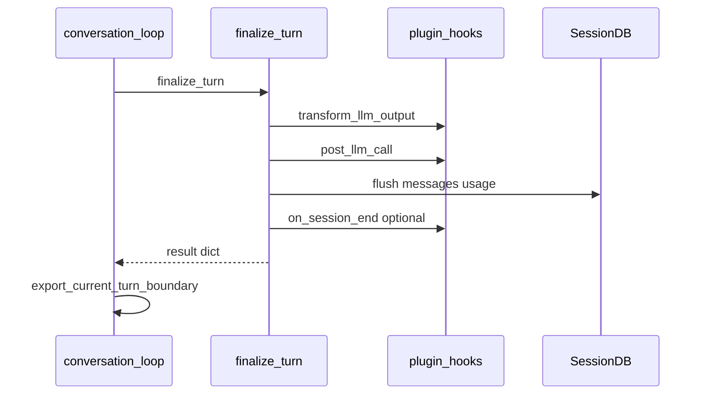

`pre_verify` 在 **准备结束文本响应** 时由 `turn_stop_gates` 调用（`verify_hooks` / `get_pre_verify_continue_message`），可能 **继续迭代** 而不是立刻 `finalize_turn`。

<a id="sec-2-3-4"></a>
<a id="34-时间点清单循环内核呈现列见卷二-34-表-d"></a>
#### 2.3.4 每一步的 hook 和 callback

| 阶段 | 模块 / 函数 | Plugin hook（HK） | Platform callback（CB） |
|------|-------------|-------------------|-------------------------|
| Façade 进门 | `admit_durable_turn_lease` | — | — |
| 轮初 | `build_turn_context` | `on_session_start`（条件） | `status_callback`（压缩警告回放等） |
| 轮初 | `run_turn_start_compaction` | — | `status_callback` compacted |
| 轮初 | `_collect_pre_llm_call_context` | **`pre_llm_call`** | — |
| 每迭代开始 | `begin_iteration` | — | — |
| 组请求前 | `prepare_iteration` | — | — |
| 调 API 前 | `announce_api_call` | — | **`thinking_callback`**、`step_callback` |
| HTTP 前 | `turn_api_request` | **`pre_api_request`** | — |
| 流式 | `perform_api_call` / `stream_delivery` | `on_stream_*`（队列） | **`reasoning_callback`**、`stream_callback` / `stream_delta_callback`、`tool_gen_callback` |
| HTTP 后 | `turn_response_intake` | **`post_api_request`** | — |
| 工具轮 | `tool_executor` | **`pre_tool_call`** / **`post_tool_call`** | **`tool_*_callback`** |
| 文本结束门 | `turn_stop_gates` | **`pre_verify`** | — |
| 轮末 | `finalize_turn` | **`transform_llm_output`**、**`post_llm_call`**、**`on_session_end`**（条件） | `notice_*` 等经 `status_output` |
| 返回前 | `export_current_turn_boundary` | — | — |

---

<a id="sec-ch3"></a>
<a id="4-turn_py-权威表阶段--职责--扩展点"></a>
## 第3章：turn_*.py 每个文件管哪一段

对着 `agent/turn_*.py` 看主路径、支路，以及文件之间谁调用谁。没有一个叫 `Turn` 的对象在模块之间传递。

**文档约定**：下表与当前 `agent/turn_*.py` 文件名一致；未列出的文件多为 **错误恢复 / 溢出 / MoA / Codex 支路**（被 `conversation_loop` 条件调用），改行为时以 grep 调用点为准。

<a id="sec-3-1"></a>
<a id="41-主路径每轮必经过或高频"></a>
### 3.1 主路径上的文件

| 模块 | 阶段 | 主要入口 | Hook（节选） | Callback（节选） |
|------|------|----------|--------------|------------------|
| `turn_facade.py` | 门面 | `TurnFacadeMixin.run_conversation` | — | — |
| `turn_facade_lease.py` | 准入 | `admit_durable_turn_lease`, `DurableTurnLease` | — | — |
| `conversation_loop.py` | 编排 | `_run_conversation_turn`, `while` + `_run_phase` | `on_session_start`（prompt 链） | — |
| `turn_context.py` | 轮初上下文 | `build_turn_context`, `export_current_turn_boundary` | `pre_llm_call` | — |
| `turn_context_compaction.py` | 压缩 | `run_turn_start_compaction` | — | `status_callback`（经压缩完成） |
| `turn_iteration_prep.py` | 迭代准备 | `begin_iteration`, `prepare_iteration`, `announce_api_call` | — | `thinking_callback`, `step_callback` |
| `turn_preflight_gate.py` | 迭代前门 | `run_preflight_gate` | — | 诊断 `status` |
| `turn_request_assembly.py` | 组请求 | `assemble_api_request` | — | — |
| `turn_api_request.py` | HTTP 前 | `pre_api_request` 发射 | `pre_api_request` | — |
| `turn_api_call.py` | HTTP | `perform_api_call`, retry | `api_request_error`（错误路径） | 流式 → `stream_delivery` |
| `turn_response_intake.py` | HTTP 后 | 规范化响应 | `post_api_request` | — |
| `turn_tool_round.py` | 工具轮 | `run_tool_round` | 经 `tool_executor` | 经 `tool_executor` |
| `turn_final_response.py` | 无工具结束 | `finish_text_response` | — | interim 等 |
| `turn_finalizer.py` | 轮末 | `finalize_turn` | `transform_llm_output`, `post_llm_call`, `on_session_end` | — |
| `turn_stop_gates.py` | 停轮门 | 验证 / 继续 | `pre_verify` | — |

<a id="sec-3-2"></a>
<a id="42-支路与专用条件触发"></a>
### 3.2 失败、溢出、用量、恢复

| 模块 | 何时 | 说明 |
|------|------|------|
| `turn_scripted_prelude.py` | `prelude=` 传入 | 首轮前脚本化工具 |
| `turn_api_error.py` / `turn_recovery*.py` | API 失败 | 重试、恢复、Codex |
| `turn_overflow.py` / `turn_truncation.py` | 上下文压力 | 与 preflight / 压缩配合 |
| `turn_liveness.py` | 租约存活 | 与 `DurableTurnLease` 看门狗 |
| `turn_usage.py` | 用量 | 轮末记账 |
| `verify_hooks.py` | 编码验证 | `pre_verify` 策略 |
| `turn_author.py` / `turn_summary.py` 等 | 元数据 | 标题、摘要、作者 |

<a id="sec-3-3"></a>
<a id="43-这么多-turn_py引用关系与调用流程"></a>
### 3.3 没有 class Turn：调度的是函数和 `_LoopState`

**先破除一个误解**：文件名里的 `turn` **不是** 一个贯穿全程的业务对象（没有 `class Turn` 在模块间传递）。真实结构是：

```text
AIAgent（长寿命，入口构造）
    ↑ 只读/改写 agent.* 属性
conversation_loop（调度器：while + _run_api_retry_loop）
    ↑ 读写
_LoopState s（dataclass，本轮/本迭代的「状态袋」）
    ↑ 每个阶段函数 (agent, *, …与 s 同名的字段…) -> Verdict
turn_*.py 里的阶段函数（无状态，纯函数风格）
```

| 名字 | 是什么 | 活多久 |
|------|--------|--------|
| **`AIAgent`** | 唯一「对象」中心 | 多轮复用（网关常缓存同一实例） |
| **`TurnContext`** | `build_turn_context` 的 **返回值**（dataclass） | 拷贝进 `_LoopState` 后不再单独传递 |
| **`_LoopState` (`s`)** | 循环局部变量袋 | **一次** `run_conversation` |
| **`TurnRetryState` (`s._retry`)** | 单次 API 重试子状态 | **一次** `perform_api_call` 尝试链 |
| **`turn_*.py` 模块** | Python **模块** + 顶层函数 | 无实例 |

阶段之间 **不靠互相 import 成链**（除了少数叶子工具，如 `turn_final_response` → `turn_stop_gates`）。**唯一总线**是 `conversation_loop._run_phase(fn, agent, s)`：从 `s` 抽字段传给 `fn`，再把返回值里的字段写回 `s`。

<a id="sec-3-3-1"></a>
#### 3.3.1 调用图

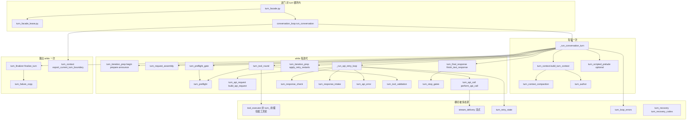

**读图**：箭头 = **谁会 import 并调用谁**（主路径）。`conversation_loop.py` 是 **hub**；`turn_preflight.py` 被 **gate** 和 **tool_round** 共用压缩逻辑。

<a id="sec-3-3-2"></a>
#### 3.3.2 主路径调用顺序（与第2章阶段图一一对应）

```text
TurnFacadeMixin.run_conversation
  └─ conversation_loop.run_conversation
       └─ _run_conversation_turn
            ├─ build_turn_context          # turn_context (+ compaction, author, pre_llm)
            ├─ [optional] play_prelude    # turn_scripted_prelude
            └─ while …
                 ├─ begin_iteration       # turn_iteration_prep
                 ├─ prepare_iteration
                 ├─ assemble_api_request   # turn_request_assembly
                 ├─ run_preflight_gate    # → turn_preflight
                 ├─ announce_api_call
                 ├─ _run_api_retry_loop
                 │    ├─ build_api_request      # turn_api_request
                 │    ├─ perform_api_call       # turn_api_call → stream_delivery
                 │    ├─ check_api_response     # turn_response_check
                 │    └─ on failure: handle_api_error # turn_api_error
                 ├─ apply_retry_restarts
                 ├─ normalize_model_response    # turn_response_intake（retry loop 返回之后）
                 └─ run_tool_round | finish_text_response
                      ├─ tool_round → tool_executor, turn_tool_validation, compress_after_tool_results
                      └─ finish_text_response → turn_stop_gates (pre_verify)
            └─ finalize_turn               # turn_finalizer
       └─ export_current_turn_boundary    # turn_context
```

<a id="sec-3-3-3"></a>
#### 3.3.3 每个文件谁调用

| 文件 | 角色 | 直接调用方（主路径） |
|------|------|----------------------|
| `turn_facade.py` | 门面 Mixin | CLI / 网关 / IM 入口 |
| `turn_facade_lease.py` | DB 租约 | `turn_facade` |
| `turn_context.py` | 轮初 + 边界导出 | `conversation_loop` |
| `turn_context_compaction.py` | 轮初压缩 | `build_turn_context` |
| `turn_author.py` | 解析 turn 作者元数据 | `turn_context` |
| `turn_scripted_prelude.py` | 可选 prelude 工具 | `_run_conversation_turn` |
| `turn_iteration_prep.py` | 迭代前/宣布 API | `while` 内 `_run_phase` |
| `turn_request_assembly.py` | 拼 api_messages | `while` |
| `turn_preflight_gate.py` | 迭代前门链 | `while` |
| `turn_preflight.py` | 压缩/压力具体逻辑 | gate、tool_round |
| `turn_api_request.py` | 组 `api_kwargs`、pre_api hook | retry loop |
| `turn_api_call.py` | HTTP/SSE | retry loop |
| `turn_response_check.py` | 响应健全性 | retry loop |
| `turn_response_intake.py` | 规范化 assistant_message、post_api | retry loop |
| `turn_api_error.py` | 失败分类/重试/溢出恢复 | retry loop |
| `turn_retry_state.py` | 单次 API 重试状态对象 | `_run_api_retry_loop` |
| `turn_tool_round.py` | 工具轮编排 | `while` |
| `turn_tool_validation.py` | 校验 tool_calls | `run_tool_round` |
| `turn_final_response.py` | 无工具结束路径 | `while` |
| `turn_stop_gates.py` | 停轮门、pre_verify | `finish_text_response` |
| `turn_finalizer.py` | 轮末 flush、hook、spawn review | `_run_conversation_turn` 末尾 |
| `turn_failure_copy.py` | 失败文案/展示 kind | finalizer、loop |
| `turn_loop_errors.py` | while 外层异常 | `while` except 路径 |
| `turn_recovery.py` / `*_codex` / `*_autorecover` | Codex/恢复支路 | loop 条件分支 |
| `turn_overflow.py` | payload 过大恢复 | `turn_api_error.handle_api_error` |
| `turn_truncation.py` | 截断/拒绝/续写上限 | `response_check` / `intake` / `final_response` / `iteration_prep` |
| `turn_empty_response.py` | 空正文恢复 | `finish_text_response` |
| `turn_explainers.py` / `turn_summary.py` | 解释/摘要文案 | `turn_failure_copy`、finalizer |
| `turn_usage.py` | token 用量汇总 | finalizer |
| `turn_liveness.py` | 租约存活看门狗 | `turn_facade_lease.DurableTurnLease` |

**和端到端文档的关系**：HERMES / 卷一只画到 `run_conversation` 与 `turn_api_call`；**第2章和第3章** 才是 `turn_*.py` 拆层的放大图。改行为时：**先 grep 函数名在 `conversation_loop.py` 的 `_run_phase(...)`**，再进对应 `turn_*.py`。

工具执行细节与 `pre_tool_call` 契约 → [卷五](05-capabilities-extensions.md)。

---

<a id="sec-ch4"></a>
## 第4章：压缩方案

压缩只缩短**这一聊送给模型的消息**。它不改 `MEMORY.md` 的正文，不改技能，也不换界面上的 8 位 `sid`。默认还不换 `session_id`。

入口是 `compress_context`（`agent/conversation_compression.py`）。真正切头、摘要、留尾巴的是 `ContextCompressor`（`agent/context_compressor.py`）。配置节是 `compression`，缺省值在 `agent/agent_init.py` 的 `_parse_compression_config`，和 `DEFAULT_CONFIG` 对齐。

<a id="sec-4-1"></a>
<a id="5-压缩边界与卷四衔接"></a>

### 4.1 压的是这一聊的消息，不是 Memory

| | 压缩动它吗 | 说明 |
|--|------------|------|
| 本轮 `messages` / SessionDB 消息行 | 动 | 中间被收成摘要，头和尾巴留原话 |
| `agent.session_id` | 默认不动 | `compression.in_place` 默认 `true`。设成 `false` 才新开一行、旧行 `end_reason=compression` |
| 界面 `sid` | 不动 | 8 位窗口 id 跟库里的 `session_id` 不是同一个 |
| `MEMORY.md` / `USER.md` 正文 | 不改字 | 压缩前 `MemoryManager.on_pre_compress` 让外部记忆抽要点。摘要落库后 `invalidate_system_prompt`，**下一轮**（或同轮重建系统提示的那条路径）才把盘上的新记忆读进 system |
| 技能、后台复盘 | 不跑 | 那是自我进化，见 [6.8](#sec-6-8) |
| 子代理的消息表 | 不跟父一起压 | 子有自己的 `session_id`。父压缩不改子行上的 `parent_session_id` |

人在这一轮里通常看不到一张「压缩完成」的独立卡片。能看到的是 `status_callback` 上的诊断行（例如 preflight 报 token 过了阈值）。

<a id="sec-4-when"></a>

### 4.2 什么时候压

触发条件同一条：`ContextCompressor.should_compress`。上次（或这次估出来的）prompt token **达到** `threshold_tokens` 才压。默认阈值是上下文窗口的 **50%**（`compression.threshold`，缺省 `0.50`）。Codex 的 gpt-5.4 / 5.5 会把这个比例抬高，避免在窗口还很空的时候就压。绝对上限可以再用 `compression.threshold_tokens` 封顶，取「比例阈值」和「绝对上限」里更小的那个。

没到阈值不压。到了但摘要模型在冷却、或连续两次被判定为「压了也没腾出空间」（`ineffective`），自动压缩会停，把原因交回去，消息原样留着。

| 时机 | 谁调用 | 默认开不开 | 对这一轮的意义 |
|------|--------|------------|----------------|
| 轮初 | `run_turn_start_compaction`，在 `build_turn_context` 末尾 | 跟着阈值 | 还没打主模型，历史已经太长 |
| 每次打模型之前 | `run_preflight_gate` 里的压力链 | 跟着阈值 | 工具结果把窗口撑过线，这一轮中间就压，然后继续或 `break` |
| 工具结果之后 | 同一条压力链，给下一迭代腾地方 | 跟着阈值 | 和 preflight 共用 `turn_preflight.py` |
| 闲置后再回来 | `compression.idle_compact_after_seconds` | **0，关着** | 会话闲下来这么多秒再进门，先压再聊 |
| 人手 | `/compress`，`force=True` | 人点了才走 | 清掉「摘要失败冷却」，立刻再试 |
| 提供商已拒绝（窗口溢出） | `trigger="overflow"`，`bypass_cooldown=True` | 出错才走 | 只跳过失败冷却，结构上的熔断还在 |
| 轮末微压缩 | `turn_finalizer._micro_compact_after_turn` | **关着**（`micro_compact` 默认 false） | 开了会改已经发出去的历史，**打断系统提示前缀缓存**。所以默认不做 |

Codex app-server（`api_mode=codex_app_server`）不走这套切分。整轮交给 Codex 自己的 compact。Hermes 这边没有一份可注入的摘要提示。`compression.checkpoint_required` 若开着，这条旁路会直接拒绝，因为 Codex 线程拿不到压缩前的可靠边界。

<a id="sec-4-scheme"></a>

### 4.3 头、摘要、尾巴，两种落库

一次成功的压缩把消息切成三段：

| 段 | 默认留多少 | 落库时什么样 |
|----|------------|----------------|
| **头** | 系统提示始终留。另外 `protect_first_n` 默认 **3** 条非系统消息。**第一次压缩之后这条保护衰减到 0**，避免最早几轮永远占着坑 | 原话，`active=1` |
| **中间** | 头和尾巴之间的全部 | 收成**一条**摘要。摘要模型的目标长度大约是阈值的 20%（`target_ratio` 缺省 `0.20`，夹在 0.10 和 0.80 之间） |
| **尾巴** | 默认 `tail_mode=lean`：很短的一段原话，注释里的预算是窗口的约 2.5%，夹在 1 万到 2.5 万 token。连续性主要写在摘要里。`legacy` 才把尾巴放到阈值的 20%。至少留 **1** 条用户原话（`min_tail_user_messages`） | 原话，接在摘要后面，`active=1` |

压缩开始时会记一个水位。水位**之后**才写进来的新行不被摘要吃掉，提交时克隆到摘要后面。所以压缩进行中别人又插进来的话还在。

两种落库，由 `agent.compression_in_place` 决定。缺这个属性时按 **true**（原地），不按裂变。注释写明：漏配若默认成裂变，会把会话楔死。

**原地（默认）** `SessionDB.archive_and_compact`：

1. `session_id` 不变，界面 `sid` 不变。
2. 被吃掉的旧行改成 `active=0, compacted=1`。还在这张表里，还能搜，模型下一轮不读。
3. 同一 `session_id` 下插入摘要行和尾巴。模型之后只读这些 `active=1`。

**裂变**（`compression.in_place: false`）`_publish_rotated_compaction`：

1. 先把压缩前的 `messages` flush 到**旧** `session_id`。
2. `new_session_id()` 得到子 id，形如 `YYYYMMDD_HHMMSS_<6位hex>`。
3. `publish_compression_child`：子行 `parent_session_id` 指向旧行，消息是摘要加尾巴，系统提示按压缩结果重建。
4. 旧行结束，`end_reason=compression`。标题抄到子行。之后 `append_message` 顺着父指针写到最深的子行，不再往已结束的父行加消息。
5. `agent.session_id` 改成子 id。`_memory_manager.on_session_switch(..., reset=False, reason="compression")`：外部记忆知道换了 id，对话还在继续。
6. 界面 `sid` 仍是原来那个。给人看的历史会沿 `parent_session_id` 把父行原话拼回去；模型上下文里没有那些原话。

两种都成功之后：外部记忆的 `on_pre_compress` 已经抽过要点；`invalidate_system_prompt` 让系统提示作废。盘上的 `MEMORY.md` 若在本轮早些时候被 `memory` 工具改过，要到这次重建才进 system。本轮进门时冻住的那份快照，在重建之前一直是模型看到的内置记忆。

<a id="sec-4-example"></a>

### 4.4 举例释义

下面同一段原话，先按**默认的原地压缩**看每一行是什么意思，再看把 `in_place` 关掉之后库里变成两行。名字是示例。界面 `sid` 一直是 `a1b2c3d4`。`session_id` 在原地方案里不变。

压缩前，模型读到的就是这些 `active=1` 的原话：

```text
S1  session_id=20261015_090000_aa11bb   sid=a1b2c3d4
  user       帮我看一下部署文档
  assistant  我先读文件
  tool       （很长的文件内容，把窗口撑过阈值）
  assistant  文档写的是用 hermes gateway 启动
  user       那 cron 呢
  assistant  （还没说完）
```

释义：六行都是原话。没有摘要行。`MEMORY.md` 即使上一句刚写过「用户在杭州」，系统提示里仍可能是进门时的「上海」。检索若打开，这六行都在 FTS 里。

**原地压缩之后**（默认）：

```text
S1  仍是 20261015_090000_aa11bb    sid 仍是 a1b2c3d4
  user       帮我看一下部署文档                 active=0  compacted=1
  assistant  我先读文件                          active=0  compacted=1
  tool       （很长的文件内容）                  active=0  compacted=1
  assistant  文档写的是用 hermes gateway 启动    active=0  compacted=1
  user       [压缩摘要] 部署用 hermes gateway；用户接着问 cron
                                               active=1
  user       那 cron 呢                          active=1
  assistant  （还没说完）                        active=1
```

逐行：

| 行 | 释义 |
|----|------|
| 前四行 `active=0, compacted=1` | 中间被摘要吃掉的原话。盘上还在，`session_search` 还能命中。模型下一轮的 `get_messages` **不**把它们送进上下文 |
| `[压缩摘要]` 那一行 | 新的 active 行，常带 `_compressed_summary`。它代替被吃掉的中间。不是把原话删了 |
| `那 cron 呢` 和还没说完的 assistant | 尾巴，原样留下。默认 lean 尾巴很短，这里示意「最近还没被摘要的几句」 |
| `session_id` | 没变。所以租约、IM 的 `session_key`、界面 `sid` 都不用跟着换一个库 id |
| 系统提示 | 这次若走到 `invalidate_system_prompt`，重建时才读到盘上的新 `MEMORY.md` |

**关掉原地、走裂变之后**，同一段话变成两行会话：

```text
20261015_090000_aa11bb   ended   end_reason=compression
  （上面那六句原话留在这里，active 仍可给简历拼回去）
  不再接收新的 append

20261015_090122_cc33dd   active  parent_session_id=20261015_090000_aa11bb
  user       [压缩摘要] 部署用 hermes gateway；用户接着问 cron
  user       那 cron 呢
  assistant  （还没说完，搬到子行）
```

逐行：

| 行 | 释义 |
|----|------|
| 父行 `end_reason=compression` | 这一截结束。原话留在父 id 上，给人看的历史沿链拼回去 |
| 子行新 id | `agent.session_id` 改成它。模型之后只读子行的 `active=1` |
| `parent_session_id` | 谱系，不是「把父的 messages 拷进子」。子的表里只有摘要和尾巴 |
| 界面 `sid=a1b2c3d4` | 不变。人感觉还是同一扇窗 |
| 子代理若在压缩前已经出生 | 子代理行上的 `parent_session_id` 仍指着出生时的父 id（这里就是 `aa11bb`），不会改成新的 tip |

<a id="sec-4-fail"></a>

### 4.5 失败、冷却、手动压缩

摘要没做成时，默认 **不换 id、不把半截摘要写进去**。`abort_on_summary_failure` 缺省 false：可以插入一段确定的交接说明并丢掉中间，而不是留下一个截断的摘要。设成 true：消息保持压缩前的样子，会话不旋转。源码里这几条失败文案都写着 “the session was NOT rotated”。

自动压缩还有两道闸：

- **冷却**：摘要调用失败之后一段时间内不再自动压。人手 `/compress`（`force=True`）清掉这道冷却。提供商已经以窗口溢出拒绝了这次请求时，`bypass_cooldown` 只跳过冷却，熔断还在。
- **无效熔断**：提供商确认「压完窗口并没有变小」累计到 2 次，`should_compress` 返回挡住，原因是 `ineffective`。静态兜底如果确实腾出了空间，不记入这 2 次。

人手 `/compress` 还可以带焦点（实现里的 `focus_topic`）：摘要时优先保住和这句话有关的事实。`/compress here N` 用 `verbatim_tail` 指定压缩后必须原样留下的最近几轮。

<a id="sec-4-2"></a>
<a id="6-和入口的边界"></a>

### 4.6 循环不看来源，入口只做三件事

`conversation_loop` **不知道** 消息来自飞书还是 TUI。入口只负责：

1. 构造或复用 `AIAgent`；  
2. 调用 `run_conversation(..., stream_callback=…, task_id=…)`；  
3. 把 result 交给呈现（卷二）或 `Delivery.send`（卷六）。

`SessionDB` 的读写 **在循环内**；网关的 `_sessions[sid].history` 是 **呈现层缓存**，与 DB 通过 flush 同步，不在本卷展开。

---

<!-- compression-detail:start -->
<a id="sec-4-lightweight"></a>

### 4.7 轻量整理：先分清三件名字相近的事

> **本节至 4.10 的核对快照**：本地源码 `60d00c5633ad76f3dd8e3ecd79f77f1c6f8e6fdd`，内置 `ContextCompressor` 的普通 Agent 路径；不把 Codex 原生 compact 或插件引擎视为同一实现。保留前文，下面把前文“只缩短送给模型的消息”“没到阈值不压”等简称展开到具体对象与分支。

**“轻量”表示不调用摘要 LLM，不表示只改本次请求、不写数据库，也不表示完全不丢信息。** 工具正文替换成短说明后，原文仍可在归档里，但不再完整出现在工作上下文中。

#### 4.7.1 三条路径的职责和先后

| 路径 | 入口 | 触发与默认 | 改哪份数据 |
|---|---|---|---|
| 完整压缩中的确定性预处理 | `ContextCompressor.compress` → `_prune_old_tool_results` | 外层已经决定进入完整压缩；内部先处理旧工具结果，再划分头/中间/尾，再走摘要 | 先做候选副本；完整压缩提交后替换工作历史并同步持久状态 |
| 独立的主动工具整理 | `ContextCompressor.prune_tool_results_only` | `proactive_prune_tokens > 0` 才启用；**默认 0，关闭**；不依赖必须先达到完整压缩比例阈值 | 成功时会改工作历史；绑定 DB 时先提交 DB，再返回新列表 |
| 发送时投影/裁剪 | `build_api_messages`、`assemble_api_request` 等 | 按本次路由和请求规则执行，不等同于压缩 | 改 API 请求副本；不能据此推断原历史被归档，见 4.8 |

另外，`micro_compact` 是另一套可选的**轮末滚动摘要**，不能因为名字有 micro 就当成“不调用 LLM 的工具整理”。前文 4.2 已列出它，默认关闭。

工具结果之后的普通路径更接近下面这张图，而不是固定“每轮先轻量，仍超窗口才摘要”：

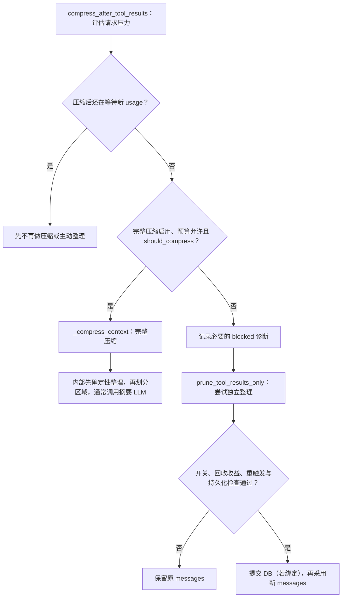

图是 `agent/turn_preflight.py:compress_after_tool_results` 的分支概括，省略超时、锁与 handoff 的收尾。完整压缩分支里已经有工具预处理；不是先调用独立 prune，再必然进入完整压缩。`compress()` 里也**没有一条普遍的“预处理后低于阈值就立即返回”规则**；是否跳过摘要还受可压缩窗口、摘要失败状态与 feasibility 判断影响。

#### 4.7.2 轻量阶段到底处理什么

以 `_prune_old_tool_results()` 的**当前可执行函数体**为准：

1. **复制列表和消息字典**，在候选上工作，不直接覆盖调用者原列表。
2. **去重旧工具结果**：较早的相同正文换成重复提示，保留较新的完整副本。去重可涉及尾部，不等于尾部每个字节都绝对不动。
3. **缩减较早的大工具正文**：按工具名/参数生成确定性短说明；这里的 summarize 是规则函数，不是再请求一个模型。普通路径还保护刚加载/近期引用的 skill 内容。
4. **退休过时图片载荷**：保留近期帧等必要内容；待模型读取的当前工具轮是否豁免，还要看它是否符合硬预算限制。
5. 完整压缩传入尾部 token 预算时，还有**尾部压力降级**，不能让单个巨型工具结果把保护区永久撑爆。

**不改的是执行事实里的工具调用参数**：当前 `_prune_old_tool_results()` 函数体没有截断 assistant 的 `tool_calls[].function.arguments`；摘要模型输入另有长度边界。附近 `prune_tool_results_only()` 的长 docstring 仍提到过“截断参数”的 pass，和当前函数体不一致，阅读时不要只抄注释。这里只记录本地实现事实，不修改源码。

独立 prune 的普通正文缩减按**最近消息条数**保护尾部；完整压缩还传入 **token 预算**，两者不能混为“固定保留最近 20 条原文”。去重、图片保留和极端压力又各有例外。

默认配置与解释：

```yaml
compression:
  proactive_prune_tokens: 0                 # 关闭独立主动整理；不是关闭完整压缩内的预处理
  proactive_prune_min_result_chars: 8000    # 独立整理时，大正文缩减的字符门槛
  proactive_prune_min_reclaim_tokens: 4096  # 至少回收这么多估算 token 才提交
  protect_last_n: 20                       # 独立整理的普通尾部计数保护
  tail_mode: lean                          # 完整压缩使用更紧凑的 token-budget 尾部
  in_place: true                          # 不换 session_id；不表示覆盖原行内容
```

`proactive_prune_tokens` 开启后，每次提交都会重设 rearm 水位，要等上下文重新增长再整理，避免少量收益换来反复 prompt-cache 失效。请求已经超过完整阈值时可以绕过特定 rearm 阻挡，**不能绕过最小回收收益检查**。存储不支持必要的原子提交、候选没变化、持有历史已经过时、DB 提交失败，也可能不采纳这次整理。

前文 4.2 的“没到阈值不压”是完整自动压缩的简称，**不包含显式手动压缩和可选的独立 proactive prune**。另外配置写的 `threshold: 0.50` 也不等于所有模型有效阈值都是窗口一半：当前实现有小窗口比例下限、模型覆盖、有效输入预算、绝对上限与辅助摘要窗口约束，应读有效 `threshold_tokens`。

<a id="sec-4-projection"></a>

### 4.8 内存 messages 不是最终模型请求：有两次投影

#### 4.8.1 先把四种“消息”摆开

| 名称 | 它是什么 | 与其他对象的关系 |
|---|---|---|
| SessionDB 的 `messages` 行 | 持久消息记录，含 `session_id`、`active/compacted`、展示/协议 sidecar 和身份字段 | 是数据库记录，不是 SDK 可以直接提交的 Python 对象 |
| 本轮 `messages` | `run_conversation` / turn context 里的工作历史，通常是 OpenAI 风格的 `list[dict]` | 可由恢复历史形成，并继续追加本轮新消息；不是 `AIAgent.self.messages` 的统一永久字段 |
| 本次 `api_messages` | 从工作历史构造的发送副本，带本次系统提示和请求期上下文 | 不是同一个列表；投影会复制、选择、清理、恢复协议回放信息 |
| `api_kwargs` / wire payload | 给当前 SDK/API 的参数：可能用 `messages`，也可能用 `input` 或独立 `system` 等字段 | 还需按 API mode/Transport 转换，不等于直接把 `messages` JSON 发出去 |

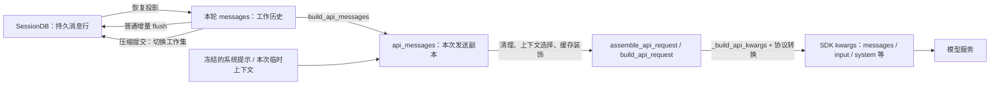

实线是数据构造/持久化方向，不是几个独立服务。两次投影分别是 **DB → 工作对象** 和 **工作对象 → 本次请求**；后者内部还有协议原生格式转换。完整后端契约见 [卷十](10-model-backends-and-resilience.md#backend-architecture)。

#### 4.8.2 第一投影：从 DB 恢复成工作历史

`hermes_state_messages.py:SessionMessagesMixin.get_messages_as_conversation` 默认读生效消息，再由 `_rows_to_conversation` 形成字典：

- 还原 `role/content`，反序列化 `tool_calls`，恢复 reasoning/协议附加信息。
- 恢复消息稳定身份、timestamp 等；需要时携带 `_row_id`。
- 从 DB 读出的字典打上 `_db_persisted`，表示已经持久化，不必下一次 flush 重写。
- 普通模型恢复不应开启仅用于展示的 `include_compacted=True`，否则会把已经摘要掉的原文又读回工作上下文。

**不是每次 API 调用前都从 DB 全量重读。** 一轮里通常在内存 `messages` 上追加 assistant/tool 等消息，然后按持久化入口 flush；外层 CLI/Gateway/TUI 如何恢复和交接 history 见 [6.2](#sec-6-2)。内存中可以暂时有尚未入库的新消息，不能假设每时每刻都与一条 SQL 查询一一对应。

普通写入由 `agent/session_persistence.py:SessionPersistenceMixin._flush_messages_to_session_db_unlocked` 处理：过滤临时 scaffolding，依据持久化标记/身份只写新消息，维护 DB 身份和 flush 基线。它不是“每轮拿整个内存列表覆盖整张表”。压缩改写旧历史则必须走专门的提交协议，不能靠普通 append-only flush 自动发现旧行应归档。

#### 4.8.3 第二投影：从工作历史形成本次请求

`agent/turn_context.py:build_api_messages` 中最关键的片段是：

```python
# 原码摘录，中文注释为解读；省略其前后的历史规范化和内容回放分支。
api_messages = []
for idx, msg in enumerate(canonical_messages):
    # 结构复制，不只浅拷贝最外层；后续处理不能通过嵌套 list/dict 改坏历史。
    api_msg = _clone_message_for_send(msg)
    _api_content = api_msg.pop("api_content", None)
    for key in PERSISTENCE_ONLY_MESSAGE_FIELDS:
        api_msg.pop(key, None)  # DB / 展示 / 身份记账字段不能带给严格 API
```

随后还有这些处理，不能省略成“直接发送内存 messages”：

| 阶段 | 具体作用 | 是否等于持久历史压缩 |
|---|---|---|
| `build_api_messages` | 历史回放规范化、去掉本地字段；user/assistant 可用 `api_content` 回放发送版本；复制当前路由需要的 reasoning | 否；主要构造请求副本，sidecar 的生成/持久化有独立流程 |
| `assemble_api_request` | 加 API-only prefill/context selection；sanitize、清理孤立工具结构、淘汰旧截图；再按规定顺序做缓存装饰等 | 否；发送副本的变化不自动归档 DB |
| `build_api_request` | 按当前/fallback 路由重施 reasoning 回放与其他请求规则，调用 `_build_api_kwargs` | 否；是本次请求组装 |
| `chat_completion_helpers.build_api_kwargs` / Transport | 根据 `api_mode` 转 Anthropic、Bedrock、Responses 或 Chat Completions 参数 | 否；是协议适配，不是决定会话保存哪些消息 |

`api_content` 可以理解为**同一条逻辑消息的发送版本 sidecar**。例如 UI 的 `content` 只显示“继续检查”，模型那次还收到了请求期注入的上下文；后续回放可复用 sidecar 保持历史前缀稳定。它本身是本地记账字段，不能原样作为未知字段发给服务商；应取它的内容后移除字段名。

因此“模型只看 active 消息”的严格说法是：**普通恢复以 active 工作集为基础，经过投影、选择和协议转换后，模型看到最终 payload**，不是模型直接读 SQLite，也不是 `api_messages == messages == DB 全部历史`。回放 reasoning 的具体字段与 route 边界见 [卷十 §7](10-model-backends-and-resilience.md#backend-replay)。

<a id="sec-4-db-commit"></a>

### 4.9 压完怎样把 DB 旧行变成 active=0、compacted=1

#### 4.9.1 不是遍历内存字典打两个字段，而是显式 DB 事务

默认 `in_place=True` 时，完整压缩由 `agent/conversation_compression.py:_commit_compaction` 提交，核心关系是：

```python
# 按真实调用整理的机制示意，不是可直接执行的完整实现。
compressed = compressor.compress(messages, ...)  # 生成候选，尚不能认为落库成功
covered_ids, unresolved_held = coverage_for_commit(db, sid, original_messages, ...)
db.archive_and_compact(
    sid, compressed,
    covered_ids=covered_ids,       # 本次确实见过的持久行
    unresolved_held=unresolved_held,
    watermark=held_watermark,      # 对持有历史/兼容存储的边界保护
    lock_holder=lease.holder,      # 完整压缩在事务内再次验证租约
    tail_count=tail_count,         # 哪些旧行是原样搬运的尾部
    carried_messages=carried_messages,
    ...,
)
stamp_db_persisted_markers(compressed)  # 成功后才标记“这批已经写入”
messages = compressed                 # 调用方采用这份新工作历史
```

这里 `messages = compressed` 表达调用方接收结果；源码实际还有 system prompt、并发尾部采纳、flush 基线、引擎通知与失败回滚等步骤。**不是摘要 LLM 直接写数据库，也不是只改消息 dict 中的 `active` 属性。**

#### 4.9.2 SessionDB 里真正执行什么

`SessionDB` 组合的 `SessionMessagesMixin.archive_and_compact()` 最终执行 SQL。全体仍生效的待归档行使用这个真实常量：

```sql
-- 源码 _ARCHIVE_ACTIVE_SQL；session_id 作为参数传入。
UPDATE messages SET active = 0, compacted = 1
WHERE session_id = ? AND active = 1;
```

但**不能只复制这句 SQL 就当成完整算法**。在已证明 coverage 的 `_archive_named_rows()` 分支，事务顺序是：

1. 读取该 session 的 active 行，划分本次见过的 covered 集合与未见过的 unseen 集合。
2. 识别**原样搬运的尾部/指定 carried 行**，以及必须保留的 unseen 行。它们的旧副本先改为 `active=0, compacted=0`，不被下面的 `active=1` 更新命中。
3. 对剩余 active 行执行归档 SQL：这些才变为 `active=0, compacted=1`。
4. `_insert_message_rows()` 插入压缩后的工作集，成为新的 active 行。
5. unseen 行通过列克隆放到新工作集之后，保留消息正文、sidecar 等；旧副本不再生效。
6. 修正显示身份/顺序、消息和工具调用计数，必要的 model-config patch 同事务写入。

这里 `compacted=0` 的旧尾部/克隆原件属于被新副本替代的旧代际，**不应与“摘要吃掉的原文”一样再次进入普通压缩历史检索**。相关查询、显示去重和 rewind 还有自己的规则，两个 flag 并不足以独立解释所有 UI 行为。

没有可用精确 coverage 时走 watermark/兼容路径：高于 watermark 的并发新行也要保留并重排；最老兼容退路才可能归档全部 active 行。不能把某一分支推广成“无条件把该 session 所有原行全设为 compacted=1”。

<a id="sec-4-9-3"></a>

#### 4.9.3 为什么还要 coverage、watermark 和租约

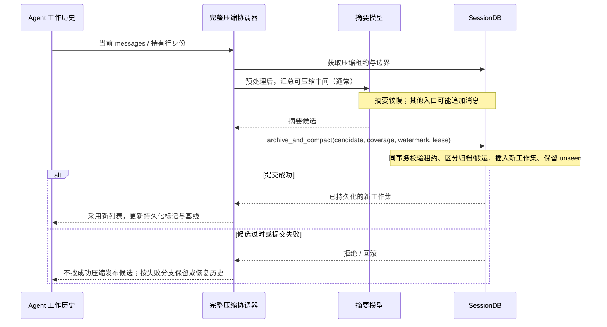

这是默认完整压缩的机制时序，不声称所有故障都同一个返回值。coverage 防止把**本次根本没看到的消息**顺手归档掉；watermark 保护摘要期间新增的尾部；租约检查防止旧压缩任务覆盖已接管的新任务。事务回滚还需恢复写入过程中打到 Python 字典上的行身份，见 `SessionMessagesMixin._execute_transcript_write`，否则已回滚的 `_row_id` 可能误指后续复用 ID 的另一行。

轻量 `prune_tool_results_only()` 也会在绑定 DB 时调用 `archive_and_compact()`，传 coverage/watermark 并持久化 rearm 水位；**它不等于完整压缩租约流程**，另有 stale-held-history 检查。DB 提交异常时它明确返回原输入 `(messages, 0)`，不采纳候选。不要把上图的每一步照搬成它的调用栈。

#### 4.9.4 成功后为什么还要更新内存标记

原地压缩已把新消息写进 DB；返回给循环后若仍当成全新消息，普通 flush 会再插一次。为此完整提交会：

- 对结果打 `_db_persisted`，与新的 DB 行身份对齐。
- 重设 `_flushed_db_message_ids` / `_last_flushed_db_idx` 等 flush 记账。
- `conversation_history_after_compression()` 在原地成功时返回 `list(messages)` 作为已持久化基线；失败/no-op 保留旧基线。

**这不是每轮重写整表，而是在压缩这一受控边界显式切换版本。** `in_place=False` 是父会话结束、发布子 continuation 的另一条事务；没有 DB 的临时运行可以只改内存；`_persist_disabled` 的隔离后台 fork 不能因共享 session ID 就写主会话。

<a id="sec-4-message-example"></a>

### 4.10 从一条大工具结果看内存、DB 与请求如何一起变化

下面是**简化示例，不是逐条复现真实 `_assemble_*` 的输出**。只追踪被改动部分，省略保护的开头、身份 sidecar、role 修复等；假设旧行已落库、此次没有并发追加。

压缩前：

| DB id | 内容 | active | compacted | 内存 |
|---|---|---:|---:|---|
| 101 | assistant：调用 read_file，参数为原始 JSON | 1 | 0 | 工作历史中的 tool-call 消息 |
| 102 | tool：很长的文件原文 | 1 | 0 | 工作历史中的 tool-result 消息 |
| 103 | user：接着检查重试逻辑 | 1 | 0 | 近期锚点 |
| 104 | assistant：近期回答 | 1 | 0 | 近期尾部 |

**情况 A：只成功提交独立轻量整理**，假设 101/102 已在保护尾部之前且满足收益门槛：

```text
新工作 messages：
  assistant：原 tool_calls 参数不变
  tool：确定性短说明，代替大段原文
  user / assistant：近期内容继续保留

DB：
  旧工作集被归档/替代；插入整理后的新 active 行
  原始工具正文仍留在旧行，默认恢复不重新装回

下次请求：
  新工作 messages → 发送副本 → 路由/协议转换 → 模型
```

轻量调用没有传完整压缩的 `tail_count/carried_messages` 信息，**不要假设它会把所有未改正文的旧行都精确分类成尾部重复行**；DB 如何标记取决于实际提交参数和分支。

**情况 B：完整原地压缩**，假设 101/102 被摘要，103/104 被识别为原样搬运尾部：

| DB id（示意） | 内容 | active | compacted | 含义 |
|---|---|---:|---:|---|
| 101、102 | 原工具调用和完整正文 | 0 | 1 | 被摘要的原文，留作归档检索 |
| 103、104 | 原近期消息副本 | 0 | 0 | 已由新 active 副本接替，避免重复代际 |
| 201 | 新的中间历史摘要 / handoff | 1 | 0 | 后续模型上下文的摘要部分 |
| 202、203 | 近期消息的新副本 | 1 | 0 | 后续工作历史中的尾部 |

新 id 只是示例；保留的逻辑消息可继续携带稳定消息身份，而 SQLite 行 id 换了。**行 id、逻辑消息身份、session ID 是三件事。** `get_messages_as_conversation()` 默认恢复 201–203 等 active 工作集；展示/检索入口按自己的 flag、去重和谱系规则找旧原文。不是 DB 变成只有三行，也不是模型继续把 101–104 全部原文和摘要一起读。

#### 源码复查入口

以下引用按本地快照检查符号存在；图为机制说明，未运行 Hermes 场景测试：

| 问题 | 入口 |
|---|---|
| 工具后完整压缩/独立整理分支 | `agent/turn_preflight.py:compress_after_tool_results` |
| 轻量整理实际 pass / 独立触发与提交 | `agent/context_compressor.py:ContextCompressor._prune_old_tool_results` · `agent/context_compressor.py:ContextCompressor.prune_tool_results_only` |
| 完整候选与摘要分支 | `agent/context_compressor.py:ContextCompressor.compress` |
| DB 恢复投影 | `hermes_state_messages.py:SessionMessagesMixin.get_messages_as_conversation` · `hermes_state_messages.py:SessionMessagesMixin._rows_to_conversation` |
| 普通增量持久化 | `agent/session_persistence.py:SessionPersistenceMixin._flush_messages_to_session_db_unlocked` |
| 内存 → 请求副本 | `agent/turn_context.py:build_api_messages` · `agent/turn_request_assembly.py:assemble_api_request` |
| 请求 → 协议参数 | `agent/turn_api_request.py:build_api_request` · `agent/chat_completion_helpers.py:build_api_kwargs` · `agent/transports/base.py:ProviderTransport` |
| 完整压缩提交 / flush 基线 | `agent/conversation_compression.py:_commit_compaction` · `agent/conversation_compression.py:conversation_history_after_compression` |
| 持有历史的 coverage | `agent/conversation_compression_archive.py:coverage_for_commit` |
| 原子归档与新工作集插入 | `hermes_state_messages.py:SessionMessagesMixin.archive_and_compact` · `hermes_state_messages.py:SessionMessagesMixin._archive_named_rows` · `hermes_state_messages.py:SessionMessagesMixin._insert_message_rows` |
| 失败后恢复 Python 行身份 | `hermes_state_messages.py:SessionMessagesMixin._execute_transcript_write` |

**这一组补充的结论**：轻量整理/完整压缩改变的是受控的工作历史，持久会话还要显式提交新工作集；API 投影改变的是本次发送表示。三者通过身份、持久化标记和事务连接，但绝不是同一个 `messages` 列表从 SQLite 原样一路传到模型。
---

<a id="sec-4-working-object"></a>
### 4.11 先认清对象：“工作区 message”到底是什么？

这里沿用“工作区消息”帮助理解，指**本轮推理实际持有、不断追加或压缩替换的工作历史**，不代表源码存在 `WorkspaceMessage` 类，也不是磁盘工作目录里的文件。

最常见的运行表示是 `list[dict]`。需要分清四个容器：

| 名称 | 谁持有 / 用途 | 与其他对象的关系 |
|---|---|---|
| `conversation_history` | 调用方传入的历史；CLI 保存为 `self.conversation_history` | 是下一轮的历史来源，也是本轮 flush 的历史基线；不是实时 SQL 查询 |
| `messages` | 本轮 `TurnContext` / loop 的工作列表 | 建轮时浅拷贝历史列表，再追加当前用户消息；压缩可以替换整个列表 |
| `api_messages` | 单次请求装配产生的发送副本 | 清理持久化字段、重放 `api_content`、按协议整理；不能当作 DB 权威历史 |
| SessionDB `messages` 表的行 | 持久化状态 | 正文、身份与状态列经过读写投影才能变成工作字典；还保留 inactive 的旧代际 |

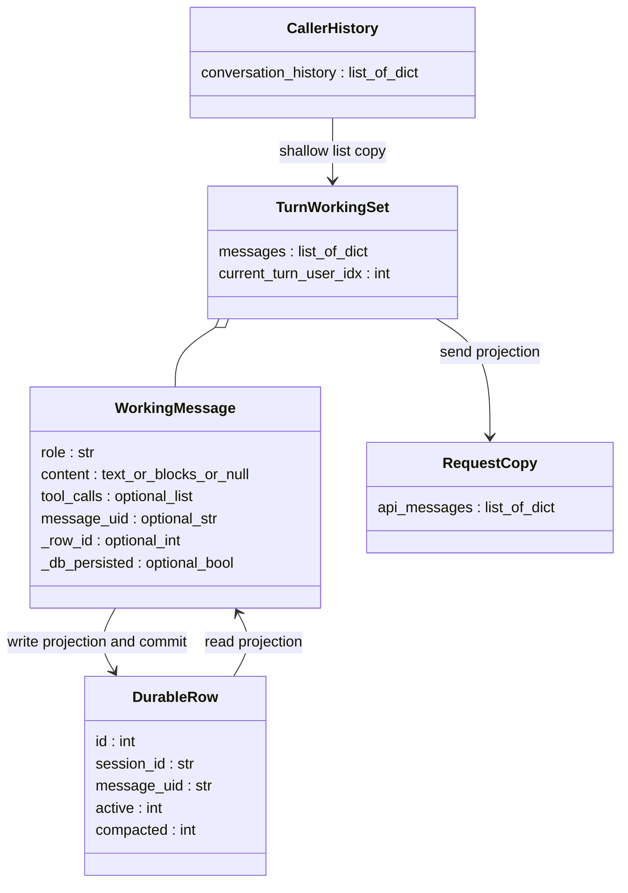

**图是对象关系示意，不是源码类声明。** 特别是 `active` / `compacted` / `session_id` 是 DB 行侧的核心属性，不要求每个工作字典都带着这些字段。

<a id="sec-4-11-1"></a>

#### 4.11.1 一条工作消息里混合了哪几类字段？

| 字段族 | 代表字段 | 人话解释与边界 |
|---|---|---|
| 对话语义 | `role`、`content` | 谁说了什么；`content` 不总是字符串，也可能是多模态 block 列表或空值 |
| 工具协议 | `tool_calls`、`tool_call_id`、`tool_name` | assistant 发起调用，tool 回传结果；tool 的名字与结果不能代替调用配对 |
| 模型重放 | `reasoning_details`、`reasoning_opaque`、`bedrock_content_blocks` 等 | 部分供应商回放需要的思考/内容侧车，不是所有消息都有，也不是任意字段都发往任意模型 |
| 正文与发送表示的差异 | `api_content` | 保存与展示正文不同的发送文本，帮助后续回放；不是把整个 SDK 请求存下来 |
| 展示与来源 | `timestamp`、`display_kind`、`display_metadata` | 何时发生、如何展示；不等于模型应收到的正文 |
| 稳定逻辑身份 | `message_uid`、`_absorbed_message_uids` | 一条逻辑消息跨 DB 代际/重启的身份，以及合并历史的见证 |
| 工具调用发生身份 | `_tool_call_uids`、`_tool_call_uid` | 区分不同轮次里重复的 provider call id；这些内部 UID 不上模型线路 |
| 持久化记账 | `_db_persisted`、`_row_id`、`_db_row_snapshot` | 已写入标记、当前物理行定位、DB 快照；用于去重、修复和覆盖证明 |

**四种身份别混在一起**：`id(msg)` 是本进程的 Python 对象地址；`message_uid` 是逻辑消息身份；`_row_id` 是 SQLite 物理行身份；`session_id` 是所属会话。新一代 active 副本可以沿用 `message_uid`，却有新的 `_row_id`；重启必然创建新 Python 对象。不同消息即便正文完全相同，也不能因此认定是同一条。

身份与字段白名单见 `agent/message_metadata.py:stamp_message_uid`、`agent/message_metadata.py:copy_identity_fields`；提交后回填见 `agent/transcript_repair.py:sync_flushed_message_markers`。去除持久化字段依据明确集合，不是简单地“删掉所有下划线字段”。

#### 4.11.2 浅拷贝意味着什么？

建轮的关键代码可压缩为下面几行（解释性摘录，省略其他初始化）：

```python
# 新的是外层列表，历史 dict 仍可与调用方共享。
messages = list(conversation_history) if conversation_history else []
user_msg, pending_cli_message = _stage_turn_user_message(...)
append_message(messages, user_msg)
current_turn_user_idx = len(messages) - 1
```

所以 `messages.append(...)` 不会自动给调用方旧列表追加元素，但**给共享 dict 回填持久化身份/标记，可能在两边都看得到**。不能把“复制列表”理解为“所有消息深拷贝、彼此完全隔离”。发送路径有自己的结构克隆；压缩候选也有自己的复制/清标记策略，不能沿用这个浅拷贝结论去推断全部对象。

入口：`agent/turn_context.py:build_turn_context`。本轮结束，finalizer 返回 `result["messages"]`；CLI 再把这个列表接回自己的历史。下一轮才会基于这份**更新后的、可能已压缩的工作集**继续。

<a id="sec-4-restart-chain"></a>
### 4.12 链路一：重新启动，SessionDB → 工作区 messages

**重新启动不是把旧进程的 messages 内存快照解冻，而是按 DB 当前已提交状态重新构建。** 以下以交互 CLI 的正常早期恢复路径为主；其他 surface 的入口与选项可能不同。

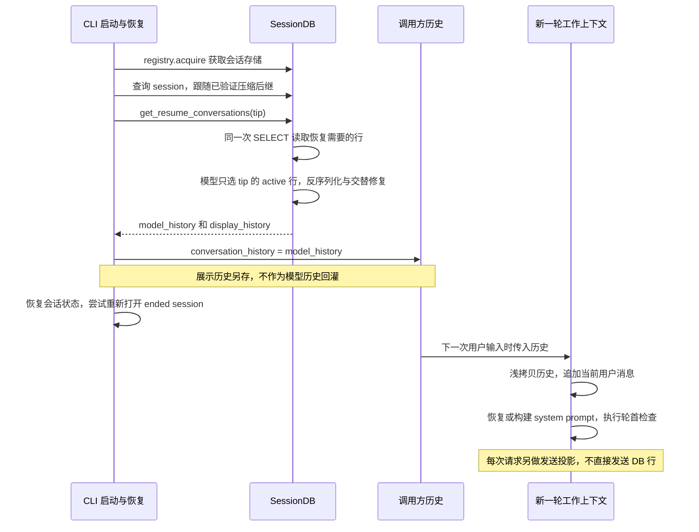

#### 4.12.1 恢复的七个关键步骤

1. **先拿存储句柄**：CLI `_init_session_store` 通过 registry `acquire()` 打开/复用会话存储；失败会显式提示持久化不可用，不应把“还能聊天”理解为“能恢复”。这一步也不是每条输入重新 new 一个 DB。
2. **解析正确的 session**：读 session 元信息，跟随压缩 continuation 到当前 tip。若历史采用原地压缩，通常 session ID 不变；旧式轮换则可能变成后继 ID。普通 branch 不应不加区分地当成压缩谱系。
3. **做恢复限制与所有权检查**：CLI 有历史大小检查，也会拒绝普通 CLI 接管需要 dispatcher 管理的 Kanban worker transcript。不是任意 session 都能当普通交互会话打开。
4. **一份数据库读取，生成两份历史**：`get_resume_conversations()` 的 `model_history` 只保留 tip 的 active 行，启用交替修复、行 ID 和摘要标记；`display_history` 可以读取已验证压缩谱系的展示行，包括 `active=0, compacted=1` 的旧原文并去重。**用户看见旧聊天，不意味着模型又收到这些旧原文。**
5. **逐行投影**：解码正文、tool_calls 等字段，恢复逻辑 UID、侧车、时间戳和按选项附带的 `_row_id`；读出的消息出生时就带 `_db_persisted=True`。交替修复是在恢复列表上处理，不是这次 SELECT 顺便 UPDATE 数据库。
6. **交给调用方持有**：CLI 把模型历史赋给 `self.conversation_history`，展示历史另存为 `_resume_display_history`，恢复会话的相关配置/状态，再尝试 reopen。晚恢复 fallback 使用另一入口，不要把它与正常早期“双历史恢复”混为一谈。
7. **下一轮才变成工作集**：`build_turn_context` 接受调用方历史，浅拷贝外层列表、追加本轮用户输入，并恢复/构建 system prompt、建立会话行和执行轮首压缩等。system prompt 还有单独的缓存/恢复逻辑，不是简单地把表里每行都拼进 `messages`。

#### 4.12.2 并发时，“启动时读过”不代表“轮到我时仍最新”

如果本轮等待过 durable turn lease，前一个持有者可能在这期间追加消息、原地压缩或轮换 session。`admit_durable_turn_lease` 会在**取得准入之后**，按条件解析当前 tip 并重读 active 历史，再交给本轮；同时保留特定的、上次未取得准入而仅在内存携带的用户输入。

它不是每轮无条件重读：立即取得租约、无需刷新时会跳过，避免不必要的 prompt-cache 变化；不存在 DB 会话行的内存 seed 也不能被空查询随意清掉。因此“每轮完全以内存为准”与“每轮完全从 DB 重建”都不准确。

源码入口：
- `hermes_cli/cli_init_mixin.py:CLIInitMixin._init_session_store` · `hermes_state_registry.py:acquire`
- `hermes_cli/cli_agent_setup_mixin.py:CLIAgentSetupMixin._preload_resumed_session` · `hermes_cli/cli_agent_setup_mixin.py:CLIAgentSetupMixin._load_resumed_history_late`
- `hermes_state_messages.py:SessionMessagesMixin.get_resume_conversations`
- `agent/turn_facade_lease.py:admit_durable_turn_lease`

<a id="sec-4-normal-flush"></a>
### 4.13 链路二：没有压缩，推理完成怎样 flush？

先给结论：**普通 flush 主要是增量追加，不是把整个工作列表覆盖数据库。** 它 **不会** 拿内存和 DB 做全文 diff 来找“新消息”；而是在本轮的 **`messages` 列表上从左到右扫**，对 **还没有 `_db_persisted` 标记的 dict** 生成 `batch_rows` 写入 SQLite，commit 成功后再 **回填** 同一批 dict 的 `_db_persisted`、`_row_id` 等（见 [4.11.1](#sec-4-11-1) 持久化记账列）。

<a id="sec-4-13-0"></a>

#### 4.13.0 心智模型：工作集是一根「带记账的 dict 列表」

| 概念 | 是什么 | 不是什么 |
|------|--------|----------|
| **`messages`** | 本轮循环里的 **工作 transcript**（`list[dict]`）；assistant/tool 用 `append` 往后长 | SessionDB 的查询结果镜像（发送前还会再投影，见 §4.8） |
| **「新消息」** | 列表里 **尚未** `_db_persisted=True` 的 dict（或本轮新 `append` 出来的 dict） | 与 DB `SELECT` 逐条比对 content 的差异集 |
| **`conversation_history`** | 调用方传入的 **基线**；flush 用 `id(msg) in history_ids` 判断「这条 dict 对象是否就是恢复时那份」 | 每轮都会和 `messages` 完全相同的第二份列表 |
| **flush** | `_db_flush_collect` → `append_messages_batch` → `sync_flushed_message_markers` | 把整份 `messages` `REPLACE` 进库 |

外层列表每轮常是 **浅拷贝**（§4.11.2）：`messages = list(conversation_history)` 再 `append` 本轮 `user`。历史 dict **对象** 往往与 CLI 的 `conversation_history` **共享**；本轮新 append 的 `Ac`/`T`/`Af` 通常 **只** 在 `messages` 里，直到 flush 给它们打上 `_db_persisted`。

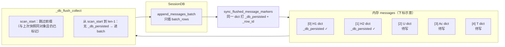

**和「找新 message」的关系**：算法 **不** 问「DB 里有没有这条 content」，只问「**这个 dict 在工作列表里、且记账说还没 durable**」。恢复进来的 `H1`/`H2` 在读库时就已经 `_db_persisted=True`（§4.12），所以第一次 flush 不会重写它们。本轮 `append` 的 `U`/`Ac`/`T`/`Af` 在写入前 **没有** 该标记，因此会进入 `batch_msgs` / `batch_rows` 配对列表。

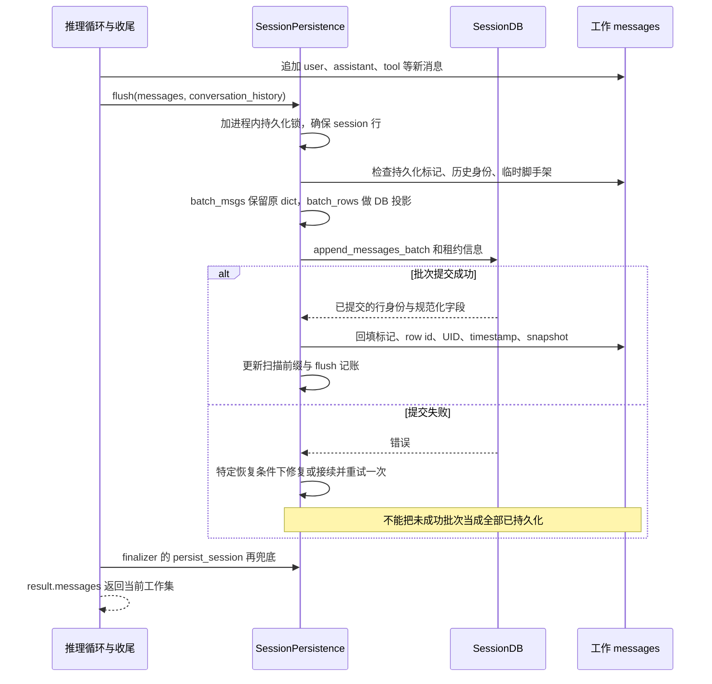

<a id="sec-4-13-1"></a>

#### 4.13.1 怎样识别“哪些还没写”？

字段全集见 [§4.11.1](#sec-4-11-1)。flush 只额外关心：**有没有 `_db_persisted`**、是不是 ephemeral scaffolding、这条 dict 的 **`id()` 是否在 `conversation_history` 里**（已 durable 的历史对象只打标、不重复 INSERT）。

`_db_flush_collect` 扫描时主要处理这些条件：

- 不是 dict、临时 scaffolding、已经带 `_db_persisted` 的消息跳过。
- 可信历史对象 / 一次性 seed 身份可转换成已持久化标记；中断准入后携带的未落库用户输入有特判，不能误跳过。
- 新工具结果如果缺内部调用 UID，会尝试从历史里找到归属。
- 每条待写消息生成一个 `batch_rows` 投影，同时在 `batch_msgs` 保留对应原 dict，以便 commit 后回填。

`_last_flushed_db_idx` **不是正确性的唯一依据**。当前扫描优化会逐项验证“前缀还是同一对象，而且仍带已持久化标记”，才跳过该前缀；序列修复或压缩后不能只用旧下标切片，否则会漏写/重复写。

下面是便于阅读的算法示意，不是可直接替换源码的实现：

```python
rows, originals = collect_unflushed(messages, history_baseline)
if rows:
    # 写 DB 投影，而不是把 live dict 中的所有字段原封不动塞进数据库。
    db.append_messages_batch(session_id, rows, lease_information=...)
    # 只有上一步成功返回，才认定这个批次已经 durable。
    sync_flushed_message_markers(originals, rows)
# 成功路径随后刷新扫描快照；未来 flush 跳过已写消息。
```

写入投影会处理 persist-user override：例如展示/入库正文与本次 API 输入不一样时，覆盖的是**待写行**，不是为落库而把 live 用户输入硬改成另一段文字。与此同时，提交后同步也可能按 canonical-row 策略回填部分规范化字段；因此不能笼统承诺“普通 flush 从不改内存 content”。

<a id="sec-4-13-3"></a>

#### 4.13.3 走读：一轮里列表怎么长、flush 写哪几个 dict

假设恢复后 `conversation_history` 与 `messages` 前两条 **共享同一对象** `H1`、`H2`（都已 `_db_persisted`）。用户输入 `U` 在 `build_turn_context` 里 `append` 到 `messages`（尚未标记）。

| 步骤 | `messages` 列表（每个格子是一个 dict 对象） | `_db_persisted`（写库前） | flush 批次 |
|------|---------------------------------------------|---------------------------|------------|
| 建轮结束 | `[H1, H2, U]` | H1✓ H2✓ U✗ | 通常还不写 U（路径相关；有的 surface 在租约/flush 边界写） |
| 模型返回 tool_calls，工具轮 **执行前** | `[H1, H2, U, Ac]` | … U✗ Ac✗ | **batch = [U, Ac]** 或仅 **Ac**（若 U 已在更早边界写过） |
| 工具返回 | `[H1, H2, U, Ac, T]` | … T✗ | 常等下一轮边界；若此时 flush，**batch = [T]**（已标记的前缀跳过） |
| 最终文本答复 | `[H1, H2, U, Ac, T, Af]` | … Af✗ | **batch = [Af]** 或尾部未写集合 |
| `finalize_turn` → `_persist_session` | 同上 | 兜底再扫一遍 | 只补 **仍无 ✓** 的 dict |
| 返回 CLI | `result["messages"]` 赋给 `conversation_history` | 成功写过的都有 ✓ + `_row_id` | — |

**collect 伪代码（与源码同构，便于对照）**：

```text
scan_start = 0
for (prev, cur) in zip(agent._db_flush_scan_prefix, messages):
    if cur is not prev or not cur.get("_db_persisted"):
        break
    scan_start += 1

batch_rows, batch_msgs = [], []
history_ids = { id(x) for x in conversation_history }

for i in range(scan_start, len(messages)):
    msg = messages[i]
    if not isinstance(msg, dict) or ephemeral(msg) or msg.get("_db_persisted"):
        continue
    if id(msg) in history_ids:          # 恢复进来的那份对象：只打标，不 INSERT
        msg["_db_persisted"] = True
        continue
    batch_rows.append(project_row(msg))  # _db_flush_row：协议字段 → DB 列
    batch_msgs.append(msg)                 # 保留原 dict 引用，供回填

if batch_rows:
    db.append_messages_batch(batch_rows)
    sync_flushed_message_markers(batch_msgs, batch_rows)  # 同一 dict：_db_persisted, _row_id, …
    agent._db_flush_scan_prefix = messages   # 下次 flush 可快速跳过已标记前缀
```

**一条 dict 从「刚 append」到「已 durable」**：`append_message` 只加 `role`/`content`/tool 字段 → flush 选中 → DB 分配 `_row_id` → `sync_flushed_message_markers` 写回 **同一个 dict**。下一轮若仍持有该对象，扫描见 `_db_persisted` 即跳过。若 CLI 用 `result["messages"]` 整体替换自己的历史，对象引用会变，但 **标记和 `_row_id` 随 dict 一起走**。

#### 4.13.2 一轮不压缩，也可能 flush 多次

以 `H1,H2` 为已恢复历史、`U` 为新输入、`Ac` 为 assistant 工具调用、`T` 为工具结果、`Af` 为最终答复：

| 时刻 | 工作列表 | 典型落库动作 |
|---|---|---|
| 建轮 | `[H1,H2,U]` | H1/H2 已标记；U 的持久化时机按 surface/路径，不假定此刻已写 |
| 工具即将执行 | `[H1,H2,U,Ac]` | 工具轮在副作用前尝试 flush，避免工具重启 Hermes 后连调用记录都找不到 |
| 工具结束、继续模型请求 | `[H1,H2,U,Ac,T]` | T 追加到工作集；何时 durable 取决于后续持久化边界，不能凭 append 认定落库 |
| 正常文本答复 | `[H1,H2,U,Ac,T,Af]` | 正常答复路径会尝试 flush 尚未持久化的尾部 |
| finalizer | 同一当前工作集，经尾部清理等处理 | `_persist_session` 再兜底；已写过的消息跳过，不应每次重新插入 H1–Af |
| 调用方接收结果 | `result["messages"]` | CLI 更新自己的 `conversation_history`，下一轮以此为历史来源 |

“工具前已写 Ac”只证明调用意图已 durable，**不证明工具副作用已经完成**。外部副作用与 SQLite 不是一个分布式事务，崩溃恢复不能据此宣称 exactly-once，也不能无脑重跑工具。

finalizer 还会清理临时尾部、处理输出变换和可选的回合后 micro-compaction，再持久化。上表的“不压缩”指这些可选压缩均未改变工作集的情形；micro-compaction 是另一条可选链，不要混入普通追加算法。

源码入口：`agent/session_persistence.py:_db_flush_collect` · `agent/session_persistence.py:_db_flush_row` · `agent/session_persistence.py:_db_flush_write` · `agent/session_persistence.py:_db_flush_scan_start` · `agent/session_persistence.py:SessionPersistenceMixin._persist_session` · `agent/turn_tool_round.py:run_tool_round` · `agent/turn_finalizer.py:finalize_turn` · `hermes_cli/cli_chat_turn_mixin.py:CLIChatTurnMixin.chat`。

<a id="sec-4-compaction-flush"></a>
### 4.14 链路三：推理中压缩，内存和 SessionDB 怎样换一本？

**说人话**：链路二（§4.13）是「笔记本 **往后接着写** 新行」。链路三是「中间写太满了，把前面很多页 **收成一篇摘要 + 保留最近几页原文**，**换一本更薄的笔记本继续写**」。换本子这件事在数据库里是一次 **`archive_and_compact` 事务**完成的——**不是**先把旧 `messages` 全部 ordinary flush，再在内存里删 dict。

<a id="sec-4-14-0"></a>

#### 4.14.0 和 ordinary flush 差在哪？

| | **§4.13 普通 flush** | **§4.14 压缩提交** |
|--|----------------------|----------------------|
| **动的是谁** | 列表里 **还没** `_db_persisted` 的几条 dict | **整段工作历史**换成更短的 `compressed` 列表 |
| **数据库动作** | `INSERT` 新行（`append_messages_batch`） | 旧 active 行 **改标记** + `INSERT` **新一整套** active 行 |
| **旧正文还在吗** | 一直在（只是又多插了几行） | **还在表里**，但多数变成 `active=0`（展示/检索仍可能看到） |
| **内存 `messages`** | 同一列表 **往后 append** | 往往 **换成新 list**（或 `messages[:] = 深拷贝回滚`）；变量指向更短的工作集 |
| **何时发生** | 工具前、轮末等多处 | 轮初 / preflight / 手动 `/compress` 等触发完整压缩 |

下面默认 **`compression.in_place: true`（原地）**——`session_id` 不变，最常见。裂变 rotation 见 [§4.14.2](#sec-4-14-2)。

<a id="sec-4-14-1"></a>

#### 4.14.1 原地压缩：一条故事讲完内存 + DB

**场景**：压缩前内存里有一长串（恢复历史 + 本轮工具来回）。模型还要继续答，但窗口快满了，触发 **完整压缩**。

**阶段 A — 还在旧笔记本上（提交前）**

| 视角 | 状态 |
|------|------|
| **内存 `messages`** | 例如 `[H1, H2, …, U, Ac, T, …]`，可能几十条 dict；有的已 `_db_persisted`，有的本轮新 append 还没写库 |
| **SessionDB** | 同一 `session_id` 下，这些行大多是 **`active=1`**（当前「正式剧本」） |
| **摘要 LLM** | 只在内存里算出候选 `compressed`（更短：头 + 摘要 assistant 行 + 保留尾部），**此时 DB 还没动** |

**阶段 B — 一次事务换剧本（`archive_and_compact`）**

人话就是三件事同时发生（源码在 `_commit_compaction` → `SessionDB.archive_and_compact`）：

1. **旧 active 行退役**：被摘要「吃掉」的正文 → `active=0, compacted=1`（进档案，不再喂模型）。被 **原样搬到新列表** 的尾部，旧物理副本 → `active=0, compacted=0`（避免 UI 里同一段话出现两次 active）。
2. **插入新 active 行**：把 `compressed`（+ 可能要接回的并发尾部）写成 **新的一串** `active=1` 行——逻辑上是你手里的「新笔记本」。
3. **租约 / coverage / watermark**：防止「压缩器没看到的并发新消息」被误归档；细节见 [§4.9.3](#sec-4-9-3)。

**阶段 C — 内存跟上新剧本（提交成功后）**

| 视角 | 变成什么 |
|------|----------|
| **内存 `messages`** | 循环里的变量 **换成** `compressed`（更短列表）。每条新 dict **打上** `_db_persisted=True`（`stamp_db_persisted_markers`），并带上新的 `_row_id` / `message_uid` 等。`U'` 可能与旧 `U` **同一逻辑 uid**，但 **新的物理行**。 |
| **flush 记账** | `_flushed_db_message_ids` 清空、`_last_flushed_db_idx = 0`、`_db_flush_scan_prefix` 更新——告诉下一轮 flush：「别拿旧列表长度去 diff，整本已提交」。 |
| **调用方基线** | `conversation_history_after_compression` 在原地成功时返回 `list(messages)`，CLI 等应把 **conversation_history 指到这份新列表**，否则 identity flush 可能重复 INSERT。 |
| **SessionDB** | 同一 `session_id`：**只有新的 active 行**参与 `get_resume_conversations` 的模型历史；`active=0, compacted=1` 的旧原文还在库里，给 `session_search` / 展示谱系用，**不会**再拼进下一轮 `messages`。 |
| **system 提示** | 常 `invalidate_system_prompt` / 更新 session 行上的 prompt（压缩边界重建）；MEMORY 快照下一轮才刷新（卷三 6.4.2）。 |

**阶段 D — 压缩之后继续本轮**

模型还没说完时：在 **新** `messages` 后面 `append` 例如 `Af`。ordinary flush（§4.13）只扫 **没有** `_db_persisted` 的尾部——**不会**把摘要行再 INSERT 一遍，因为阶段 C 已整本打标。

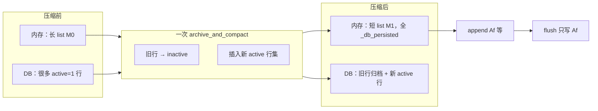

**压缩失败 / 提交前取消**：内存可能 `messages[:] = deepcopy(压缩前快照)`，**DB 保持阶段 A**（原子事务没成功就不会出现「摘要 + 原文双倍 active」）。不要把「摘要模型已经返回文字」当成「已经压完」。

**和 §4.13 的衔接一句话**：压缩 **替换了** 工作列表并 **在事务里** 写好新 active 行；之后的 flush 只做 **增量补写**（例如压缩后才产生的 assistant 尾句），两套机制不要混成「先 flush 全量再压缩删内存」。

<a id="sec-4-14-2"></a>

#### 4.14.2 裂变（rotation，`in_place: false`）— 内存和 DB 多换一把 `session_id`

人话：不是在同一 session 行里换 active 集，而是 **开一个新 session 行**（新 `session_id`），把压完的工作集 **发布到子会话**；父会话 **结束**，历史留在父里给展示/谱系。

| | **原地 in_place** | **裂变 rotation** |
|--|-------------------|-------------------|
| **`session_id`** | 不变 | 父结束，子为新 tip |
| **压缩前未 flush 的本轮消息** | 不要求先 flush 到父 session | **先** flush 到 **父** session，再 rotation（#47202） |
| **内存 `messages` 之后** | 同一 agent 上换成 `compressed` | agent 切到子 session；子侧持压缩后的列表 |
| **`conversation_history_after_compression`** | 返回 `list(messages)` 作新基线 | 返回 `None`（子会话用自己的持久化安排） |
| **恢复** | 仍读同一 id 的 active 行 | 要跟 compression tip 解析到 **子** id |

逐行 DB 形状仍见 [§4.9–4.10](#sec-4-db-commit)、[第6章 6.5 / 6.7](#sec-6-5)。

#### 4.14.3 其它容易混进来的路（一句带过）

- **独立 proactive prune**（§4.7）：也可能 `archive_and_compact`，但 **不是** 完整压缩租约 + history 基线那套；别用 §4.14.1 的「整本打标」去套它。
- **Codex 原生 compact**（§5.2）：不走 Hermes `ContextCompressor` 这条 `archive_and_compact`；`compression.checkpoint_required` 与 Codex 旁路互斥。

源码入口：`conversation_compression._commit_compaction` · `archive_and_compact` · `stamp_db_persisted_markers` · `conversation_history_after_compression` · 循环侧 `turn_preflight` / `turn_context_compaction` 里对 `out.messages = compress 结果` 的赋值。

<a id="sec-4-lifecycle-boundaries"></a>
### 4.15 还要补上的核心链：发送、结果回交、崩溃与隔离

把三条主链闭合起来，还缺这四个边界：

| 链路 | 内存 / DB 的实际边界 | 常见误解 |
|---|---|---|
| 工作集 → 单次模型请求 | 每次生成请求副本，重放/清字段并转换 provider payload；API-only 整理不自动归档 DB | “工作 dict 就是模型请求 JSON” |
| 本轮结果 → 下一轮历史 | finalizer 返回当前 messages；CLI 接回 history，gateway 另有自己的内存历史引用 | “始终存在一份全局 self.messages 自动同步所有入口” |
| 进程崩溃 → 再恢复 | 只能恢复已提交行；内存 append、流式文字、工具执行状态未必都 durable | “屏幕看见了，就一定能从 DB 原样恢复” |
| 无 DB / 隔离 fork | `_persist_disabled` 或无 DB 时普通 flush 跳过；某些后台 fork 虽共享父 session ID，却禁止写父 transcript | “相同 session ID 就能把任意 messages 写进去” |

再把失败分成三种，排障更容易：

- **普通批次写失败**：不按成功路径给这一批 stamped durable；错误分类可能触发修复或采用压缩 tip，重试有预算，不是无限重试。finalizer 后续兜底也不等于承诺最终一定写成。
- **压缩未被采用 / 提交失败**：不能把候选当 durable 基线；按分支保留或回滚工作历史。数据库事务回滚保证的是这次 transcript 写入边界，不是撤销模型费用、外部副作用或所有 Memory 更新。
- **提交成功后进程退出**：即便没来得及继续推理，重启也应读到已提交的新 active 集；不靠旧 Python 列表活着来维持恢复语义。这是提交边界的设计解释，本次未执行 crash 注入实测。

**一口气串起来**：SessionDB 提供已提交的 active 历史 → surface 持有模型历史 → 每轮复制列表并追加输入 → 每次请求单独投影 → 普通 flush 增量追加并回填身份 → 压缩提交切换 active 代际并交接新工作集 → 返回最新 messages 给下一轮 → 重启重新从 DB 的提交结果恢复。内存是正在推理的工作视图，DB 是可恢复的提交记录，两者通过明确的读、写、提交与结果回交边界连接，并非实时双向绑定。

---

<a id="sec-4-context-injection"></a>
### 4.16 外部 Memory 与插件 context：放在哪里，是否进入内存消息？

**先说结论**：外部 Memory 预取和插件 `pre_llm_call` 的 context，默认走**本轮 user 消息的发送表示**，不是统一追加到 system，也不是自动新建一条 tool 消息。只有 Memory 预取文本由宿主加 `<memory-context>`；插件 context 默认在该标签外面。普通字符串路径不改原始 `content`，但会写进 live message 的 `api_content`；多模态路径则直接追加 live `content` 的 text part。

#### 4.16.1 哪段带标签？插件与 Memory 不共用包装

源码的关键拼接逻辑如下，注释为解读：

```python
# 只有 Memory 预取结果在这里包装为 <memory-context>...</memory-context>。
fenced = build_memory_context_block(ext_prefetch_cache) if ext_prefetch_cache else ""

# 插件 context 直接参与拼接；宿主不在这里替它添加统一标签。
injections = [part for part in (fenced, plugin_user_context) if part]
return "\n\n".join(injections) if injections else None
```

发送正文的顺序因此是：

```text
用户原始问题

<memory-context>
宿主生成的召回记忆说明
Memory 召回内容
</memory-context>

插件 pre_llm_call 返回的 context
```

**不是**把插件 context 也放进 `<memory-context>`。插件可以自行返回带标签的字符串；这里描述的是 Hermes 宿主默认包装。标签只是 user 正文中的文本，不会把其中内容变成协议层的 system 消息，也不是安全隔离边界。源码的记忆块包含将其解释为召回参考的说明，但不能据此把任意插件输出当成同等级的可信指令。

`_collect_pre_llm_call_context` 收集 hook 返回的字符串，或返回字典里的 `context`，按顺序拼接；过大的单个输出可能先 spill 到磁盘。因此实际注入文本不一定等于插件最初返回的超长原文。外部 Memory 则在轮首预取，结果放在 `ext_prefetch_cache` 供本轮使用；变量名中的 cache 不是“必定查询 Redis”，也不是模型供应商的 prompt cache。

#### 4.16.2 字符串例子：content 不变，但 message 对象确实变了

以下业务内容均为示例，省略记账字段和 Memory 包装中的完整说明文字。假设：

- 用户：`帮我排查 payment 超时`。
- Memory：`payment 使用 PostgreSQL。`。
- 插件 context：`当前环境：生产。排查只能执行只读操作。`。

**A. 注入前的工作消息**：

```python
msg = {
    "role": "user",
    "content": "帮我排查 payment 超时",
}
```

**B. 轮首准备后，同一个工作消息 dict**：

```python
msg = {
    "role": "user",
    # 原始正文保留，不为注入而直接拼长。
    "content": "帮我排查 payment 超时",
    # 这是完整的发送正文，不只是新增 context 的增量。
    "api_content": (
        "帮我排查 payment 超时\n\n"
        "<memory-context>\n"
        "[宿主的召回记忆说明，此处缩写]\n\n"
        "payment 使用 PostgreSQL。\n"
        "</memory-context>\n\n"
        "当前环境：生产。排查只能执行只读操作。"
    ),
}
```

源码不是只把变量留在 `TurnContext`，还会在普通字符串主路径执行：

```python
_turn_user_msg = messages[current_turn_user_idx]
# ……统一生成与持久化正文匹配的侧车……
_turn_user_msg["api_content"] = _api_content
```

所以只打印 `messages[i]["content"]` 会误以为“插件 context 没进内存”。准确说法是：**没改原始 content，但已进入同一个内存 message 对象的 api_content 字段；没有新增一条独立消息。** 插件结果与 Memory 结果还分别保留在本轮 context 的对应字段，供发送路径使用。

**C. 发给模型的请求副本**，以 Chat Completions 风格表示：

```python
# build_api_messages 中：先克隆，再在请求副本上替换。
api_msg = clone(msg)  # 示意名，不是源码函数名
sidecar = api_msg.pop("api_content", None)
if sidecar:
    api_msg["content"] = sidecar
# 实际实现还会清理持久化字段、做历史重放及后续协议整理。
```

```json
{
  "messages": [
    {"role": "system", "content": "Hermes 系统提示词……"},
    {"role": "user", "content": "帮我排查 payment 超时\n\n<memory-context>\n[召回记忆说明，此处缩写]\n\npayment 使用 PostgreSQL。\n</memory-context>\n\n当前环境：生产。排查只能执行只读操作。"}
  ]
}
```

模型看见的是拼接后的 user `content`，**不会收到名为 `api_content` 的内部属性**。上例省略历史、tools 和其他请求参数；Anthropic / Responses 等路径随后还会做协议转换，不保证最终 wire JSON 与此相同。

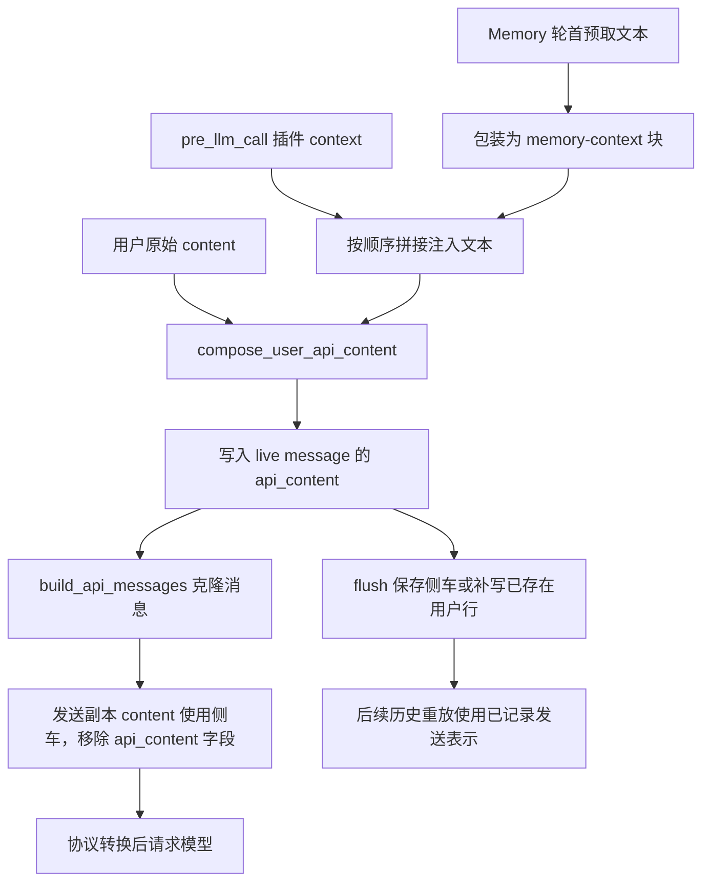

#### 4.16.3 多模态例外：直接改 live content 列表

当当前用户消息的 `content` 是列表时，字符串拼接函数不返回侧车；`_append_multimodal_context` 将上述注入文本作为一个 text part 加入本轮 live 列表。例如：

```python
{
    "role": "user",
    "content": [
        {"type": "text", "text": "帮我分析这个报错"},
        {"type": "image_url", "image_url": {"url": "示意图片地址"}},
        # 新增 part；如果 Memory 非空，该 text 内先有 Memory 包装，再有插件文本。
        {"type": "text", "text": "当前环境：生产。排查只能执行只读操作。"},
    ],
}
```

这里是**直接改变内存 content**，而不是只动发送副本；本轮只追加一次，不逐轮修改所有历史用户消息。DB 写入还要经过持久化投影，不代表图片原始结构和字节一定全部按 live 形状保存；若用户行已提前提交，这条路径还会按条件补写用户正文。

#### 4.16.4 是否落库、下轮是否重新检索、所有模式是否相同？

| 问题 | 当前实现的边界 |
|---|---|
| 普通字符串 context 会保存吗？ | `api_content` 可随用户行投影持久化；已经提前写入的用户行有条件补写逻辑。是否真的 durable 仍以 DB 写成功为准 |
| 为什么保存侧车？ | 历史 user/assistant 可重放之前实际发送的文本，保持前缀稳定；不能每轮用新的检索结果改写同一条历史正文 |
| “临时 context”是否意味着绝不落库？ | 否。这里主要是按本轮获取/注入、不修改长期缓存 system prompt，不等于不记录历史发送表示 |
| 工具循环每次都重新检索吗？ | 这条默认轮首 Memory 预取在循环前执行；本轮请求复用已取结果。下一用户轮可重新预取，历史则使用已存侧车 |
| 字符串是不是所有模式都 stamp？ | 否。`build_turn_context` 对 `moa_active` / `codex_app_server` 跳过这一处字符串 stamp，不能直接推广普通模式结论；这是此处的分支边界，不证明那些模式完全不注入 context |
| 多模态是否同样跳过？ | 这里的 list-content 分支先执行 `_append_multimodal_context`，不受后面的字符串 stamp 条件约束 |
| 自定义 Context Engine 会保持示例原样吗？ | 不保证。后续 `select_context()` 可以替换本次请求列表；示例是没有此类替换时的默认装配路径 |

其他注入通道也不要混为一谈：`ephemeral_system_prompt` 拼到本次请求的 system 内容；`prefill_messages` 以独立消息插在 system 后；工具结果通常是配对的 tool 消息。它们与插件 context 的默认 user 尾部通道不同。

#### 4.16.5 源码定位与一句话记忆

- 收集插件结果：`agent/turn_context.py:_collect_pre_llm_call_context`。
- 外部 Memory 预取与包装：`agent/turn_context.py:_memory_turn_start_and_prefetch` · `agent/memory_manager.py:build_memory_context_block`。
- 拼接注入正文：`agent/turn_context.py:compose_multimodal_context_part` · `agent/turn_context.py:compose_user_api_content`。
- 字符串侧车 / 多模态正文：`agent/turn_context.py:_stamp_api_content_sidecar` · `agent/turn_context.py:_append_multimodal_context`。
- 持久化正文与侧车协调：`agent/session_persistence.py:durable_user_row_content`。
- 发送副本及后续请求选择：`agent/turn_context.py:build_api_messages` · `agent/turn_request_assembly.py:assemble_api_request` · `agent/conversation_loop.py:_apply_context_engine_selection`。

**记住三个位置**：插件在 Memory 标签外；字符串注入在 live `api_content`；模型收到的是请求副本的 `content`。多模态另走直接追加 live text part 的路径。所谓“内存 messages 没变”，只有在明确限定“字符串原始 content 没变”时才准确。

---
<!-- compression-detail:end -->
<a id="sec-ch5"></a>
## 第5章：Batch 和 Codex 旁路

仍从 `run_conversation` → `_run_conversation_turn` 进门。**只有** `api_mode == "codex_app_server"` 会在 `conversation_loop` 里 **提前 return**，跳过下面的 `while`。**`platform` 不是循环分叉条件**——`platform="batch"` / `"subagent"` / IM 的 gateway 键只影响遥测、租约 holder 字符串、呈现出站，不改变「进不进 while」。

<a id="sec-5-0"></a>

### 5.0 `conversation_loop` 里到底分叉什么？

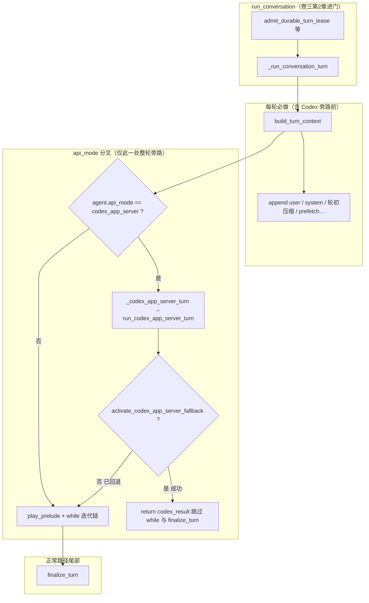

| 符号 | 读什么 | 是否让 `conversation_loop` 跳过 `while` |
|------|--------|------------------------------------------|
| **`api_mode == "codex_app_server"`** | Agent 构造 / `/codex-runtime` 等可改 | **是**（成功时）；失败可 **fallback** 后掉进 `while` |
| **`api_mode == "codex_responses"`** | 仍在 `while` 里；`perform_api_call` 走 Codex Responses 流 | **否**（每 **迭代** 一次 API，不是子进程整轮） |
| **`api_mode` 其它**（`chat_completions`、`anthropic_messages`…） | 常规 Hermes 迭代 | **否** |
| **`platform`**（`batch`、`subagent`、`telegram`…） | 谁开的这轮、日志/租约标签 | **否**；Batch 仍跑完整 `while` |

**Codex app-server 旁路仍先跑 `build_turn_context`**：用户行、system、轮初压缩、`prefetch_all` 等与第2章一致；分叉点在 `_LoopState` 建好 **之后**、`play_prelude` / `while` **之前**（`conversation_loop.py` 约 1640 行注释）。

**旁路成功时**：`run_codex_app_server_turn` 在子进程跑 `codex app-server` 的 `run_turn`，把事件投影进 `messages`，在 `codex_runtime._finish_codex_turn` 里做 **轮末子集**（外部 memory `sync`、可选 `background_review`），返回与 chat 路径兼容的 `result` dict（含 `agent_persisted=True`）。**不**再走 `finalize_turn`（网关据此跳过重复 flush）。**失败回退**：`activate_codex_app_server_fallback` 改写 provider/model/`api_mode` 后 `_codex_app_server_turn` 返回 `None`，同一用户 turn **掉进下面的 `while`**，并带上 Codex 已记的 `api_call_count` 投影行。

与 [卷一 §2.5 平行入口](01-platform-and-architecture.md#sec-2-5) 总表一致；下面 5.1 / 5.2 分述 Batch 与 Codex。

<a id="sec-5-1"></a>
<a id="8-batch-执行面-platformbatch"></a>

### 5.1 Batch：结果写文件（仍走 `while`）

**入口**：`batch_runner.py` 的 `BatchRunner`（CLI `python batch_runner.py --dataset_file=…`）。与交互 CLI 一样调用 `AIAgent.run_conversation`，内核 **仍是** `while` + `finalize_turn`；**无** TUI/IM/ACP 呈现。`platform="batch"` 只写入 task-run / 租约 holder 遥测，**不是** `conversation_loop` 分支条件。

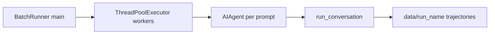

| 项 | 说明 |
|----|------|
| **进门** | worker 内 `AIAgent(..., platform="batch")` → `run_conversation(prompt, task_id=…)` |
| **检查点** | `data/<run_name>/checkpoint.json`；`--resume` 跳过已完成 index |
| **system** | 可选 `ephemeral_system_prompt`（**不**写入轨迹文件）；`prefill_messages` 作 few-shot |
| **出站** | 文件 JSONL/统计；**不**经过卷一 OUT 的 TERM/WS/IM |
| **租约** | 批任务通常独立 session/`task_id`；与桌面共享 DB 时仍走 `admit_durable_turn_lease` |

---

<a id="sec-5-2"></a>
<a id="9-codex-app-server-整轮旁路"></a>

### 5.2 Codex：两种 `api_mode` 不要混

| `api_mode` | 在 `conversation_loop` 的位置 | 谁跑工具 / 多轮 |
|------------|------------------------------|-----------------|
| **`codex_app_server`** | `build_turn_context` **之后**、**`while` 之前** 整轮旁路 | 子进程 `codex app-server` 内闭环；Hermes **不**跑 `run_tool_round` 迭代链 |
| **`codex_responses`** | **在 `while` 内** 每次 `perform_api_call` | Hermes 仍组请求、仍可能多轮；传输层是 Codex Responses SSE（`run_codex_stream` 等） |

#### 5.2.1 App-server 整轮旁路（`codex_app_server`）

条件：**仅** `agent.api_mode == "codex_app_server"`（与 `platform` 无关）。

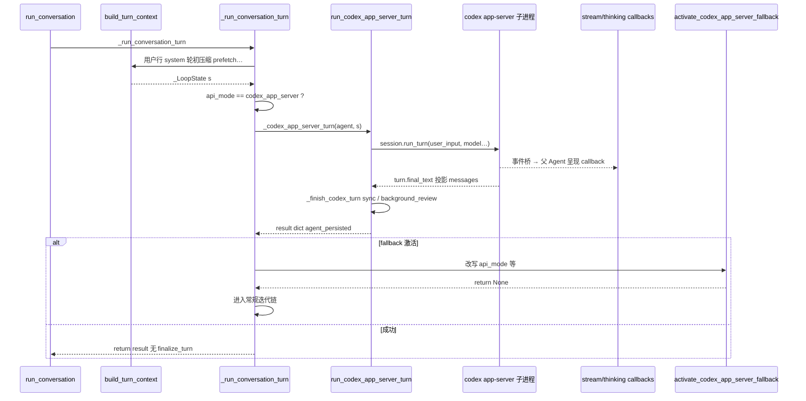

| 项 | 说明 |
|----|------|
| **入口** | `_codex_app_server_turn` → `agent._run_codex_app_server_turn`（`agent/codex_runtime.py`） |
| **子进程** | `agent/transports/codex_app_server_session.py`；长连 session + `run_turn` |
| **事件桥** | `make_codex_app_server_event_bridge` → 父 Agent `thinking` / `stream`（卷二 callback 仍可用） |
| **持久化** | `_persist_projected_messages` + `agent_persisted=True`；网关勿重复 flush |
| **压缩** | Codex 线程自管 compact；`compression.checkpoint_required=True` 与旁路 **互斥**（init + `run_codex` 双保险 `_checkpoint_blocked`） |
| **轮末** | `_finish_codex_turn`：usage、外部 memory sync、可选 `_spawn_background_review`；**不是** `turn_finalizer.finalize_turn` 全表 |
| **失败回退** | `turn_recovery.activate_codex_app_server_fallback` → 返回 `None`，同一用户句 **重试** 下面 `while` |

#### 5.2.2 Responses 模式（`codex_responses`）— 仍在 `while` 里

不触发 §5.0 的提前 return。一次用户 turn 仍可能 **多次** `api_call_count`（工具循环）。`turn_api_request` / `perform_api_call` 按 `api_mode` 选传输；原生 compact 见 `native_compaction.py`（与卷四 [4.7 注](03-runtime-session-and-loop.md#sec-4-lightweight) 的 Hermes `ContextCompressor` 不是同一条实现）。迭代内恢复支路：`turn_recovery_codex.py`。

权威：`agent/codex_runtime.py`、`agent/transports/codex_app_server_session.py`、`agent/codex_responses_adapter.py`、`agent/turn_recovery.py`、`agent/turn_recovery_codex.py`。

---

<a id="sec-ch6"></a>
<a id="10-aiagent历史hitlmemory-与-session-裂变"></a>

## 第6章：AIAgent 上有什么，历史、HITL、Memory、Session 怎么裂

这一章有两块：**Session** 是 `state.db` 里的消息行；**Memory** 是另外四条轨，何时写、会不会改本轮系统提示。自我进化不在这里，它写的是记忆文件和技能，见 [6.8](#sec-6-8)。

`AIAgent` 定义在 `run_agent.py`，本体几乎是转发。字段在 `agent/agent_init.py` 分组挂上，方法在各个 Mixin 上。一轮里的 `messages` 列表是循环的局部变量，不是 `agent.messages`。

<a id="sec-6-1"></a>
<a id="101-这个类上到底有什么"></a>

### 6.1 类上的字段和方法

继承（和本卷有关的）：`TurnFacadeMixin`（`run_conversation`）、`InterruptControlMixin`（`interrupt` / `steer` / `redirect`）、`SessionPersistenceMixin`（往 SessionDB 写）、`CompressionFacadeMixin`（压缩与裂变）、`StreamDeliveryMixin`（把字流回界面）。

| 组 | 属性 | 作用 |
|----|------|------|
| 身份 | `session_id`、`_parent_session_id`、`platform`、`gateway_session_key` | 这一聊在库里的行；压缩或子代理之后父 id 还在 |
| 模型 | `model`、`provider`、`api_mode`、`base_url` | 这一轮打谁 |
| 历史快照 | `_session_db`、`_session_messages`、`_cached_system_prompt` | 库句柄、上一轮结束时的消息副本、系统提示快照 |
| 记忆 | `_memory_manager`、`skip_memory` | 外部 provider；cron 等可关掉 |
| 中途插入 | `_pending_steer`、`_pending_redirect`、`_interrupt_requested`、`_executing_tools` | steer / redirect / 硬停；工具是否还在跑 |
| 人在看 | `stream_delta_callback`、`thinking_callback`、`tool_*_callback`、`clarify_callback`、`status_callback` | 呈现。审批卡不在这些 callback 里，在工具执行前的 `approval` |

常用方法：

| 方法 | 作用 |
|------|------|
| `run_conversation(...)` | 进门：停复盘、抢租约，再跑循环 |
| `steer(text)` / `redirect(text)` / `interrupt()` | 本轮还在跑时插入或停掉 |
| `_ensure_db_session()` | 系统提示好了之后才建会话行 |
| `reset_session_state()` | `/new`、`/resume`、`/branch` 换 `session_id` 时清本对象上的缓存 |

<a id="sec-6-2"></a>
<a id="102-对话历史不在-selfmessages"></a>

### 6.2 对话历史不在 `self.messages`

三份东西容易当成一份：

| 名字 | 在哪 | 这一轮谁改 |
|------|------|------------|
| **本轮 `messages`** | `conversation_loop` 的局部列表，从入口传入的 `conversation_history` 拷出来 | 循环里 append user / assistant / tool |
| **`agent._session_messages`** | Agent 上的列表 | 主要在 `finalize_turn` 收尾时换成这一轮的 `messages`，给下一轮入口当快照 |
| **SessionDB 消息表** | `hermes_state` | 工具调用前先落 `tool_call` 行；轮末 `_persist_session` 再 flush。这是崩溃后还能续的那份 |

入口下一轮通常用库里的 `get_messages`，或用 `_session_messages` 当内存副本。两者对不齐时，以库为准（租约保护的是库）。

<a id="sec-6-3"></a>
<a id="103-hitl-停在哪"></a>

### 6.3 HITL：审批、澄清、打断

人插进来都不新开 Session 行。审批是「这个工具先别做」；澄清是「这个工具要一个答案」；interrupt 是「这一轮停下」；steer 是「这一轮接着做，但带上这句」。IM 卡片的画法在 [卷六第8章](06-gateways-channels-and-hitl.md#sec-g8)。这里写闸门本身。

<a id="sec-6-3-1"></a>

#### 6.3.1 三种停法

| | 审批 | 澄清 | 打断 interrupt |
|--|------|------|----------------|
| 谁触发 | 危险命令、插件升级、写文件闸门 | 模型调用 `clarify` | 人按停止、`AIAgent.interrupt()` |
| 谁在等 | **工具线程**堵住 | **工具线程**堵住，`clarify_callback` | 循环在边界看到标志后退出；正在飞的 HTTP 被取消 |
| 人答完 | 同一条工具调用栈继续执行，或把拒绝写进 tool 结果 | 答案写进这条工具的结果 | 这一轮结束。外部记忆不 `sync_all` |
| 会话 | 同一 `session_id`。`tool_call` 行已经在库里，tool 结果还没有 | 同一 `session_id`。回答不是新的 `run_conversation` | 不裂变 |
| 系统提示 | 不重建 | 不重建 | 不因打断而重建 |

等待的时间不计入工具自己的超时（`approval_human_wait`）。库里的样子见 [6.7](#sec-6-7) 的「审批卡住」。

<a id="sec-6-3-2"></a>

#### 6.3.2 审批堵在工具线程，不是把进程暂停

`run_conversation` 的 while 没有一个「暂停点」函数。模型已经返回 `tool_calls`，`run_tool_round` 进到具体工具（例如 `terminal`）之后，工具自己叫闸门。调用栈停在闸门里，直到人给了选择，然后**同一条栈**往下走：要么真的执行，要么返回一条 BLOCKED 的工具结果。结果写回 `messages` 之后，while 自然进入下一次模型调用。仍是这一次 `run_conversation`。

两条界面用同一个闸门 `_run_approval_gate`（`tools/approval.py`），等的原语不同：

| 面 | 工具线程堵在 | 人怎么把答案送回来 |
|----|----------------|---------------------|
| 终端 | 后台线程里的队列 `get`。画审批面板的是主线程，主线程不堵 | 主线程 `put` 一次选择：once / session / always / deny |
| IM | `Event.wait`，直到 `resolve_gateway_approval(session_key, choice)` | 按钮或 `/approve` `/deny`。登记发生在这一轮开跑时的 `register_gateway_notify`，不是 Agent 构造时的回调槽 |

同一时刻只处理一扇审批窗。并发的危险命令要抢锁，后到的等前一扇关了再问。

<a id="sec-6-3-3"></a>

#### 6.3.3 命令先过地板，再问人

`check_dangerous_command` 的顺序是固定的。问人只是最后一档。

1. **容器隔离**可以跳过危险命令提示（docker 若挂了宿主目录则不跳）。用户自己的 `approvals.deny` 仍生效。
2. **地板**，在 yolo、`approvals.mode: off`、cron 自动放行之前：灾难性硬命令、删掉当前解释器、以及用户写下的 deny 规则。这些没有「总是允许」。
3. 命中永久允许名单，或 yolo / mode=off：放行。
4. 检测器认为危险：进入 `_run_approval_gate`。闸门自己再看一遍 yolo 和 mode=off，然后看这个 `session_key` 是否已经对这个 pattern 说过 session/always。
5. 没有人能答（不是 CLI、不是网关、也没有 ask 桥）：cron、单次查询、无人值守按各自的 mode 拒绝或放行。插件标成必须有人、又找不到人时，**失败即拒绝**，不默默执行。
6. 有人：弹出一次选择。session / always 记在这个会话上，下次同一 pattern 不再问。once 只放这一次。deny 记一条拒绝。

<a id="sec-6-3-4"></a>

#### 6.3.4 拒绝之后这一轮还在

Deny 把「未执行」写进**这一条** tool 结果，模型在同一次 `run_conversation` 里看到它，可以改做法。它不结束 turn，不换 `session_id`，不压缩。

interrupt 才结束这一轮。已经 flush 的行留下，可能停在一条没有 tool 结果的 `tool_call` 上。外部记忆不 `sync_all`。`MEMORY.md` 若工具在打断前已经 `add` 成功，盘上的字还在，因为那次写盘不靠轮末。

澄清是另一条工具：`clarify_callback` 发卡片或编号文本，流式气泡先收口，人答完写回工具结果。子代理构造时 `clarify_callback=None`，不能自己再向人提一串问题。子代理上的危险命令仍走父进程里的审批闸门；父被 interrupt 时，挂在父上的子一起停。

steer / redirect 的文本进 `_pending_steer` 或取消这一次 HTTP，见 [卷一 §2.3.2](01-platform-and-architecture.md#sec-2-3-2)。不新开 user 行。

<a id="sec-6-4"></a>
<a id="104-memory-写在哪"></a>

### 6.4 Memory：三层，不是会话表

会话原文是 Session。Memory 是另外三层，旧文档里的「六层」把技能、压缩、轨迹也算进记忆，和实现不符。技能和自我进化见 [6.8](#sec-6-8)。压缩见 [第4章](#sec-ch4)。

| 层 | 载体 | 默认 | 这一轮怎么进模型 | 何时写 |
|----|------|------|------------------|--------|
| 内置长期记忆 | `$HERMES_HOME/memories/MEMORY.md`、`USER.md` | 开 | 进门时冻成快照，放进系统提示 | `memory` 工具当时写盘。轮末不批量灌 |
| 会话检索 | 同一个 `state.db` 的 FTS | 开 | 只有模型调用 `session_search` 才查。结果是工具返回，不进 system | 消息落库时建索引 |
| 外部 provider | `MemoryManager` 上最多一个（Honcho、Mem0 等） | 关 | `prefetch_all` 贴在这句用户的 `api_content` 上，不进 system，不改 Session 行 | 这一轮**正常结束**才 `sync_all`。打断不写 |

开了外部 provider，两份 md 仍在。外部不能替代内置文件。

<a id="sec-6-4-1"></a>

#### 6.4.1 内置文件存什么、不存什么

`MEMORY.md` 是环境事实：项目约定、工具的怪癖、稳定经验。`USER.md` 是这个人：说法、习惯、想避开什么。系统提示里的标题是 “MEMORY (your personal notes)” 和 “USER PROFILE (who the user is)”。

不往这两份文件里塞：当前任务进度、这一轮的结论、临时待办、大段原文。那些留在 Session，要用时走 `session_search`，或者写成技能。

上限按**字符**，不按 token，这样换模型也不用改预算。`MemoryStore` 缺省 `memory_char_limit=2200`、`user_char_limit=1375`，配置项同名。条目用 `\n§\n` 拼起来。超限则这次 `add` 失败，盘上保持原样。

`memory` 工具的动作是 `add`、`replace`、`remove`，以及一次多条的 `batch`。`replace` / `remove` 用 `old_text` 做子串匹配，不是条目 id。同一子串命中多条就拒绝，要求写得更具体。写入走文件锁和原子替换。内容进系统提示之前有一层扫描（注入、套话、把密钥带出去、看不见的字符）。这不是完整的安全网关，只说明这两份文件会被当成提示的一部分。

<a id="sec-6-4-2"></a>

#### 6.4.2 冻结快照

进门 `MemoryStore.load_from_disk()`，把两份文件渲染进 `_cached_system_prompt`。这一轮里：

- `memory add` 立刻改盘。工具结果里能看到新条目。
- 系统提示里的那一块**仍是进门时的字**。前缀缓存因此不会在回合中途被记忆写坏。
- 压缩成功并 `invalidate_system_prompt`，或 `/new` 换了会话，才重新读盘。所以「帮我记住我去杭州了」这一轮，模型的 system 里可能还写着上海；下一轮或这次压缩重建之后才是杭州。逐步对照见 [6.6](#sec-6-6)。

谁会写这两份文件：对话里的 `memory` 工具；轮末后台复盘里那个受限 Agent 再调同一个工具；人直接改文件。复盘不改 Session 的消息行。

<a id="sec-6-4-3"></a>

#### 6.4.3 会话检索

`session_search` 查的是全部会话的原文和压缩归档（`compacted=1` 的行还在索引里），不是 `MEMORY.md`。默认 `limit=3`。命中按压缩谱系去重：父行和它的压缩子行算同一条 lineage，不把同一段话报两次。调用方可以排除一批 session id，排除时连它们的谱系根一起藏掉，避免把**正在看的这条上下文**再搜回来。

子代理的行是另一条 lineage。父的检索不会把子的全文当成自己的压缩史拼进上下文。

<a id="sec-6-4-4"></a>

#### 6.4.4 外部 provider

`MemoryProvider` 是抽象类，`MemoryManager` 持有最多一个实现。读和写拆开：

- 读：每轮用户句上 `prefetch_all`，贴在 `api_content`。不进系统提示，不写 SessionDB。
- 写：`finalize_turn` 里这一轮正常结束才 `sync_all`。同步的是这轮用户句和最终助手句，不是把工具过程全灌进去。interrupt 不写。
- 压缩或 `/new`：`on_session_switch` / `on_pre_compress`。压缩时 `reset=False`，表示对话还在继续，只是库 id 可能换了。这不是往 `MEMORY.md` 批量灌。

子代理 `skip_memory=True`，不装这套，也不读父的两份 md。

<a id="sec-6-5"></a>
<a id="105-session-裂变"></a>

### 6.5 压缩裂变和子代理裂变

压缩的切分、阈值和逐行释义在 [第4章](#sec-ch4)。这里只写「库里因此多出来的那一行」和子代理那一行有什么不同。默认压缩是原地，不新开 `session_id`。裂变才是下面这一条。

**压缩裂变**（同一聊变长了）：`_publish_rotated_compaction`（`agent/conversation_compression.py`）。

1. 先把当前 `messages` flush 到 **旧** `session_id`。
2. `mint_session_id()` 得到子 id。
3. `publish_compression_child(parent_session_id=旧, child_session_id=新)`：子行带摘要后的 `messages` 和新的 system prompt。
4. `agent.session_id = 新 id`。旧行结束，标题抄到子行。
5. `_memory_manager.on_session_switch(..., reset=False, reason="compression")`：外部记忆知道换了 id，对话还在继续。

还有一种 **原地压缩**：不换 id，只改写同一行的消息。`parent_session_id` 不变。

**子代理裂变**（另一段活，不是压缩）：`delegate_task` 再构造一个 `AIAgent`。父的 `session_id` 不动。子在构造时没有传入 `session_id`，于是 `new_session_id()` 另发一个 `YYYYMMDD_HHMMSS_<6位hex>`。库行的 `parent_session_id` 记的是**出生那一刻父的 `session_id`**（父若已经压缩过，这里就是当时的 tip，不是最初那行）。子用自己的一条 `SessionDB` 连接，打开的是**同一个 `state.db` 文件**。`platform="subagent"`，`skip_memory=True`，不读父的 `MEMORY.md`，也不把父的 `messages` 拷进来。子的第一条 user 是这次的 `goal`。父的消息表只多一条 `delegate_task` 的 tool 结果。

子自己窗口满了，只轮转**子的** `session_id`。父的 id 不变。父后来若再压缩裂变，父的 `session_id` 换成新 tip，子行上的 `parent_session_id` 仍是出生时那个旧值。子会话带 `_delegate_from`，不进会话选择列表。resume 不会把子的消息拼进父的模型上下文。

`/branch` 走 `reset_session_state`，也是换 id，原因是人要求分叉，不是窗口满了。

<a id="sec-6-6"></a>
<a id="106-一轮示例每步之后库存了什么"></a>

### 6.6 一轮示例：每步之后库里有什么

下面是一条会调 `memory`、会等审批、并且长到触发压缩的轮。名字是示例：旧行 `S1`，压缩后子行 `S2`。界面 `sid` 一直是 `a1b2c3d4`。

进门前：`S1` 里已有「用户：你好 / 助手：在」。`MEMORY.md` 盘上是「用户在上海」。`_cached_system_prompt` 里已经嵌了这句。外部记忆里有一条「喜欢简洁」。

| 步 | 本轮 `messages` | SessionDB | `MEMORY.md` | 外部记忆 | Agent 上 |
|----|-----------------|-----------|-------------|----------|----------|
| 1. 抢到租约，`build_turn_context` | 拷上 `S1` 的历史，末尾加上「帮我记住：我改去杭州了，然后删掉临时文件」 | 还是旧两行。会话行在 system 提示就绪后 `_ensure_session_row` | 仍是「上海」 | 未写 | `session_id=S1`。prefetch 把「喜欢简洁」贴到这句的 `api_content`，不进库 |
| 2. 第一次模型调用 | 多一条 assistant，`tool_calls: memory add 杭州` | 执行前先落下这条 `tool_call` | 仍是「上海」。快照也仍是「上海」 | 未写 | 流式字已经在界面上 |
| 3. `memory` 工具执行完 | 再加 tool 结果「已写入」 | 工具结果 append | **盘上变成「杭州」** | 未写 | 系统提示快照 **还是「上海」**。要等压缩或下一会话 |
| 4. 模型又要 `terminal` 删文件 | assistant 带 `tool_call` | 这条 `tool_call` 已落库，工具还没跑 | 「杭州」 | 未写 | `_executing_tools` 将要为真 |
| 5. **审批 HITL** | 不变 | 不变 | 不变 | 未写 | 工具线程堵住。人点允许之后才执行。`session_id` 仍是 `S1` |
| 6. 窗口不够。下表按**裂变**画；默认原地压缩则 `session_id` 仍是 `S1`，旧行 `compacted=1`，见 [4.4](#sec-4-example) | 换成摘要 + 还没答完的尾巴 | 裂变时 `S1` 结束，新行 `S2`，`parent_session_id=S1` | 「杭州」 | `on_session_switch`，`reset=False` | 裂变才把 `session_id` 改成 `S2`。`sid` 不变。系统提示重建，这时才读到「杭州」 |
| 7. 模型给出最终答复 | 末尾 assistant 文本 | 还没整轮 flush | 「杭州」 | 仍未 sync | |
| 8. `finalize_turn` | 定稿 | `_persist_session` 写入 `S2` | 复盘还没跑 | **这一轮正常结束才 `sync_all`**，外部记忆才有「改去杭州」 | `_session_messages` 换成这一轮的列表。没吃掉的 steer 放进 `result.pending_steer` |

若第 5 步人拒绝：工具结果是拒绝，不删文件，`S1` 不裂变，`MEMORY.md` 仍已是「杭州」（第 3 步已经写盘）。若第 7 步被人 interrupt：外部记忆 **不** `sync_all`，`S2` 或 `S1` 上已 flush 的行还在。

子代理如果在第 4 步换成 `delegate_task`：父表多一条 tool 结果；子表是另一行，`parent_session_id` 指向当时的 `session_id`。那是 6.5 的第二种裂变，不会把 `S1` 收成摘要。

<a id="sec-6-7"></a>
<a id="107-sessiondb-里对话在各种情况下长什么样"></a>

### 6.7 SessionDB 在平常、压缩、原地压缩、子代理、branch、撤回时的行

Session 不是「只留原话」或「只留压缩稿」。两样都在 `messages` 表里。模型下一轮只读**当前 tip 上 `active=1` 的行**（没压缩时就是原话；压缩后是摘要加尾巴）。被摘要掉的原话仍在盘上：裂变时留在旧 `session_id` 那一行，原地压缩时留在同一行里、标成 `active=0, compacted=1`。给人看的简历会把压缩谱系上这些行再拼出来，所以界面还能看到原话，模型上下文里没有。

`session_id` 会变，但不是每次压缩都变，界面上的 8 位 `sid` 也不跟着变：

| 发生了什么 | `session_id` | 原话 | 模型下一轮读 |
|------------|--------------|------|----------------|
| 平常一轮结束 | 不变 | 全是 `active=1` | 这些原话 |
| 原地压缩 | **不变** | 旧行改成 `active=0, compacted=1` | 同一行上新插入的摘要和尾巴 |
| 压缩裂变 | **换成新 id** | 留在旧行，`end_reason=compression` | 新行上的摘要和尾巴 |
| `/new`、`/branch` | **换成新 id** | 旧行留下，原因不是 compression | 新行自己的消息 |
| 子代理出生 | 父不变；子另发一个新 id | 父的原话不动 | 父只多一条 tool 结果；子从 `goal` 读自己的表 |
| 子自己再压缩 | 只换子的 id | 子的旧行留下 | 父的 `session_id` 不动 |

两张表。`sessions` 一行是一聊（或裂变后的一截）。`messages` 挂在某个 `session_id` 上。

一行消息大致是：`role`（user / assistant / tool）、`content`、可选 `tool_calls`、`active`、`compacted`。`active=0, compacted=1` 是压缩归档，还在盘上，还能搜。`active=0, compacted=0` 是撤回或被新副本取代，不是摘要。

下面用同一段原话。压缩前模型看到的就是这些行本身。

**平常一轮结束（不压缩）** — 只有 `S1`，`end_reason` 空。

```text
S1  active
  user       帮我看一下部署文档
  assistant  我先读文件
  tool       （read_file 的结果）
  assistant  文档写的是用 hermes gateway 启动
```

`MEMORY.md` 不在这些行里。外部记忆的 prefetch 只贴在当次请求的 `api_content` 上，不进这张表。

**压缩裂变** — 旧行收尾，新行接上。父行 `end_reason=compression`。子行 `parent_session_id=S1`。模型之后只读 `S2` 的 active 行。`S1` 的原话还在，resume 给人看的历史会沿着这条链拼回去。

```text
S1  ended  end_reason=compression
  user       帮我看一下部署文档          active=1（留在父行，不再送给模型）
  assistant  我先读文件
  tool       （很长的文件内容）
  assistant  文档写的是用 hermes gateway 启动
  user       那 cron 呢
  assistant  （还没说完，flush 到这里）

S2  active  parent_session_id=S1
  user       [压缩摘要] 部署用 hermes gateway；用户接着问 cron
  user       那 cron 呢                         （尾巴原样搬过来）
  assistant  cron 不走收消息，走 delivery_queue
```

摘要是新的 active 行，常带 `_compressed_summary`。尾巴是压缩时还没被摘要吃掉的最近几轮，原样插入子行。父行不再接收新消息：`append_message` 顺着 `parent_session_id` 且父已是 `compression` 时，写到最深的子行。

**原地压缩** — 不换 `session_id`。`archive_and_compact` 把旧 active 行改成 `active=0, compacted=1`，再插入摘要和尾巴。界面 `sid` 和 `session_id` 都不变。模型只看见新的 active 行；盘上旧行还在。

```text
S1  仍是这一行
  user/assistant/tool …     active=0  compacted=1   （被摘要掉）
  user       [压缩摘要] …    active=1
  user       最近这一句      active=1               （尾巴）
```

压缩进行中若又有人写入：用压缩开始时的水位。水位之后的新行不被摘要吃掉，克隆到摘要后面。

**审批卡住** — 不裂变。`tool_call` 已经在库里，tool 结果还没有。

```text
S1
  user       删掉临时文件
  assistant  tool_calls=terminal   active=1
  （没有 role=tool。人点头后才 append 工具结果）
```

**硬停** — 仍是 `S1`。已 flush 的行留下。可能多一条被打断的 assistant，或停在没有 tool 结果的 `tool_call` 上。外部记忆不 sync。

**steer** — 不新开 user 行。文本贴在最新一条 tool 结果的 content 后面，仍属 `S1`。

```text
S1
  tool       文件有 3 行
             用户接着说：不要改第 1 行
```

**子代理** — 父行只多一条 tool 结果。子是另一行、另一个 `session_id`，第一条 user 是 `goal`，后面是子自己的工具和答复。子不继承父已经写过的原话。

```text
20261015_013000_ab12cd          父，session_id 不变
  user       帮我看一下部署文档
  assistant  tool_calls=delegate_task
  tool       子代理的最终结论

20261015_013005_ef34gh          子，新 id
  parent_session_id=20261015_013000_ab12cd
  platform=subagent
  user       父交给它的 goal
  assistant  …子自己的工具和答复…
```

父若这时再压缩裂变，父的 `session_id` 变成新的 tip，子行上的 `parent_session_id` 仍指着 `20261015_013000_ab12cd`。resume 不会把子行拼进父的模型上下文。

**`/branch`** — 新行的父是 `end_reason=branched`（或同类分叉标记），不是 `compression`。简历只加载这一支，不把父的原话再送进模型。压缩链才会 root→tip 整段给人看。

**撤回** — 被收回的行 `active=0, compacted=0`。和压缩归档（`compacted=1`）不同：搜索不把「用户拿回去的话」当成摘要。

<a id="sec-6-8"></a>

### 6.8 自我进化不写进这一聊的消息表

Hermes 说的自我进化，是一轮结束之后改**跨会话的记忆和技能**，不是改这一聊的 `sessions` / `messages`。

| 写到哪 | 谁写 | 这一聊的消息表 |
|--------|------|----------------|
| `MEMORY.md` / `USER.md` | 对话里的 `memory` 工具，或轮末后台复盘 | 不改。下一轮或压缩重建系统提示时才读到 |
| 技能文件 | `skill_manage`，或复盘里允许的技能写入 | 不改。技能索引进的是系统提示，不是 Session 行 |
| 外部记忆 provider | 正常结束才 `sync_all` | 不改 |

后台复盘是 `turn_finalizer` 在人已经看到回复之后 fork 的一个受限 `AIAgent`（[1.5](#sec-1-5)）。它不重写主对话 transcript。**完整时间轴（nudge → spawn → idle 队列 → cancel → 写盘）** → [卷八 §3.0](08-security-and-governance.md#sec-8-br-flow)；fork 属性表在 [§3.2](08-security-and-governance.md#32-build_cache_parity_fork-与-btw-共用)。

**四条进化路径别混成一层**（legacy「六层塔」仅用于框架对比）：

| 路径 | 写什么 | 是否改本聊消息表 |
|------|--------|------------------|
| **Curated memory** | `memory` 工具 / 复盘 → `MEMORY.md`、`USER.md` | 否 |
| **Session archive** | 每轮 flush → `state.db`；需要时用 `session_search` | 否（那是库，不是「进化进 system」） |
| **Skills** | `skill_manage`、telemetry nudge、**Curator review** 归档重叠技能 | 否；索引进 system volatile |
| **Trajectory** | 可选 ShareGPT 导出 → 离线微调/评测 | 否 |

触发时机对照（nudge、Curator、压缩、复盘）→ [卷五附录 B · D 节](05-memory-architecture-and-evolution.md#d-扩展机制skills--curator--trajectory)。协作数据流与 MemoryManager 矩阵 → [附录 B · C 节](05-memory-architecture-and-evolution.md#c-协作数据流与架构)。工具入口表 → [卷五 §4.3–4.4](05-capabilities-extensions.md#43-skills)。

子代理 `delegate_task` 构造时 `skip_memory=True`，**不参与**后台复盘进化线。

---

<a id="sec-appendix"></a>
<a id="7-包与核心类grep-入口"></a>

## 附录：按源码路径 grep


| 路径 | 职责 |
|------|------|
| `agent/turn_facade.py` | `TurnFacadeMixin` |
| `agent/turn_facade_lease.py` | `admit_durable_turn_lease`, `DurableTurnLease` |
| `agent/conversation_loop.py` | `run_conversation`, `_run_conversation_turn` |
| `agent/turn_context.py` | `build_turn_context`, `TurnContext` |
| `agent/turn_context_compaction.py` | 轮初/迭代压缩 |
| `agent/turn_finalizer.py` | `finalize_turn` |
| `agent/tool_executor.py` | 工具前后 hook + callback |
| `agent/stream_delivery.py` | 流式 token → callback + `on_stream_*` |
| `hermes_state` / `SessionDB` | 持久化消息与 session 行 |
| `hermes_cli/plugins.py` | `VALID_HOOKS` 全集 |
| `batch_runner.py` | `BatchRunner`, `platform=batch` |
| `agent/codex_runtime.py` | `run_codex_app_server_turn` |
| `agent/conversation_compression.py` | `compress_context`、裂变 / 原地提交 |
| `agent/context_compressor.py` | `ContextCompressor.should_compress` / `compress` |
| `agent/background_review.py` | `build_cache_parity_fork`、复盘取消 |
| `tools/approval.py` | `_run_approval_gate`、`check_dangerous_command` |
| `tools/memory_tool.py` / `memory_tool_store.py` | 内置 `MEMORY.md` / `USER.md` |
| `tools/session_search_tool.py` | FTS、`session_search` |
| `agent/memory_manager.py` | 外部 provider 的 prefetch / sync |

