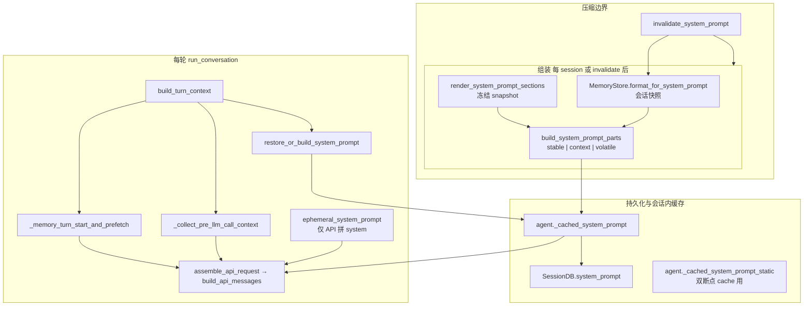
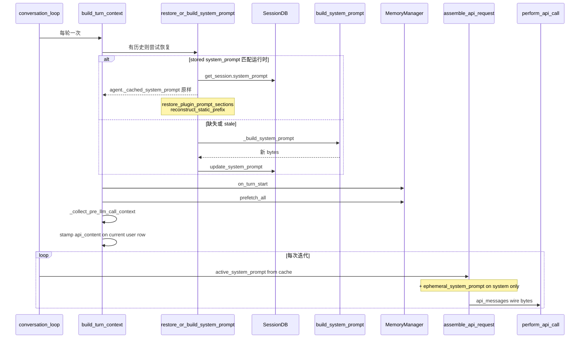
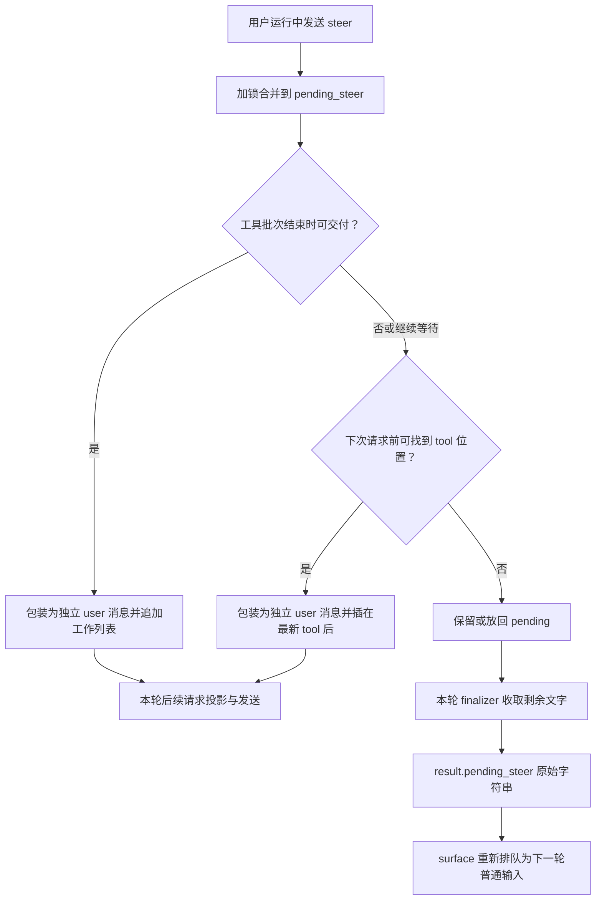

<a id="卷四--系统提示与上下文拼一次发时再贴-ephemeral"></a>
# 卷四 · 模型请求的上下文：系统提示词、动态注入、请求组装与缓存

> **卷标准**：[`VOLUME_STANDARD.md`](VOLUME_STANDARD.md) · **完成度**：[`MANIFEST.md`](MANIFEST.md) — **部分达标**（system 与 **每请求组装** 已写；Skills/MCP **执行**、Plan **skill 全文** 在 [卷五](05-capabilities-extensions.md)）  
> **本卷边界**：`build_system_prompt` 三段与缓存、`SessionDB.system_prompt` 恢复、**每次 API** 的 `api_messages` + `tools` 车道（含 MoA、`ContextEngine.select_context`、`prompt_cache_plan`）。**长 system 译文与接线 JSON** → [附录 · Prompt 原文库](04-prompt-corpus.md)。**不**展开 `handle_function_call`、MCP transport、压缩算法实现（→ 卷五、卷三 §5）。  
> **只追近期改动**：[`MANIFEST.md` 增量索引](MANIFEST.md#近期增量索引不必重读整卷)（含 queue 专题，与卷四无关可跳过）。  
> **权威源码**：`agent/system_prompt.py`、`agent/prompt_builder.py`、`agent/prompt_caching.py`、`agent/turn_context.py`（`compose_user_api_content`）、`agent/conversation_loop.py`（`_restore_or_build_system_prompt`）、`hermes_cli/plugins_dispatch.py`（插件 section 帧）  
> **相邻卷**：[03 循环](03-runtime-session-and-loop.md) · [05 能力](05-capabilities-extensions.md) · [02 Surface](02-surface-and-presentation.md)

模型看见的 **system** 字符串和 **user** 行上的「侧车」是两条轨：前者尽量 **会话内字节稳定**（利于前缀 / KV cache）；后者承载 **每轮会变** 的外部记忆检索、插件 `pre_llm_call` 注入，**不改** `_cached_system_prompt`。

---

<a id="本卷目录"></a>
<a id="目录锚点跳转"></a>
## 这卷讲什么？

本卷回答的是：**Hermes 调用模型前，怎样把系统规则、项目资料、历史消息、外部记忆、插件结果和工具定义，组装成一次请求；哪些内容被缓存，哪些每轮变化。** 不展开工具执行过程，也不展开历史压缩算法。

先按问题找入口；需要完整理解时，再按下面的正文目录阅读。节号沿用旧版，旧链接保留。

### 按问题查找

| 我想知道…… | 直接看这里 |
|---|---|
| 一次模型请求究竟包含什么，除了 system 还有什么？ | [请求组成总览](#07-发给模型的一次请求不止-system-字符串) → [请求结构示意](#71-一次-http-请求里的层) |
| SOUL、AGENTS.md、Skills、MEMORY.md 分别放在哪里，顺序是什么？ | [系统提示词三层](#02-三段-tierstable-→-context-→-volatile) → [完整内容与组装顺序](#41-build_system_prompt_parts-组装顺序逻辑块) |
| 外部 Memory、插件 context 是加到 system 还是 user？ | [动态注入入口](#03-ephemeral不进缓存贴在-api-上) → [注入位置对照](#72-三类加料对照) |
| 插件 context 有 memory 标签吗，会改内存消息、写入 DB 吗？ | [卷三 §4.16：标签、内存侧车、多模态正文、落库与回放](03-runtime-session-and-loop.md#sec-4-context-injection) |
| 插件 system section 与 pre_llm_call 有什么不同？ | [两种插件注入机制](#05-插件-system-section-vs-pre_llm_call) → [system section 的预算与恢复](#42-插件-system-prompt-sectionplugins_dispatchpy) |
| system 什么时候构建、重建，为什么改了 Memory 没立即更新？ | [失效与重建条件](#04-何时-invalidatesystemprompt) → [缓存复用机制](#43-缓存与前缀优化简表) |
| 重启后 system 从哪里恢复，内存与 DB 的关系是什么？ | [缓存与存储位置](#01-三个缓存存储位置) → [构建与恢复的调用入口](#2-谁调用谁入口与标识)；消息恢复另见 [卷三 §4.12](03-runtime-session-and-loop.md#sec-4-restart-chain) |
| 一轮对话中，什么时候检索 Memory、执行 hook、定型请求？ | [主流程时序](#31-主路径与卷三-3-对齐) |
| 每次调用模型前，投影、MoA、上下文选择、清理和缓存标记按什么顺序执行？ | [每次请求的装配顺序](#45-每迭代-assemble_api_request-顺序api-上下文-build) |
| 自定义 Context Engine 能替换什么，与压缩有什么区别？ | [上下文选择与历史压缩](#46-context-engine压缩-vs-选上下文) |
| 工具 schema、Skill 正文和 MCP 工具通过什么位置进入模型？ | [Skills / Tools / MCP 的分工](#47-skills--tools--mcp-在上下文里的分工) |
| 子 Agent 的提示词与主 Agent 有什么不同？ | [裁剪配置](#44-skip-标志子-agent--cron-常用) → [主 / Leaf / Orchestrator 对照](#49-主--leaf--orchestrator-提示差异) |
| Plan、协调器、Kanban 的提示规则在哪里？ | [规划与协调相关的注入通道](#06-plan协调器kanban在提示里是什么形态) |
| 运行中 steer 何时进 messages、插在哪里，轮末剩余文字怎么处理？ | [steer 三个交付出口与两种消息格式](#sec-4-steer-delivery) |
| 我要找完整 Prompt / JSON 样例，或者排查实际发出的内容 | [Prompt 原文库](04-prompt-corpus.md) · [调试入口](#74-调试时-grep-什么) · [源码文件索引](#6-包与核心类grep-入口) |

### 建议阅读顺序

- **第一次读**：§0.7 请求全貌 → §1 架构图 → §3.1 一轮时序 → §4.1 system 内容清单 → §4.5 请求装配。
- **查动态 context**：§0.3 → §0.5 → §7.2 → 卷三 §4.16 的对象与请求实例。
- **查缓存与恢复**：§0.1 → §0.4 → §4.3 → §7.4。

### 正文目录

- [0. 上下文有哪些组成，分别存在哪里、什么时候更新？](#0-先澄清几份提示别混)
  - [0.1 存储位置：Agent 内存、SessionDB 与消息历史](#01-三个缓存存储位置)
  - [0.2 系统提示词分层：固定规则、项目上下文与会话快照](#02-三段-tierstable-→-context-→-volatile)
  - [0.3 动态上下文入口：临时 system、Memory 预取与插件 context](#03-ephemeral不进缓存贴在-api-上)
  - [0.4 系统提示词何时失效重建，哪些变化不会立即生效？](#04-何时-invalidate_system_prompt)
  - [0.5 插件的两种注入：会话级 system section 与每轮 user context](#05-插件-system-section-vs-pre_llm_call)
  - [0.6 Plan、协调器与 Kanban 的规则通过哪些上下文通道进入模型？](#06-plan协调器kanban在提示里是什么形态)
  - [0.7 请求全貌：system、历史消息、当前输入、tools 与缓存标记](#07-发给模型的一次请求不止-system-字符串)
- [1. 架构图：系统提示词构建、动态注入与每次请求组装](#1-架构流程)
- [2. 调用入口：谁构建 system，谁恢复缓存，谁组装请求？](#2-谁调用谁入口与标识)
- [3. 一轮对话的时间线：恢复 system、注入 context、发送模型请求](#3-端到端一轮里-system-与-user-侧车何时定型)
  - [3.1 主流程时序：从用户输入到本轮上下文定型](#31-主路径与卷三-3-对齐)
  - [3.2 Hook 的职责：入口处理与 pre_llm_call 上下文注入的区别](#32-与卷二-hook-的交界)
- [4. 详细机制：system 内容清单、插件约束、请求顺序与上下文选择](#4-权威表)
  - [4.1 系统提示词的内容与顺序：身份、工具指引、AGENTS、Skills、Memory、运行环境](#41-build_system_prompt_parts-组装顺序逻辑块)
  - [4.2 插件 system section：插入位置、大小预算、冻结与恢复](#42-插件-system-prompt-sectionplugins_dispatchpy)
  - [4.3 缓存复用：持久化 system 与提供商前缀缓存的配合](#43-缓存与前缀优化简表)
  - [4.4 子 Agent 与 Cron 的配置：跳过 Memory、项目文件和身份加载](#44-skip-标志子-agent--cron-常用)
  - [4.5 每次请求如何组装：消息投影、MoA、上下文选择、清理与缓存断点](#45-每迭代-assemble_api_request-顺序api-上下文-build)
  - [4.6 Context Engine：压缩历史与替换本次请求上下文有何不同？](#46-context-engine压缩-vs-选上下文)
  - [4.7 Skills、Tools 与 MCP：哪些进入 system、tools 参数或工具结果？](#47-skills--tools--mcp-在上下文里的分工)
  - [4.8 执行能力的延伸阅读：工具检索、MCP 重连与 Skill 管理](#48-本卷未展开见卷五的项)
  - [4.9 主 Agent、Leaf 与 Orchestrator：系统提示词和任务注入的差异](#49-主--leaf--orchestrator-提示差异)
  - [4.10 运行中 steer：入队、两处本轮注入与轮末转交](#sec-4-steer-delivery)
- [5. 跨卷定位：消息持久化、压缩与工具执行分别去哪里看？](#5-和卷三卷五的边界)
- [6. 源码索引：按提示构建、缓存、动态注入与请求组装定位文件](#6-包与核心类grep-入口)
- [7. 请求示例与排查：内容分层、注入位置、Prompt 原文和调试入口](#7-模板槽位与一次-api-怎么接)
  - [7.1 请求结构示意：system 分层、user 侧车与 tools 参数](#71-一次-http-请求里的层)
  - [7.2 注入位置对照：Memory、插件、临时 system、MoA 与 Context Engine](#72-三类加料对照)
  - [7.3 压缩摘要 Prompt：交接要求与完整原文入口](#73-压缩摘要-prompt交接用)
  - [7.4 排查入口：实际 system、user 发送正文、预取结果与缓存失效原因](#74-调试时-grep-什么)

### 完整原文与相邻专题

- [Prompt 原文库：system 全文、子 Agent 样例与请求 JSON](04-prompt-corpus.md)。
- [卷三：消息工作集、重启恢复、flush 与压缩](03-runtime-session-and-loop.md#sec-4-working-object)。
- [卷五：工具、Skills、MCP 与插件执行](05-capabilities-extensions.md)。

---

<a id="0-先澄清几份提示别混"></a>
## 0. 上下文有哪些组成，分别存在哪里、什么时候更新？

<a id="01-三个缓存存储位置"></a>
### 0.1 存储位置：Agent 内存、SessionDB 与消息历史

| 名字 | 在哪 | 何时写入 | 模型何时看见 |
|------|------|----------|--------------|
| **`agent._cached_system_prompt`** | 进程内 Agent | `_build_system_prompt` / 从 DB **原样恢复** | 每次 API：`assemble_api_request` 里作 `active_system_prompt`，再可选拼 `ephemeral_system_prompt` |
| **`SessionDB` 行字段 `system_prompt`** | 磁盘 | 首轮 build 后 `_persist_system_prompt`；Bot Chat 能力刷新后重写 | **下一 turn** `restore_or_build` 时整段复用（前缀 cache 对齐） |
| **`messages[]` 里的 user/assistant** | SessionDB 消息表 | 循环 append；**不含** prefetch / `pre_llm_call` 正文 | 历史轮按 **durable `content`** 回放；**当前轮** wire 用 `api_content` 侧车（见 §0.3） |

**没有**单独的 `PromptBuilder` 类；入口是 **`AIAgent._build_system_prompt`** → `agent.system_prompt.build_system_prompt`。

<a id="02-三段-tierstable-→-context-→-volatile"></a>
### 0.2 系统提示词分层：固定规则、项目上下文与会话快照

`build_system_prompt_parts` 返回 `dict` 三键，最终 `"\n\n".join(stable, context, volatile)`（空段跳过）。

| Tier | 设计意图 | 典型内容（条件分支见 §4.1） |
|------|----------|------------------------------|
| **`stable`** | 尽量跨 turn、跨 worktree 共享最长前缀 | 身份（`SOUL.md` / `DEFAULT_AGENT_IDENTITY`）、工具相关指引（仅 `valid_tool_names` 含对应工具时）、`STEER_CHANNEL_NOTE`、模型族 operational 指引、coding brief **前半**、pinned skills |
| **`context`** | 项目 / 调用方相关，可能因 cwd、`system_message` 变 | 构造参数 **`system_message`**（若传入 build）、`AGENTS.md` 等 context files（`skip_context_files` 则无）、coding **workspace** 块 |
| **`volatile`** | 重建时允许变；放在最后少伤前缀 | **Skills 索引**、`MEMORY.md`/`USER.md` 快照、外部 memory provider 的 system 块、**插件 system sections**、`Conversation started:` 时间行、profile 行、`RUNTIME_ENVIRONMENT` 块 |

模块头注释与 `references/system-prompt-invariant.md` 一致：**会话内默认只 build 一次**；**上下文压缩**等边界才 `invalidate_system_prompt` 后重建。

<a id="03-ephemeral不进缓存贴在-api-上"></a>
### 0.3 动态上下文入口：临时 system、Memory 预取与插件 context

> **阅读限定（与卷三 §4.16 对齐）**：本节及 §0.1、§7.2 里“注入不进 content”的简表，是普通字符串路径的概括，不代表不进入内存对象或不落库。字符串路径会记录 live `api_content`，历史请求也可重放已存侧车；多模态路径直接追加 live content 的 text part。插件 context 默认在 Memory 标签外。完整对象变化与模式例外见 [卷三 §4.16](03-runtime-session-and-loop.md#sec-4-context-injection)。

| 机制 | 源码 | 进 `_cached_system_prompt`？ | 进 transcript `content`？ |
|------|------|------------------------------|---------------------------|
| **`ephemeral_system_prompt`** | 子 Agent / delegate 等构造参数 | **否** | **否**；仅在组 `api_messages` 时拼到 system 末尾 |
| **外部记忆 `prefetch_all`** | `turn_context._memory_turn_start_and_prefetch` | **否** | **否**；进 `api_content` / `compose_user_api_content` |
| **插件 `pre_llm_call` → `context`** | `turn_context._collect_pre_llm_call_context` | **否** | **否**；与 prefetch 一起进 user 侧车 |
| **插件 `register_system_prompt_section`** | `render_system_prompt_sections` → volatile 尾 | **是**（冻结在整段 system 里） | N/A |

`turn_context` 注释：**`messages` 保持「人看的 transcript」**；`api_content` 保存 **实际发给提供商的字节**，压缩 / resume 时用于前缀稳定回放。  
**围栏原文与一轮 wire 示意** → [原文库 §4](04-prompt-corpus.md#4-主-agentuser-侧车与围栏原文)。

<a id="04-何时-invalidate_system_prompt"></a>
### 0.4 系统提示词何时失效重建，哪些变化不会立即生效？

<a id="04-何时-invalidatesystemprompt"></a>

`invalidate_system_prompt`（`agent/system_prompt.py`）会：

1. 清空 `_cached_system_prompt` / `_cached_system_prompt_static`  
2. 删除 `_plugin_system_prompt_sections_snapshot`（上一版 snapshot 存到 `_plugin_system_prompt_sections_previous` 作 render 失败兜底）  
3. 若存在 `MemoryStore` → **`load_from_disk()`** 刷新内置记忆快照  

| 触发场景 | 典型入口 |
|----------|----------|
| **上下文压缩** 后重建 system | `conversation_compression._rebuild_system_prompt_at_boundary` |
| **CLI `/new`、换模型、部分 session 操作** | `hermes_cli/cli_session_mixin.py`、`cli_commands_mixin.py` |
| **ACP / Desktop 工具触发的刷新** | `acp_adapter/server.py`、`tui_gateway/methods_tools.py` |

**不会**因为：本轮 `memory` 工具写盘、Skills 按需 `skill_view`、单轮 `pre_llm_call` —— 这些要么下轮 prefetch，要么等压缩 invalidate。

**例外（不清 invalidate，但会强制 rebuild）**：Bot Chat **能力 epoch** 变化时 `_restore_or_build_system_prompt` 检测 `_bot_chat_prompt_stale`，清 skills 索引缓存并 `_build_system_prompt`，再 `update_system_prompt` 落库（一次性 prefix break）。

<a id="05-插件-system-section-vs-pre_llm_call"></a>
### 0.5 插件的两种注入：会话级 system section 与每轮 user context

| | **System section** | **`pre_llm_call` hook** |
|--|-------------------|-------------------------|
| **注册** | `PluginContext.register_system_prompt_section(id, content, position=…)` | `VALID_HOOKS` 里的 `pre_llm_call` |
| **渲染** | 每 session **冻结**一次；resume 从持久化 prompt **解析**帧 | **每轮** `build_turn_context` 收集 |
| **位置** | volatile 内、`after_memory` 锚点（当前仅此 position） | user **`api_content`** |
| **失效** | 与 `invalidate_system_prompt` 同边界重渲染 | 不碰 system 缓存 |

帧标记：`PLUGIN_SECTIONS_START` / `PLUGIN_SECTIONS_END`（`hermes_cli/plugins_dispatch.py`）；每段标题 `## Plugin Context: <id>` + `<!-- hermes-plugin-section-chars:N -->`。

<a id="06-plan协调器kanban在提示里是什么形态"></a>
### 0.6 Plan、协调器与 Kanban 的规则通过哪些上下文通道进入模型？

Hermes **没有** 单独的「Plan 模式」硬闸把工具面关掉（对比 Pi 扩展 plan → 框架对比文档）。和「规划 / 协调」相关的内容 **分散在多条车道**：

| 你听到的词 | 实际落点 | 进 system 缓存？ | 说明 |
|------------|----------|------------------|------|
| **`/plan`、plan skill** | 用户触发后模型 **`skill_view` 读 SKILL.md** | 索引在 volatile；**正文不进** system | **软 SOP**：靠技能正文约束行为，不是内核拦截工具 |
| **Kanban / 协调器** | `KANBAN_GUIDANCE` 等 | **是**（stable，当 `kanban_*` 在 `valid_tool_names`） | `prompt_builder` 里写「orchestrator 做决策、worker 执行」类指引 |
| **Goals、`/goal`** | 用户消息 + 工具 | 视具体命令 | 运行时状态在 goal 子系统，不是第二套 system 模板 |
| **Context engine「选上下文」** | `ContextEngine.select_context` | **替换当次 `api_messages` 列表**，不改 DB | 插件引擎可做检索/分支；默认 `ContextCompressor` 多为 no-op |
| **压缩 / plan 步完成提醒** | `automatic_compaction_status_message`、部分 engine | status 行，非 system 块 | 与「产品 Plan 模式」不同 |

**MoA（多模型参考）**：`provider == "moa"` 时 **`_append_moa_context`** 在 `assemble_api_request` 里往 **user 侧** 追加参考模型材料，**不**写入 `_cached_system_prompt`（§4.5）。

<a id="07-发给模型的一次请求不止-system-字符串"></a>
### 0.7 请求全貌：system、历史消息、当前输入、tools 与缓存标记

很多人把「上下文 build」等同于 `build_system_prompt`；实际上 **每次迭代** 在 `turn_request_assembly.assemble_api_request` 里拼的是一整包 **provider request**：

```text
api_messages = [ system (+ ephemeral) ]
              + history（SessionDB，经 sanitize / 可选 select_context 替换）
              + 当前 user（wire 上可能 = content + prefetch + pre_llm_call 侧车）
              + [ MoA 追加块 ]
tools_for_api = agent.tools（OpenAI schema；与 system 里的「工具指引」文案分离）
+ build_prompt_cache_plan → cache_control 断点、tools 副本
```

| 车道 | 典型源码 | 会话内是否稳定 | 卷 |
|------|----------|----------------|-----|
| System 三段 + 插件 section | §0–§4.1 | **尽量稳定**（缓存目标） | 本卷 |
| Transcript `messages[]` | `SessionDB` + 循环 append | 每轮增长；压缩会改写 | 卷三 |
| User 侧车 `api_content` | `turn_context.compose_user_api_content` | 每轮 / 每用户句 | 本卷 §0.3 |
| **Tools 定义** | `agent.tools`（含 MCP 登记） | Desktop/TUI 可 **pin** 与 session 一致 | 卷五 §（待写） |
| **Skills 全文** | `skill_view` 工具 **返回**进 history | 按需进 tool 结果 | 卷五 |
| **Context engine 选择** | `_apply_context_engine_selection` | **仅当次 HTTP** | 本卷 §4.6 |
| **Prompt cache plan** | `build_prompt_cache_plan` | 每请求重算断点 | 本卷 §4.5 |

---

<a id="1-架构流程"></a>
## 1. 架构图：系统提示词构建、动态注入与每次请求组装



---

<a id="2-谁调用谁入口与标识"></a>
## 2. 调用入口：谁构建 system，谁恢复缓存，谁组装请求？

| 阶段 | 函数 / 方法 | 包 | 说明 |
|------|-------------|-----|------|
| Agent 门面 | `AIAgent._build_system_prompt` | `run_agent.py` → `system_prompt.build_system_prompt` | 写 `_cached_system_prompt` + `_cached_system_prompt_static` |
| 轮初 | `restore_or_build_system_prompt` | `conversation_loop._restore_or_build_system_prompt` | DB 有匹配 prompt → **字节复用**；否则 build + 持久化 |
| 轮初 | `build_turn_context` | `turn_context.py` | 调 restore；`prefetch` + `pre_llm_call`；stamp `api_content` |
| 每迭代 | `assemble_api_request` / `build_api_messages` | `turn_request_assembly.py`、`turn_context` | `active_system_prompt` + ephemeral + 历史 `api_content` 回放 |
| 压缩后 | `_rebuild_system_prompt_at_boundary` | `conversation_compression.py` | `invalidate` → `_build_system_prompt` |
| 插件段 | `render_system_prompt_sections(session_info)` | `hermes_cli/plugins.py` | `session_id` / `model` / `provider` / `platform` / `profile_name` / `cwd` |
| 前缀恢复 | `reconstruct_static_prefix` / `restore_plugin_prompt_sections` | `system_prompt.py` | resume / keep-prompt 压缩后恢复 **static 断点** 与插件帧 |

本卷 **不** 使用 TUI `sid`；持久化键是 **`agent.session_id`**（压缩 lineage 下可能轮转，见 [卷三 §1.3](03-runtime-session-and-loop.md#sec-1-3) 与 [第4章](03-runtime-session-and-loop.md#sec-ch4)）。

---

<a id="3-端到端一轮里-system-与-user-侧车何时定型"></a>
## 3. 一轮对话的时间线：恢复 system、注入 context、发送模型请求

<a id="31-主路径与卷三-3-对齐"></a>
### 3.1 主流程时序：从用户输入到本轮上下文定型



**表 D · 时间点 → 源码**

| 时间点 | 符号 | 对 prompt 的影响 |
|--------|------|------------------|
| 进门 | `build_turn_context` | 绑定 `turn_id`；恢复或 build system |
| 轮初一次 | `_memory_turn_start_and_prefetch` | `ext_prefetch_cache` 进 `TurnContext` |
| 轮初一次 | `_collect_pre_llm_call_context` | `plugin_user_context` |
| 轮初一次 | `_stamp_api_content_sidecar` | DB 可存 `api_content` ≠ `content` |
| 每迭代 | `build_api_messages` | system = cache + ephemeral；user 当前轮用侧车 |
| 压缩成功 | `invalidate_system_prompt` | 下一段 session / 下一轮 rebuild 见新 MEMORY、新插件段 |
| 子 Agent | `ephemeral_system_prompt=…` | 父 cache 不变；子实例自己的 `_cached_system_prompt` + ephemeral |

<a id="32-与卷二-hook-的交界"></a>
### 3.2 Hook 的职责：入口处理与 pre_llm_call 上下文注入的区别

- **`pre_llm_call`**：本卷 §0.5；**不**列 `VALID_HOOKS` 全表 → [卷二 §3.4 D](02-surface-and-presentation.md#34-端到端时序platform-callback-与-plugin-hook-同图) 增量行即可。  
- **`on_session_start`**：在 **首次** `_persist_system_prompt` 路径上可能 `invoke_hook`（`conversation_loop` restore 分支）；不是每轮。  
- **呈现 callback**：与 system 组装无关。

---

<a id="4-权威表"></a>
## 4. 详细机制：system 内容清单、插件约束、请求顺序与上下文选择

> **文档约定**：下列表与 `agent/system_prompt.build_system_prompt_parts` / `plugins_dispatch` **一致**；legacy §3「层清单」为细粒度展开，**顺序以三段 tier 为准**。

<a id="41-build_system_prompt_parts-组装顺序逻辑块"></a>
### 4.1 系统提示词的内容与顺序：身份、工具指引、AGENTS、Skills、Memory、运行环境

按 **append 顺序**；空块跳过。`system_message` 参数仅进入 **context** tier（`build_system_prompt(agent, system_message=…)` 时）。

| 顺序 | 块 | Tier | 条件 / 备注 |
|------|-----|------|-------------|
| 1 | SOUL / `DEFAULT_AGENT_IDENTITY` | stable | `load_soul_identity`；子 Agent 可关 |
| 2 | `HERMES_AGENT_HELP_GUIDANCE` 或 `_NO_SKILLS` 变体 | stable | 有 `skill_view` + 索引含 `hermes-agent` 时换完整版 |
| 3 | 工具感知指引 | stable | `MEMORY_*` / `SESSION_SEARCH_*` / `SKILLS_GUIDANCE` / `KANBAN_*` / `PARALLEL_TOOL_CALL_*` 等，按 `valid_tool_names` 与模型 gate |
| 4 | `STEER_CHANNEL_NOTE` | stable | mid-turn `/steer` 标记说明 |
| 5 | `TASK_COMPLETION_GUIDANCE`、Telegram 富文本等 | stable | 平台 / 配置 |
| 6 | Tool-use / Google operational 等 | stable | `_model_gate` |
| 7 | Alibaba 身份等 | stable | 提供商 |
| 8 | Pinned / auto-load skills 正文 | stable | per-agent 常量 |
| 9 | Coding brief 前缀 | stable | `coding_context` |
| 10 | **`system_message` 参数** | context | 调用方注入；**不**进 cache 注释指 ephemeral 在 API；此处是显式 caller message |
| 11 | Context files (`AGENTS.md` …) | context | `skip_context_files`；扫描见 `prompt_builder` |
| 12 | Coding workspace + trailing + post-workspace | context 或 stable | 无 workspace 时 trailing 回 stable |
| 13 | **Skills 索引** | volatile | `build_skills_system_prompt`；全文不进 system |
| 14 | **MEMORY / USER 快照** | volatile | `MemoryStore.format_for_system_prompt` |
| 15 | **外部 memory provider block** | volatile | `MemoryManager.build_system_prompt()`，与工具暴露 gate 一致 |
| 16 | **插件 sections** `position=after_memory` | volatile | `_frozen_plugin_prompt_sections` |
| 17 | Active profile 行 | volatile | |
| 18 | `Conversation started:` 时间戳 | volatile | lineage root session id 优先（压缩不「重生」对话） |
| 19 | `RUNTIME_ENVIRONMENT` | volatile | `build_environment_hints` |

<a id="42-插件-system-prompt-sectionplugins_dispatchpy"></a>
### 4.2 插件 system section：插入位置、大小预算、冻结与恢复

| 常量 / 字段 | 值 | 含义 |
|-------------|-----|------|
| `SYSTEM_PROMPT_SECTION_POSITIONS` | `{"after_memory"}` | 当前唯一合法 `position` |
| `DEFAULT_SYSTEM_PROMPT_SECTION_MAX_CHARS` | `4000` | 单段上限 |
| `MAX_SYSTEM_PROMPT_SECTION_CHARS` | `4000` | 硬顶 |
| `MAX_SYSTEM_PROMPT_SECTIONS` | `32` | 段数上限 |
| `MAX_SYSTEM_PROMPT_SECTIONS_TOTAL_CHARS` | `8000` | 所有段 + 帧开销总预算 |
| Section `id` | `^[a-z0-9][a-z0-9._-]{0,127}$` | 注册时校验 |
| `PLUGIN_SECTIONS_START` | `<!-- hermes-plugin-sections:start -->` | 容器起 |
| `PLUGIN_SECTIONS_END` | `<!-- hermes-plugin-sections:end -->` | 容器止；后接 `\n\nConversation started:` 才接受 resume 解析 |

Resume 时 `_restore_plugin_prompt_sections` 从 DB 里 **整段 prompt** 解析帧，避免重跑插件代码；`invalidate` 后重新 `render_system_prompt_sections(session_info)`。

<a id="43-缓存与前缀优化简表"></a>
### 4.3 缓存复用：持久化 system 与提供商前缀缓存的配合

| 机制 | 源码 | 作用 |
|------|------|------|
| 会话内复用 DB prompt | `_restore_or_build_system_prompt` | Anthropic 等 **前缀字节** 跨 turn 一致 |
| `_cached_system_prompt_static` | `build_system_prompt` 写入 | `prompt_caching` / `reconstruct_static_prefix` **双断点** |
| `record_prompt_rebuild` / `record_cache_break` | `prompt_caching.py` | 观测 rebuild 原因 |
| prefetch / `pre_llm_call` 进 user | §0.3 | **不改** system 前缀 |
| keep-prompt 压缩 | `conversation_compression` | 尽量保留 system 字节；边界仍可能 `invalidate` |

<a id="44-skip-标志子-agent--cron-常用"></a>
### 4.4 子 Agent 与 Cron 的配置：跳过 Memory、项目文件和身份加载

| `AIAgent` 构造字段 | 对组装的影响 |
|--------------------|--------------|
| `skip_memory` | 无 `MemoryStore` 块 |
| `skip_context_files` | 无 AGENTS.md 等 |
| `load_soul_identity=False` | 默认身份文案 |
| `ephemeral_system_prompt` | 仅 API system 尾缀，见 §0.3 |
| `platform` | context files fallback、平台 hint、`TELEGRAM_RICH_MESSAGES_HINT` 等 |

子 Agent 完整 prompt 策略（`delegate_tool`、`_build_child_system_prompt`）→ [卷七](07-multi-agent-and-kanban.md)；本卷只记 **ephemeral 不进父 cache**。

<a id="45-每迭代-assemble_api_request-顺序api-上下文-build"></a>
### 4.5 每次请求如何组装：消息投影、MoA、上下文选择、清理与缓存断点

在 `turn_request_assembly.py` 中，**每次**进入 `_run_api_retry_loop` 前跑 `_run_phase(assemble_api_request, …)`。与「只 build 一次 system」不同，这里 **每迭代** 可能重算 cache 断点。

| 步骤 | 函数 / 概念 | 作用 |
|------|-------------|------|
| 1 | `build_api_messages`（`turn_context`） | 从 canonical history 克隆 → 贴 `api_content` → 拼 `effective_system`（cache + `ephemeral_system_prompt`） |
| 2 | `_append_moa_context` | 若 `moa_config`：参考模型摘要等 **追加到 messages**（非 system 缓存） |
| 3 | `_apply_context_engine_selection` | 若引擎实现 `select_context`：可 **整体替换** 当次 `api_messages`（fail-open） |
| 4 | sanitizers / tool-call 规范化 | `_canonicalize_api_tool_calls`、strict provider 清理 |
| 5 | `build_prompt_cache_plan` | 在 **所有 transcript 变更之后** 打 `cache_control`；输出 `tools_for_api` |
| 6 | `build_api_request`（`turn_api_request`） | 合并 `api_kwargs`、hooks、provider 特例 |

`format_tools_for_system_message`（`system_prompt.py`）是 **轨迹/兼容格式** 的 JSON 工具列表字符串，**不是** 现代 Chat Completions 主路径；主路径用 **`tools` 参数** 传 schema。

<a id="46-context-engine压缩-vs-选上下文"></a>
### 4.6 Context Engine：压缩历史与替换本次请求上下文有何不同？

| | **`ContextCompressor`（默认）** | **插件 `context.engine`** |
|--|--------------------------------|---------------------------|
| 配置 | 内建 | `context.engine` → `plugins/context_engine/<name>/` |
| 压长度 | `should_compress` / `compress` | 可实现自定义压缩 |
| **换上下文** | 默认 `select_context` → no-op | 可 **每请求** 替换 `api_messages` |
| 轮末 | `on_turn_complete` | 索引/路由状态（fail-open） |
| 与 system 关系 | 压缩后常 `invalidate_system_prompt` | `select_context` **不改** `_cached_system_prompt` |

工具：`_inject_context_engine_tools` 可把引擎工具并进 `valid_tool_names`（`context_engine` toolset）。

<a id="47-skills--tools--mcp-在上下文里的分工"></a>
### 4.7 Skills、Tools 与 MCP：哪些进入 system、tools 参数或工具结果？

| 能力 | 进 system 提示？ | 进 `tools[]`？ | 进 transcript？ |
|------|------------------|----------------|-----------------|
| **Skills 索引** | volatile 段（目录） | — | — |
| **SKILL.md 全文** | 否 | — | `skill_view` → **tool 结果** |
| **内置 / 注册工具** | 仅 **指引文案**（`*_GUIDANCE`） | `agent.tools` | tool_calls + results |
| **MCP 工具** | 同左 | `refresh_agent_mcp_tools` 登记进同一数组 | 同左 |
| **memory 工具** | MEMORY/USER **快照**在 system | `memory` schema | 写盘后 **invalidate 前** 快照不变 |

执行路径、`pre_tool_call`、Registry dispatch → **卷五**（本卷只画 **数据进模型的位置**）。

<a id="48-本卷未展开见卷五的项"></a>
### 4.8 执行能力的延伸阅读：工具检索、MCP 重连与 Skill 管理

`tool_search` 动态扩表、MCP 重连、plan skill 正文、`skill_manage`、子 Agent `skip_*` 组合表 → [卷五 §4](05-capabilities-extensions.md#4-权威表) 与执行 E2E §3。

<a id="49-主--leaf--orchestrator-提示差异"></a>
### 4.9 主 Agent、Leaf 与 Orchestrator：系统提示词和任务注入的差异

两条构建路径（legacy [PROMPT_SYSTEM_ARCHITECTURE §2](../archive/legacy/PROMPT_SYSTEM_ARCHITECTURE.md#2-两条构建路径与-api-拼接)）：

| 路径 | 函数 | 进 `_cached_system_prompt`？ | 进 API system？ |
|------|------|------------------------------|-----------------|
| **A** | `_build_system_prompt` → `build_system_prompt_parts` | **是**（可落 `SessionDB.system_prompt`） | 是 |
| **B** | `_build_child_system_prompt` → `ephemeral_system_prompt` | **否** | 是（拼在 A 末尾） |

| | 主 Agent | Leaf 子 Agent | Orchestrator 子 Agent |
|--|----------|---------------|------------------------|
| 路径 A 层 | 按工具/配置全开（常见） | `skip_memory`、`skip_context_files`、常无 SOUL/AGENTS | 同 Leaf，可有 `delegate_task` |
| 路径 B | 通常无 | **goal + workspace** ephemeral | B 内可含委派说明 |
| 外部 memory prefetch | 轮初进 user 侧车 | **无**（`skip_memory`） | 无 |
| 全文样例 | [原文库 §1–2](04-prompt-corpus.md#1-默认-cli-编码会话中文-system-全文) | [原文库 §3](04-prompt-corpus.md#3-子-agent-leaf-英文样例路径-ab) | 卷七 delegate |

```text
effective_system = _cached_system_prompt
if ephemeral_system_prompt:
    effective_system = (effective_system + "\n\n" + ephemeral_system_prompt).strip()
```

---

<a id="sec-4-steer-delivery"></a>
### 4.10 运行中 steer：在哪里消费，插到什么位置，轮末如何转交？

**先记住区别**：steer 不是插件 `pre_llm_call` 的 user 侧车。普通循环中，成功的中途交付会创建**独立的 user 消息**，写入工作 `messages`；如果本轮已结束，则把原始文字转交 surface，作为下一轮输入。三处是“消费/交付出口”，**不是三处都会生成同样的带标记消息**。

#### 4.10.1 入队不等于进入 messages，也不等于落库

运行中的 CLI `/steer` 调用 `agent.steer(text)`。Agent 在 `_pending_steer_lock` 下，把非空文本追加到 `_pending_steer`；多次调用用换行连接。这里是一个加锁的字符串待处理槽位，不是逐条保留身份、时间和 envelope 的持久化队列。

```python
# 解释性摘录：steer() 不直接修改 messages。
with self._pending_steer_lock:
    existing = self._pending_steer
    self._pending_steer = existing + "\n" + cleaned if existing else cleaned
```

`steer()` 标记本轮发生用户干预，但自身不取消正在执行的模型请求或工具。仅在 pending 中的文字还不是 DB 消息；CLI 没有活动 Agent 时，会退回输入排队，而不是强行走本轮 steer 插入路径。

#### 4.10.2 三个出口：前两个包装，第三个不包装

| 出口 | 调用位置与消费逻辑 | 最终位置与格式 |
|---|---|---|
| **A：工具批次结束** | `_finalize_tool_batch` 先执行预算处理、记录工具批次，再调用 `apply_pending_steer_to_tool_results`；确认本批尾部存在工具结果后消费交付 | `messages.append(steer_user_row(text))`：新 user 消息追加在工作列表末尾，典型位置在工具结果之后 |
| **B：下一次模型调用前** | `prepare_iteration` drain pending，再由 `_inject_steer_after_newest_tool_result` 从后向前找最新 tool 消息 | `messages.insert(tool_index + 1, steer_user_row(text))`：插在最新 tool 后，**不保证是列表末尾** |
| **C：本轮 finalizer** | 最后再 drain 尚未交付的文字，写入 `result["pending_steer"]` | **不调用 `steer_user_row`**；返回原始字符串，由 CLI/TUI/Gateway 接续排队为下一轮普通输入 |

A 在 `num_tool_msgs <= 0` 或列表为空时不消费；已经取出文字却找不到本批工具结果时会 requeue。B 找不到任何 tool 消息也会 requeue，不会随意创建插入位置。因此它们都不是“拿到 steer 后必定立即发给模型”。B 还覆盖上次模型调用期间新到达、而循环即将继续的 steer；若模型已结束本轮，就交给 C。



图是出口关系示意，不是忙等流程；A/B 由实际工具/迭代边界触发，pending 也可能在其他时间点收到新文字。

#### 4.10.3 前两个出口的消息样例：真正改变 live messages

`steer_user_row()` 生成下列结构；正文标记来自 `format_steer_marker()`，这里展示当前标记文本：

```python
{
    "role": "user",
    "content": (
        "[OUT-OF-BAND USER MESSAGE — a direct message from the user, "
        "delivered once at this position; not tool output and not a new "
        "delivery when replayed from conversation history]\n"
        "先别修改代码，只定位问题\n"
        "[/OUT-OF-BAND USER MESSAGE]"
    ),
    "display_kind": "steer",
}
```

典型顺序：

```text
user：帮我排查并修复
assistant：tool_calls=[...]
tool：读取文件结果
tool：查询日志结果
user：OUT-OF-BAND 标记包裹的“先别修改代码，只定位问题”
assistant：遵照新要求继续当前任务
```

这不是拼进 system，不是覆盖原始 user 的 `api_content`，也不是把 steer 混进已有 `tool.content`。新 dict 初始没有 `_db_persisted`，后续普通 flush 将其作为新增消息持久化；**创建消息本身不保证此刻已经提交成功**。`display_kind="steer"` 帮助展示与消息修复区分这种输入，发送投影会清除本地展示字段，模型主要看到 user 角色与正文标记。

部分旧注释仍说“追加到工具结果”；当前函数体是 `append/insert(steer_user_row(...))`，应以当前实现为准。独立建行也避免修改已落库工具正文后，普通追加式 flush 不重写旧行，造成 live 请求与重启回放不一致。

#### 4.10.4 第三个出口的样例：下一轮普通输入，不是带标记 steer

本轮结束时只返回：

```python
result["pending_steer"] = "先别修改代码，只定位问题"
```

CLI 随后把原始字符串放入 `_pending_input`；TUI 放入 prompt 队列。Gateway 有自己的 pending 输入/事件协调逻辑，不能假定所有 surface 使用同一个队列实现。普通接续的语义是：

```text
assistant：上一轮最终答复
user：先别修改代码，只定位问题
assistant：开始下一轮处理
```

**此处不会因为来源是 leftover steer，就自动加 OUT-OF-BAND 标记或 `display_kind="steer"`。** 新一轮仍可执行普通 Memory/插件注入，所以最终发送正文可能附带新一轮 context，但那不是 `steer_user_row()` 包装。finalizer 返回字段也不代表该文字已经作为本轮 user 消息落库，要等 surface 实际接续。

#### 4.10.5 system 规则、redirect 与失败边界

- **system 中的 `STEER_CHANNEL_NOTE` 是通道说明，不是每次用户 steer 的正文**：告诉模型识别宿主的指定标记、理解它是用户运行中的补充要求，并避免把历史重放当成新交付。文本标签本身不是密码学认证或通用安全隔离。
- **`redirect()` 不等于 `steer()`**：工具运行期间 redirect 可以退化到 steer；模型请求期间另有取消与继续逻辑；`codex_app_server` 的 redirect 分支可走原生 `turn/steer`，不能套用普通循环的 A/B 插入路径。
- **pending 是进程内状态**：尚未注入/接续的文字不能据此承诺跨进程恢复；已入工作列表还要等持久化边界。
- **清理不会总是抹掉 steer**：普通软清理保留 pending；硬取消的相关分支会清空它，不能说任何已接受的 steer 都无条件必达。

#### 4.10.6 源码入口

| 要查什么 | 源码符号 |
|---|---|
| 入队、drain、redirect 与取消清理 | `agent/interrupt_control.py:InterruptControlMixin.steer` · `agent/interrupt_control.py:InterruptControlMixin._drain_pending_steer` · `agent/interrupt_control.py:InterruptControlMixin.redirect` |
| 标记与新 user 消息 | `agent/prompt_builder.py:format_steer_marker` · `agent/prompt_builder.py:steer_user_row` |
| 工具批次交付与 requeue | `agent/tool_executor.py:_finalize_tool_batch` · `agent/agent_runtime_helpers.py:apply_pending_steer_to_tool_results` · `agent/agent_runtime_helpers.py:_requeue_pending_steer` |
| 请求前补充交付 | `agent/turn_iteration_prep.py:prepare_iteration` · `agent/turn_iteration_prep.py:_inject_steer_after_newest_tool_result` |
| 轮末转交与下一轮排队 | `agent/turn_finalizer.py:finalize_turn` · `hermes_cli/cli_chat_turn_mixin.py:CLIChatTurnMixin.chat` · `tui_gateway/prompt_turn.py:_run_post_turn_followups` |

**一句话区分**：A/B 是“当前任务中途插话”，创建带标记的独立 user 消息；C 是“本轮结束后的接续”，转交原始文本为下一轮普通输入。与插件侧车的比较见 [卷三 §4.16](03-runtime-session-and-loop.md#sec-4-context-injection)，普通 flush 见 [卷三 §4.13](03-runtime-session-and-loop.md#sec-4-normal-flush)。

---

<a id="5-和卷三卷五的边界"></a>
## 5. 跨卷定位：消息持久化、压缩与工具执行分别去哪里看？

| 主题 | 本卷 | 别卷 |
|------|------|------|
| 压缩何时 `invalidate` | §0.4、§3.1 | [卷三第4章](03-runtime-session-and-loop.md#sec-ch4)（机制）+ [1.4](03-runtime-session-and-loop.md#sec-1-4)（三个时刻） |
| `memory` 工具写盘 | 快照仍旧直到 invalidate | 卷五 memory 工具 |
| `skill_view` 全文 | 不进 system cache | 卷五 Skills |
| Context file 安全扫描 | 提及；规则在 `prompt_builder` | 卷八可选交叉 |
| MoA 参考上下文 | §4.5 `_append_moa_context` | 卷七（编排） |
| Context engine 插件 | §4.6 | `plugins/context_engine/` 源码 |
| Plan / Kanban 指引 | §0.6 | 卷五 + `prompt_builder` 常量 |
| Tools/MCP 执行 | §4.7 表 | 卷五 |

---

<a id="6-包与核心类grep-入口"></a>
## 6. 源码索引：按提示构建、缓存、动态注入与请求组装定位文件

| 路径 | 职责 |
|------|------|
| `agent/system_prompt.py` | `build_system_prompt_parts`、`build_system_prompt`、`invalidate_system_prompt`、`restore_plugin_prompt_sections` |
| `agent/prompt_builder.py` | 各 `*_GUIDANCE`、`build_skills_system_prompt`、`build_context_files_prompt`、`format_steer_marker` |
| `agent/prompt_caching.py` | cache break 记录、provider 侧 cache_control 布局 |
| `agent/conversation_loop.py` | `_restore_or_build_system_prompt`、failover 时 `_sync_failover_system_message` |
| `agent/turn_context.py` | `compose_user_api_content`、`build_turn_context`、prefetch / `pre_llm_call` |
| `agent/conversation_compression.py` | `_rebuild_system_prompt_at_boundary` |
| `tools/memory_tool.py` | `MemoryStore` |
| `agent/memory_manager.py` | 外部 provider `build_system_prompt` / `prefetch_all` |
| `hermes_cli/plugins_dispatch.py` | section 帧格式与预算 |
| `run_agent.py` | `AIAgent._build_system_prompt` / `_invalidate_system_prompt` 转发 |
| `agent/turn_request_assembly.py` | `assemble_api_request`、MoA、cache plan |
| `agent/context_engine.py` | `ContextEngine` ABC、`select_context` 契约 |
| `agent/conversation_loop.py` | `_apply_context_engine_selection`、`_notify_context_engine_turn_complete` |

---

<a id="7-模板槽位与一次-api-怎么接"></a>

## 7. 请求示例与排查：内容分层、注入位置、Prompt 原文和调试入口

**长原文**（默认 CLI 中文 system、条件块、子 Agent 英文、整包 JSON）→ **[卷四附录 · Prompt 原文库](04-prompt-corpus.md)**。本节只保留 **槽位地图** 与 **外部 memory / hook 落在哪**。

<a id="71-一次-http-请求里的层"></a>
### 7.1 请求结构示意：system 分层、user 侧车与 tools 参数

```text
┌─ system（尽量缓存）────────────────────────────────────────────┐
│ stable │ context │ volatile                                      │
│ 身份/工具指引/steer/coding… │ AGENTS.md/system_message │ Skills索引│
│                              │                        │ MEMORY/USER│
│                              │                        │ ext provider block（volatile）│
│                              │                        │ plugin sections 帧           │
│                              │                        │ 时间戳 / RUNTIME_ENVIRONMENT   │
└────────────────────────────────────────────────────────────────┘
        + ephemeral_system_prompt（仅 API，子 Agent 任务块）
┌─ messages[] ───────────────────────────────────────────────────┐
│ 历史：durable content；回放 wire 用 api_content 若存在          │
│ 当前 user：content=人看的字；wire=content+侧车（见下）          │
└────────────────────────────────────────────────────────────────┘
tools[]  ← 与 system 里「指引文案」分离，OpenAI function schema
```

<a id="72-三类加料对照"></a>
### 7.2 注入位置对照：Memory、插件、临时 system、MoA 与 Context Engine

| 机制 | 落在哪 | 进 `_cached_system_prompt` | 进 transcript `content` | 何时变 |
|------|--------|------------------------------|-------------------------|--------|
| **MEMORY/USER 快照** | system volatile | 是（冻结） | N/A | `invalidate` / 新会话 |
| **外部 provider system 块** | system volatile | 是（若 provider 暴露） | N/A | 配置 / invalidate |
| **外部 provider prefetch** | user `api_content` | 否 | 否（侧车） | **每轮** `prefetch_all` |
| **`pre_llm_call` context** | user `api_content` | 否 | 否 | **每轮** hook |
| **plugin system section** | system volatile 帧内 | 是（冻结） | N/A | `invalidate` 或新 session 渲染 |
| **ephemeral_system_prompt** | API system 尾 | 否 | 否 | 子 Agent 构造 |
| **MoA 参考** | messages 追加块 | 否 | 视实现 | 每迭代 |
| **ContextEngine.select_context** | 替换当次 `api_messages` | 否 | DB 不变 | 每迭代 |

围栏与 JSON 示意 → [原文库 §4–5](04-prompt-corpus.md#4-主-agentuser-侧车与围栏原文)。

<a id="73-压缩摘要-prompt交接用"></a>
### 7.3 压缩摘要 Prompt：交接要求与完整原文入口

Summarizer 角色与字段清单（禁止保留密钥、为「下一助手」写交接）→ legacy [PROMPT_SYSTEM_ARCHITECTURE §9](../archive/legacy/PROMPT_SYSTEM_ARCHITECTURE.md#9-上下文压缩-prompt-工程)；触发与阈值 → [卷三第4章](03-runtime-session-and-loop.md#sec-ch4)。

<a id="74-调试时-grep-什么"></a>
### 7.4 排查入口：实际 system、user 发送正文、预取结果与缓存失效原因

| 想看 | 去哪 |
|------|------|
| 当前会话 system 字节 | `SessionDB.system_prompt` 或 `_cached_system_prompt` |
| 当轮 user wire | 消息行 `api_content` 或 `assemble_api_request` 之后 |
| prefetch 是否为空 | 轮初 `ext_prefetch_cache` / MemoryManager 日志 |
| 插件段是否在帧里 | system 内 `<!-- hermes-plugin-sections:start -->` |
| cache break 原因 | `prompt_caching.record_*` |

更多 → legacy [§15 调试要点](../archive/legacy/PROMPT_SYSTEM_ARCHITECTURE.md#15-调试要点)。
