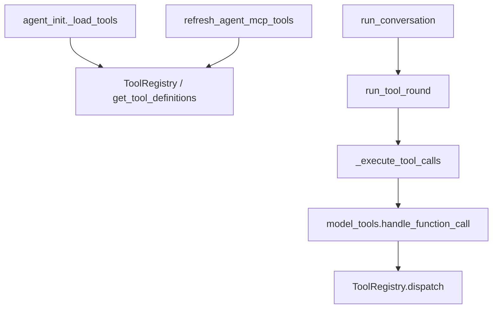
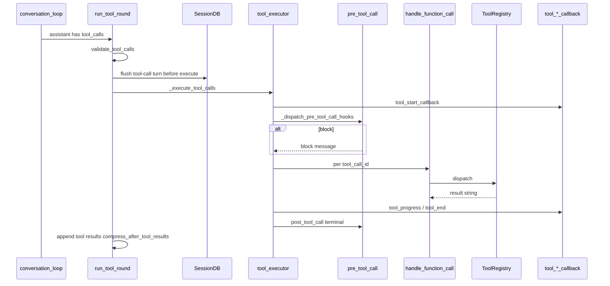
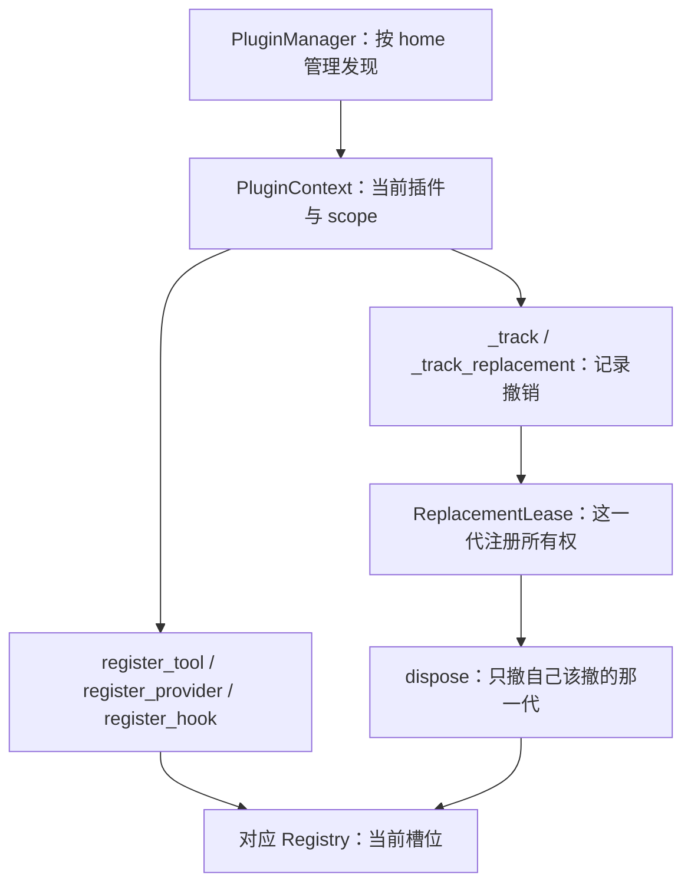
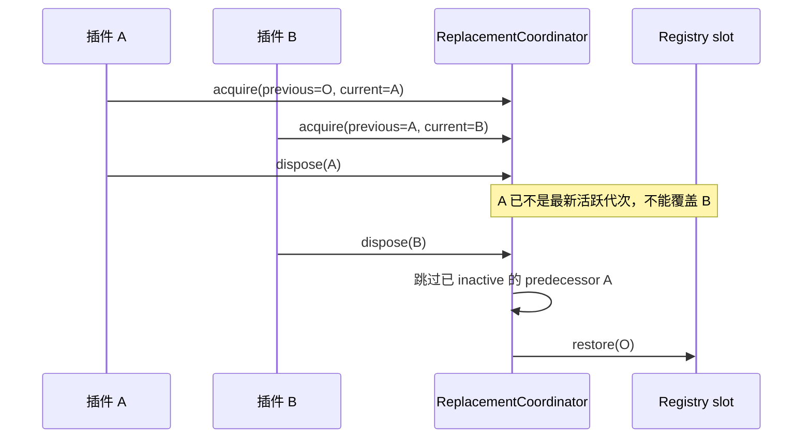

<a id="卷五--能力记忆工具技能mcp"></a>
# 卷五 · 工具与扩展：能力启用、工具执行、MCP、Skills、Memory 与插件生命周期

> **卷标准**：[`VOLUME_STANDARD.md`](VOLUME_STANDARD.md) · **完成度**：[`MANIFEST.md`](MANIFEST.md) — **达标**（执行路径 + 权威表；个别工具 schema 仍见 legacy）  
> **本卷边界**：四类能力 **如何进 Agent**、**如何在 `run_tool_round` 里执行**；呈现 callback 全表 → [卷二 §5.2](02-surface-and-presentation.md#52-_agent_cbssid-返回的-dict-里有什么)。Prompt 里「目录 vs 全文」→ [卷四 §4.7](04-prompt-and-context.md#47-skills--tools--mcp-在上下文里的分工)。
> **权威源码**：`model_tools.py`（仓库根）、`agent/tool_executor.py`、`agent/turn_tool_round.py`、`tools/registry.py`、`tools/mcp_tool_agent.py`、`agent/agent_init.py`（`_load_tools`）、`tools/skills_tool.py`、`tools/memory_tool.py`、`agent/memory_manager.py`  
> **相邻卷**：[03 循环](03-runtime-session-and-loop.md) · [04 Prompt](04-prompt-and-context.md) · [08 安全](08-security-and-governance.md)

四能力 **共用一张 `agent.tools` + `valid_tool_names`**，循环不按工具名写死分支；差异在 **登记来源** 与 **dispatch 落点**。

---

<a id="本卷目录"></a>
<a id="目录锚点跳转"></a>
## 阅读导航：这份文档解决什么问题？

本卷解释**能力怎样启用、工具怎样执行、扩展怎样生效与卸载**。要查“Memory 存什么、Provider 怎么配”，直接去附录 A；要查“经验怎样沉淀为 Skills 或离线轨迹”，去附录 B。

### 三份文档怎么选

| 文档 | 解决的问题 |
|---|---|
| [卷五主卷：工具与扩展](05-capabilities-extensions.md) | 配置如何启用工具，模型调用后如何执行，MCP/Skills/Memory 如何接入，插件如何注册与卸载 |
| [附录 A：Memory 使用与 Provider 接入](05-memory-system-reference.md) | 该存什么、如何检索、容量怎么管，以及 Mem0/Honcho/Supermemory 的读写、配置与自定义接入 |
| [附录 B：协作数据流与经验沉淀](05-memory-architecture-and-evolution.md) | MemoryManager 如何协调数据，压缩前后如何流转，Skills/Curator/Trajectory 如何分别沉淀经验 |

### 按问题查找

| 我想知道…… | 直接看这里 |
|---|---|
| 配置了 toolset，为什么模型还是看不到工具？ | [0.3 Toolset 启用：配置、工具集解析、schema 与 valid_tool_names](#03-toolset-启用链agent-构造时) |
| 模型选中工具后，校验、Hook、执行和回调按什么顺序？ | [3. 一次工具调用怎样完成：校验、Hook、执行、结果与回调](#3-端到端一次工具轮hook-+-callback-点位) |
| 哪些是内置工具，工具名和 schema 从哪里来？ | [4.6 核心内置工具清单：默认能力与注册名称](#46-核心内置工具_hermes_core_tools) |
| MCP 工具如何进入工具表、如何调用与刷新？ | [4.2 MCP 工具：发现、登记、调用与刷新入口](#42-mcp) |
| Skills 索引、技能全文和 skill_manage 各在哪里处理？ | [4.3 Skills：索引、正文加载与技能管理工具](#43-skills) |
| Memory、session_search、外部 Provider 有什么区别？ | [4.4 Memory：内置记忆、历史检索与外部 Provider 的分工](#44-记忆) |
| 插件装好后何时加载，何时注册，卸载会影响谁？ | [7. 插件生命周期：加载、注册、作用域、卸载与工具快照](#7-源码补充插件不是-import-完就算装好了) |
| 两个插件注册同名能力，覆盖和卸载怎样处理？ | [7.3 作用域：同名能力如何覆盖，调用时如何选择？](#73-scope-的人话解释) |
| 插件修改后为什么当前工具快照没立即变化？ | [7.7 运行中工具快照：注册变化为何不等于当前请求立即变化？](#77-这与工具快照有什么关系) |
| 我需要具体源码文件，不想按目录猜实现位置 | [6. 源码索引：按工具加载、执行、MCP、Skills、Memory 定位文件](#6-包与核心类grep-入口) |

### 建议阅读顺序

- **理解执行主链**：§0.3 启用工具 → §1 架构 → §3 工具轮 → §4 分模块机制。
- **开发/排查插件**：§7.1 生命周期 → §7.2–7.4 所有权与覆盖 → §7.5–7.7 加载和快照。

### 完整内容目录

- [0. 能力总览：哪些能力能用，配置如何变成模型可调用的工具？](#0-先澄清)
  - [0.1 工具、Skills、Memory、MCP 各负责什么，与 Prompt 有何区别？](#01-四条车道别和-prompt-混)
  - [0.2 模型发起工具调用后：Registry、特殊工具与 MCP 三条执行路径](#02-三条执行路径模型点名之后)
  - [0.3 Toolset 启用：配置、工具集解析、schema 与 valid_tool_names](#03-toolset-启用链agent-构造时)
- [1. 架构图：工具登记、模型调用、执行器与 MCP 的关系](#1-架构流程)
- [2. 调用入口：工具加载、工具轮、执行器与处理函数](#2-谁调用谁)
- [3. 一次工具调用怎样完成：校验、Hook、执行、结果与回调](#3-端到端一次工具轮hook-+-callback-点位)
  - [3.0 工具步骤时间表：Hook 与 UI 回调在什么时候触发？](#表-d--工具步时间点)
  - [3.1 工具轮必须保持的约束：工具名校验、消息配对与持久化](#31-run_tool_round-不变量读代码时记住)
- [4. 分模块机制：工具加载、MCP、Skills、Memory 与生命周期 Hook](#4-权威表)
  - [4.1 工具加载链：从配置到 API tools schema 与执行注册](#41-工具从配置到-api)
  - [4.2 MCP 工具：发现、登记、调用与刷新入口](#42-mcp)
  - [4.3 Skills：索引、正文加载与技能管理工具](#43-skills)
  - [4.4 Memory：内置记忆、历史检索与外部 Provider 的分工](#44-记忆)
  - [4.5 生命周期 Hook：工具前后与会话相关的扩展事件](#45-本卷相关的-valid_hooks-子集)
  - [4.6 核心内置工具清单：默认能力与注册名称](#46-核心内置工具_hermes_core_tools)
- [5. 跨卷定位：运行循环、上下文注入、审批与安全分别看哪里？](#5-与卷三卷四卷八的边界)
- [6. 源码索引：按工具加载、执行、MCP、Skills、Memory 定位文件](#6-包与核心类grep-入口)
- [7. 插件生命周期：加载、注册、作用域、卸载与工具快照](#7-源码补充插件不是-import-完就算装好了)
  - [7.1 插件安装、模块加载、能力注册与运行快照有什么区别？](#71-四个容易混淆的生命周期)
  - [7.2 注册所有权：插件 owner 与注册代次](#72-注册的所有者是谁)
  - [7.3 作用域：同名能力如何覆盖，调用时如何选择？](#73-scope-的人话解释)
  - [7.4 卸载顺序：移除覆盖层后应恢复谁，哪些注册必须保留？](#74-最容易漏掉的情况后注册先卸载或先注册先卸载)
  - [7.5 加载并发：模块加载锁、截止时间与失败边界](#75-模块加载为什么也有锁和截止时间)
  - [7.6 PluginContext 扩展面：工具、Provider、Hook 与其他注册能力](#76-plugincontext-的几类能力不能只画-register_tool)
  - [7.7 运行中工具快照：注册变化为何不等于当前请求立即变化？](#77-这与工具快照有什么关系)
  - [7.8 插件源码入口、已验证范围与生命周期结论](#78-本节权威表与结论)


---

<a id="0-先澄清"></a>
## 0. 能力总览：哪些能力能用，配置如何变成模型可调用的工具？

<a id="01-四条车道别和-prompt-混"></a>
### 0.1 工具、Skills、Memory、MCP 各负责什么，与 Prompt 有何区别？

| 能力 | 进 system 提示？ | 进 `tools[]`？ | 执行入口 |
|------|------------------|----------------|----------|
| **内置记忆文件** | `MemoryStore` 快照（卷四） | `memory` 工具（若启用） | `ToolRegistry` → `memory_tool` |
| **外部 memory provider** | provider `build_system_prompt` 块 | provider 注入的工具 | `MemoryManager` + Registry |
| **Skills** | volatile **索引** only | `skill_view` / `skill_manage` / … | Registry → `skills_tool` |
| **MCP** | 无（仅通用 tool 指引） | `mcp_<server>_<tool>` 等 | Registry → MCP transport |

<a id="02-三条执行路径模型点名之后"></a>
### 0.2 模型发起工具调用后：Registry、特殊工具与 MCP 三条执行路径

| 路径 | 何时 | 源码 |
|------|------|------|
| **Registry** | 绝大多数具名工具 | `model_tools.handle_function_call` → `ToolRegistry.dispatch` |
| **Inline executor** | 少数内联、不经 Registry 包装 | `agent/inline_tool_executors.py` |
| **Plugin `dispatch_tool`** | 插件注册的工具名 | `hermes_cli/plugins.py` `PluginManager.dispatch_tool` |

`tool_executor._execute_tool_calls` 统一编排：审批、`pre_tool_call`、并行/串行 worker、**terminal `post_tool_call`**。

<a id="03-toolset-启用链agent-构造时"></a>
### 0.3 Toolset 启用：配置、工具集解析、schema 与 valid_tool_names

```text
AIAgent.__init__
  → enabled_toolsets / disabled_toolsets（平台、CLI、配置）
  → _load_tools → get_tool_definitions(...)  # tools/registry.py
  → agent.tools + agent.valid_tool_names
  → inject_memory_provider_tools(agent)
  → _inject_context_engine_tools(agent)   # 可选
  → refresh_agent_mcp_tools(...)            # Desktop/TUI 能力刷新、MCP 重连
```

**Bot Chat** 可能在 **轮间** `refresh_agent_mcp_tools`（卷四 Bot Chat epoch）；子 Agent 常 `skip_*` + 缩 toolset（卷七）。

---

<a id="1-架构流程"></a>
## 1. 架构图：工具登记、模型调用、执行器与 MCP 的关系



---

<a id="2-谁调用谁"></a>
## 2. 调用入口：工具加载、工具轮、执行器与处理函数

| 符号 | 文件 | 作用 |
|------|------|------|
| `run_tool_round` | `turn_tool_round.py` | 校验 → **先 persist tool_calls** → `_execute_tool_calls` → `compress_after_tool_results` |
| `_execute_tool_calls` | `tool_executor.py` | 审批、hook、`handle_function_call`、进度 callback |
| `handle_function_call` | `model_tools.py`（包根） | 作用域检查、别名、转 Registry / inline |
| `ToolRegistry.dispatch` | `tools/registry.py` | 按名找 handler |
| `validate_tool_calls` | `turn_tool_validation.py` | 轮初校验 mixed batch 等 |
| `get_tool_definitions` | `tools/registry.py` | 按 toolset 组装 OpenAI schema 列表 |

---

<a id="3-端到端一次工具轮hook-+-callback-点位"></a>
## 3. 一次工具调用怎样完成：校验、Hook、执行、结果与回调

与 [卷三 §3.2](03-runtime-session-and-loop.md#32-单次迭代api--工具或结束) 衔接；本图只放大 **工具支路**。



<a id="表-d--工具步时间点"></a>
### 3.0 工具步骤时间表：Hook 与 UI 回调在什么时候触发？

| 时刻 | 插件 hook | 呈现 callback（卷二） |
|------|-----------|------------------------|
| 工具开始前 | `pre_tool_call`（可 block / 改 args） | `tool_start_callback` |
| 执行中 | — | `tool_progress_callback`（若配置） |
| 单次结束 | `post_tool_call`（terminal，每 `tool_call_id` 一次） | `tool_end_callback` |
| 结果进模型前 | `transform_tool_result` | — |

**审批**（危险 shell 等）卡在 `tool_executor` 内、dispatch 前 → [卷八](08-security-and-governance.md)；IM 与 CLI 回调不同，但 **同一 executor**。

<a id="31-run_tool_round-不变量读代码时记住"></a>
### 3.1 工具轮必须保持的约束：工具名校验、消息配对与持久化

1. **`stage_tool_call_message` + `append_message` 后先 `_flush_messages_to_session_db`**，再跑工具（resume 安全）。  
2. **无效工具名**（mixed batch）先写 error tool 行，再从执行列表剔除。  
3. **`_tool_guardrail_halt_decision`** 可整轮 break，不继续 API。  
4. 工具轮末 **`compress_after_tool_results`**（压力链，卷三 preflight 同源模块）。

---

<a id="4-权威表"></a>
## 4. 分模块机制：工具加载、MCP、Skills、Memory 与生命周期 Hook

<a id="41-工具从配置到-api"></a>
### 4.1 工具加载链：从配置到 API tools schema 与执行注册

| 阶段 | 函数 / 字段 | 说明 |
|------|-------------|------|
| 配置 | `enabled_toolsets`, `disabled_toolsets` | `None` = 默认全集；平台可缩表 |
| 构建 | `get_tool_definitions(enabled_toolsets=…)` | 返回 `list[OpenAI tool dict]` |
| Agent 字段 | `agent.tools`, `agent.valid_tool_names` | 每次 MCP refresh 可 **原地替换**（锁：`mcp_tool_agent`） |
| 发给模型 | `assemble_api_request` → `tools_for_api` | 与 system 文案分离（卷四 §4.5） |
| 执行 | `tc.function.name in valid_tool_names` | 否则 error tool 行 |

<a id="42-mcp"></a>
### 4.2 MCP 工具：发现、登记、调用与刷新入口

| 项 | 说明 |
|----|------|
| 登记名 | 通常 `mcp_<server>_<tool>`（以 registry 为准） |
| 刷新 | `refresh_agent_mcp_tools(agent, enabled_override=…)` |
| 与 memory/context_engine | `_reinject_post_build_tools` 避免 refresh 丢掉后注入工具 |
| 断开 | 可用性检查失败；模型点不到则 invalid name 路径 |

<a id="43-skills"></a>
### 4.3 Skills：索引、正文加载与技能管理工具

| 工具名（常见） | 作用 |
|----------------|------|
| `skill_view` | 读 `SKILL.md` 或引用文件 → **进 tool 结果**，不进 system cache |
| `skill_manage` | 创建/改技能文件；扫描 `scan_skill` / `_scan_context_content` |
| 索引 | `build_skills_system_prompt` → system volatile（卷四 §4.1 行 13） |
| `/plan` | **用户加载 plan skill** → 软约束，非内核关工具 |

Hook：`on_skill_lifecycle`（成功 create/patch 等事实）。

**不是 built-in memory**：技能是 **L1 程序记忆**（方法论、可复用工作流），与 `MEMORY.md` 的「稳定事实/偏好」分工不同。Skill telemetry、nudge 间隔、**Curator** 自动归档重叠技能、与复盘 fork 的关系 → **[卷五附录 B](05-memory-architecture-and-evolution.md#d-扩展机制skills--curator--trajectory)**。卷内一句话边界 → [卷三 6.8](03-runtime-session-and-loop.md#sec-6-8)。

<a id="44-记忆"></a>
### 4.4 Memory：内置记忆、历史检索与外部 Provider 的分工

三层主模型（Layer A 文件 / Layer B `session_search` / Layer C 至多一个 provider）的运行时分工 → [卷三 6.4](03-runtime-session-and-loop.md#sec-6-4)。本节只列 **工具与 Manager 入口**。

| 操作 | 路径 | 系统提示何时变 |
|------|------|----------------|
| 内置 `memory` 工具写盘 | `MemoryStore` | `invalidate` / 压缩后（当轮 system **仍冻结**，见卷三 6.4.2） |
| `prefetch_all` | 轮初 `turn_context` | 不进 system；贴 user `api_content` |
| `sync_all` | `turn_finalizer` 正常结束 | 下轮 prefetch；**interrupt 不调** |
| `on_memory_write` 桥接 | `memory` add/replace 后 | 可选镜像到外部 provider |
| `session_search` | 模型主动 | FTS 工具结果，不进 system |

| 配置 / 符号 | 说明 |
|-------------|------|
| `memory.provider` | 启用 Layer C；`MemoryManager.add_provider` **最多一个** |
| `memory_char_limit` / `user_char_limit` | 内置文件字符上限（默认 2200 / 1375） |
| `memory.enabled` / `user_profile.enabled` | 是否加载 `MEMORY.md` / `USER.md` |

**使用指南**（什么时候存 memory、容量、误区、口诀）与 **外部 Provider 全表**（Mem0 / Honcho / Supermemory / 配置 YAML / 自定义 `MemoryProvider`）→ **[卷五附录 · Memory 参考](05-memory-system-reference.md)**（自 legacy `MEMORY_SYSTEM.md` §7–§8 迁入，约 1100+ 行）。

<a id="45-本卷相关的-valid_hooks-子集"></a>
### 4.5 生命周期 Hook：工具前后与会话相关的扩展事件

完整集合在 `hermes_cli/plugins.py` `VALID_HOOKS`；与工具/能力直接相关：

| Hook | 时机 |
|------|------|
| `pre_tool_call` | 执行前；可 `block` |
| `post_tool_call` | 每 tool_call_id 终端一次 |
| `transform_tool_result` | 结果字符串改写 |
| `pre_llm_call` / `post_llm_call` | 轮级；context 进 user 侧车（卷四） |
| `on_skill_lifecycle` | 技能文件生命周期 |
| `pre_approval_request` / `post_approval_response` | 审批 UI（卷八） |

---

<a id="46-核心内置工具-_hermes_core_tools"></a>

<a id="46-核心内置工具_hermes_core_tools"></a>
### 4.6 核心内置工具清单：默认能力与注册名称

权威名单在 `toolsets.py` 的 `_HERMES_CORE_TOOLS`。CLI 和各 IM 的 `hermes-*` 包都是这份名单再加平台附加项。桌面专有工具（`read_terminal`、`desktop_project` 等）不在这里，在 `desktop_ui` / `project`。

不是每个会话都会把整份名单交给模型。看板工具还要 `HERMES_KANBAN_TASK`；`browser_vault` 默认延迟；`browser_exec` 只在 `browser.backend=browser-use` 时替换其它浏览器工具。`coding` 姿态会拿掉生图、语音、cron、computer_use 和全部 `kanban_*`。Webhook 只留 `web_search`、`web_extract`、`vision_analyze`、`clarify`。

| 组 | 工具 |
|----|------|
| 网页 | `web_search`、`web_extract` |
| 终端 | `terminal`、`process_manage` |
| 文件 | `read_file`、`write_file`、`patch`、`search_files` |
| 看图 / 生图 | `vision_analyze`、`image_generate` |
| 技能 | `skills_list`、`skill_view`、`skill_manage` |
| 浏览器 | `browser_navigate`、`browser_snapshot`、`browser_click`、`browser_type`、`browser_scroll`、`browser_back`、`browser_press`、`browser_get_images`、`browser_vision`、`browser_console`、`browser_cdp`、`browser_dialog`、`browser_vault`、`browser_exec` |
| 语音 | `text_to_speech` |
| 计划 / 记忆 / 旧对话 | `todo_list`、`memory`、`session_search` |
| 问人 / 代码 / 子代理 | `clarify`、`execute_code`、`delegate_task` |
| 定时 | `cronjob_manage` |
| 看板 | `kanban_show`、`kanban_list`、`kanban_complete`、`kanban_block`、`kanban_request_review`、`kanban_request_changes`、`kanban_heartbeat`、`kanban_comment`、`kanban_create`、`kanban_link`、`kanban_unblock`、`kanban_attach`、`kanban_attach_url`、`kanban_attachments` |
| 桌面控制 | `computer_use` |
| 连接器 | `manage_connections` |

不在核心名单、按场景另挂的：`video_analyze`、`video_generate`、`x_search`、飞书文档/评论、元宝群工具、Discord 管理、桌面 `desktop_ui`。

<a id="5-与卷三卷四卷八的边界"></a>
## 5. 跨卷定位：运行循环、上下文注入、审批与安全分别看哪里？

| 主题 | 本卷 | 别卷 |
|------|------|------|
| `turn_*` 谁调 `run_tool_round` | 指针 | 卷三 §4 |
| system 里 skills 索引 | 指针 | 卷四 |
| 网关 busy / steer | 无 | 卷六、卷一 §2.3 |
| 安装扫描 skill 包 | 提及 | 卷八 |

---

<a id="6-包与核心类grep-入口"></a>
## 6. 源码索引：按工具加载、执行、MCP、Skills、Memory 定位文件

| 路径 | 职责 |
|------|------|
| `model_tools.py` | `handle_function_call`, `get_tool_definitions` |
| `tools/registry.py` | `ToolRegistry`, toolset 注册 |
| `agent/tool_executor.py` | `_execute_tool_calls`, `pre_tool_call` 编排 |
| `agent/turn_tool_round.py` | `run_tool_round` |
| `tools/mcp_tool_agent.py` | `refresh_agent_mcp_tools` |
| `tools/skills_tool.py` | skill_view / manage |
| `tools/memory_tool.py` | `MemoryStore` |
| `agent/memory_manager.py` | provider、prefetch、sync |
| `agent/inline_tool_executors.py` | 非 Registry 快路径 |

---

<a id="cap-plugin-lifecycle"></a>
<a id="7-源码补充插件不是-import-完就算装好了"></a>
## 7. 插件生命周期：加载、注册、作用域、卸载与工具快照

> 本节增补于快照 `60d00c5633ad76f3dd8e3ecd79f77f1c6f8e6fdd`。保留前文；本节补充前文注册表总览没有展开的**所有权、scope、卸载、加载竞争与权限**。

<a id="71-四个容易混淆的生命周期"></a>
### 7.1 插件安装、模块加载、能力注册与运行快照有什么区别？

| 动作 | 实际改变 | 主要代码 |
|---|---|---|
| 安装 | 磁盘代码与依赖准备好 | `pm/`；见卷十二 |
| 发现与加载 | 找到 manifest，解析 gate，执行模块，得到插件实例 | `hermes_cli/plugins.py:PluginManager`、`plugins/plugin_loader.py` |
| 注册 | 将工具、provider、hook 等放进对应运行时 registry | `PluginContext.register_*` |
| 卸载/替换 | 撤销当前插件拥有的注册与资源 | `PluginContext.on_unload`、replacement leases |

启用配置、代码可导入、工具对当前 Agent 可见，也不是同一回事。当前会话的工具前缀还要遵守缓存与会话授权边界。

<a id="72-注册的所有者是谁"></a>
### 7.2 注册所有权：插件 owner 与注册代次



`PluginContext` 不只是一个传给 `register(ctx)` 的万能字典。它记录 plugin id、配置/state、注册归属、任务与 unload 回调，且通过 `PluginManager` 的 home key 与 scoped registry 避免多个 profile 的注册混用。

<a id="73-scope-的人话解释"></a>
### 7.3 作用域：同名能力如何覆盖，调用时如何选择？

`agent/provider_registry.py:ProviderRegistry` 保存全局 map 与每个 profile 的 scoped map。`merged()` 是**全局底图上覆盖当前 profile 的那一层**；`get_provider()` 优先 scoped，再回退 global。

需要识别所有权时，`snapshot_registration()` 刻意只看精确 slot，不做全局回退。否则 profile 卸载本地插件时，可能误把借来的全局实例当成自己的旧注册。

`registry_generation()` 返回 global/scoped generation fingerprint，供依赖注册状态的缓存发现变化。只缓存“某个名字存在”而不关心 generation，会漏掉同名替换。

```python
# 摘录自 agent/provider_registry.py:ProviderRegistry.merged。
with self._lock:
    merged = dict(self._providers)  # 全局底图复制，不把原表暴露给调用者改。
    merged.update(self._scoped_providers.get(hermes_home_key(scope), {}))
return merged  # 当前 profile 的同名注册覆盖全局底图。
```

<a id="74-最容易漏掉的情况后注册先卸载或先注册先卸载"></a>
### 7.4 卸载顺序：移除覆盖层后应恢复谁，哪些注册必须保留？

假设全局 slot 原来是 O，插件 A 写入 A，插件 B 覆盖为 B。

| 卸载顺序 | 正确结果 | 简单“卸载就删 slot”的错误 |
|---|---|---|
| B → A | B 卸载恢复 A；A 卸载恢复 O | 把原有能力永远丢掉 |
| A → B | A 不能动仍由 B 占据的 slot；B 卸载跳过死掉的 A，恢复 O | B 卸载把已卸载的 A 复活 |

`registration_lifecycle.py:ReplacementCoordinator` 正是解决这个问题。它记录**注册代次**及 predecessor，而不只是比“这个对象是不是同一个对象”。同一个 singleton 被再注册，也可能是新的所有权代次。



`dispose()` 用嵌套 finally 确保 restore、finalize、slot pruning 都获得执行机会。这里是运行时注册所有权，不是会话写入租约，也不是 OAuth 凭据占用租约。

<a id="75-模块加载为什么也有锁和截止时间"></a>
### 7.5 加载并发：模块加载锁、截止时间与失败边界

`plugins/plugin_loader.py:load_plugin_module`：

- 对模块名称建立可重入加载锁，避免多个线程同时 import 同一模块。
- 记录 waiter/owner，识别并发循环加载可能造成的死锁。
- 等待有上界；另一个线程长期不完成时跳过当前加载，而不是无限等住整个宿主。
- module 名称先占位，为 sibling/relative import 提供路径；加载失败清除失败模块项。

**注意**：加载锁与 bounded wait 不把插件代码变成安全沙箱。import 本身会执行 Python；对插件的信任和权限约束仍必须看 manifest、管理器 gate 与安全策略。

<a id="76-plugincontext-的几类能力不能只画-register_tool"></a>
### 7.6 PluginContext 扩展面：工具、Provider、Hook 与其他注册能力

| 类别 | 真实接口举例 | 阅读时应注意 |
|---|---|---|
| 工具与命令 | `register_tool`、`register_cli_command`、`register_command` | 重名覆盖政策、scope、工具是否进入会话 |
| 模型与子 Agent | `llm`、`subagent_lifecycle` | trust policy、task ownership、能力 handle |
| Prompt/context | `register_system_prompt_section`、`register_context_engine`、`register_context_reference` | 注册不等于中途随意改变缓存 prefix |
| 外部调用/消息注入 | `call_mcp`、`inject_message`、`dispatch_tool` | allowlist、能力声明、注入宿主是否存在 |
| 平台/审批 | `register_platform`、`register_approval_transport` | 是新入口接缝，不是绕过审批 |
| 资源生命周期 | `on_unload`、`spawn_task`、`subscribe` | 任务与订阅必须跟着所有者回收 |

这些接口存在，不代表每个插件自动获准调用所有接口；具体 gate 分散在 `PluginContext` 的相应方法和 manifest policy 中。

<a id="77-这与工具快照有什么关系"></a>
### 7.7 运行中工具快照：注册变化为何不等于当前请求立即变化？

`tools/mcp_tool_agent.py` 有 `refresh_agent_mcp_tools`、`restore_agent_tool_prefix`、`_merge_preserving_prefix`、`_reinject_authorized_dynamic_tools`。这说明动态工具的更新不等于把 `agent.tools` 全部推倒重建：当前会话的 prefix 和授权需要保留/核对。

与此同时，`ToolRegistry.get_definitions` 是 schema 对外暴露，`dispatch` 是实际执行。一个工具能在 registry 里找到，不代表它已经被发给当前模型，更不代表当前会话授权就通过。

<a id="78-本节权威表与结论"></a>
### 7.8 插件源码入口、已验证范围与生命周期结论

| 问题 | 文件 / 符号 |
|---|---|
| 当前 profile 的插件管理器 | `hermes_cli/plugins.py:get_plugin_manager` |
| 生命周期/权限接缝 | `hermes_cli/plugins.py:PluginContext` |
| provider scope | `agent/provider_registry.py:ProviderRegistry` |
| 代次与任意顺序卸载 | `registration_lifecycle.py:ReplacementCoordinator.dispose` |
| 并发 import | `plugins/plugin_loader.py:load_plugin_module` |
| 动态工具 prefix | `tools/mcp_tool_agent.py:restore_agent_tool_prefix` |

本节总结：插件可扩展能力，但也引入**注册所有权、缓存一致性、profile 隔离与资源清理**。真正的设计不是“写个 register 函数”，而是“加入以后可见，撤销以后不留错，覆盖以后不误删别人”。
