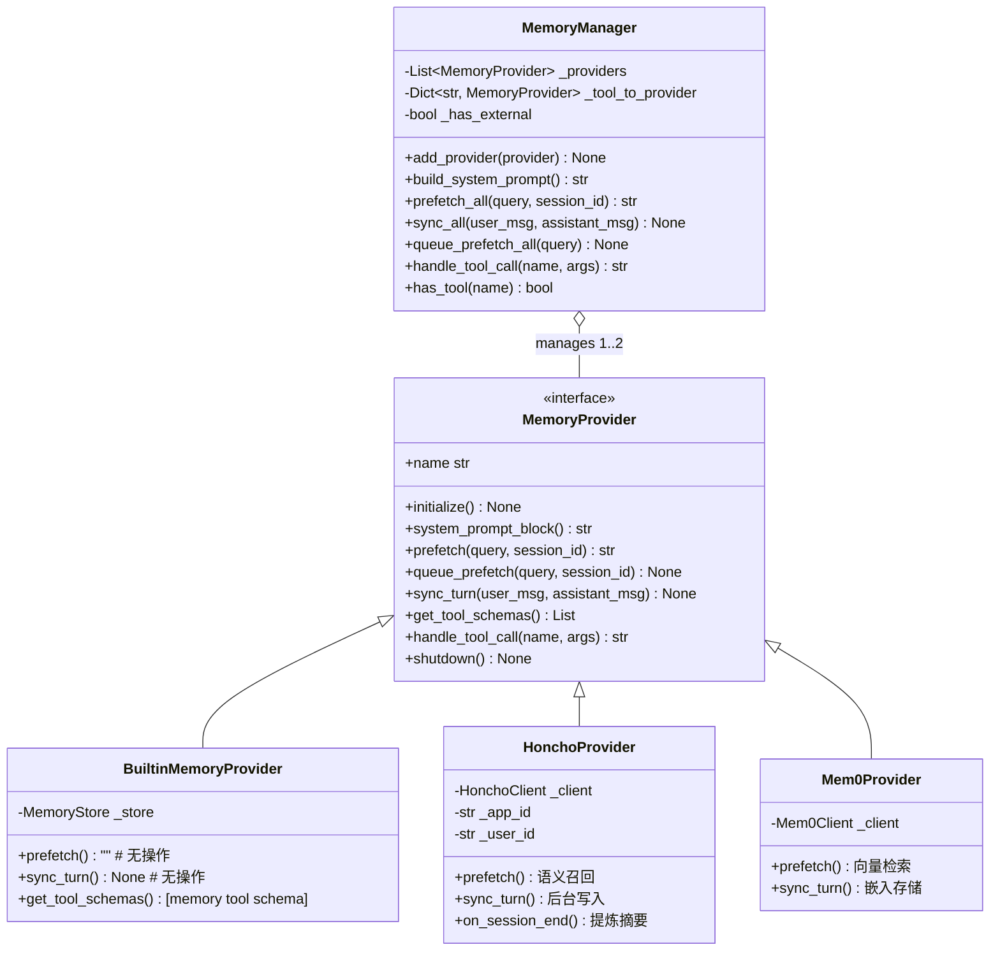
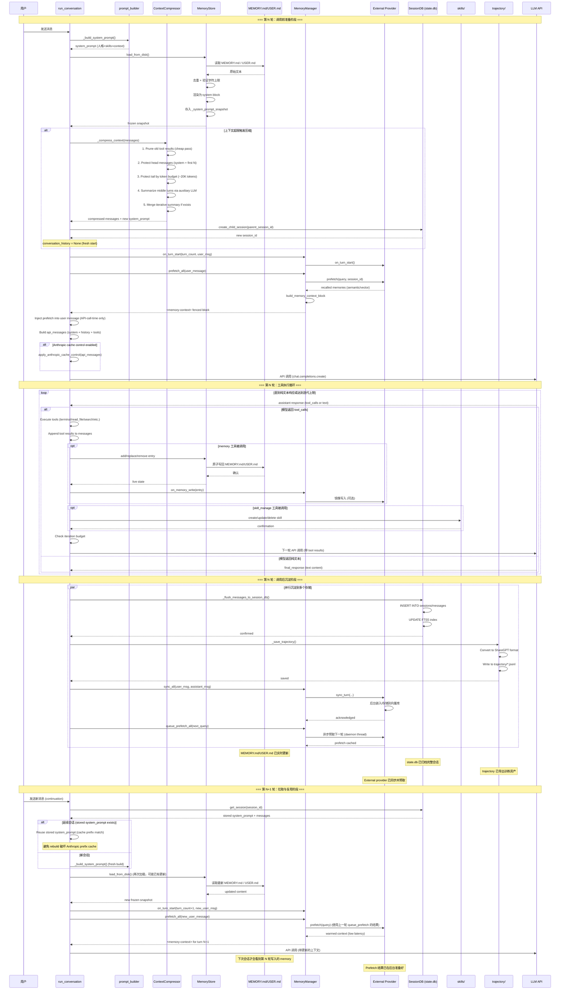
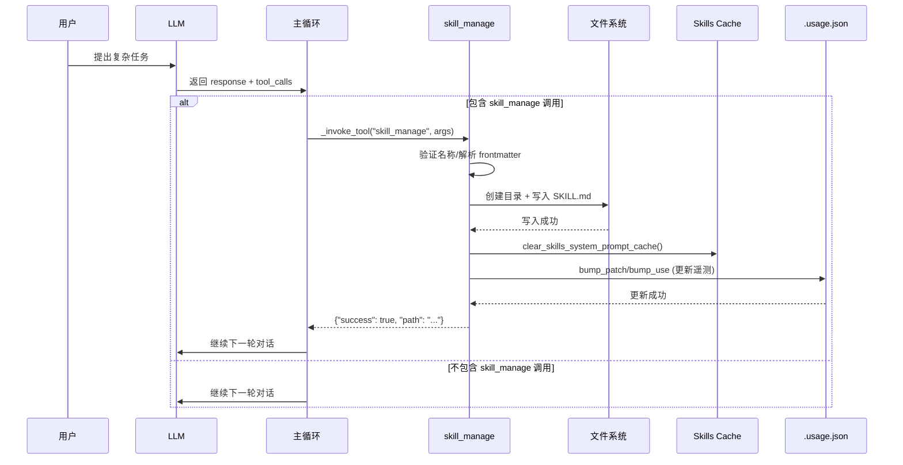
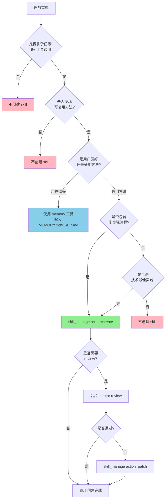
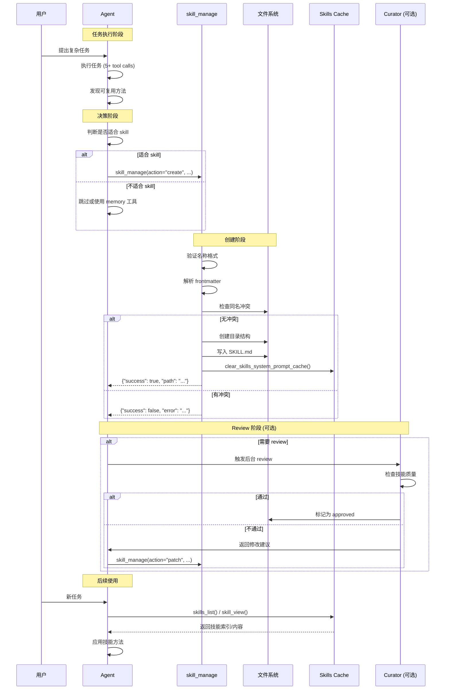
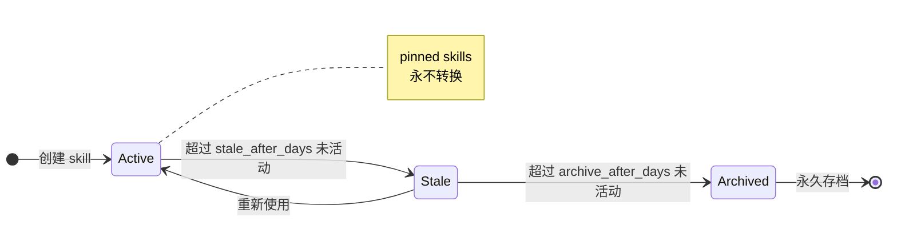
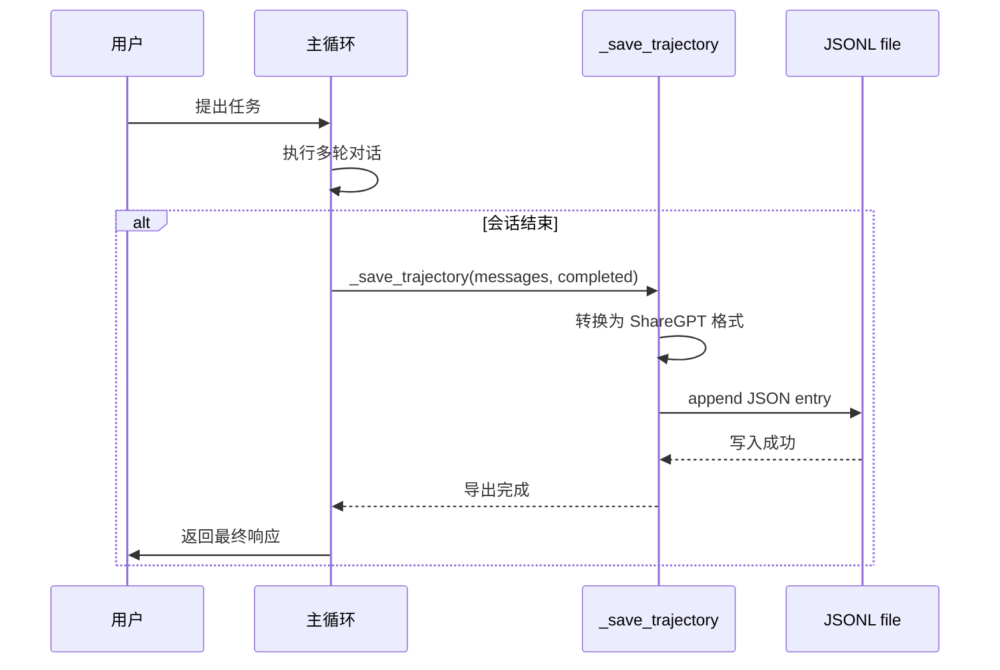
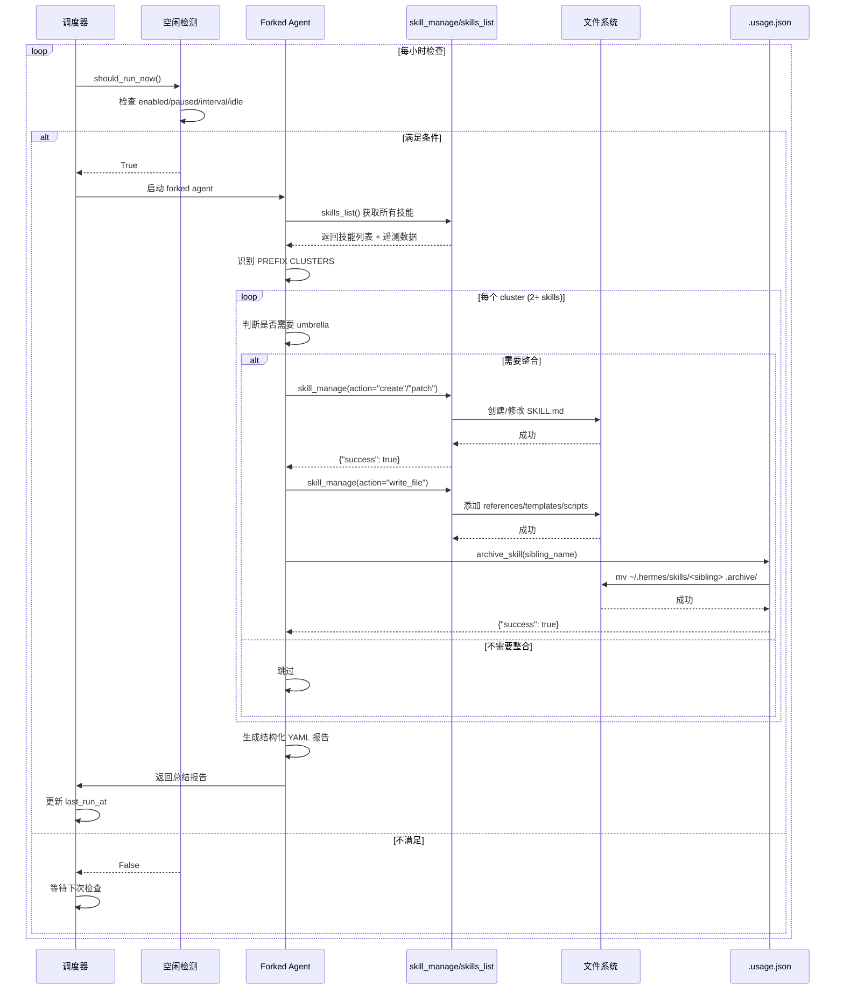
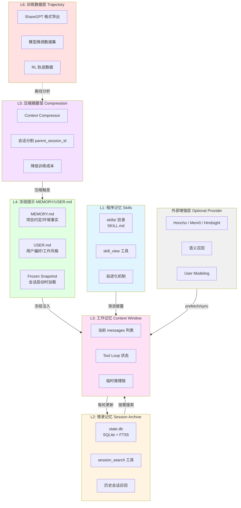
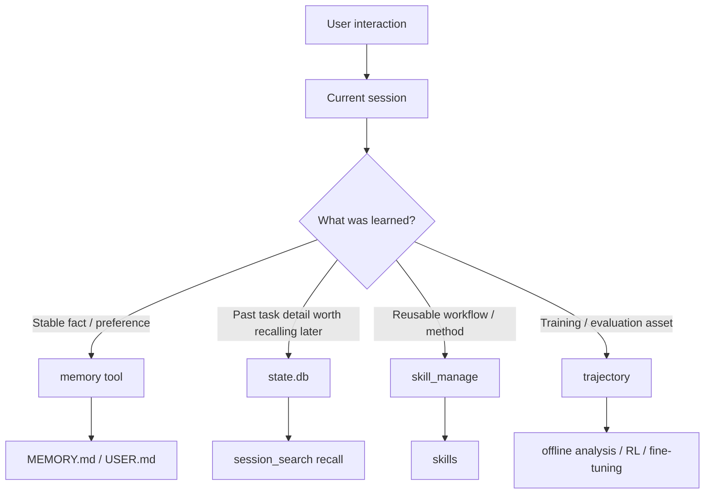

<a id="卷五附录-b--memory-协作架构与自我进化skills--curator--trajectory"></a>
# 卷五附录 B · Memory 协作与经验沉淀：数据流、Skills、Curator 与 Trajectory

> **卷标准**：[`VOLUME_STANDARD.md`](VOLUME_STANDARD.md) · **完成度**：[`MANIFEST.md`](MANIFEST.md)  
> **本文件边界**：自 legacy `MEMORY_SYSTEM.md` 迁入的 **§6 协作与数据流**、**§9 扩展机制**、**附录 A/B（六层对比与演进表述）**。  
> **三层运行时 + 使用指南 + Provider 清单** → [卷五附录 A · Memory 参考](05-memory-system-reference.md)；循环内 Session/Memory 分工 → [卷三第6章](03-runtime-session-and-loop.md#sec-ch6)；后台复盘 fork → [卷八 §3](08-security-and-governance.md#3-后台复盘background-review)。  
> **权威源码**：`agent/memory_manager.py`、`tools/skill_usage.py`、`agent/curator.py`、`agent/trajectory.py`、`tools/skills_tool.py`、`agent/conversation_compression.py`

---

<a id="本附录目录"></a>
## 阅读导航：这份文档解决什么问题？

本附录解释**记忆如何协作，以及经验怎样沉淀为不同资产**。先读 MemoryManager 与完整数据流，再分别查 Skills、Curator、Telemetry 和 Trajectory；最后两节是架构对比视角，不是另一套在线 Memory 实现。

### 三份文档怎么选

| 文档 | 解决的问题 |
|---|---|
| [卷五主卷：工具与扩展](05-capabilities-extensions.md) | 配置如何启用工具，模型调用后如何执行，MCP/Skills/Memory 如何接入，插件如何注册与卸载 |
| [附录 A：Memory 使用与 Provider 接入](05-memory-system-reference.md) | 该存什么、如何检索、容量怎么管，以及 Mem0/Honcho/Supermemory 的读写、配置与自定义接入 |
| [附录 B：协作数据流与经验沉淀](05-memory-architecture-and-evolution.md) | MemoryManager 如何协调数据，压缩前后如何流转，Skills/Curator/Trajectory 如何分别沉淀经验 |

### 按问题查找

| 我想知道…… | 直接看这里 |
|---|---|
| Memory、Session、Skills 各有什么职责，谁协调它们？ | [1.2 MemoryManager 与协作矩阵](#memorymanager-与协作矩阵) |
| 一轮、压缩前后、下一轮的记忆数据怎样流动？ | [1.3 完整数据流向（含压缩、沉淀与第二轮拉取）](#完整数据流向含压缩沉淀与第二轮拉取) |
| 三层 Memory 主模型是什么，六层视角为什么不是同一回事？ | [1.4 当前实现真正的「层级」与易误判点](#当前实现真正的层级与易误判点) |
| 什么时候应沉淀 Skill，而不是保存一条 Memory？ | [2.3.3 什么时候该沉淀成 skill](#53-什么时候该沉淀成-skill) |
| Skill 使用与成功反馈怎样记录，在哪里触发？ | [2.4 Skill Telemetry：使用记录、反馈写入与沉淀流程](#54-skill-telemetry-系统底层实现) |
| 哪些机制自动触发、哪些要手动触发？ | [2.6 触发时机对照：哪些自动执行，哪些需要主动调用](#59-所有进化机制的触发时机对比) |
| Curator 的日常生命周期与技能整理是什么关系？ | [2.7 Curator 生命周期：自动管理的对象与流程](#57-curator-自动生命周期管理) |
| Trajectory 导出什么，为什么不是在线记忆？ | [2.9 Trajectory：离线轨迹的定位、用途与导出实现](#61-它属于什么层) |
| Curator Review 什么时候执行、处理哪些资产？ | [2.10 Curator Review：独立运行的 LLM 技能审查与整合](#71-curator-review策展人审查机制llm-驱动的技能整合) |
| “自我进化”到底指哪些工程机制，有什么限制？ | [4.2 对“Hermes 会自我进化”的准确表述](#9-对hermes-会自我进化的准确表述) |

### 建议阅读顺序

- **理解运行时**：第1节的职责与 MemoryManager → 完整数据流 → 三层模型与误区。
- **理解经验沉淀**：第2节分别查 Skill 记录、触发时机、Curator 生命周期、Trajectory 导出和 Curator Review。
- **做架构对比**：在前两节基础上，再看第3–4节的层次视角与演化表述。

**编号说明**：正文标题按本文件层级重新编号，旧标题锚点保留。代码示例里的源文件行号和原文中的历史编号不作为本目录的节号。

### 完整内容目录

- [1. Memory 协作架构：职责、MemoryManager 与压缩前后数据流](#c-协作数据流与架构)
  - [1.1 设计目标与非目标](#设计目标与非目标)
    - [1.1.1 设计目标](#11-设计目标)
    - [1.1.2 非目标](#12-非目标)
  - [1.2 MemoryManager 与协作矩阵](#memorymanager-与协作矩阵)
    - [1.2.1 协作矩阵](#23-协作矩阵)
    - [1.2.2 MemoryManager 内部架构](#24-memorymanager-内部架构)
  - [1.3 完整数据流向（含压缩、沉淀与第二轮拉取）](#完整数据流向含压缩沉淀与第二轮拉取)
  - [1.4 当前实现真正的「层级」与易误判点](#当前实现真正的层级与易误判点)
    - [1.4.1 当前实现真正的“层级”](#7-当前实现真正的层级)
    - [1.4.2 设计优劣势](#8-设计优劣势)
    - [1.4.3 读源码时最容易误判的点](#9-读源码时最容易误判的点)
- [2. 经验沉淀机制：Skills、Curator、Telemetry 与 Trajectory](#d-扩展机制非-memory-主模型)
  - [2.1 阅读范围：Skills、Curator、Trajectory 与 Memory 的职责边界](#本节范围)
  - [2.2 Hermes 的"进化"不是单一路径](#2-hermes-的进化不是单一路径)
  - [2.3 Skills 沉淀：与事实记忆的区别、工程策略与适用场景](#5-进化路径三skills)
    - [2.3.1 为什么 skill 不应被混同为 memory](#51-为什么-skill-不应被混同为-memory)
    - [2.3.2 Hermes 当前的工程策略](#52-hermes-当前的工程策略)
    - [2.3.3 什么时候该沉淀成 skill](#53-什么时候该沉淀成-skill)
  - [2.4 Skill Telemetry：使用记录、反馈写入与沉淀流程](#54-skill-telemetry-系统底层实现)
    - [2.4.1 Telemetry 写入时机与执行流程](#55-写入时机与执行流程)
    - [2.4.2 Skill 沉淀决策流程](#56-skill-沉淀决策流程)
    - [2.4.3 Skill 沉淀时序图](#57-skill-沉淀时序图)
  - [2.5 Skill 与 Memory 对照：方法沉淀和事实记忆如何选择](#58-skill-vs-memory-对比表)
  - [2.6 触发时机对照：哪些自动执行，哪些需要主动调用](#59-所有进化机制的触发时机对比)
  - [2.7 Curator 生命周期：自动管理的对象与流程](#57-curator-自动生命周期管理)
  - [2.8 生命周期对照：Skills、Session Archive 与 Curated Memory](#510-三种进化机制的生命周期管理对比)
  - [2.9 Trajectory：离线轨迹的定位、用途与导出实现](#61-它属于什么层)
    - [2.9.1 为什么 Trajectory 不属于 Memory 主模型](#62-为什么它不该算进-memory-主模型)
    - [2.9.2 Trajectory 与经验分析、后续改进的关系](#63-但为什么仍值得放在这里讲)
    - [2.9.3 Trajectory 导出的底层实现](#64-trajectory-导出的底层实现)
  - [2.10 Curator Review：独立运行的 LLM 技能审查与整合](#71-curator-review策展人审查机制llm-驱动的技能整合)
- [3. 六层扩展视角：与三层主模型如何对应](#e-附录-a六层扩展视角)
  - [3.1 六层扩展视角：用于架构对比，不是官方运行时主模型](#21-六层扩展视角架构分析用--非官方主模型)
  - [3.2 三层主模型与六层扩展视角的对应关系](#22-三层主模型-vs-六层扩展)
- [4. 演化时序与结论：如何准确理解自我进化](#e-附录-b演进表述与时序)
  - [4.1 演化时序图：从对话、事实记忆到技能与离线资产](#8-一个更准确的演化时序图)
  - [4.2 对“Hermes 会自我进化”的准确表述](#9-对hermes-会自我进化的准确表述)
  - [4.3 架构对比结论：如何描述 Hermes 的记忆与经验沉淀](#11-最后给架构对比使用者的结论)


---

<a id="c-协作数据流与架构"></a>

## 1. Memory 协作架构：职责、MemoryManager 与压缩前后数据流

<a id="设计目标与非目标"></a>
### 1.1 设计目标与非目标

<a id="11-设计目标"></a>
#### 1.1.1 设计目标

如果只看功能名称，Hermes memory 很容易被误解成“多加几个存储后端”。但从源码上看，它追求的是下面几个更具体的目标：

- **低成本长期上下文**
  让一小部分高价值事实稳定进入 prompt，而不是每轮都做昂贵召回。
- **完整历史可追溯**
  让过去对话可检索、可回顾、可摘要，而不是只保留当前窗口。
- **本地优先但可增强**
  在没有外部依赖时，内建 memory 和 session archive 仍然可用；需要时再接 provider。
- **不把 recall 冒充成 user input**
  这是 Hermes memory 在安全和行为稳定性上的核心底线。
- **不让 memory 侵占全部系统复杂度**
  memory 重要，但它必须和 skills、tool loop、gateway、delegation 保持边界。

<a id="12-非目标"></a>
#### 1.1.2 非目标

同样重要的是，Hermes 当前**不追求**下面这些事情：

- **不追求 mid-session 热更新 system prompt**
  built-in memory 设计上就是 next-session-oriented，而不是 mutable prompt store。
- **不追求无限容量**
  `MEMORY.md` / `USER.md` 明确受限，强迫系统做 curated memory 而不是日志堆积。
- **不追求多个外部 provider 叠加**
  工程上优先避免 schema 冲突、治理混乱和双重写入。
- **不把 skill / trajectory 强行当成 memory 主层**
  它们相关，但角色不同。

<a id="memorymanager-与协作矩阵"></a>
### 1.2 MemoryManager 与协作矩阵

<a id="23-协作矩阵"></a>
#### 1.2.1 协作矩阵

这套系统最容易误判的地方,是把所有“看起来像记忆”的东西混在一起。下面这张协作矩阵用来区分谁负责什么:

| 组件 | 它真正负责的事 | 它不应该负责的事 | 主要协作对象 |
|------|----------------|------------------|--------------|
| `MemoryStore` | `MEMORY.md` / `USER.md` 的加载、冻结快照、文件级读写 | 外部 provider 生命周期 | `run_agent.py`, `memory_tool.py` |
| `memory` tool | 把长期稳定事实写入 built-in persistent memory | 搜索完整历史会话 | `MemoryStore` |
| `SessionDB` | 会话存档、FTS5 索引、历史检索底座 | system prompt 注入 | `run_agent.py`, `session_search_tool.py` |
| `session_search` | 基于 `state.db` 做历史回忆和 focused summary | 持久写入长期偏好 | `SessionDB` |
| `MemoryManager` | 编排一个 external provider 的 prefetch / sync / hooks | 替代 built-in memory 本体 | `MemoryProvider`, `run_agent.py` |
| external provider | 更深的语义 recall / user modeling / 外部持久化 | 管理 Hermes 全部记忆策略 | `MemoryManager` |

看这张表时,最重要的一条是:

> Hermes 不是一个“统一大 memory 仓库”,而是几套边界清晰、用途不同的记忆机制并行存在。

<a id="24-memorymanager-内部架构"></a>
#### 1.2.2 MemoryManager 内部架构



**关键设计约束**:
- ✅ Built-in Provider 始终存在且不可移除
- ✅ 最多允许 **1 个** External Provider(避免工具 schema 冲突)
- ✅ 单 Provider 失败不阻塞其他 Provider
- ✅ Tool name 冲突检测与警告

<a id="完整数据流向含压缩沉淀与第二轮拉取"></a>
### 1.3 完整数据流向（含压缩、沉淀与第二轮拉取）




**关键观察**:
1. **写盘是实时的** - `memory` 工具立即更新 `MEMORY.md` / `USER.md`
2. **Prompt 生效是延迟的** - 当前会话仍使用 frozen snapshot，下一轮才重新加载
3. **External Provider 是增强的** - 提供实时语义召回，但不替代 built-in
4. **压缩是主动的** - 上下文超限时触发 ContextCompressor，创建子会话链
5. **沉淀是多路径的** - SessionDB (归档) + Trajectory (训练) + External (向量库) 并行写入
6. **预取是异步的** - `queue_prefetch_all` 在后台 daemon thread 中预热下一轮上下文
7. **缓存是优化的** - Anthropic prefix cache 通过复用 stored system_prompt 保持命中

<a id="当前实现真正的层级与易误判点"></a>
### 1.4 当前实现真正的「层级」与易误判点

<a id="7-当前实现真正的层级"></a>
#### 1.4.1 当前实现真正的“层级”

如果一定要讲层级，我建议用下面这组更贴近现实的维度，而不是旧的六层官方口径：

| 维度 | 当前实现 |
|------|----------|
| **始终在线长期记忆** | `MEMORY.md` + `USER.md` |
| **历史会话档案** | `state.db` + FTS5 |
| **可选语义增强** | external provider |
| **运行态工作记忆** | 当前 messages / tool loop / context window |
| **方法论沉淀** | skills |
| **训练与离线资产** | trajectories / compressor / RL |

这样更容易避免概念污染。

---

<a id="8-设计优劣势"></a>
#### 1.4.2 设计优劣势

<a id="81-优势"></a>
##### 1.4.2.1 优势

- 主层清晰：built-in memory 和 session archive 职责不同
- 本地优先：没有外部 provider 也能工作
- 成本稳定：frozen snapshot 避免每轮重注入
- 安全意识较强：写入扫描 + fenced recall
- 可扩展：provider interface 很清楚

<a id="82-代价"></a>
##### 1.4.2.2 代价

- built-in memory 不会在当前 session 热更新
- 长期记忆容量刻意受限，需要持续精编
- external provider 只能单选，不能叠加
- 对初学者来说，memory / session_search / skills 边界不直观

---

<a id="9-读源码时最容易误判的点"></a>
#### 1.4.3 读源码时最容易误判的点

<a id="91-不要把-memorymanager-当成-built-in-memory-本体"></a>
##### 1.4.3.1 不要把 MemoryManager 当成内置记忆存储本体

当前 `MemoryManager` 主要是 external provider 编排器。

built-in persistent memory 的核心实现其实是：

- `MemoryStore`
- `memory` tool

<a id="92-不要把-session_search-当成-provider"></a>
##### 1.4.3.2 不要把 session_search 当成 Provider

`session_search` 是 Hermes 核心工具，不属于 external provider 插件体系。

<a id="93-不要把-skills-当成-built-in-memory"></a>
##### 1.4.3.3 不要把 Skills 当成内置事实记忆

skills 可以沉淀经验，但它们不是 `MEMORY.md` / `USER.md` 那套持久记忆文件。

---


<a id="d-扩展机制skills--curator--trajectory"></a>

<a id="d-扩展机制非-memory-主模型"></a>
## 2. 经验沉淀机制：Skills、Curator、Telemetry 与 Trajectory

> Skills、Curator、Trajectory **不是** Persistent Memory 的子类型。  
> 主模型仍是三层；本节描述与 memory **协同**的进化/沉淀机制。  
> 已删除旧稿中错误的 `memory(action="write")` /「<5KB」示例（与 §3 API 冲突）。

<a id="本节范围"></a>
### 2.1 阅读范围：Skills、Curator、Trajectory 与 Memory 的职责边界

本文只回答：

- memory 如何与 skills 协作
- 对话如何变成训练资产
- Hermes 所谓“self-improving”在工程上是怎么分层的

---

<a id="2-hermes-的进化不是单一路径"></a>
### 2.2 Hermes 的"进化"不是单一路径

Hermes 所谓进化，至少有四条不同路径：

1. **Curated Memory 更新**（curated memory = 精选记忆 / 策展记忆）
   - **是什么**: Agent 主动将学到的稳定事实写入 `MEMORY.md` / `USER.md`
   - **作用**: 持久化用户偏好、环境事实、项目约定，改善未来会话的初始上下文
   - **示例**: "用户喜欢简洁代码" → 写入 USER.md → 下次会话自动遵循

2. **Session Archive 增长**（session archive = 会话归档）
   - **是什么**: 每次会话结束后，完整对话自动保存到 `state.db`（SQLite 数据库）
   - **作用**: 积累完整历史，支持按需回忆和搜索过去的对话
   - **示例**: "上次是怎么解决那个 bug 的？" → `session_search` → 找到相关会话

3. **Skill 沉淀**（skill = 技能）
   - **是什么**: Agent 将可复用的方法论保存为独立技能文件（SKILL.md）
   - **作用**: 把"怎么做"抽出来形成可加载资产，避免重复摸索
   - **示例**: "调试 Python import 错误的方法" → 保存为 skill → 下次直接应用

4. **Trajectory / Training Data 积累**（trajectory = 轨迹 / 训练数据）
   - **是什么**: 将会话转换为标准化的 ShareGPT 格式，保存到 JSONL 文件
   - **作用**: 为模型微调、错误分析、性能监控提供训练和研究数据
   - **示例**: 收集 1000 个成功对话 → 微调模型 → 提升整体性能

所以"进化"不是一个按钮，而是多个沉淀面并行发生。

<a id="5-进化路径三skills"></a>
<a id="23-进化路径三skills"></a>
### 2.3 Skills 沉淀：与事实记忆的区别、工程策略与适用场景

<a id="51-为什么-skill-不应被混同为-memory"></a>
#### 2.3.1 为什么 skill 不应被混同为 memory

memory 解决的是：

- 记住什么

skill 解决的是：

- 下次怎么做

这两者显然相关，但不是一回事。

<a id="52-hermes-当前的工程策略"></a>
#### 2.3.2 Hermes 当前的工程策略

Hermes 的主线不是“自动无限生成 skills 并自我改写一切”，而是：

- 提供 `skill_manage`
- 提供 `skills_list` / `skill_view`
- 在 prompt 中鼓励 agent 将稳定方法论沉淀成 skill
- 在后台 memory/skill review 节点做机会性检查

这说明 Hermes 确实在朝 self-improving 方向走，但工程姿态更接近：

- 可控沉淀
- 工具显式化
- 允许 review / patch

而不是一个黑箱式“自动学习引擎”。

<a id="53-什么时候该沉淀成-skill"></a>
#### 2.3.3 什么时候该沉淀成 skill

适合 skill 的内容：

- 固定工作流
- 多步操作套路
- 特定技术栈最佳实践
- 某类任务的稳定模板

不适合 skill 的内容：

- 用户个人偏好
- 一次性 bug 细节
- 临时上下文

---

<a id="54-skill-telemetry-系统底层实现"></a>
<a id="234-skill-telemetry-系统底层实现"></a>
### 2.4 Skill Telemetry：使用记录、反馈写入与沉淀流程

**存储位置**: `~/.hermes/skills/.usage.json`

**数据结构**:
```json
{
  "debug-python": {
    "use_count": 15,
    "view_count": 42,
    "patch_count": 3,
    "last_used_at": "2026-05-01T10:30:00+00:00",
    "last_viewed_at": "2026-05-01T11:15:00+00:00",
    "last_patched_at": "2026-04-28T14:20:00+00:00",
    "created_at": "2026-04-15T09:00:00+00:00",
    "state": "active",
    "pinned": false,
    "archived_at": null
  },
  "web-scraping": {
    "use_count": 8,
    "view_count": 20,
    "patch_count": 1,
    "last_used_at": "2026-04-20T16:45:00+00:00",
    "last_viewed_at": "2026-04-25T08:30:00+00:00",
    "last_patched_at": "2026-04-16T12:00:00+00:00",
    "created_at": "2026-04-10T10:00:00+00:00",
    "state": "stale",
    "pinned": false,
    "archived_at": null
  }
}
```

**计数器更新逻辑**:

```python
## tools/skill_usage.py (第 314-336 行)

def bump_view(skill_name: str) -> None:
    """Bump view_count and last_viewed_at. Called from skill_view()."""
    def _apply(rec: Dict[str, Any]) -> None:
        rec["view_count"] = int(rec.get("view_count") or 0) + 1
        rec["last_viewed_at"] = _now_iso()
    _mutate(skill_name, _apply)


def bump_use(skill_name: str) -> None:
    """Bump use_count and last_used_at. Called when a skill is actively used."""
    def _apply(rec: Dict[str, Any]) -> None:
        rec["use_count"] = int(rec.get("use_count") or 0) + 1
        rec["last_used_at"] = _now_iso()
    _mutate(skill_name, _apply)


def bump_patch(skill_name: str) -> None:
    """Bump patch_count and last_patched_at. Called from skill_manage (patch/edit)."""
    def _apply(rec: Dict[str, Any]) -> None:
        rec["patch_count"] = int(rec.get("patch_count") or 0) + 1
        rec["last_patched_at"] = _now_iso()
    _mutate(skill_name, _apply)
```

**原子写入机制**:

```python
## tools/skill_usage.py (第 249-271 行)
def save_usage(data: Dict[str, Dict[str, Any]]) -> None:
    """Write the usage map atomically. Best-effort — errors are logged, not raised."""
    path = _usage_file()
    try:
        path.parent.mkdir(parents=True, exist_ok=True)
        fd, tmp_path = tempfile.mkstemp(
            dir=str(path.parent), prefix=".usage_", suffix=".tmp"
        )
        try:
            with os.fdopen(fd, "w", encoding="utf-8") as f:
                json.dump(data, f, indent=2, sort_keys=True, ensure_ascii=False)
                f.flush()
                os.fsync(f.fileno())  # 确保数据刷到磁盘
            os.replace(tmp_path, path)  # 原子替换
        except BaseException:
            try:
                os.unlink(tmp_path)  # 失败时清理临时文件
            except OSError:
                pass
            raise
    except Exception as e:
        logger.debug("Failed to write %s: %s", path, e, exc_info=True)
```

**设计原则**:
- ✅ **Sidecar 模式**: 遥测数据与 SKILL.md 分离，避免污染用户内容
- ✅ **原子写入**: 使用 tempfile + os.replace 防止损坏
- ✅ **Best-effort**: 失败只记录日志，不影响工具调用
- ✅ **Provenance Filter**: 只追踪 agent-created skills，忽略 bundled/hub skills

---

<a id="55-写入时机与执行流程"></a>
<a id="235-写入时机与执行流程"></a>
#### 2.4.1 Telemetry 写入时机与执行流程

**触发位置**: 同样在主循环的工具调用分支中（[run_agent.py#L9323](file:///Users/gqli/work/deepagents/hermes-agent/run_agent.py#L9323)）

```python
## run_agent.py (第 9320-9324 行)
## Reset nudge counters
if function_name == "memory":
    self._turns_since_memory = 0
elif function_name == "skill_manage":
    self._iters_since_skill = 0  # 重置技能提示计数器
```

**执行流程**:



**关键特点**:
- ✅ **同步阻塞**: 工具执行完成后才继续下一轮对话
- ✅ **即时生效**: 写入后立即清除缓存，下次会话就能加载新技能
- ✅ **Agent 自主**: LLM 根据 `SKILLS_GUIDANCE` prompt 决定是否调用
- ✅ **遥测更新**: 同时更新 `.usage.json` 中的计数器

**实际示例**:

```
用户: "帮我调试这个 Python import 错误"

Agent: [执行 8 步调试流程]
       1. read_file("error.log")
       2. terminal("python -c 'import sys; print(sys.path)'")
       3. read_file("__init__.py")
       4. patch(path="__init__.py", ...)
       5. terminal("pytest tests/")
       6. read_file("test_output.log")
       7. patch(path="setup.py", ...)
       8. terminal("pytest tests/ -v")
       
       [成功解决，识别为可复用方法]
       
       {
         "role": "assistant",
         "tool_calls": [{
           "name": "skill_manage",
           "arguments": {
             "action": "create",
             "name": "debug-python-import",
             "content": "---\nname: debug-python-import\ndescription: ...\n---\n\n# Debug Python Import Errors\n\n## Steps\n1. Check error.log...\n..."
           }
         }]
       }

主循环: [执行 skill_manage 工具]
        → 验证名称格式（小写、连字符、≤64字符）
        → 解析 frontmatter
        → 检查同名冲突
        → 创建 ~/.hermes/skills/debug-python-import/
        → 写入 SKILL.md
        → 清除 Skills Cache
        → 更新 .usage.json (created_at, use_count=1)
        → 返回工具结果给 LLM

LLM: "我已将此调试方法保存为技能 'debug-python-import'，下次遇到类似问题可直接使用。"

[下次会话开始时]
→ skills_list() 返回新技能索引
→ skill_view("debug-python-import") 加载完整内容
→ Agent 应用此技能的方法论
```

---

<a id="56-skill-沉淀决策流程"></a>
<a id="236-skill-沉淀决策流程"></a>
#### 2.4.2 Skill 沉淀决策流程



**决策要点**:
1. **复杂度检查**: 至少 5+ 工具调用，确保不是简单任务
2. **可复用性**: 方法是否能应用于未来类似场景
3. **分类判断**: 用户偏好 → memory，通用方法 → skill
4. **流程完整性**: 是否包含明确的步骤序列
5. **Review 机制**: 重要技能可能需要 curator 审核

---

<a id="57-skill-沉淀时序图"></a>
<a id="237-skill-沉淀时序图"></a>
#### 2.4.3 Skill 沉淀时序图



**关键节点说明**:

1. **任务执行阶段**: Agent 在执行复杂任务时识别模式
2. **决策阶段**: 根据复杂度、可复用性、分类进行判断
3. **创建阶段**: 
   - 验证名称（小写、连字符、≤64字符）
   - 解析 frontmatter（name, description, platforms等）
   - 检查冲突（同名技能已存在则失败）
   - 创建目录结构（`~/.hermes/skills/<category>/<name>/`）
   - 写入 SKILL.md
   - 清除缓存（触发 Skills Index 重建）
4. **Review 阶段**: 可选的 curator 审核流程
5. **后续使用**: 通过 `skills_list()` 和 `skill_view()` 加载技能

---

<a id="58-skill-vs-memory-对比表"></a>
<a id="238-skill-vs-memory-对比表"></a>
### 2.5 Skill 与 Memory 对照：方法沉淀和事实记忆如何选择

| 维度 | Skill | Memory |
|------|-------|--------|
| **解决的问题** | 下次怎么做（程序性记忆） | 记住什么（陈述性记忆） |
| **存储位置** | `~/.hermes/skills/<category>/<name>/SKILL.md` | `~/.hermes/memories/MEMORY.md` / `USER.md` |
| **内容类型** | 工作流、步骤、模板、最佳实践 | 用户偏好、环境事实、项目约定 |
| **容量** | 无限制（每个技能独立文件） | 有限（需保持精简） |
| **加载方式** | 按需加载（`skill_view()`） | 每轮自动注入（prefetch） |
| **更新频率** | 较低（稳定后很少修改） | 中等（持续精编） |
| **适用场景** | 固定工作流、多步操作套路 | 个人偏好、稳定经验 |
| **示例** | "Debug Python 的系统化方法" | "用户喜欢简洁的响应" |

**选择原则**:
- ✅ **问自己**: "这是关于'做什么'还是'怎么做'?"
  - 做什么（what）→ Memory
  - 怎么做（how）→ Skill
- ✅ **问自己**: "这个信息是一次性的还是会重复出现?"
  - 一次性 → Session Archive（state.db）
  - 重复出现 → Skill 或 Memory
- ✅ **问自己**: "这是一个通用的方法论还是个人的偏好?"
  - 通用方法论 → Skill
  - 个人偏好 → Memory

---

<a id="59-所有进化机制的触发时机对比"></a>
<a id="239-所有进化机制的触发时机对比"></a>
### 2.6 触发时机对照：哪些自动执行，哪些需要主动调用

| 机制 | 中文含义 | 主要作用 | 效果 | 触发位置 | 是否阻塞主循环 | 触发者 | 代码行号 |
|------|---------|---------|------|---------|--------------|--------|----------|
| **skill_manage** | 技能管理工具 | Agent 主动创建/更新可复用的方法论（SKILL.md） | 下次会话可直接应用该方法，避免重复摸索 | 主循环内（工具调用分支） | ✅ 是（同步） | Agent（LLM） | [run_agent.py#L9323](file:///Users/gqli/work/deepagents/hermes-agent/run_agent.py#L9323) |
| **memory 工具** | 记忆管理工具 | Agent 主动记录用户偏好、环境事实、项目约定 | 下次会话自动遵循这些偏好和事实 | 主循环内（工具调用分支） | ✅ 是（同步） | Agent（LLM） | [run_agent.py#L9321](file:///Users/gqli/work/deepagents/hermes-agent/run_agent.py#L9321) |
| **Session Archive** | 会话归档 | 会话结束后自动保存完整对话到 SQLite 数据库 | 支持通过 `session_search` 搜索过去的解决方案 | 主循环结束后 | ❌ 否（会后） | 运行时（自动） | [run_agent.py#L13613](file:///Users/gqli/work/deepagents/hermes-agent/run_agent.py#L13613) |
| **Trajectory Export** | 轨迹导出 | 将会话转换为 ShareGPT 格式保存到 JSONL 文件 | 为模型微调、错误分析、性能监控提供训练数据 | 主循环结束后 | ❌ 否（会后） | 运行时（自动） | [run_agent.py#L13607](file:///Users/gqli/work/deepagents/hermes-agent/run_agent.py#L13607) |
| **Curator Review** | 策展人审查 / 后台审查 | 定期自动检查并整合相似技能，保持技能库整洁 | 防止技能库膨胀，提升技能质量，节省用户整理时间 | 完全独立 | ❌ 否（异步） | 调度器（定时） | 独立进程 |

**关键结论**:

1. **Skill 和 Memory 的写入**确实在**主循环中**，由 Agent 主动调用工具触发
   - ✅ 同步阻塞：工具执行完成才继续
   - ✅ 即时生效：下次会话就能加载
   - ✅ Agent 自主：LLM 根据 prompt 决定是否调用

2. **Session Archive 和 Trajectory**在**主循环结束后**自动触发，不阻塞响应
   - ❌ 会后执行：不影响当前会话响应速度
   - ❌ 自动触发：无需 Agent 显式调用
   - ✅ 完整保存：包括所有 messages、tool calls、results

3. **Curator Review**是**完全独立的后台进程**，与主循环无关
   - ❌ 独立进程：不与用户交互
   - ❌ 异步执行：不影响当前会话
   - ✅ 定期触发：可配置间隔（默认 24h）

这种设计确保了：
- ✅ **即时反馈**: Skill/Memory 修改后立即生效
- ✅ **用户体验**: 会后操作不阻塞响应
- ✅ **系统稳定性**: 后台任务不影响前台交互

<a id="57-curator-自动生命周期管理"></a>
<a id="2310-curator-自动生命周期管理"></a>
### 2.7 Curator 生命周期：自动管理的对象与流程

**配置文件**: `~/.hermes/config.yaml`

```yaml
curator:
  enabled: true
  interval_hours: 24          # 每 24 小时运行一次
  min_idle_hours: 2           # Agent 空闲至少 2 小时才运行
  stale_after_days: 30        # 30 天未使用标记为 stale
  archive_after_days: 90      # 90 天未使用自动归档
```

**状态机**:



**自动转换逻辑**:

```python
## agent/curator.py (第 215-255 行)
def apply_automatic_transitions(now: Optional[datetime] = None) -> Dict[str, int]:
    """Walk every agent-created skill and move active/stale/archived based on
    the latest real activity timestamp. Pinned skills are never touched."""
    from tools import skill_usage as _u

    if now is None:
        now = datetime.now(timezone.utc)
    stale_cutoff = now - timedelta(days=get_stale_after_days())
    archive_cutoff = now - timedelta(days=get_archive_after_days())

    counts = {"marked_stale": 0, "archived": 0, "reactivated": 0, "checked": 0}

    for row in _u.agent_created_report():
        counts["checked"] += 1
        name = row["name"]
        if row.get("pinned"):
            continue  # Pinned skills 永不转换

        # 获取最新活动时间（use/view/patch 的最新时间）
        last_activity = _parse_iso(row.get("last_activity_at"))
        # 如果从未活动，使用 created_at 作为锚点
        anchor = last_activity or _parse_iso(row.get("created_at")) or now
        if anchor.tzinfo is None:
            anchor = anchor.replace(tzinfo=timezone.utc)

        current = row.get("state", _u.STATE_ACTIVE)

        # 判断是否需要归档
        if anchor <= archive_cutoff and current != _u.STATE_ARCHIVED:
            ok, _msg = _u.archive_skill(name)
            if ok:
                counts["archived"] += 1
        # 判断是否需要标记为 stale
        elif anchor <= stale_cutoff and current == _u.STATE_ACTIVE:
            _u.set_state(name, _u.STATE_STALE)
            counts["marked_stale"] += 1
        # 判断是否需要重新激活
        elif anchor > stale_cutoff and current == _u.STATE_STALE:
            _u.set_state(name, _u.STATE_ACTIVE)
            counts["reactivated"] += 1

    return counts
```

**归档实现**:

```python
## tools/skill_usage.py (第 376-420 行)
def archive_skill(skill_name: str) -> Tuple[bool, str]:
    """Move an agent-created skill directory to ~/.hermes/skills/.archive/."""
    if not is_agent_created(skill_name):
        return False, f"skill '{skill_name}' is bundled or hub-installed; never archive"

    skill_dir = _find_skill_dir(skill_name)
    if skill_dir is None:
        return False, f"skill '{skill_name}' not found"

    archive_root = _archive_dir()  # ~/.hermes/skills/.archive/
    try:
        archive_root.mkdir(parents=True, exist_ok=True)
    except OSError as e:
        return False, f"failed to create archive dir: {e}"

    # 扁平化目录结构（忽略 category 嵌套）
    dest = archive_root / skill_dir.name
    if dest.exists():
        # 如果目标已存在，添加时间戳避免冲突
        dest = archive_root / f"{skill_dir.name}-{datetime.now(timezone.utc).strftime('%Y%m%d%H%M%S')}"

    try:
        shutil.move(str(skill_dir), str(dest))
        set_state(skill_name, STATE_ARCHIVED)
        return True, f"archived to {dest}"
    except OSError as e:
        return False, f"failed to move: {e}"
```

**恢复技能**:

```bash
## CLI 命令
hermes curator restore <skill-name>

## 底层实现
mv ~/.hermes/skills/.archive/<skill-name> ~/.hermes/skills/<skill-name>
```

**设计原则**:
- ✅ **Pinned Skills 保护**: 标记为 pinned 的技能永远不会被自动归档
- ✅ **Provenance Filter**: 只管理 agent-created skills，忽略 bundled/hub skills
- ✅ **可逆操作**: 归档不是删除，可以随时恢复
- ✅ **渐进式降级**: Active → Stale → Archived，给用户多次机会

<a id="510-三种进化机制的生命周期管理对比"></a>
<a id="2311-三种进化机制的生命周期管理对比"></a>
### 2.8 生命周期对照：Skills、Session Archive 与 Curated Memory

| 机制 | 是否需要过期 | 是否需要错误更正 | 管理方式 |
|------|------------|----------------|---------|
| **Skills** | ✅ 是（避免膨胀） | ✅ 是（方法过时） | Curator Review 自动整理 + 用户手动 pin/unpin |
| **Session Archive** | ❌ 否（永久保存） | ❌ 否（历史记录） | 无需管理，按需搜索 |
| **Curated Memory** | ❌ 否（人工控制） | ✅ 是（事实变更） | Agent 主动更新 + 用户手动编辑 |

**关键差异**:

1. **Skills 需要自动整理**:
   - 原因：Agent 可能创建大量狭窄技能，导致技能库混乱
   - 解决：Curator Review 定期合并相似技能，归档过时技能

2. **Session Archive 不需要管理**:
   - 原因：历史记录永远有价值，存储成本低
   - 解决：通过索引和搜索提高效率，不删除任何数据

3. **Curated Memory 需要人工策展**:
   - 原因：容量有限（<5KB），需要保持高信噪比
   - 解决：Agent 主动更新 + 用户手动编辑，不依赖自动化

<a id="61-它属于什么层"></a>
<a id="2312-trajectory-的定位训练与研究资产不是在线召回记忆"></a>
### 2.9 Trajectory：离线轨迹的定位、用途与导出实现

Trajectory（轨迹）是训练和研究资产，不是在线 recall memory。

它的目标不是改善“当前这次会话”的上下文，而是：

- 生成可分析的对话轨迹
- 为 RL / fine-tuning / evaluation 准备数据

<a id="62-为什么它不该算进-memory-主模型"></a>
<a id="2313-为什么-trajectory-不属于-memory-主模型"></a>
#### 2.9.1 为什么 Trajectory 不属于 Memory 主模型

因为它既不参与日常 prompt 注入，也不承担用户级 recall。

它更多是：

- 离线资产
- 训练输入
- 研究数据

把它硬塞进“memory 层级”会导致概念膨胀。

<a id="63-但为什么仍值得放在这里讲"></a>
<a id="2314-trajectory-与经验分析后续改进的关系"></a>
#### 2.9.2 Trajectory 与经验分析、后续改进的关系

因为 Hermes 的品牌叙事不是“有记忆就够了”，而是：

- 记住
- 复盘
- 沉淀
- 再学习

所以 trajectory 虽不是 memory 主层，但确实是长期进化闭环的一部分。

---

<a id="64-trajectory-导出的底层实现"></a>
<a id="2315-trajectory-导出的底层实现"></a>
#### 2.9.3 Trajectory 导出的底层实现

**存储格式**: JSONL（每行一个完整的会话）

**输出文件**:
- `trajectory_samples.jsonl`: 成功完成的会话
- `failed_trajectories.jsonl`: 失败或中断的会话

**触发位置**: 在主循环结束后（[run_agent.py#L13607](file:///Users/gqli/work/deepagents/hermes-agent/run_agent.py#L13607)）

```python
## run_agent.py (第 13607 行)
## Save trajectory if enabled
self._save_trajectory(messages, _summarize_user_message_for_log(user_message), completed)
```

**执行流程**:



**数据结构**（ShareGPT 格式）:

```json
{
  "conversations": [
    {
      "from": "human",
      "value": "帮我修复这个 Python bug"
    },
    {
      "from": "gpt",
      "value": "<think>\n我需要先查看错误信息...\n</think>\n\n让我检查一下日志。",
      "tool_calls": [
        {
          "id": "call_abc123",
          "type": "function",
          "function": {
            "name": "read_file",
            "arguments": "{\"file_path\": \"error.log\"}"
          }
        }
      ]
    },
    {
      "from": "tool",
      "name": "read_file",
      "content": "Traceback (most recent call last):\n  ...",
      "tool_call_id": "call_abc123"
    },
    {
      "from": "gpt",
      "value": "我找到了问题所在..."
    }
  ],
  "timestamp": "2026-05-01T10:30:00+00:00",
  "model": "claude-3-opus-20240229",
  "completed": true
}
```

**导出逻辑**:

```python
## agent/trajectory.py (第 30-57 行)
def save_trajectory(trajectory: List[Dict[str, Any]], model: str,
                    completed: bool, filename: str = None):
    """Append a trajectory entry to a JSONL file."""
    if filename is None:
        filename = "trajectory_samples.jsonl" if completed else "failed_trajectories.jsonl"

    entry = {
        "conversations": trajectory,
        "timestamp": datetime.now().isoformat(),
        "model": model,
        "completed": completed,
    }

    try:
        with open(filename, "a", encoding="utf-8") as f:
            f.write(json.dumps(entry, ensure_ascii=False) + "\n")
        logger.info("Trajectory saved to %s", filename)
    except Exception as e:
        logger.warning("Failed to save trajectory: %s", e)
```

**调用时机**: 在 `batch_runner.py` 中，每个会话结束后自动调用

```python
## batch_runner.py (简化版)
def run_batch_session(agent, task: str) -> None:
    """Run a single session and save trajectory."""
    messages = []
    
    # 执行会话
    response = agent.run(task, messages=messages)
    
    # 转换为 ShareGPT 格式
    trajectory = agent._convert_to_trajectory_format(messages)
    
    # 保存轨迹
    completed = response.status == "completed"
    save_trajectory(
        trajectory=trajectory,
        model=agent.model_name,
        completed=completed
    )
```

**Scratchpad 转换**:

```python
## agent/trajectory.py (第 16-21 行)
def convert_scratchpad_to_think(content: str) -> str:
    """Convert <REASONING_SCRATCHPAD> tags to <think> tags."""
    if not content or "<REASONING_SCRATCHPAD>" not in content:
        return content
    return content.replace("<REASONING_SCRATCHPAD>", "<think>").replace("</REASONING_SCRATCHPAD>", "</think>")
```

**用途**:
- 📊 **微调数据集**: 用于 SFT（Supervised Fine-Tuning）
- 🧪 **评估基准**: 构建任务特定的 eval suite
- 🔍 **错误分析**: 研究失败模式和改进方向
- 📈 **性能监控**: 追踪 token 使用、成本、成功率等指标

**设计原则**:
- ✅ **完整保留**: 包括 tool calls/results、thinking process
- ✅ **标准化格式**: ShareGPT 兼容，便于与其他框架互操作
- ✅ **增量追加**: JSONL 格式支持流式写入，无需加载整个文件
- ✅ **分离成败**: 成功和失败的轨迹分开存储，便于针对性分析

---

<a id="71-curator-review策展人审查机制llm-驱动的技能整合"></a>
<a id="2316-curator-review策展人审查机制llm-驱动的技能整合"></a>
### 2.10 Curator Review：独立运行的 LLM 技能审查与整合

**触发位置**: ❌ **完全独立，不在主循环中**

**审查范围**: ⚠️ **仅针对 Skills（技能），不包括 Session Archive 和 Curated Memory**

> **重要说明**: Curator Review 的职责是**技能库的整理和优化**，不负责 Session Archive 和 Curated Memory 的生命周期管理。
>
> - **Session Archive**: 永久保存，不过期，用户可通过 `session_search` 按需搜索
> - **Curated Memory**: 由 Agent 在对话中主动更新，无自动过期机制
> - **Skills**: 需要定期整理，避免膨胀，因此引入 Curator Review

**触发条件**:
1. **定时触发**: 每 `interval_hours` 小时检查一次（默认 24h）
2. **空闲检测**: Agent 必须空闲至少 `min_idle_hours` 小时（默认 2h）
3. **手动触发**: `hermes curator run --now`

**审查内容**:
- ✅ **技能整合**: 识别相似技能，合并为 umbrella skill
- ✅ **技能归档**: 将过时/狭窄的技能移动到 `.archive/`
- ✅ **技能质量**: 检查技能名称是否过窄（包含 PR 号、具体错误字符串等）
- ❌ **Session Archive**: 不处理（永久保存）
- ❌ **Curated Memory**: 不处理（由 Agent 主动更新）

> **Curator = 策展人 / 管理员**：负责后台自动审查和整合技能的专用 agent。

**执行流程**:



**关键特点**:
- ❌ **独立进程**: 不与用户交互
- ❌ **异步执行**: 不影响当前会话响应速度
- ✅ **定期触发**: 可配置间隔（默认 24h）
- ✅ **空闲检测**: 只在 Agent 空闲 ≥2h 时运行

> （完整 Curator Review 时序见上一节 mermaid，此处不重复。）


**Review Prompt 核心要求**:

```python
## agent/curator.py (第 262-350 行，简化版)
CURATOR_REVIEW_PROMPT = (
    "你是 Hermes 的后台技能 CURATOR。这是一个 UMBRELLA-BUILDING consolidation pass，"
    "不是被动审计，也不是重复查找器。\n\n"
    
    "目标：构建一个 CLASS-LEVEL INSTRUCTIONS AND EXPERIENTIAL KNOWLEDGE 库。"
    "数百个狭窄技能的集合（每个只捕获一次会话的特定 bug）是库的失败 —— "
    "不是特性。\n\n"
    
    "硬性规则:\n"
    "1. 不要触碰 bundled 或 hub-installed skills\n"
    "2. 不要删除任何技能。归档（移动到 .archive/）是最大破坏性操作\n"
    "3. 不要触碰 pinned=yes 的技能\n"
    "4. 不要使用 usage counters 作为跳过整合的理由。基于 CONTENT 判断重叠\n"
    "5. 不要因为 '每个技能有不同的 trigger' 而拒绝整合\n\n"
    
    "工作方法:\n"
    "1. 扫描候选列表，识别 PREFIX CLUSTERS（共享首词或领域关键词的技能）\n"
    "2. 对于每个 2+ 成员的 cluster，问：'这些技能服务的 UMBRELLA CLASS 是什么？'\n"
    "3. 三种整合方式:\n"
    "   a. MERGE INTO EXISTING UMBRELLA — patch 现有技能，添加 labeled section\n"
    "   b. CREATE A NEW UMBRELLA SKILL.md — create 新的 class-level skill\n"
    "   c. DEMOTE TO REFERENCES/TEMPLATES/SCRIPTS — move to support directories\n"
    "4. 标记名称过窄的技能（包含 PR 号、feature codename、具体错误字符串）\n"
    "5. 迭代。一轮整合后，扫描剩余集寻找下一个 umbrella 机会\n"
)
```

**结构化输出格式**:

```yaml
## Curator 必须在响应中包含此 YAML block
consolidations:
  - from: "debug-python-import-error"
    into: "debug-python"
    reason: "Import errors are a subset of general Python debugging"
  - from: "debug-python-type-error"
    into: "debug-python"
    reason: "Type errors belong under the same umbrella"

prunings:
  - name: "fix-pr-12345"
    reason: "Session-specific PR fix, too narrow for a standalone skill"
  - name: "audit-gateway-config-2024"
    reason: "Dated audit artifact, content absorbed into hermes-config umbrella"
```

**解析与执行**:

```python
## agent/curator.py (第 509-587 行)
def _parse_structured_summary(llm_final: str) -> Dict[str, List[Dict[str, str]]]:
    """Extract the structured YAML block from the curator's final response."""
    import re
    match = re.search(r"```ya?ml\s*\n(.*?)\n```", llm_final, re.DOTALL | re.IGNORECASE)
    if not match:
        return {"consolidations": [], "prunings": []}
    
    body = match.group(1)
    try:
        import yaml
        data = yaml.safe_load(body)
    except Exception:
        return {"consolidations": [], "prunings": []}
    
    # 解析 consolidations 和 prunings 列表
    out = {"consolidations": [], "prunings": []}
    # ... 详细解析逻辑 ...
    return out
```

**启发式回退**:

如果 LLM 未能生成有效的 YAML，Curator 会使用工具调用证据进行启发式分类：

```python
## agent/curator.py (第 401-506 行)
def _classify_removed_skills(
    removed: List[str],
    added: List[str],
    after_names: Set[str],
    tool_calls: List[Dict[str, Any]],
) -> Dict[str, List[Dict[str, Any]]]:
    """Split removed into consolidated vs pruned using tool-call evidence.
    
    Heuristic: scan skill_manage tool calls and look for write_file/patch/create/edit
    actions whose target skill references the removed skill's name.
    """
    # ... 详细实现 ...
```

**设计原则**:
- ✅ **LLM 驱动**: 利用 LLM 的语义理解能力识别技能重叠
- ✅ **双重保障**: 结构化 YAML + 启发式回退
- ✅ **非破坏性**: 只归档，不删除，随时可恢复
- ✅ **透明报告**: 每次 review 生成详细的 YAML 报告

---

<a id="e-附录六层视角与演进表述"></a>

<a id="e-附录-a六层扩展视角"></a>
## 3. 六层扩展视角：与三层主模型如何对应

> **非官方主模型。** 仅用于架构对比；对外叙事请用三层。

<a id="21-六层扩展视角架构分析用--非官方主模型"></a>
### 3.1 六层扩展视角：用于架构对比，不是官方运行时主模型

> ⚠️ 下图将 skills、compression、trajectory 与 runtime memory **画在同一塔里**，便于和 OpenHarness / deer-flow 对比。**运行时主 API 仍以 §2.2 三层为准。**

Hermes 在**扩展分析**中常用六层叙事,从持久化到训练数据逐层递进:



**各层职责**:

| 层级 | 载体 | 读写频率 | 典型用途 | 示例 |
|------|------|---------|---------|------|
| **L1 程序记忆** | `skills/*.md` | 低频写/高频读 | 方法论沉淀、可复用工作流 | `code-review`, `debug-python` |
| **L2 情景记忆** | `state.db` (FTS5) | 每次会话写/按需读 | 完整历史档案、跨会话召回 | "上周修过某个 auth bug" |
| **L3 工作记忆** | `messages` 列表 | 每轮读写 | 当前对话上下文、工具调用链 | 本轮的 reasoning + tool results |
| **L4 冻结提示** | `MEMORY.md`/`USER.md` | 手动写/会话启动读 | 稳定事实、用户偏好、项目约定 | "用户喜欢简洁回答" |
| **L5 压缩摘要** | parent_session_id 链 | 阈值触发 | 降低上下文长度、训练成本控制 | 长会话分割为父子链 |
| **L6 训练数据** | ShareGPT JSONL | 批量导出 | 模型微调、RL 训练 | `trajectory_compressor.py` |
| **External** | Honcho/Mem0 API | 每轮 prefetch/sync | 语义召回、深度用户建模 | 向量数据库检索 |

<a id="22-三层主模型-vs-六层扩展"></a>
### 3.2 三层主模型与六层扩展视角的对应关系

> **重要澄清**: 正文 §1–§6 聚焦**三层主模型**(Persistent Memory + Session Search + External Provider),这是 Hermes memory 的核心运行时。
>
> L1/L5/L6 属于**扩展沉淀机制**,与 skills/trajectory/compression 专题交叉,在 [附录 D · 扩展机制](#d-扩展机制skills--curator--trajectory) 中详述。

<a id="e-附录-b演进表述与时序"></a>
## 4. 演化时序与结论：如何准确理解自我进化

<a id="8-一个更准确的演化时序图"></a>
### 4.1 演化时序图：从对话、事实记忆到技能与离线资产



这个图比“六层塔”更忠实于当前工程现实。

---

<a id="9-对hermes-会自我进化的准确表述"></a>
### 4.2 对“Hermes 会自我进化”的准确表述

建议把这个说法写得更稳一些。

可以写：

- Hermes 具备 **持续沉淀经验** 的机制
- 它通过 curated memory（精选记忆）、session archive（会话归档）、skills（技能）和 training assets（训练资产）形成多条学习路径
- 一部分进化由 agent 主动触发，一部分由用户或离线流程显式管理

不建议继续写成：

- “Hermes 有一个统一六层自进化记忆引擎”

因为这会把太多不同子系统强行归到一个抽象里。

---


<a id="11-最后给架构对比使用者的结论"></a>
### 4.3 架构对比结论：如何描述 Hermes 的记忆与经验沉淀

如果你在跨框架对比 Hermes memory，最稳妥的说法应该是：

- Hermes 的 **主记忆模型** 是三层：
  built-in persistent memory（内置持久化记忆）、session search（会话搜索）、optional external provider（可选外部提供者）
- Hermes 的 **长期进化机制** 另外包括：
  skills（技能）、curator review（策展人审查 / 后台审查）、trajectory/training assets（轨迹 / 训练资产）

这个表述既能保住 Hermes 的优势，也更经得起源码核对。

