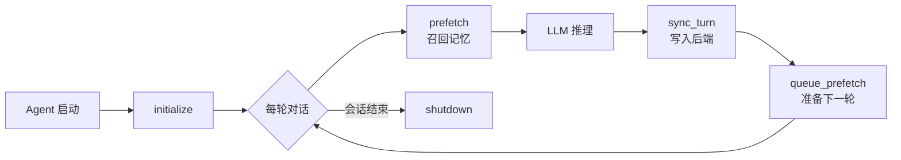

# 卷五附录 · Memory 使用指南与外部 Provider 参考

> **卷标准**：[`VOLUME_STANDARD.md`](VOLUME_STANDARD.md) · **完成度**：[`MANIFEST.md`](MANIFEST.md)  
> **本文件边界**：从 legacy `MEMORY_SYSTEM.md` 迁入的 **§7 使用指南** + **§8 外部 Provider 参考**（配置、各插件深度、自定义 Provider）。  
> **运行时契约（三层、prefetch/sync、与 Session 分工）** 仍以 [卷三第6章](03-runtime-session-and-loop.md#sec-ch6) 与 [卷五 §4.4](05-capabilities-extensions.md#44-记忆) 为准；本附录不重复循环时序。  
> **协作架构、Skills/Curator/Trajectory 长文** → [卷五附录 B · 架构与进化](05-memory-architecture-and-evolution.md)。  
> **自我进化摘要** → [卷三 6.8](03-runtime-session-and-loop.md#sec-6-8) · [卷五 §4.3 Skills](05-capabilities-extensions.md#43-skills) · [卷八 §3](08-security-and-governance.md#3-后台复盘background-review)。  
> **权威源码**：`tools/memory_tool.py`、`tools/session_search_tool.py`、`agent/memory_manager.py`、`agent/memory_provider.py`、`hermes_state.py`

---

## 本附录目录

- [A. 使用指南](#a-使用指南)（日常、`memory` / `session_search`、容量、误区）
- [B. 外部 Provider 参考](#b-外部-provider-参考)（接口、官方插件、配置、自定义）

---

<a id="a-使用指南"></a>

## A. 使用指南

### 1. 日常使用只需要记住三件事

1. **长期稳定事实** 存到 `memory`
2. **历史任务和讨论细节** 用 `session_search`
3. **可复用方法论** 沉淀成 skill

如果把这三件事混在一起，Hermes 的记忆系统就会迅速失真。

---

### 2. `memory` 工具到底应该怎么用

#### 2.1 两个 target

`memory` 工具只操作两个目标：

- `target="memory"`
- `target="user"`

含义分别是：

- `memory`: 你的环境、项目、惯例、教训
- `user`: 用户是谁、怎么沟通、喜欢什么、讨厌什么

#### 2.2 三个 action

当前稳定 action 只有三个：

- `add`
- `replace`
- `remove`

其中：

- `replace` 需要 `old_text`
- `remove` 需要 `old_text`
- `old_text` 是唯一子串，不是完整条目 ID

#### 2.3 最佳实践

好的 memory entry 应该满足：

- 稳定
- 可复用
- 高密度
- 会影响后续行为

例如：

```text
项目 ~/work/api 使用 Go 1.22 + sqlc + chi。测试命令是 `make test`。CI 在 GitHub Actions。
```

而不是：

```text
今天我们看了一个 bug，后来试了几次，感觉可能是数据库或者缓存问题。
```

---

### 3. 什么时候该存 memory

#### 3.1 应主动保存的内容

- 用户表达了稳定偏好
- 用户纠正了 agent
- agent 发现了环境事实
- agent 学到项目约定
- agent 发现了将来还会反复踩到的工具 quirks

#### 3.2 不该存进 memory 的内容

- 临时进度
- 当前任务的中间状态
- 一次性 debug 上下文
- 大段日志
- 已经很容易重新发现的公开事实

#### 3.3 一个简单判断标准

问自己：

> “如果下周开启一个全新会话，这条信息是否仍然值得自动进 prompt？”

如果答案不是明确的“是”，大概率就不该进 memory。

---

### 4. `session_search` 什么时候用

`session_search` 是 Hermes 的“长时会话回忆”，不是 built-in memory 的补丁。

适合它的场景：

- “我们以前修过这个问题吗？”
- “上次那个方案最后为什么放弃了？”
- “某个 session 里提到过哪个路径 / 命令 / 时间点？”
- “最近几次对这个用户的需求变化是什么？”

不适合它的场景：

- 代替 `MEMORY.md` 保存长期偏好
- 保存必须每次都立即在 prompt 里可见的约定

---

### 5. memory vs session_search vs skills

| 需求 | 该用什么 | 原因 |
|------|----------|------|
| 用户偏好 | `memory(target=\"user\")` | 下次会话一开始就要生效 |
| 项目约定 | `memory(target=\"memory\")` | 属于长期稳定背景 |
| 上次任务细节 | `session_search` | 属于历史会话召回 |
| 可复用步骤 / 方法论 | skill | 这是“怎么做”，不是“记住什么” |
| 临时 todo | todo | 这是运行态任务管理，不是持久记忆 |

这是 Hermes memory 最需要反复强调的一张表。

---

### 6. capacity management

#### 6.1 为什么要小而精

Hermes 的 built-in memory 是 system prompt 成本的一部分。

所以 built-in memory 的目标不是“越多越好”，而是：

- 少
- 稳
- 准

#### 6.2 容量满了怎么办

Hermes 当前实现不是自动无限扩容，而是要求 agent 或用户：

1. 看已有条目
2. 找可合并或过时的条目
3. 用 `replace` 做浓缩
4. 再添加新条目

这意味着 memory 本质上是 curated memory，不是 append-only log。

#### 6.3 推荐写法

优先写“密度高”的句子，而不是碎片化条目。

较好：

```text
用户偏好简洁回复；后端常用 Python/FastAPI，前端偏 React/TypeScript；默认先给结论再给细节。
```

较差：

```text
用户喜欢简洁回复。
用户常用 Python。
用户也会用 FastAPI。
用户有时候做前端。
```

---

### 7. 当前 session 中途写 memory 会发生什么

磁盘立即更新；**当前会话 system prompt 不刷新**（tool result 可见新内容）。机制见 [§3 Frozen Snapshot](#35-冻结快照模式)。

### 8. 为什么不热更新 built-in memory

为了 prefix cache 稳定、避免 mid-session prompt 漂移。built-in memory 是 **next-session-oriented**，不是 live scratchpad。细节见 §3。


### 9. external provider 怎么影响日常使用

如果启用了外部 provider：

- 你仍然保留 `MEMORY.md` / `USER.md`
- 你仍然能用 `session_search`
- 只是额外获得更深的 recall / profile / semantic memory 能力

所以对使用者来说，正确心智模型不是：

- “我换成 Honcho 之后 built-in memory 就没了”

而是：

- “我在 built-in memory 之上加了一层增强”

---

### 10. 典型使用模式

#### 10.1 个人开发者

- 长期偏好和项目规则进 `memory`
- 历史 debug 与 task 详情交给 `session_search`
- 常做的任务沉淀成 skill

#### 10.2 长期助手

- `USER.md` 记录沟通风格和偏好
- external provider 负责更深用户建模
- `session_search` 负责完整时序追溯

#### 10.3 团队 / 多入口会话

- `state.db` 提供统一会话归档
- built-in memory 保持稳定共同背景
- external provider 负责跨 session 的 richer profile

---

### 11. 给 prompt / policy 作者的建议

如果你在写 Hermes 的系统提示、agent policy 或技能说明，应该遵守下面的分流规则：

- “记住这个偏好” -> `memory(target="user")`
- “记住这个环境事实 / 约定” -> `memory(target="memory")`
- “我们以前聊过这个吗” -> `session_search`
- “把这套方法沉淀下来” -> `skill_manage`

最差的做法是让 agent 把所有有价值信息都塞进 `memory`。

---

### 12. 常见误区

#### 12.1 “memory 就是所有长期上下文”

不对。Hermes 的长期上下文至少分成：

- curated built-in memory
- session archive
- optional external provider

#### 12.2 “session_search 可以代替 memory”

也不对。`session_search` 是按需 recall，不是始终在线 context。

#### 12.3 “skill 就是另一种 memory”

部分重叠，但角色不同。skill 是方法论资产，不是用户画像或项目背景。

---

### 13. 实战口诀

最后浓缩成一句话：

> **偏好和约定进 memory，历史细节查 session_search，做法沉淀成 skill。**


<a id="b-外部-provider-参考"></a>

## B. 外部 Provider 参考

### MemoryProvider 接口与生命周期

#### 1.1 设计哲学

Hermes 的外部记忆系统采用**插件化架构**,通过 `MemoryProvider` 抽象基类定义统一契约,支持多种后端实现:

```python
## agent/memory_provider.py - 核心抽象
class MemoryProvider(ABC):
    """所有外部 Provider 必须实现的接口"""
    
    @property
    @abstractmethod
    def name(self) -> str:
        """Provider 唯一标识 (e.g. 'mem0', 'honcho')"""
    
    @abstractmethod
    def is_available(self) -> bool:
        """检查配置是否就绪(不发起网络请求)"""
    
    @abstractmethod
    def initialize(self, session_id: str, **kwargs) -> None:
        """会话初始化: 建立连接、创建资源"""
    
    def prefetch(self, query: str, *, session_id: str = "") -> str:
        """回合前召回: 返回要注入的记忆文本"""
        return ""
    
    def queue_prefetch(self, query: str, *, session_id: str = "") -> None:
        """异步队列下一轮的召回任务"""
    
    def sync_turn(self, user_content: str, assistant_content: str, *, session_id: str = "") -> None:
        """回合后同步: 将对话写入后端"""
    
    @abstractmethod
    def get_tool_schemas(self) -> List[Dict[str, Any]]:
        """暴露给 LLM 的工具列表"""
    
    def handle_tool_call(self, tool_name: str, args: Dict[str, Any], **kwargs) -> str:
        """处理工具调用,返回 JSON 字符串"""
```

**关键生命周期**:



#### 1.2 单一 Provider 限制

```python
## agent/memory_manager.py
class MemoryManager:
    def add_provider(self, provider: MemoryProvider):
        if self.external_provider is not None:
            logger.warning(
                "Only one external provider allowed. Ignoring %s, keeping %s",
                provider.name, self.external_provider.name
            )
            return
        self.external_provider = provider
```

**设计理由**:
- ✅ 避免工具 schema 爆炸(每个 Provider 暴露 3-5 个工具)
- ✅ 避免写入语义冲突(多个后端同时写入同一事实)
- ✅ 简化配置与调试(明确的故障边界)
- ✅ 降低 Token 消耗(只注入一个 Provider 的上下文)

### 2. 官方插件详解

| Provider | 类型 | 存储后端 | 核心能力 | 适用场景 |
|----------|------|---------|---------|----------|
| **mem0** | 向量数据库 | Mem0 Platform API | 服务端 LLM 提取 + 语义搜索 + rerank | 个人使用,注重隐私 |
| **Honcho** | AI 原生记忆 | Honcho Cloud API | 方言推理 + Peer Card + 用户建模 | 深度个性化,跨会话理解 |
| **supermemory** | 知识图谱 | Supermemory API | 容器标签 + 会话导入 + 混合搜索 | 团队协作,项目管理 |
| **hindsight** | 本地向量 | SQLite + Sentence Transformers | 离线运行 + 零依赖 | 完全本地部署 |
| **byterover** | 向量数据库 | ByteRover API | 高性能检索 | 高吞吐场景 |
| **openviking** | 向量数据库 | OpenViking SDK | 开源可自托管 | 企业内网 |
| **retaindb** | 关系型 | SQL-based | 结构化查询 | 需要复杂过滤 |

---

### 3. Mem0 Provider 深度解析

#### 3.1 存储什么?

Mem0 采用**服务端 LLM 提取**策略,不是简单存储原始对话:

```python
## 用户输入
user: "我喜欢用 Python 写后端,前端用 React"
assistant: "好的,已记录您的技术栈偏好"

## Mem0 服务端提取的事实(存储在云端向量库)
facts = [
    {"memory": "用户喜欢用 Python 写后端", "score": 0.95},
    {"memory": "用户使用 React 做前端开发", "score": 0.92}
]
```

**数据模型**:
```json
{
  "id": "mem_abc123",
  "memory": "用户喜欢用 Python 写后端",
  "user_id": "hermes-user",
  "agent_id": "hermes",
  "metadata": {
    "source": "conversation",
    "extracted_at": "2026-04-22T10:30:00Z"
  },
  "embedding": [0.1, 0.2, ...],  // 768维向量
  "created_at": "2026-04-22T10:30:00Z"
}
```

#### 3.2 如何存?

**自动同步(sync_turn)** - 每轮对话后异步发送:
```python
def sync_turn(self, user_content: str, assistant_content: str, *, session_id: str = "") -> None:
    """非阻塞地将对话发送到 Mem0 服务端进行事实提取"""
    def _sync():
        client = self._get_client()
        messages = [
            {"role": "user", "content": user_content},
            {"role": "assistant", "content": assistant_content},
        ]
        # Mem0 服务端会调用 LLM 提取事实并存储
        client.add(messages, filters={"user_id": self._user_id, "agent_id": self._agent_id})
    
    threading.Thread(target=_sync, daemon=True).start()
```

**手动存储(mem0_conclude 工具)** - 用户显式要求记住:
```python
## 用户说: "记住我每周三晚上 8 点有团队会议"
## Agent 调用:
mem0_conclude(conclusion="用户每周三晚上 8 点有团队会议")

## 内部实现(infer=False 表示不经过 LLM 提取,直接存储)
client.add(
    [{"role": "user", "content": conclusion}],
    filters={"user_id": self._user_id, "agent_id": self._agent_id},
    infer=False  # 关键: 绕过服务端提取,原样存储
)
```

#### 3.3 如何取?

**三种召回方式**:

1. **自动召回(prefetch)** - 每轮对话前异步执行:
```python
def queue_prefetch(self, query: str, *, session_id: str = "") -> None:
    """后台线程执行语义搜索,结果缓存到 _prefetch_result"""
    def _run():
        client = self._get_client()
        results = client.search(
            query=query,
            filters={"user_id": self._user_id},  # 只查当前用户
            rerank=self._rerank,  # 启用重排序提升精度
            top_k=5
        )
        # 格式化为一行一行的事实
        lines = [r.get("memory", "") for r in results if r.get("memory")]
        with self._prefetch_lock:
            self._prefetch_result = "\n".join(f"- {l}" for l in lines)
    
    threading.Thread(target=_run, daemon=True).start()
```

2. **全量获取(mem0_profile 工具)** - 获取所有记忆:
```python
def handle_tool_call(self, tool_name: str, args: dict, **kwargs) -> str:
    if tool_name == "mem0_profile":
        memories = client.get_all(filters={"user_id": self._user_id})
        lines = [m.get("memory", "") for m in memories if m.get("memory")]
        return json.dumps({"result": "\n".join(lines), "count": len(lines)})
```

3. **语义搜索(mem0_search 工具)** - 按需检索:
```python
if tool_name == "mem0_search":
    results = client.search(
        query=args["query"],
        filters={"user_id": self._user_id},
        rerank=args.get("rerank", False),
        top_k=min(int(args.get("top_k", 10)), 50)
    )
    items = [{"memory": r["memory"], "score": r["score"]} for r in results]
    return json.dumps({"results": items, "count": len(items)})
```

#### 3.4 性能优化

**电路断路器(Circuit Breaker)**:
```python
_BREAKER_THRESHOLD = 5       # 连续失败 5 次
_BREAKER_COOLDOWN_SECS = 120 # 冷却 120 秒

def _is_breaker_open(self) -> bool:
    if self._consecutive_failures < _BREAKER_THRESHOLD:
        return False
    if time.monotonic() >= self._breaker_open_until:
        self._consecutive_failures = 0  # 重置
        return False
    return True  # 熔断中,跳过 API 调用
```

**效果**: 当 Mem0 API 不可用时,不会阻塞 Agent 主循环,2 分钟后自动重试。

---

### 4. Honcho Provider 深度解析

#### 4.1 存储什么?

Honcho 采用**AI 原生用户建模**,不只是存储事实,而是构建用户的**Peer Card**(同伴卡片):

```python
## Honcho 存储的核心数据结构
peer_card = {
    "peer_id": "user_123",
    "representation": "用户是一位资深 Python 工程师,偏好简洁的代码风格...",
    "card": [
        "喜欢用 FastAPI 构建后端服务",
        "前端技术栈: React + TypeScript",
        "沟通风格: 直接,不喜欢冗长解释",
        "工作时间: 通常在北京时间 9:00-18:00 活跃"
    ],
    "sessions": ["sess_001", "sess_002", ...]  # 关联的会话 ID
}
```

**与 Mem0 的关键区别**:
- Mem0: 存储离散的事实片段 → 语义搜索
- Honcho: 构建连贯的用户画像 → 方言推理(Dialectic Reasoning)

#### 4.2 如何存?

**三层存储策略**:

1. **Session 层** - 每次对话的原始消息:
```python
## plugins/memory/honcho/session.py
def add_message(self, session_key: str, role: str, content: str):
    """将消息添加到 Honcho Session"""
    honcho_session = self.get_or_create(session_key)
    honcho_session.chat(role=role, content=content)
```

2. **Peer 层** - 用户表示(Representation)和卡片(Card):
```python
## 在会话结束时,Honcho 自动更新用户表示
def on_session_end(self, messages: List[Dict]):
    # Honcho 内部会调用 LLM 分析整个会话,更新 peer.representation
    # 这是 Honcho 的核心价值: 持续精炼用户画像
    pass  # 由 Honcho SDK 自动处理
```

3. **Conclusions 层** - 持久化结论:
```python
## 用户显式保存结论
def handle_tool_call(self, tool_name: str, args: dict, **kwargs) -> str:
    if tool_name == "honcho_conclude":
        conclusion = args.get("conclusion", "")
        # 写入 Honcho 的 conclusions 表,永久保存
        honcho.conclusions.create(peer="user", text=conclusion)
        return json.dumps({"result": "Conclusion stored."})
```

#### 4.3 如何取?

**四种召回模式**(recall_mode 配置决定):

**模式 1: Context 模式** - 自动注入上下文:
```python
def prefetch(self, query: str, *, session_id: str = "") -> str:
    """返回两层上下文"""
    # Layer 1: Base context (peer representation + card)
    base_ctx = self._manager.get_prefetch_context(self._session_key)
    # 返回: "## User Representation\n...\n## User Peer Card\n..."
    
    # Layer 2: Dialectic supplement (LLM 推理结果)
    dialectic = self._run_dialectic_depth(query)
    # 返回: "基于历史对话,用户当前可能在解决认证问题..."
    
    return f"{base_ctx}\n\n{dialectic}"
```

**Dialectic Reasoning(方言推理)** - Honcho 的核心创新:
```python
def _run_dialectic_depth(self, query: str) -> str:
    """多轮 LLM 推理,逐步深入理解用户意图"""
    results = []
    for i in range(self._dialectic_depth):  # 默认 1-3 轮
        if i == 0:
            prompt = "Who is this person? What are their preferences?"
        elif i == 1:
            prompt = f"Given prior assessment:\n{results[-1]}\nWhat gaps remain?"
        else:
            prompt = f"Reconcile contradictions between passes:\n{results}"
        
        result = self._manager.dialectic_query(
            self._session_key, 
            prompt,
            reasoning_level="low"  # minimal/low/medium/high/max
        )
        results.append(result)
    
    return results[-1]  # 返回最后一轮的推理结果
```

**模式 2: Tools 模式** - 仅暴露工具,不自动注入:
```python
def system_prompt_block(self) -> str:
    if self._recall_mode == "tools":
        return (
            "# Honcho Memory\n"
            "Active (tools-only mode). Use honcho_profile, honcho_search, "
            "honcho_reasoning to access memory. No automatic injection."
        )
    return ""

def prefetch(self, query: str, *, session_id: str = "") -> str:
    if self._recall_mode == "tools":
        return ""  # 不自动注入任何内容
```

**模式 3: Hybrid 模式** - 两者结合(默认):
```python
## 既自动注入上下文,又暴露工具供主动查询
def system_prompt_block(self) -> str:
    return (
        "# Honcho Memory\n"
        "Active (hybrid mode). Context auto-injected AND tools available."
    )
```

**工具调用示例**:

1. **honcho_profile** - 快速获取用户卡片:
```python
## Agent 调用
honcho_profile(peer="user")

## 返回
{
  "card": [
    "喜欢用 FastAPI 构建后端服务",
    "前端技术栈: React + TypeScript",
    "沟通风格: 直接,不喜欢冗长解释"
  ]
}
```

2. **honcho_search** - 语义搜索原始摘录:
```python
honcho_search(query="authentication bug", max_tokens=800)

## 返回原始会话片段(无 LLM 合成)
{
  "excerpts": [
    "上次我们修复了 token 刷新逻辑,关键是 SECRET_KEY 要持久化...",
    "JWT token 过期时间设置为 1 小时..."
  ]
}
```

3. **honcho_reasoning** - 合成答案(高成本):
```python
honcho_reasoning(
    query="用户之前遇到过哪些认证问题?",
    reasoning_level="medium"  # 控制推理深度
)

## 返回 LLM 合成的答案
{
  "answer": "用户在 2026-04-19 遇到过 JWT token 刷新问题,原因是..."
}
```

4. **honcho_context** - 获取完整会话上下文:
```python
honcho_context(peer="user")

## 返回
{
  "summary": "本次会话讨论了认证 bug 修复",
  "representation": "用户是一位资深 Python 工程师...",
  "card": [...],
  "recent_messages": [...]
}
```

#### 4.4 成本优化

**Cadence 控制**(减少 API 调用频率):
```python
## honcho.json 配置
{
  "contextCadence": 3,      // 每 3 轮调用一次 peer.context()
  "dialecticCadence": 5,    // 每 5 轮调用一次 dialectic reasoning
  "injectionFrequency": "first-turn"  // 只在第一轮注入完整上下文
}
```

**推理级别选择**:
```python
## 根据查询长度自动调整推理深度
def _apply_reasoning_heuristic(self, base: str, query: str) -> str:
    if len(query) < 120:
        return "minimal"  # 短查询用最小推理
    elif len(query) < 400:
        return "low"      # 中等长度用低推理
    else:
        return "medium"   # 长查询用中等推理
```

---

### 5. Supermemory Provider 深度解析

#### 5.1 存储什么?

Supermemory 采用**容器化(Container Tags)**组织记忆,支持多维度分类:

```python
## 数据模型
memory_item = {
    "id": "doc_xyz789",
    "memory": "用户每周三晚上 8 点有团队会议",
    "container_tags": ["hermes", "work-schedule"],  # 容器标签
    "metadata": {
        "source": "hermes",
        "type": "explicit_memory",
        "category": "preference"
    },
    "updated_at": "2026-04-22T10:30:00Z"
}
```

**容器标签系统**:
- `hermes`: 默认容器(所有记忆)
- `work-schedule`: 工作日程
- `tech-stack`: 技术栈偏好
- `project-notes`: 项目笔记

#### 5.2 如何存?

**三种写入方式**:

1. **自动捕获(sync_turn)** - 每轮对话后:
```python
def sync_turn(self, user_content: str, assistant_content: str, *, session_id: str = "") -> None:
    """清理后的对话文本发送到 Supermemory"""
    # 移除 <supermemory-context> 标签,避免污染
    clean_user = _clean_text_for_capture(user_content)
    clean_assistant = _clean_text_for_capture(assistant_content)
    
    # 格式化为结构化对话
    content = (
        f"[role: user]\n{clean_user}\n[user:end]\n\n"
        f"[role: assistant]\n{clean_assistant}\n[assistant:end]"
    )
    
    # 异步发送
    threading.Thread(
        target=lambda: self._client.add_memory(
            content,
            metadata={"source": "hermes", "type": "conversation_turn"},
            entity_context=self._entity_context  # 指导 LLM 提取什么
        )
    ).start()
```

**Entity Context(实体上下文)** - 指导 LLM 提取策略:
```python
_DEFAULT_ENTITY_CONTEXT = (
    "User-assistant conversation. Format: [role: user]...[user:end]\n\n"
    "Only extract things useful in future conversations.\n\n"
    "Remember lasting personal facts, preferences, routines, tools, ongoing projects.\n\n"
    "Do NOT remember temporary intents, one-time tasks, assistant actions.\n\n"
    "When in doubt, store less."
)
```

2. **会话导入(on_session_end)** - 会话结束后批量导入:
```python
def on_session_end(self, messages: List[Dict[str, Any]]) -> None:
    """将整个会话作为一条记录导入 Supermemory"""
    cleaned = [
        {"role": msg["role"], "content": _clean_text_for_capture(msg["content"])}
        for msg in messages
        if msg["role"] in ("user", "assistant")
    ]
    
    # 调用 Supermemory Conversations API
    self._client.ingest_conversation(self._session_id, cleaned)
```

3. **手动存储(supermemory_store 工具)** - 用户显式保存:
```python
def _tool_store(self, args: dict) -> str:
    content = args["content"]
    metadata = {
        "type": _detect_category(content),  # preference/decision/fact/other
        "source": "hermes_tool"
    }
    
    # 可选: 指定容器标签
    container_tag = args.get("container_tag")  # e.g. "work-schedule"
    
    result = self._client.add_memory(
        content,
        metadata=metadata,
        entity_context=self._entity_context,
        container_tag=container_tag
    )
    return json.dumps({"saved": True, "id": result["id"]})
```

#### 5.3 如何取?

**Profile Recall(配置文件召回)** - 自动召回:
```python
def prefetch(self, query: str, *, session_id: str = "") -> str:
    """获取静态事实 + 动态上下文 + 语义搜索结果"""
    profile = self._client.get_profile(query=query[:200])
    
    # Static: 持久化事实(如用户偏好)
    static_facts = profile["static"]  # ["喜欢用 Python", "时区 Asia/Shanghai"]
    
    # Dynamic: 近期上下文(最近几轮对话的摘要)
    dynamic_facts = profile["dynamic"]  # ["正在修复认证 bug"]
    
    # Search: 语义相关记忆
    search_results = profile["search_results"]  # [{"memory": "...", "similarity": 0.85}]
    
    # 格式化为 <supermemory-context> 标签
    return _format_prefetch_context(static_facts, dynamic_facts, search_results)
```

**输出格式**:
```markdown
<supermemory-context>
The following is background context from long-term memory.

### User Profile (Persistent)
- 喜欢用 Python 写后端
- 时区: Asia/Shanghai

### Recent Context
- 正在修复 FastAPI 认证 bug

### Relevant Memories
- [2h ago] [85%] JWT token 刷新逻辑需要持久化 SECRET_KEY
- [1d ago] [72%] 用户偏好使用 pytest 进行测试
</supermemory-context>
```

**工具调用**:

1. **supermemory_search** - 语义搜索:
```python
supermemory_search(query="authentication", limit=5)

## 返回
{
  "results": [
    {"id": "doc_001", "content": "JWT token 刷新...", "similarity": 85},
    {"id": "doc_002", "content": "SECRET_KEY 持久化...", "similarity": 78}
  ],
  "count": 2
}
```

2. **supermemory_profile** - 获取完整画像:
```python
supermemory_profile(query="技术栈偏好")

## 返回
{
  "profile": "## User Profile (Persistent)\n- 喜欢用 Python...",
  "static_count": 5,
  "dynamic_count": 2
}
```

3. **supermemory_forget** - 删除记忆:
```python
## 按 ID 删除
supermemory_forget(id="doc_abc123")

## 按查询删除(删除最匹配的一条)
supermemory_forget(query="过时的项目信息")
```

#### 5.4 多容器管理

**启用自定义容器**:
```json
// supermemory.json
{
  "enable_custom_container_tags": true,
  "custom_containers": ["work-schedule", "tech-stack", "project-notes"],
  "custom_container_instructions": "Use work-schedule for meetings, tech-stack for programming preferences."
}
```

**工具调用时指定容器**:
```python
## 保存到特定容器
supermemory_store(
    content="每周三晚上 8 点团队会议",
    container_tag="work-schedule"
)

## 从特定容器搜索
supermemory_search(
    query="会议安排",
    container_tag="work-schedule"
)
```

---

### 6. Provider 对比总结

| 维度 | Mem0 | Honcho | Supermemory |
|------|------|--------|-------------|
| **存储粒度** | 离散事实片段 | 用户画像(Peer Card) | 容器化记忆 + 会话 |
| **提取方式** | 服务端 LLM 自动提取 | 方言推理(Dialectic) | Entity Context 指导提取 |
| **召回策略** | 语义搜索 + Rerank | 自动注入 + 工具查询 | Profile Recall + 混合搜索 |
| **工具数量** | 3 个(profile/search/conclude) | 5 个(profile/search/reasoning/context/conclude) | 4 个(store/search/forget/profile) |
| **成本控制** | 电路断路器 | Cadence + 推理级别 | 捕获模式(all/everything) |
| **适用场景** | 个人知识管理 | 深度个性化助手 | 团队协作 + 项目管理 |
| **数据所有权** | Mem0 Platform(云端) | Honcho Cloud(云端) | Supermemory API(云端) |
| **离线支持** | ❌ | ❌ | ❌ |

---

### 7. 配置示例

#### Mem0 配置

```yaml
## ~/.hermes/config.yaml
memory:
  provider: mem0

## $HERMES_HOME/mem0.json
{
  "api_key": "mem0_xxx",  // 或环境变量 MEM0_API_KEY
  "user_id": "hermes-user",
  "agent_id": "hermes",
  "rerank": true
}
```

#### Honcho 配置

```yaml
## ~/.hermes/config.yaml
memory:
  provider: honcho

## $HERMES_HOME/honcho.json
{
  "api_key": "honcho_xxx",  // 或环境变量 HONCHO_API_KEY
  "baseUrl": "https://api.honcho.dev",  // 可选,自托管时设置
  "recall_mode": "hybrid",  // context/tools/hybrid
  "contextCadence": 3,
  "dialecticCadence": 5,
  "dialecticDepth": 2,
  "dialecticReasoningLevel": "low",
  "injectionFrequency": "every-turn"  // every-turn/first-turn
}
```

#### Supermemory 配置

```yaml
## ~/.hermes/config.yaml
memory:
  provider: supermemory

## $HERMES_HOME/supermemory.json
{
  "api_key": "supermemory_xxx",  // 或环境变量 SUPERMEMORY_API_KEY
  "container_tag": "hermes",  // 支持 {identity} 模板
  "auto_recall": true,
  "auto_capture": true,
  "max_recall_results": 10,
  "profile_frequency": 50,
  "capture_mode": "all",  // all/everything
  "search_mode": "hybrid",  // hybrid/memories/documents
  "entity_context": "Only extract lasting facts...",  // 自定义提取指导
  "enable_custom_container_tags": true,
  "custom_containers": ["work", "personal"],
  "custom_container_instructions": "Use work for professional context."
}
```

---

### 8. 开发自定义 Provider

#### 步骤 1: 创建插件目录

```bash
mkdir -p plugins/memory/my-provider
touch plugins/memory/my-provider/__init__.py
```

#### 步骤 2: 实现 MemoryProvider 接口

```python
## plugins/memory/my-provider/__init__.py
from agent.memory_provider import MemoryProvider
from typing import Any, Dict, List
import json

class MyProvider(MemoryProvider):
    """自定义 Memory Provider 示例"""
    
    def __init__(self):
        self._api_key = ""
        self._client = None
        self._prefetch_result = ""
    
    @property
    def name(self) -> str:
        return "my-provider"
    
    def is_available(self) -> bool:
        """检查 API Key 是否配置"""
        import os
        return bool(os.environ.get("MY_PROVIDER_API_KEY"))
    
    def initialize(self, session_id: str, **kwargs) -> None:
        """初始化客户端"""
        import os
        self._api_key = os.environ.get("MY_PROVIDER_API_KEY", "")
        # self._client = MyClient(api_key=self._api_key)
    
    def prefetch(self, query: str, *, session_id: str = "") -> str:
        """召回记忆"""
        if not self._prefetch_result:
            return ""
        result = self._prefetch_result
        self._prefetch_result = ""
        return f"## My Provider Memory\n{result}"
    
    def queue_prefetch(self, query: str, *, session_id: str = "") -> None:
        """异步召回"""
        import threading
        def _run():
            try:
                # results = self._client.search(query, limit=5)
                # lines = [r["text"] for r in results]
                # self._prefetch_result = "\n".join(f"- {l}" for l in lines)
                pass
            except Exception as e:
                print(f"Prefetch failed: {e}")
        
        threading.Thread(target=_run, daemon=True).start()
    
    def sync_turn(self, user_content: str, assistant_content: str, *, session_id: str = "") -> None:
        """同步对话"""
        import threading
        def _sync():
            try:
                # self._client.add({
                #     "user": user_content,
                #     "assistant": assistant_content
                # })
                pass
            except Exception as e:
                print(f"Sync failed: {e}")
        
        threading.Thread(target=_sync, daemon=True).start()
    
    def get_tool_schemas(self) -> List[Dict[str, Any]]:
        """暴露工具"""
        return [
            {
                "name": "my_provider_search",
                "description": "Search my provider memory",
                "parameters": {
                    "type": "object",
                    "properties": {
                        "query": {"type": "string"}
                    },
                    "required": ["query"]
                }
            }
        ]
    
    def handle_tool_call(self, tool_name: str, args: Dict[str, Any], **kwargs) -> str:
        """处理工具调用"""
        if tool_name == "my_provider_search":
            # results = self._client.search(args["query"])
            return json.dumps({"results": [], "count": 0})
        raise NotImplementedError(f"Unknown tool: {tool_name}")
    
    def shutdown(self) -> None:
        """清理资源"""
        pass

def register(ctx) -> None:
    """注册 Provider"""
    ctx.register_memory_provider(MyProvider())
```

#### 步骤 3: 激活 Provider

```yaml
## ~/.hermes/config.yaml
memory:
  provider: my-provider
```

---

### 9. 最佳实践

#### 9.1 选择合适的 Provider

**场景 1: 个人使用,注重隐私**
- ✅ 推荐: Builtin Memory + SessionDB
- ❌ 避免: 云端 Provider

**场景 2: 深度个性化,跨会话理解**
- ✅ 推荐: Honcho (方言推理 + 用户建模)
- ✅ 优势: 持续精炼用户画像,理解深层意图

**场景 3: 团队协作,项目管理**
- ✅ 推荐: Supermemory (容器标签 + 会话导入)
- ✅ 优势: 多维度分类,支持团队共享

**场景 4: 简单事实存储**
- ✅ 推荐: Mem0 (服务端提取 + 语义搜索)
- ✅ 优势: 配置简单,开箱即用

#### 9.2 控制记忆大小

**建议**:
- SessionDB: 定期清理旧会话(>30天)
- MEMORY.md: 保持精简,只记录关键点
- External Provider: 设置 retention policy

```bash
## 清理旧会话
hermes cleanup --older-than 30d
```

#### 9.3 监控记忆质量

```bash
## 查看记忆统计
hermes memory stats

## 输出:
## SessionDB: 1,234 sessions, 45,678 messages
## Builtin: MEMORY.md (2.3 KB), USER.md (1.1 KB)
## External: honcho (567 memories)
```

#### 9.4 调试记忆问题

**检查记忆是否正确注入**:
```bash
## 启用调试日志
hermes --log-level DEBUG

## 查看 <memory-context> 内容
grep "<memory-context>" ~/.hermes/logs/latest.log
```

**常见问题**:
- ❌ 记忆未召回 → 检查 API Key 和网络连接
- ❌ 记忆混淆 → 检查 `<memory-context>` 标签是否完整
- ❌ Provider 失败 → 查看日志中的错误信息

## 9. 扩展机制（非 memory 主模型）

> Skills、Curator、Trajectory **不是** Persistent Memory 的子类型。  
> 主模型仍是三层；本节描述与 memory **协同**的进化/沉淀机制。  
> 已删除旧稿中错误的 `memory(action="write")` /「<5KB」示例（与 §3 API 冲突）。

### 本节范围

本文只回答：

- memory 如何与 skills 协作
- 对话如何变成训练资产
- Hermes 所谓“self-improving”在工程上是怎么分层的

---

