# 卷六 · IM Gateway：启动、会话、收发、忙时、投递与 HITL

> **卷标准**：[`VOLUME_STANDARD.md`](VOLUME_STANDARD.md) · **完成度**：[`MANIFEST.md`](MANIFEST.md)  
> **本卷边界**：包 **`gateway/`**（IM 网关进程）+ 同进程挂上的 **cron 出站**、**hosted room**、**看板调度**。呈现网关 `tui_gateway/` → [卷二](02-surface-and-presentation.md)。审批状态机细节 → [卷八](08-security-and-governance.md)。  
> **权威源码**：`gateway/run.py`（`GatewayRunner`、`start_gateway`）、`run_startup.py`、`run_inbound.py`、`run_busy.py`、`run_turn.py`、`platforms/base.py`、`delivery.py`、`delivery_ledger.py`、`session.py`  
> **相邻卷**：[01](01-platform-and-architecture.md#sec-ch1) · [02](02-surface-and-presentation.md) · [08](08-security-and-governance.md) · [对比](../../compare/CHANNEL_AGENTSCOPE_VS_HERMES.md)

---

## 📋 目录

<!-- channel-questions:start -->
### Channel 设计按问题查找

| 我想知道…… | 直接看这里 |
|---|---|
| Channel 模块有哪些层，为什么不让平台 SDK 直接调用 Agent？ | [2.1 职责与架构](#sec-channel-design) |
| Adapter、事件、来源、回执是什么关系？ | [2.2 类图与核心对象](#sec-channel-classes) |
| 启动时先连接还是先装 handler？失败如何处理？ | [2.3 启动时序](#sec-channel-start) |
| 停止时怎样保证先收尾再断连？SDK 卡住怎么办？ | [2.4 停止时序](#sec-channel-stop) |
| 新消息如何进入会话？忙时与审批回复怎么分流？ | [2.5 入站时序](#sec-channel-receive) |
| Follow-up、pending、/queue、steer 分别放在哪里，怎样消费？ | [2.8 Follow-up 与队列](#sec-channel-queues) |
| Channel 领域还有哪些不能漏掉的能力？ | [2.9 完整能力清单](#sec-channel-capabilities) |
| 最终回复谁发？先发送还是先登记账本？ | [2.6 出站时序](#sec-channel-send) |
| 接新平台需要实现与验证哪些契约？ | [2.7 扩展与源码入口](#sec-channel-source) |

<!-- channel-questions:end -->

- [第1章：两个网关与本卷范围](#sec-g1)
- [第2章：启动与连接](#sec-g2)
  - [2.1 Channel 模块职责与整体架构图](#sec-channel-design)
  - [2.2 核心对象、类图与两层会话守卫](#sec-channel-classes)
  - [2.3 启动：回调装配、并发连接与失败恢复时序](#sec-channel-start)
  - [2.4 停止：排空、取消任务、断连与退出时序](#sec-channel-stop)
  - [2.5 收消息：事件转换、后台调度与忙时分流时序](#sec-channel-receive)
  - [2.6 发消息：最终回复、交付账本与发送回执时序](#sec-channel-send)
  - [2.7 扩展约束与源码入口](#sec-channel-source)
  - [2.8 Follow-up、busy queue、steer 与 pending](#sec-channel-queues)
  - [2.9 Channel/Gateway 完整能力清单](#sec-channel-capabilities)
- [第3章：会话键、活跃槽、Agent 缓存](#sec-g3)
- [第4章：入站一条消息（完整）](#sec-g4)
- [第5章：忙时 `busy_input_mode`](#sec-g5)
- [第6章：出站 Delivery 与 ledger](#sec-g6)
- [第7章：每个门户的设计](#sec-g7)
- [第8章：IM 上的 HITL 审批卡](#sec-g8) — [8.1](#sec-g8-1) · [8.2](#sec-g8-2) · [8.3](#sec-g8-3) · [8.4](#sec-g8-4) · [8.5](#sec-g8-5) · [8.6](#sec-g8-6) · [8.7](#sec-g8-7)
- [第9章：Cron 出站（不经 `_handle_message`）](#sec-g9)
- [第10章：Hosted Room](#sec-g10)
- [第11章：网关里的看板调度](#sec-g11)
- [第12章：和 AgentScope Channel 对照](#sec-g12)
- [第13章：包地图（grep）](#sec-g13)

---

## 第1章：两个网关与本卷范围

口语「网关」在仓库里是 **两套 Python 服务**：

| | **呈现网关 `tui_gateway/`** | **IM 网关 `gateway/`（本卷）** |
|--|---------------------------|--------------------------------|
| 启动 | `python -m tui_gateway.entry` / Desktop 后端 | `start_gateway` / `hermes gateway` |
| 听什么 | JSON-RPC：`prompt.submit`、`session.create` | 平台 SDK 推送 / webhook |
| 出站 | `_emit` → stdio 或 WebSocket | `Delivery` → `adapter.send` + **ledger** |
| 忙时 | `queued_prompt` | `_pending_messages` + `busy_input_mode` |
| 谁跑 Agent | 同一呈现网关进程 | **同一 IM 网关进程**（适配器不 import Agent） |

IM **不会** `import` Gateway 循环。启动时 Gateway **把 handler 登记进适配器**；平台推消息后 **回调** `_handle_message`。长连接在 **跑 Gateway 的那个进程**里，没有单独的 channel worker（这是和 AgentScope 的第一差别）。

---

## 第2章：启动与连接

> **概览图阅读说明**：本章下方原始启动简图保留为历史概览，包含职责/函数型参与者；精确对象及调用归属以 §2.1–2.8 重整后的实体图为准。

入口：`gateway/run.py` 的 `start_gateway(config, …)` → 构造 `GatewayRunner` → `run_startup` 拉适配器、cron、看板 watcher。

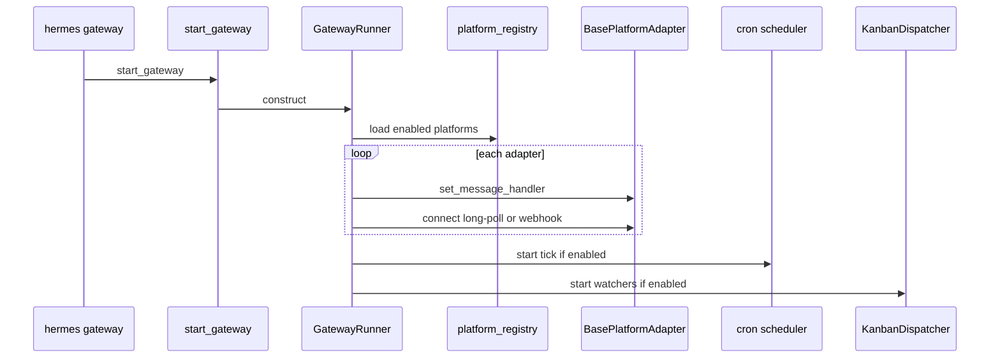

| 符号 | 文件 | 作用 |
|------|------|------|
| `start_gateway` | `gateway/run.py` | 进程入口 |
| `GatewayRunner` | `run.py` Mixin 拼装 | 会话槽、入站、出站、关机 |
| `run_startup.py` | 启动序 | 配适配器、心跳、plugin rewire |
| `platform_registry.py` | 平台名 → 类 | telegram / feishu / weixin / … |
| `connect()` | `platforms/base.py` 子类 | 长连接或 webhook `tcp_site` |

关机：`run_shutdown.py`、`run_shutdown_session_end.py` — 活跃 turn 收尾，ledger 未完成义务尽量送出。

---

<!-- channel-design:start -->

### 2.1 Channel 是什么：独立的平台适配层，不是另一套 Agent

本书的 **Channel 模块**指 `gateway/platforms/` 的适配器接口、公共消息生命周期及各平台实现，并通过 `platform_registry.py` 接入内置或插件平台。源码没有要求每个平台继承一个名为 `Channel` 的类：共同抽象是 **`BasePlatformAdapter`**。“channel”也可能只是 Slack 的频道或 `SessionSource.chat_type="channel"`，不要把两种含义混为一谈。

它的设计重点是：**平台差异下沉，共同消息生命周期上收，Agent 执行通过回调反转控制。** 平台 SDK 不需要了解 `AIAgent.run_conversation()`；Gateway 在连接前安装 handler，适配器把统一事件交给 handler，再完成平台侧的交付与收尾。

| 层 | 负责什么 | 不应误解成什么 |
|---|---|---|
| 注册与工厂 | 平台名到工厂；依赖/配置检查；插件平台与内置后备入口 | 不是一个平台对应一个独立进程 |
| 具体 Adapter | SDK、polling/SSE/WebSocket/webhook、原始事件转换、格式/媒体与平台错误处理 | 不是 Agent 或持久化会话的所有者 |
| BasePlatformAdapter | 公共入站调度、会话 guard、忙时槽、typing、响应交付、重试与任务收尾 | 不是薄薄一层 `send()` 接口 |
| GatewayRunner | 鉴权与路由、会话身份、命令、busy 策略、Agent 缓存与推理、全局启停 | 不是平台 SDK 的替代品 |
| 交付账本 / SessionStore | 回复义务及恢复 / 会话状态与历史 | 不是 Adapter 内存队列的另一种名字 |

**部署边界**：这些 Python 对象在同一个 Gateway 进程内协作；SDK 可能自带线程，某些平台还依赖外部服务（如 Signal 的 signal-cli daemon），因此“没有独立 Channel worker”不等于“绝对没有外部进程”。

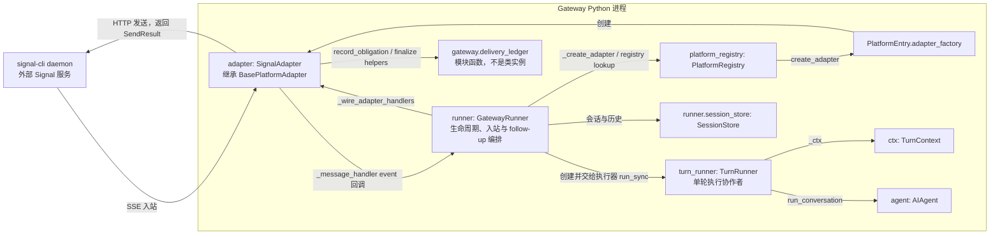

图中的具体 Adapter 与 Base 是同一个适配器实例的不同职责层，不是通过网络互调的两个服务。图中 ledger 是普通最终回复的可靠性交付旁路，不表示每个 typing、草稿或临时控制消息都走相同账本流程。

### 2.2 核心对象与类图：协议、来源、会话和发送结果

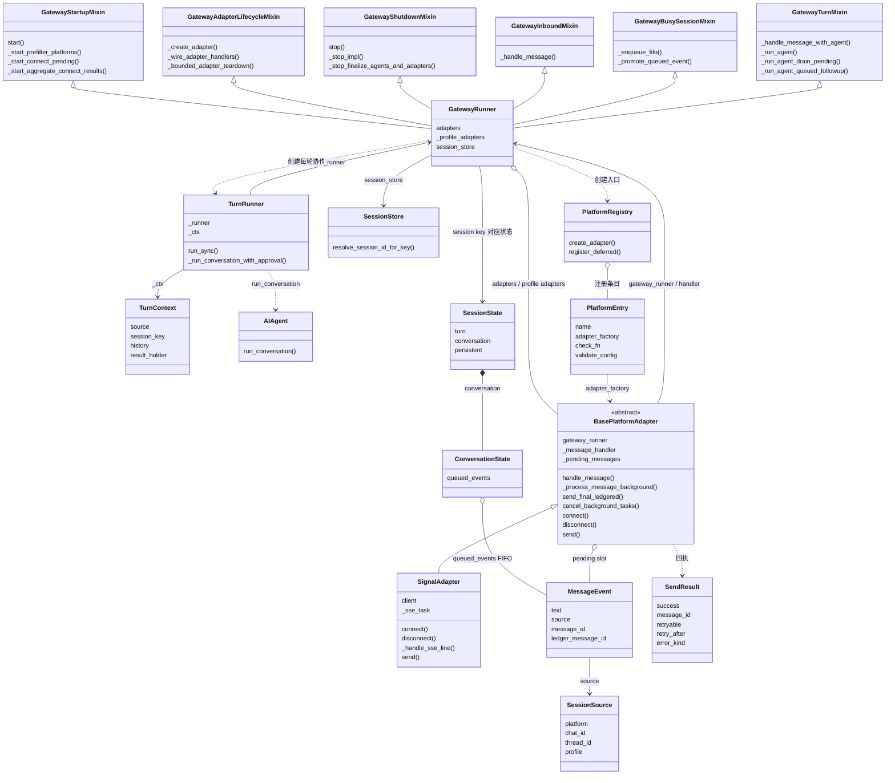

#### 图例与实体对照：后续所有时序图使用同一组对象

- `runner: GatewayRunner` 是运行时对象；`GatewayStartupMixin`、`GatewayShutdownMixin`、`GatewayTurnMixin` 等是它继承的方法提供者，**不是各自独立运行的服务或实例**。
- `adapter: SignalAdapter` 同时执行子类协议方法和继承自 `BasePlatformAdapter` 的公共生命周期。时序图用自调用表示进入基类方法，不画成 Adapter 与 Base 两个对象互发消息。
- `turn_runner: TurnRunner` 是每轮创建的协作者，负责执行器中的 `run_sync()`、回调和 `AIAgent.run_conversation()`；**不是 follow-up 队列的所有者**。
- `state: SessionState` 是数据容器；`conversation: ConversationState` 的 `queued_events` 保存溢出事件，队列调度方法在 Runner 的 `GatewayBusySessionMixin`。
- `gateway.delivery_ledger` 是模块函数集合，不存在图中虚构的 `DeliveryLedger` 类；`signal-cli daemon` 是外部系统，不强行画成 Python 类。
- 图中采用 Signal 作为具体协议实例，便于逐个对照真实字段与方法；并不宣称所有平台都使用 SSE 或 HTTP。启动中的注册表路径及失败分支是框架级路径，具体实例来源取决于实际注册配置。

| 图中实体 | 定义文件 | 真实作用 / 方法归属 |
|---|---|---|
| `GatewayRunner` | `gateway/run.py` | 聚合各 Mixin，持有 Adapter、会话状态，协调运行 |
| `GatewayStartupMixin` / `GatewayAdapterLifecycleMixin` | `run_startup.py` / `run_adapters.py` | start、连接、装配与有界拆除 |
| `GatewayShutdownMixin` | `run_shutdown.py` | stop 与各清理阶段 |
| `GatewayInboundMixin` / `GatewayBusySessionMixin` | `run_inbound.py` / `run_busy.py` | handler 与忙时排队策略 |
| `GatewayTurnMixin` | `run_turn.py` | `_run_agent`、pending drain 与 queued follow-up |
| `TurnRunner` / `TurnContext` | `run_turn_runner.py` / `turn_context.py` | 单轮执行协作者 / 单轮数据 |
| `SignalAdapter` / `BasePlatformAdapter` | `platforms/signal.py` / `platforms/base.py` | 平台协议实现 / 继承的公共消息生命周期 |
| `PlatformRegistry` / `PlatformEntry` | `platform_registry.py` | 注册与工厂元数据 |
| `SessionState` / `ConversationState` | `session_state.py` | 按 session key 的状态 / 对话范围状态 |
| `MessageEvent` / `SessionSource` / `SendResult` | `platforms/event.py` / `session.py` / `platforms/base.py` | 入站信封 / 路由坐标 / 出站回执 |

**关系约定**：类图空心三角表示继承，实线箭头表示对象持有/引用，虚线表示调用依赖。图只展开本专题相关 Mixin，不是 GatewayRunner 的全部基类清单。时序箭头优先标实际方法；解释性步骤会明确写成说明，不伪造同名 API。

这里以当前内置 `SignalAdapter` 展示真实继承关系和实例调用链，不要求所有平台采用同一种传输。Mixin 的方法均在 `runner: GatewayRunner` 上执行，类图显示定义归属，时序图显示运行对象。

- **`MessageEvent` 是入站信封**：除文本外，保留来源、原消息、消息 ID、回复锚点、媒体与元数据；它不是 LLM 的 `role/content` 消息。
- **`SessionSource` 是路由坐标**：平台、聊天、用户、线程、Profile 等参与会话定位。不是只靠 `chat_id` 就能隔离所有会话。
- **`SendResult` 是出站回执**：`success`、平台消息 ID、`retryable`、`retry_after`、`error_kind`。拆包发送还可携带 continuation IDs；“调用 send 没抛错”不能替代检查结果。
- **两层 `_active_sessions` 不可混淆**：Adapter guard 防止同 key 并行启动处理任务，Runner 活跃槽协调真实 Agent 轮次和 busy 策略。名字相近，不代表同一个字典。

### 2.3 启动流程：先装配回调，再并发连接，再发布可用实例

实际主链为 `GatewayStartupMixin.start()` → `_start_prefilter_platforms()` → `_start_connect_pending()` → `_start_aggregate_connect_results()`，随后完成服务与 watcher 装配。第2章开头简图的 `loop connect` 表示“每个平台都要连接”，**不表示串行等待所有平台**。

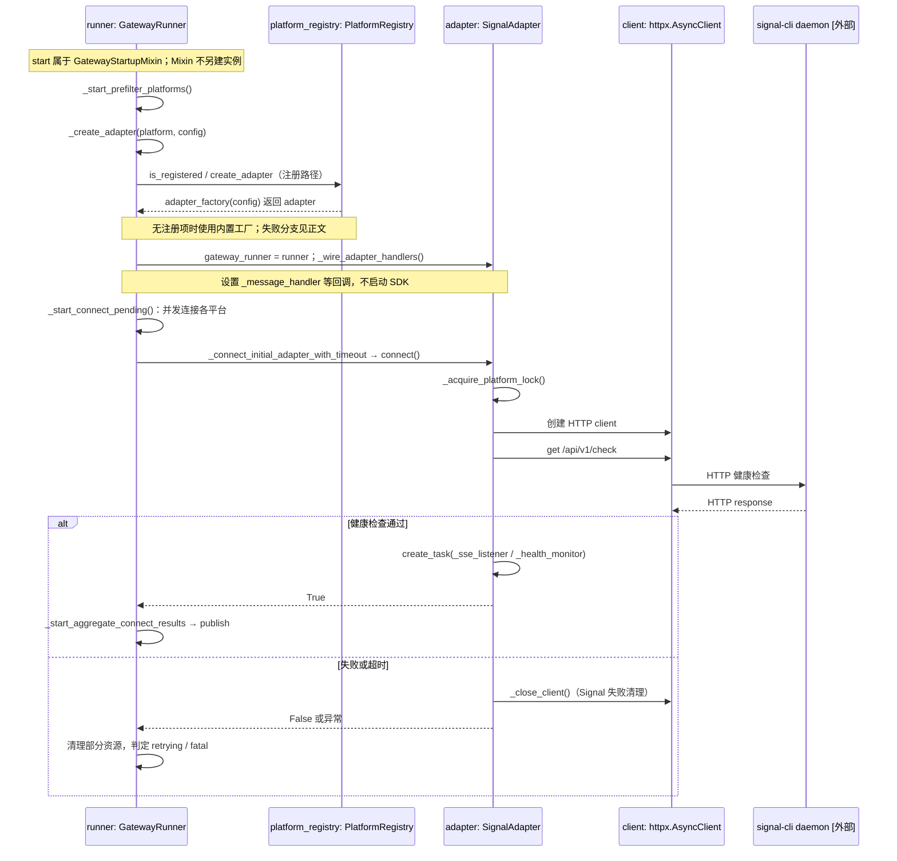

装配不是只有 `set_message_handler()`：还包括 fatal-error handler、session store、busy handler、鉴权、平台事件、topic recovery，以及 debounce/人类化延迟参数。多 Profile 适配器还要先声明 owner，再绑定带 Profile 作用域的 handler，避免第一条消息就落错会话命名空间。

**注册表不是无限制后备链**：`_instantiate_adapter()` 优先查已注册平台；若已注册但创建失败，不再偷偷回退成另一个内置实例。没有注册项时才继续内置工厂路径。注册表支持 deferred loader，避免只查看平台列表就导入全部重型 SDK。

**连接成功不等于完全健康**：源码允许 connect 返回 True 但接收链路仍 degraded，聚合阶段检查 `send_path_degraded` 再决定状态；不要把“启动函数返回成功”当成端到端收发证明。启动中收到停止请求也有 abort 路径，取消连接并拆除已建资源。

### 2.4 停止流程：先排空工作，再取消任务和断开协议资源

`stop()` 复用 `_stop_task`，重复调用等待同一次停止，不重复跑全套拆除。**不能一收到 SIGTERM 就先断开全部 Adapter**，否则正在收尾的 turn 和通知没有发送通道。

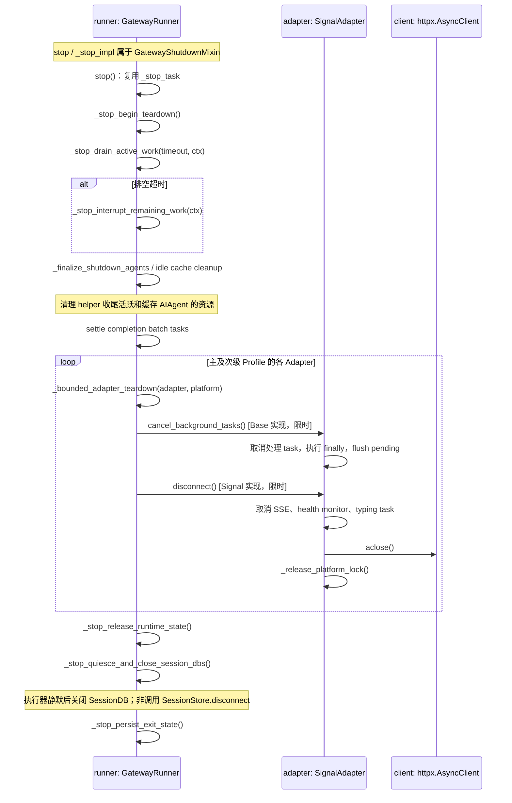

这是有界的 best-effort 清理，不是“所有消息必然发出”的保证。单个平台取消任务或断开卡住，Runner 记录超时后继续，不让一个半死 SDK 阻塞整个进程；线程级 shutdown watchdog 是事件循环卡死时的最后兜底。未完成交付应依赖账本及恢复机制，内存 pending 槽不是持久化消息队列。

**Signal 的具体例子**：`disconnect()` 设置 `_running=False`，取消 SSE listener 和 health monitor，取消 typing 任务，关闭 HTTP client，释放账号锁。其他平台应对应清理自身的 WebSocket、polling、webhook listener 或 SDK 线程；不能把 Signal 的资源表套给全部平台。

### 2.5 收消息流程：标准化事件、会话 guard、回调与忙时分流

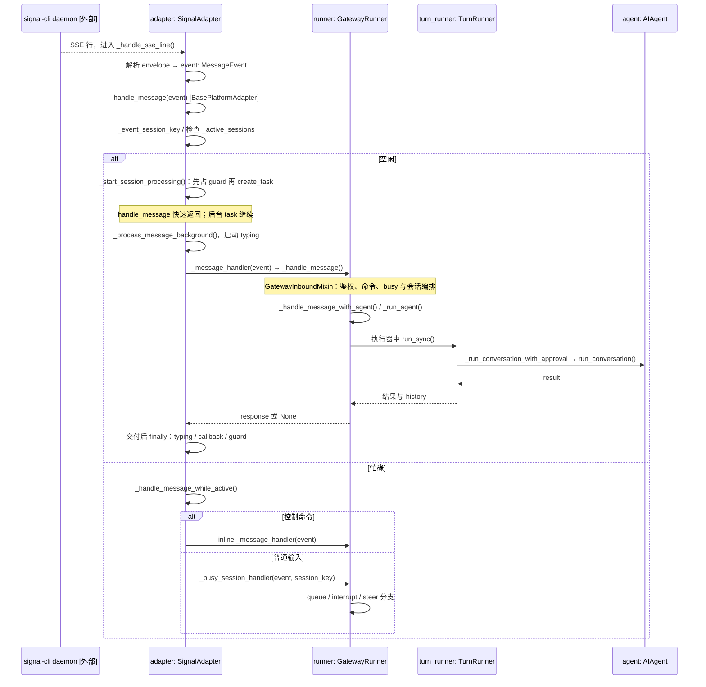

关键是 `_start_session_processing()` **在创建 task 前同步占位**，第二条消息不能利用调度间隙再启动一个 owner。`event._gateway_accepted` 是接纳协作标记，不是平台已收回执或回复已成功送达的证明。

忙时有 Adapter 与 Runner 两道守卫。`/approve`、`/deny` 等控制消息必须穿过两道守卫并 inline 处理，否则会排在等待审批的 Agent 后面形成死锁；`/new` 也不能当普通文本漏入下一轮。具体 `busy_input_mode` 策略见第5章。

`_pending_messages` 是按 session key 存放的事件槽，支持合并；文本还有 debounce 批次。因此它不是一个保证逐条 FIFO、永不合并的 durable queue。后台处理结束时会停止 typing、执行 post-delivery callback、刷新 debounce 并交还 guard，后续事件再排空。

### 2.6 发消息流程：回复由谁发送，发送前后如何记账？

**普通非流式文本最终回复**通常由 Runner handler 返回，Base 的 `_process_message_background()` 再负责发出。不是所有消息都由 `run_turn.py` 直接调用一个通用 Delivery 对象；`DeliveryRouter` 还服务 cron 等主动出站，流式与媒体另有分支。

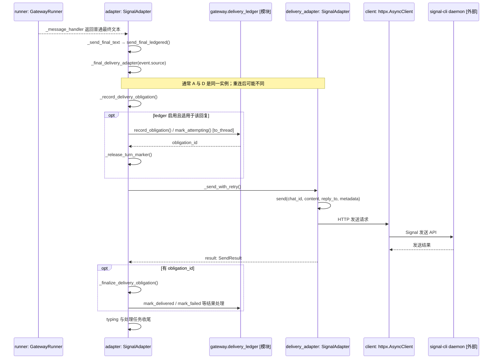

`send_final_ledgered()` 先选择**当前** delivery adapter，登记义务后才发送；若获得义务 ID，才把原 turn marker 的恢复责任交给 ledger。这样发送失败仍有可恢复记录。返回值包括 `SendResult` 和实际发送的 Adapter：平台消息 ID 归该 transport 所有，临时消息删除等后续操作不能随意改用另一个实例。

`_send_with_retry()` 根据回执中的可重试信息处理短暂失败；长时间平台限流不能无限占住协程，交由账本恢复。发送成功回执不是“人类已经阅读”的保证，也不是全局 exactly-once；失败、崩溃与平台确认边界仍有不确定性。

**流式发送不是“每个 token 调一次普通 send”**：stream consumer 按能力选择 draft/edit/native stream。`draft_stream_is_message=True` 时，流本身就是最终消息，不能再无条件补发一份；最终文本必须由 consumer 的完成路径确认。媒体、审批卡、短命回复、主动通知都可能走不同接口。第4章旧图的 `deliver → send → record_obligation` 仅为角色概览；可靠性先后顺序以本节为准。

### 2.7 设计价值、扩展约束与源码阅读入口

这个模块值得独立理解，不只是因为“支持很多 IM”，而是因为它把**协议差异、公共会话生命周期、业务推理与交付恢复**分开：接新平台主要实现协议与能力接口，公共调度和 Runner 编排可以复用。代价是 Base 已承载较多生命周期逻辑，新增平台不能绕开其 guard、finally 与回执契约。

新增适配器至少需要检查：

1. 先查 `gateway/platforms/ADDING_A_PLATFORM.md`，按当前平台注册机制提供工厂、依赖检查及配置约束；不只在 Runner 里追加平台分支。
2. `connect()` 在 handler 装配后建立监听，失败释放部分资源；`disconnect()` 处理重复或部分初始化后的清理。
3. 入站构造完整 `SessionSource` 和 `MessageEvent`，经公共 `handle_message()` 接纳，不直接从 SDK callback 启动 Agent。
4. `send()` 等出站接口遵守 `SendResult` 契约；明确文本限制、回复锚点、线程、媒体、edit 与 streaming 能力。
5. 控制消息穿过双守卫；连接替换、Profile 隔离、取消与最终回复避免重复，都需要单独验证。

本节依据本地源码快照，不宣称远端最新。以下路径相对 Hermes 源码根 `hermes-dev/hermes-agent/`，可按符号搜索；未导入或运行目标服务。

| 文件 | 关键符号 | 阅读目的 |
|---|---|---|
| `gateway/platform_registry.py` | `PlatformEntry`、`PlatformRegistry.create_adapter`、`register_deferred` | 可插拔工厂与惰性加载 |
| `gateway/run_adapters.py` | `_create_adapter`、`_instantiate_adapter`、`_wire_adapter_handlers` | 实例绑定、注册优先级、回调装配 |
| `gateway/run_startup.py` | `start`、`_start_prefilter_platforms`、`_start_connect_pending`、`_start_aggregate_connect_results` | 有界并发启动与结果发布 |
| `gateway/run_shutdown.py` | `stop`、`_stop_impl`、`_stop_finalize_agents_and_adapters` | 停止阶段、幂等等待与清理顺序 |
| `gateway/run_adapters.py` | `_bounded_adapter_teardown` | 先取消公共任务，再断开平台连接 |
| `gateway/platforms/base.py` | `BasePlatformAdapter`、`handle_message`、`_process_message_background`、`send_final_ledgered`、`SendResult` | 公共入站、任务、交付与回执 |
| `gateway/platforms/event.py` / `gateway/session.py` | `MessageEvent` / `SessionSource` | 入站信封与路由身份 |
| `gateway/platforms/signal.py` | `SignalAdapter.connect`、`disconnect`、`_handle_sse_line`、`send` | 一个真实的 SSE + HTTP 实现 |
| `gateway/delivery.py` | `DeliveryRouter`、`DeliveryTransport` | 主动出站与普通回复链路的区别 |

<!-- channel-design:end -->

<!-- channel-followup:start -->

### 2.8 Follow-up、busy queue、steer 与 pending：四种“后续消息”不能混为一谈

Channel 领域最容易漏掉的不是 `send()`，而是**一轮推理还没结束时新消息怎样存放、何时变成下一轮、重启时是否还能找回**。Hermes 至少有以下四个相邻但不同的机制：

| 机制 | 典型存放位置 | 谁消费 | 是否自然成为下一轮 | 重启语义 |
|---|---|---|---|---|
| Base Adapter pending slot | `adapter._pending_messages[session_key]` | Adapter/Runner 的忙时处理与 post-turn drain | 通常是 | 内存槽；关机时另行 spool |
| `/queue` overflow FIFO | `SessionState.conversation.queued_events` | `_promote_queued_event()` 逐个提升 | 是，保持到达顺序 | `queue` / `steer` 模式在 drain 期间可保留并 flush |
| runner-drained follow-up | 当前 turn 内的 `pending` / `pending_event` | `run_turn.py` 的 `_run_agent_queued_followup()` 递归启动下一轮 | 是，直接复用更新后的 history | 不是独立 durable 队列；崩溃依赖 shutdown/recovery 路径 |
| steer | busy 输入分支生成的可控后续文本/事件 | 当前轮合适边界或下一轮 | 取决于出口；请求前注入与普通后续轮不是同一件事 | `steer` drain 期间可保留；具体注入见卷四 §4.10 |

`_pending_messages` 是 adapter 级的**头槽**，`queued_events` 是其后面的 FIFO **溢出链**；不能只看某一个字段就得出队列为空。源码在普通文字连续到达时避免覆盖已有头槽，达到上限会丢弃并记录告警；相同安全上下文的照片 burst 才允许合并，voice/audio/video/document 等不能一概合并。

#### Follow-up 的完整时序：GatewayRunner 调度，TurnRunner 执行

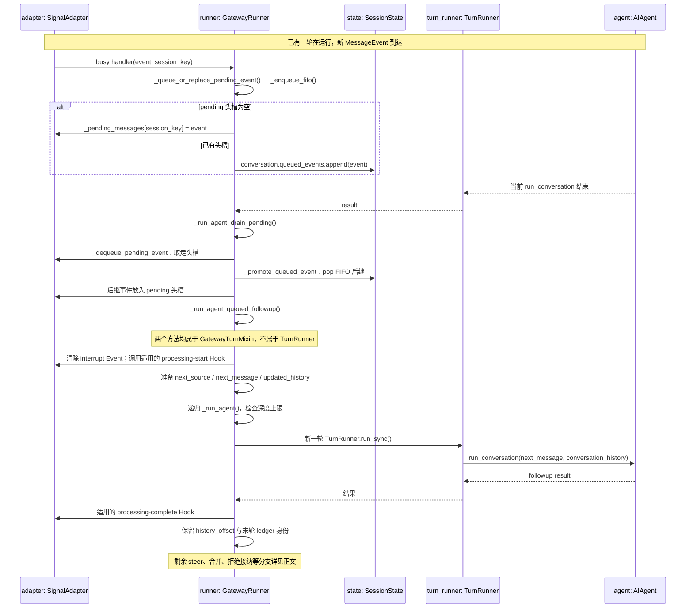

这条链路不会把 follow-up 再伪装成一次全新的平台 callback：它在GatewayRunner 的 GatewayTurnMixin 方法内消费，因而需要显式补齐 `on_processing_start` / `on_processing_complete` 等 Adapter 生命周期 Hook，否则 Slack/Telegram 等平台的回执或 typing 状态会漏记。合并后的 follow-up 仍须以自己的入站消息 ID 区分交付账本义务，不能只按文本或 reply anchor 去重。

#### 三种 busy 模式及拒绝接纳的边界

- **queue**：后续消息作为独立 FIFO turn 排队；照片 burst 是有限的合并例外。
- **interrupt**：打断当前 Agent；当前响应可能被丢弃，follow-up 在清理后运行；递归深度到上限后重新排队，避免失败消息造成无限递归。
- **steer**：把消息作为对当前工作的引导，具体是当前轮注入、下一轮文本，还是独立用户行，要看出口；不要等同于 `/queue`。
- **拒绝接纳不是第四种 busy 模式**：身份/权限不匹配、队列达到容量上限等可以导致消息不被接纳；不能因此假设存在 `drop` / `ignore` 配置值，也不能把 Adapter pending 当永久队列。

**控制消息例外**：`/stop`、`/new`、`/queue`、`/status`、`/approve`、`/deny` 及某些澄清回复需要绕过普通 busy 排队 inline 处理。否则 `/approve` 可能排在等待审批的 Agent 后面形成死锁，`/new` 也会被当作普通用户文本。

#### 轮尾剩余 steer 与 FIFO 的优先级

`_run_agent_drain_pending()` 不只读取 Adapter 头槽：它会提升 overflow，再检查 Agent 返回的 `pending_steer`。若两者同时存在，剩余 steer 可作为下一轮优先输入，刚取出的 queued event 放回头部，已经提升的后继项退回 overflow 前部，避免丢失或插队。这不是一条全局“所有来源都 FIFO”的队列；是保留用户引导优先级的分流规则。已运行中的 steer 注入详见卷四，不能与此轮尾降级路径混为一谈。

源码入口：`gateway/run_busy.py` 的 `_enqueue_fifo`、`_promote_queued_event`、`_rescue_orphaned_overflow`、`_queue_or_replace_pending_event`；`gateway/run_turn.py` 的 `_run_agent_drain_pending`、`_run_agent_queued_followup`；`gateway/run_turn_followup_ack.py` 的 `_followup_processing_hooks_apply`；`gateway/shutdown_flush.py` 的 `recover_pending_spool` / `recover_gateway_pending`。队列因异常或边界变更未被正常提升时，还有 orphan overflow rescue 路径，新输入不能直接越过遗留旧项。

#### 重启、关机与恢复

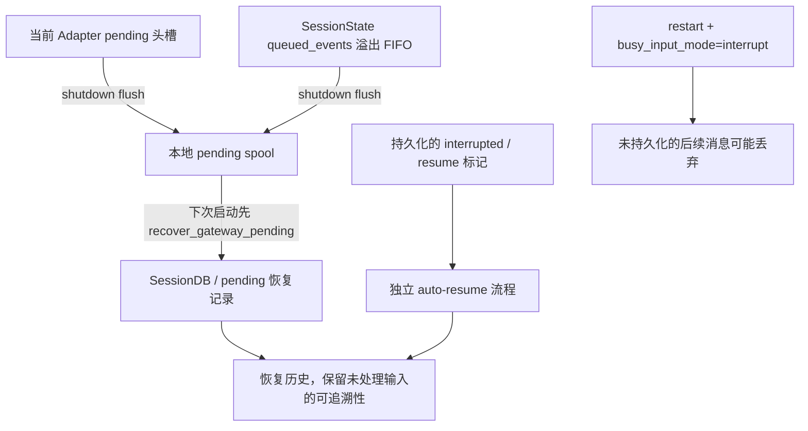

`run_shutdown` 在清理 session state 前分别 flush Adapter pending 和 overflow FIFO；启动恢复阶段先 replay pending spool，再安排 restart-interrupted session 的 auto-resume。这里的 **pending spool、SessionDB transcript、delivery ledger、内存 pending slot** 是四套不同东西：spool 可保留 pending 入站及未成功落库的 transcript，ledger 保留尚未确认的出站义务，不能互相替代。**recover_gateway_pending 是将 spool 经 append_message 恢复到 DB，不是自动把每个旧事件重新入 FIFO 并执行一次**；是否继续运行由独立 resume 标记和恢复策略决定。

### 2.9 Channel/Gateway 领域覆盖清单：避免只整理“连接和 send”

阅读 `gateway/` 时，至少要覆盖下面这些横切能力；它们不是每个平台都实现一遍，而是 Adapter、Runner、Session、Delivery 和后台 worker 的组合契约：

1. **平台注册与能力探测**：内置/插件 Adapter、deferred loader、依赖安装、配置校验、连接状态与 degraded 状态。
2. **入站规范化**：原始 SDK/webhook/SSE → `MessageEvent` + `SessionSource`，媒体下载、回复锚点、线程/topic、Profile、来源身份与机器人消息过滤。
3. **路由与访问控制**：allow/deny、配对、角色授权、DM/group/thread session key、命令权限和 topic recovery。
4. **并发与忙时控制**：Adapter guard、Runner 活跃槽、跨进程 turn lease、queue/interrupt/steer、pending 头槽、overflow FIFO、debounce 与合并上限。
5. **Agent 运行交接**：Agent cache、消息到 Agent 输入的投影、压缩/重启后的 session 恢复、queued follow-up 的 history offset 与生命周期 Hook。
6. **出站可靠性**：文本分段、markup 降级、媒体/TTS、typing、draft/stream/edit、retry/backoff、当前 transport 选择、delivery ledger 与重复发送防护。
7. **控制面与 HITL**：审批卡、approve/deny、clarify、stop/new/reset、slash command 表、控制消息双守卫与回执。
8. **失败恢复与生命周期**：启动恢复、pending spool、ledger redelivery、自动 resume、连接替换、有限 shutdown drain、watchdog、未完成任务和资源清理。
9. **主动事件入口**：cron、后台进程完成通知、heartbeat/wake、hosted room、kanban watcher、内部事件接纳 receipt；这些可能不经过普通 `_handle_message`。
10. **扩展和观测**：平台插件注册、Profile 多实例、事件 Hook、运行状态、健康检查、结构化日志、会话与交付诊断。

**覆盖状态**：§2.1–2.8 已展开模块生命周期和 follow-up；第3–8章覆盖会话、忙时、交付、平台差异与 HITL，第9–11章介绍主动任务入口。这份清单是源码阅读索引，不代表每项都已完成同等深度的设计走读；特别是后台完成通知、heartbeat/wake、跨进程租约、Profile 热变更与内部事件接纳仍需独立专题。

后续读某个平台时，按这张清单逐项检查，而不是只搜索 `connect()` / `send()`；平台有些能力是继承来的，有些由 Gateway runner 统一完成，有些在 `delivery.py` 或 session/recovery 模块完成。

<!-- channel-followup:end -->

## 第3章：会话键、活跃槽、Agent 缓存

IM 一条消息必须落到 **一个 `session_key`**，再占 **活跃槽**，再拿到 **`AIAgent`**。

| 概念 | 谁 mint | 用途 |
|------|---------|------|
| **`session_key`** | `_session_key_for_source`（`run.py`）+ `gateway/session.py` 命名空间 | SessionDB 行、busy 字典、ledger |
| **`_active_sessions`** | Runner | 该 key 是否正在 `run_conversation` |
| **Agent 缓存** | `run_agent_cache.py` | 同 key 复用 `AIAgent`，避免每条消息重建 |
| **profile** | `profile_routing.py` | 多 profile 时 key 带命名空间 |

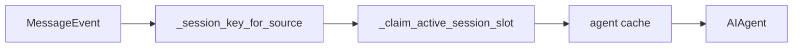

和呈现层 `sid`（8 位 UI 窗口）**不是同一个 id**。IM 身份是 `session_key`；压缩后 `AIAgent.session_id` 可能转，key 策略见 `gateway/session.py`。

未授权入站：`run_inbound_unauthorized.py`。配对：`pairing.py`。

---

## 第4章：入站一条消息（完整）

主路径文件拆开，不是单函数包办：

| 阶段 | 文件 | 函数 |
|------|------|------|
| 适配器收到 SDK 事件 | `platforms/base.py` | 转 `MessageEvent` |
| 入站总入口 | `run_inbound.py` | `_handle_message` |
| 媒体 | `run_inbound_media.py` | 图/语音下载与清洗 |
| 消费 | `run_inbound_consumer.py` | 过滤、slash、是否丢弃 |
| 忙时 | `run_inbound.py` + `run_busy.py` | 见第5章 |
| 真正跑轮 | `run_turn.py` | `_handle_message_with_agent` |
| 插件改写 | `run_plugin_injection.py` | 入站文本 hook |

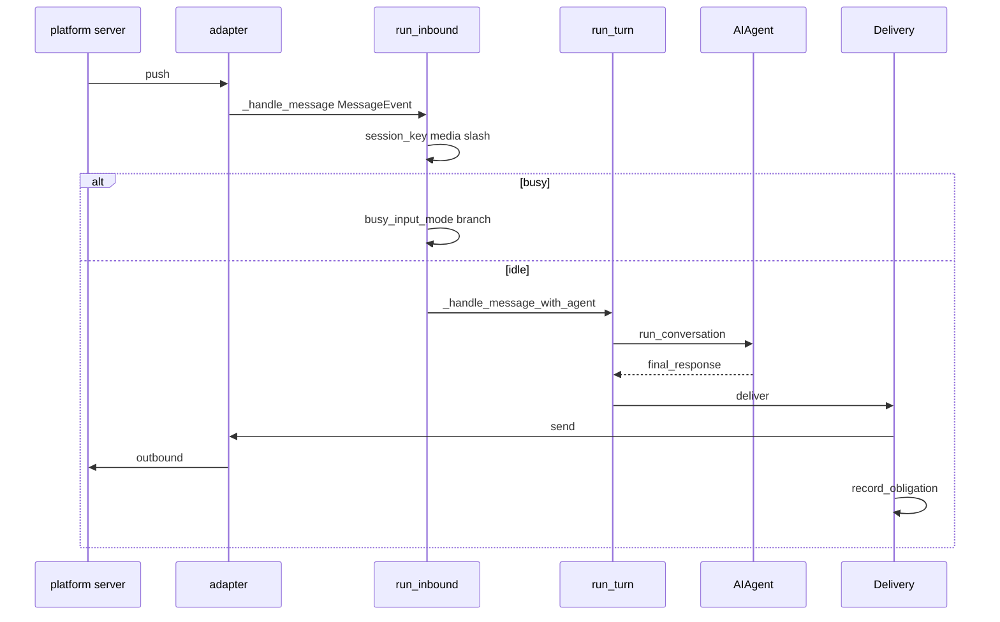

Slash（`/busy`、`/steer`、`/new`…）在进 Agent **之前** 由网关命令层吃掉一部分；其余当用户文本。

---

## 第5章：忙时 `busy_input_mode`

配置：`interrupt`（**默认**）| `queue` | `steer`。用户 `/busy` 切换（`gateway/slash_commands.py`）。

会话已在 `_active_sessions` 时：

| 模式 | 行为 | 源码 |
|------|------|------|
| **interrupt** | 打断当前 `run_conversation`；子 agent / 压缩中可 **降级 queue** | `run_inbound._hm_handle_running_session_message` |
| **queue** | merge 进 `adapter._pending_messages[session_key]`，本轮结束 drain | `BasePlatformAdapter` + `_spawn_drain_task` |
| **steer** | 调内核 `running_agent.steer(text)`，写入 `AIAgent._pending_steer`；失败再落入 `_pending_messages` | `run_busy._hm_steer_agent` |

**queue 的槽在适配器，steer 的槽在正在跑的 Agent。** queue 本轮结束后再开一轮；steer 在本轮工具批之后或下一次组请求前吃掉。对照 [卷一 §2.3.2](01-platform-and-architecture.md#sec-2-3-2)。

这不是 SessionDB 租约等待，也不是 Desktop `queueDelta`。对照 [卷二 §3.0](02-surface-and-presentation.md#30-忙时再点发送用户话排队不是-messagedelta-的-queuedelta)。

活跃会话上的适配器路径：`platforms/base.py` `_handle_message_while_active`。

---

## 第6章：出站 Delivery 与 ledger

循环返回 `final_response` 之后，IM **必须**走投递，不能 `print`。

| 类型 | 文件 | 职责 |
|------|------|------|
| `DeliveryTransport` / `DeliveryTarget` / `DeliveryRouter` | `delivery.py` | 按平台切分长度、媒体、路由到哪个 chat |
| `delivery_ledger.record_obligation` | `delivery_ledger.py` | **最终回复必达**：失败重试、进程重启仍欠账 |
| `lifecycle_ledger` | `lifecycle_ledger.py` | 会话生命周期侧义务 |
| `run_delivery_queue_watch` | 同名 | 盯 cron/网关投递队列 |

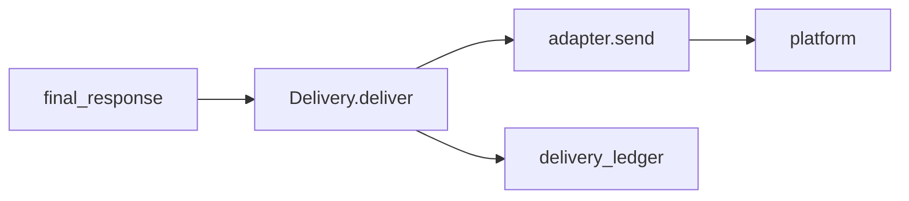

和呈现 `_emit` 的差别：IM 出站受平台 API 限制（字数、媒体、风控），所以有 Router + ledger；TUI 是同一条 JSON-RPC 上推 event。

---

## 第7章：每个门户的设计

人碰到 Hermes 的每一种方式都是一个门户。内核只有 `run_conversation`。差别只在五件事：**谁持有连接、会话怎么切开、忙时下一句放哪、回复从哪条路回去、危险操作怎么让人点头。**

### 7.1 人机壳（不在 `gateway/` 进程里）

这些壳自己持有界面。呈现细节在卷二，这里把设计和 IM 对齐，避免只在总表里留一行。

| 门户 | 连接 | 会话怎么切 | 忙时 | 回复 | 审批 |
|------|------|------------|------|------|------|
| **CLI** `hermes chat` | 本进程 TTY | 终端里当前会话；`-q` 一次一进程 | `_pending_input`；也认 `busy_input_mode` | 终端 callback | 终端提示 `approval_prompt` |
| **TUI** Ink | stdio JSON-RPC → `tui_gateway` | 窗口 `sid`（8 位）映射库 `session_key` | `queued_prompt`，收尾 `_drain_queued_prompt` | `_emit` | 呈现事件，人在 TUI 上点 |
| **Desktop** | 同一条 JSON-RPC，WebSocket 或 stdio | 同 TUI | 同 TUI | `handleMessageStreamEvent` 画气泡 | 同 TUI |
| **Web Dashboard** | Dashboard 页连 `tui_gateway`（远程时是整台 `hermes serve`） | 同 TUI 的 `sid` | 同 TUI | 同 `_emit` | 同 TUI |
| **Compute host** | 父进程仍是呈现网关；子进程跑 Agent | 父进程的 `sid`；父进程 **vouch** 租约给子进程 | 同 TUI，drain 可走 host | 子进程事件镜像回父进程 `_emit` | 父进程表面 |
| **ACP** | IDE 用 Agent Client Protocol 连 `acp_adapter` | 每个 ACP session 一个 Agent | `queued_prompts` | `session_update`，不走 `_emit` | IDE 侧；循环里挂 `step_callback` |
| **Batch** | `batch_runner` worker，无长连接 | 每行一个 task，`platform=batch` | 无（一行跑完即走） | 写结果文件 | 批跑默认无人等着点 |
| **Codex app-server** | 不是入口壳：`api_mode=codex_app_server` 时整轮旁路 | 仍是当前会话 | 原生 `turn/steer` | 走 Codex 传输 | 视该传输 |

CLI / TUI / Desktop 的一轮时序 → [卷二 §3–§4](02-surface-and-presentation.md#3-tui--desktop一轮怎么走完)。Compute host / ACP → [卷二 §11–§12](02-surface-and-presentation.md#11-compute-hostturn-隔离子进程)。Batch / Codex → [卷三第5章](03-runtime-session-and-loop.md#sec-ch5)。

### 7.2 IM 与机器门户共用的合同

凡是 `BasePlatformAdapter` 子类，都活在 **同一个 gateway 进程**里：`connect()` 自己收消息，回调 `_handle_message`，不另起 channel worker。

| 合同 | 设计 |
|------|------|
| **会话键** | `build_session_key`（`gateway/session.py`）。形如 `<ns>:<platform>:<chat_type>[:slack scope][:chat_id][:thread][:user]`。私聊按 chat 隔离，没有 chat_id 才退到发送者。群默认按人切开；线程默认共享，除非 `thread_sessions_per_user` |
| **忙时** | 全部走 `busy_input_mode`（interrupt / queue / steer）。槽在适配器 `_pending_messages`；steer 才进内核 `_pending_steer` |
| **出站** | `Delivery` 按平台切长度和媒体，`delivery_ledger` 记必达。例外见下表「回复」列 |
| **审批** | 工具执行前 `register_gateway_notify(session_key)`，人点完 `resolve_gateway_approval`。卡片长什么样由通道决定，卡点不在收消息时 |
| **准入** | 各通道自己的 allowlist / @ / pairing；不过准入的消息进不了 Agent |

Telegram 论坛话题：General 的 thread id 空或 `"1"` 都当根；回复若被剥掉 thread，会钉回这个用户上次活跃的话题，避免 `/model` 这类命令写到另一把钥匙上。

### 7.3 每条通道只写和合同不同的地方

插件在 `plugins/platforms/<name>/`，仓内适配器在 `gateway/platforms/`。登记：`platform_registry.py`。

| 通道 | 连接 | 和公共合同的差别 |
|------|------|------------------|
| **Telegram** | `python-telegram-bot` 长轮询，或带 secret 的 webhook | 话题/thread 进会话键；可流式改自己的消息；审批用 inline keyboard |
| **Discord** | discord.py 网关 | 频道里第一条会按「即将进入的线程」切键，后续跟帖才能对上；语音模式、角色鉴权私聊 |
| **Slack** | slack-bolt **Socket Mode**（要 bot token + app token） | 会话键比别人多一截 workspace `scope_id`；审批是 Block Kit |
| **飞书 / Lark** | 官方 SDK，WebSocket 或 webhook；`FEISHU_DOMAIN` 分中国/国际 | 群里要 @ 才说话；文档评论、会议邀请也是入站事件 |
| **钉钉** | Stream Mode SDK | 群 @、自由回复会话；cron 可走静态机器人 webhook |
| **企业微信** | 两条：`wecom` 智能机器人 WebSocket；`wecom_callback` 自建应用 HTTP + AES | 两个平台名，两套密钥，会话键前缀不同 |
| **微信个人** | iLink `getupdates` 长轮询 | 每条回复必须带回对方最新 `context_token`；媒体走 AES CDN；扫码登录 |
| **QQ** | 官方 Bot API v2：入站 WebSocket，出站 `api.sgroup.qq.com` | 私聊/群各自 allowlist 或 pairing；语音先试免费转写再 STT |
| **WhatsApp** | 两条：插件是本机 Node 桥（WhatsApp Web）；`whatsapp_cloud.py` 是 Cloud API | 私聊 id 要先规范化再进会话键 |
| **Signal** | 本机 `signal-cli` HTTP：入站 SSE，出站 JSON-RPC | 没有官方云 SDK，守护进程挂了通道就断 |
| **iMessage · BlueBubbles** | 本机 BlueBubbles：入站 webhook，出站 REST | 依赖一台 macOS 上的 BlueBubbles |
| **iMessage · Photon** | Photon gRPC，经 Node sidecar 长流 | 不需要公网 URL 和签名 secret |
| **元宝** | 自己的 WebSocket（鉴权、心跳、重连） | 入站是一条中间件管道：解码、去重、撤回、路由、准入，然后才变成 `MessageEvent` |
| **LINE** | aiohttp webhook，HMAC 校验 | 优先用免费 reply token，过期再走按条计费的 Push |
| **Google Chat** | HTTP 回调，或 Pub/Sub 拉订阅 | 附件要用户在私聊里 `/setup-files` 做一次 OAuth |
| **Teams** | Bot Framework webhook（默认端口 3978） | 审批是 Adaptive Card |
| **Matrix** | mautrix，可选端到端加密 | 房间级 allowlist；线程进会话键 |
| **Mattermost** | v4 REST + WebSocket | 回复可钉在线程里 |
| **IRC** | 标准库 asyncio，无第三方 SDK | 频道或私信；断线重连由适配器自己做 |
| **Email** | IMAP 轮询收，SMTP 发 | 一封信一个线程；没有「正在输入」 |
| **SMS** | Twilio REST + 入站 webhook | Markdown 剥成纯文本；一条短信有字数上限，靠 Delivery 切 |
| **SimpleX** | 本机 simplex-chat 守护进程 WebSocket | 没有稳定用户 id，联系人 id 在连上时才生成 |
| **ntfy** | HTTP 流订阅话题，POST 回复 | 没有用户身份，一个话题一把会话 |
| **Buzz** | 社区 relay（Nostr），调 `buzz` CLI | 传输可 WebSocket 或轮询 |
| **A2A** | 入站：`/.well-known/agent-card.json` + JSON-RPC 任务。出站工具是另一方向 | 没配 token 就只绑本机；进来的文本过注入过滤 |
| **Raft** | 本机回环 HTTP，只收「该醒了」 | 正文不在 webhook 里；Agent 再用 Raft CLI 去读和发 |
| **Webhook** | 通用 HTTP POST | 没有人在等：自动续跑要做完被打断的活，不要反问「接下来呢」 |
| **API Server** | 网关进程里的 aiohttp：`/v1/chat/completions`、`/v1/responses`、`/v1/runs` | `send()` 是空的，**不走** Delivery 必达；客户端靠 HTTP/SSE 把回复拿走。也没有人点「会话已恢复」 |

媒体缓存：`media_cache.py`、`gateway/media_fetch.py`。新通道怎么挂进注册表：`platforms/ADDING_A_PLATFORM.md`。

### 7.4 同进程、但不是「人发来一条 IM」

| 门户 | 连接 | 会话 | 忙时 | 回复 | 审批 |
|------|------|------|------|------|------|
| **Cron** | 时钟 `scheduler_tick`，不是平台推送 | job 自己的会话 | 无用户跟进槽；`skip_background_review` | 网关已连上就 `_deliver_result`，否则 `delivery_queue` 等适配器 | 无人值守，危险工具按策略拒绝或跳过 |
| **Hosted Room** | 成员话仍从某条 IM 适配器进来，再变成 `prompt.submit` | 呈现侧 `sid` + room 任务表 | 同 TUI `queued_prompt` | 回到那个群通道 | 同该 IM |
| **看板调度** | 网关里 `tick_once`，然后 **spawn** `hermes --cli chat -q` | worker 子进程自己的会话，`HERMES_SESSION_SOURCE=kanban` | 无（短进程） | 看板数据库里的任务状态，不是聊天气泡 | worker 是 CLI，终端那套 |

Cron 出站时序 → [第9章](#sec-g9)。Room 状态机 → [第10章](#sec-g10)。看板 spawn → [第11章](#sec-g11)、[卷七 §4](07-multi-agent-and-kanban.md#4-看板-worker-端到端)。

---

## 第8章：IM 上的 HITL 审批卡

**一句话**：模型要跑被判危险的动作时，**跑 tool 的那条线程**在 `tools/approval.py` 里停住；Gateway 把审批推到 IM；人点完 `resolve_gateway_approval` 后 **同一条调用栈** 继续 execute 或写 BLOCKED tool 结果。**Deny 不结束 turn**（那是 `interrupt`）。

检测 **不在** `_handle_message`、也不在适配器收包时。入站只负责把话送进 `run_conversation`；危险 shell 在 `terminal_tool` 里 `check_dangerous_command` → `_run_approval_gate`（插件 `pre_tool_call` 的 `approve` 走同一闸门，但堵点更靠前，见 [卷八 §2.2](08-security-and-governance.md#sec-8-2-2)）。

人类等待 **不计入** 固定 batch deadline（`approval_human_wait.human_wait_ceiling`）。

### 8.1 和 interrupt、clarify 别混

| | **审批 Approval** | **Interrupt** | **Clarify** |
|--|-------------------|---------------|-------------|
| 触发 | 危险命令 / 插件 escalate / 写文件闸门 | `/stop`、`AIAgent.interrupt()` | 模型调 `clarify` |
| IM 表现 | 审批卡 / `/approve` | 本轮收尾、可能半截 tool | 澄清卡片或编号选项 |
| 线程 | **工具线程** `Event.wait` 或 pending | 循环边界退出 | 工具线程等答案 |
| 答完后 | 同一次 `run_conversation` 继续 | turn 结束 | tool 结果回模型 |
| 源码 | `tools/approval.py` | `AIAgent.interrupt()` | `tools/clarify_tool.py` |

闸门语义、地板命令顺序、deny 后库里长什么样 → [卷三 6.3](03-runtime-session-and-loop.md#sec-6-3)。

### 8.2 会话开跑时登记：notify 不是 Agent 回调槽

IM **没有** `im_*` 回调字段。审批用的是 **进程内全局表**（`tools/approval.py`），键是 **`session_key`**（与 SessionDB / busy 字典一致，不是 TUI `sid`）。

| 时机 | 谁调 | 干什么 |
|------|------|--------|
| 本轮 `run_turn` 开跑前 | Gateway（`run_turn.py` 路径） | `register_gateway_notify(session_key, cb)` |
| `cb(approval_data)` | **Agent 线程**里同步调用 | Gateway 必须把「发卡」**schedule 到 asyncio 循环**（注释：sync→async 桥） |
| 回合结束 / interrupt / 换 Agent 缓存 | `unregister_gateway_notify(session_key)` | 摘掉 cb，并 **`event.set()` 唤醒** 所有还在等的 entry，避免线程挂死 |

`approval_data` 里常有 `request_id`、`command`/`description`、`pattern_key` 等，供各平台画卡与 `/approve <id>` 精确命中。

### 8.3 阻塞式路径（有 notify）：和 CLI 同一心智，原语换成 Event

| | CLI / TUI | Gateway IM |
|--|-----------|------------|
| **等人** | Agent 线程 `queue.Queue.get()` | Agent 线程 `threading.Event.wait()`（`approval_gateway_wait._await_gateway_decision`） |
| **人怎么答** | 主线程审批面板 Enter | 按钮或 slash：`/approve` `/deny` `/always`，`/approve all` |
| **谁唤醒** | UI `queue.put(choice)` | `resolve_gateway_approval(session_key, choice)` → `entry.result` + `event.set()` |
| **继续 loop** | tool 返回 → ToolMessage → 下一轮 LLM | **完全相同** |

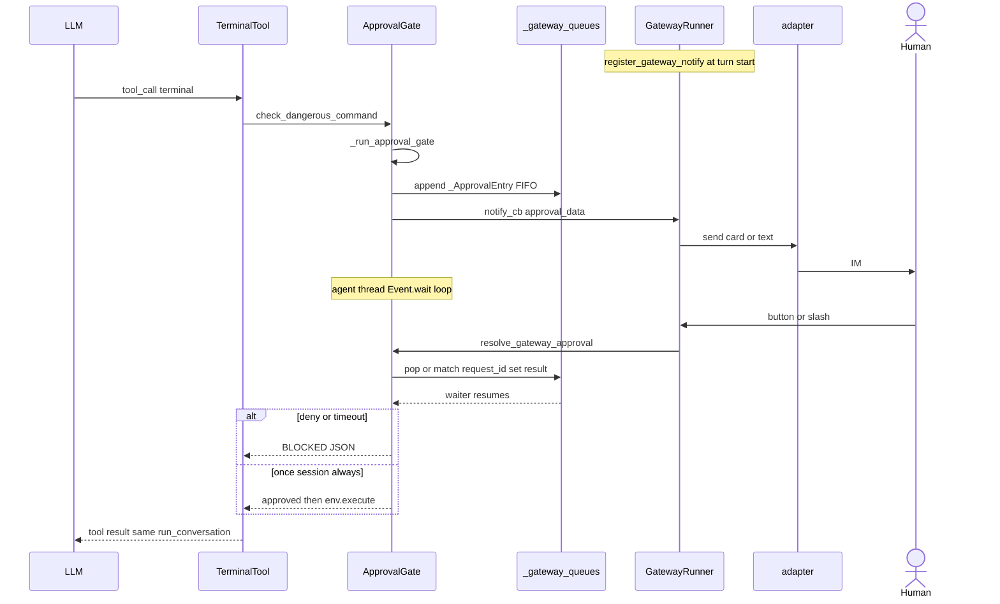

**Gateway 进程没有整体 pause**：async 事件环仍收别的 chat；堵的是 **执行 tool 的同步线程**。

并发危险命令：`_approval_lock` + `tool_executor` authorization gate，**同一时刻只处理一扇窗**；多扇排队 FIFO（`session_key` 维度 `_gateway_queues`）。

超时默认 `approvals.timeout` → 按 **deny** 处理。`/stop`、会话 interrupt → `unregister` 或 withdraw，等待方不能无限挂起。

### 8.4 Pending 路径（没法同步等人）

**没有** `register_gateway_notify`，或 notify 调度失败时：**不能** 让 Agent 线程无限 `Event.wait`（用户可能永远看不到卡）。

| 步骤 | 行为 |
|------|------|
| `submit_pending(session_key, approval)` | 记入 pending 表，**立刻**返回 `approved: false`，状态 `pending_approval` |
| tool 结果 | 命令 **未执行**；模型在同一 turn 看到「请用户批准」类 JSON |
| 人稍后批准 | **force 重放**路径（不是同一条栈上的 wait 醒来） |

阻塞式 = CLI 的 IM 版；pending = 无人可答时的 fail-soft。Cron / 无人值守默认走 deny 或 auto，不弹 IM 卡（[卷八 §2.5](08-security-and-governance.md#sec-8-2-5)）。

### 8.5 用户选择与持久化

| 选择 | 含义 | 持久化 |
|------|------|--------|
| `once` | 仅此次 | 不写 |
| `session` | 本 `session_key` 同 `pattern_key` 免问 | `_session_approved` |
| `always` | session + 永久 allowlist | `approve_permanent` + 落盘 |
| `deny` | 拒绝 | BLOCKED tool 结果；**turn 继续** |

`/deny <reason>` 的自由文本会进 BLOCKED 消息（`resolve_gateway_approval(..., reason=)`）。

### 8.6 Slash 与运维 API（网关侧）

| 用户输入 | 效果 |
|----------|------|
| `/approve` | 解队头一条（FIFO） |
| `/approve all` | `resolve_all=True`，一次解完该 session 队列 |
| `/approve <request_id>` | 精确匹配 `approval_data.request_id` |
| `/deny` | 队头 deny；可带 reason |

实现入口：`gateway/run.py` 与 slash 层；解阻塞一律进 `resolve_gateway_approval`。

其它 API（运维 / 多客户端）：

| 函数 | 作用 |
|------|------|
| `list_gateway_approvals(session_key)` | 未决审批快照 |
| `withdraw_gateway_approval(session_key, request_id, cause)` | 客户端画不出卡时撤回，唤醒为 **cancelled**（不是用户 deny） |
| `register_gateway_settle(session_key, request_id, settle)` | 无论哪条路径结束，跑一次 `settle(reason)` |

### 8.7 各通道「卡」长什么样（合同相同，皮不同）

[第7章](#sec-g7-channels) 里每个适配器自己画 UI，但都服从 **8.2–8.3** 的合同：

| 通道 | 典型审批 UI |
|------|-------------|
| **Telegram** | Inline keyboard（once / session / deny…） |
| **Slack** | Block Kit 按钮 |
| **Teams** | Adaptive Card |
| **Discord** | 组件按钮（频道线程键见 §7.3） |
| **飞书 / 钉钉 / 企微** | 各 SDK 的交互消息或卡片 |
| **SMS / Email** | 常退化为纯文本 + slash（无富交互） |

共同点：**卡点都在 tool 执行前**；出站仍走 `Delivery` + ledger；审批消息本身也是一次 `adapter.send`。

子 Agent：`delegate_tool` 子线程 `set_approval_callback(parent_cb)`，危险命令仍可能弹 **父会话** 的 Gateway 卡（同一 `session_key` 策略见 `tools/delegate_tool.py`）。子 Agent **没有** `clarify_callback`。

**配置速查**（全表面，不只 IM）：`approvals.mode` / `timeout` / `cron_mode` / `deny`；环境变量 `HERMES_YOLO_MODE`、`HERMES_GATEWAY_SESSION`、`HERMES_CRON_SESSION` 等 → [卷八 §2.5](08-security-and-governance.md#sec-8-2-5)。

CLI 双线程 + Queue 详解（对照读本卷 8.3）→ [卷八 §2.3](08-security-and-governance.md#sec-8-2-3)。

---

## 第9章：Cron 出站（不经 `_handle_message`）

定时任务 **不是** IM 入站的一条 `MessageEvent`。

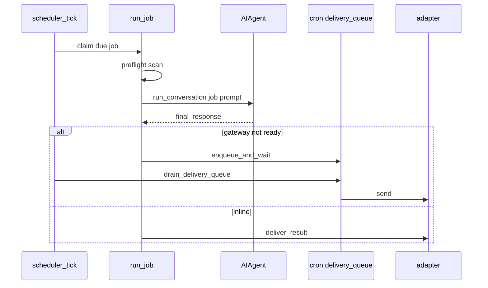

| 模块 | 作用 |
|------|------|
| `cron/scheduler.py` `run_job` | 建 Agent、跑一轮、记 job |
| `scheduler_tick.py` | 时钟 |
| `scheduler_detached_worker.py` | 子进程，避免堵死 Gateway 事件环 |
| `delivery_queue.py` | 持久化出站 |
| `scheduler_delivery.py` | `last_delivery_queued`、incident |
| `blueprint_catalog.py` | 任务模板 |
| `quota_hold.py` | 配额 |

网关可 `run_delivery_queue_watch` 帮 cron 把队列送出去。

---

## 第10章：Hosted Room

多成员群：成员消息经 IM 适配器进网关，再变成呈现路径上的 `prompt.submit`，带 `_hosted_task` / `_hosted_terminal_callback`。

任务状态机：`gateway/hosted_room_driver.py`（表 `hosted_room_driver_tasks`：queued / running / settled / failed / cancelled…）。fencing：`execution_generation` + `cancel_generation`。

| 文件 | 职责 |
|------|------|
| `hosted_rooms.py` | probe、room 元数据 |
| `hosted_room_driver.py` | 任务 SM、lease |
| `hosted_room_peer.py` | 成员协议 |
| `tui_gateway/hosted_room_peer_transport.py` | 与呈现网关互传 |
| `tui_gateway/methods_prompt.py` | `_hosted_submit_error`、`_lock_in_submit_turn` |

hook：`on_room_member_activity`。忙时与 TUI 相同：`queued_prompt`。不是 `delegate_task`（那是父 turn 内子 Agent）。

---

## 第11章：网关里的看板调度

`_KanbanDispatcher` **住在 gateway 进程**，但 **不** `_handle_message`：

`tick_once` → `hermes_cli/kanban_db_dispatch.dispatch_once` → `_default_spawn` → `hermes -p PROFILE --cli chat -q`。

环境：`HERMES_SESSION_SOURCE=kanban`。人看的是看板行状态，不是 IM 气泡。→ [卷七 §4](07-multi-agent-and-kanban.md#4-看板-worker-端到端)。

相关：`kanban_watchers.py`、`kanban_watchers_dispatcher.py`、`kanban_watchers_notifier.py`。

---

## 第12章：和 AgentScope Channel 对照

| | Hermes Gateway | AgentScope App |
|--|----------------|----------------|
| 长连接谁持有 | **本进程**适配器 | 可拆 channel worker |
| 回复怎么回去 | 同进程 `Delivery` + ledger | `session_events` + 节点 REST |
| 忙时 | `busy_input_mode` 三分支 | inbox + wakeup |
| 会话真源 | `SessionDB` 在 Agent 上，循环内 flush | `Storage` 在 `ChatService` |
| 出站必达 | `delivery_ledger` | 总线不保证 IM 投递语义 |

全文：[CHANNEL_AGENTSCOPE_VS_HERMES.md](../../compare/CHANNEL_AGENTSCOPE_VS_HERMES.md)。

---

## 第13章：包地图（grep）

| 路径 | 职责 |
|------|------|
| `gateway/run.py` | `GatewayRunner`、`start_gateway`、`_session_key_for_source` |
| `run_startup.py` / `run_shutdown*.py` | 起停 |
| `run_inbound.py` / `run_inbound_*.py` | 入站 |
| `run_busy.py` | steer / queue |
| `run_turn.py` | `_handle_message_with_agent` |
| `run_agent_cache.py` | Agent 复用 |
| `platforms/base.py` | 适配器基类、pending |
| `delivery.py` / `delivery_ledger.py` | 出站 |
| `session.py` | key 命名空间 |
| `hosted_room_*.py` | Room |
| `kanban_watchers*.py` | 看板 |
| `cron/scheduler.py` | 定时 |
| `tools/approval.py` | IM 审批卡 |

呈现对照：卷二 `_emit`。入口总表：卷一 §2.4。
