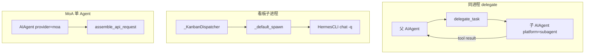
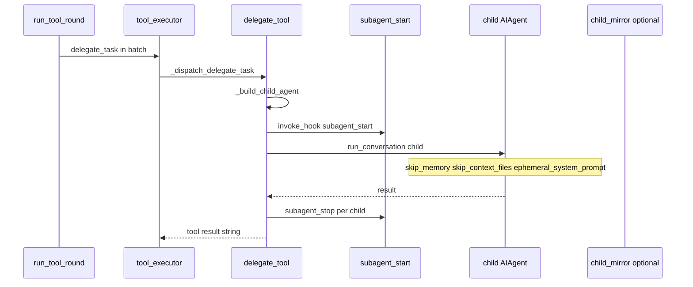
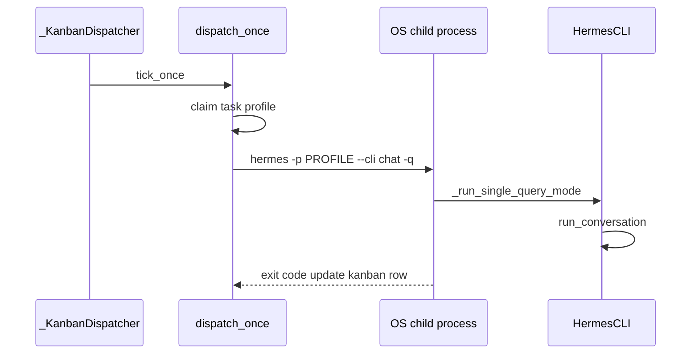
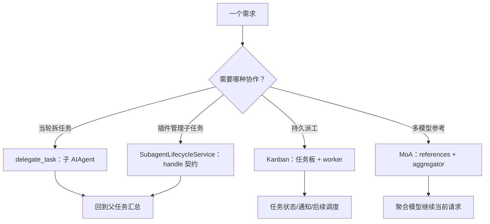
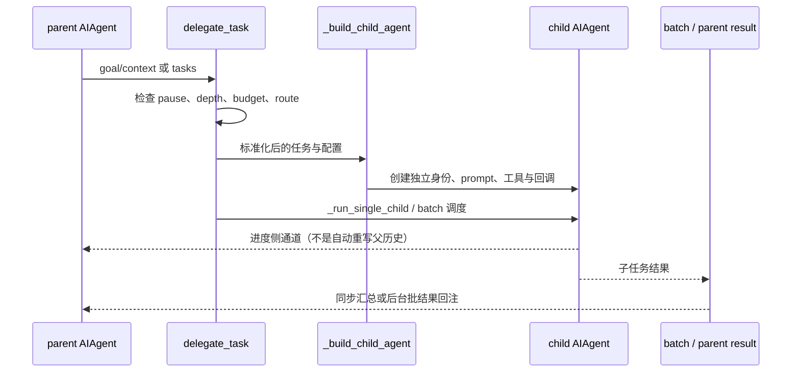
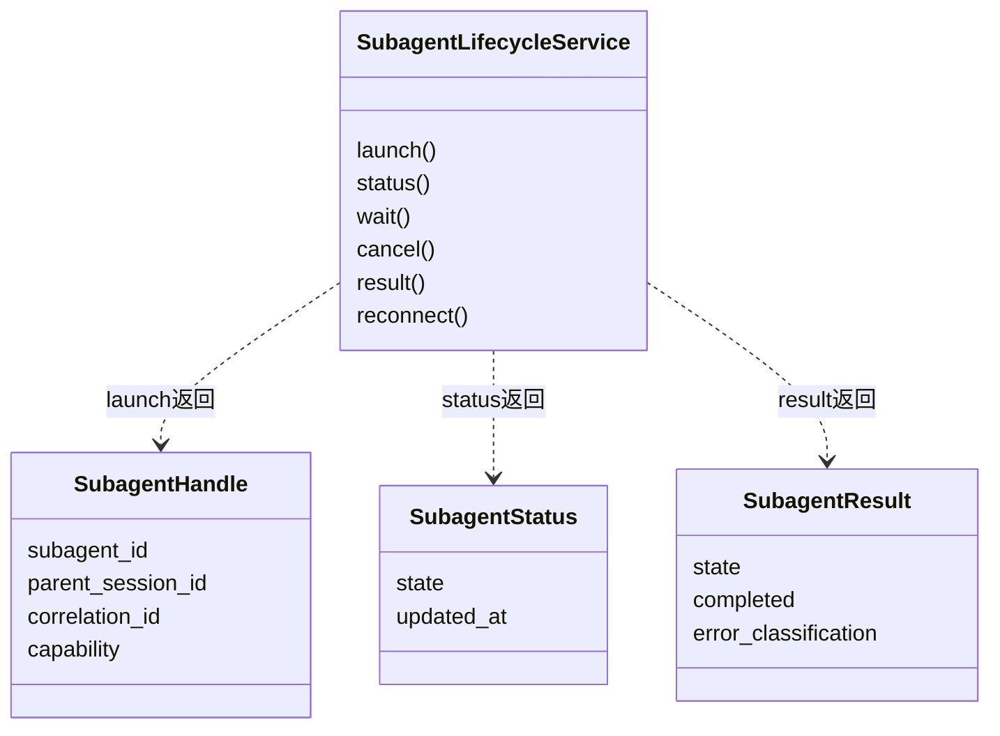

# 卷七 · 多 Agent：对话 delegate、MoA 与看板 worker

> **卷标准**：[`VOLUME_STANDARD.md`](VOLUME_STANDARD.md) · **完成度**：[`MANIFEST.md`](MANIFEST.md) — **部分达标**（delegate + 看板 E2E + hook/镜像表；MoA 深潜仍链卷四 §4.5）  
> **本卷边界**：**同进程** `delegate_task` 子 `AIAgent`、**子进程** kanban worker、**MoA 多模型** 与父会话的关系；工具 dispatch → [卷五](05-capabilities-extensions.md)。  
> **权威源码**：`tools/delegate_tool.py`、`tools/delegate_tool_child_run.py`、`tools/delegate_tool_results.py`、`gateway/kanban_watchers_dispatcher.py`、`hermes_cli/kanban_db_dispatch.py`、`agent/background_review.py`（`build_cache_parity_fork`）、`hermes_cli/moa_config.py`  
> **相邻卷**：[01 入口](01-platform-and-architecture.md) · [02 Surface 子会话镜像](02-surface-and-presentation.md) · [04 MoA 上下文](04-prompt-and-context.md#45-每迭代-assemble_api_request-顺序api-上下文-build)

---

## 本卷目录

| 块 | 节 | 作用 |
|----|-----|------|
| **澄清** | [§0](#0-先澄清三种多-agent别混) | delegate / kanban / MoA / background review 对照 |
| **总览** | [§1](#1-架构流程) · [§2](#2-谁调用谁) | 三机制一张图；符号表 |
| **E2E** | [§3](#3-端到端delegate_taskhook--呈现) · [§4](#4-看板-worker-端到端) | 同进程子 Agent；子进程 `-q` worker |
| **深潜** | [§5](#5-moa多模型参考仍是一轮父-agent) | 不新建 Agent；卷四 §4.5 上下文 |
| **交叉** | [§6](#6-与-busy--steer--租约) · [§7](#7-包与核心类) | IM busy；grep |

### 目录（锚点跳转）

- **§0** [三种多 Agent](#0-先澄清三种多-agent别混)  
- **§1** [架构流程](#1-架构流程)  
- **§2** [谁调用谁](#2-谁调用谁)  
- **§3** [delegate_task E2E](#3-端到端delegate_taskhook--呈现) — [3.1](#31-子-agent-prompt--工具面权威) · [3.2](#32-tui-子会话镜像呈现) · [3.3](#33-插件-hook子集)  
- **§4** [看板 worker](#4-看板-worker-端到端)  
- **§5** [MoA](#5-moa多模型参考仍是一轮父-agent)  
- **§6** [busy / steer / 租约](#6-与-busy--steer--租约)  
- **§7** [包与核心类](#7-包与核心类)

---

## 0. 先澄清：三种「多 Agent」，别混

| 机制 | 进程 | 新 `AIAgent`？ | 结果怎么回父会话 | 用户 IM 忙时 |
|------|------|----------------|------------------|--------------|
| **`delegate_task`** | **父进程** 内线程/子运行 | **是**（子实例） | tool 结果字符串 | 父仍在跑；interrupt 可降级 queue（卷六） |
| **Kanban worker** | **子进程** `hermes --cli chat -q` | worker 内新建 | 看板 DB 状态，**不是**父聊天气泡 | 与父 IM 会话无关 |
| **MoA** | 父进程 | **否**（同一 Agent，`provider=="moa"`） | 参考模型上下文拼进 **当次 API messages** | 同单 Agent |
| **background review** | 父进程守护线程 | fork 受限 Agent | **不改**主 transcript；可选 `background_review_callback` | live turn 会 `cancel_background_review`（[卷三 §1.5](03-runtime-session-and-loop.md#sec-1-5)） |

**Steer 到子 Agent**：`tools/delegate_tool_registry.steer_subagent` + 父 `steer()` 扇出（卷一 §2.3.2）。

---

## 1. 架构流程

---

## 2. 谁调用谁

| 符号 | 文件 | 作用 |
|------|------|------|
| `_dispatch_delegate_task` | `run_agent.py` | `tool_executor` 唯一 delegate 入口 |
| `delegate_task` / `_build_child_agent` | `delegate_tool.py` | 子 Agent 构造、`ephemeral_system_prompt` |
| `_run_child_lifecycle` | `delegate_tool_child_run.py` | 子 `run_conversation` |
| `_fire_subagent_stop_hooks` | `delegate_tool_results.py` | 批结束 `subagent_stop` |
| `invoke_hook subagent_start` | `delegate_tool.py` | 子跑前 |
| `_KanbanDispatcher.tick_once` | `kanban_watchers_dispatcher.py` | 网关内扫板 |
| `dispatch_once` | `kanban_db_dispatch.py` | 领任务、spawn |
| `decode_moa_turn` / `moa_config` | `hermes_cli/moa_config.py` | MoA 轮配置 |
| `_append_moa_context` | `turn_request_assembly.py` | 参考模型块进 messages |

---

## 3. 端到端：`delegate_task`（hook + 呈现）

### 3.1 子 Agent prompt / 工具面（权威）

| 构造参数 / 行为 | 典型值 | 目的 |
|-----------------|--------|------|
| `ephemeral_system_prompt` | `_build_child_system_prompt(...)` | **不进**父 `_cached_system_prompt`（卷四） |
| `skip_memory` | `True` | 不挂父 MEMORY 快照 |
| `skip_context_files` | `True` | 不读父 AGENTS.md |
| `platform` | `"subagent"` | 平台 hint、工具 scope |
| `clarify_callback` | `None` | 子不阻塞父 UI RPC |
| `_cap_delegate_task_calls` | `run_agent` | 单轮并发子任务上限 |

子可有 **独立 `session_id` / SessionDB**（`_open_child_session_db`）；父 live transcript 与子的关系见 `delegate_tool` 注释。

### 3.2 TUI 子会话镜像（呈现）

| 字段 | 说明 |
|------|------|
| `_child_mirrors` | `tui_gateway/agent_callbacks.py` 模块 dict，键 `(parent_sid, child_session_id)` |
| 事件 | 子进度经 delegate 回调中继 → 父 `sid` 上 `subagent.*` 类事件（卷二需对照 `agent_callbacks`） |
| 条件 | Desktop/TUI 网关进程；纯 CLI 无镜像 |

### 3.3 插件 hook（子集）

| Hook | 时机 | 主要 kwargs |
|------|------|-------------|
| `subagent_start` | 子开跑前 | `parent_session_id`, `child_session_id`, `child_role`, … |
| `subagent_stop` | 子结束 | `tool_call_history`, cost rollup |

---

## 4. 看板 worker 端到端

与卷一 §1 一致；**不是** `GatewayRunner._handle_message` 回调线程。

环境：`HERMES_SESSION_SOURCE=kanban` 等；**delegate 子 Agent 不是 kanban owner**（`kanban_tools` 拒绝）。

Hook：`kanban_task_claimed` / `kanban_task_completed` / `kanban_task_blocked`、worker 系列（`VALID_HOOKS`，卷五 §4.5）。

---

## 5. MoA（多模型参考，仍是一轮父 Agent）

- `agent.provider == "moa"`；`conversation_loop` 可 `decode_moa_turn` 解出 `moa_config`。  
- **不**新建子 `AIAgent`；参考模型输出由 MoA 运行时收集，`_append_moa_context` 贴进 **当次** `api_messages`（卷四 §4.5）。  
- `turn_context._sanitize_model_for` 用 aggregator 模型名做 strict API 清理。  
- 配置：`hermes_cli/moa_config.py`、profile `delegation.*`（与 `delegate_task` 模型链不同）。

---

## 6. 与 busy / steer / 租约

| 场景 | 行为 |
|------|------|
| IM 父轮跑着，用户发消息 | `busy_input_mode`（卷六）；**子 delegate 仍在** 时 interrupt → **queue** |
| 父 `steer()` | 可 `steer_subagent` 扇出到活跃子 |
| 子占父进程 | **无** 第二个 `DurableTurnLease` 给子；子 session 行可能单独 |

---

## 7. 包与核心类

`tools/delegate_tool.py`、`delegate_tool_child_run.py`、`delegate_tool_results.py`、`delegate_tool_registry.py`、`gateway/kanban_watchers_dispatcher.py`、`hermes_cli/kanban_db_dispatch.py`、`tui_gateway/agent_callbacks.py`（`_child_mirrors`）。

---

## 6. 源码补充：四种“多 Agent”不是同一套调度

> 核对快照：`60d00c5633ad76f3dd8e3ecd79f77f1c6f8e6fdd`。本节补充上文，尤其澄清 delegate、插件生命周期、Kanban 与 MoA 的执行边界。

### 6.1 先用问题区分，而不是都叫协作

| 机制 | 解决什么问题 | 执行主体/入口 | 返回什么 |
|---|---|---|---|
| `delegate_task` | 当前父任务拆出子任务 | 子 `AIAgent`；`tools/delegate_tool.py` | 同步批结果，或 background unit |
| SubagentLifecycleService | 插件要稳定管理子 Agent | `agent/subagent_lifecycle.py` | 可核验 handle、status、wait、cancel、result |
| Kanban worker | 持久任务板上的任务需要被领取/运行 | Gateway dispatcher 与 CLI worker | 任务板状态、运行记录、后续通知 |
| MoA | 多个参考模型帮助一个聚合模型答题 | `agent/moa_loop.py` | 参考结果合成的 guidance 与聚合输出 |

**不同点**：Kanban 的任务跨对话持久存在；delegate 往往附属于当前父任务；MoA 的 reference fanout 是模型请求协作，不应该被解释成每个参考模型都有完整工具 Agent 和独立 shell。

### 6.2 delegate 的预算不是模型随口给出来的

`delegate_task()` 在真实 spawn 前检查：父 Agent 是否存在、action 是否支持、spawn pause、depth limit、配置预算、route pin 是否可解析、批任务/schema/image 是否有效、oneshot spawn budget。

重要细节：源码保留 `max_iterations` 参数兼容内部调用，但**调用者传的值不是权威**；`delegation.max_iterations` 配置才决定预算。模型不能靠参数请求一个无限子任务。

`_build_child_agent()` 根据当前深度与 orchestrator 开关确定实际 role。兼容参数 `role` 不是模型绕过 depth 限制的权限标志。

### 6.3 子 Agent 继承的是配置与约束，不是整个父进程灵魂

`_build_child_agent` 的构建内容包括：

- 独立 subagent id 与 child session 身份，关联 parent subagent/session。
- 工具集解析和禁用项；goal/context 对应的 child prompt。
- 父路由继承或 delegation 配置覆盖；内部 review 等可传自己的 routing owner。
- `parent_session_id` 等持久关联、回调与 live transcript 关联信息。
- 深度、压缩上限与子 Agent 生命周期需要的元数据。

这些都不等于“复制父 Agent 所有历史并共享所有可变对象”。是否继承哪个工具、哪个上下文和哪个路由，应沿 `_resolve_child_toolsets`、`_resolve_child_runtime`、`delegation_context` 核对。

### 6.4 Background batch 是一个异步单元，不是每个孩子随时打断父对话

源码注释明确：background 同时适用于单任务和 batch；batch 是**一个 async unit**，等子任务 join 后作为一个合并消息重新进入父方流程。

这能避免“十个孩子分别随时把父历史改写十次”的错误理解。进度显示与最终结果注入也不同：live transcripts 是 side channel，目标是观测，代码注释说明不影响 message content 或 prompt caching。

live transcript 的 home 还优先从父拥有的 SessionDB path 推导，避免线程切换丢掉 home override 后把记录写进另一个 profile。这里的隔离是真实设计，不是日志路径的小细节。

### 6.5 插件子 Agent handle 为什么带 capability

`SubagentLifecycleService.launch()` 验证当前父身份与 correlation；重复的 correlation id 不能在同一父会话下随便再 spawn。handle 包含 contract version、subagent id、parent session、创建时间与 capability。

`_record()` 验证 handle 和活动父的所有权，所以**拿到别人的 subagent id 不代表你可以 stop 它**。已阅读 `tests/agent/test_subagent_lifecycle.py` 的断言：伪造 capability 和错误 parent 得到 UNKNOWN_HANDLE；取消使用明确的 hard interrupt。

`wait(timeout)` 的超时不是任务取消；`cancel()` 接受取消请求也不是已经终止；应继续看终态与 result。

另一个边界：服务的 `_REGISTRY` 是当前进程内记录；`reconnect()` 找不到记录时返回 `RECONNECT_UNAVAILABLE`。因此这套 handle 契约**不能被描述为进程重启后自动恢复所有子 Agent 的持久调度器**。

### 6.6 MoA 的“多”在模型调用层

`MoAChatCompletions` 组织 reference fanout、guidance 与 aggregator；`MoAClient` 提供 facade。关键函数有 `_run_references_parallel`、`aggregate_moa_context`、`_build_guidance`、`create`。

它还有隐私过滤、参考上下文裁剪、晚到 accounting、reference trace、aggregator cache 等机制。这解释了为什么不能只画“并发问三个模型然后拼文字”：reference 超时、失败、预算、隐私与缓存都需要独立考虑。

本轮核对到 fanout 与 facade 的职责及入口，未逐个展开 preset、alternation 和所有 billing 分支。继续深潜可从 `tests/agent/test_moa_aggregator_prefix_stability.py` 与 `test_moa_prepared_request_client_swap.py` 的断言开始；不要把测试文件名当已执行的验证。

### 6.7 本节总结与核对入口

| 想解决的问题 | 从这里读 |
|---|---|
| spawn 前的限制 | `tools/delegate_tool.py:delegate_task` |
| 子 Agent 怎么构造 | `tools/delegate_tool.py:_build_child_agent` |
| 插件如何管理子任务 | `agent/subagent_lifecycle.py:SubagentLifecycleService` |
| Kanban 跨回合任务 | 本卷前文 + `gateway/kanban_watchers_dispatcher.py` |
| 多参考模型聚合 | `agent/moa_loop.py:MoAChatCompletions` |

不要按“用了几个人格”分类。应按**任务是否持久、谁拥有状态、并行的是 Agent 还是模型请求、取消与恢复在哪层**分类，才能看清四种协作的边界。
