# 卷七 · 多 Agent：对话 delegate、MoA 与看板 worker

> **卷标准**：[`VOLUME_STANDARD.md`](VOLUME_STANDARD.md) · **完成度**：[`MANIFEST.md`](MANIFEST.md) — **部分达标**（delegate + Kanban 架构/数据/调度/审核/恢复/交付 + hook/镜像表；MoA 深潜仍链卷四 §4.5）
> **本卷边界**：**同进程** `delegate_task` 子 `AIAgent`、**子进程** kanban worker、**MoA 多模型** 与父会话的关系；工具 dispatch → [卷五](05-capabilities-extensions.md)。  
> **权威源码**：`tools/delegate_tool.py`、`tools/delegate_tool_child_run.py`、`tools/delegate_tool_results.py`、`gateway/kanban_watchers_dispatcher.py`、`hermes_cli/kanban_db_dispatch.py`、`agent/background_review.py`（`build_cache_parity_fork`）、`hermes_cli/moa_config.py`；Kanban 完整模块索引见 [§4.17](#sec-7-kanban-reading-map)。
> **相邻卷**：[01 入口](01-platform-and-architecture.md) · [02 Surface 子会话镜像](02-surface-and-presentation.md) · [04 MoA 上下文](04-prompt-and-context.md#45-每迭代-assemble_api_request-顺序api-上下文-build)

---

## 本卷目录

本卷按两条主线组织：**对话中的子 Agent 如何协作**，以及**持久看板如何编排跨进程任务**。不知道模块名时，可直接按下面的问题定位。

| 你想弄清楚什么？ | 从这里读 |
|---|---|
| delegate、Kanban、MoA、background review 到底有什么不同？ | [§0 机制对照](#0-先澄清三种多-agent别混) · [§1 总览](#1-架构流程) · [§2 调用入口](#2-谁调用谁) |
| delegate 子 Agent 怎样创建、执行、收结果和呈现？ | [§3 生命周期](#sec-7-delegate-lifecycle) · [§8 权限、上下文与返回边界](#sec-8-runtime-boundaries) |
| 看板整体分几层，各模块和真实类分别做什么？ | [§4.1 架构](#sec-7-kanban-architecture) · [§4.2 模块/类图](#sec-7-kanban-modules) |
| 卡片、Run、依赖、SessionDB 怎么关联？ | [§4.3 数据模型](#sec-7-kanban-storage) · [§4.4 状态机](#sec-7-kanban-states) |
| 任务怎么拆解？Swarm 是不是同一种 DAG？ | [§4.5 两种任务图](#sec-7-kanban-graphs) |
| 谁启动调度，怎样限制并发、防止重复认领？ | [§4.6 启停](#sec-7-kanban-gateway-lifecycle) · [§4.7 派工](#sec-7-kanban-dispatch) · [§4.8 原子认领](#sec-7-kanban-claim) |
| worker 收到什么上下文，文件放哪里，谁能结算？ | [§4.9 worker](#sec-7-kanban-worker) · [§4.10 工作区](#sec-7-kanban-workspace) |
| 怎样完成、阻塞、送审、返工？进程退出算完成吗？ | [§4.11 结算](#sec-7-kanban-settlement) · [§4.12 review](#sec-7-kanban-review) |
| 崩溃/重启后会 restore 吗？结果如何回聊天/页面？ | [§4.13 恢复](#sec-7-kanban-recovery) · [§4.14 通知/wake](#sec-7-kanban-delivery) |
| 能否把一张任务从创建到验收完整走一遍？ | [§4.15 示例](#sec-7-kanban-example) |
| 看板还有哪些功能？接下来从哪里读源码？ | [§4.16 能力清单](#sec-7-kanban-surface) · [§4.17 源码地图](#sec-7-kanban-reading-map) |
| 模型到底看见哪些看板工具？人工能把卡拖到哪一列？ | [§4.18 工具面](#sec-7-kanban-toolface) · [§4.19 移动矩阵](#sec-7-kanban-workflow) |
| 失败、超时、断线各烧哪本账？哪些只是暂停？ | [§4.20 失败账本](#sec-7-kanban-ledger) · [§4.23 诊断信号](#sec-7-kanban-diagnostics) |
| 卡片执行正在搬进 profile 网关意味着什么？多网关怎么分工？ | [§4.21 owner 准入](#sec-7-kanban-owner-admission) · [§4.22 多网关](#sec-7-kanban-multi-gateway) |
| 第三方看板插件能碰什么数据？最近改了什么？ | [§4.24 插件生态](#sec-7-kanban-plugins) · [§4.25 变更台账](#sec-7-kanban-changelog) |
| MoA、busy、steer、聊天租约与以上机制如何区别？ | [§5 MoA](#5-moa多模型参考仍是一轮父-agent) · [§6 忙时与租约](#6-与-busy--steer--租约) · [§7 核心类索引](#7-包与核心类) |

### 目录（锚点跳转）

- **§0** [三种多 Agent](#0-先澄清三种多-agent别混)  
- **§1** [架构流程](#1-架构流程)  
- **§2** [谁调用谁](#2-谁调用谁)  
- **§3** [delegate_task E2E](#sec-7-delegate-lifecycle) — [3.1](#31-子-agent-prompt--工具面权威) · [3.2](#32-tui-子会话镜像呈现) · [3.3](#33-插件-hook子集)
- **§4** [Kanban 整体设计与 worker 全链路](#4-看板-worker-端到端) — 架构、数据、依赖、调度、执行、审核、恢复、通知与完整示例 — [4.18 工具面](#sec-7-kanban-toolface) · [4.19 移动矩阵](#sec-7-kanban-workflow) · [4.20 失败账本](#sec-7-kanban-ledger) · [4.21 owner 准入](#sec-7-kanban-owner-admission) · [4.22 多网关](#sec-7-kanban-multi-gateway) · [4.23 诊断](#sec-7-kanban-diagnostics) · [4.24 插件](#sec-7-kanban-plugins) · [4.25 台账](#sec-7-kanban-changelog)
- **§5** [MoA](#5-moa多模型参考仍是一轮父-agent)  
- **§6** [busy / steer / 租约](#6-与-busy--steer--租约) — [6.1](#sec-7-6-1) · [6.2](#sec-7-6-2) · [6.3](#sec-7-6-3)  
- **§7** [包与核心类](#7-包与核心类)  
- **§8** [四种多 Agent 源码边界](#sec-8-runtime-boundaries)

---

## 0. 先澄清：三种「多 Agent」，别混

| 机制 | 进程 | 新 `AIAgent`？ | 结果怎么回父会话 | 用户 IM 忙时 |
|------|------|----------------|------------------|--------------|
| **`delegate_task`** | **父进程** 内线程/子运行 | **是**（子实例） | tool 结果字符串 | 父仍在跑；interrupt 可降级 queue（卷六） |
| **Kanban worker** | **子进程** `hermes --cli chat -q` | worker 内新建 | 看板 DB 状态，**不是**父聊天气泡 | 与父 IM 会话无关 |
| **MoA** | 父进程 | **否**（同一 Agent，`provider=="moa"`） | 参考模型上下文拼进 **当次 API messages** | 同单 Agent |
| **background review** | 父进程守护线程 | fork 受限 Agent | **不改**主 transcript；可选 `background_review_callback` | live turn 先 cancel（[卷三 §1.5](03-runtime-session-and-loop.md#sec-1-5)）；**全流程** → [卷八 §3.0](08-security-and-governance.md#sec-8-br-flow) |

**Steer 到子 Agent**：`tools/delegate_tool_registry.steer_subagent` + 父 `steer()` 扇出（卷一 §2.3.2）。

---

## 1. 架构流程

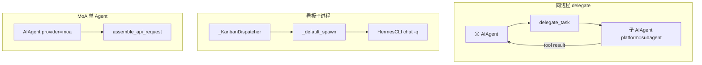

---

## 2. 谁调用谁

| 符号 | 文件 | 作用 |
|------|------|------|
| `_dispatch_delegate_task` | `run_agent.py` | `tool_executor` 唯一 delegate 入口 |
| `delegate_task` / `_build_child_agent` | `delegate_tool.py` | 子 Agent 构造、`ephemeral_system_prompt` |
| `_run_child_lifecycle` | `delegate_tool_child_run.py` | 子 `run_conversation` |
| `_fire_subagent_stop_hooks` | `delegate_tool_results.py` | 批结束 `subagent_stop` |
| `invoke_hook subagent_start` | `delegate_tool.py` | 子跑前 |
| `_KanbanDispatcher.tick_once` | `kanban_watchers_dispatcher.py` | 网关内扫板 |
| `dispatch_once` | `kanban_db_dispatch.py` | 领任务、spawn |
| `decode_moa_turn` / `moa_config` | `hermes_cli/moa_config.py` | MoA 轮配置 |
| `_append_moa_context` | `turn_request_assembly.py` | 参考模型块进 messages |

---

<a id="sec-7-delegate-lifecycle"></a>
## 3. 端到端：`delegate_task`（hook + 呈现）

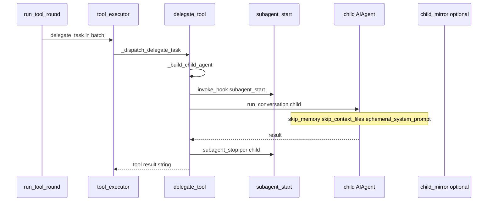

### 3.1 子 Agent prompt / 工具面（权威）

| 构造参数 / 行为 | 典型值 | 目的 |
|-----------------|--------|------|
| `ephemeral_system_prompt` | `_build_child_system_prompt(...)` | **不进**父 `_cached_system_prompt`（卷四） |
| `skip_memory` | `True` | 不挂父 MEMORY 快照 |
| `skip_context_files` | `True` | 不读父 AGENTS.md |
| `platform` | `"subagent"` | 平台 hint、工具 scope |
| `clarify_callback` | `None` | 子不阻塞父 UI RPC |
| `_cap_delegate_task_calls` | `run_agent` | 单轮并发子任务上限 |

子可有 **独立 `session_id` / SessionDB**（`_open_child_session_db`）；父 live transcript 与子的关系见 `delegate_tool` 注释。

### 3.2 TUI 子会话镜像（呈现）

| 字段 | 说明 |
|------|------|
| `_child_mirrors` | `tui_gateway/agent_callbacks.py` 模块 dict，键 `(parent_sid, child_session_id)` |
| 事件 | 子进度经 delegate 回调中继 → 父 `sid` 上 `subagent.*` 类事件（卷二需对照 `agent_callbacks`） |
| 条件 | Desktop/TUI 网关进程；纯 CLI 无镜像 |

### 3.3 插件 hook（子集）

| Hook | 时机 | 主要 kwargs |
|------|------|-------------|
| `subagent_start` | 子开跑前 | `parent_session_id`, `child_session_id`, `child_role`, … |
| `subagent_stop` | 子结束 | `tool_call_history`, cost rollup |

---

## 4. 看板 worker 端到端

Kanban 不是“把 delegate 画成卡片”，也不只是一个看板 UI。它是一个**以独立 SQLite 看板库为中心、按依赖关系调度独立 worker 进程、用 Run 和事件保存执行现场的任务系统**。聊天、CLI、Dashboard 都是入口；关掉页面不等于停止调度，父聊天结束也不等于 worker 结束。

> **阅读与源码口径**：以下按本地源码快照 `60d00c5633ad76f3dd8e3ecd79f77f1c6f8e6fdd` 整理，不代表远端最新版本。图中标注 `模块` 的是函数容器，不是虚构的服务类；`runner: GatewayRunner` 是运行实例，Mixin 只解释方法定义位置。接口示例是说明数据流的示意，不是已执行的任务。

先记住四件事：

1. **Task 是事情，Run 是这件事的一次执行尝试**；失败重试、实现转 review 都可能换 Run，不必新建卡片。
2. **调度器授权，worker 执行并主动结算**；进程退出码为 0 不是任务完成的充分条件。
3. **依赖靠 `task_links`，交接靠摘要、附件和评论**；不是共享 Python 内存，也不是默认复制父聊天全部 messages。
4. **恢复先对账，再决定继续等待或重新派工**；通常不是 restore 旧 Agent 调用栈。

<a id="sec-7-kanban-architecture"></a>
### 4.1 整体架构：入口、领域内核、调度执行、结果交付如何分层？

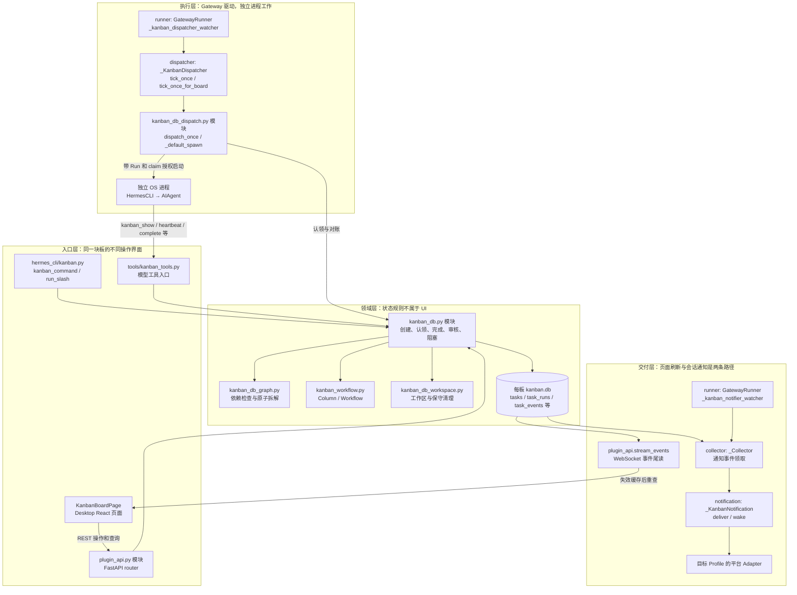

**分层的价值**：入口不各自实现一份状态机；调度器不依赖页面存活；worker 崩溃后仍能从看板库知道“谁拿了任务、哪次尝试没有结算”。但这里的 `task_events` 是审计/通知事件记录，**不能据此宣称系统是可从事件完整重建状态的 event sourcing 架构**。

<a id="sec-7-kanban-modules"></a>
### 4.2 模块与真实实体：哪些是类，哪些只是模块函数？

| 模块 / 实体 | 实际职责与边界 |
|---|---|
| `hermes_cli/kanban.py`、`kanban_parser.py`、`kanban_output.py` | 命令解析、slash 入口、输出呈现，不负责后台轮询 |
| `hermes_cli/kanban_ops.py` | 手动 dispatch 等运维入口；旧 daemon 入口已弃用，常驻循环由 Gateway 承担 |
| `hermes_cli/kanban_boards.py` | 多板身份、选择与板级操作 |
| `tools/kanban_tools.py`、`kanban_tools_schemas.py` | 模型工具与参数 schema、worker 权限边界、结构化错误 |
| `hermes_cli/kanban_db.py` | 领域操作入口及 `Task` / `Run` / `Comment` / `Attachment` / `Event` 数据类 |
| `kanban_db_connect.py` | SQLite schema/迁移、事务、tick 锁、完整性检查和有限修复 |
| `kanban_db_graph.py`、`kanban_workflow.py` | 依赖/拆解与列/人工移动规则；后者**不是完整调度状态机** |
| `kanban_db_workspace.py`、`kanban_db_notify.py` | 工作区与清理；持久订阅与游标 |
| `kanban_decompose.py`、`kanban_swarm.py` | 辅助模型规格化/拆解；预定义 Swarm DAG 与 blackboard |
| `GatewayKanbanWatchersMixin` | 为 `GatewayRunner` 提供 watcher 方法；不是独立启动的对象 |
| `_KanbanDispatcher` / `_DispatcherSettings` | 网关调度对象及设置；遍历看板、自动拆解、调用板级 dispatch |
| `kanban_db_dispatch.py` / `DispatchResult` | 调度函数群及结果数据类；没有一个叫 `dispatch_once` 的数据库服务 |
| `_Collector` / `_KanbanNotification` | 领取待通知事件；处理一次目标路由交付与可选 wake |
| `plugins/kanban/dashboard/plugin_api.py` | FastAPI 路由、Dashboard 操作/诊断和 WebSocket 事件流 |
| `apps/desktop/src/plugins/kanban/` | `KanbanBoardPage`、`api.ts`、drawer、board-switcher、orchestration 等前端模块 |

以下类图只画本专题相关成员和依赖，不把所有字段堆成一张“源码截图”。

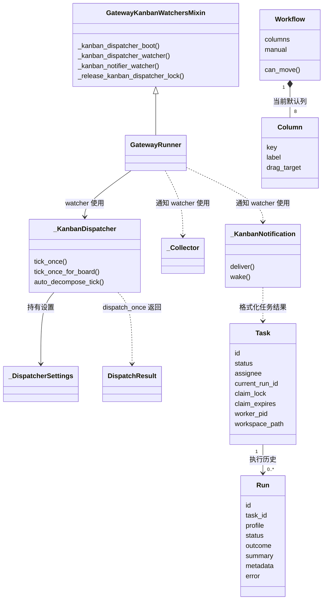

`Task` / `Run` 是行的内存视图，不是各自开线程的 actor；`Workflow` 描述列和允许申请的人工移动，不意味着“拖到 running 就启动一个 worker”。真正认领必须经过领域事务。

<a id="sec-7-kanban-storage"></a>
### 4.3 数据模型与隔离：卡片、执行尝试、消息会话是什么关系？

| 数据 | 保存什么 | 不要混同为 |
|---|---|---|
| `tasks` | 事项当前状态、负责人、优先级、工作区、当前 Run/claim、重试/阻塞计数及模型覆盖等 | 每执行一轮就插一张新卡 |
| `task_runs` | 一次认领后的执行尝试，profile、租约、PID、起止时间、outcome、交接摘要、错误与 metadata | Agent 单次 LLM 请求 |
| `task_links` | 前置任务 → 后继任务的有向依赖 | 文件夹父子关系或评论回复关系 |
| `task_comments` | 人机讨论、补充信息、Swarm 的结构化 blackboard 更新 | 自动成为全部 worker 的共享 messages |
| `task_attachments` | 持久附件元数据及已保存文件位置 | worker scratch 的临时文件 |
| `task_events` | 创建、认领、完成、失败、审核等领域事件，部分关联 run_id | 完整对话 transcript |
| `kanban_notify_subs` | 每个任务/目的地订阅、模式、路由和消费游标 | 全局一个“已通知”布尔值 |

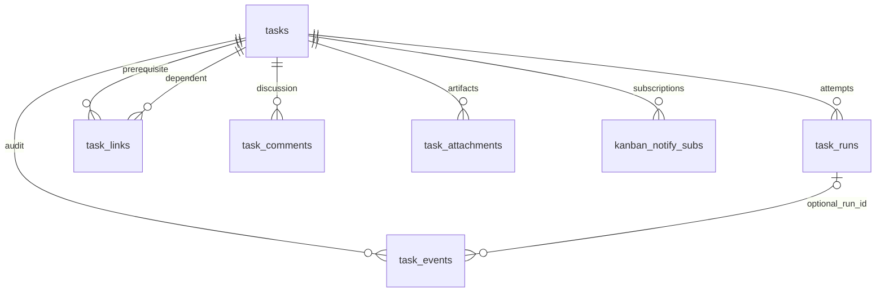

图画的是逻辑关系，不将每条连线都承诺为 SQLite 已声明的外键。`tasks.current_run_id` 是当前尝试的所有权指针；历史 Run 不能越过它结算后来接手的执行。

**三个 ID 加一个进程身份，要分开读：**

- `Task.session_id` 记录经过校验的来源聊天关联；不等于任务当前 worker 的全部运行现场。
- `Run.id` 标识一次看板执行尝试；reviewer 的执行也是另一次尝试。
- worker 自己还会产生 `source=kanban` 的 SessionDB 会话记录。**Kanban DB 管任务；SessionDB 管对话**，不能把修改任务状态说成更新会话 messages。
- PID 加进程启动指纹用于识别同一 OS 进程，防止 PID 复用后误判或误杀；单有 PID 不足以证明拥有执行权。

**多板路径不是 Profile 私有库：**`kanban_home()` 以 `HERMES_KANBAN_HOME` 或默认 Hermes 根目录为根；默认板是 `<root>/kanban.db`，命名板是 `<root>/kanban/boards/<slug>/kanban.db`。`board.json` 保存板元数据/默认工作目录，`<root>/kanban/current` 是当前板选择指针，各板有自己的工作区、附件和 worker 日志路径。

普通交互可按显式板/当前板选择；worker 等被授权流程采用 **pin-first**，固定 `DB / BOARD / WORKSPACES_ROOT`，不能因 UI 切板或 `-p PROFILE` 更换 Profile home 而偷偷换库。`tenant` 是命名空间/路由上下文，**不是 OS 沙箱隔离保证**。

<a id="sec-7-kanban-states"></a>
### 4.4 任务状态机：每列意味着什么，谁能推动状态？

| 状态 | 人话解释 | 主要后续路径 |
|---|---|---|
| `triage` | 还需要讲清规格或拆分 | specify/decompose 后进入可安排的任务图 |
| `todo` | 当前不能开始，通常有前置任务未完成 | `recompute_ready` / unblock 重算依赖 |
| `ready` | 依赖允许认领；仍需可启动负责人和并发额度 | 原子 claim → running |
| `running` | 某个 Run 已认领，可能正在准备/启动/执行 | complete、request_review、block，或被回收 |
| `blocked` | 需要外部介入，或失败熔断 | unblock 重算依赖并恢复原阶段（可为 review）；反复同类阻塞可回 triage |
| `scheduled` | 主动停放，等待时间条件/外部触发 | 外部操作调用 unblock 后重新过依赖门禁 |
| `review` | 实现交给审核，尚未最终验收 | reviewer claim、request_changes 或完成/人工审核操作 |
| `done` | 已有显式完成结算 | 后继任务可提升；仍可被重新打开 |
| `archived` | 已归档，不作为普通列显示 | 终结通知订阅；必要时走恢复操作 |

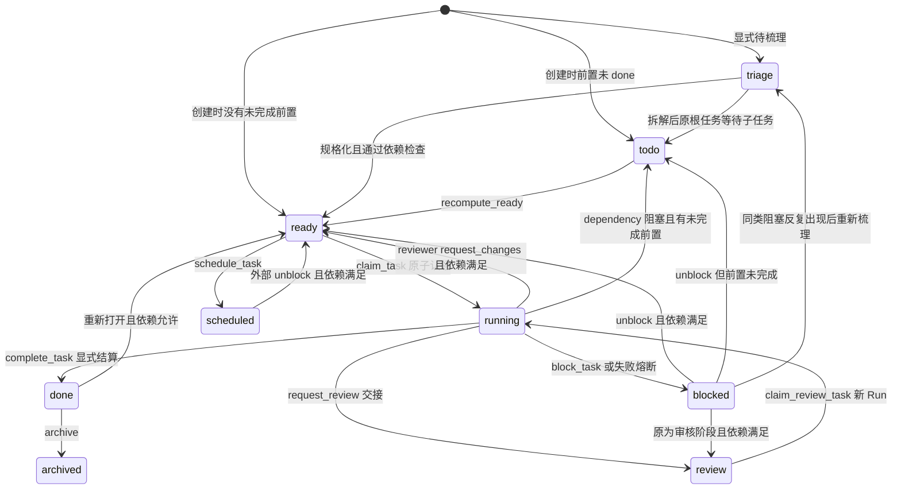

这是**关键内核路径图，不是完整人工拖动矩阵**；其他状态也可能归档，reopen、修复、导入等条件转移需要读对应领域函数。`kanban_workflow.DEFAULT_WORKFLOW` 才是默认列及人工 move allow-list 的来源；`can_move=True` 只是允许申请，仍需完成证据、依赖、审核等门禁。`workflow_template_id / current_step_key` 有预留含义，不能据此声称已经支持任意自定义工作流调度。

两个容易读错的边界：

- **scheduled 不是已经实现的倒计时调度队列**：当前 `schedule_task` 没有 `wake_at` 定时器语义，dispatcher 不会仅因时间流逝自动唤醒卡片。不要从列名推导功能。
- **创建与运行期的依赖检查有细节差异**：`initial_task_state` 创建时检查前置是否都为 `done`；运行期 `_parents_satisfied` 将 `done / archived` 视为满足。不能用一句“所有入口完全同一规则”掩盖差异。

<a id="sec-7-kanban-graphs"></a>
### 4.5 创建、依赖与拆解：为什么 decompose 和 Swarm 的根任务方向相反？

`create_task` 不是单纯 INSERT：还处理初始状态、前置任务存在性、幂等键、工作区/项目关联和来源上下文。`link_tasks` 要防止有向环，依赖才有可执行顺序。前置被重新打开时，后继需要重新失效/门禁检查，不能永久保留一次 ready 的资格。

**triage 拆解**：`kanban_decompose.decompose_task` 用辅助任务 `kanban_decomposer` 产出结构化规格/任务图，校验输出和负责人；`kanban_db_graph.decompose_triage_task` 在一个写事务内检查原任务还在可拆状态、没有已拆记录，插子任务、连边、记事件、把原根任务放回 todo。兄弟任务图使用拓扑校验，不能一半写成功、一半失败。

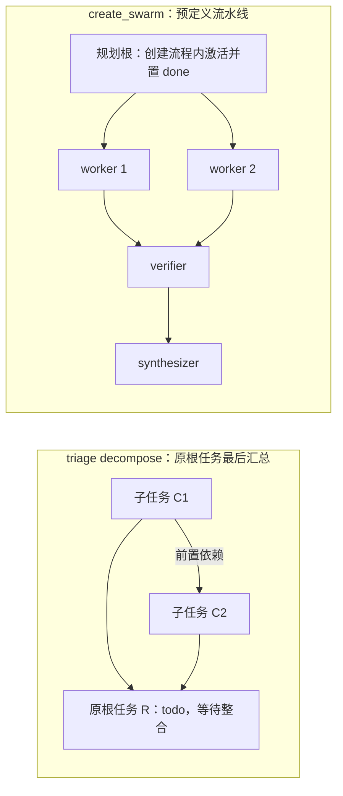

图中箭头统一表示 **前置 → 后继**。decompose 的“子任务”是原任务的前置，不是原根先跑完再允许子任务跑；自动提升关闭时子任务可先保留 todo。Gateway 的 `auto_decompose_tick` 在调度前处理 triage，且有每 tick 的预算。

`kanban_swarm.create_swarm` 则通过 `SwarmWorkerSpec / SwarmCreated` 等构造固定阶段 DAG；`post_blackboard_update / latest_blackboard` 在根任务评论中保存结构化黑板。所谓“共享黑板”是**持久信息约定**，不是几个 Agent 共用同一个 messages list。

<a id="sec-7-kanban-gateway-lifecycle"></a>
### 4.6 Gateway 如何启动、循环和停止看板服务？

源码归属：`gateway/kanban_watchers.py` 的 `GatewayKanbanWatchersMixin` 方法由 `GatewayRunner` 实例执行；`gateway/kanban_watchers_dispatcher.py` 的 `_KanbanDispatcher` 是真正的调度对象。

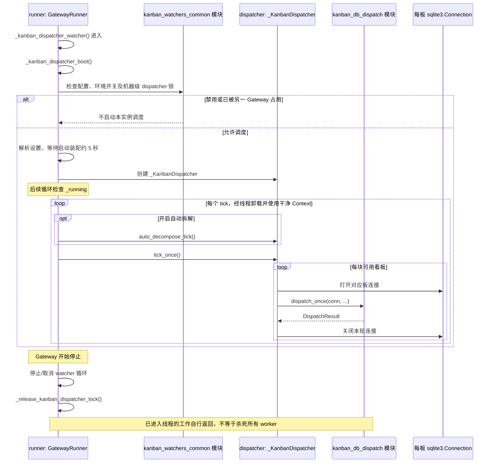

- `kanban.dispatch_in_gateway` 默认开启；`HERMES_KANBAN_DISPATCH_IN_GATEWAY=off` 可关闭。轮询默认约 60 秒、最小 1 秒；启动先留出约 5 秒给 adapter 装配。
- 机器根目录 `kanban/.dispatcher.lock` 抑制多个 Gateway 同时常驻派工；**锁不可用时存在记录日志后仅靠配置继续的退化分支**，不能宣称无条件全局恰好一个 dispatcher。
- 多板分别连接、分别处理；损坏数据库可以被隔离，不应让一块坏板拖垮全部轮询。大部分 dispatch 设置启动时读取，自动拆解的 enabled/per_tick 会在后续轮次重读。
- Gateway 停止不等于所有任务取消。worker 是独立进程，适用时采用 restart-safe scope，可跨服务重启存活；下一次启动先对账。全局 `hermes pause` 等开关控制的是派工许可，不是任意终止进程的命令。

<a id="sec-7-kanban-dispatch"></a>
### 4.7 一轮 dispatch 的流程：先回收、再算额度、最后认领

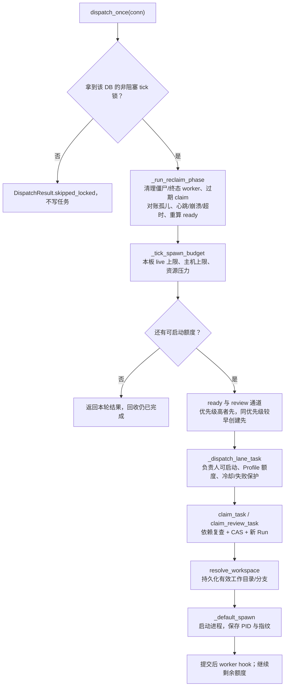

**回收顺序有意义**：`reap_worker_zombies` → `reap_terminal_workers` → `release_stale_claims` → 可选 `reconcile_orphaned_running` → `detect_stale_running` → `detect_crashed_workers` → `enforce_max_runtime` → `recompute_ready`。先释放旧占用，才能算本轮能否新开工；资源紧张时也不能跳过恢复工作。这里说的是已进入 `dispatch_once` 的 tick；全局 pause 则在 watcher 外层直接跳过自动拆解和派工，仅仍尝试独立的僵尸进程回收，不能误读为暂停期间所有对账步骤照常执行。

**并发不是一个配置项：**

| 机制 | 范围 / 语义 |
|---|---|
| Gateway dispatcher 锁 | 抑制多个常驻轮询者；不能替代 DB 事务 |
| resolved DB 的 tick 锁 | 同一块板一轮 dispatch 串行；手动 dispatch 与 Gateway 可能争用 |
| `BEGIN IMMEDIATE` 与 CAS | 即使有其他写入者，任务认领仍只有一个赢家 |
| `max_spawn` | **本板存活 worker 的并发上限**，不是每 tick 必须新启动 N 个 |
| `max_in_progress` | **主机范围**限制，计入其他板；未显式设置时可由内存条件推导 |
| Profile 上限 | 当前板查询统计该负责人的运行任务；不能宣传为跨板统一 Profile 限额 |
| 资源压力 | critical 停止新派工；elevated 将新增收紧到至多一个，回收仍运行 |

review 与 ready 共用总预算；有可启动 review 时会预留一个额度防止长期饥饿。未分配负责人时可用有效默认负责人；负责人不在磁盘上、不可 spawn 时可被跳过，不代表其他外部控制面永远不能认领它。spawn 成功也**不会立刻清零连续失败计数**；真正成功完成才代表业务恢复。

<a id="sec-7-kanban-claim"></a>
### 4.8 原子认领与防旧 worker 写回：Task、Run、claim 怎么绑定？

`kanban_db._claim_and_open_run` 的核心可简读为：

```sql
-- 调用方已处于 write_txn(conn)：BEGIN IMMEDIATE，带忙锁重试。
-- :source_status 是领域函数选定的 ready 或 review，不是用户自由拼接 SQL。
UPDATE tasks
   SET status = 'running', claim_lock = :lock, claim_expires = :expires,
       started_at = COALESCE(started_at, :now)
 WHERE id = :task_id
   AND status = :source_status
   AND claim_lock IS NULL;
-- rowcount != 1：本次没有拿到授权，不能再启动 worker。
-- rowcount == 1：同一事务内继续 INSERT task_runs(status='running', ...)，
-- 更新 tasks.current_run_id，并追加 claimed 事件，然后才提交。
```

这不是只靠 `SELECT status == ready` 再 UPDATE 的先查后写方案。`claim_task` 还在事务内复查前置，非法 ready 会回到 todo；review 认领记录 `claimed.source_status=review`，以后才能辨认“这是 reviewer 的 Run”。

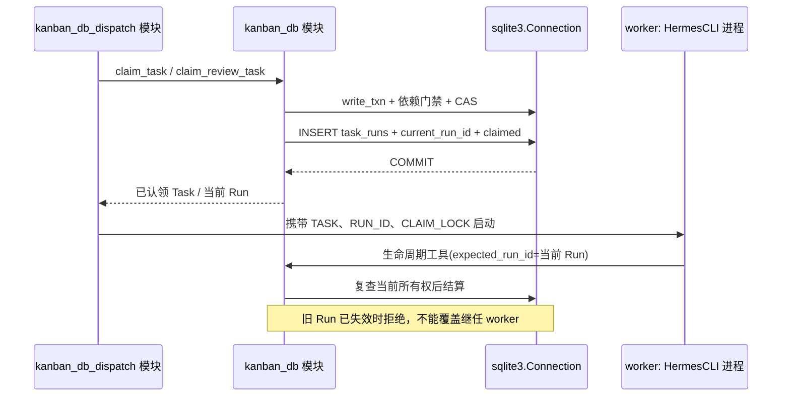

工作区解析或 spawn 失败也发生在认领之后，因此要记录失败并关闭/释放相应 Run 与 claim，不能留下永久 running；认领成功不保证进程最终启动。

claim 是执行许可，Run 是尝试身份，进程指纹是 OS 身份，三者各管一层。它们与聊天层 `DurableTurnLease` 不是同一把租约。领域变更提交后再发相应 hook，避免插件观察者占用任务写事务；dispatch-tick hook 还明确放在 tick 锁释放后。不要把这一点扩大为“每一种 hook 都在所有锁外运行”：worker-spawned 等调用仍可能处于整轮 dispatch 的范围内。hook 是扩展观察点，不替代事务提交。

<a id="sec-7-kanban-worker"></a>
### 4.9 worker 怎么启动，任务内容放在哪里，工具权力如何收紧？

`kanban_db_dispatch._worker_argv` 组装真实安装入口及参数，形态是：

```text
hermes -p PROFILE --cli --accept-hooks [模型/工具集/skills/reasoning 参数]
       chat -q "work kanban task t_ID"
```

`_default_spawn` 不把整份任务、历史评论和父聊天塞到命令行，而是同时提供一组授权环境：

| 环境/启动信息 | 用途 |
|---|---|
| `HERMES_PROFILE / HERMES_HOME` | 选择负责人的配置、凭据和工具能力 |
| `HERMES_KANBAN_TASK` / `HERMES_KANBAN_RUN_ID` / `HERMES_KANBAN_CLAIM_LOCK` | 固定本次获授权的卡片与执行尝试 |
| `HERMES_KANBAN_DB` / `HERMES_KANBAN_BOARD` / `HERMES_KANBAN_WORKSPACES_ROOT` | 固定同一块板，不受 Profile home 或当前板切换影响 |
| `HERMES_KANBAN_WORKSPACE / TERMINAL_CWD`、进程 cwd | 固定实际工作目录；不是仅在 prompt 里说“请到某目录” |
| `HERMES_SESSION_SOURCE=kanban` | 标记 worker 对话来源，供会话记录/恢复边界识别 |
| tenant、branch、goal 相关信息 | 承接本任务范围和执行策略，不等于绕过权限 |

启动会清理不该继承的 Gateway 会话路由变量；Profile 的秘密/terminal 配置按负责人的作用域处理。stdin 为 DEVNULL，stdout/stderr 写 worker 日志，适用时放入可跨 Gateway 重启的运行 scope。基础设施的 restart-safe scope 不可用与业务执行失败分开处理，不能无条件消耗卡片重试次数。

`HermesCLI` 在**新进程**中创建并运行 `AIAgent`。`agent/prompt_builder.py` 的 `KANBAN_GUIDANCE` 指导 worker 先 `kanban_show()`，确认工作区并取任务信息，再执行、心跳、阻塞或完成。`kanban_db.build_worker_context` 提供有界的任务正文、附件、先前尝试、已完成前置的交接、负责人近期工作和评论。因此：

```text
短启动指令 + worker 指导 + kanban_show 返回的任务上下文
    → 该 worker 自己的推理/工具循环
    → 显式写入结果/摘要/附件
    → 下一个 worker 重新从持久看板上下文读取
```

不是“父 AIAgent 的工作区 messages 直接传引用给子进程”。Agent 的 `_touch_activity` 会尝试调用 `heartbeat_current_worker_from_env`，并检查新评论；长时间无活动的工具外等待仍可显式调用 `kanban_heartbeat`。

`tools/kanban_tools.py` 的 `_visible / _worker_guard` 进一步区分编排者、授权 worker 和 delegate 子 Agent：worker 的生命周期写入限于自己的任务且带 Run fence，部分编排工具对 worker 隐藏；delegate 子 Agent **不是 kanban owner**，即使继承了一些环境，也不能替父 worker 结算。父 worker 可以委派子工作，但最终仍由自己交接/完成。

任务还可指定 model/provider/reasoning/skills、goal 模式和轮数等。goal 的持续执行/判定是 worker 会话内策略，不应画成“每轮判定都新建一张卡或一个 Run”。

<a id="sec-7-kanban-workspace"></a>
### 4.10 工作区、文件成果与清理：为什么不是进程结束就删目录？

| 工作区种类 | 解析方式 | 清理边界 |
|---|---|---|
| `scratch` | 板级工作区根下按任务稳定定位 | 声明成果应先保存成持久附件，再考虑清理 |
| `dir` | 使用显式绝对目录 | 外部目录不能当临时垃圾任意删除 |
| `worktree` | Git 仓库根可落到 `<repo>/.worktrees/<task-id>`；也支持明确工作区/板默认目录锚点 | 保存分支与路径；dirty、共享/未知所有权等情况保守保留 |

源码是 `kanban_db_workspace.resolve_workspace` 及其清理逻辑。worktree 没有可用仓库/目录锚点时应失败，不编造一个可写目录继续跑。清理还要考虑仍活跃的后继、其他任务或其他板的占用；无法证明安全时保留并记录原因。

完成/交接不是“数据库先标 done，附件以后再说”：scratch 中声明的成果要先转存到持久附件；保全失败时应拒绝这次转换，避免卡片已完成却找不到成果。代码仓库分支、附件、Run 摘要是交接介质；单看最终聊天文本不足以理解整个生命周期。

<a id="sec-7-kanban-settlement"></a>
### 4.11 成功与阻塞怎么结算：LLM 说完成了为什么还不够？

`kanban_db.complete_task` 需要经过前置门禁（事务前与事务内）、完成结果/摘要要求、`created_cards` 存在性校验、配置要求的 PR 验收以及 live claim 的所有权检查等，再关闭当前 Run、写完成事件、释放 claim/worker 引用、重置成功相关计数。`recompute_ready` 随后以独立事务让后继看到可开工资格；不是在 LLM 最后一段话出现“完成”时自动达成。

- 活跃 worker 的正常结算需要 `expected_run_id`；人工强制入口是显式例外，不是默认忽略 fence。
- stdout、`final_response`、进程 exit 0 都不能替代 `kanban_complete` 等领域调用。**进程干净退出，但任务仍是 running，会按协议违例处理**。
- worker block 会关闭当前尝试并释放认领。后续人工补信息、unblock，按前置门禁回 ready/todo；若阻塞前在审核阶段还可恢复 review，再由新 Run 重新派工，不是让旧函数从暂停点继续。

| `block_kind` | 领域处理 |
|---|---|
| `dependency` | 真有未完成前置时回 todo；没有这种前置则重归类为 needs_input，避免假依赖卡死 |
| `needs_input` | 等人补充信息，blocked 不会被一般 ready 提升扫过去 |
| `capability` | 缺能力/环境，需外部修复 |
| `transient` | 以阻塞显式表达临时障碍；不等于 dispatcher 无限即时重试 |

同类阻塞复发累计到阈值（当前为 2）可以退回 triage 重新梳理。`unblock` 重置连续失败数但保留阻塞复发历史；成功完成才清除相应复发状态。**`block_recurrences` 与 `consecutive_failures` 是两类计数，不能用一条“重试次数”概括。**

<a id="sec-7-kanban-review"></a>
### 4.12 review 如何交接、返工、重新验收？与人工安全审批一样吗？

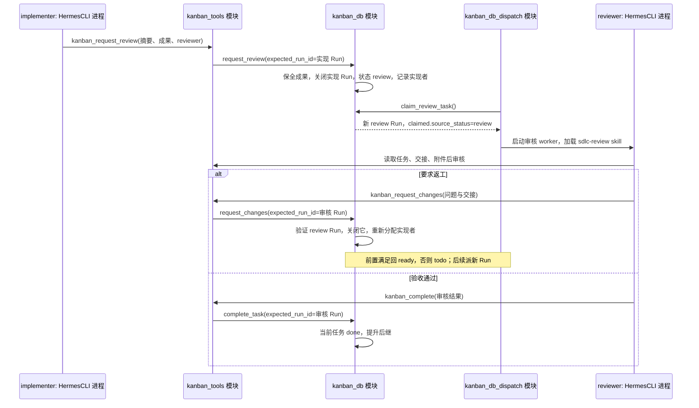

`request_review` 不只是改 assignee：它保存交接，结束实现尝试，记录 `review_requested` 事件及实现者来源。`request_changes` 要求当前确是从 review 认领的活跃 Run，再按来源事件找回实现者；不是允许任意 running worker 把任务随意退给别人。审核 worker 使用强制加载的 `sdlc-review` 指导；人工 review 操作也要走对应领域门禁。

**这不等于卷八的危险命令审批**：terminal `/approve` 通常在同一进程的 Queue/Event 等待现场放行原 tool 调用；Kanban review 是任务级持久交接，常常换 Profile、换进程、换 Run。不能画成 reviewer 批准后自动 restore 原 implementer 的 Python 栈。

<a id="sec-7-kanban-recovery"></a>
### 4.13 崩溃、超时、重启：现场保留在哪里，如何避免重复执行？

| 现场 | 下一轮对账做什么 | 不能据此推导什么 |
|---|---|---|
| claim 过期，但本地进程仍被证明存活 | 按规则延长/处理租约，而非只看过期时间立刻杀掉 | TTL 就是任务总时长 |
| PID 不存在或指纹不符 | 识别崩溃/陈旧记录，结算对应 Run、释放占用 | 同号 PID 一定还是原 worker |
| 心跳陈旧 / 超过 max runtime | 分别检查活动停滞和总运行时限，按规则处理 | 无输出一定已死；所有超时同一原因 |
| exit 0，但没有生命周期结算 | 协议违例失败，保留诊断/执行历史 | 退出码成功必然 done |
| 连续失败超过任务阈值 | 失败计数、退避/冷却和熔断，必要时 blocked | 无限立即重启总能恢复 |
| Gateway 自身重启 | 重新扫 DB，对仍存活 worker 对账；需要重派时新 Run | 清空全部 running 或恢复所有旧栈 |
| 板 DB 损坏 | 完整性检查、有限索引修复、备份/隔离和诊断 | 删库重建就是“恢复成功” |

`max_retries` 在这里控制的是失败阈值；例如 1 可能意味着第一次计入的失败就熔断，不是“初次之外还能再试一次”。没有任务覆盖时使用 dispatcher 的失败限制。速率限制/冷却等有不计入常规失败的分支，基础设施错误也不能全部按任务失败计算。必须看 outcome 分类，不能仅数 spawn 次数。

还有两种不同的“恢复”：

1. `agent/kanban_turn_recovery.py` 在当前 worker 内做有界的 turn 重试（默认 3 次、15/45/90 秒退避）。授权来自准确匹配的 DB、RUN_ID、CLAIM_LOCK 和仍有效的任务/Run 租约；rate limit/billing、已经耗尽的持久预算等不是这条重试通道可以覆盖的错误。仅有一段 partial response 不构成继续运行权限。
2. `hermes_cli/kanban_resume_guard.py::kanban_resume_refusal` 根据持久 SessionDB 的来源/谱系，阻止普通 CLI/Desktop 把 Kanban transcript 随意恢复为可写会话；受监督的 dispatcher 流程有相应边界。不能用手工 resume 绕开任务已经易主的事实；无法分类/探测失败的分支也不能误说成无条件 fail-closed。

**保留文件和摘要 ≠ 恢复调用栈**。再次派工可以复用工作区/分支，从先前 Run 摘要、评论和附件重建任务上下文，但仍需新的合法认领。

<a id="sec-7-kanban-delivery"></a>
### 4.14 结果怎么回到用户/Agent？通知、wake、页面刷新分别是什么？

任务完成首先写的是看板库。是否把它送回来源聊天，取决于是否存在匹配的持久订阅，不是 worker 最后一条 assistant 消息自动成为父会话回复。

订阅按 `(task_id, platform, chat_id, thread_id)` 定位目的地，并保存 notifier Profile、用户/tenant 等路由信息、模式和游标：`notify` 是被动通知，`wake` 是唤起目标会话处理，`notify+wake` 两者都做；普通默认与 api_server 的默认策略不同，后者默认 notify+wake。新订阅从当前最大事件游标开始，不自动重放整段历史。

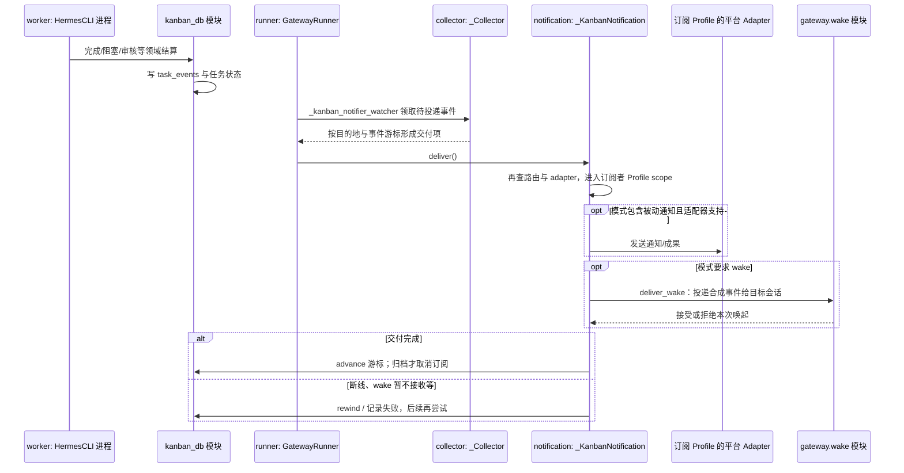

- `_Collector` 只领取符合通知条件/路由的事件；不是无差别广播整张 `task_events`。
- `_KanbanNotification.deliver` 会重查路由，避免领取后 adapter 断开；发送/附件策略取订阅者 Profile，不应退回主 Profile 凭据导致串号。
- wake 是目标会话获得**新事件/新处理机会**，不是唤醒旧 worker 的暂停栈，也不代表把全部任务结果直接永久塞进父 messages。
- 游标加领取/回退降低重复；外部发送与 DB 不是一个原子事务，**不能承诺 exactly-once**。notify+wake 的两条腿都成功后才结算消费游标；已发送 ping 另有持久 checkpoint，让 wake 重试不必重发这些 ping。wake 的接受只是入队接受，不是目标 Agent 已执行/最终回复的回执。进程在外部发送与 checkpoint 写入之间崩溃等窗口仍不能提供 exactly-once 保证。
- done 可重开，因此订阅不立刻删除；archived 才退订。另有 done 订阅保留期与周期 GC，默认约 30 天保留，不是无限增长。

**Dashboard 是另一条消费链**：`plugin_api.stream_events` 用 `_EventTail` 尾读事件，经 WebSocket 告知前端变化；React Query 失效缓存后重新 GET 卡片。首次没有 `since` 从当前末尾开始，有游标才按它续读。前端缓存、所选板、事件游标按 **connection + board** 隔离；切板重连，不修改服务器所有人的当前板。板已消失时关闭流，不偷偷重建死板。这个 WebSocket 既不派工，也不等于 IM 通知订阅。

<a id="sec-7-kanban-example"></a>
### 4.15 完整示例：从创建接口任务到返工、通过、后继执行

以下用示意 ID 说明同一张卡如何经历多次尝试，**不是可直接复制的 CLI 参数示范**。任务内容：“增加订单查询接口，附测试及交接”；负责人 Profile 为 `backend`，审核人为 `reviewer`，后继为部署任务 `t_deploy`。

| 步骤 | Task / Run 的可见变化 | 谁在做什么 |
|---|---|---|
| 1. 创建 | `t_api=ready`，`t_deploy=todo`；依赖 `t_api → t_deploy` | CLI/聊天工具/API 调同一领域操作，记录来源会话并按需要订阅通知 |
| 2. 第一次派工 | `t_api=running`，新 Run 101，current_run_id=101 | dispatcher 先过额度/依赖门禁，再 claim，准备 worktree 并启动 backend worker |
| 3. 读取现场 | Run 101 持有自己的 claim | worker 收到短指令，`kanban_show` 取得正文/附件，修改代码、运行测试并心跳 |
| 4. 提交审核 | `t_api=review`；Run 101 已关闭；成果/摘要持久化 | worker 调 request_review，写“变更、测试、风险、成果位置”，不能仅在终端输出“请审核” |
| 5. 审核返工 | 新 Run 102，从 review 认领；随后关闭，`t_api=ready` | reviewer 找到缺失的权限测试，request_changes 按来源记录分回 backend |
| 6. 再次实现 | 新 Run 103；还是同一 `t_api` | 新 worker 读旧 Run/返工评论，可在保留工作区继续修；不是恢复 Run 101 的旧调用栈 |
| 7. 再送审通过 | 实现交接关闭 103，审核新 Run 104，最后 `t_api=done` | reviewer 显式 complete，通过所有完成门禁 |
| 8. 后继与交付 | `t_deploy` 经重算变 ready；订阅游标推进 | dispatcher 另行派工；notifier 通知来源聊天，若模式要求则 wake；页面收到事件重查 |

概念性交接数据可以是：

```json
{
  "summary": "已增加订单查询接口和权限测试；审核关注租户过滤",
  "artifacts": ["测试报告的持久附件引用"],
  "metadata": {"交接说明": "改动范围、验证结果、剩余风险"}
}
```

这是**交接语义示意，不是承诺每个工具都接受上述原样 JSON schema**；具体入参对照 `kanban_tools_schemas.py` 与领域函数。关键是信息进入可持久读取的结果/摘要/metadata/附件，而不是只留在某个进程的 stdout。

把步骤 3 换成“缺测试环境”会走 block → 人补评论/修环境 → unblock → 新 Run；把它换成“进程崩溃”会走下一 tick 对账与重试策略。两者都不应让 `t_deploy` 偷跑，因为最终认领还要重新检查前置。

<a id="sec-7-kanban-surface"></a>
### 4.16 Dashboard 与运维设计：看板领域还有哪些功能不能漏？

Dashboard 后端入口是 `plugins/kanban/dashboard/plugin_api.py` 的 FastAPI `router`，挂载在 `/api/plugins/kanban/`；前端 `api.ts` 使用插件 SDK `ctx.rest`，不是再启动一套与 CLI 分叉的后台服务。`create_task / update_task / _apply_status / _drag_to` 等负责将操作映射到领域函数；拖卡要经过人工移动矩阵和对应操作的业务门禁，不是允许浏览器任意 PATCH 数据库字段。

| 功能面 | 实现落点 / 设计要点 |
|---|---|
| 多板管理 | `kanban_boards.py`、`kanban_db.py`、Dashboard boards 路由及 board-switcher：创建/切换/重命名/归档/移除等；worker 固定板不跟 UI 漂移 |
| 备份与迁移 | 板导出/导入；在线备份保持一致性，导入清理本机 PID/claim/订阅等运行态，不复活导出机器的进程 |
| 任务组织 | create/show/update/list、依赖边、幂等创建、优先级、项目/租户/来源信息、specify/decompose |
| 团队编排 | Swarm 预定义 DAG、verifier/synthesizer 与 blackboard；不是 delegate 注册表 |
| 人工协作 | 评论、附件、review/request_changes/reopen、阻塞/unblock、手动 move；分别有领域语义 |
| 执行策略 | Profile、模型/provider、skills/reasoning、goal 配置，PR/完成验收约束，工作区/分支选择 |
| 运维可见性 | Run 历史、worker 日志/tail、事件 log、stats、诊断与手动 dispatch |
| 干预与回收 | terminate/reclaim 等操作、全局派工暂停、过期 claim/孤儿/超时/崩溃恢复；须尊重进程所有权 |
| 数据卫生 | 完整性检查、有限索引修复、损坏备份/隔离、订阅 GC、工作区保守清理，不随意“删掉重来” |
| 扩展事件 | `kanban_task_claimed / completed / blocked` 与 worker 系列 hook，按 `VALID_HOOKS` 核对；事务后观察而非拥有事务 |
| 安全边界 | Profile 凭据作用域、板 pin、worker 自任务与 Run fence、delegate 禁止冒充 owner；与 terminal 安全校验叠加 |

本节覆盖主要架构和链路，不把“存在路由”当作其每个错误分支都已逐行解读。深入某个 API 入参时仍要查实际 schema；新增功能也应先检查是否复用了同一领域门禁，而不是在 UI 或新脚本里直写 status。

<a id="sec-7-kanban-reading-map"></a>
### 4.17 按问题读源码：从哪几个入口开始最有效？

以下路径相对于 Hermes 源码根目录（不是本 docs 仓库），以函数名定位比大文件中的固定行号更稳定：

| 要追的链路 | 推荐顺序 |
|---|---|
| 谁启动/停止常驻派工 | `gateway/kanban_watchers.py` → `kanban_watchers_common.py` → `kanban_watchers_dispatcher.py` |
| 一轮派工全部步骤 | `hermes_cli/kanban_db_dispatch.py::dispatch_once` → `_dispatch_once_locked` → `_run_reclaim_phase / _tick_spawn_budget / _dispatch_lane_task` |
| 双认领/旧写回如何阻止 | `kanban_db_connect.write_txn` → `kanban_db.claim_task / _claim_and_open_run` → 生命周期函数的 expected_run_id 检查 |
| 卡片怎么拆成 DAG | `kanban_decompose.decompose_task` → `kanban_db_graph.decompose_triage_task`；另读 `kanban_swarm.create_swarm`，不要混图 |
| worker 实际收到什么 | `_worker_argv / _default_spawn` → `agent/prompt_builder.KANBAN_GUIDANCE` → `tools/kanban_tools.py` → `kanban_db.build_worker_context` |
| 成功、阻塞、送审、返工 | `kanban_db.complete_task / block_task / request_review / request_changes` 及 graph/workspace 辅助函数 |
| 重启/重试与 resume 边界 | `kanban_db_dispatch` 回收函数 → `agent/kanban_turn_recovery.py` → `hermes_cli/kanban_resume_guard.py` |
| 结果怎样通知聊天 | `kanban_db_notify.py` → `gateway/kanban_watchers_notifier.py::_Collector / _KanbanNotification` → `gateway/wake.py` |
| 页面为何会更新 | `plugins/kanban/dashboard/plugin_api.py::stream_events` → `apps/desktop/src/plugins/kanban/api.ts / board.tsx` |

**本专题总结**：Kanban 的主轴不是“多开几个 Agent”，而是 **持久任务图 → 受约束认领 → 独立执行 → 显式交接/结算 → 对账恢复 → 按目的地交付**。与卷三的工作区 messages/SessionDB、卷六的聊天队列、卷八的在线审批相邻，但状态和所有权不能互相替代。
---

<a id="sec-7-kanban-toolface"></a>
### 4.18 模型侧工具面：15 个 `kanban_*` 工具各自被谁看见？

§4.9 讲了 worker 怎样被启动，这里补上**模型实际拿到的工具契约**，因为「谁看得见哪个工具」本身就是权限设计。schema 定义在 `tools/kanban_tools_schemas.py`（面向模型的字符串，byte-frozen），实现在 `tools/kanban_tools.py`。

| 工具 | 必填 | 语义要点 | 可见范围 |
|---|---|---|---|
| `kanban_show` | — | 读整张卡：标题/正文/负责人/前置交接/自己以往尝试/评论/近期事件，并返回可直接引用的 `worker_context` 字符串 | worker + 编排者 |
| `kanban_list` | — | 编排者发现可路由工作；默认 50 行、上限 200，带截断元数据；列出前会重算 ready | **仅编排者** |
| `kanban_complete` | schema 无必填；**运行时**要求 `summary`/`result` 至少一个 | `metadata` 放机器可读事实；`created_cards` 由内核核验存在性（防幻影引用）；`artifacts` 声明交付物 | worker（自己的卡）+ 人工/CLI |
| `kanban_block` | `reason` | `kind` 四选一决定路由；同类复发会升级 triage | worker |
| `kanban_schedule` | — | 停放：**不创建定时器**，只是让卡片不可派工，唤醒标记写进 `reason` | worker |
| `kanban_request_review` | `summary` | 送审；**不计入** unblock-loop 计数，所以反复送审不会被误升级 triage | worker |
| `kanban_request_changes` | `reason` | 审核者裁决：关闭审核 Run、重加前置门禁、退回原实现者，不走 block 计数 | 仅从 review 认领的 Run |
| `kanban_heartbeat` | — | 长操作的活性信号，纯副作用 | worker |
| `kanban_comment` | `task_id`, `body` | 跨尝试持久；临时推理不该写这里 | worker（自己的卡）；对他人卡片是编排者能力 |
| `kanban_attach` / `kanban_attach_url` / `kanban_attachments` | `filename` + `content_base64` / `url` / — | 真实附件（25 MB 上限），不是评论里的链接 | worker + 编排者 |
| `kanban_create` | `title`, `assignee` | 扇出；有未完成前置时返回 `gated: true` + `gated_by` | **仅编排者** |
| `kanban_unblock` | `task_id` | 回原阶段（review/ready）或前置未清时回 todo | **仅编排者** |
| `kanban_link` | `parent_id`, `child_id` | 事后加边；已 running 的子卡被拒（边无法串行化已开始的 Run） | **仅编排者** |

所有工具都带可选 `board` 参数，用于显式覆盖 env 固定的活动板；**显式参数压过 env pin**（见 §4.3 的 pin-first 讨论）。

**schema 的 `required` 与领域门禁不是一回事**：`kanban_complete` 在 schema 里没有必填项，但「必须有交接证据」这条规则住在 `kanban_db` 的领域函数里；`kanban_request_changes` 的「必须是当前从 review 认领的 Run」、`kanban_link` 的「拒绝 running 子卡」同理。只读 JSON schema 会低估约束，权限与证据门禁要回到领域层核对。

**默认零 schema 足迹**：普通 `hermes chat` 会话里这 15 个工具一个都不注入。注入条件是 `HERMES_KANBAN_TASK`（dispatcher 派工的 worker）或 profile 显式启用 `kanban` toolset（编排者）。`tools/kanban_toolset_context.py` 用 ContextVar 而不是进程环境变量携带「本次 schema 构建是否显式点名 kanban」，因为网关会在同一 profile 内并发为多个平台构建 schema。

**为什么不让模型 shell out 到 `hermes kanban`**（官方给的三条理由，属于设计解释）：① terminal 后端可能是 Docker/Modal/SSH，容器里没有 `hermes` 也没挂 board DB；② 避免 `--metadata '{...}'` 过 shlex+argparse 的引号地雷；③ 工具结果是结构化 JSON，模型能推理，而不是要解析的 stderr。

**同一 lineage 的下游进程被栅栏**：带 `HERMES_DELEGATED_CHILD_CONTEXT`（见 `agent/delegation_context.py`）的进程即使继承 `HERMES_KANBAN_TASK`，也拿不到 worker 指导块，其自动心跳会记一次 `refused` 警告，`kanban_complete` / `kanban_request_review` 直接拒绝。修法是让 dispatcher 重新派工，而不是把标记删掉继续跑。

<a id="sec-7-kanban-workflow"></a>
### 4.19 人工移动矩阵与 workflow 单一真源

§4.4 的状态表回答「每列意味着什么」，但**人在面板上能把卡片拖到哪一列**是另一张表，来源是 `hermes_cli/kanban_workflow.py` 的 `kanban_workflow.DEFAULT_WORKFLOW`。这一模块 2026-09-24 落地（`96db175da7`），把此前散落的 `VALID_STATUSES`、board 列定义、工具 enum、CLI 图标收敛成一处。

`kanban_workflow.Column` 保存 `key`（写进 `tasks.status`，稳定标识）、`label`（仅展示）、`icon`（CLI 单字形）、`drag_target`（是否作为拖拽/菜单目标）。默认列与顺序：

| 顺序 | key | 标签 | 图标 | `drag_target` | 为什么不是拖拽目标 |
|---|---|---|---|---|---|
| 1 | `triage` | Triage | ◇ | ✅ | — |
| 2 | `todo` | Todo | ◻ | ✅ | — |
| 3 | `scheduled` | Scheduled | ⏱ | ❌ | 需要唤醒条件，属额外输入动词 |
| 4 | `ready` | Ready | ▶ | ✅ | — |
| 5 | `running` | Running | ● | ❌ | 内核专属，人工不能直接置位 |
| 6 | `blocked` | Blocked | ⊘ | ✅ | — |
| 7 | `review` | Review | ◎ | ❌ | 需要 reviewer |
| 8 | `done` | Done | ✓ | ✅ | — |

人工移动 allow-list（`kanban_workflow.can_move`，源 → 允许目标；归档到 `archived` 永远允许且不在表内）：

| 源 | 允许目标 |
|---|---|
| `triage` | todo, ready |
| `todo` | triage, scheduled, ready |
| `scheduled` | triage, todo, ready |
| `ready` | triage, todo, scheduled, blocked, review, done |
| `running` | triage, todo, scheduled, ready, blocked, review, done |
| `blocked` | triage, todo, scheduled, ready, done |
| `review` | triage, todo, ready, done |
| `done` | triage, todo, ready |
| `archived` | triage, todo, ready（从归档筛选恢复） |

读这张表必须注意四点，都是源码里明确写下的：

1. **`archived` 不是列**，是筛选开关，但允许作为移动**源**（恢复）；`Workflow.keys()` 永不含它，`Workflow.validate()` 还禁止自定义工作流把它当列名。
2. **允许 ≠ 保证**：动词自身的门禁（未完成父任务、完成证据、goal 门禁）仍会拒绝。
3. **已知怪癖被刻意保留**：`review → todo` 实际落在 `ready`（`reopen_review_task` 忽略请求目标），注释写明 Phase 1 修；矩阵测试不掩盖它。
4. `can_move` 对**所有状态全定义**（total），`hermes kanban stats` 的列从工作流派生，因此不会出现「DB 里有状态但统计缺列」。

**这块刻意没有建模的东西**（模块 docstring 原文意思）：列对 dispatcher 的内核含义（可认领、终结、父门禁）与内核驱动的转移（约 20 处条件状态写：block 路由、崩溃/回收回位、父重开、导入）都**不在这里**，要和内核切换一起设计，「本模块绝不发布半成品契约」。2026-10-01 两个回退（丢掉未执行的 column traits、丢掉部分内核事件模型）就是这条原则的执行证据。

面板通过 `GET /api/plugins/kanban/workflow` 读同一份定义（`plugins/kanban/dashboard/plugin_api.py` 的 `get_workflow`），注释说明所有板今天都用默认工作流，**每板自定义工作流（`board.json`）是后续阶段**，不要从接口存在推断已支持任意自定义流转。

<a id="sec-7-kanban-ledger"></a>
### 4.20 失败与暂停账本：哪些计入熔断、哪些只是 hold？

§4.13 给了对账现场的分类，这里把**一次派工尝试是怎么被记账的**摊开，因为「重试次数」这个词掩盖了至少四套互不相同的账。常量都在 `hermes_cli/kanban_db_dispatch.py` 顶部。

**worker 退出码即协议**（dispatcher-spawned worker）：

| 退出码 | 含义 | 记账 |
|---|---|---|
| 0 但卡片仍 `running` | 协议违例（模型输出文本就退出，没做终结性看板调用） | `protocol_violation` 事件 + 独立连续违例预算 `_PROTOCOL_VIOLATION_FAILURE_LIMIT = 3`，超预算 `gave_up` 并 sticky blocked |
| 0 且已终结 | 正常 | Run 按终结类型关闭 |
| 1 | 普通失败 | 计入 `consecutive_failures` |
| 75 `EX_TEMPFAIL` | provider 限流/过载/5xx/超时/配额账单墙 | run 记 `rate_limited`，**不计失败**，回 ready |
| 78 `EX_CONFIG` | provider 拒绝了重试也修不好的东西（凭据 401/403、模型 404、TLS 链） | **首次即熔断**：run 记 `crashed` + `exit_kind: terminal_provider`，`gave_up` 带 `terminal_provider: true`，卡片 sticky blocked（`recompute_ready` 不会自动恢复） |

worker 还会把退出码写进自己日志的最后一行 `[kanban-worker-exit] rc=<code>`，这样「每 tick 跑一次 `hermes kanban dispatch`、从未回收过该进程、读不到退出状态」的部署方式也能同样记账；在那之前就被杀掉的进程按普通 `crashed` 处理。内核伪文件与文本读取都强制 UTF-8 解码（避免 Windows/语言环境把这条尾行读成乱码）。

**四类账，各自阈值**：

| 账本 | 位置 | 默认阈值 | 触发后果 | 是否计入任务失败 |
|---|---|---|---|---|
| 熔断 `gave_up` | `DEFAULT_FAILURE_LIMIT` | 2 | blocked，带最后一次错误 | ✅ |
| 协议违例 | `_PROTOCOL_VIOLATION_FAILURE_LIMIT` | 3（只数**连续**干净退出违例，中间穿插 rate-limited 重排中性、其他失败种类重置连续段） | `gave_up` + sticky blocked | 独立预算 |
| 阻塞复发 | `kanban_db.py` 的 `BLOCK_RECURRENCE_LIMIT` | 2 | 路由到 `triage` 而不是 `blocked`，防 cron 无限转圈 | ❌（**只有成功完成才清零**；unblock 清零正是让循环无界的失忆） |
| 陈旧活性 | `kanban_db_dispatch.py` 的 `_STALE_HEARTBEAT_GAP_SECONDS` + `dispatch_stale_timeout_seconds` | 心跳间隔 3600 s / 超时 4 h | `detect_stale_running` 回源阶段、Run 关闭 `outcome='stale'`、必要时终止本机 worker | ❌（调度侧缺席检测不是 worker 过错） |

**只做 hold、不烧预算的暂停**（`respawn_guarded` 事件携带 reason）：

| reason | 条件 | 常量 |
|---|---|---|
| `blocker_auth` | 上次失败文本命中配额/鉴权族正则 | `_RESPAWN_BLOCKER_RE`（刻意用枚举词表，不用 `auth\w*` 开集：那个词根会匹配 "author/authoritative"，曾把健康卡片永久停放） |
| `recent_success` | 1 小时内有成功 Run | `_RESPAWN_GUARD_SUCCESS_WINDOW = 3600` |
| `active_pr` | 近期评论出现 GitHub PR URL | `_RESPAWN_GUARD_PR_WINDOW = 86400` |
| `rate_limit_cooldown` | 刚被配额墙重排 | `DEFAULT_RATE_LIMIT_COOLDOWN_SECONDS = 300`，可用 `HERMES_KANBAN_RATE_LIMIT_COOLDOWN_SECONDS` 覆盖 |
| `infrastructure_cooldown` | 宿主拒绝安置 worker（无 restart-safe scope） | 同上窗口 |

`recent_success` 与 `active_pr` 只拦 **ready** 列：它们是「送审的输入信号」，不是对送审本身的阻止。要让 reviewer/closer 接手已开 PR 的卡，用 `request-review`（`ready` 也接受）或先 `assign` 给该 profile——**在 PR 评论之后发生的分派会解除该卡当前负责人的 `active_pr`**，因为那张 PR 正是它要做的活；只有换成**不同** profile 才算，重复分给同一 profile、取消分派、dispatcher 自己的 `default_assignee` 填充都不解除。

**其他容易漏的记账分支**：

- `reconcile_orphaned_running`：卡片 `running` 但 `claim_lock`/`claim_expires` 为 NULL（claim 中途崩溃、手工 SQL、DB 还原）时，TTL/崩溃/陈旧三条路都救不了它，会成为永久僵尸；该路径带注释地重回 ready、关闭泄漏 Run、写 `reconciled`，**有本机活跃 PID 的行被推迟**以免重复 spawn。由 `kanban.reconcile_orphans` 控制，默认开。
- `terminal_worker_reaped`：`kanban_complete`/`request_review` 之后健康 worker 还会活一会儿（收尾轮次、会话持久化），所以只有 `ended_at` 至少 `TERMINAL_WORKER_REAP_GRACE_SECONDS = 120`（≈两个默认 tick）前才收割；匹配要求 PID **与**启动指纹同时成立（`kanban_db_dispatch.py` 的 `_process_fingerprint`），重启后复用的 PID 永不会被误发信号。
- `skipped_nonspawnable`：负责人 profile 不存在或不在 `kanban.dispatch_profiles` 白名单内时，**每卡只写一次**（中间有新事件才再写），避免每 tick 刷一张事件；卡片留在 ready，改派或装 profile。白名单缺失才是「任意存在 profile」，空列表/`null`/读取失败都 fail-closed 什么都不认领。
- `memory_pressure`：内存感知的派工护栏（见 §4.25 的 2026-10-25 条目）。
- `hermes kanban dispatch --dry-run` 会逐张列出 `Guarded (<reason>)`；网关与独立 daemon 的「dispatcher 卡住」告警也会点名上一 tick 拦下了什么，例如 `Last tick held back: active_pr=1`。

终结性看板调用属于 worker 协议，因此**退出前 Hermes 会注入最多两次合成 nudging**（`agent/kanban_stop.py`，可用 `HERMES_KANBAN_STOP_NUDGE=0` 关闭），针对「模型说了下一步就 `finish_reason=stop`」的常见形态；已经交接过的卡片（`request_review` 或审核者的 `request_changes`）绝不会被 nudge 去 `complete`。nudge 只对拥有该卡片的 dispatcher-spawned worker 生效，`delegate_task` 子 Agent 与 worker 内触发的 cron 继承环境变量但没有看板工具，因此从不 nudge。

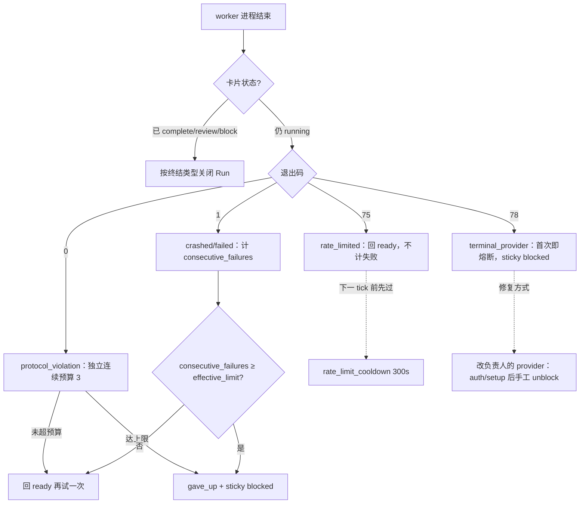

有效阈值的解析顺序是：任务级 `max_retries` → 调度器 `failure_limit` / `kanban.failure_limit` → 内置默认 2。图上 `terminal_provider` 分支**跳过**这条解析，第一次就熔断。

<a id="sec-7-kanban-owner-admission"></a>
### 4.21 受管 worker 与 owner 准入：卡片执行正在被移进 profile 网关

> **快照边界（必读）**：本节依据 **`origin/main` = `fa78e686fa`（2026-10-30）**，本地工作树 HEAD 是 `60d00c5633`（历史最晚 2026-10-12），**不含**下列文件。§4.9 描述的是 HEAD 的子进程形态；上游正在把它换成「owner 网关内的受管 worker」。读代码前先确认自己在哪个快照上。

新增模块（origin/main）：`hermes_cli/kanban_worker_client.py`（模块 docstring 直译：**「Dispatcher 子进程：向它的 profile owner 提交一次认领；绝不运行 agent」**）、`hermes_cli/kanban_owner_recovery.py`（docstring：**「供 dispatcher 回收路径使用的只读、规范化准入栅栏」**）、`gateway/session_kanban.py`、`hermes_cli/kanban_worker_log.py`；对应文档 `website/docs/user-guide/features/kanban-multi-gateway.md`。

变化实质：dispatcher 不再自己跑 agent，而是启动一个瘦客户端，通过本地控制 socket 向**该 assignee profile 的网关 owner** 提交认领（`kanban.run`）并读收据（`prompt.receipt`）；卡片轮次在 owner 内作为受管 worker 会话执行。owner 校验 task/run/claim 并冻结其策略，transport 携带 dispatcher 的**精确 board DB 路径**（含自定义路径与跨 profile 共享板），不会另起一个 transcript 写入者。

关键机制与它们在 10 月的收紧轨迹：

| 机制 | 事实（读到的常量/函数级证据） | 变更日期 |
|---|---|---|
| worker 断线**不结束轮次**，而是重拨 | `OWNER_WAIT_S = 180.0`（owner 允许静默的最长时长）；`kanban.run` 每次尝试幂等、`prompt.receipt` 是只读，所以重复询问安全 | 10-26 重拨；10-26 重连成功后重置重拨预算；10-27 只有收据有进展才重置 |
| 瞬态 owner 状态不烧卡片预算 | `_TRANSIENT_OWNER_STATES = {draining, starting}`、`_TRANSIENT_RPC_REASONS = {runtime_draining, runtime_retired}`；注释：这是宿主的状况，不是卡片的 | 10-13/10-14 网关 drain 与 restart 期间的 wake；10-28 统一 owner-refusal 规则与放弃消息 |
| 准入等待有预算上界 | `ADMISSION_ANSWER_MARGIN_S = 60`，`admission_answer_budget()` = `write_txn` 对 `BEGIN IMMEDIATE` 的重试次数 × busy timeout + margin | 10-17、10-18 |
| 收据与准入账本 | `owner_admitted` 事件载荷是 owner 指向自己账本的指针；`kanban_owner_recovery.py` 的 `_owner_receipt` / `_admission_row` 只读查 `session_admissions(status, outcome)` | 09-10 起 |
| **模糊尝试不自动重跑** | `owner_reclaim_paused()`：收据缺失/不可读/`queued`/`unknown` → 暂停通用回收；`interrupted` 也先暂停，由 `owner_attempt_provably_over` 判定「没有任何东西还能执行它」 | 10-18/10-19/10-20（回收事务内复查；dead bound interpreter 归崩溃清扫） |
| 收据无法解析导致的**永久卡死**被修 | `kanban-worker-lanes.md` 新增一条：卡片停在 `running`、占着该 profile 的 `max_in_progress_per_profile` 名额，告警只点名排在它后面的卡；现在「无可执行证据」即失效，并在诊断里以 `stale_running`（按年龄升级，origin/main 配置 `kanban.diagnostics.stale_running_grace_seconds`，默认 1 h）暴露真因 | 10-28 文档 + 10-26/10-28 回收条件收紧 |
| 「一个工作目录只有一个写者」 | 10-26：真实派工下成立；重试的 worktree 卡不能认领一张活跃卡持有的 checkout；10-01 worktree 共享守卫折叠成单一 helper | 10-01 → 10-26 |
| 卡片尝试的轮次作者 | 作者是 **dispatcher（在 owner 网关上）**，不是操作员；10-26 移除 spawn env 里的 turn author | 10-12、10-26 |
| worker 内的 `delegate_task` | 由 owner 在 worker 执行下预留子代理：每个子代理有自己的 session（作为卡片会话的 subagent 列出）、计入 `delegation.max_concurrent_children` / `max_spawn_depth`、结果在卡片轮次内返回、随 worker 结束；网关中途挂掉则子代理退役、永不恢复 | 10-20 支持；10-19 缺失时给出解释；10-21 拒绝受管 worker 内的 profile 路由 |

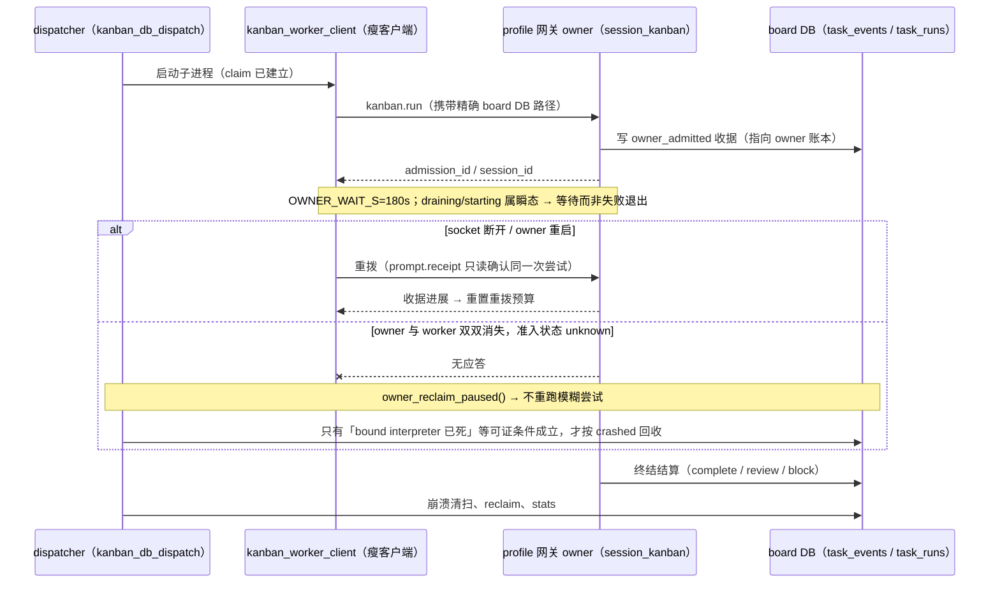

**未核对边界**（诚实标注）：本节读的是这些模块的 docstring、常量块与关键函数，**不是逐行审计**，也没有运行时的多网关实测；`session_admissions` 账本的完整状态机、控制 socket 的鉴权模型（`invalid_control_peer` 等拒绝分支）需要单独专题。不要把本节当作已验证的部署手册。

<a id="sec-7-kanban-multi-gateway"></a>
### 4.22 多网关部署：单调度器 + 按 Profile 归属的投递

§4.14 讲清了「谁订阅、怎么投递」，多网关场景再加一条所有权约束：**派工只有一个 owner，投递按 profile 归属**。

| 网关角色 | `dispatch_in_gateway` | 打开已订阅的板 DB？ | 派工 | 投递 |
|---|---|---|---|---|
| 调度所有者（通常 `default`） | `true`（默认） | 是 | 是 | 自有 profile + 无戳的历史订阅 |
| `writer` / `admin` / `coder` … | `false` | 仅当该 profile 有订阅时 | 否 | 本网关自有 profile |

配置：在非调度网关的 `config.yaml` 写 `kanban: dispatch_in_gateway: false`，或设 `HERMES_KANBAN_DISPATCH_IN_GATEWAY=false`。理由不是「防重复投递」——原子的事件领取本来就能防重复投递——而是**多个网关不应竞争同一份工作的派工权**。

审核反馈也走同一条订阅链：`changes_requested` 作为可操作的 review-BLOCK 通知投递；用 `notify+wake` 的订阅会**唤起恰好那张卡片 originating 的聊天/线程/会话**去检视现有卡片与当前 Run；`notify` 保持纯被动，`wake` 保持只唤起。审核反馈**从不**创建、unblock、重排或以其他方式改写任务。

<a id="sec-7-kanban-diagnostics"></a>
### 4.23 诊断信号目录与只读运维端点

`hermes_cli/kanban_diagnostics.py` 是一个规则引擎，不是日志 grep：每条规则产出 `Diagnostic(kind, severity, title/detail, actions)`，`DiagnosticAction` 里可能是 `cli_hint`（给一条可直接执行的命令）、`reclaim`、`reassign`、`comment`。`hermes kanban diagnostics [--json]` 与面板 `GET /diagnostics` 共用同一引擎，`severity_at_or_above` 负责按阈值过滤。

默认规则集（`_RULES` 顺序即同严重级下的展示顺序）：

| kind | 默认严重级 | 说明与阈值 |
|---|---|---|
| `hallucinated_cards` | error | 完成时声明的 `created_cards` 不存在 |
| `triage_aux_unavailable` | warning | triage 的 specify/decompose 拿不到辅助 LLM 客户端 |
| `prose_phantom_refs` | warning | 正文里引用了不存在的卡片 id |
| `repeated_failures` | error（失败数 ≥ 2× 阈值时 critical） | 阈值与 `kanban.failure_limit` 对齐，避免诊断比熔断还晚 |
| `repeated_crashes` | error（同上升级） | `crash_threshold` 默认 2 |
| `review_dependency_deadlock` | error | 父卡被 `review-required:` 粘住而直接子卡仍被依赖门控在 `todo` |
| `running_with_open_parents` | warning | 运行中卡片的父卡不是 done/archived：门禁没串行化两者，`kanban_complete` 会被拒；建议 `unlink` |
| `stuck_in_blocked` | warning | `blocked` 停滞超过 `blocked_stale_hours`（默认 24 h） |
| `block_unblock_cycling` | warning | 反复 block/unblock 循环 |
| `stranded_in_ready` | warning → error（2×）→ critical（6×） | 有负责人、`ready` 且未被认领 ≥ `stranded_threshold_seconds`（默认 30 min）；低于 30 min 的信号被下一 tick 的正常认领淹没 |

`DEFAULT_CONFIG` 的取舍值得照抄到运维手册：`failure_threshold` 默认 2 且**刻意与 `kanban.failure_limit` 对齐**（`config_from_kanban_config` 只允许 `kanban.diagnostics.failure_threshold` 显式覆盖），`spawn_failure_threshold` 只作为读取期兼容别名。

**诊断是只读的**：它建议「补评论 / unblock / 改派 / unlink / reclaim」，但不会自动解除用户施加的 block，也不会自动删依赖边。

运维面（`plugins/kanban/dashboard/plugin_api.py`，都在 `/api/plugins/kanban/` 下，受面板鉴权约束）：`GET /workers/active`（当前 worker 的 PID/profile/task/started/last heartbeat）、`GET /runs/{run_id}`、`GET /runs/{run_id}/inspect`、`POST /runs/{run_id}/terminate`、`POST /tasks/{id}/reclaim`、`GET /diagnostics`、`GET /stats`、`GET /assignees`、`GET /tasks/{id}/log`、`POST /dispatch`（跳过 60 s 等待手动催一轮）、`GET /workflow`、`GET|PUT /orchestration`、`POST /estimate`、`GET /model-options`、`GET /home-channels`、板级 `GET|POST|PATCH|DELETE /boards…` 与 `export|import|switch`。这些端点全部复用 §4.11–§4.13 的同一批领域函数：路由的存在不等于某个错误分支已被解读，新界面也不该绕过领域门禁直写 `status`。

<a id="sec-7-kanban-plugins"></a>
### 4.24 第三方看板插件与 Desktop 卡片扩展位

看板成了第三方插件的高价值落点，`plugin-catalog/` 里当前有 5 个条目。它们对**本地 board DB 与 profile `state.db` 的读写面**各不相同，选型时应按披露（disclosure）而不是按截图判断。

| 插件 | 版本 | 类别 | 数据面要点 |
|---|---|---|---|
| `kanban-gantt` | 1.7.3 | desktop | 三视图（List / Timeline 真实时间戳 / Graph 依赖图 + 传递归约 + 血缘高亮）；页内建卡（project/workspace/skills/model override/goal mode）、拖拽改父、**带子卡跨板移动**（目标验证通过后才删源行与链接）、批量归档/删除、附件预览与下载、worker 日志读取；`/events` WS，可用 `KANBAN_GANTT_WS=0` 关掉改 60 s 轮询 |
| `kanban-live-gantt` | 0.1.3 | desktop | `kanban-gantt` 的 GPL-3.0 fork：以「现在」为中心的 72 h 可滑动窗口、轮到小时刻度、lifecycle 渲染（虚线等待 vs 实线执行）；后端可转换/改派/评论/**永久删除**任意板的任务 |
| `kanban-graph` | 0.2.1 | desktop | 只读依赖图；点卡片显示 Run、最后一次失败、**运行中 worker 的最新工具调用**——它读 assignee profile 的 `state.db`，这条数据面要单独评估 |
| `kanban-stream` | 1.0.2 | automation | 把 worker 活动以「每任务一条就地编辑消息」推到 Telegram（工具调用历史、计时、tokens/sec、思考指示、终结态）；`/steer` 经配套 daemon 把 Telegram 文本写成任务评论，**直达正在运行的 worker**；默认关闭，需独立运维 bot token 与 allowlist；出口只有 `api.telegram.org` |
| `hermes-worker-monitor` | 0.1.1 | automation | 只读计数看板（`kanban.db` + 各 profile `state.db`）；fork 时移除了上游所有网络出口与凭据读取路径 |

Desktop 侧新增 per-card 扩展位：贡献区 `KANBAN_CARD_AREAS.badges`（10-23 落地，同日把 board 的 tenant 列表传给 badge 装饰器）。同时文档明确 **dashboard 没有 per-card slot**，卡片级标签只在 desktop 板上成立。第三方插件与官方看板插件的关系见 [卷五 §Plugins](05-capabilities-extensions.md)：官方插件刻意薄（≈700 行 router + WS tail + bulk batcher + config reader，不含业务逻辑），第三方插件因此**可以**直接读写领域函数所在的后端路由，风险也随之从 UI 层转移到数据层。

<a id="sec-7-kanban-changelog"></a>
### 4.25 版本口径与变更台账（2026-09 → 2026-10-30）

**先固定口径，否则「最新」无意义**：

| 项 | 值 |
|---|---|
| 源码 root | `hermes-dev/hermes-agent/`（上游 `NousResearch/hermes-agent`） |
| 本卷既有正文依据 | 本地 HEAD `60d00c5633ad76f3dd8e3ecd79f77f1c6f8e6fdd`（作者日期 09-06，提交日期 10-12；历史最晚作者日期 2026-10-12），工作树干净 |
| 已 fetch 的 `origin/main` | `fa78e686fa`（2026-10-30），领先 HEAD **9159** 个提交 |
| 本节台账来源 | `git log origin/main --grep=kanban -i` 与按路径 `'*kanban*'` 的历史；**未执行任何 Hermes 运行时测试** |

按性质分组（日期为 author date）：

**A. 结构性变化（会改变你对 §4.9 的理解）**

| 日期 | 内容 |
|---|---|
| 09-10 | owner 准入进入：受认领卡片经「可信 owner 准入」路由（`kanban_worker_client`、`gateway/session_kanban` 首次出现） |
| 09-13 | 新增 `kanban-multi-gateway.md`，文档站收编 |
| 10-07 | workflow 单一真源落地收尾：`kanban_db` 改为从 workflow 导入 `VALID_STATUSES`；`can_move` 全定义；`stats` 由工作流派生；文档补「archived 可作人工移动源」 |
| 10-06 | 板身份硬化：身份要求 `board.json`、归档留 tombstone、`connect()/init_db()` 拒绝重建死板、面板拒绝过期的已归档/已删除 slug；抽出 `kanban_db_boards` |
| 10-06 | `kanban_resume_guard` 落地：拒绝把 Kanban 拥有的 worker 会话当作未受跟踪的写者恢复 |
| 10-20 | 受管 worker 支持 `delegate_task`（owner 预留子代理）；worker 日志轮转拆到 `kanban_worker_log` |
| 10-14 / 10-20 | 插件目录新增 `kanban-graph`、`kanban-stream` |
| 10-23 | Desktop `KANBAN_CARD_AREAS.badges` + tenant 列表入参 |
| 10-25 | provider 用量到顶时 hold 网关轮次与看板卡片；宿主内存吃紧时 hold 新轮次并把子代理设为 OOM 首选受害者 |

**B. 记账与恢复正确性（10-18 → 10-28 集中修复）**

`release a dead attempt's claim when its owner receipt cannot be resolved`（10-18）、`bound kanban.run's admission wait by the board lock budget`（10-18）、`a dead bound interpreter stays the crash sweep's to book`（10-19）、`a card attempt lost across an owner restart settles interrupted`（10-19）、`re-check owner recovery inside the reclaim transaction` / `an exited, unreaped owner no longer holds its slot` / `a timed-out managed run is booked timed_out, not crashed` / `stale_running reads only the current attempt's pids`（10-20）、`the dead-interpreter override applies only after a local kill`（10-20）、`dispose of a lost managed worker within one tick`（10-22）、重拨预算三连（10-26/10-27）、`a lost worker's clean exit is a crash, not also a protocol violation` + `keep the worker's last output when a lost worker's clean exit is rebooked` + `the protocol-violation streak never matches a worker's quoted output` + `a bound run stays the crash sweep's; no recorded pid is no proof inside the claim TTL` + `one owner-refusal rule and one give-up message for a recovering worker`（10-28）。

**C. 并发与工作区安全**

`keep a scratch dir another live task still uses` / `check containment before the shared-scratch scan` / `tighten the shared-scratch guard` / `fold the worktree sharing guard into one helper`（10-01）、`fence the explicit-board override to unfenced callers`（10-02）、`a retried worktree card cannot claim into a checkout a live card holds` + `one writer per workspace holds under real dispatch`（10-26）、`gate kanban_schedule like the other lifecycle tools`（10-01）。更早一轮（09-26/09-27）修掉 `gc must never delete the scratch workspaces root itself` 与「只统计真实删除」。

**D. 交付与界面**

`deliver Kanban wakes, heartbeats and cron results into local chats`（10-25）、`/skills and /kanban with a quote in the argument are classified, not an internal error`（10-17）、`admit owner-run card turns as finite`（10-15）、`keep Kanban workers and tool sessions on the profile's toolsets`（10-15）、`point bare kanban_show/comment calls at kanban_list outside a worker`（10-02）、`unknown-assignee skip is recorded once per card, never once per tick`（09-28）、`show why a Kanban task is blocked and let it be unblocked`（09-27，desktop）。

**E. 测试基座**（09-24 起）真进程板 harness：scratch home + fake provider + CLI tick，按 worker 进程计 provider 请求；覆盖 SIGKILL/restart 行完整性、artifact/pinned-skill worker 契约、auto-decompose 计费边界，并用 `strict-xfail` 钉住已知缺陷（#119155、#121255、#119618、#119070 等）。**这些是上游测试，本仓库没有执行它们**，不能写成「已验证通过」。

**读这份台账时应避免的推论**：commit 标题的措辞不等于已发布的稳定契约（A 组里多条是「正在收紧」的中间态）；上游文档与本地快照可能不同步——`kanban.md` 在 HEAD 与 origin/main 之间只差 31 行，但 §4.21 描述的执行模型差异发生在更早的代码层。

> **补充小结**：§4.18–§4.25 补的是「权限面、移动矩阵、账本、网关所有权、诊断、插件生态、时间轴」六个此前缺失的维度。看板的设计重心始终是**同一套领域门禁不能被任何门面绕过**：CLI、工具、REST、插件、第三方页面都必须经过 `kanban_db` 的同一批函数；新增能力如果只出现在某一层而没落到领域层，就是设计债，不是功能。

---

## 5. MoA（多模型参考，仍是一轮父 Agent）

- `agent.provider == "moa"`；`conversation_loop` 可 `decode_moa_turn` 解出 `moa_config`。  
- **不**新建子 `AIAgent`；参考模型输出由 MoA 运行时收集，`_append_moa_context` 贴进 **当次** `api_messages`（卷四 §4.5）。  
- `turn_context._sanitize_model_for` 用 aggregator 模型名做 strict API 清理。  
- 配置：`hermes_cli/moa_config.py`、profile `delegation.*`（与 `delegate_task` 模型链不同）。

---

## 6. 与 busy / steer / 租约

这一节回答：**父会话正在跑（尤其里面还挂着 `delegate_task` 子 Agent）时，用户又发一句话，会进哪条机制？**  
三者是 **不同层**，不要当成同一把锁：

| 层 | 机制 | 解决什么 | 详读 |
|----|------|----------|------|
| **IM 网关** | `busy_input_mode`（interrupt / queue / **steer**） | 会话已在跑，新入站消息怎么处理 | [卷六 §5](06-gateways-channels-and-hitl.md#sec-g5) |
| **Agent 内核** | `AIAgent.steer()` → `_pending_steer` | 不新开 `run_conversation`，把话塞进**当前这一轮** | [卷一 §2.3.2](01-platform-and-architecture.md#sec-2-3-2) |
| **SessionDB** | `DurableTurnLease` | **跨进程**谁有权写这条会话行 | [卷三 §1.2](03-runtime-session-and-loop.md#sec-1-2) |

```text
用户又发一句（IM）
        │
        ▼
  网关：会话 busy？ ──否──► 正常 _handle_message_with_agent → run_conversation
        │
       是
        ▼
  busy_input_mode ?
    interrupt ──► 通常打断父 run_conversation
    queue     ──► 进 _pending_messages，本轮结束再开一轮
    steer     ──► Gateway 调 running_agent.steer(text)
                      │
                      ├─► 父：_pending_steer（内核三处吃掉，卷一）
                      └─► 若有活跃子：steer_subagent 扇出到子（本卷）

与 delegate 无关的并行概念：
  租约 = 父这一轮 run_conversation 进门时占住 session_id 写库权；
         子在同进程、在父的 tool 栈里跑，不再为「父会话」抢第二把租约。
```

<a id="sec-7-6-1"></a>

### 6.1 Busy（网关）：默认 interrupt，有子 Agent 时会「降级 queue」

父 IM 会话正在 `_active_sessions` 里跑 `run_conversation` 时，用户再发消息走 [卷六 busy 分支](06-gateways-channels-and-hitl.md#sec-g5)。

| `busy_input_mode` | 平时（没有子 Agent） | **父正在 `delegate_task`、子还在跑** |
|-------------------|----------------------|--------------------------------------|
| **interrupt**（默认） | 打断当前 turn | **自动改成 queue**（`run_busy.py`：`demoted_for_subagents`，#30170） |
| **queue** | 合并进 pending，本轮结束 drain | 同上，本来就是排队 |
| **steer** | `steer()` 写 `_pending_steer` | 父 `steer` + **`_steer_active_subagents`** 给活跃子也塞转向 |

为什么要降级：**interrupt 会 abort 父 turn，正在跑的子 Agent 也会被一起掐掉**；有子任务时网关宁可让你排队，也不要误杀 delegate。真要硬停：用户仍可用 **`/stop`**（注释里写明是 escape hatch）。

压缩进行中也可能把 interrupt 降级 queue（`demoted_for_compression`），逻辑同类——别在危险窗口硬 interrupt。

<a id="sec-7-6-2"></a>

### 6.2 Steer（内核 + 子扇出）：不是新开会话

- **Steer ≠ 新 user 行进 SessionDB**（默认不为此再 `run_conversation` 一次）。文本进父的 `_pending_steer`，在 `prepare_iteration` / 工具批后 / `finalize_turn` 被吃掉（卷一图）。  
- IM 上 `busy_input_mode=steer` 时，网关调 `_hm_steer_agent`：先 `running_agent.steer(text)`，若 `_agent_has_active_subagents`，再 **`steer_subagent`**（`delegate_tool_registry`）把同一句扇到活跃子。  
- 子上的 steer 和父一样，最终体现为 **带外用户消息** 贴到工具结果旁（卷四 `STEER_CHANNEL_NOTE`），不是子会话单独开一轮聊天。

Kanban worker、MoA **不走**这条 IM busy 链（卷七 §0 表）：它们是别的进程或同一 turn 内的别的机制。

<a id="sec-7-6-3"></a>

### 6.3 租约（SessionDB）：防两个进程写坏同一会话，不管子 Agent

| 问题 | 答案 |
|------|------|
| 父 IM 跑 delegate 时，租约谁拿着？ | **父**这次 `run_conversation` 进门时拿的 `DurableTurnLease`（父的 `session_id` / lineage），**整轮**持有到 `finalize_turn`，子跑在父的 tool 线程里，**不会**再 `admit` 一次父会话租约。 |
| 子有自己的 `session_id` 吗？ | **有**（`new_session_id()` + `parent_session_id`），子 transcript 写在**子行**；见卷三 [6.5](03-runtime-session-and-loop.md#sec-6-5)。这是库里的另一条会话，不是「第二个进程来抢父租约」。 |
| 和 UI `running`、busy 队列的关系？ | 网关 `_sessions[sid].running` = 别重复点发送；**租约** = 别两个 Hermes **进程** 写同一条库会话。常同时 true，但不是一回事（卷三 §1.2.1）。 |

一句话：**busy/steer 管「用户又说话了怎么办」；租约管「哪个 OS 进程有权 flush 父会话库」；delegate 是父 turn 里的工具，子在同进程、子会话行分开存。**

---

## 7. 包与核心类

`tools/delegate_tool.py`、`delegate_tool_child_run.py`、`delegate_tool_results.py`、`delegate_tool_registry.py`、`gateway/kanban_watchers_dispatcher.py`、`hermes_cli/kanban_db_dispatch.py`、`tui_gateway/agent_callbacks.py`（`_child_mirrors`）。

---

<a id="multi-runtime-boundaries"></a>
<a id="sec-8-runtime-boundaries"></a>
## 8. 源码补充：四种“多 Agent”不是同一套调度

> 核对快照：`60d00c5633ad76f3dd8e3ecd79f77f1c6f8e6fdd`。本节补充上文，尤其澄清 delegate、插件生命周期、Kanban 与 MoA 的执行边界。

### 8.1 先用问题区分，而不是都叫协作

| 机制 | 解决什么问题 | 执行主体/入口 | 返回什么 |
|---|---|---|---|
| `delegate_task` | 当前父任务拆出子任务 | 子 `AIAgent`；`tools/delegate_tool.py` | 同步批结果，或 background unit |
| SubagentLifecycleService | 插件要稳定管理子 Agent | `agent/subagent_lifecycle.py` | 可核验 handle、status、wait、cancel、result |
| Kanban worker | 持久任务板上的任务需要被领取/运行 | Gateway dispatcher 与 CLI worker | 任务板状态、运行记录、后续通知 |
| MoA | 多个参考模型帮助一个聚合模型答题 | `agent/moa_loop.py` | 参考结果合成的 guidance 与聚合输出 |

**不同点**：Kanban 的任务跨对话持久存在；delegate 往往附属于当前父任务；MoA 的 reference fanout 是模型请求协作，不应该被解释成每个参考模型都有完整工具 Agent 和独立 shell。

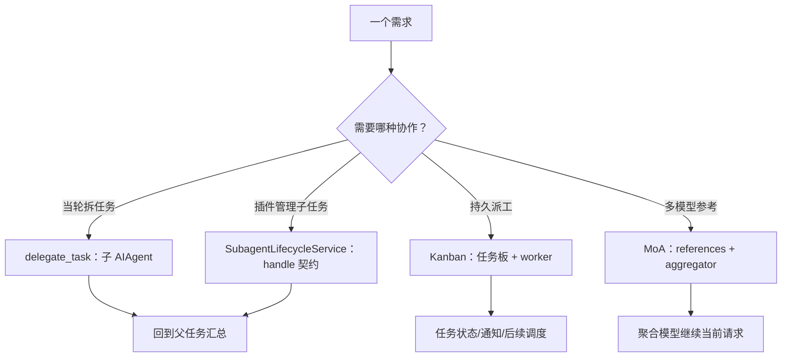

### 8.2 delegate 的预算不是模型随口给出来的

`delegate_task()` 在真实 spawn 前检查：父 Agent 是否存在、action 是否支持、spawn pause、depth limit、配置预算、route pin 是否可解析、批任务/schema/image 是否有效、oneshot spawn budget。

重要细节：源码保留 `max_iterations` 参数兼容内部调用，但**调用者传的值不是权威**；`delegation.max_iterations` 配置才决定预算。模型不能靠参数请求一个无限子任务。

`_build_child_agent()` 根据当前深度与 orchestrator 开关确定实际 role。兼容参数 `role` 不是模型绕过 depth 限制的权限标志。

### 8.3 子 Agent 继承的是配置与约束，不是整个父进程灵魂

`_build_child_agent` 的构建内容包括：

- 独立 subagent id 与 child session 身份，关联 parent subagent/session。
- 工具集解析和禁用项；goal/context 对应的 child prompt。
- 父路由继承或 delegation 配置覆盖；内部 review 等可传自己的 routing owner。
- `parent_session_id` 等持久关联、回调与 live transcript 关联信息。
- 深度、压缩上限与子 Agent 生命周期需要的元数据。

这些都不等于“复制父 Agent 所有历史并共享所有可变对象”。是否继承哪个工具、哪个上下文和哪个路由，应沿 `_resolve_child_toolsets`、`_resolve_child_runtime`、`delegation_context` 核对。

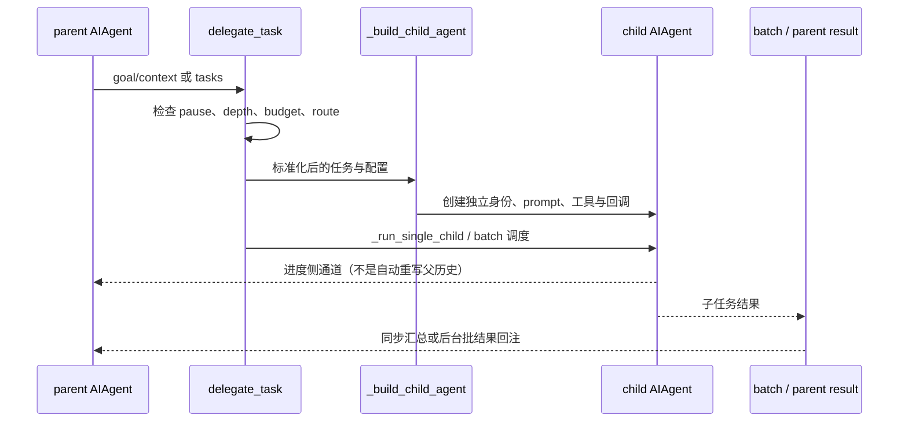

### 8.4 Background batch 是一个异步单元，不是每个孩子随时打断父对话

源码注释明确：background 同时适用于单任务和 batch；batch 是**一个 async unit**，等子任务 join 后作为一个合并消息重新进入父方流程。

这能避免“十个孩子分别随时把父历史改写十次”的错误理解。进度显示与最终结果注入也不同：live transcripts 是 side channel，目标是观测，代码注释说明不影响 message content 或 prompt caching。

live transcript 的 home 还优先从父拥有的 SessionDB path 推导，避免线程切换丢掉 home override 后把记录写进另一个 profile。这里的隔离是真实设计，不是日志路径的小细节。

### 8.5 插件子 Agent handle 为什么带 capability

`SubagentLifecycleService.launch()` 验证当前父身份与 correlation；重复的 correlation id 不能在同一父会话下随便再 spawn。handle 包含 contract version、subagent id、parent session、创建时间与 capability。

`_record()` 验证 handle 和活动父的所有权，所以**拿到别人的 subagent id 不代表你可以 stop 它**。已阅读 `tests/agent/test_subagent_lifecycle.py` 的断言：伪造 capability 和错误 parent 得到 UNKNOWN_HANDLE；取消使用明确的 hard interrupt。

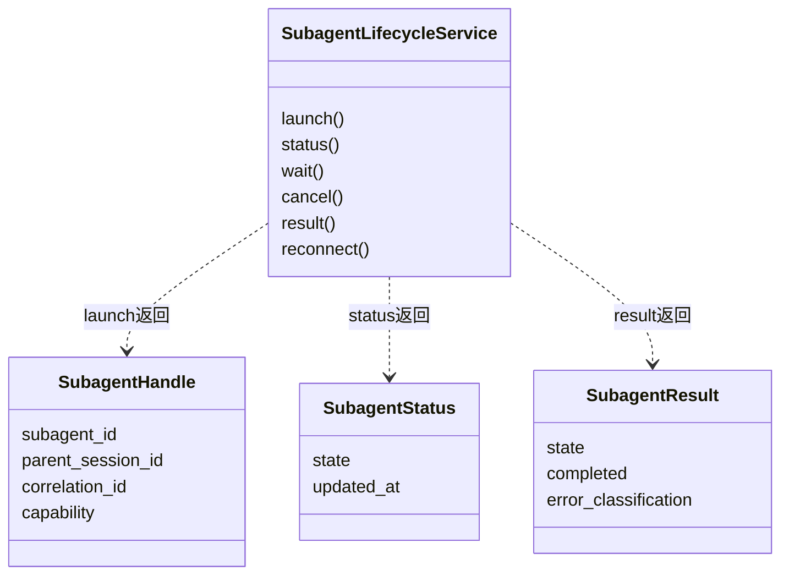

`wait(timeout)` 的超时不是任务取消；`cancel()` 接受取消请求也不是已经终止；应继续看终态与 result。

另一个边界：服务的 `_REGISTRY` 是当前进程内记录；`reconnect()` 找不到记录时返回 `RECONNECT_UNAVAILABLE`。因此这套 handle 契约**不能被描述为进程重启后自动恢复所有子 Agent 的持久调度器**。

### 8.6 MoA 的“多”在模型调用层

`MoAChatCompletions` 组织 reference fanout、guidance 与 aggregator；`MoAClient` 提供 facade。关键函数有 `_run_references_parallel`、`aggregate_moa_context`、`_build_guidance`、`create`。

它还有隐私过滤、参考上下文裁剪、晚到 accounting、reference trace、aggregator cache 等机制。这解释了为什么不能只画“并发问三个模型然后拼文字”：reference 超时、失败、预算、隐私与缓存都需要独立考虑。

本轮核对到 fanout 与 facade 的职责及入口，未逐个展开 preset、alternation 和所有 billing 分支。继续深潜可从 `tests/agent/test_moa_aggregator_prefix_stability.py` 与 `test_moa_prepared_request_client_swap.py` 的断言开始；不要把测试文件名当已执行的验证。

### 8.7 本节总结与核对入口

| 想解决的问题 | 从这里读 |
|---|---|
| spawn 前的限制 | `tools/delegate_tool.py:delegate_task` |
| 子 Agent 怎么构造 | `tools/delegate_tool.py:_build_child_agent` |
| 插件如何管理子任务 | `agent/subagent_lifecycle.py:SubagentLifecycleService` |
| Kanban 跨回合任务 | 本卷前文 + `gateway/kanban_watchers_dispatcher.py` |
| 多参考模型聚合 | `agent/moa_loop.py:MoAChatCompletions` |

不要按“用了几个人格”分类。应按**任务是否持久、谁拥有状态、并行的是 Agent 还是模型请求、取消与恢复在哪层**分类，才能看清四种协作的边界。
