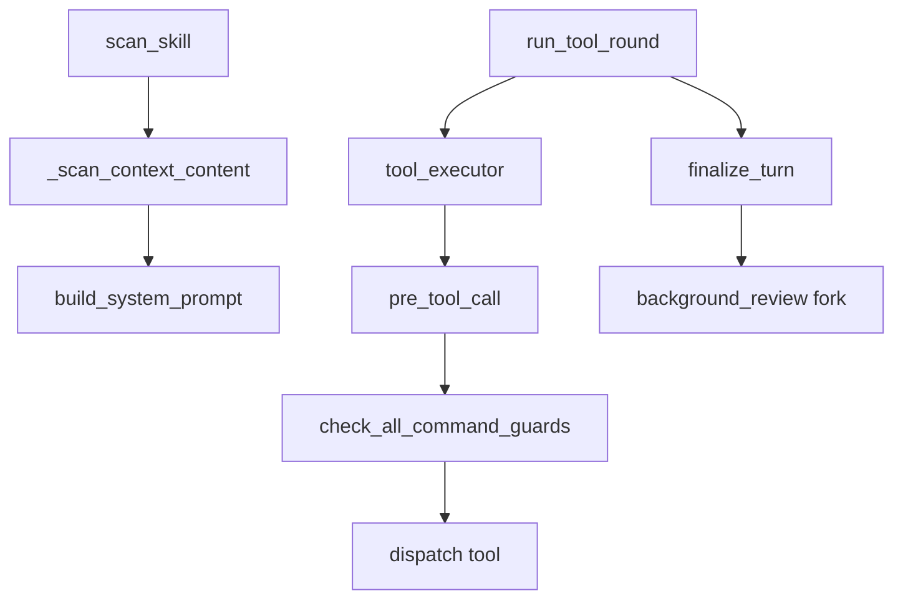
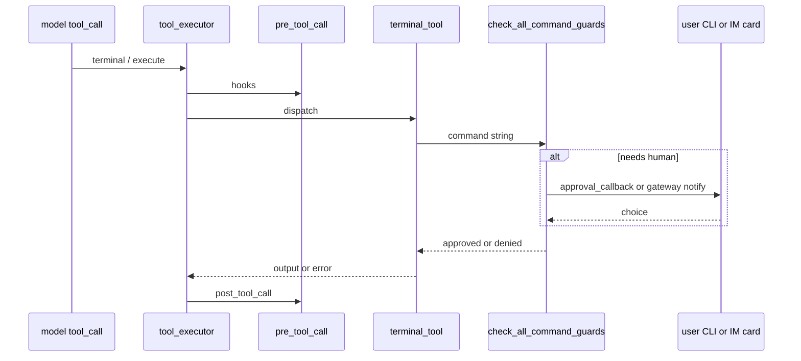
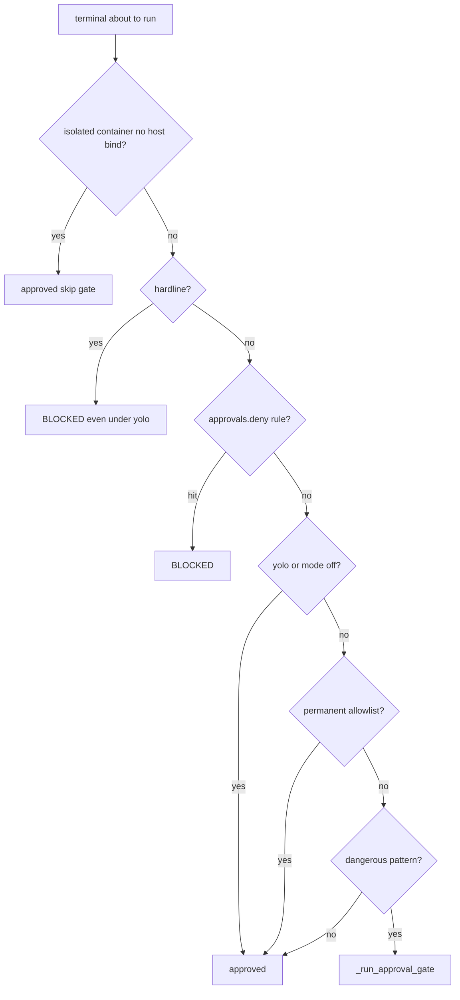
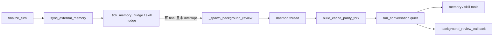

# 卷八 · 安全与治理：扫描、审批、后台复盘

> **卷标准**：[`VOLUME_STANDARD.md`](VOLUME_STANDARD.md) · **完成度**：[`MANIFEST.md`](MANIFEST.md) — **部分达标**（四道关 + 审批 E2E 进 `tool_executor`；§3 background review；YOLO 全配置表待补）  
> **本卷边界**：**装/load 时扫描**、**工具执行前审批**、**轮末 background review**；与 `pre_tool_call` block 的叠层 → 本节 §0.2。  
> **权威源码**：`tools/skills_guard.py`、`agent/prompt_builder.py`（context scan）、`tools/approval.py`、`tools/approval_human_wait.py`、`agent/tool_executor.py`（authorization gate）、`agent/background_review.py`、`tools/terminal_tool.py`  
> **相邻卷**：[05 工具轮](05-capabilities-extensions.md#3-端到端一次工具轮hook--callback-点位) · [06 IM 审批第8章](06-gateways-channels-and-hitl.md#sec-g8)

---

## 本卷目录

| 块 | 节 | 作用 |
|----|-----|------|
| **澄清** | [§0](#0-先澄清) | 四道关；审批 vs hook vs guardrail |
| **总览** | [§1](#1-架构流程) | 扫描 → prompt → 工具 → 复盘 |
| **E2E** | [§2](#2-端到端危险终端命令cli--im) | 审批时序；表 D；§2.1 函数表 |
| **深潜** | [§3](#3-后台复盘background-review) | `build_cache_parity_fork`；与 live turn |
| **交界** | [§4](#4-与卷五-tool_executor-的交界) · [§5](#5-包与核心类) | 与工具轮、grep |

### 目录（锚点跳转）

- **§0** [先澄清](#0-先澄清) — [0.1](#01-四道关时间顺序) · [0.2](#02-审批-vs-pre_tool_call-vs-guardrail)  
- **§1** [架构流程](#1-架构流程)  
- **§2** [危险终端 E2E](#2-端到端危险终端命令cli--im) — [2.1](#sec-8-2-1) · [2.3 CLI Queue](#sec-8-2-3) · [2.4 Gateway](#sec-8-2-4) · [2.5 模式](#sec-8-2-5) · [2.6 grep](#26-入口函数grep-表)  
- **§3** [background review](#3-后台复盘background-review) — [3.1](#31-什么时候跑什么时候必须停) · [3.2](#32-build_cache_parity_fork-与-btw-共用) · [3.3](#33-写盘staging父界面) · [3.4](#34-和审批子代理外部-memory-的边界) · [3.5](#35-源码锚点grep)  
- **§4** [与 tool_executor 交界](#4-与卷五-tool_executor-的交界)  
- **§5** [包与核心类](#5-包与核心类)

---

## 0. 先澄清

### 0.1 四道关（时间顺序）

| 阶段 | 函数 / 模块 | 拦什么 |
|------|-------------|--------|
| **技能安装前** | `skills_guard.scan_skill` | 恶意/越权 skill 包 |
| **进 system 前** | `prompt_builder._scan_context_content` | AGENTS.md / SOUL 等注入模式 |
| **工具执行前** | `check_all_command_guards` 等（`tools/approval.py`） | 危险 shell / 写盘命令 |
| **轮末（可选）** | `background_review` fork | 窄工具面复盘 MEMORY/skills |

它们 **不在一个函数**；失败点不同，UI 也不同。

### 0.2 审批 vs `pre_tool_call` vs guardrail

| 层 | 谁调 | 能 block？ | 典型表面 |
|----|------|------------|----------|
| **`pre_tool_call` hook** | `tool_executor._dispatch_pre_tool_call_hooks` | `{"action":"block"}` | 插件策略 |
| **Command guards** | `terminal_tool` → `check_all_command_guards` | `approved: false` | CLI 行内 / IM 卡片 |
| **Tool guardrail halt** | `tool_executor` 后检查 | 整轮 `break` | status 诊断 |
| **YOLO / `approvals.mode=off`** | `approval.py` 内短路 | 自动过 | 配置 |

IM：`register_gateway_notify(session_key, cb)` → 发卡；`resolve_gateway_approval(session_key, choice)` 唤醒阻塞的工具线程（卷六 §4）。

---

## 1. 架构流程



---

## 2. 端到端：危险终端命令（CLI / IM）

**一句话**：审批是 **工具调用栈内的同步闸门**——人答完，**同一条栈**继续 `env.execute` 或返回 BLOCKED；不是 LangGraph 式 checkpoint resume。Deny **不** `interrupt` turn。



<a id="sec-8-2-1"></a>

### 2.1 两条入口，一个闸门

| 路径 | 谁触发 | 堵在哪 | 典型场景 |
|------|--------|--------|----------|
| **A. 工具内** | `terminal_tool` → `_check_all_guards` → `check_dangerous_command` | handler 内、`env.execute` **之前** | shell 危险 pattern |
| **B. 中间件** | `resolve_pre_tool_block`：`pre_tool_call` 返回 `{action:"approve"}` → `request_tool_approval` | `_authorized_dispatch` 里，**还没进** handler | 插件要求任意工具先问人 |

两条最终都进 **`_run_approval_gate`**（`tools/approval.py`）。路径 B 对人交互与路径 A 相同（CLI 同一 `_approval_callback`；IM 同一 `Event.wait`），只是 **堵点更靠前**。

```text
execute_tool_calls
  → middleware / _authorized_dispatch
       → resolve_pre_tool_block     ← 路径 B
       → execute(handler)
            → terminal_tool
                 → check_dangerous_command   ← 路径 A
                 → _run_approval_gate
```

<a id="sec-8-2-2"></a>

### 2.2 `check_dangerous_command` 决策顺序（地板在人之前）



`_run_approval_gate` **内部**再判：yolo / `approvals.mode: off` → session 已批过 `pattern_key` → 是否 CLI / Gateway / ask 桥 → 无人值守 cron/single-query 分支 → 才 prompt。

<a id="sec-8-2-3"></a>

### 2.3 CLI：进程没有 pause，Agent 线程堵在 Queue 上

| 线程 | 在干什么 |
|------|----------|
| **主线程** | `prompt_toolkit`：画审批面板、收键盘；用户 Enter → `queue.put(choice)` |
| **Agent / 工具线程** | `run_conversation` → terminal → `_approval_callback` → **`response_queue.get()` 阻塞** |

TUI **无** `approval_callback` 时会 **deny**（避免 stdin 死锁）。子 Agent 线程必须通过 `delegate_tool` 的 `initializer=set_approval_callback` 继承父回调。

「继续 loop」= `get()` 返回后 **同一条调用栈** 往下走 → tool 结果进 `messages` → while 顶部再调 LLM。**没有**单独的 resume API。

<a id="sec-8-2-4"></a>

### 2.4 Gateway：Event、FIFO、pending

与 CLI 对照表、阻塞时序、各平台卡片 → **[卷六第8章](06-gateways-channels-and-hitl.md#sec-g8)**（本卷只保留符号表）。

| 符号 | 职责 |
|------|------|
| `_gateway_queues[session_key]` | `_ApprovalEntry` FIFO |
| `_await_gateway_decision` | `Event.wait` + 心跳（避免 inactivity watchdog 杀人） |
| `resolve_gateway_approval` | `entry.result` + `event.set()`；`resolve_all` / `request_id` |
| `submit_pending` | 无 notify 时非阻塞 pending |
| `unregister_gateway_notify` | 回合结束唤醒所有 waiter |

<a id="sec-8-2-5"></a>

### 2.5 Smart / YOLO / Cron / 无人值守

| 机制 | 行为 |
|------|------|
| `mode: manual` | 默认过人闸门 |
| `mode: smart` | 可先 LLM 再决定是否问人 |
| `mode: off` / yolo | 跳过可恢复层；**不**跳过 hardline / `approvals.deny` |
| `cron_mode` | cron 无真人：deny 或 auto-approve（配置） |
| 隔离容器、无 host bind | 可跳过危险提示 |
| Docker + host bind | **不**跳过 |
| 插件 `fail_closed_when_no_human` | 非交互且无 gateway → BLOCKED |

```yaml
approvals:
  mode: manual
  timeout: 300
  cron_mode: deny
  deny: []
```

环境：`HERMES_YOLO_MODE`、`HERMES_INTERACTIVE`、`HERMES_GATEWAY_SESSION`、`HERMES_CRON_SESSION`、`HERMES_EXEC_ASK`。

### 表 D · 审批相关 hook / callback

| 时刻 | 插件 | 呈现 / 网关 |
|------|------|-------------|
| 要问人之前 | `pre_approval_request` | CLI `approval_callback`；IM `register_gateway_notify` → `notify_cb` |
| 人点完之后 | `post_approval_response` | `resolve_gateway_approval` |
| 工具已 block | — | `tool_end` 带错误文案 |

`tool_executor` **authorization gate** 串行化并发工具批里的审批；人类等待 **不计入** batch deadline（`approval_human_wait.human_wait_ceiling`）。

### 2.6 入口函数（grep 表）

| 函数 | 文件 | 作用 |
|------|------|------|
| `check_all_command_guards` / `check_dangerous_command` | `tools/approval.py` | 模式 + 地板 + gate |
| `check_execute_code_guard` | 同上 | 代码执行变体 |
| `_run_approval_gate` / `request_tool_approval` | 同上 | 共享人机闸门 |
| `register_gateway_notify` / `resolve_gateway_approval` | 同上 | IM |
| `withdraw_gateway_approval` / `list_gateway_approvals` | 同上 | 撤回 / 列表 |
| `human_wait_ceiling` | `tools/approval_human_wait.py` | 锁等待上限 |
| `terminal_approval_batch` | `agent/terminal_approval_batch.py` | 终端批审批合并 (#113158) |
| CLI `_approval_callback` | `cli.py` | Queue 消费方 |
| `/approve` `/deny` | `gateway/run.py` | 解阻塞 |

---

## 3. 后台复盘（background review）

这是 Hermes「自我进化」里**不碰 Session 消息表**的那条腿：父 turn **已交付**（用户看到回复）之后，在守护线程里 fork 受限 `AIAgent`，问模型要不要改 `MEMORY.md` / 技能。与 [卷三 6.8](03-runtime-session-and-loop.md#sec-6-8) 同主题；本节按源码把 **spawn → fork → 预算 → 取消 → 写盘** 讲透。



### 3.1 什么时候跑、什么时候必须停

| 项 | 说明 |
|----|------|
| **计数** | `turn_context` 里 `_tick_memory_nudge(agent)`（默认约每 **10** 个带 memory 的用户回合）与 skill nudge 独立计数 |
| **spawn 条件** | `turn_finalizer`：`final_response` 存在、**未** `interrupted`、**未** `skip_background_review`（cron 等）、且 memory 或 skill 复盘 flag 为真 |
| **顺序** | **先** `_sync_external_memory_for_turn`（Layer C），**再** spawn——复盘不与用户可见交付抢模型 |
| **cron** | `skip_background_review=True`：无人值守 fork 成本高且无 HITL 收益 |
| **进门抢占** | 新 live turn：`cancel_background_review_for_live_turn`（[卷三 1.5](03-runtime-session-and-loop.md#sec-1-5)），`_BACKGROUND_REVIEW_CANCEL_TIMEOUT_SECONDS`（约 **2s**）等 request-phase ack；超时 **仍放行** live turn（#84423） |
| **关窗 / interrupt** | `tui_gateway.session_lifecycle` 结束/打断会话走 **同函数**（#102895）：fork 不在 `session["running"]` 上，别处停不到 |

`cancel` 会 `_interrupt_background_review` 子 fork，并在有 `BackgroundReviewRun` 时做 **usage 归因到父 session**（#87250，best-effort）。

### 3.2 `build_cache_parity_fork` 与 `/btw` 共用

`build_cache_parity_fork(agent, …)` → `(review_agent, runtime_dict, routed)`。与 **`/btw`** 同套「缓存前缀对齐」哲学（模块注释 + #25322 / PR #17276：同模型路径约 **26%** 成本降幅）。

| 属性 | 复盘 fork | 父 live Agent |
|------|-----------|----------------|
| **presentation callback** | `_fork_init_kwargs` 不传 thinking/stream 等；`quiet_mode` + `suppress_status_output` | CLI / IM / TUI `_agent_cbs` |
| **`run_conversation`** | 无 `stream_callback` | 每轮有 |
| **`_session_db`** | **`None`**；`_persist_disabled=True`；`_end_session_on_close=False` | 写 SessionDB |
| **`session_id`** | **与父相同**（前缀缓存 warmth） | 权威 transcript 键 |
| **若 fork 真写库** | 会把 harness 回合混进父会话 → 下一 live turn 当指令（curator 根因） | — |
| **system** | 同模型：继承 `_cached_system_prompt` + `session_start` 字节级一致 | invalidate 路径 |
| **`routed=True`** | `auxiliary.background_review.{provider,model}` 换模型；缓存本冷 → **紧凑 digest** replay | — |
| **`skip_memory=True`（构造）** | 不挂外部 provider（防 harness 漏进用户 namespace） | 可有 `MemoryManager` |
| **`_memory_store` 绑定** | 仍指向父的 `MemoryStore`（built-in 文件） | — |
| **nudge 关闭** | `_memory_nudge_interval = _skill_nudge_interval = 0` | 正常计数 |
| **tools[]** | 同模型：`_inherit_parent_tool_surface` 深拷贝父 **上次出站** `tools[]`，冻结 generation（#103579） | MCP 可晚连 |
| **dispatch** | 运行时 **白名单**（只放行 memory/skill 类）；广告全量 ≠ 许可执行 |
| **MCP** | `_skip_mcp_refresh=True` | 回合间可 refresh |
| **压缩** | `compression_in_place=True`，且不落库 | 正常写 Session |
| **cache scope** | 继承父 `resolve_prompt_cache_scope_safe`（#109964） | — |
| **日志** | `_turn_origin = background_review`（与 live turn 区分，#118693） | — |

复盘线程：`thread_scoped_silence` 闷 stdout。Plugin `on_stream_*` 仍可能被打到（扩展总线），不是 TUI `_emit`。

**输入 token 预算**（防无人值守烧窗）：`auxiliary.background_review.max_input_tokens`；未设则约为复盘模型 context 的 **75%**，封顶 **600k**（`_REVIEW_MAX_INPUT_TOKENS_CAP`）。`conversation_loop` 里 `_review_input_budget_exhausted` 累加 INPUT，超限则停 fork 内循环。`max_iterations` 默认 **16**（`_REVIEW_MAX_ITERATIONS`）。

### 3.3 写盘、staging、父界面

| 动作 | 行为 |
|------|------|
| **`memory` add** | 常直写 `$HERMES_HOME/memories/*.md`；`_memory_write_origin` 标 `background_review` |
| **`replace` / `remove`** | 无人值守常 **staging**（`memory_tool`）；等人或策略再落盘 |
| **父 system 快照** | **不**热更新父 `_cached_system_prompt` → [卷三 6.4.2](03-runtime-session-and-loop.md#sec-6-4-2) |
| **父 IM/TUI** | 父 Agent 上 `background_review_callback` → 网关可 `_emit("review.summary", …)`；**不是** `_CALLBACK_PARAMS` 流式正文 |
| **Session 行** | fork **永不** append 父 transcript（`_persist_disabled` + 无 `_session_db`） |

### 3.4 和审批、子代理、外部 memory 的边界

| 邻域 | 关系 |
|------|------|
| **HITL** | 复盘工具面 **无** `terminal` 危险链；不弹审批卡（无人值守） |
| **子代理** | `delegate_task`：`skip_memory=True`，不参与复盘进化线 |
| **外部 provider** | fork 构造 `skip_memory=True`；父 turn 的 `sync_all` 已在 spawn **之前** 做完 |
| **live turn** | 进门先 `cancel_background_review_for_live_turn`；foreground 永远优先 |

危险命令与 IM 卡 → [§2](#2-端到端危险终端命令cli--im)、[卷六第8章](06-gateways-channels-and-hitl.md#sec-g8)。

### 3.5 源码锚点（grep）

| 符号 | 文件 |
|------|------|
| `cancel_background_review_for_live_turn` | `agent/background_review.py` |
| `build_cache_parity_fork` / `_spawn_background_review` | 同上 + `AIAgent` mixin |
| `_tick_memory_nudge` | `agent/turn_context.py` |
| spawn 门控 | `agent/turn_finalizer.py`（`skip_background_review`、delivery 之后） |
| `auxiliary.background_review` | `hermes_cli` config |

---

## 4. 与卷五 `tool_executor` 的交界

- 所有 Registry 工具（含 `memory`、`delegate_task`）经 **`_execute_tool_calls`**。  
- **Inline** 工具绕过 `handle_function_call` 但仍走同一 executor 的 hook/审批包装（卷五 §0.2）。  
- `delegate_task` **串行 dispatch**、可占满 batch deadline 例外（`_SEQUENTIAL_DEADLINE_EXEMPT_TOOLS`）。

---

## 5. 包与核心类

`tools/skills_guard.py`、`agent/prompt_builder.py`、`tools/approval.py`、`tools/approval_context.py`、`tools/terminal_tool.py`、`agent/tool_executor.py`、`agent/background_review.py`、`tools/memory_tool.py`（staging）。
