<a id="卷八--安全与治理扫描审批后台复盘"></a>
# 卷八 · 安全与治理：校验规则、人工审批与执行现场

> **卷标准**：[`VOLUME_STANDARD.md`](VOLUME_STANDARD.md) · **完成度**：[`MANIFEST.md`](MANIFEST.md) — **持续补齐**（本卷补充校验顺序、CLI/Gateway 审批现场与关联标识；§3 保留后台复盘；并非全产品安全审计）
> **本卷边界**：**装/load 时扫描**、**工具执行前审批**、**轮末 background review**；与 `pre_tool_call` block 的叠层 → 本节 §0.2。  
> **权威源码**：`tools/skills_guard.py`、`agent/prompt_builder.py`（context scan）、`tools/approval.py`、`tools/approval_human_wait.py`、`agent/tool_executor.py`（authorization gate）、`agent/background_review.py`、`tools/terminal_tool.py`  
> **相邻卷**：[05 工具轮](05-capabilities-extensions.md#3-端到端一次工具轮hook-+-callback-点位) · [06 IM 审批第8章](06-gateways-channels-and-hitl.md#sec-g8)

---

## 本卷目录

先回答最容易混淆的问题：**收到 `/approve` 通常不是重新启动 Agent，也不是从 SessionDB restore。原工具线程正等着一个决定；确认写入 Queue/Event 后，同一次工具调用继续。** 而 memory/skills 的文件暂存审核是另一条链路，不能套用这个结论。

<a id="目录锚点跳转"></a>
### 按问题查找

| 我想知道什么 | 阅读位置 |
|---|---|
| 安全控制分布在哪里？扫描、审批、guardrail 有何区别？ | [0.1 阶段](#01-四道关时间顺序)、[0.2 分层](#02-审批-vs-pre_tool_call-vs-guardrail)、[0.3 控制矩阵](#sec-8-controls) |
| 工具调用先经过哪些校验？哪一层改参数、哪一层拒绝？ | [1 架构](#1-架构流程)、[2.7 完整调用链](#sec-8-validation) |
| 哪些命令直接拦截，哪些问人？YOLO、容器有什么例外？ | [2.8 规则与优先级](#sec-8-rules)、[2.5 模式配置](#sec-8-2-5) |
| 谁持有审批现场？线程、UI、Agent 各在干什么？ | [2.9 实体与状态所有权](#sec-8-entities) |
| CLI 点确认后，如何回到工具执行？ | [2.3 CLI 概述](#sec-8-2-3)、[2.10 CLI 完整时序](#sec-8-cli-sequence) |
| IM 发卡、回复 `/approve`、唤醒工具的完整流程是什么？ | [2.11 Gateway 完整时序](#sec-8-gateway-sequence) |
| 确认究竟关联哪次 tool call？多个审批会不会串？ | [2.12 标识与并发](#sec-8-correlation) |
| 能否从一条模型 tool call 一直看到下一次模型请求？ | [2.13 完整例子](#sec-8-example) |
| 拒绝、超时、停止、重启、没有审批 UI 怎么办？ | [2.14 异常与恢复边界](#sec-8-failures) |
| `/memory approve <id>` 与 `/approve` 有何不同？ | [2.15 写入暂存审核](#sec-8-staged-writes) |
| skill 扫描与 prompt 注入扫描依据什么规则？ | [0.4 扫描规则](#sec-8-scan-rules) |
| 后台复盘什么时候启动、取消、写盘？ | [3.0 完整流程](#sec-8-br-flow)、[3.1 启停](#31-什么时候跑什么时候必须停)、[3.3 写盘](#33-写盘staging父界面) |
| 源码从哪里读？ | [2.6 入口表](#26-入口函数grep-表)、[2.16 精确源码地图](#sec-8-source-map)、[4 工具轮边界](#4-与卷五-tool_executor-的交界)、[5 包](#5-包与核心类) |

### 章节结构

- **第0章：安全边界与规则分类**——四个时间阶段、策略层的区别、控制矩阵、扫描规则。
- **第1章：校验在调用链中的位置**——不是所有控制都串在 terminal 之前。
- **第2章：从工具请求到人工决定，再到执行结果**——保留原 2.1–2.6 速览；2.7–2.16 展开规则、对象、CLI/IM、关联、示例、失败与暂存审核。
- **第3章：后台复盘**——这是轮末可选治理任务，不是危险工具的审批者。
- **第4章：与工具执行器的边界**。
- **第5章：相关源码包**。

---

## 0. 先澄清

### 0.1 四道关（时间顺序）

| 阶段 | 函数 / 模块 | 拦什么 |
|------|-------------|--------|
| **技能安装前** | `skills_guard.scan_skill` | 恶意/越权 skill 包 |
| **进 system 前** | `prompt_builder._scan_context_content` | AGENTS.md / SOUL 等注入模式 |
| **工具执行前** | `check_all_command_guards` 等（`tools/approval.py`） | 危险 shell / 写盘命令 |
| **轮末（可选）** | `background_review` fork | 窄工具面复盘 MEMORY/skills |

它们 **不在一个函数**；失败点不同，UI 也不同。

### 0.2 审批 vs `pre_tool_call` vs guardrail

| 层 | 谁调 | 能 block？ | 典型表面 |
|----|------|------------|----------|
| **`pre_tool_call` hook** | `tool_executor._dispatch_pre_tool_call_hooks` | `{"action":"block"}` | 插件策略 |
| **Command guards** | `terminal_tool` → `check_all_command_guards` | `approved: false` | CLI 行内 / IM 卡片 |
| **Tool guardrail halt** | `tool_executor` 后检查 | 整轮 `break` | status 诊断 |
| **YOLO / `approvals.mode=off`** | `approval.py` 内短路 | 自动过 | 配置 |

IM：`register_gateway_notify(session_key, cb)` → 发卡；`resolve_gateway_approval(session_key, choice)` 唤醒阻塞的工具线程（卷六 §4）。


<a id="sec-8-controls"></a>
### 0.3 安全控制矩阵：不是每个拒绝都会弹人工确认

| 控制面 | 真实入口 / 规则 | 结果与边界 |
|---|---|---|
| Skill 内容 | `tools/skills_guard.py`：`scan_skill` → `should_allow_install` | 根据来源信任级与 verdict 允许/阻断/要求处理；不是 terminal 的 Event 审批 |
| 上下文文件 | `agent/prompt_builder.py::_scan_context_content` | 仓库来源命中注入规则时用 BLOCKED 文本替代；用户自写 SOUL 的信任例外见 §0.4 |
| 工具权限面 | `agent/tool_executor.py::_dispatch_authorized_once` | scope → plugin → 压缩占位符校验 → guardrail；可在 handler 前返回错误 |
| 插件主动升级 | `pre_tool_call` 的 approve 决定 → `request_tool_approval` | 任意工具可被插件要求审批；无人工入口时 fail closed；hook 抛异常不等同 block |
| Shell 执行 | `tools/terminal_tool.py`、`tools/approval.py` | 预执行保护、硬拒绝、策略授权、可交互审批是多层检查，详见 §2.7–2.8 |
| 任意代码执行 | `check_execute_code_guard` | `execute_code` 可直接发起 subprocess，不能假设里面的操作都会经过 terminal pattern；对脚本整体授权，非交互信任边界需单独看配置 |
| 文件修改 | `tools/file_tools_write_guards.py` | 敏感路径/配置文件直接拒绝；受保护指令文件在保护开启时每次问人，不用 YOLO/永久授权跳过；不是所有文件写操作一律询问 |
| 跨会话 memory/skills 写入 | `tools/write_approval.py::evaluate_gate` | 开关、inline 与文件 staging；详见 §2.15，不等于命令审批 |
| 工具结果后的治理 | tool guardrail / `agent/background_review.py` | 前者可限制继续执行；后者是轮末可选复盘，不能撤销已发生的外部副作用 |

**四道关是阶段总览，不是穷尽的四个实现，也不是一个统一沙箱。** 命令字符串检测不覆盖任意 Python、远端服务或所有 OS 行为；“没有匹配规则”只表示本层未命中，不表示已证明安全。

<a id="sec-8-scan-rules"></a>
### 0.4 扫描具体依据什么：Skill 判定与上下文替换

`skills_guard._determine_verdict` 把 findings 分成：存在 `critical` → `dangerous`；否则存在 `high` → `caution`；仅 medium/low → `safe`。随后 `INSTALL_POLICY` 按来源决策：

| 来源 | safe | caution | dangerous |
|---|---|---|---|
| builtin | allow | allow | allow |
| trusted | allow | allow | block |
| community | allow | block | block |
| agent-created | allow | allow | ask |

这里的 `ask` **不能直接理解成发一张危险命令卡**：agent-created 的 guard 启用时，该分支可作为错误要求 Agent 移除触发内容再重试。`should_allow_install(force=True)` 也不是无条件放行：community/trusted 的 dangerous 仍不可强制覆盖；其他拒绝是否可覆盖由该函数处理。

上下文扫描则走另一套规则：`scan_for_threats(content, scope="context")`。普通项目 `AGENTS.md` / `.cursorrules` 等命中后返回：

```text
[BLOCKED: <文件名> contained potential prompt injection (<匹配规则>). Content not loaded.]
```

这段替代文本进入后续 prompt 构造，原恶意内容不原样加载；**不修改源文件、不挂起工具等人确认**。用户自己位于 HERMES_HOME 的 SOUL（`user_authored=True`）命中时仅警告并保留内容；由 profile distribution 提供的 SOUL 不享受这个例外。不要把“SOUL 总是信任”或“所有上下文命中都丢弃”写成绝对规则。

---

## 1. 架构流程

以下是**不同入口上的控制点**，不是 `scan_skill` 每次都调用 prompt_builder，也不是所有 handler 都经过 terminal 审批。

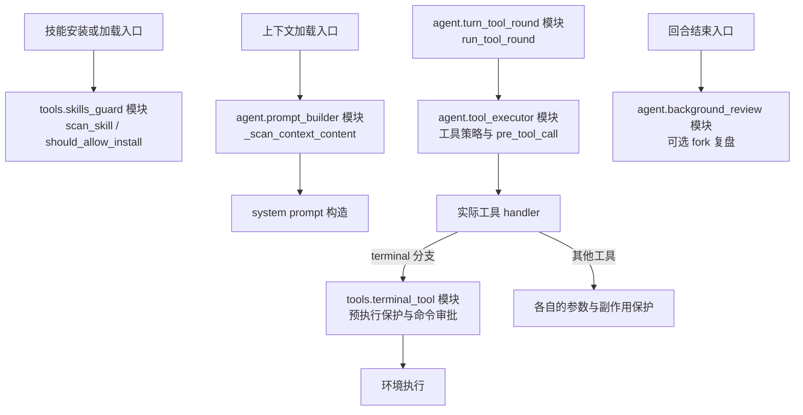

---

## 2. 端到端：危险终端命令（CLI / IM）

**一句话**：CLI/Gateway 常规在线审批是 **工具调用栈内的同步闸门**——人答完，**同一条栈**继续 `env.execute` 或返回 BLOCKED；不是 LangGraph 式 checkpoint resume。Deny **不** `interrupt` turn。

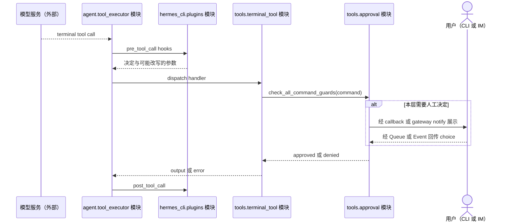

<a id="sec-8-2-1"></a>

### 2.1 两条入口，一个闸门

| 路径 | 谁触发 | 堵在哪 | 典型场景 |
|------|--------|--------|----------|
| **A. 工具内** | `terminal_tool` → `_check_all_guards` → `check_all_command_guards` | handler 内、`env.execute` **之前** | shell 危险 pattern |
| **B. 中间件** | `resolve_pre_tool_block`：`pre_tool_call` 返回 `{action:"approve"}` → `request_tool_approval` | `_authorized_dispatch` 里，**还没进** handler | 插件要求任意工具先问人 |

两条复用审批交互基础设施，但**不是都先进入 `_run_approval_gate`**：A 的完整命令校验 `check_all_command_guards` 最终调用 `_human_decision`；B 的 `request_tool_approval` 经通用 `_run_approval_gate` 再决定交互。CLI 复用 `_approval_callback`，Gateway 复用 Event 等待；B 的堵点更靠前。完整顺序见 [2.7](#sec-8-validation)、[2.8](#sec-8-rules)。

```text
execute_tool_calls
  → middleware / _authorized_dispatch
       → resolve_pre_tool_block     ← 路径 B
       → execute(handler)
            → terminal_tool
                 → check_all_command_guards ← 路径 A
                 → _human_decision
```

<a id="sec-8-2-2"></a>

### 2.2 `check_dangerous_command` 决策顺序（地板在人之前）

> **阅读校正**：本节保留原函数名作为检索入口。终端实际走的是完整 `check_all_command_guards`，不能把轻入口的顺序当作完整链。下图只示意部分分支；完整、含容器例外、运行时保护、sudo、无人值守与批量预审批的顺序见 [2.8](#sec-8-rules)。

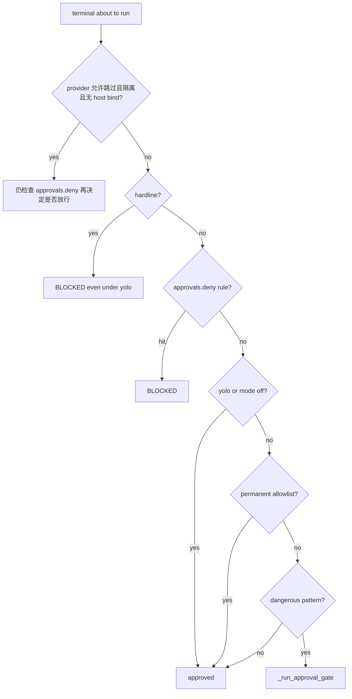

上面的轻入口概念图没有展开完整 terminal 分支；通用 `_run_approval_gate` **内部**再判：yolo / `approvals.mode: off` → session 已批过 `pattern_key` → 是否 CLI / Gateway / ask 桥 → 无人值守 cron/single-query 分支 → 才 prompt。

<a id="sec-8-2-3"></a>

### 2.3 CLI：进程没有 pause，Agent 线程堵在 Queue 上

| 线程 | 在干什么 |
|------|----------|
| **主线程** | `prompt_toolkit`：画审批面板、收键盘；用户 Enter → `queue.put(choice)` |
| **Agent / 工具线程** | `run_conversation` → terminal → `_approval_callback` → **`response_queue.get()` 阻塞** |

TUI **无** `approval_callback` 时会 **deny**（避免 stdin 死锁）。子 Agent 线程必须通过 `delegate_tool` 的 `initializer=set_approval_callback` 继承父回调。

「继续 loop」= `get()` 返回后 **同一条调用栈** 往下走 → tool 结果进 `messages` → while 顶部再调 LLM。**没有**单独的 resume API。

<a id="sec-8-2-4"></a>

### 2.4 Gateway：Event、FIFO、pending

与 CLI 对照表、阻塞时序、各平台卡片 → **[卷六第8章](06-gateways-channels-and-hitl.md#sec-g8)**；本卷此处为速览，完整现场见 [2.9–2.12](#sec-8-entities)。

| 符号 | 职责 |
|------|------|
| `_gateway_queues[session_key]` | `_ApprovalEntry` FIFO |
| `_await_gateway_decision` | `Event.wait` + 心跳（避免 inactivity watchdog 杀人） |
| `resolve_gateway_approval` | `entry.result` + `event.set()`；`resolve_all` / `request_id` |
| `submit_pending` | 无 notify 时非阻塞 pending |
| `unregister_gateway_notify` | 回合结束唤醒所有 waiter |

<a id="sec-8-2-5"></a>

### 2.5 Smart / YOLO / Cron / 无人值守

| 机制 | 行为 |
|------|------|
| `mode: manual` | 命中需确认条件且没有既有授权时问人；不是所有命令都问 |
| `mode: smart` | 可先 LLM 再决定是否问人 |
| `mode: off` / yolo | 正常宿主校验链跳过交互层，不跳过 floor；隔离容器例外见 §2.8，不能泛化为所有工具的总开关 |
| `cron_mode` | cron 无真人：deny 或 auto-approve（配置） |
| 隔离容器、无 host bind | provider 配置允许 skip 时可跳过命令检测；仍执行用户 deny |
| Docker + host bind | **不**跳过 |
| 插件 `fail_closed_when_no_human` | 非交互且无 gateway → BLOCKED |

```yaml
approvals:
  mode: manual
  timeout: 300
  cron_mode: deny
  deny: []
```

环境：`HERMES_YOLO_MODE`、`HERMES_INTERACTIVE`、`HERMES_GATEWAY_SESSION`、`HERMES_CRON_SESSION`、`HERMES_EXEC_ASK`。

### 表 D · 审批相关 hook / callback

| 时刻 | 插件 | 呈现 / 网关 |
|------|------|-------------|
| 要问人之前 | `pre_approval_request` | CLI `approval_callback`；IM `register_gateway_notify` → `notify_cb` |
| 人点完之后 | `post_approval_response` | `resolve_gateway_approval` |
| 工具已 block | — | `tool_end` 带错误文案 |

`tool_executor` **authorization gate** 串行化并发工具批里的审批；人类等待 **不计入** batch deadline（`approval_human_wait.human_wait_ceiling`）。

### 2.6 入口函数（grep 表）

| 函数 | 文件 | 作用 |
|------|------|------|
| `check_all_command_guards` / `check_dangerous_command` | `tools/approval.py` | 模式 + 地板 + gate |
| `check_execute_code_guard` | 同上 | 代码执行变体 |
| `_run_approval_gate` / `request_tool_approval` | 同上 | 共享人机闸门 |
| `register_gateway_notify` / `resolve_gateway_approval` | 同上 | IM |
| `withdraw_gateway_approval` / `list_gateway_approvals` | 同上 | 撤回 / 列表 |
| `human_wait_ceiling` | `tools/approval_human_wait.py` | 锁等待上限 |
| `terminal_approval_batch` | `agent/terminal_approval_batch.py` | 终端批审批合并 (#113158) |
| CLI `_approval_callback` | `hermes_cli/cli_modal_mixin.py`，混入 `cli.py::HermesCLI` | Queue 消费方 |
| `/approve` `/deny` | `gateway/slash_commands.py`，混入 `gateway/run.py::GatewayRunner` | 解阻塞 |

---

<a id="sec-8-validation"></a>
### 2.7 完整校验链：模型提出请求，什么都还没有执行

先分清三个时刻：**模型产生 tool call ≠ 工具获准 ≠ OS 已执行**。模型参数还可能被中间件/插件改写，规则必须检查最终要执行的参数。

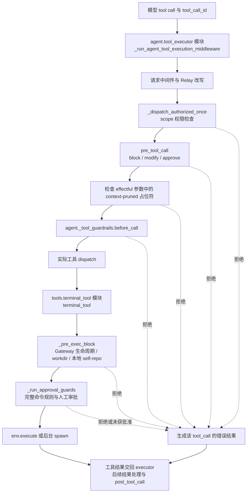

- `_dispatch_authorized_once` 检查顺序是 scope → plugin → 压缩占位符 → guardrail → dispatch。插件 hook 异常被当前 `_pre_tool_block` 捕获后继续，**不是所有插件异常都 fail closed**。
- `_pre_exec_block` 先保护正在运行的 Gateway，再检查显式 workdir，再对 local 做 self-repo 保护；它在命令审批之前，且有独立的限时执行封装。保护检查自己超时也不会裸奔执行命令。
- 插件 `approve` 可以在 handler 外就等人；terminal 自身又有命令保护。一次审批通过并不意味着可以跳过之后所有层。
- 命令 handler 内部的 `force=True` 是**不在模型 schema 中的内部参数**，会跳过 `_run_approval_guards`，但不跳过更前面的 `_pre_exec_block`；不能把它和 YOLO 说成同一功能，也不能把“hardline 任何调用者都无法绕过”当成绝对保证。

<a id="sec-8-rules"></a>
### 2.8 完整命令规则：硬拒绝、已有授权、问人的先后关系

以下顺序对应 `tools.approval.check_all_command_guards`，前提是调用者没有走内部 `force` 路径。**先匹配的返回分支结束本层决策**。

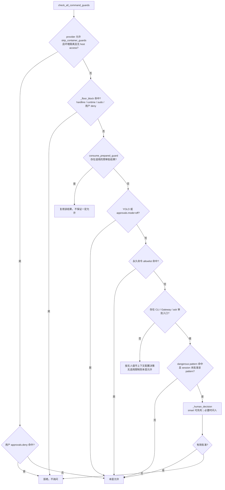

**正常宿主路径的 floor 顺序：**

| 顺序 | 检查 | 例子 / 含义 | 人点允许能否覆盖？ |
|---|---|---|---|
| 1 | `detect_hardline_command` | 递归删除根/系统/整个 home、mkfs、写裸块设备、fork bomb、kill 全进程、关机重启等匹配项 | 该路径直接拒绝，不发卡 |
| 2 | `command_deletes_runtime` | 删除当前 Python interpreter / venv 等运行时目标 | 直接拒绝 |
| 3 | `_check_sudo_stdin_guard` | 未配置 `SUDO_PASSWORD` 时通过 `sudo -S` 猜/灌密码 | 完整 guard 中直接拒绝 |
| 4 | `_user_deny_block` | 操作者配置的 `approvals.deny` glob | 直接拒绝；YOLO/off 不覆盖 |

**不要漏掉隔离容器分支**：它在 floor **之前**；满足 provider 的 skip 条件时仅保留用户 deny，不执行上表整组 floor。这不表示容器天然安全；host bind 会使其走正常路径。对照配置和 backend 才能判断实际分支。

**可询问规则和匹配方式：**

- `DANGEROUS_PATTERNS` 是危险操作检测表，例如递归删除（含 flags 在 operands 后）、Windows 删除与编码命令等。`rm -rf ./build-cache` 属于可询问例子，`pwd` 通常不命中；后者不是安全证明。
- `_match_user_deny_rule` 是对归一化/去混淆候选做**大小写不敏感 fnmatch glob**，不是正则表达式。例：`deny: ["*deploy-prod*"]` 可以拦含该片段的候选命令；上线应根据实际命令测试规则，而不是凭直觉写 regex。
- 检测会处理命令位置、引号、部分 shell wrapper 与去混淆变体。`echo "rm -rf /"` 中引用的说明文本不能简单等同真的执行删除；反过来 `sh -c` 中的引号 payload 可能是代码。它不是完整 shell 语义解释器。
- `session` 授权缓存的粒度是 pattern key；`always` 进入永久授权机制；`once` 只批准当前决定。**授权同类危险模式可能比授权一个精确命令更宽**，不要把 session/always 当作“只重试这一条”。
- smart 模式可能由 guardian 直接允许；smart-denied 后的人类 override 只提供 once/deny，不把这次 override 扩大成 session/always。用户配置的模式、无人值守规则与 human timeout 是不同维度。

<a id="sec-8-entities"></a>
### 2.9 审批现场由谁持有：对象、模块与线程

下面**类图只放真实类**；`tools.approval` 是模块，不伪装成一个 ApprovalManager 服务。

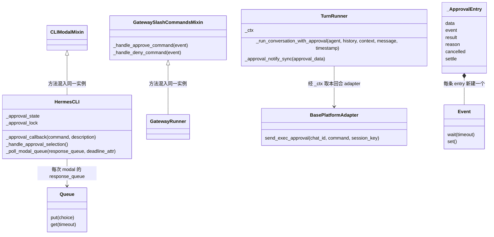

> 类图仅画相关继承关系，非完整 MRO；方法参数省略部分可选项。Mixin 不是另外一条服务线程；`BasePlatformAdapter` 是契约，运行时是具体平台子类。`TurnRunner` 是回合协作者，不是平台 adapter。

| 状态 | 所有者 / 存储位置 | 等待时是否持久化为可恢复现场？ |
|---|---|---|
| 模型原始 tool call、参数、执行栈 | Agent / executor / 工具 worker 的局部变量 | 不是一个可序列化的 checkpoint |
| CLI 当前审批面板 | `HermesCLI._approval_state`，内含 `response_queue` | 进程内状态 |
| Gateway 审批 FIFO | `tools.approval._gateway_queues[session_key]` | 进程内字典，持有 `_ApprovalEntry` |
| 等待与答案 | `_ApprovalEntry.event/result/reason/cancelled` | 进程内 Event 与字段 |
| 发卡回调 | `register_gateway_notify(session_key, TurnRunner._approval_notify_sync)` | 回合期间注册，结束 unregister |
| tool call 与其结果 | 工作区 messages / 后续 transcript 持久化链 | 可记录历史，但不能据此恢复原线程的 Event |
| memory/skills 暂存写入 | `$HERMES_HOME/pending/{memory,skills}/<id>.json` | 是文件化审核材料；不是上面这个等待栈 |

<a id="sec-8-cli-sequence"></a>
### 2.10 CLI：按下确认键，怎样回到原来的 terminal 调用

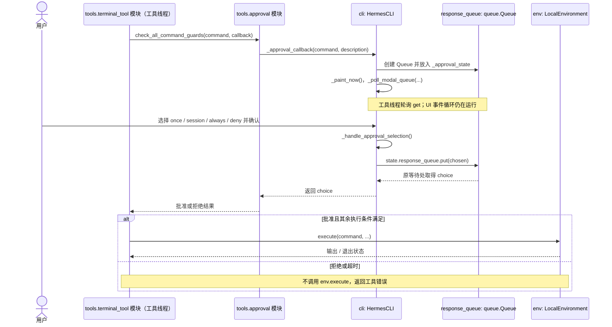

`_approval_lock` 避免并行子任务覆盖同一 CLI 的面板状态；Queue 属于这一次 callback。`_poll_modal_queue` 负责有限等待，而非无限阻塞。UI 的“view”仅展开长命令，不是批准。选定答案才 `put(chosen)`；等待超时返回 timeout，再按拒绝处理。

这里一个 `HermesCLI` 同时承载工具线程调用的 callback 与 UI 线程事件方法，**不是两个 CLI 对象互调**。代码中的同名 `self` 不能被画成两台服务。

<a id="sec-8-gateway-sequence"></a>
### 2.11 Gateway：发卡 → 用户回复 → Event 唤醒 → 同一次调用继续

以下用**文字 `/approve` 路径**展示确定的关联规则；原生按钮的路由由具体 adapter 决定，不能把所有平台画成统一携带 request_id。

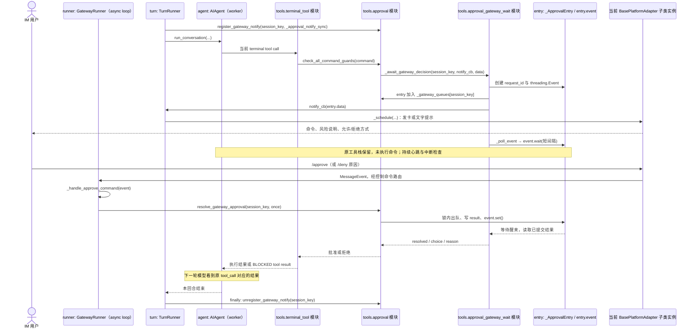

**等待不是 Gateway 停机**：Agent/工具 worker 等 Event，async loop 还能接收命令。`TurnRunner._approval_notify_sync` 把同步回调桥接到 loop，展示前脱敏命令，暂停可能妨碍输入的 typing/status；实际发卡失败不能冒充“已成功通知”。

**回复不是普通 user prompt**：`GatewayRunner` 上混入的 `GatewaySlashCommandsMixin._handle_approve_command` 调 resolver，而不是让 LLM 解读“我同意”。控制命令还必须通过所属会话/权限与忙碌时的控制路由，不能让别人的文本随便解锁当前栈。平台消息接入与权限校验边界另见卷六。

<a id="sec-8-correlation"></a>
### 2.12 确认如何绑定 tool call：五个 ID 不要混为一个

| 标识 | 用途 | 不代表什么 |
|---|---|---|
| `tool_call_id` | executor 将 tool result 关联到模型原始调用 | 不是 `_gateway_queues` 的直接索引 |
| `session_key` | 找该会话的 notify callback 与审批队列 | 不等于只有一条待批命令；也不要未经转换就当 SessionDB session_id |
| `entry.data.request_id` | `_ApprovalEntry` 内默认生成的 UUID hex；resolver 可精确选该 entry | 不代表每个平台按钮一定携带它 |
| `pattern_key` / `pattern_keys` | 风险模式、session 授权与合并判断 | 不是精确一次 tool call 的身份 |
| 平台卡片/消息 ID | adapter 的按钮处理、撤回/更新 UI | 不是通用授权缓存 key |

关联有两段：

1. **审批回复 → 等待 entry**：`resolve_gateway_approval` 有 request_id 就选精确 entry；无 ID 且 `resolve_all=True` 选全部；否则选当前 session FIFO 最旧的一条。文字 `/approve` 默认走 FIFO；`/approve all` 才批全部。
2. **entry 决定 → 原 tool call**：原工具调用栈一直保留着参数和执行上下文；对应 Event 醒来后返回该栈。后续结果仍由 executor 挂回原 `tool_call_id`，**不是拿批准文本拼一个新的 tool call**。

并发下还有两点：

- `_await_gateway_decision` 可合并同 session、同 command、同 pattern_keys 的在途申请，followers 等 leader 的结果。terminal 批量预审批也可预先收集/复用决定。**一张卡、一条 entry、一个 tool call 并非恒定一一对应。**
- resolver 在同一锁内完成选中/出队、写 result、`event.set()`；waiter 的收尾读取也用同一锁，避免用户已被确认成功，worker 却只看见 timeout。过期 request_id 找不到返回 0；文字 FIFO 没有精确 ID，所以不要把迟到 `/approve` 当作一定指向用户脑中那张旧卡。


**代码解读：resolver 为什么不需要重新生成工具调用？** 下列是 `resolve_gateway_approval` 的核心逻辑摘读（删去边界检查与可选原因赋值，用注释说明，不可当作完整实现）：

```python
with _lock:
    queue = _gateway_queues.get(session_key)  # 先限定到当前会话
    # request_id 精确选；resolve_all 选全部；否则 FIFO 取最旧项。
    # targets = ...，并在同一锁内从 queue 移除这些 targets
    for entry in targets:
        entry.result = choice               # 先提交决定
        entry.event.set()                   # 再唤醒持有这个 entry 的原 waiter
# 返回本次处理的 entry 数，不是 tool_call_id，也不是新 Agent 的句柄。
```

原 waiter 已持有 `entry`，不需要向模型询问“这张卡对应哪条命令”；而 executor 早已持有原 tool_call_id。**入站路由选 entry，Python 调用栈保留工具关联**，两层职责不同。

<a id="sec-8-example"></a>
### 2.13 完整示例：删除工作区缓存，批准后才执行

**这是一段说明用数据，不执行命令。** 假设 local 环境、`approvals.mode=manual`、有 CLI 或 Gateway、没有 allowlist/session 授权、没有用户 deny；目标也不是运行时目录或受保护目标。

模型提出（内部消息示意；最终 provider 协议会投影转换）：

```json
{
  "role": "assistant",
  "tool_calls": [{
    "id": "call_cache_42",
    "type": "function",
    "function": {
      "name": "terminal",
      "arguments": "{\"command\":\"rm -rf ./build-cache\"}"
    }
  }]
}
```

| 步骤 | 现场发生什么 | 尚未发生什么 |
|---|---|---|
| 1. executor | 保存调用身份，跑 scope/plugin/占位符/guardrail | 尚未删除目录 |
| 2. terminal | `_pre_exec_block` 通过；完整 guard 的 floors 未命中 | 尚未 `env.execute` |
| 3. 风险检测 | 命中 recursive delete，得到实际 detector 返回的 pattern key | 尚无批准；不能把 pattern key 写死成自己起的名字 |
| 4. Gateway 申请 | 在 `session_key=S` 下创建 entry（示意 `request_id=R`），保留 command/pattern_keys | 不是把原 call 从 DB restore 出来 |
| 5. 展示 | 提示命令与风险；工具 worker 等 entry.event | 不向 LLM 再问一轮“用户是否允许” |
| 6. 用户 | 在同会话发送 `/approve` | 文本本身不是模型 tool result |
| 7. resolver | 默认取 S 的最旧 entry，写 `result="once"`，set Event | 不新建 Agent，不重新生成命令 |
| 8. 原栈继续 | `_human_decision` 返回批准；terminal 执行这次已校验的 command | 不把 once 保存为永久放行 |
| 9. 结果回填 | executor 形成 `tool_call_id="call_cache_42"` 的工具结果 | 不把 request_id 当 tool_call_id |
| 10. 下一轮推理 | Agent 带这个结果继续请求模型；之后依既有 transcript flush 链持久化 | `/approve` 本身不触发 SessionDB compact/restore |

接下来工作区消息的逻辑结构是：

```json
[
  {"role": "assistant", "tool_calls": [{"id": "call_cache_42", "type": "function", "function": {"name": "terminal", "arguments": "{\"command\":\"rm -rf ./build-cache\"}"}}]},
  {"role": "tool", "tool_call_id": "call_cache_42", "content": "<实际 terminal 输出及状态序列化结果>"}
]
```

`content` 是示意占位，不是假定真实返回字段。模型后续可能总结成功，也可能因实际执行报错而调整。**批准只是允许尝试，不保证 OS 操作成功**。若第6步是 `/deny 请保留缓存用于排障`，第8步不会执行，原 call 的结果携带拒绝/原因；Agent 可据此选择只检查目录或解释风险，而不是把 deny 当作整轮 interrupt。

对照三个小例子（沿用以上环境假设）：`pwd` 通常直接允许；`rm -rf ./build-cache` 可询问；匹配根目录删除 hardline 的命令直接拒绝。若先配了匹配用户 deny，即便选择 YOLO 也不会到人工询问分支。

<a id="sec-8-failures"></a>
### 2.14 拒绝、超时、停止、没有 UI、重启：现场如何结束

| 情况 | 状态与后果 |
|---|---|
| `once` | 原等待返回批准，继续同栈；不写复用授权 |
| `session` / `always` | 在该 gate 允许这些选项时记录授权，再继续；smart-denied override 不提供这两个选项 |
| 主动 deny | 返回 BLOCKED，可带 reason；命令不执行，**不等同 `/stop`**，Agent 可继续推理 |
| 人没有回答直到 timeout | fail closed，不执行；不能把沉默当同意 |
| notify 抛错 / 发布失败 | notify_failed 收尾并移除 entry，不伪造用户拒绝，也不直接执行 |
| `/stop`、delegation teardown 等 interrupt | 等待轮询退出，取消/撤回；标明取消原因，不伪装成人明确 deny |
| 回合结束 / unregister notify | 清理该会话等待者，唤醒以收尾；不能留下线程永久等卡 |
| 重复点击、精确旧 request_id | resolver 无对应 entry 返回 0；该层不会因旧 ID 再执行一次工具 |
| 只有 pending transport，没有同步 notify | 可能返回 pending_approval（terminal 包装带 approval_pending）；当前调用此时已经返回，**不是仍持有一个可唤醒的 Event 栈**；后续由具体 transport 的协议驱动，不能概括为全部自动续跑 |
| 没有 CLI/Gateway/ask | 完整命令 guard 按 unattended 配置决策，可能拒绝也可能允许；插件升级 gate 可要求 fail closed。不能一概写“没 UI 就 pending”或“没 UI 就 deny” |
| 进程重启 / 崩溃 | 内存 Queue、Event、原调用栈消失。重新读取 SessionDB 能重建对话，不会复活这个等待线程；旧卡不能被当作持久执行票据 |

人等待期间 `_poll_event` 约每秒检查，定期 heartbeat；human wait 另计，工具批次 deadline 不应把正常等人时间当工具执行超时，但仍受审批 timeout 和 interrupt 约束。**不是无期限占住工具 worker。**

工具结果之后的工作区更新、普通 flush 与 SessionDB 恢复见卷三；这里没有通过 `active=0/compacted=1` 把审批现场变成可恢复快照的机制。UI 或日志可能保留审批痕迹，那也不等于保存线程现场。

<a id="sec-8-staged-writes"></a>
### 2.15 第二种人工审核：memory/skills 先暂存，再按 payload 应用

不要把以下三件事混用同一个“resume”词：

| 机制 | 等什么 | 人确认后做什么 |
|---|---|---|
| terminal CLI/Gateway 在线审批 | 原工具栈等 Queue/Event | 原栈继续或返回拒绝 |
| 前台 memory inline 审批 | 写入调用内的交互决定 | 通过后当前写入继续；主动拒绝返回 blocked |
| memory/skills 文件 staging | 原调用返回“尚未保存”，payload 在 pending 文件 | 管理命令加载记录并调用 applier；不是恢复旧 Agent 栈 |

`tools.write_approval.evaluate_gate` 的主要分支：

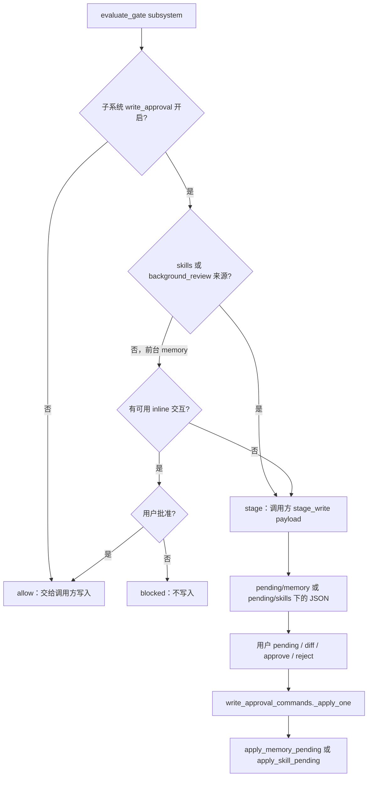

例如启用 `memory.write_approval` 后，后台复盘提出一项记忆更新：

1. `evaluate_gate` 发现 background_review → stage；`stage_write` 写 JSON（ID、payload、summary、origin 等）。当前 fork 可结束，不需要留着等 Event。
2. 用户 `/memory pending` 找 ID、查看内容，再 `/memory approve <id>`。
3. `hermes_cli/write_approval_commands.py::_apply_one` 读 record.payload，调用 `tools.memory_tool.apply_memory_pending(payload, memory_store)`。skills 则调用 `apply_skill_pending`。
4. applier 成功才是写入成功；对 destructive memory 操作还有固定目标/有效性约束，不能把审核前的搜索片段盲目施加到已变化的条目。失败需要处理，不等于批准即写成功。

这条链可在原回合结束后审核，因为保留的是**待应用操作材料**，不是 Python continuation。`/<subsystem> reject <id>` 丢弃暂存项，不是在给一个 terminal waiter 发送 deny。

> 与原 §3.3 的关系：§3.3 描述后台 memory 工具的操作级行为；本节补充跨前台/后台的 `write_approval` 子系统总闸门。不能仅按 add/replace/remove 推断一定直写，也不能认为开了 staging 就会热更新父 Agent 的 system 快照。

<a id="sec-8-source-map"></a>
### 2.16 源码阅读地图：按调用方向对照，不把模块当类

| 阅读目标 | 文件与符号 |
|---|---|
| 一次派发与中间件 | `agent/tool_executor.py`：`_run_agent_tool_execution_middleware`、`_dispatch_authorized_once`、`_pre_tool_block`、`_ConcurrentToolAuthorizationGate` |
| terminal 先保护再询问 | `tools/terminal_tool.py`：`terminal_tool`、`_pre_exec_block`、`_run_approval_guards`、`_check_all_guards` |
| 最终决策 | `tools/approval.py`：`check_all_command_guards`、`_floor_block`、`_human_decision`、`request_tool_approval`、`check_execute_code_guard` |
| 规则定义 | `tools/approval_detection.py`：`HARDLINE_PATTERNS`、`DANGEROUS_PATTERNS`、`detect_dangerous_command`；`tools/approval_floors.py`：`_match_user_deny_rule`、`_command_matches_permanent_allowlist` |
| 等待者与结束竞态 | `tools/approval_gateway_wait.py`：`_ApprovalEntry`、`_poll_event`、`_await_gateway_decision`；`tools/approval.py`：`resolve_gateway_approval` |
| 等人的 deadline 口径 | `tools/approval_human_wait.py`；批量决定：`agent/terminal_approval_batch.py` |
| CLI 实例与 modal | `cli.py::HermesCLI`；`hermes_cli/cli_modal_mixin.py::CLIModalMixin`：`_approval_callback`、`_handle_approval_selection`、`_poll_modal_queue` |
| Gateway 发卡与回调注册 | `gateway/run_turn_runner.py::TurnRunner`：`_run_conversation_with_approval`、`_approval_notify_sync` |
| Gateway 控制消息 | `gateway/slash_commands.py::GatewaySlashCommandsMixin`：`_handle_approve_command`、`_handle_deny_command`；实例为 `gateway/run.py::GatewayRunner` |
| 文件专有规则 | `tools/file_tools_write_guards.py`：`_check_sensitive_path`、`_request_protected_instruction_approval` |
| 暂存与后续应用 | `tools/write_approval.py`：`GateDecision`、`evaluate_gate`、`stage_write`；`hermes_cli/write_approval_commands.py::_apply_one` |

以上依据本仓库对应本地 Hermes 源码核对，不宣称远端版本最新。图中示意数据、ID 和工具结果内容不是某次真实执行日志。

---

## 3. 后台复盘（background review）

这是 Hermes「自我进化」里**不碰 Session 消息表**的那条腿：父 turn **已交付**（用户看到回复）之后，在守护线程里 fork 受限 `AIAgent`，用专用 harness 提示问模型要不要改 `MEMORY.md` / 技能。与 [卷三 6.8](03-runtime-session-and-loop.md#sec-6-8)、[卷五附录 B 进化路径](05-memory-architecture-and-evolution.md#d-扩展机制skills--curator--trajectory) 同主题。

**先读**：[§3.0 端到端流程](#sec-8-br-flow)（时间轴 + 时序图）；下面 §3.1–3.5 是分主题深表。

<a id="sec-8-br-flow"></a>

### 3.0 端到端流程（从用户一句话到复盘结束）

复盘 **不是** 第四类多 Agent（对比 [卷七 §0](07-multi-agent-and-kanban.md#0-先澄清三种多-agent别混) 的 delegate / Kanban / MoA）。它是 **父会话同一 `session_id` 上、轮末异步 fork**，只写盘 `MEMORY.md` / 技能文件，**不 append 父 `messages[]`**。

#### 3.0.1 在整条 live turn 上的位置

```text
用户消息
  → build_turn_context
       └─ _tick_memory_nudge → should_review_memory（仅计数，本 turn 末才可能用）
  → while 迭代（模型 + 工具，含 delegate_task 子 Agent）
  → finalize_turn
       ├─ 用户已看到 final_response（呈现层已交付）
       ├─ _sync_external_memory_for_turn（外部 provider；与复盘 fork 无关）
       ├─ 算 _should_review_skills（本轮 tool 迭代数 vs skill_nudge_interval）
       └─ 若 flag ∧ 未 interrupt ∧ 未 skip_background_review
            → _spawn_background_review（可能进 idle 队列，见下）
  → [并行] 守护线程 bg-review
       → prepare_background_review_run（占父上的 review run 槽）
       → build_cache_parity_fork + harness prompt + 工具白名单 dispatch
       → 子 run_conversation（quiet，无 stream_callback）
       → memory / skill_manage 写盘（可能 staging）
       → background_review_callback（可选摘要给父 UI）
```

**下一句 live turn 进门**（卷三 §1.5）：`cancel_background_review_for_live_turn` **先于** `admit_durable_turn_lease`——真人优先，复盘让步。

#### 3.0.2 两道「计数门」+ 一道「配置门」

| 门 | 何时算 | 条件（典型） | 影响 |
|----|--------|--------------|------|
| **Memory nudge** | `build_turn_context` 每轮一次 | `memory` 在 `valid_tool_names`、有 `MemoryStore`、`_turns_since_memory` 达到 `_memory_nudge_interval`（默认约 **10** 个用户回合） | `TurnContext.should_review_memory=True`，传到 `finalize_turn` 的 `_should_review_memory` |
| **Skill nudge** | `finalize_turn` 轮末 | `_iters_since_skill >= _skill_nudge_interval` 且存在 `skill_manage` | `_should_review_skills`；触发后计数清零 |
| **配置总开关** | `_spawn_background_review` 入口 | `auxiliary.background_review.enabled`（`load_background_review_settings`） | 关则从不 spawn |
| **子代理深度** | 同上 | `_delegate_depth > 0` 且非 `/refine` focus | **直接 return**（子 Agent 里不再套自动复盘） |

Memory 门与 Skill 门 **独立**：可以只复盘记忆、只复盘技能，或两者一起（选 `_COMBINED_REVIEW_PROMPT`）。

#### 3.0.3 Spawn：立即线程 vs 空闲队列

`_spawn_background_review`（`run_agent.py`）是 **唯一调度入口**：

| 路径 | 何时 | 行为 |
|------|------|------|
| **立即** | 默认；或 `defer: never` | `_spawn_background_review_now` → `threading.Thread(..., name="bg-review")` |
| **延迟** | `defer: auto` 且复盘模型走 **本机托管 llama-server** | `review_idle_queue.QUEUE.enqueue`：机器 **无 live turn** 且 GPU 空闲约 **15s** 后再跑；同会话 **只保留最新 snapshot**；超过 `defer_max_age_s`（默认 30min）强制 dispatch |
| **`/refine`** | `explicit=True` 或带 `focus` | **从不延迟**；write origin 为 `refine_review`，记忆工具集更宽 |

被 live turn **抢占取消**的延迟复盘：在 managed-local + defer 模式下可 **自动 requeue**（最多约 3 次，` _maybe_requeue_preempted_review`）。

#### 3.0.4 时序（主路径）

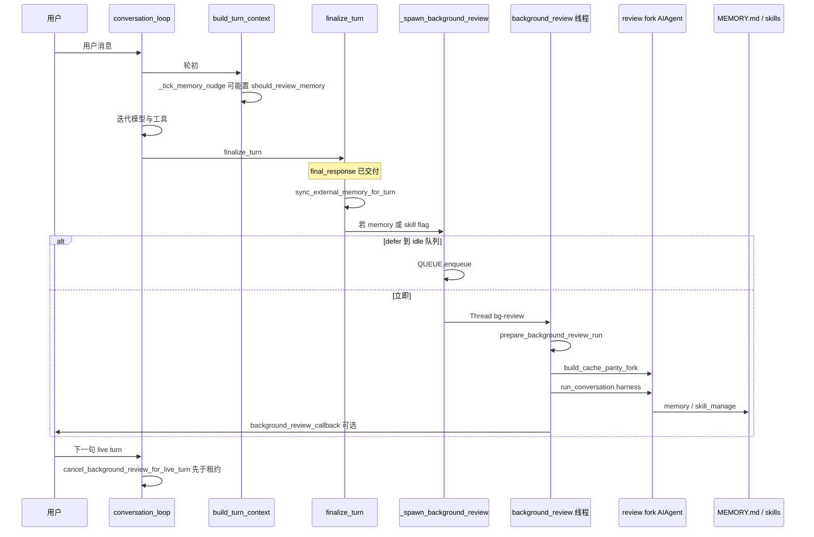

#### 3.0.5 Fork 内一圈在干什么（与 §3.2 对照）

1. **克隆** `messages_snapshot`（深拷贝，防污染 live transcript）。  
2. **`build_cache_parity_fork`**：同 `session_id`、同模型时复用父 system 前缀缓存；`_session_db=None`、`_persist_disabled=True`。  
3. **选 harness**：`_MEMORY_REVIEW_PROMPT` / `_SKILL_REVIEW_PROMPT` / `_COMBINED_REVIEW_PROMPT`（+ 可选 `/refine` focus 段）。  
4. **工具**：`tools[]` 与父出站一致（缓存）；**dispatch 白名单** 才允许 `memory`（仅 memory-nudge 触发时）、`skill_manage`、`read_file`、`search_files` 等（见 `background_review.py` `_review_tool_whitelist`）。  
5. **预算**：迭代上限 + 累计 input token 上限（§3.2）；超限则结束 fork。  
6. **收尾**：`finish_background_review_run`、usage 归因父 session、从 `_background_review_agent` / `_active_children` 摘掉 fork。

#### 3.0.6 与邻机制（别混）

| 邻机制 | 关系 |
|--------|------|
| **`delegate_task`** | 父 turn **内**同步子 Agent；子深度 >0 时 **不**再自动 spawn 复盘 |
| **`SubagentLifecycleService`** | 插件异步子任务；**不是** background review |
| **对话里 `memory` 工具** | 用户可见 turn 内写盘；复盘是 **轮末无人值守** 再问一遍要不要写 |
| **外部 provider `sync_all`** | 在 spawn **之前** 做完；fork `skip_memory=True` 不挂 provider |
| **Cron** | 常 `skip_background_review=True` |
| **Codex 旁路** | `_finish_codex_turn` 里可选同样 `_spawn_background_review`，不经完整 `finalize_turn`（卷三 Codex 节） |

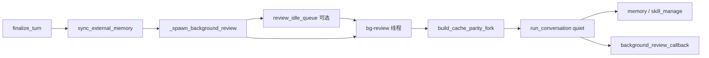

### 3.1 什么时候跑、什么时候必须停

| 项 | 说明 |
|----|------|
| **计数** | `turn_context` 里 `_tick_memory_nudge(agent)`（默认约每 **10** 个带 memory 的用户回合）与 skill nudge 独立计数 |
| **spawn 条件** | `turn_finalizer`：`final_response` 存在、**未** `interrupted`、**未** `skip_background_review`（cron 等）、且 memory 或 skill 复盘 flag 为真 |
| **顺序** | **先** `_sync_external_memory_for_turn`（Layer C），**再** spawn——复盘不与用户可见交付抢模型 |
| **cron** | `skip_background_review=True`：无人值守 fork 成本高且无 HITL 收益 |
| **进门抢占** | 新 live turn：`cancel_background_review_for_live_turn`（[卷三 1.5](03-runtime-session-and-loop.md#sec-1-5)），`_BACKGROUND_REVIEW_CANCEL_TIMEOUT_SECONDS`（约 **2s**）等 request-phase ack；超时 **仍放行** live turn（#84423） |
| **关窗 / interrupt** | `tui_gateway.session_lifecycle` 结束/打断会话走 **同函数**（#102895）：fork 不在 `session["running"]` 上，别处停不到 |

`cancel` 会 `_interrupt_background_review` 子 fork，并在有 `BackgroundReviewRun` 时做 **usage 归因到父 session**（#87250，best-effort）。

### 3.2 `build_cache_parity_fork` 与 `/btw` 共用

`build_cache_parity_fork(agent, …)` → `(review_agent, runtime_dict, routed)`。与 **`/btw`** 同套「缓存前缀对齐」哲学（模块注释 + #25322 / PR #17276：同模型路径约 **26%** 成本降幅）。

| 属性 | 复盘 fork | 父 live Agent |
|------|-----------|----------------|
| **presentation callback** | `_fork_init_kwargs` 不传 thinking/stream 等；`quiet_mode` + `suppress_status_output` | CLI / IM / TUI `_agent_cbs` |
| **`run_conversation`** | 无 `stream_callback` | 每轮有 |
| **`_session_db`** | **`None`**；`_persist_disabled=True`；`_end_session_on_close=False` | 写 SessionDB |
| **`session_id`** | **与父相同**（前缀缓存 warmth） | 权威 transcript 键 |
| **若 fork 真写库** | 会把 harness 回合混进父会话 → 下一 live turn 当指令（curator 根因） | — |
| **system** | 同模型：继承 `_cached_system_prompt` + `session_start` 字节级一致 | invalidate 路径 |
| **`routed=True`** | `auxiliary.background_review.{provider,model}` 换模型；缓存本冷 → **紧凑 digest** replay | — |
| **`skip_memory=True`（构造）** | 不挂外部 provider（防 harness 漏进用户 namespace） | 可有 `MemoryManager` |
| **`_memory_store` 绑定** | 仍指向父的 `MemoryStore`（built-in 文件） | — |
| **nudge 关闭** | `_memory_nudge_interval = _skill_nudge_interval = 0` | 正常计数 |
| **tools[]** | 同模型：`_inherit_parent_tool_surface` 深拷贝父 **上次出站** `tools[]`，冻结 generation（#103579） | MCP 可晚连 |
| **dispatch** | 运行时 **白名单**（只放行 memory/skill 类）；广告全量 ≠ 许可执行 |
| **MCP** | `_skip_mcp_refresh=True` | 回合间可 refresh |
| **压缩** | `compression_in_place=True`，且不落库 | 正常写 Session |
| **cache scope** | 继承父 `resolve_prompt_cache_scope_safe`（#109964） | — |
| **日志** | `_turn_origin = background_review`（与 live turn 区分，#118693） | — |

复盘线程：`thread_scoped_silence` 闷 stdout。Plugin `on_stream_*` 仍可能被打到（扩展总线），不是 TUI `_emit`。

**输入 token 预算**（防无人值守烧窗）：`auxiliary.background_review.max_input_tokens`；未设则约为复盘模型 context 的 **75%**，封顶 **600k**（`_REVIEW_MAX_INPUT_TOKENS_CAP`）。`conversation_loop` 里 `_review_input_budget_exhausted` 累加 INPUT，超限则停 fork 内循环。`max_iterations` 默认 **16**（`_REVIEW_MAX_ITERATIONS`）。

### 3.3 写盘、staging、父界面

| 动作 | 行为 |
|------|------|
| **`memory` add** | 无额外写入审批限制时可写 `$HERMES_HOME/memories/*.md`；`_memory_write_origin` 标 `background_review`。开启 `memory.write_approval` 后后台写入须暂存，见 §2.15 |
| **`replace` / `remove`** | 无人值守常 **staging**（`memory_tool`）；等人或策略再落盘 |
| **父 system 快照** | **不**热更新父 `_cached_system_prompt` → [卷三 6.4.2](03-runtime-session-and-loop.md#sec-6-4-2) |
| **父 IM/TUI** | 父 Agent 上 `background_review_callback` → 网关可 `_emit("review.summary", …)`；**不是** `_CALLBACK_PARAMS` 流式正文 |
| **Session 行** | fork **永不** append 父 transcript（`_persist_disabled` + 无 `_session_db`） |

### 3.4 和审批、子代理、外部 memory 的边界

| 邻域 | 关系 |
|------|------|
| **HITL** | 复盘工具面 **无** `terminal` 危险链；不弹审批卡（无人值守） |
| **子代理** | `delegate_task`：`skip_memory=True`，不参与复盘进化线 |
| **外部 provider** | fork 构造 `skip_memory=True`；父 turn 的 `sync_all` 已在 spawn **之前** 做完 |
| **live turn** | 进门先 `cancel_background_review_for_live_turn`；foreground 永远优先 |

危险命令与 IM 卡 → [§2](#2-端到端危险终端命令cli--im)、[卷六第8章](06-gateways-channels-and-hitl.md#sec-g8)。

### 3.5 源码锚点（grep）

| 符号 | 文件 |
|------|------|
| `cancel_background_review_for_live_turn` | `agent/background_review.py` |
| `build_cache_parity_fork` / `_spawn_background_review` | 同上 + `AIAgent` mixin |
| `_tick_memory_nudge` | `agent/turn_context.py` |
| spawn 门控 | `agent/turn_finalizer.py`（`skip_background_review`、delivery 之后） |
| `auxiliary.background_review` | `hermes_cli` config |

---

## 4. 与卷五 `tool_executor` 的交界

- 所有 Registry 工具（含 `memory`、`delegate_task`）经 **`_execute_tool_calls`**。  
- **Inline** 工具绕过 `handle_function_call` 但仍走同一 executor 的 hook/审批包装（卷五 §0.2）。  
- `delegate_task` **串行 dispatch**、可占满 batch deadline 例外（`_SEQUENTIAL_DEADLINE_EXEMPT_TOOLS`）。

---

## 5. 包与核心类

`tools/skills_guard.py`、`agent/prompt_builder.py`、`tools/approval.py`、`tools/approval_context.py`、`tools/terminal_tool.py`、`agent/tool_executor.py`、`agent/background_review.py`、`tools/memory_tool.py`（staging）。
