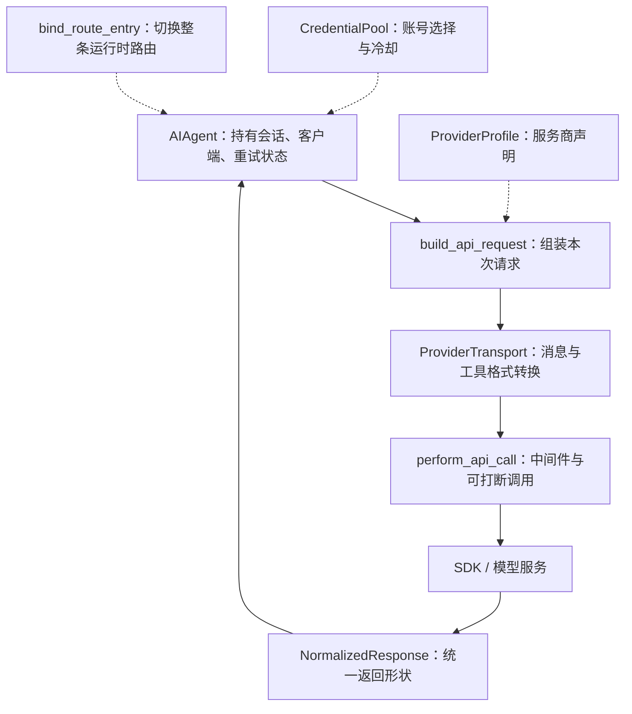
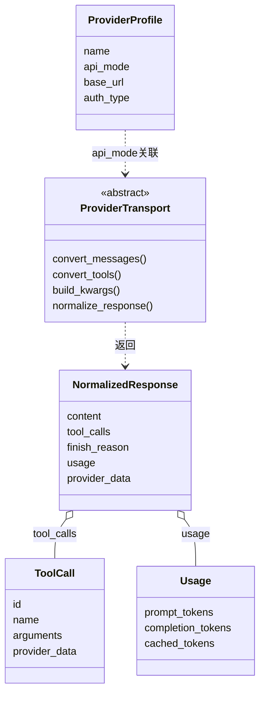
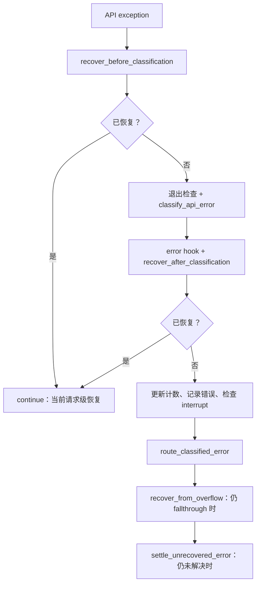

# 卷十 · 模型后端：协议、凭据、降级与辅助请求

> **核对范围**：本地 `hermes-dev/hermes-agent`，提交 `60d00c5633ad76f3dd8e3ecd79f77f1c6f8e6fdd`。不是对远端最新版的声明。  
> **阅读前提**：[卷三](03-runtime-session-and-loop.md)知道一轮如何运行；[卷四](04-prompt-and-context.md)知道上下文如何组成。  
> **本卷要回答**：同一轮为什么可以接不同模型？换账号与换模型有什么区别？失败后如何恢复而不把历史弄坏？

## 目录

- [1. 先把“后端”拆成四件事](#backend-concepts)
- [2. 后端架构：政策在 Agent，翻译在 Transport](#backend-architecture)
- [3. 一次请求的完整路线](#backend-request)
- [4. 凭据池不是 API Key 列表](#backend-credentials)
- [5. 错误恢复与 fallback 的边界](#backend-recovery)
- [6. Auxiliary 与插件 LLM](#backend-auxiliary)
- [7. 协议细节：为什么不能只保留正文](#backend-replay)
- [8. 源码走读、测试与排障](#backend-reference)

<a id="backend-concepts"></a>
## 1. 先把“后端”拆成四件事

“我切了后端”至少可能指四种不同动作。混在一起讲，会误以为改一个模型名字就够了。

| 概念 | 用人话解释 | 源码落点 | 不负责什么 |
|---|---|---|---|
| ProviderProfile | 一张服务商说明卡：入口、认证方式、协议和请求习惯 | `providers/base.py:ProviderProfile` | 不创建客户端、不轮换凭据、不拥有重试循环 |
| ProviderTransport | 翻译员：把 Hermes 的消息/工具转成服务商格式，再把返回转回来 | `agent/transports/base.py:ProviderTransport` | 不独立决定重试、打断、缓存策略 |
| Client / runtime route | 实际用哪条连接，连到哪里，以哪个模型发请求 | `agent/route_binding.py:bind_route_entry`、`agent/client_lifecycle.py` | 不能只改显示标签而不重绑运行时 |
| CredentialPool | 哪个账号现在能用，谁在占用，何时能再用 | `agent/credential_pool.py:CredentialPool` | 不把不同服务商的账号任意混成一个池 |

还要分清另一套名字相似的类：`agent/provider_base.py:ProviderBase` 是**插件能力 Provider 的基础接口**；它不是上表里声明推理服务商行为的 `providers/base.py:ProviderProfile`。Memory、终端、图像等能力也有 Provider，但不是“换大模型”的同一条链。

**例子**：请求返回 429，可能是当前账号暂时不可用；换池内账号并不一定换模型。主服务商一直不可用时才可能走 fallback route，这时模型、协议、上下文窗口都可能一起改变。

<a id="backend-architecture"></a>
## 2. 后端架构：政策在 Agent，翻译在 Transport



图里实线表示本次请求的数据路线，虚线表示对路线的配置/状态影响；不是说 `ProviderProfile` 本身发网络请求。

### 2.1 类图：共享抽象与协议保留区



`ProviderTransport` 的四个抽象方法是代码中的契约；图里的关联不是一个臆造的继承关系。`NormalizedResponse`、`ToolCall`、`Usage` 均在 `agent/transports/types.py`。

### 2.2 不是所有协议都自动进入相同路径

`agent/transports/__init__.py` 自动发现的模块是 `anthropic`、`codex`、`chat_completions`、`bedrock`；`register_transport()` 是扩展接缝。`get_transport()` 在注册表不存在对应协议时可以返回 `None`，允许调用方走兼容路径。

源码同时有 `codex_app_server.py` 与 `codex_app_server_session.py`，但**“目录里有文件”不等于“被这张默认 registry 自动加载”**。Codex runtime 的专用会话行为仍需结合卷三第5章理解。本轮没有把所有服务商的具体 SDK 行为归纳成一份未经核对的统一规范。

<a id="backend-request"></a>
## 3. 一次请求的完整路线

以下是请求阶段图，不重画卷三的整个工具循环。`turn_api_request`、`turn_api_call`、`turn_api_error` 是分阶段函数，不是三个长期运行的服务。

```mermaid
sequenceDiagram
    participant Loop as conversation_loop
    participant Req as turn_api_request
    participant Call as turn_api_call
    participant MW as LLM execution middleware
    participant Net as client / transport
    participant Err as turn_api_error
    Loop->>Req: build_api_request(...)
    Req-->>Loop: 请求参数与构建状态
    Loop->>Call: perform_api_call(...)
    Call->>MW: run_llm_execution_middleware(...)
    MW->>Net: 调用实际请求函数
    alt 成功且没有交叉发生的 redirect
        Net-->>Call: response
        Call-->>Loop: 继续响应处理
    else 请求异常
        Net-->>Loop: exception
        Loop->>Err: handle_api_error(...)
        Err-->>Loop: continue / break / return 等恢复裁决
    end
```

### 3.1 一个容易被漏掉的并发问题：回应到达时，用户已经转向

`perform_api_call()` 用 `_model_request_active` 标记请求正在运行，并在存在 `_pending_redirect_lock` 时同步读写。请求返回之后还要重新检查 redirect。

人话：**模型刚给出的答案，可能已经不是用户现在问的那件事了。** 所以不能只看“HTTP 成功了”。实现会丢弃已经过时的响应，并根据 redirect/interrupt 状态决定重建回合还是停止。

```python
# 摘录自 agent/turn_api_call.py:146 起，中文注释为新增解读。
if _redirect_crossed_response:
    # 不把旧问题的回复提交给已经转向的对话。
    thinking_spinner = stop_thinking_spinner(agent, thinking_spinner)
    if agent.clear_interrupt(preserve_redirect=True):
        # 是转向：让外层循环拿新的消息重来。
        _retry.restart_with_redirected_messages = True
    else:
        # 是停止：不要当成普通的 retry。
        interrupted = True
    return _verdict("break")
```

流式与非流式也不是只差一个布尔值：当前函数的流式路径用 `_interruptible_streaming_api_call`；非流式通过 `relay_llm.execute` 包装 `_interruptible_api_call`。这说明观测/转发边界不能单凭最终正文反推。

<a id="backend-credentials"></a>
## 4. 凭据池不是 API Key 列表

### 4.1 选择、租约、冷却、刷新分别解决什么问题

| 行为 | 源码方法 | 为什么要有它 |
|---|---|---|
| 选一个当前可用账号 | `CredentialPool.select` | 跳过不能立即使用的项，而非每次机械取第一项 |
| 标记耗尽并尝试轮换 | `mark_exhausted_and_rotate` | 记录失败的是哪一项，避免坏账号立刻被重复选中 |
| 获取/释放租约 | `acquire_lease` / `release_lease` | 并发请求的占用与刷新需要协调 |
| 刷新当前或匹配凭据 | `try_refresh_current` / `try_refresh_matching` | OAuth 过期不等于账号永远不可用 |
| 查询最早可用时刻 | `next_available_at` | “现在没有”与“永久没有”不是一个错误 |
| 持久化池状态 | `persist_pool_entries` | 重启后不应完全忘掉认证状态和已知失败 |

这是一张**职责表**，不是保证每次调用都严格按表格顺序跑。池内的策略、认证类型、单账号分支都会影响细节。

### 4.2 两类隔离不能省掉

1. **Provider/endpoint 边界**：`credential_pool_entry_serves_endpoint`、`credential_pool_matches_provider` 和 `resolve_runtime_pool_key` 负责路由匹配。自定义 endpoint 不能只凭一个相似名字借错池。
2. **Profile/存储归属边界**：代码包含 `_store_owns_pool_provider`、`_profile_owns_pool_provider` 等归属判断。多 profile 下不能把当前线程碰巧看到的全局凭据当成当前 profile 的所有权。

OAuth refresh 又多一层麻烦：有些 token 轮换后旧 refresh token 不能再用。源码有刷新锁、写回、未持久化轮换的 fail-closed 等分支。因此“捕获异常就换 key”不是等价实现。

### 4.3 可核对的场景

- 当前账号 429，但池里有其他账号：先看分类结果与池恢复；不要直接解释成“换模型”。
- 池内全部暂时冷却：看 `has_available`、`next_available_at` 与 cooldown 相关状态。
- 认证刷新失败：看刷新错误属于暂时失败还是 terminal auth failure。
- profile A 与 B 各有账号：看 pool key 与存储所有权，不能仅比对模型名称。

测试入口：`tests/agent/test_credential_pool_provider_boundary.py`、`test_credential_pool_profile_oauth_fork.py`、`test_credential_pool_lease_refresh_reselect.py`。它们是继续验证的入口；本次文档工作没有运行这些运行时测试。

<a id="backend-recovery"></a>
## 5. 错误恢复与 fallback 的边界

### 5.1 实际顺序比“重试三次”复杂

`handle_api_error()` 明确按以下阶段组织：



图是分阶段的概括。中断或某阶段已经给出终止裁决时，不会机械继续走到图底。

**为什么先有协议修复，再有一般分类？** 某些失败源于当前请求的格式/兼容问题；盲目把它们当服务商故障，会把本来可修复的问题变成无谓的账号轮换和模型降级。

### 5.2 Fallback 为什么必须重建消息并重跑 preflight

函数 docstring 明确要求：每次激活 fallback 都要带着 `restart_with_rebuilt_messages` 离开内层 retry（`break`），让调用 API 前的检查重新按照 fallback 的窗口执行。

例子：主模型能吃下当前历史，fallback 模型窗口小得多。如果只把 `model` 字段替换掉、原样重发，降级实际上会制造另一个上下文超限。

`bind_route_entry()` 做的不是一个赋值，而是一组运行时同步：

- 解析 entry 的 endpoint、认证和 `api_mode`；客户端不可用时返回 `None`。
- 清除旧的 `_config_context_length`，不能带着旧模型窗口覆盖新模型。
- 更新 model/provider/base_url/api_mode，清理 transport cache 和 Codex reasoning replay。
- 重绑 CredentialPool、切换 client（MoA 有其专门的 runtime 绑定）。
- 重新计算缓存政策、压缩器窗口、reasoning 配置和 extra_body 的适用范围。
- `_fallback_activated` 标记后续恢复主路由所需的状态。

**边界**：这不是承诺“下一轮无条件切回”。`reinstall_primary_runtime()` 是恢复操作；什么时候允许恢复还要看调用方 gates。不能把操作函数本身当成调度政策。

### 5.3 三种“重来”必须区分

| 动作 | 改了什么 | 典型原因 |
|---|---|---|
| 请求级 retry | 主要在当前请求/账号状态内恢复 | 暂时网络失败、协议恢复 |
| 重建本轮请求 | 重新检查历史、窗口、上下文 | fallback、压缩、用户 redirect |
| 开新会话 | 改变会话身份与长期 prefix 的生命周期 | 用户主动切会话；不是自动 retry 的同义词 |

<a id="backend-auxiliary"></a>
## 6. Auxiliary 与插件 LLM

主 Agent 的回答不是系统里唯一会调用模型的地方。压缩、标题、review 等侧任务有自己的模型/任务配置入口。卷三已经介绍 Auxiliary；这里补充**路由与权限边界**。

- `agent/auxiliary_client.py` 提供客户端解析等能力；`auxiliary_task_config.py` 是侧任务配置的源码入口。
- `agent/plugin_llm.py:PluginLlm` 给插件稳定的 complete/structured/async 接口，而不是要求插件自行偷拿主 Agent 的私有 client。
- `PluginLlm` 在调用前通过 `_gate` 检查；同模块有 `_resolve_trust_policy`、`_check_overrides`、`_check_task`、`_resolve_task_ownership`。因此“插件能调用模型”不等于“插件可以任意指定服务商、任务归属和覆盖参数”。
- `_resolve_attribution`、`_attributed` 与 auxiliary accounting 相关模块体现了成本归属的边界；侧任务不应全部被解释成用户那一次主请求的 token 消耗。

本轮只核对这些接口与控制边界，**没有把每一种 auxiliary task 的默认模型、优先级和收费口径宣称为已完整验证**。新增侧任务时，应补齐“任务所有者 → 配置解析 → client → usage”这条证据链。

<a id="backend-replay"></a>
## 7. 协议细节：为什么不能只保留正文

看起来“回复就是一段 text”，但下一次 API 请求可能还依赖上一轮的协议字段。

| 必须保留的东西 | 在统一结构里的位置 | 丢了会怎样 |
|---|---|---|
| 工具调用身份 | `ToolCall.id`，协议特有 ID 在 `provider_data` | 工具结果无法正确对应请求 |
| Gemini thought signature | `ToolCall.provider_data` / `extra_content` 兼容属性 | 后续回放可能被 API 拒绝 |
| Anthropic 有序 blocks | `NormalizedResponse.provider_data` 的 `anthropic_content_blocks` | signed thinking 与 tool_use 的顺序被破坏 |
| Codex reasoning/message items | `provider_data` 对应字段 | 专用协议的后续请求丢失需要的状态 |
| token usage | `Usage` | 成本与缓存观测失真 |

共同字段只保留下游都需要的形状，特殊信息放 `provider_data`。这是**统一接口而不抹平协议差异**的设计，不是可任意丢弃的附加日志。

<a id="backend-reference"></a>
## 8. 源码走读、测试与排障

### 8.1 权威入口（相对源码根）

| 问题 | 文件 / 符号 | 核对层次 |
|---|---|---|
| 服务商说明卡有哪些字段 | `providers/base.py:ProviderProfile` | 声明与职责 |
| 翻译边界在哪里 | `agent/transports/base.py:ProviderTransport` | 完整抽象契约 |
| 默认 transport 如何发现 | `agent/transports/__init__.py:get_transport` | 注册表与 miss 行为 |
| 一次请求如何被执行 | `agent/turn_api_call.py:perform_api_call` | 主分支与 redirect 竞争 |
| 错误处理的先后次序 | `agent/turn_api_error.py:handle_api_error` | 阶段顺序与裁决 |
| 为什么换模型需要换很多东西 | `agent/route_binding.py:bind_route_entry` | 路由重绑 |
| 账号池的状态机 | `agent/credential_pool.py:CredentialPool` | 核心方法；不是逐分支穷尽 |
| 插件侧调用的限制 | `agent/plugin_llm.py:PluginLlm` | 权限 gate 和接口 |

### 8.2 一条最有价值的排障路径

先找 `api_request_id` 对应的 provider/model/api_mode，然后确认：

1. **请求构建错**：transport/消息回放字段，还是工具 arguments 不合法？
2. **请求发不出去**：endpoint、认证、连接生命周期？
3. **被限流**：账号冷却，还是整个 provider/配额不可用？
4. **模型切了仍失败**：context compressor 与 request preflight 是否跟着重绑？
5. **用户已停止仍在输出**：redirect/interrupt 的裁决是否被后续提交忽略？

不要首先改 `max_retries`。次数只是恢复政策的一个预算，不是错误原因。

### 本卷总结

模型后端不是一层薄薄的 SDK wrapper。它有**声明、协议翻译、运行时路由、凭据状态、恢复政策、协议回放**六个协同部分。主循环负责把它们连起来；工具循环不需要为每个服务商重新实现一遍。
