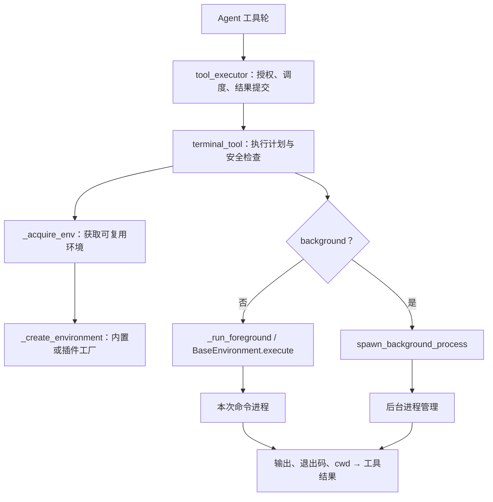
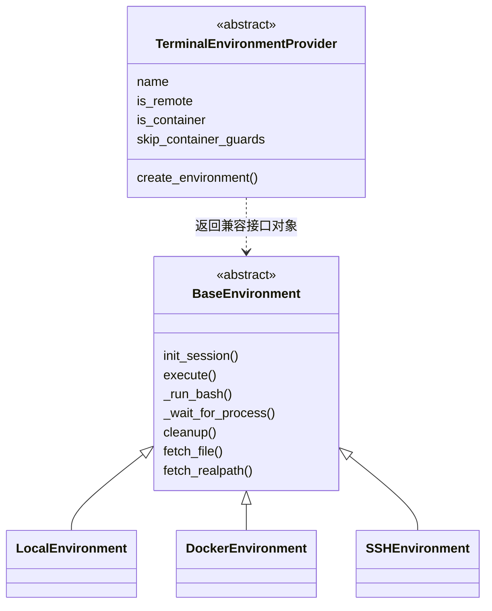
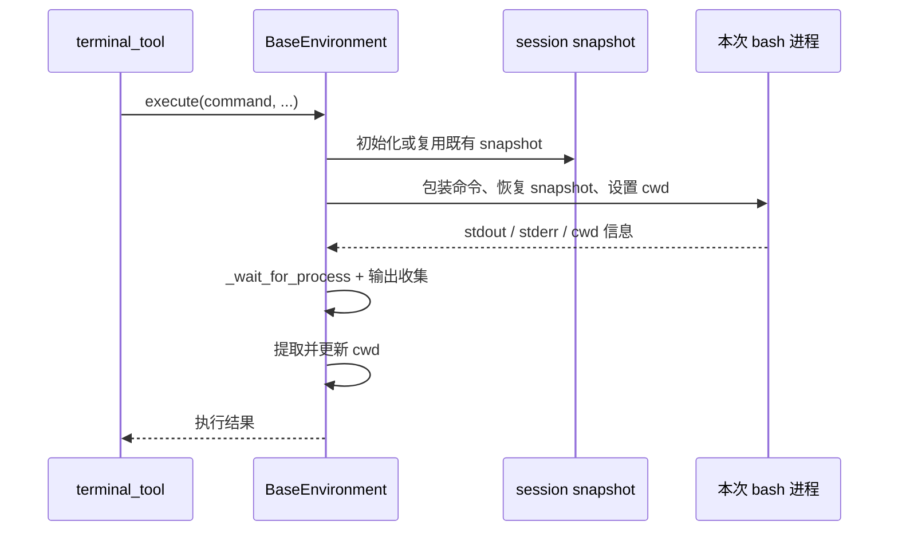
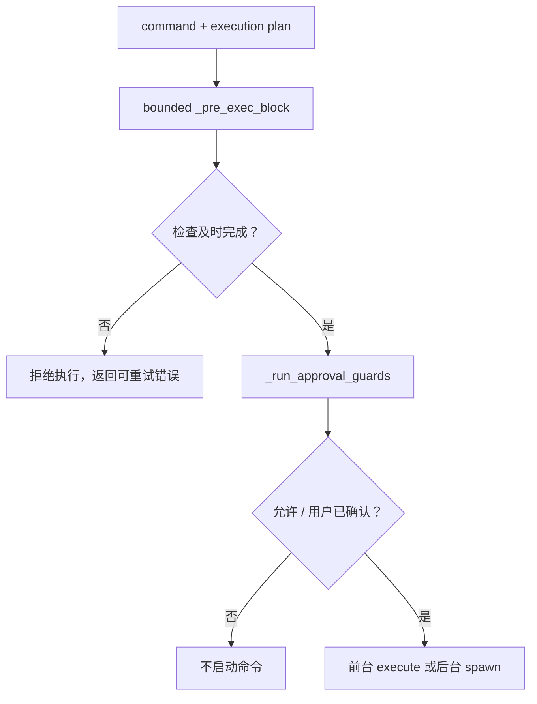

# 卷十一 · 执行后端：终端、环境隔离、后台进程与清理

> **核对快照**：`60d00c5633ad76f3dd8e3ecd79f77f1c6f8e6fdd`。  
> **与卷十的区别**：卷十讲“谁来思考”；本卷讲“模型决定执行命令之后，究竟在哪里、以什么状态、受什么保护执行”。  
> **相关卷**：[工具与插件](05-capabilities-extensions.md) · [安全与治理](08-security-and-governance.md)。

## 目录

- [1. 先澄清：shell、environment、task、session](#exec-concepts)
- [2. 从工具调用到系统进程](#exec-architecture)
- [3. 为什么不是一条永久打开的 shell](#exec-shell)
- [4. 环境选择与隔离身份](#exec-isolation)
- [5. 安全检查：不能把容器当万能免责牌](#exec-security)
- [6. 前台、后台与生命周期](#exec-lifecycle)
- [7. 插件后端契约与常见误解](#exec-plugin)
- [8. 权威表与排障路线](#exec-reference)

## 1. 先澄清：shell、environment、task、session

| 名词 | 一句话 | 为什么不能混用 |
|---|---|---|
| shell process | 本次 `bash -c` 的进程 | 下一次命令通常是另一个进程 |
| Environment | 执行地点与执行接口，可以跨多次工具调用复用 | 对象复用不等于 shell 进程复用 |
| task_id | 环境与进程资源关联的任务身份 | 可能被 profile/session 隔离规则进一步限定 |
| session key | 对话与安全/审批/cwd 的关联身份 | 工具线程不总能直接继承调用方 ContextVar |
| cwd | 本次命令工作的目录 | 主机目录与容器/远端目录可能不是同一路径 |

本卷核心问题是：**怎样让命令有连续的工作上下文，又不把进程和环境身份弄成一个难以回收的黑盒？**

## 2. 从工具调用到系统进程

图分开“环境工厂”和“执行分支”：工厂不是每次 tool call 都创建一个全新容器，环境会依据任务与隔离规则缓存/复用。

`terminal_tool()` 的主路径实际是：`_plan_execution` → `_acquire_env` → bounded `_pre_exec_block` → `_run_approval_guards` → 前台/后台分支。工厂入口在 `tools/terminal_tool_backends.py`，不是模型直接实例化 `DockerEnvironment`。

### 2.1 环境抽象的类图

插件返回对象可以满足 duck-type 契约，不强制必须继承图里的 `BaseEnvironment`。因此虚线表示接口要求，不是插件类继承。

## 3. 为什么不是一条永久打开的 shell

`tools/environments/base.py` 的文件说明明确采用 **spawn-per-call**：每条命令启动一个新的 `bash -c`。会话初始化捕获环境变量、函数、alias 的 snapshot；后续命令重新 source 这份 snapshot。

**人话**：每次开一个干净的执行进程，但带上初始化时保存的工作底稿。

### 3.1 哪些状态连续，哪些不连续

| 状态 | 连续性 | 应如何理解 |
|---|---|---|
| 初始 shell 环境、函数、alias | 初始化 snapshot 会被重新载入 | 不意味着后续随意 `export` 都会被自动重新抓拍 |
| 工作目录 | 实现有 cwd 提取与更新机制 | 不是让下一次命令靠上一次 shell 仍存活 |
| 文件修改 | 取决于实际文件系统和环境寿命 | 本机/持久容器/临时 sandbox 的寿命不同 |
| 某命令启动的临时 shell 状态 | 不能当永久 shell 状态依赖 | 特别是交互模式、job table、任意新增变量 |
| 后台进程 | 有另外的管理与释放规则 | 不是前台 execute 自带的永久会话 |

本机 cwd 通过临时文件获取；远端路径使用 stdout 内嵌标记。`base_session_env.py` 中的 `_wrap_command_script` 与 `_split_cwd_marker` 是核对“命令结束后目录如何回来”的入口。不要把控制标记当成模型应该看到的普通输出。

### 3.2 一次 execute 的时序（机制图）

这是抽象机制，不是每个 backend 的逐行 trace。SSH、Docker 和云 sandbox 的具体 spawn/文件同步实现需要再看各自模块。

## 4. 环境选择与隔离身份

### 4.1 不同 backend 不只是换一个命令前缀

源码有 Local、Docker、SSH、Singularity、Modal、Daytona、Vercel sandbox 等实现或集成入口。但厂商支持列表不能替代架构解释：

| 类型 | 命令实际在哪里跑 | 额外需要理解 |
|---|---|---|
| Local | Hermes 所在主机 | 主机权限、继承环境、进程组清理 |
| Docker / Singularity | 容器文件系统/运行时 | host mount、资源配置、session identity |
| SSH | 远端主机 | 远端 cwd、连接失败、文件下载/映射 |
| 云 sandbox | 服务商提供的环境 | 重建、销毁、资源寿命和凭据过滤 |
| 插件 backend | 插件声明的执行地点 | 必须声明远端/容器等政策属性 |

本轮读到公共接口与 Local/Docker 等核心入口，**未实连任何云服务，也未验证所有厂商 SDK 的部署条件**。

### 4.2 task key 为什么要“加姓氏”

`tools/terminal_tool.py` 中 `_SessionScope`、`_qualify_task_key`、`_resolve_container_task_id`、`resolve_task_overrides` 处理任务身份与环境隔离。

用人话说：两个 profile 都叫自己的任务 `default`，并不表示应该共用一个执行目录或销毁对方容器。根据持久性和配置，身份会带上 profile/session 等隔离信息。具体 key 生成规则要沿上述函数核对，不能把本卷概念图当成固定的字符串格式规范。

`record_session_cwd` / `get_session_cwd` 负责 cwd 侧的记录。`terminal_tool()` 明确处理“ContextVar 没有跨工具 worker 线程”这一情况：session key 可以从 raw task_id 取稳定回退值。这与卷六的 IM session key 相关，但不是同一个字典就能包办的状态。

## 5. 安全检查：不能把容器当万能免责牌

### 5.1 两层检查分开看

1. **执行前保护**：`_pre_exec_block` 涉及底线/运行时自保护等条件。调用通过 `run_bounded_sync` 带 deadline；保护没算出结论，命令不能先执行。
2. **审批检查**：`_run_approval_guards` 检查命令危险性与人工确认。`force=True` 表示已经得到用户确认，不是“所有安全底线都可以关闭”。

### 5.2 有 host mount 的容器仍可能伤害主机

`_docker_has_host_access`、`_docker_volume_uses_host_path` 是源码入口。容器本身并不自动证明安全：把用户目录挂进去以后，容器内的删除/覆盖仍可能作用于主机文件。

插件契约提供 `skip_container_guards`，默认随 `is_container`；契约说明要求能挂载主机路径的后端覆盖为 `False`。这是作者必须正确声明的政策，不是系统凭“名字里带 sandbox”就推断出来的安全保证。

### 5.3 凭据过滤与提示事实也是隔离的一部分

`TerminalEnvironmentProvider.strip_env_keys` 声明不应进入模型命令子进程的厂商凭据。`is_remote` 还影响 prompt 中的主机 OS/home/cwd 提示以及主机 Python 探测。

为什么 prompt 也算这里的问题？因为模型如果以为自己在 macOS 的某目录，实际命令却在 Linux sandbox，路径与安装命令都会选错。执行环境与提示环境必须一致。

## 6. 前台、后台与生命周期

### 6.1 前台不是“阻塞直到永远”

公共环境包含等待、输出收集、活动心跳、超时与进程终止机制：`_wait_for_process`、`_kill_process`、`_force_kill_process`，以及 `base_output.py` / `base_wait.py`。

活动心跳用于告诉外层“工具仍在工作”，不是模型正文。等待的输出数量、超时退出和外层 backstop 是不同预算。源文件说明中的内层超时可以返回部分输出与 124；外层 bounded 等待用于兜住内层根本不返回的情况。不要把所有超时都解释成“命令返回了 124”。

### 6.2 后台任务有独立的结果读取与终止通路

`terminal_tool()` 的 background 分支调用 `spawn_background_process`。这不是在命令末尾偷偷补一个 `&` 就结束了；后台进程还要被管理、查询、读取输出并在适当时通知完成。

代码允许通知、watch patterns、heartbeat、`persist_on_release` 等内部/公开参数组合；互斥与默认规则应按工具 schema/实现核对。特别是 `persist_on_release` 表示某些后台进程可以不随任务释放自动停止，但**用户显式 kill 仍是另一回事**。

### 6.3 程序退出时，不能只关闭 Python 对象

`base.py` 的 `_live_foreground` 跟踪当前进程内各环境正在运行的前台命令；`kill_live_foreground_processes(now=True)` 使用 exit fence，阻止退出时新命令继续进入，并处理“刚越过检查、尚未登记”的 spawn 竞争窗口。

**解释性例子**：

1. 线程 A 已检查“可以 spawn”，尚未把新进程加入 registry。
2. 主线程收到退出信号，开始杀 registry 里的进程。
3. 如果只遍历一次 registry，A 的进程可能漏掉，成为孤儿。
4. exit fence 与 in-flight spawn 协调就是为了兜住这一窗口。

不能因此推断“所有远端命令都已在外部服务商那里消失”。进程杀掉、连接断开、云资源删除是不同层的结果，应分别观察。

## 7. 插件后端契约与常见误解

`agent/terminal_env_provider.py:TerminalEnvironmentProvider` 的关键政策属性：

| 属性/方法 | 作用 |
|---|---|
| `is_remote` | 执行离开主机；影响环境提示与主机事实探测 |
| `is_container` | 文件系统/资源按容器类环境处理 |
| `skip_container_guards` | 是否允许跳过容器危险命令提示；不是全局授权 |
| `cache_path_base` | 自动同步缓存文件应落到哪里 |
| `strip_env_keys` | 哪些服务商凭据不能传入命令子进程 |
| `session_isolated_when_nonpersistent` | 非持久模式是否每会话独立 sandbox 身份 |
| `is_available()` | 廉价可用性检查；契约要求不发网络请求 |
| `check_requirements(config)` | 带配置的完整要求检查 |
| `create_environment(..., **kwargs)` | 创建兼容对象；未知参数必须能被接纳/忽略以便工厂演进 |

注册在 `PluginContext.register_terminal_environment_provider`，工厂在 `_build_plugin_env` / `_create_environment`。公用 registry 还拒绝内置 backend 名称冲突。

**设计取舍（解释，不是作者 ADR）**：把分类政策变成声明属性，比在核心中追加一串 vendor name 判断更容易扩展；代价是插件必须忠实声明自己的权限与资源行为，错误声明可能影响审批和路径政策。

## 8. 权威表与排障路线

| 想知道什么 | 源码入口 |
|---|---|
| 执行计划、审批与前后台分支 | `tools/terminal_tool.py:terminal_tool` / `_plan_execution` |
| 环境工厂、插件分支 | `tools/terminal_tool_backends.py:_create_environment` / `_build_plugin_env` |
| 公共执行与退出清理 | `tools/environments/base.py:BaseEnvironment` / `kill_live_foreground_processes` |
| cwd 与 shell snapshot | `tools/environments/base_session_env.py` |
| 输出、进程句柄 | `tools/environments/base_output.py` |
| 本机实现 | `tools/environments/local.py:LocalEnvironment` |
| Docker 实现 | `tools/environments/docker.py:DockerEnvironment` |
| 远端抽象政策 | `agent/terminal_env_provider.py:TerminalEnvironmentProvider` |

排障先问四个问题：**实际 backend 是谁？实际 cwd 是哪里？task/profile/session 身份是否正确？卡在 guard、spawn、wait、output 还是 cleanup？**

如果“工具超时但进程还活着”，要同时看工具 executor 的 deadline 和 environment/process 的终止能力，不能只提高工具 timeout。若“文件在主机存在、模型却说找不到”，先检查路径映射，不要直接判定模型幻觉。

### 本卷总结

执行后端的重点不是“支持多少云厂商”，而是**工作上下文连续、执行身份隔离、风险边界可检查、前后台可管理、退出时可清理**。同一套 terminal 工具能跨不同环境工作，是靠这些公共契约，不是靠所有 shell 都表现一样。
