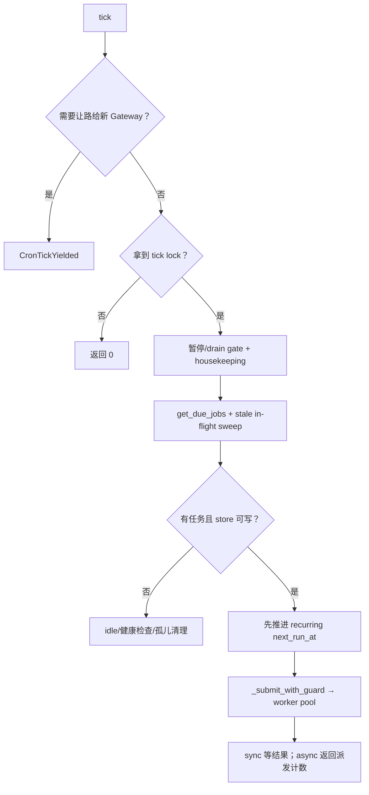
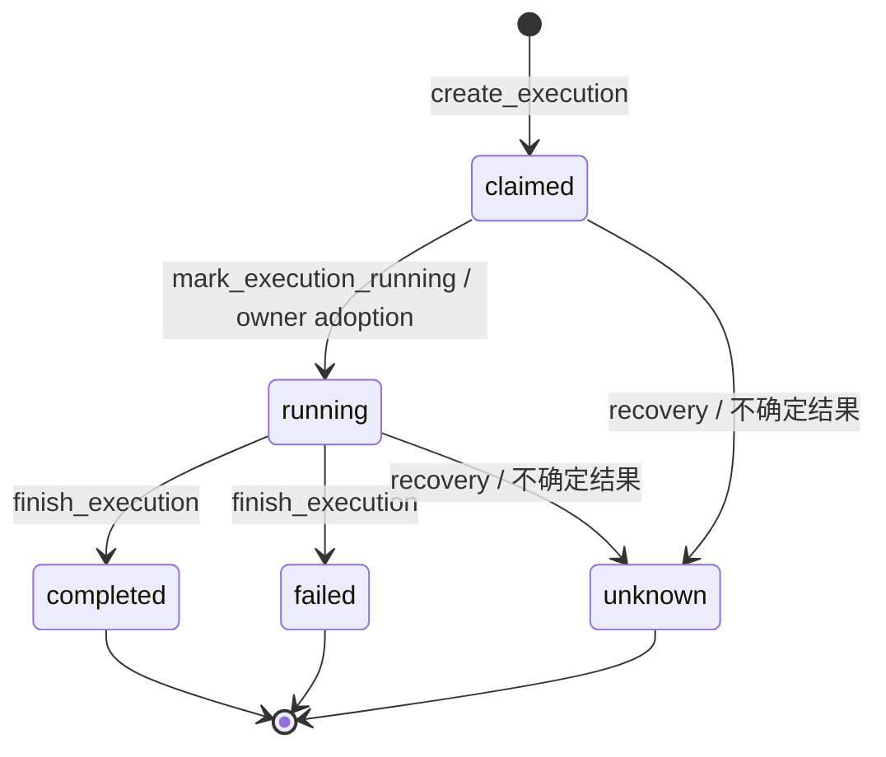
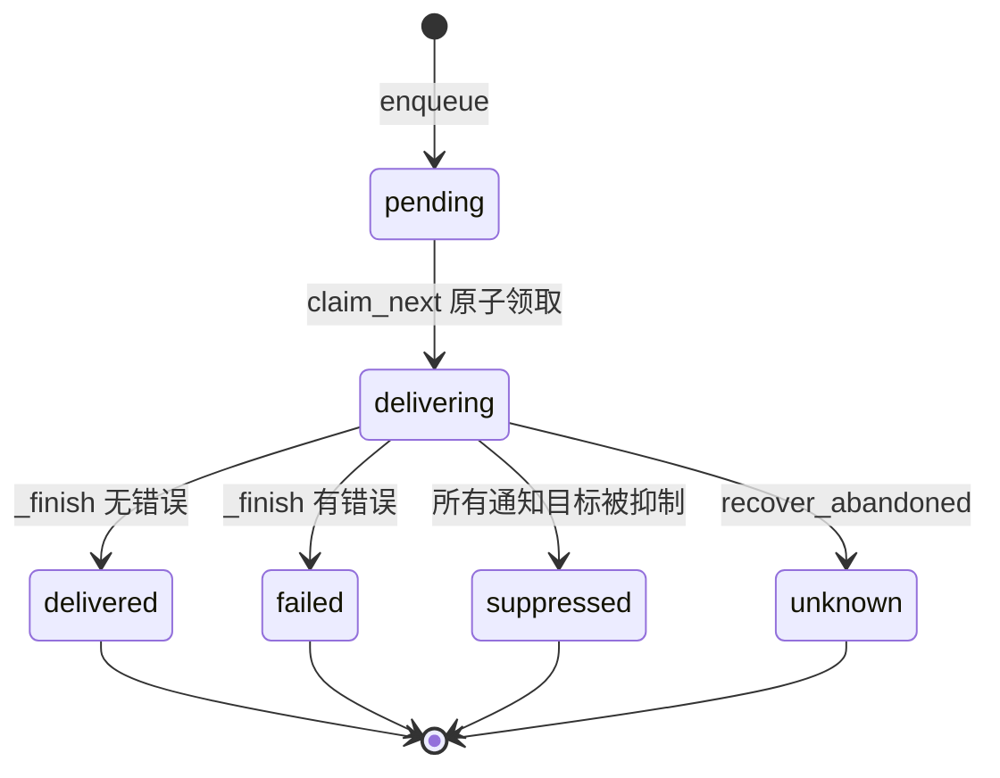
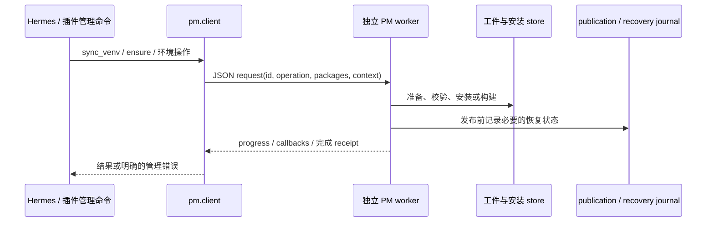

# 卷十二 · 长期运行：Cron 账本、投递不确定性与包运行时

> **核对快照**：`60d00c5633ad76f3dd8e3ecd79f77f1c6f8e6fdd`。  
> **本卷边界**：不重复卷六的消息入口，而是讲“没人盯着的时候，任务如何启动、恢复、投递，以及依赖如何安全进入运行环境”。  
> **前后关系**：[卷六的 Cron 出站](06-gateways-channels-and-hitl.md) → 本卷调度内部 → [卷五的插件生命周期](05-capabilities-extensions.md#cap-plugin-lifecycle)。

## 目录

- [1. 一个定时任务有三种不同记录](#ops-records)
- [2. tick：多进程如何避免抢同一份活](#ops-tick)
- [3. Execution：开始之前先记账](#ops-execution)
- [4. Delivery：为什么“不知道”不能当“失败重发”](#ops-delivery)
- [5. 包管理：运行进程不应该自己随手 pip](#ops-pm)
- [6. 安装与插件发布的故障窗口](#ops-publication)
- [7. 运维排障与源码证据](#ops-reference)

<a id="ops-records"></a>
## 1. 一个定时任务有三种不同记录

“每晚整理报告并发到群里”包含三个不同事实：

1. **Job**：规则是什么——什么时候跑、做什么、往哪发。
2. **Execution**：某一次尝试发生了什么——谁领了任务、谁在执行、结束没有。
3. **Delivery**：这次结果有没有送出去——还没开始发送、发送中、成功、失败或者结果不确定。


图表达职责和关联，不声明某个数据库一定有三个外键。`occurrences.py` 是计划时刻/去重判断等逻辑入口，不能从模块名推导成一个必然独立的 occurrence 表。

**结论**：执行成功，不代表消息成功；消息发送不确定，也不代表应该再执行一次任务。

<a id="ops-tick"></a>
## 2. tick：多进程如何避免抢同一份活

`cron/scheduler_tick.py:tick` / `_tick_admitted` 是主线。这个 ticker 不是单纯 `sleep(60); run_all()`：

| 阶段 | 实际问题 | 源码行为 |
|---|---|---|
| 陈旧代码让路 | checkout 更新了，旧进程还拿着旧模块 | 新鲜 Gateway 能接管时，旧 tick 让路；不是一律禁止独立桌面 tick |
| tick lock | 多个宿主同时看见到期任务 | 获取 lock 失败不派发 |
| ESTOP / drain gate | 操作者暂停、Gateway 正在收尾 | 不继续创建新工作；暂停不等于杀掉已经运行的任务 |
| housekeeping | 旧 owner、投递和 MCP 孤儿需要处理 | 即使没有到期任务，也有 idle 维护路径 |
| store health | 账本已知不可写 | 不继续假装可以 claim/advance |
| recurring advance | 重复 tick 再看到同一时间槽 | 在执行前先推进 next_run_at |
| worker pool | 到期任务不应全阻塞 ticker | 持久 pool、in-flight guard、可选 sync 等待 |



源码的 recurring advance 注释使用 at-most-once。这里要谨慎：**它描述推进时间槽、防止重复派发的局部策略，不是整个外部系统的 exactly-once 保证**。

另外，async 返回的计数是派发侧的乐观计数，不能当“这些任务最终都成功了”。实际结果应查 execution。

<a id="ops-execution"></a>
## 3. Execution：开始之前先记账

### 3.1 谁负责记录

`cron/executions.py` 有：`create_execution`、`mark_execution_handoff_pending`、`adopt_claimed_execution`、`mark_execution_running`、`touch_execution_progress`、`finish_execution`、`recover_interrupted_executions`。

`create_execution` 的契约是：**在 executor/provider dispatch 之前先持久化 claimed attempt**。否则进程在 dispatch 后崩溃，重启只能看到“到期了”，却不知道上次可能已经启动。



这是主要持久状态的阅读图；handoff pending 还带额外元数据，不要把图里的每条边当所有路径的唯一调用顺序。具体 failed/unknown 的判定需跟 recovery 方法核对。

### 3.2 PID 活着，不意味着这个 owner 仍可信

Execution 记录有 process identity、PID 和 process started time；PID 可能复用，所以不能简单 `kill(pid, 0)` 就认定还是原来的 owner。

`_owner_is_live()` 的规则还有一条重要底线：**无法证明 owner 已死亡时，不贸然改写它的状态**。读取系统进程状态失败与确定死亡不是一回事。

长期不动的 live owner 又是另一问题。`_live_owner_stale_after_seconds` 从 inactivity/script timeout 等配置推导 stale bound；inactivity 设置为无限/无效时不会凭空加一个无根据的 reclaim 超时。`_stale_age_seconds` 优先看 `progress_at`，不是单看总运行时长。

人话：健康但跑得久的任务不应该被当死；进程还在、实际上卡住的任务也不能永久占槽。

### 3.3 带注释的源码摘录

```python
# cron/executions.py:touch_execution_progress 中的 SQL（Python 外壳简化）。
# 不仅要求任务处于活动状态，还要求写入者仍是当前 owner。
conn.execute(
    """UPDATE executions SET progress_at=?
       WHERE id=? AND status IN ('claimed','running') AND process_id=? AND pid=?""",
    (now, execution_id, _PROCESS_ID, os.getpid()),
)
```

这不是一个任意调用者都能延长的“永生心跳”。rowcount 不为 1 时，调用者没有把它当自己的 execution 更新成功。

<a id="ops-delivery"></a>
## 4. Delivery：为什么“不知道”不能当“失败重发”

### 4.1 最危险的时间窗口

设想 adapter 已经把消息发给远端平台，但本机还没把 `delivered` 写入数据库，进程就退出。下一次启动时只能看见 `delivering`。

此时有两个可能：

- 远端已经收到了，本机没来得及落账。
- 远端没收到，调用途中就断了。

光凭本地状态无法分辨。自动重发有可能制造重复通知；直接写 failed 也会把“远端可能已收到”这一事实抹掉。

### 4.2 源码选择：unknown，不自动重播不确定发送

`cron/delivery_queue.py` 的主要路径：



`recover_abandoned()` 的 docstring 明确说 **never replay uncertain sends**。它检查 active deliveries 与 owner liveness，再把无法确认的发送终结为 unknown。这与“所有失败都放回 pending”有根本区别。

其他明确可重试的不可达情况有 `cron/unreachable_retry.py` 等独立政策；不能因此把 uncertain delivery 和 unreachable retry 合并成一条无条件重发规则。

### 4.3 领取为什么必须在发送之前

```python
# 摘录自 cron/delivery_queue.py:claim_next，中文注释为新增。
cur = conn.execute(
    """UPDATE deliveries SET status='delivering', owner_process_id=?,
       owner_pid=?, owner_started_at=?
       WHERE execution_id=? AND status='pending'""",
    (_PROCESS_ID, pid, started, row["execution_id"]),
)
if cur.rowcount != 1:
    # 没有赢得这一次领取，就不能替另一个 sender 发。
    return None
```

事务中的选择与条件更新负责领取；`_finish` 又要求 owner 对得上才落结果。时间排序使用 `julianday(created_at)`，不是单纯比较带不同时区偏移的 ISO 文本。

### 4.4 去掉旧记录，不能去掉幂等记忆

`enqueue()` 在 `BEGIN IMMEDIATE` 内先查 `delivery_tombstones`，再 `INSERT OR IGNORE`。投递终态的详细记录可以按保留策略裁剪，但同一 execution 已终结的事实仍由 tombstone 保存。否则清理历史以后再次 enqueue 相同 execution，就可能重新发出旧通知。

已阅读 `tests/cron/test_delivery_queue.py:test_terminal_delivery_retention_is_bounded`：裁剪后旧 execution 仍能查到 delivered，重复入队不会调用 sender。这是保留策略与幂等性之间的具体契约，不是“队列永远不删数据”。

### 4.5 与 Gateway delivery ledger 的区别

卷六讲 IM/Gateway delivery 与 ledger。本卷的 `cron/delivery_queue.py` 是 Cron 的持久投递边界。两者会协作，但不是因为名字都叫 delivery，就可以假设它们用同一个队列、同一状态表或同一重试政策。

**排障顺序**：查 execution 是否产出结果 → 查 queue 是否 pending/claimed → 查 adapter 的发送 → 查 outcome 是否落盘。不要一看到群里没消息就重新运行整个 Agent。

<a id="ops-pm"></a>
## 5. 包管理：运行进程不应该自己随手 pip

Hermes 源码的 `pm/` 是依赖/工具/运行环境管理子系统。它不只是 CLI 里对 pip 加一层输出美化。

| 部分 | 用人话解释 | 源码 |
|---|---|---|
| client | 业务侧提出安装/环境请求，处理 worker 回调 | `pm/client.py` |
| worker | 独立执行管理操作，不依赖正在运行的应用的完整依赖环境 | `pm/worker.py`、`worker_operations.py` |
| store/install | 准备工件、校验、安装、封存与恢复 | `pm/store.py`、`install.py` |
| environment/runtime | 管理 Python 环境与当前选择 | `pm/environment.py`、`environments.py`、`runtime.py` |
| publication | 发布插件选择/代码及其恢复日志 | `pm/publication.py` |
| receipt | 给这次操作留下步骤与结果凭证 | `pm/receipt.py` |



`pm/client.py:_request` 构造带 request id、operation、packages 和 repo/lockfile context 的消息，再以 `subprocess.Popen` 启动 worker；这不是本卷臆造的远程服务。

**设计解释**：依赖环境正在变化时，把更新逻辑留在依赖那个环境的进程里，容易产生“修理工具先被自己拆掉”的问题。独立 worker、安装锁和 stdlib 恢复记录减少了这种耦合；这仍不是“升级所有故障都不可能发生”的承诺。

<a id="ops-publication"></a>
## 6. 安装与插件发布的故障窗口

### 6.1 安装不是边下载边让应用使用

`pm/install.py:_install` 把准备工件、安装目标、校验和 store metadata 放在管理流程中。`_publish_entry`、`_restore_previous_entry`、`_settle_previous_entry` 等入口说明旧项/新项交替与失败恢复不是直接覆盖一个目录这么简单。

本轮讲清流程边界，没有核对每个平台的 artifact build 配方。Windows、Termux、GPU/native build 的具体故障恢复仍应沿 `_uv.py`、`termux_libs.py`、`native_build.py` 等继续阅读。

### 6.2 插件选择同时涉及配置与依赖

`PluginSelection.__init__()`：

- 将配置 home 限制在 dependency home root 内。
- 记录旧配置与配置集合快照。
- `expected_config` 存在时，以 digest 检查调用者读到的配置是否仍然有效。
- 用 round-trip YAML 修改 enabled/disabled，不无谓丢掉其他配置和注释。
- 根据拟议选择解析候选插件依赖。

`publish()` 再检查快照是否变化，**先写 `publication.json`，然后写拟议配置**。

```python
# 摘录自 pm/publication.py:PluginSelection.publish，省略 journal row 构造。
if selection_snapshot() != self.configs or read_bytes_or_none(self.path) != self.previous:
    # 用户/别的进程已经改了配置：不拿旧快照覆盖新选择。
    raise ValueError("plugin configuration changed while preparing publication; retry")
# 顺序不能反：先给崩溃恢复留下依据，再提交新配置。
durable_write_bytes(install_state_dir(project) / "publication.json", json.dumps(row).encode())
durable_write_bytes(self.path, self.proposed)
```

`StagedPlugin` 另外处理 staged code、target digest、metadata 和发布前验证。**依赖安装完成、配置发布完成、运行时注册完成是三件事**；运行中的 PluginManager 不因为文件换了就自动完成全部生命周期切换。

### 6.3 不要拿一次 receipt 代替全部健康信号

receipt 给出操作结果和步骤，帮助区分“依赖本就最新，只提交选择”与“确实重建了 venv”。它不是 Agent 启动、MCP 服务连接、模型账号可用性的总证明。

已阅读的验证线索：`tests/pm/test_worker_publication.py` 检查 worker 发布选择时保留 YAML 注释，并覆盖 staged plugin 与依赖行为。本次只阅读断言，不执行安装测试。

<a id="ops-reference"></a>
## 7. 运维排障与源码证据

| 症状 | 先查 | 不应立即做 |
|---|---|---|
| 定时任务没跑 | ESTOP/drain、tick lock、due time、store health | 改 cron 表达式掩盖领取失败 |
| PID 还在但任务不动 | progress_at、owner identity、stale bound | 强行把所有 running 改成 completed |
| 任务成功但通知没来 | delivery queue、adapter、unknown/failed/suppressed | 直接重跑整个任务 |
| 更新插件后不能导入 | PM receipt、selected env、plugin dependency publication | 在应用进程里手工 pip 到另一个解释器 |
| 插件开关被回滚或拒绝 | expected_config / selection snapshot | 去掉并发校验“让它成功” |

### 权威符号表

| 主题 | 文件与符号 |
|---|---|
| tick 主线 | `cron/scheduler_tick.py:tick` / `_tick_admitted` |
| 计划时刻 | `cron/occurrences.py:scheduled_instant` / `completed_occurrence` |
| execution 生命周期 | `cron/executions.py:create_execution` / `recover_interrupted_executions` |
| 执行活性 | `cron/executions.py:touch_execution_progress` / `_owner_is_live` |
| 原子投递 | `cron/delivery_queue.py:claim_next` / `_finish` |
| 不确定发送恢复 | `cron/delivery_queue.py:recover_abandoned` |
| 管理 worker 协议 | `pm/client.py:_request` |
| 安装项生命周期 | `pm/install.py:_install` / `_publish_entry` |
| 插件选择与代码发布 | `pm/publication.py:PluginSelection` / `StagedPlugin` |
| 管理凭证 | `pm/receipt.py:finalize` |

测试入口：`tests/cron/test_execution_ledger.py`、`tests/cron/test_delivery_queue.py`、`tests/pm/test_worker_publication.py`。测试中定义的故障窗口值得继续读；不能只看测试名就声称所有线上故障已覆盖。

### 本卷总结

Hermes 的长期运行依赖的是**时间槽、执行身份、持久状态、发送不确定性、依赖环境发布**这些机制。最重要的一条原则：**本地不知道的外部结果要保留为不知道，不能为了让状态看起来漂亮就重试一切。**
