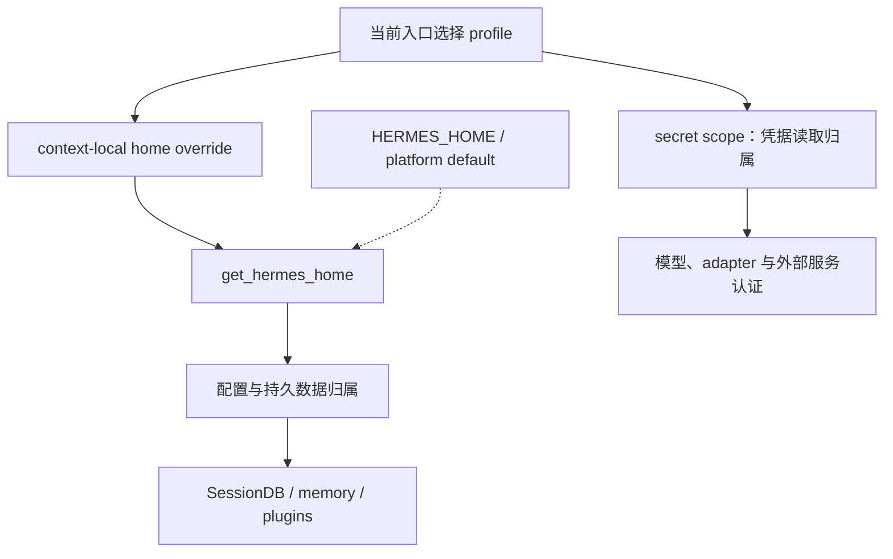
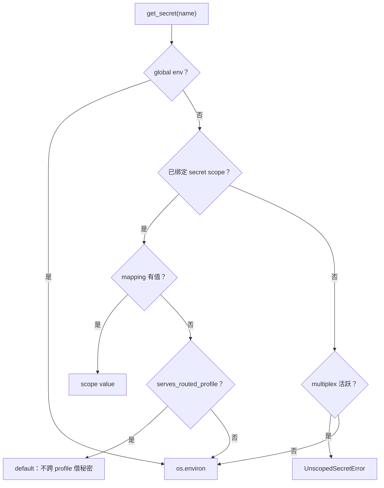
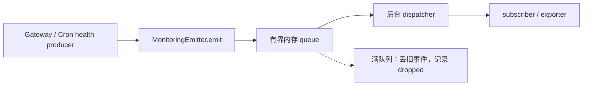

# 卷十三 · 支撑底座：Profile、配置、秘密、平台事实与观测

> **源码快照**：`60d00c5633ad76f3dd8e3ecd79f77f1c6f8e6fdd`。  
> **为什么要单列**：主循环解释的是“如何做事”；这些模块解释的是“替谁做、用谁的配置、能看到谁的秘密、失败后凭什么定位”。  
> **边界**：本卷聚焦公共控制边界，不把所有 CLI 子命令与平台探测配方都当成已逐行覆盖。

## 目录

- [1. Profile 不是会话，也不只是一个配置名字](#support-profile)
- [2. 秘密读取：单 Profile 与 multiplex 不同](#support-secrets)
- [3. 启动与平台事实为什么在循环外](#support-platform)
- [4. 日志、监控事件、会话记录是三种东西](#support-observability)
- [5. 其余能力的源码导航](#support-map)
- [6. 维护与核对方法](#support-maintenance)

## 1. Profile 不是会话，也不只是一个配置名字

一个 profile 是一块配置、秘密、插件注册和持久数据的归属空间。一个 profile 里可以有很多 session；同一进程还可能替多个 profile 工作。

`hermes_constants.py:get_hermes_home()` 的解析次序是：**当前 context-local override → `HERMES_HOME` 环境变量 → 平台默认目录**。

`set_hermes_home_override()` 用 ContextVar，而不是修改全进程共享的 `os.environ`。这是多 profile 并发的基础：否则线程 A 刚改成 A 的 home，线程 B 就可能用它写 B 的会话。

虚线表示没有 override 时的回退，不表示同时合并多个 home。

配置主要入口在 `hermes_cli/config.py:load_config` / `load_config_readonly` / `save_config`。行为选项、秘密、运行时对象不能混成一份可任意覆盖的全局配置字典：例如插件发布要保留 YAML 注释并检查配置快照，见卷十二。

**跨线程/进程注意**：ContextVar 的存在不自动保证任何第三方启动方式都能继承它。子进程需要明确传 home；工具线程、后台写入需要稳定的 owner 锚点。卷七 live transcript 从父 SessionDB 推导 home，正是这一原则的实例。

## 2. 秘密读取：单 Profile 与 multiplex 不同

`agent/secret_scope.py:get_secret()` 不只是 `os.getenv()` 的别名。

| 情况 | 行为 | 目的 |
|---|---|---|
| 属于声明的 global env | 读进程环境 | 某些全局事实不属于私有账号 |
| 已绑定 scope，scope 内有值 | 读 scope mapping | 优先使用当前 profile 的秘密 |
| 已绑定 scope，但没有值，且服务 routed profile | 返回 default | 不借另一个 profile 的进程环境凭据 |
| 已绑定 scope，没有值，单 profile 环境 | 可回退到进程环境 | 保留 systemd 等注入秘密的正常使用方式 |
| multiplex 活跃但无 scope | 抛 `UnscopedSecretError` | fail-closed，不猜“当前是谁” |

这张图为什么重要？因为“找不到密钥就回退全局”在单 profile 下很方便，在 multiplex 下却可能跨账号泄露。**错误地做成更宽松的兼容，反而是越界。**

`build_profile_secret_scope`、`set_secret_scope`、`reset_secret_scope` 是设置生命周期的入口。不要在模型编写的命令里打印全部 env 来定位这一问题；日志应只记录 scope/home 归属和是否命中，不记录真实 token。

## 3. 启动与平台事实为什么在循环外

### 3.1 Bootstrap 是启动保护，不是 Agent 工具

`hermes_bootstrap.py` 有 import path hardening、Windows UTF-8/VT 初始化、连接建立兼容、临时目录设置、更新中断后的启动处理等入口。

这些机制在“用户发来一条消息”之前就要工作。若安装环境、编码或 import path 出错，`AIAgent.run_conversation` 根本没有机会修复自己。它们也不意味着每次模型请求都会执行全部 bootstrap。

### 3.2 hermes_platform 是事实与解析，不负责顺手安装

源码分为 `host/` 的事实/运行时/产品信息，以及 `resolver/` 的命令、路径、候选解析。`resolver/core.py` 的核心数据类有 `Observation`、`Candidate`、`LookupContext`、`Resolution`。

`Resolution` 保存 candidates，`command` / `source` 投影第一个 present candidate；没有找到时留明确的 missing/空结果。**探测到什么和选择哪个执行入口**可以分开检查。

这与 `pm/` 的职责不同：发现 Node/Python/浏览器不等于有权立即安装或更新它。UI、CLI、插件需要能力时应通过既有 resolver 和 PM seam，不各自写一套 PATH 猜测与下载器。

本轮没有逐个平台实机验证，不能把“平台解析器支持某路径”升级成“所有 Windows/Termux/macOS 主机都可运行”。

## 4. 日志、监控事件、会话记录是三种东西

| 通道 | 用来回答什么 | 源码 | 能否替代事实账本 |
|---|---|---|---|
| 本地诊断日志 | 哪里失败、哪个组件在做事 | `hermes_logging.py` | 不能替代 SessionDB / execution / delivery 状态 |
| Monitoring events | 宿主和任务是否健康、观测/导出 | `agent/monitoring/` | 内存队列，不是持久事实存储 |
| 会话/任务账本 | 用户说了什么、谁领到任务、投递结果 | `hermes_state*`、`cron/executions.py` 等 | 是各自域内的持久记录，不等于完整分布式 trace |

### 4.1 本地日志如何避免干扰执行

`hermes_logging.py` 的集中 setup 使用异步 queue；日志落到 agent/errors/gateway/gui 等旋转文件，`RedactingFormatter` 负责脱敏。多进程与 Windows 的旋转锁处理有专门兼容分支。

日志脱敏是一个具体实现点，不是数学证明“任何字符串都永远不会泄露”。新增 secret carrier、URL 参数、异常信息仍需要脱敏回归测试。

### 4.2 Monitoring 的队列满了为什么丢事件，不阻塞对话

`MonitoringEmitter.emit()` 的契约是**不等磁盘/网络、不向业务调用者抛错误**；有后台 dispatcher 向 subscribers 发批次。队列有界，满时移走最旧事件，为最新事件留空间。

`get_emitter()` 创建 singleton 时初始 disabled，订阅者出现才启用 collection。这里是**采集启用与 egress 接缝**，不能把“某处调用 emit”当成自动开启所有远端 telemetry。

`agent/monitoring/policy.py:ensure_install_id` 提供可重置的 pseudonymous instance id；存不进去时可用临时 id。它不应该被误写成某个用户账号身份。远端 exporter 的具体开关与协议还要看 `otlp_exporter.py`、Gateway health export，未在本轮完整深潜。

**设计取舍（解读）**：监控优先保证业务继续运行，代价是可能丢事件；所以不能用 monitoring queue 替代要求可恢复的 delivery/execution 数据库。

## 5. 其余能力的源码导航

下面为按职责组织的导航，不把“已经列出文件”宣称成深潜完成。

| 模块族 | 主要入口 | 现有/新增说明 | 剩余深度 |
|---|---|---|---|
| CLI 配置、认证、profile、管理命令 | `hermes_cli/`、`cli.py` | 卷一、卷二、本卷、卷十二 | 每个子命令的完整校验/迁移行为 |
| 浏览器能力 | `agent/browser_provider.py`、`browser_registry.py`、`tools/browser_tool.py` | 卷五工具契约 | 各 provider 会话、CDP、下载、权限与资源清理 |
| 图片/转写/TTS 等媒体能力 | `agent/image_gen_provider.py`、`transcription_provider.py`、`tts_provider.py` | 卷二呈现、卷五 provider 接缝 | 每类媒体的上传、缓存、供应商错误处理 |
| IDE ACP | `acp_adapter/server.py`、`session.py`、`permissions.py` | 卷二第12节 | IDE 兼容矩阵、权限消息的完整协议样本 |
| Dashboard / Web | `web/src/` | 卷一与卷二入口地图 | 页面/API 的逐路由契约与状态管理 |
| Desktop / TUI | `apps/desktop/src/`、`ui-tui/src/` | 卷二详细走读 | 本轮未复核所有组件和主题状态 |
| 批处理、评测、训练导出 | `batch_runner.py`、`evals/`、`mini_swe_runner.py` | 卷三第5章、记忆附录 | dataset schema、评分器、失败聚合与成本 |
| Skill 资产 | `skills/`、`optional-skills/` | 卷四、卷五 | 每一个具体 skill 的内容与外部依赖 |
| 外部 MCP 目录 | `optional-mcps/`、`plugin-catalog/` | 卷五 MCP/Plugins | 每个服务真实运行与认证配置 |
| 构建/部署/发布 | `scripts/`、`docker/`、`nix/`、`.github/` | 卷九、本卷、PM | CI job、签名发布、镜像构建逐步骤 |

## 6. 维护与核对方法

每次修改涉及这些底座，至少问：

1. 读写的是哪个 profile 的 home？跨线程/进程身份如何传递？
2. secret scope 缺失时能否安全回退？是不是 routed profile？
3. 平台 resolver 给的是“观察结果”还是“已安装”的保证？
4. 监控丢失是否会影响业务？若会，是否应该改成持久账本？
5. 日志是不是只记录了诊断信息，还是意外把凭据/正文带出去？

### 本卷总结

支撑底座的统一主题是**归属和证据**：配置属于谁、秘密属于谁、进程属于谁、哪份状态是持久事实、哪份只是尽力而为的观测。把这一层省掉，会导致架构图看起来完整，真正定位并发与恢复问题时却无从下手。
