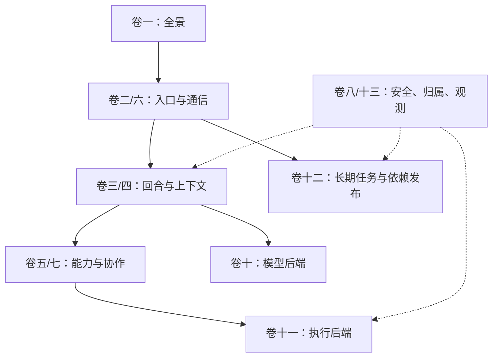

# Hermes 源码设计全书 · 阅读入口

这套文档要让你从“知道 Hermes 能干什么”，走到“能沿源码解释一条流程、定位状态和故障”。原九卷和记忆附录全部保留；本轮补入后端/运行支撑专题，并追加插件与多 Agent 的关键设计。

**依据**：本地 `hermes-dev/hermes-agent` 提交 `60d00c5633ad76f3dd8e3ecd79f77f1c6f8e6fdd`，核对时源码工作区干净。版本是可复查的本地快照，不代表已同步远端最新发布。

## 目录

- [1. 先读什么](#book-start)
- [2. 全书大纲](#book-outline)
- [3. 从问题找到模块](#book-questions)
- [4. 本轮改了什么，还缺什么](#book-change)

## 1. 先读什么

建议先读卷一建立地图，不要直接从某个工具实现开始。三条阅读路线：

- **第一次理解**：卷一 → 卷三 → 卷四 → 卷五 → 卷六；再根据使用入口读卷二。
- **后端/线上排障**：卷十 → 卷十一 → 卷十二 → 卷十三；对照卷三的回合和持久状态。
- **扩展/多 Agent**：卷五第7节 → 卷七第6节 → 卷十二 PM 发布；再回到 Prompt/cache 和安全边界。

每个新专题有目录、图、关键分支、源码权威表与总结。 [覆盖审计](SOURCE_AUDIT.md) 区分“清点过”“讲过”“读过关键实现”和“实测过”，不要求你凭字数相信它完整。

## 2. 全书大纲

| 层次 | 卷 | 你应掌握什么 |
|---|---|---|
| 整体 | [01 平台与架构](01-platform-and-architecture.md) | 产品、进程、入口、模块关系与一次请求 |
| 交互 | [02 Surface 与呈现](02-surface-and-presentation.md) | CLI/TUI/Desktop、事件、流式与 compute host/ACP |
| 内核 | [03 运行时、会话与循环](03-runtime-session-and-loop.md) | turn gates、while、工具、压缩、SessionDB、finalize |
| 上下文 | [04 Prompt 与 Context](04-prompt-and-context.md) | system/messages/tools 的拼装和 prefix 边界 |
| 能力 | [05 工具、技能、MCP、插件](05-capabilities-extensions.md) | registry、dispatch、动态能力与注册所有权 |
| 记忆 | [05 记忆参考](05-memory-system-reference.md) · [架构与进化](05-memory-architecture-and-evolution.md) | 内置/外部记忆、会话原文、检索、学习资产 |
| 通信 | [06 Gateway、Channel、HITL](06-gateways-channels-and-hitl.md) | 入站身份、忙时策略、出站、审批、Room、Cron 通知 |
| 协作 | [07 多 Agent 与 Kanban](07-multi-agent-and-kanban.md) | delegate、持久派工、插件 handle 与 MoA 的区别 |
| 治理 | [08 安全与后台治理](08-security-and-governance.md) | 扫描、授权、危险命令、后台 review |
| 参考 | [09 历史、版本与维护](09-reference-history-and-versions.md) | 版本/历史线索；不是当前行为的替代品 |
| 思考后端 | [10 模型后端与恢复](10-model-backends-and-resilience.md) | profile/transport/client/pool、fallback 与协议回放 |
| 执行后端 | [11 终端执行环境](11-terminal-execution-backends.md) | shell 状态、cwd、隔离、前后台与退出清理 |
| 长期运行 | [12 Cron 与包运行时](12-automation-and-package-runtime.md) | 时间槽、execution、delivery、unknown、worker 与发布 |
| 支撑底座 | [13 配置、秘密、观测](13-config-secrets-and-observability.md) | profile 归属、secret scope、平台事实与观测边界 |

这是阅读关系图，不是源码调用图。旧 [MANIFEST](MANIFEST.md) 的详细锚点/历史增量仍保留，新的维护规则见 [写作标准](VOLUME_STANDARD.md)。

## 3. 从问题找到模块

| 想搞懂什么 | 直接入口 |
|---|---|
| 轻量压缩会不会改内存/DB，内存消息是否直接发给模型 | [卷三 §4.7–4.10](03-runtime-session-and-loop.md#sec-4-lightweight) |
| 工作区消息对象、重启恢复、普通 flush 与压缩后的内存交接 | [卷三 §4.11–4.15](03-runtime-session-and-loop.md#sec-4-working-object) |
| 外部 Memory / 插件 context 放哪里、是否改内存、如何落库回放 | [卷三 §4.16](03-runtime-session-and-loop.md#sec-4-context-injection) |
| 模型返回错误为什么没有立刻失败 | [卷十 §5](10-model-backends-and-resilience.md#backend-recovery) |
| 账号切换与模型切换是不是同一回事 | [卷十 §4](10-model-backends-and-resilience.md#backend-credentials) |
| cd/export 到底会不会保持到下一次命令 | [卷十一 §3](11-terminal-execution-backends.md#exec-shell) |
| 容器里执行就一定安全吗 | [卷十一 §5](11-terminal-execution-backends.md#exec-security) |
| 定时任务执行了为什么没收到通知 | [卷十二 §3–4](12-automation-and-package-runtime.md#ops-execution) |
| 插件卸载如何不误删别人注册的能力 | [卷五 §7](05-capabilities-extensions.md#cap-plugin-lifecycle) |
| 子 Agent 能否跨进程重启恢复 | [卷七 §6](07-multi-agent-and-kanban.md#multi-runtime-boundaries) |
| 为什么缺少密钥时有时不能回退全局 env | [卷十三 §2](13-config-secrets-and-observability.md#support-secrets) |
| 哪些模块仍只有索引，没有完整深潜 | [覆盖审计](SOURCE_AUDIT.md) |

## 4. 本轮改了什么，还缺什么

具体清单见 [变更总结](CHANGES.md)。本轮重点补上原书薄弱的后端、运行支撑和生命周期；**尚未逐行覆盖全部 CLI 命令、所有前端页面/组件、媒体/浏览器各供应商、每个 skill 和部署配方**。

[源码清单](SOURCE_INVENTORY.json) 让后续新增文件不会在地图里隐形；[证据清单](SOURCE_EVIDENCE.json) 记录实际专题引用。它们不是“100% 行为覆盖”的成绩单。继续补文档时优先处理覆盖审计里的下一批高价值缺口，而不是继续堆总架构大图。
