# Hindsight 开源项目架构与分层记忆系统：完整源码对齐总文档

> **文档定位**：本文件是 `hindsight-architecture` 目录的唯一合并文档。它把系统边界、分层记忆、Retain / Recall / Reflect 三条管线、Consolidation、Codex/Cursor 集成、数据模型、接口、安全、运维、测试、源码地图和选型对比合并为一个可审阅、可落地的架构基线。
>
> **源码基线**：`/Users/gqli/work/deepagents/hindsight`，提交 `fb11ddfea`；整理日期：2026-10-10。本文描述源码快照和架构关系，不替代随版本演进的 OpenAPI/官方安装文档。
>
> **阅读原则**：本文中的 L1/L2/L3/L4 是业务理解模型，不等于四张物理表；表名、字段和路由以当前源码、迁移和 OpenAPI 为最终事实。章节中重复出现的“事实/证据/派生层”只在第一次给出完整定义，后续只补充该章节特有的实现细节。

## 目录

1. [系统概述与核心设计原则](#1-系统概述--核心设计原则)
2. [四层记忆分层与业务实例](#2-四层记忆分层完整定义--业务完整实例)
3. [冲突、证据强度与派生层刷新](#3-冲突场景完整推演新增矛盾事实l3-证据强度变化--l4-刷新条件)
4. [Bank-ID 命名空间与多 Session 共享](#4-bankid-命名空间隔离设计多-session-共享记忆)
5. [PostgreSQL 核心表与实体关系](#5-postgresql-核心表结构说明)
6. [Retain 写入完整链路](#6-retain-写入完整链路)
7. [Recall 多路检索与 Reflect 分层取证](#7-recall-多路检索完整管线)
8. [Fact type 去重、证据互补与预算](#8-核心疑问三种-fact-type-检索为什么不会大量重复)
9. [检索索引层、模型层与记忆层的辨析](#9-检索概念辨析检索索引层--transformer-模型层--hindsight-记忆四层)
10. [为什么需要独立外部记忆服务](#10-为什么需要独立外部记忆服务-hindsight)
11. [常见误区汇总](#11-常见误区汇总)
12. [系统边界与运行时补充](#12-系统边界与运行时补充)
13. [物理数据模型与一致性补充](#13-物理数据模型与一致性补充)
14. [REST、MCP 与 SDK 接口契约](#14-rest--mcp--sdk-接口契约)
15. [安全、租户与信任边界](#15-安全租户与信任边界)
16. [部署、运维与故障排查](#16-部署运维与故障排查)
17. [测试、评估与变更验证](#17-测试评估与变更验证)
18. [源码地图、阅读顺序与扩展入口](#18-源码地图阅读顺序与扩展入口)
19. [架构评价、修改检查表与容量边界](#19-架构评价修改检查表与容量边界)
20. [Codex、Cursor、Hook、MCP 与共享 Bank](#20-codex--cursor-集成hookmcp-与共享-bank)
21. [宿主集成设计、过滤规则与验收](#21-宿主集成设计过滤规则与验收)
22. [Acme Commerce 端到端分层记忆案例](#22-acme-commerce从原始输入到可验证回答的完整案例)
23. [设计动机：为什么不是简单向量 RAG](#23-设计动机为什么不是简单向量-rag)
24. [Memory Landscape 与相邻方案](#24-memory-landscape与-rag向量库和-agent-memory-的关系)
25. [附录：TencentDB Agent Memory 与外部后端](#25-附录tencentdb-agent-memory-对比与外部后端启示)
26. [Consolidation 与知识层：后台桥梁](#26-consolidation-与知识层三条在线管线之间的后台桥梁)

---

## 1. 系统概述 & 核心设计原则

Hindsight 是面向 AI Agent 的生产级分层长期记忆基础设施，区别普通向量数据库、RAG、Agent 内置简易记忆。

**核心设计哲学**

1. 原始证据 L1/L2：以追加和可追溯为优先；正常情况下不覆盖旧事实，但系统支持按 Document/MemoryUnit 进行删除、替换或撤回。
2. 高层认知 L3/L4：动态归纳/刷新，携带 source memory IDs、证据数量、历史或 freshness；本文中的“置信度”是案例治理分数，不是所有版本都存在的统一数据库列。
3. 读写彻底解耦
   - Retain 写入记忆：小请求可以同步完成解析和底层 memory unit 写入；大批量或显式 `async=true` 返回 operation，Observation/索引维护等派生工作可在后台完成。
   - Recall 检索记忆：不生成最终答案，也不执行 consolidation；但可能调用 embedding、BM25、graph、temporal 和 reranker provider。生成式 LLM 主要出现在 Retain 抽取、Consolidation 和 Reflect。
4. `bank_id` 作为记忆强命名空间隔离，支持多 Session、多 Agent、多 IDE 窗口共享同一套长期记忆。
5. 类人认知机制：
   - L1/L2：原始 world/experience memory units，优先保留来源和历史；
   - L3 Observation：对新增事实敏感，依据 source memory IDs、proof_count 和 freshness 重新巩固；
   - L4 Mental Model / Knowledge Page：由配置的 reflect/refresh/knowledge-base 流程维护，是否立即刷新取决于触发策略，不是单条事实自动颠覆。

## 1.1 先把“逻辑层”与“物理实体”对齐

本文使用 L1/L2/L3/L4 作为**理解模型**，不能直接等同于四张数据库表：

| 逻辑层 | 当前源码中的主要承载 | 说明 |
|---|---|---|
| L1 WorldFact | `memory_units.fact_type = 'world'` + `documents` | 用户、组织、项目和外部世界事实；来源先写入 Document |
| L2 ExperienceFact | `memory_units.fact_type = 'experience'` + `documents` | Agent 实际完成/发现的经验；不是所有 assistant 输出都应写入 |
| L3 Observation | `memory_units.fact_type = 'observation'`，通过 `source_memory_ids`/`proof_count` 等字段表达巩固关系 | PostgreSQL 中与 raw facts 共用 `memory_units` 物理表；Oracle 等后端可能使用 observation source 辅助表 |
| L4 Mental Model / Page | 独立 `mental_models` / knowledge-page / reflect 相关对象 | 通过搜索、读取和 refresh/reflect 维护；不属于标准 Recall 的 fact type |

因此，后文出现“L1/L2/L3/L4 同时存在”时，表示**业务语义层级**，不是“Recall 会对四张表各跑一遍同样的检索”。

## 2. 四层记忆分层完整定义 + 业务完整实例

示例上下文：`bank_id = project:openbackend:dev`，后端项目指标存储选型。

### L1 WorldFact 客观外部事实

- 来源：用户输入、文档、工具返回、外部系统输入
- 属性：追加优先、保留来源；不应被高层摘要覆盖，但可通过 source/document delete、replace 或 retraction 处理撤回
- 作用：原始证据底座，用于审计、溯源、核对细粒度数值细节


> L1 原始样例

- L1‑01：项目后端指标日志存储选择 ClickHouse，不使用 MySQL。
- L1‑02：团队开发人员主要使用 Python，尽量避免 Java 技术栈。
- L1‑03：ClickHouse 适合高吞吐日志写入，但不适合高频更新事务类数据。
- L1‑04：团队没有 ClickHouse 运维经验，需要配套监控告警方案。
- L1‑05：项目预算有限，不想引入过多付费云数据库。

### L2 ExperienceFact Agent 亲历经验事实

- 来源：Agent 工具调用、文档查阅、执行动作、Agent 输出记录
- 属性：追加优先、保留来源；不应被高层摘要覆盖，但可通过 source/document delete、replace 或 retraction 处理撤回
- 作用：回溯 Agent 历史行为、操作轨迹


> L2 原始样例

- L2‑01：Agent 查阅了 ClickHouse 官方部署文档，推荐单节点起步。
- L2‑02：Agent 提醒团队需要预留 2 人学习 ClickHouse 运维。

### L3 Observation 观察结论层

- 来源：Consolidation Worker 异步聚合多条 L1+L2 生成
- 属性：可更新迭代；携带 `source_memory_ids` / `source_fact_ids` 证据 ID 列表；可用 `proof_count`、证据时间和 trend 表达支撑强度；底层 L1/L2 保持不变。
- 作用：把零散多条事实压缩为归纳结论；处理事实冲突；支持溯源下钻原始证据。


> L3‑01 V1（冲突前）

```
observation_text：
openbackend项目指标存储选型：选定ClickHouse替代MySQL。
约束：团队熟悉Python、规避Java；团队缺少ClickHouse运维经验，项目预算有限。
ClickHouse适合高吞吐日志写入，但不适合事务型业务。

confidence：0.91
source_memory_ids： [L1‑01, L1‑02, L1‑03, L1‑04, L1‑05, L2‑01, L2‑02]
```

### L4 Mental Model 心智模型（知识页）

- 来源：独立的 mental-model/knowledge-page 配置、Reflect 结果或 refresh 流程；可引用 Observation 和 raw memories。
- 属性：高度压缩、token 少；携带来源、更新时间、scope/tags；是否刷新由触发策略决定。
- 作用：供 Reflect 的 `search_mental_models` / `read_mental_models` 使用，或作为宿主 session 的策展上下文；标准 Recall 不把它当作 `world/experience/observation` fact type。


> MM‑01 V1（冲突前）

```
title：openbackend项目核心技术约束
content：
openbackend后端项目：
1. 指标存储路线：长期目标采用ClickHouse。
2. 团队技术基线：优先Python，尽量规避Java；无ClickHouse运维经验，项目预算有限。
3. 选型边界：ClickHouse适合高吞吐日志写入，不适合事务业务。

confidence：0.84
source_observation_ids（本文示例中的逻辑引用）：[L3‑01]
```

> **字段口径说明**：下面示例中的 `confidence` 是为了演示冲突治理的业务评分。当前源码对 Observation 更直接的证据字段是 `proof_count`、`source_memory_ids`、证据 quote、时间跨度和 trend；不要把本例的 0.91/0.84 直接当作 Hindsight API 的固定字段。

**四层体量直观对比**

表格

| 层级 | 本例 token 量级 | 溯源指向 | 是否可更新 |
| --- | --- | --- | --- |
| L1+L2 原始事实 | ~320 | Document/Chunk/metadata | ✅追加优先，可撤回 |
| L3 Observation | ~160 | source_memory_ids → L1/L2 | ✅可更新 |
| L4 Mental Model | ~80 | Observation/Memory source → L3/L1/L2 | ✅按 refresh 策略更新 |


> 重要：L4 不是替代 L3，L3 不是替代 L1/L2；四层共存；摘要有疑问时可顺着 ID 下钻原始证据。

## 3. 冲突场景完整推演：新增矛盾事实，L3 证据强度变化 & L4 刷新条件

### 3.1 基线状态

- L1‑01 ~ L1‑05，L2‑01~L2‑02 已存在。
- L3‑01 V1 confidence=0.91
- L4 MM‑01 V1 有效。

### 3.2 阶段 1：新增矛盾事实

用户对话：经过运维评估，我们放弃 ClickHouse，最终决定全线使用 MySQL 8.0 承载日志，不再迁移 CH。
`retain()`执行，新增 L1 事实：


> L1‑06：项目最终决策：放弃 ClickHouse，全线使用 MySQL8.0 承载指标日志。

规则：旧 L1‑01**不会删除、不会覆盖**；底层同时存在两套矛盾客观记录。

### 3.3 阶段 2：Consolidation Worker 运行，L3 更新 V2

```
Observation V2
内容：
项目早期计划使用 ClickHouse 存储日志；
最新决策推翻原有方案，项目最终全线使用 MySQL8.0 承载指标日志。
团队技术栈偏好 Python，无 ClickHouse 运维经验，预算有限。

confidence：0.68
source_memory_ids：[L1‑01, L1‑02, L1‑03, L1‑04, L1‑05, L1‑06, L2‑01, L2‑02]
```

- 本例的业务“证据强度”由 0.91 下降至 0.68：底层事实发生冲突，结论暂时不稳定。真实系统更直接观察 `proof_count`、source IDs、时间和 trend；这个数值不是内置统一算法。
- ✅如果产品治理策略要求“单次冲突不刷新页面”，此时可以让 L4 保持 V1；这不是 Hindsight 核心代码对所有 Bank 的硬编码保证。


> L4 刷新触发条件（至少满足其一）

1. 同主题连续多条冲突事实，新证据数量显著压倒旧证据；
2. L3 新版本稳定保持一段时间；
3. 新旧证据比例明显反转。


> 单条矛盾不足以修改 L4，避免单次噪声污染 Agent 长期世界观。

### 3.4 阶段 3：继续追加两条佐证新事实

- L1‑07：运维团队已完成 MySQL 日志方案压测，性能满足日志吞吐需求。
- L1‑08：团队决定停止学习 ClickHouse，全部精力投入 MySQL 调优。

### 3.5 阶段 4：L3 迭代 V3，证据强度回升

```
Observation V3
内容：
项目初期规划采用 ClickHouse 存储日志，
经过评估后方案完全反转：
最终稳定技术方案为 MySQL8.0 承载全部指标日志。
已完成压测验证性能达标，团队放弃 ClickHouse 学习路线。
团队偏好 Python、预算有限、无 CH 运维经验。

confidence：0.89
source_memory_ids：[L1‑01, L1‑02, L1‑03, L1‑04, L1‑05, L1‑06, L1‑07, L1‑08, L2‑01, L2‑02]
```

### 3.6 阶段 5：满足阈值，L4 刷新生成 V2

```
MentalModel V2
title：openbackend项目核心技术约束
content：
项目指标存储最终稳定方案：
项目早期曾规划使用 ClickHouse，现已完全推翻。
当前标准技术栈：MySQL8.0 承载所有日志指标，性能验证通过。
团队 Python 技术栈、预算有限、无 CH 运维经验是本次选型变更的主要原因。

confidence：0.86
source_observation_ids（本文示例中的逻辑引用）：[L3‑01‑V3]
```

### 冲突机制总结

1. L1/L2：新旧事实以 source/document 为边界保留；若需要删除或撤回，应通过删除/替换操作处理，不靠覆盖文本。
2. L3：Observation consolidation 会依据新增 source memories、proof_count、时间和现有 observation 重新巩固；不要把“单条矛盾必然更新”写成固定算法。
3. L4：Mental Model/Page 是否刷新由其 query、scope、schedule、watermark 和 refresh 策略决定；本例的“连续佐证后刷新”是推荐治理策略。

## 4. Bank‑ID 命名空间隔离设计（多 Session 共享记忆）

1. `bank_id` 是记忆逻辑空间和查询边界；它不是完整 auth/tenant 替代品。
2. `documents`、`memory_units`、`entities`、`banks`、`mental_models`、`directives` 等主对象按 Bank 隔离；`unit_entities`、`memory_links` 等关联对象通过所属 memory/entity 关联到 Bank。
3. Session 不控制记忆，**bank_id 控制记忆**：
   - 不同 Session、进程、Agent 使用同一个 bank_id → 可能读写同一套项目记忆；
   - 使用不同 bank_id → 默认隔离；
   - 仍必须叠加 tenant、认证、tag scope 和宿主的用户/仓库授权。


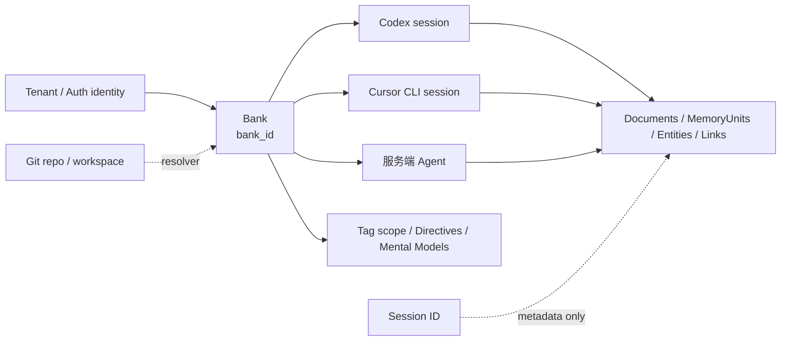

> 粒度选型

- ❌错误：直接使用`session_id`作为 bank_id：每个会话独立记忆，无法跨会话持久。
- ✅正确：使用`user_id` / `project_id` / `team_id`作为 bank_id，实现跨会话长期记忆。

## 5. PostgreSQL 核心表结构说明

不要把逻辑层直接写成 `facts`、`observations` 三张表。当前 PostgreSQL 主路径的关键物理对象更接近下面的关系：

```mermaid
erDiagram
  BANK ||--o{ DOCUMENT : owns
  BANK ||--o{ MEMORY_UNIT : scopes
  DOCUMENT ||--o{ MEMORY_UNIT : produces
  MEMORY_UNIT }o--o{ ENTITY : mentions
  MEMORY_UNIT ||--o{ MEMORY_LINK : from
  MEMORY_UNIT ||--o{ MEMORY_LINK : to
  MEMORY_UNIT ||--o{ MEMORY_UNIT : source_memory_ids
  BANK ||--o{ MENTAL_MODEL : configures
  MENTAL_MODEL ||--o| KNOWLEDGE_PAGE : rendered_as
  KNOWLEDGE_PAGE ||--o{ KNOWLEDGE_PAGE : contains
  BANK ||--o{ DIRECTIVE : constrains
  BANK ||--o{ ASYNC_OPERATION : schedules

  BANK {
    text bank_id PK
    jsonb disposition
    text mission
  }
  DOCUMENT {
    text id PK
    text bank_id PK
    text original_text
    text content_hash
  }
  MEMORY_UNIT {
    uuid id PK
    text bank_id
    text document_id FK
    text text
    text fact_type
    timestamptz occurred_start
    timestamptz occurred_end
    timestamptz mentioned_at
    uuid_array source_memory_ids
    int proof_count
    jsonb metadata
    vector embedding
  }
  ENTITY {
    uuid id PK
    text bank_id
    text canonical_name
  }
  MEMORY_LINK {
    uuid from_unit_id FK
    uuid to_unit_id FK
    text link_type
    uuid entity_id FK
    float weight
  }
  MENTAL_MODEL {
    text id PK
    text bank_id PK
    text subtype
    text name
    text description
    jsonb observations
    text[] tags
  }
  KNOWLEDGE_PAGE {
    text id PK
    text bank_id
    text parent_id FK
    text kind
    text name
    text mental_model_id FK
    int sort_order
  }
```

### 5.1 Entity Resolution 与 Graph 维护流程

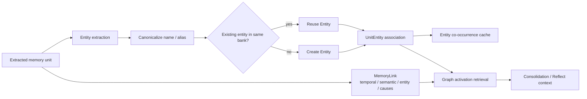

实体和链接是检索索引，不是脱离 MemoryUnit 的第二套事实库。`memory_links` 的两端仍然是 memory unit，实体关系必须能够回到具体的 source memory；同一个实体名称在不同 Bank 也不能直接合并。

| 物理对象 | 作用 | 与逻辑层的关系 |
|---|---|---|
| `banks` | Bank 元数据、mission、disposition | 命名空间和 Reflect 行为配置 |
| `documents` | Retain 原始输入及 hash | L1/L2/L3 的来源容器 |
| `memory_units` | sentence-level memory；`fact_type` 可为 `world`、`experience`、`observation` | L1/L2/L3 主要共用的物理表 |
| `entities` / `unit_entities` | 实体归一化与 memory 关联 | 图检索的节点/关联边 |
| `entity_cooccurrences` | 实体共现缓存 | 图扩展辅助索引 |
| `memory_links` | memory unit 之间的 temporal/semantic/entity/causal link | 关系检索和 consolidation 上下文 |
| `mental_models` | L4 mental model 的内容、subtype、observations、tags、更新时间 | Reflect 的 search/read/refresh 对象；不等于 Recall 的 observation fact |
| `knowledge_pages` | folder/page 树、parent、sort_order、managed、mental_model_id | 面向 Agent/用户的知识库组织层，可指向 mental model |
| `directives` | Reflect 的硬规则/行为约束 | 规则层，不应伪装成事实 |
| `async_operations` / Worker backend | 异步 retain、consolidation、refresh、webhook 等 | 后台任务状态，不要假设固定名为 `consolidation_jobs` |

不同后端和迁移版本可能在 observation source、history、mental model/page 的物理实现上有差异；阅读源码时优先以当前 migration、`models.py` 和 API response model 为准。

## 6. Retain 写入完整链路

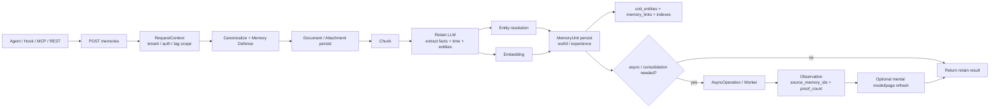

### 6.1 Retain 的时序和同步/异步边界

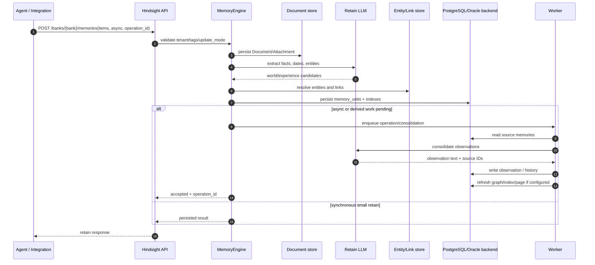

`retain` 成功只表示请求或本次写入阶段成功；它不自动等价于 Observation、Mental Model、所有 graph/index 都已完成。删除 Document 时，因 `memory_units` 对 Document 有级联关系，仍需额外处理 observation source、links、history 和 page freshness。

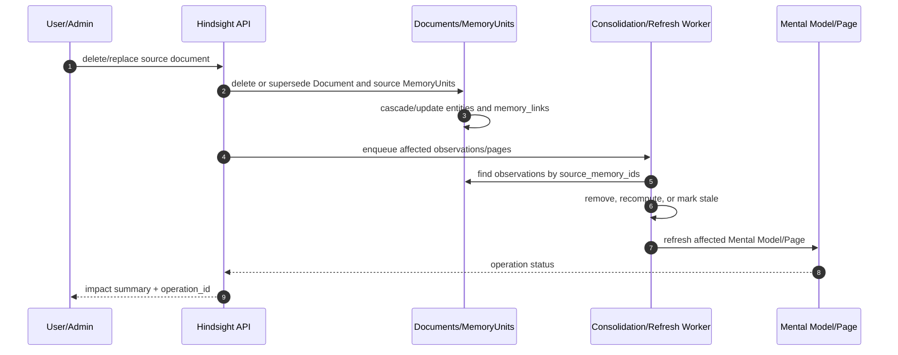

## 7. Recall 多路检索完整管线

### 7.1 Recall 检索管线总图

Recall 的 `fact_type` 是 `world`、`experience`、`observation`；Mental Model/Page 由 Reflect 的专用工具读取，不应画成标准 Recall 的第四张 fact 表。

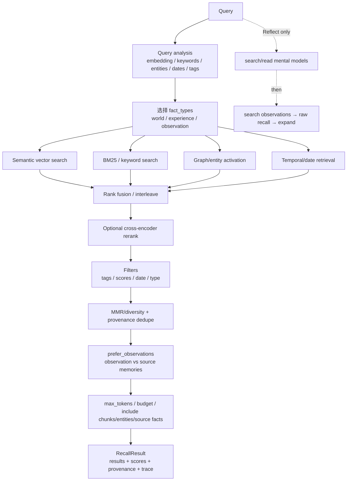

### 7.2 Hermes + Hindsight 端到端交互时序图

Hermes 只是一个宿主示例；下面的 `recall`、`retain`、`reflect` 由宿主决定何时调用。

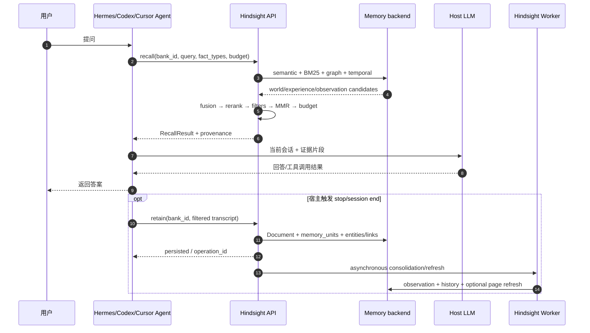

### 7.3 记忆粒度与可变性图

```mermaid
quadrant
    title 记忆粒度与可变性（逻辑模型）
    x-axis 细粒度证据 --> 高层策展
    y-axis 追加优先 --> 持续刷新
    quadrant-1 L1/L2
    quadrant-2 L3 Observation
    quadrant-3 source Document/Chunk
    quadrant-4 L4 Mental Model/Page
```

该图表达的是治理取向，不代表数据库禁止删除。source/document 仍可能因隐私、纠错或用户请求被删除；删除后必须让派生层失效或重算。

### 7.4 四路检索算子说明

对每个请求的 `fact_type`（world/experience/observation）执行四类候选检索：

1. **语义检索**：query embedding 与 memory unit embedding 的向量检索。
2. **BM25/关键词检索**：专有名词、技术术语、错误码、短语和精确 token。
3. **图/实体检索**：基于 entity、memory link、图激活和多跳关系。
4. **时间检索**：使用 occurred/mentioned/event 时间和 question date/temporal window。

随后进行 rank fusion（RRF 或 interleave）、可选 reranker、过滤、MMR/diversity、`prefer_observations` provenance 去重和 token budget。Mental Model 的检索是 Reflect 工具链中的 `search_mental_models` / `read_mental_models`，不是 Recall 的第四种 fact type。

### 7.5 Recall Python 伪代码

```python
query_embedding = embed(query)
keywords = analyze_keywords(query)
entities = analyze_entities(query)
time_constraint = parse_temporal_window(query)

fact_types = ["world", "experience", "observation"]
candidates = []
for fact_type in fact_types:
    arms = [
        semantic_search("memory_units", query_embedding, fact_type=fact_type),
        bm25_search("memory_units", keywords, fact_type=fact_type),
        graph_search("memory_units", entities, fact_type=fact_type),
        temporal_search("memory_units", time_constraint, fact_type=fact_type),
    ]
    candidates.extend(rank_fusion(arms))

r = rerank(query, candidates, mode="cross_encoder")
r = apply_filters(r, tags=tags, min_scores=min_scores, temporal_window=time_constraint)
r = diversify_with_mmr(r)
if prefer_observations:
    r = drop_raw_memories_already_explained_by_returned_observations(r)
final_result = trim_by_token_budget(
    r, max_tokens=4096, include_chunks=include_chunks, include_source_facts=include_source_facts
)
```

### 7.6 Reflect 分层检索与回答时序

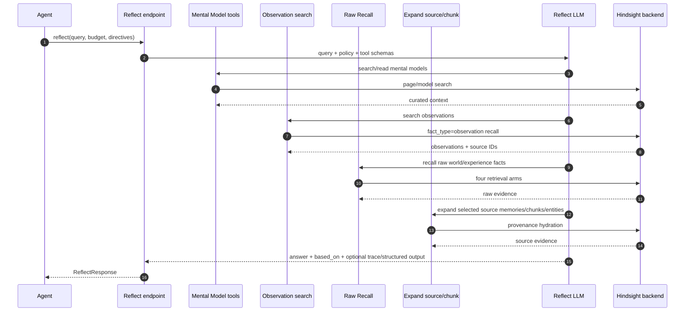

## 8. 核心疑问：三种 fact type 检索为什么不会大量重复

标准 Recall 不是把 L1、L2、L3、L4 四张表各自检索一遍，而是对 `memory_units` 中请求的三类 fact type 做四路候选检索：

1. **候选阶段允许重叠**：同一概念可能同时出现在 raw world/experience 和 observation 中，重叠有助于避免只依赖摘要而丢失证据。
2. **融合阶段统一排序**：semantic、BM25、graph、temporal 的结果先做 rank fusion，再做可选 cross-encoder rerank。
3. **去重不是简单按文本相似度删除**：
   - `prefer_observations` 可以根据 `source_memory_ids` 删除已被返回 Observation 覆盖的 raw memories；
   - MMR/diversity 避免同质结果占满预算；
   - 如果原始事实提供更新过程、时间或精确数值，可能与 Observation 同时保留。
4. **预算阶段最后裁剪**：`max_tokens`、chunks、entities、source facts 是响应预算，不代表底层事实被删除。

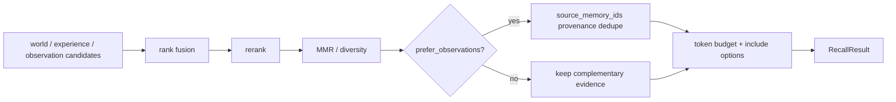

`exclude_recent_minutes` 如果由 Hermes/Codex/Cursor integration 提供，是宿主侧会话去重策略，不应写成 Hindsight Recall 的通用核心字段。

## 9. 检索概念辨析：检索索引层 / Transformer 模型层 / Hindsight 记忆四层

三个 “层” 是完全独立概念，不可混淆：

表格

| 概念 | 归属 | 说明 |
| --- | --- | --- |
| Hindsight 记忆四层 L1‑L4 | 业务记忆分层 | 逻辑语义层；L1/L2/L3 主要映射到 `memory_units` 的 fact_type，L4 是 mental model/page 对象 |
| Transformer 模型 Layer‑N | 大模型内部 | LLM 的 transformer 网络层，输出 embedding 向量；输出向量喂给检索组件 |
| HNSW 内部多层图结构 | ANN 检索索引内部 | HNSW 算法内部跳点图，用于加速 ANN 搜索，属于索引数据结构，和业务记忆无关 |


> 关键点：检索算法（HNSW、IVF‑PQ 等）只接收向量，**不感知向量来自 LLM 哪一层，也不感知 Hindsight 的 L1/L2/L3/L4 记忆层**。
> HNSW/IVF‑PQ 等 ANN 算法选型只取决于向量库规模、内存、延迟、召回指标，不绑定记忆层。

常见 ANN 检索算法简单对比：

表格

| 算法 | 特点 | 适用规模 |
| --- | --- | --- |
| Brute‑force 暴力 KNN | 全量计算，100% 召回，慢 | 小数据集 |
| IVF | 聚类分桶，速度快，召回可调 | 千万级 |
| HNSW | 图索引，速度快，召回优秀，内存占用高 | 百万‑千万级（最常用） |
| IVF‑PQ / HNSW‑PQ | 向量量化压缩，节省内存，轻微损失召回 | 千万‑亿级，内存紧张场景 |

## 10. 为什么需要独立外部记忆服务（Hindsight）

普通 Agent 内置记忆的痛点：

1. 记忆绑定进程，进程重启丢失记忆；多 Agent 实例之间记忆不同步。
2. 摘要直接覆盖旧内容，没有原始证据、没有溯源审计。
3. 归纳逻辑容易跑在主请求链路，阻塞对话，增加延迟与 LLM 消耗。
4. 没有来源分层、证据强度、冲突处理和派生知识治理。
5. 很难实现多 Session、多 Agent 共享同一套统一世界观。

Hindsight 核心价值：

1. 记忆与 Agent 进程完全解耦，进程销毁记忆持久保存。
2. 读写分离架构，写侧异步后台归纳，读侧高性能检索。
3. 可追溯证据体系，所有高层结论均可下钻原始事实做审计复盘。
4. 类人认知：敏感 L3 观察层 + 保守 L4 心智层，处理事实冲突。
5. 统一多路检索基建，Agent 不需要重复开发检索、图检索、RRF、rerank 逻辑。
6. bank_id 提供逻辑记忆隔离，支持跨会话、跨 Agent 共享记忆；真实多租户安全仍依赖 tenant、认证授权和 tag scope。

## 11. 常见误区汇总

1. ❌误区：L4 心智模型可以完全替代 L3、L1/L2
   ✅：L4 是压缩摘要，会丢失细节，需要下层做证据溯源。
2. ❌误区：L1/L2/L3/L4 四层都由 Recall 逐层检索，每层使用不同检索算法
   ✅：Recall 主要对 memory_units 的 world/experience/observation 三类 fact type 复用四路检索；Mental Model/Page 由 Reflect 的专用工具搜索和读取。
3. ❌误区：Recall 接口内部会调用生成式 LLM 做归纳
   ✅：Recall 不生成归纳答案；它可能调用 embedding/reranker provider。生成式 LLM 主要在 Retain 抽取、Consolidation 和 Reflect 中使用。
4. ❌误区：出现矛盾事实，旧 L1 记录会被覆盖删除
   ✅：L1/L2 追加优先且保留 provenance；冲突由 Observation consolidation 处理，必要时可通过删除/替换/retraction 修正来源。
5. ❌误区：HNSW 多层图 = Hindsight 记忆 L1‑L4 分层
   ✅：两套完全无关概念。
6. ❌误区：使用 session_id 做 bank_id 可以实现跨会话记忆
   ✅：session_id 会导致每次会话隔离，无法跨会话记忆，应使用 project/user 作为 bank_id。


> 渲染清单：文档内含 4 个 Mermaid 代码块，粘贴进飞书文档后，逐个选中代码块，执行「转换为流程图」：

>
> 1. Retain 写入 + Consolidation 后台流程图
> 2. Recall 检索管线总图
> 3. Hermes+Hindsight 时序图
> 4. 记忆粒度象限图


---

## 12. 系统边界与运行时补充

### 1. 定位与边界

#### 1.1 Hindsight 解决什么问题

Hindsight 的目标不是保存完整聊天记录，而是让 Agent 能在多次交互后**学习、检索、修正和使用长期知识**。一个输入可能同时产生：

- 原始 document/chunk，用于溯源；
- 原子事实，用于精确检索；
- 实体和实体关联，用于多跳查询；
- 向量和全文搜索字段，用于不同查询形态；
- 后台 observation，用于低成本复用；
- mental model 或 knowledge page，用于可策展知识。

它把记忆当作一个独立服务层，而不是把一段 summary 直接塞回宿主 Agent 的 prompt。

#### 1.2 Hindsight 不负责什么

| 不负责 | 由谁负责 |
|---|---|
| Agent 主循环、工具执行、任务计划 | 宿主 Agent / 框架 |
| 业务数据的最终权威性 | 业务系统和调用方 |
| 让所有事实天然正确 | 输入策略、抽取模型、来源、人工治理 |
| 跨所有 Bank 的默认全局查询 | 调用方编排或显式配置 |
| 为任意数据库自动提供高可用 | 部署者的 PostgreSQL/Oracle、备份和基础设施 |
| 解决所有 prompt injection | Memory Defense + 宿主安全策略 + 工具权限 |

#### 1.3 与三类相邻方案的区别

| 方案 | 保存粒度 | 取回方式 | 是否有派生知识 | 典型缺点 |
|---|---|---|---|---|
| 聊天历史 | message | 最近窗口 | summary | 长期、跨会话和多跳能力弱 |
| 传统 RAG | document chunk | 向量 top-k | 通常没有 | 专名、时间和关系查询容易漏召回 |
| 知识图谱 | entity/triple | graph query | 依 pipeline | 文本上下文和自然语言综合成本高 |
| Hindsight | source + fact + entity + observation | semantic + keyword + graph + temporal + rerank | consolidation、mental model | 存储、LLM 和维护复杂度更高 |

Hindsight 并不是完全替代前三者：它内部仍使用文档、向量和图，而是将这些策略组合为一个面向 Agent 记忆的产品抽象。

---
### 3. 整体运行时架构

#### 3.1 组件图

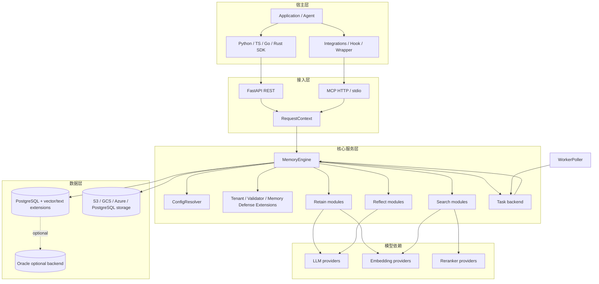

#### 3.2 同步请求和后台任务的分工

同步路径只应承担调用者需要立即知道的部分：输入校验、权限、必要的抽取/检索/回答和最小持久化。consolidation、图维护、向量维护、mental model refresh、导入导出和 webhook 由 operation + Worker 完成。

这带来一个关键语义：**retain 成功不代表所有派生索引已经完成**。调用方需要关注返回的 operation、freshness 和失败状态。

#### 3.3 API 入口

核心 REST 资源包括：

- `/banks`：Bank 创建、更新、删除、alias、profile、config、stats；
- `/banks/{bank_id}/memories`：retain、list、get、update、delete、dry-run extraction、recall；
- `/banks/{bank_id}/reflect`：反思回答；
- `/documents`、`/chunks`、`/attachments`：来源与文件；
- `/entities`、`/graph`：实体和图；
- `/observations`、`/mental-models`、`/knowledge-base`、`/directives`：高层知识；
- `/operations`：异步状态、cancel、retry、delete；
- `/transfer`、`/export`、`/import`、`/webhooks`、`/audit-logs`：运维和治理。

完整路由实现位于 `hindsight-api-slim/hindsight_api/api/http.py`，不应把这份源码路由表当作永远不变的稳定 API 清单；客户端契约以 OpenAPI 和官方文档为准。

---

---

## 13. 物理数据模型与一致性补充

> 目标：解释“数据存在哪里、为什么拆成这些表、一个事实如何从输入走到回答”。表名来自 `hindsight-api-slim/hindsight_api/models.py`、Alembic 初始迁移和后续迁移；最新版本持续演进，以下以架构关系为主，不把每个迁移字段硬编码成 API 契约。

### 1. 逻辑实体关系

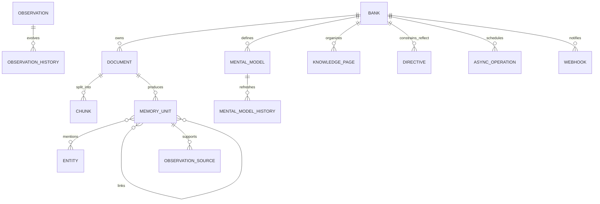

### 1.1 从输入到回答的层级链

```text
Raw input
  → Document / Chunk / Attachment
  → MemoryUnit Fact（world / experience）
  → Entity / Link
  → Observation（consolidation 派生）
  → Mental Model（按主题/查询策展）
  → Knowledge Page（面向 Agent 的压缩入口）
  → Recall evidence
  → Reflect answer
```

| 层 | 谁生成 | 是否事实 | 是否可直接注入 prompt | 是否必须可回溯 | 主要用途 |
|---|---|---:|---:|---:|---|
| Document | API/client | 原始证据容器 | 通常否 | 是 | 保留原文和删除边界 |
| Chunk | chunker | 原始证据分片 | 通常否 | 是 | 抽取、embedding、精确定位 |
| Fact / MemoryUnit | retain LLM + persist | 是 | 可以 | 是 | 精确检索和引用 |
| Entity / Link | resolver/graph | 关系索引 | 通常否 | 是，回到 facts | 多跳关系和图扩展 |
| Observation | consolidation | 派生知识 | 可以 | 是 | 跨事实巩固、降低读取成本 |
| Mental Model | refresh/reflect | 推理模型 | 可以 | 是 | 按主题组织规则和推理框架 |
| Knowledge Page | knowledge-base/策展 | 压缩展示层 | 可以 | 是 | session start/Agent 可读上下文 |

**关键约束**：高层对象不是低层对象的替代品。删除 Document、纠正事实或发现时间冲突时，必须能沿 `source_fact_ids`、observation source、history 和 page refresh 关系向上影响派生层。完整贯穿案例见本文第 22 章。

### 2. 核心对象

#### 2.1 Bank

`banks` 是逻辑上的记忆空间。它包含名称、背景/mission、disposition 和更新时间等 Bank 级元数据。Bank 级配置由 `config_resolver.py` 解析，最终与全局环境配置、租户配置合并。

**不要把 Bank 等同于用户**：可以按用户、Agent、项目、团队、工作区或业务租户建模；关键是一个 Bank 内的事实应共享信任和检索边界。

#### 2.2 Document / Chunk / Attachment

- `documents`：retain 的原始输入及其稳定文档 ID、hash、时间。
- `chunks`：长文本被切分后交给 LLM 抽取和 embedding 的单元；保留 chunk index、内容、hash 等溯源信息。
- `file_storage` / `document_attachments` / `attachments`：文件或图片等多模态内容的存储与关联。附件可以被抽取事实引用，但不应把二进制内容直接塞进 `memory_units`。

Document 是证据源；MemoryUnit 是从证据源抽取出的可检索语义单元。删除 Document 会影响其下游记忆和附件的可见性，具体级联以迁移与操作实现为准。

#### 2.3 MemoryUnit

`memory_units` 是 Hindsight 的事实主表。典型字段包括：

| 字段 | 作用 |
|---|---|
| `id` | 事实 ID，回答引用和后续维护的稳定标识 |
| `bank_id` | Bank 隔离键 |
| `document_id` / `chunk_id` | 原始证据位置 |
| `text` | 规范化后的事实文本 |
| `context` | 说话人、场景等抽取上下文 |
| `event_date` | 事件或事实的时间锚点 |
| `occurred_start/end` | 事件区间，支持时间查询 |
| `mentioned_at` | 被提及的时间 |
| `fact_type` | `world`、`experience`、`opinion`、`observation` 等 |
| `metadata` / `tags` | 业务过滤和扩展元数据 |
| `embedding` | 语义检索向量 |
| `search_vector` | 关键词/全文检索结构 |
| `proof_count`、状态/巩固字段 | 证据强度、后台处理状态 |

**类型语义**：

- `world`：关于用户、组织、外部世界的事实。
- `experience`：Bank 所代表的 Agent 自己做过或经历过的事情。
- `opinion`：带置信度的判断/观点，不应被当作无条件客观事实。
- `observation`：由多条事实巩固得到的较高层知识，带来源和历史。

类型由抽取上下文和 Bank 语义确定，不应简单依据文本里是否出现“我”。

#### 2.4 Entity / UnitEntity / Cooccurrence

- `entities`：Bank 范围内规范化的实体（人、组织、地点、产品等），维护 canonical name、首次/最近出现时间和 mention count。
- `unit_entities`：事实与实体的多对多关系。
- `entity_cooccurrences`：实体在事实中共同出现的统计，用于图和实体导航。

实体解析解决“同名、别名、大小写、轻微变体”问题。实体图不是独立真相库：其边最终仍需回到事实或事实间的 link 才能解释。

#### 2.5 MemoryLink

`memory_links` 表示事实间的有向关系，含 `from_unit_id`、`to_unit_id`、`link_type`、可选 entity 和 weight。它用于：

- 图检索的邻接扩展；
- 通过时间/实体/语义关联补全多跳问题；
- consolidation 和 curation 的上下文扩展；
- 维护事实之间的可追溯关系。

链接创建和图维护是写入后的重要阶段；图故障不应静默伪装成“没有记忆”。

### 3. 高层知识对象

#### 3.1 Observations

Observation 是对事实集合的巩固结果，仍以 memory unit 的一种 fact type 或配套历史/来源结构体现。巩固过程会尝试合并、修正、反驳、细化旧 observation；`observation_sources` 记录其依据，`observation_history` 保留演化轨迹。

Observation 的关键性质：

- 不是对每条消息做一次摘要，而是跨事实的可复用知识；
- 可能过期或被新事实推翻，因此有 freshness、source 和历史；
- reflect 优先使用，但原始事实仍是最终可回溯证据；
- consolidation 失败应保留原始 facts，不应以失败结果覆盖现有 observation。

#### 3.2 Mental Models

Mental Model 是由用户或系统配置的“知识页/模型”。它通常有一个查询或触发条件，refresh 时重新调用 reflect，从 Bank 的事实/observations 生成结构化或自然语言内容。相关表包括 `mental_models`、`mental_model_history`、版本/刷新状态字段。

与 observation 的差异：

| | Observation | Mental Model |
|---|---|---|
| 产生方式 | 后台按事实巩固 | 配置的页面/查询按需刷新 |
| 作用 | 低成本的中间知识层 | 用户可策展的主题知识层 |
| 更新粒度 | 随新事实 consolidation | 按触发器、手动或异步 refresh |
| 来源 | 多条事实及 observation | 配置 query + 检索/reflect 结果 |

#### 3.3 Knowledge Base

Knowledge Base 是文件夹、页面和节点组成的可组织树，适合把 mental models/反思结果按主题策展。它不是另一个底层事实库；页面内容仍应通过 source IDs、query、history 与 Bank 记忆关联。

#### 3.4 Directives

Directives 是 reflect 的行为约束或工作规则，可是 Bank 级或 tag scope。它们改变回答如何解释证据、遵循何种策略，而不是把规则伪装成事实。Directives 的可见性和可写性也必须经过 tag scope 检查。

### 4. AsyncOperation 与 Webhook

`async_operations` 持久化后台任务的生命周期：pending、processing、completed、failed、cancelled 等状态，含 retry count、progress、错误和结果元数据。批量任务可以有 parent/child operation，父任务在子任务全部结束后聚合状态和结果。

`webhooks` 与 delivery 记录用于把 consolidation 或 operation 状态通知外部系统。投递失败应有可重试记录，不能用同步 API 请求持有长时间网络调用。

### 5. 索引与搜索字段

Hindsight 的数据库不是“只有一列 vector”：

| 结构 | 目的 |
|---|---|
| vector index | semantic arm；可配置 pgvector、vchord、pgvectorscale、ScaNN 等后端 |
| text search / BM25 | keyword arm；支持 native、vchord、pg_textsearch、pgroonga、pg_search 等选项 |
| date indexes | event/occurred/mentioned 时间过滤和排序 |
| bank/type/tag indexes | Bank 隔离、事实类型、标签过滤 |
| entity trigram / graph indexes | 实体解析、图导航和邻接查询 |
| operation/queue indexes | Worker claim、状态、过期与维护 |

具体 index DDL 由 Alembic migration 决定，部署更换向量或文本扩展时必须执行对应迁移和索引健康检查。

### 6. 写入、删除和历史原则

1. 先写 source，再写 derived memory；任何 derived 记录都应能追溯到 Bank 和来源。
2. 同步 retain 返回成功不等于 consolidation、graph maintenance、vector maintenance 全部完成；这些可能是后台 operation。
3. 删除 memory 需要考虑 link、entity membership、observation source、history 和 mental model freshness。
4. retraction/curation 应优先记录失效或修订关系，而不是破坏审计所需的全部历史。
5. Bank export/import 必须携带足够的 IDs、source、历史和配置，避免只导出文本造成引用断裂。

---

## 14. REST / MCP / SDK 接口契约

> 本文给出架构层面的接口说明，而非替代 OpenAPI schema。精确字段、必填项、状态码和 SDK 类型请以当前服务的 `/docs`、OpenAPI 生成物及 `hindsight-docs/docs/developer/api/` 为准。

### 1. 接入方式

| 接入面 | 适合场景 | 连接特性 | 调用方责任 |
|---|---|---|---|
| REST API | 后端服务、自研 Agent | HTTP，最完整资源面 | 鉴权、Bank 选择、重试、operation 轮询 |
| SDK | Python/TS/Go/Rust 应用 | 对 REST 的类型化包装 | 版本兼容、异常处理、超时 |
| MCP | 已有工具调用循环的 Agent | HTTP MCP 或本地 stdio MCP | 工具权限、模型工具使用策略 |
| LLM wrapper | 不愿重写 LLM 调用链 | 自动 read/write 生命周期 | 选择 Bank、过滤可 retain 内容 |
| Host integration | CLI/IDE/框架生命周期明确 | hooks/plugins/callbacks | session→Bank 映射、隐私和失败降级 |

无论哪种方式，最终都是对 Bank 范围内的 retain、recall、reflect 和资源管理 API 的调用。

### 2. 核心操作

#### 2.1 Retain

```text
POST /banks/{bank_id}/memories
```

概念输入：

```json
{
  "items": [
    {
      "content": "用户 Alice 偏好用 Python 处理数据分析。",
      "context": "用户在 2026-10-08 的对话中陈述；不是 Agent 自己的经历。",
      "event_date": "2026-10-08T00:00:00Z",
      "metadata": {"source": "chat"},
      "tags": ["profile", "preference"]
    }
  ],
  "async": false
}
```

架构关键点：

- `content` 也可能是结构化 blocks 或附件，不限于纯字符串；
- `context` 决定抽取主体、world/experience 分类和可解释性；
- `document_id` 用于幂等、更新、来源追踪和文档管理；
- `async=true` 只表示此次 retain 的主要工作通过 operation 执行，不代表调用方可忽略最终状态；
- 输入会经过 Tenant/tag scope/Memory Defense/operation validator；
- 返回值关注 accepted/written/blocked/failed、memory/document IDs、operation ID 和后续任务信息。

**什么时候 retain**：用户明确陈述持久偏好、稳定事实、Agent 完成的行动、工具成功结果、经过过滤的项目决策。
**什么时候不要 retain**：密钥、临时推测、未确认外部内容、原始隐私数据、无业务价值的每个 token。

#### 2.2 Recall

```text
POST /banks/{bank_id}/memories/recall
```

概念输入：

```json
{
  "query": "Alice 在数据分析任务中偏好什么语言？",
  "budget": "mid",
  "fact_type": ["world"],
  "tags": ["profile"],
  "include_entities": true,
  "include_chunks": false,
  "enable_trace": false
}
```

Recall 返回的是证据集合而不是最终对话答案。调用方应将选中的 facts 与原问题一同传给自己的模型，或直接使用 reflect。

主要控制项：

| 控制项 | 作用 |
|---|---|
| `budget` | 控制候选、检索和 token 消耗的档位 |
| `max_tokens` | 控制事实/chunk 返回体积 |
| `fact_type` | world、experience、observation 等类型过滤 |
| `question_date` | 解释相对时间表达 |
| tags / tag groups | 业务/授权范围过滤 |
| `include_entities` | 把实体上下文加入响应 |
| `include_chunks` | 返回原始来源片段，成本更高 |
| `min_scores` | 对 semantic、keyword、reranker/final 等分数设门槛 |
| `enable_trace` | 调试检索臂、融合、重排时使用，不宜默认开 |

#### 2.3 Reflect

```text
POST /banks/{bank_id}/reflect
```

概念输入：

```json
{
  "query": "基于已知偏好，应该推荐什么数据分析实现方案？请说明证据。",
  "budget": "mid",
  "context": "当前任务需要在一周内交付原型。",
  "max_tokens": 1200,
  "response_schema": {"type": "object"}
}
```

Reflect 内部会自主搜索 mental models、observations、raw facts，并在必要时 expand。外部调用方仍应：

- 设置在线延迟和成本预算；
- 对结构化 schema 做客户端验证；
- 区分“无事实支持的回答”与“工具/模型失败”；
- 展示或保存 response 中的 source/citation 信息；
- 不让 reflect 直接获得不受宿主控制的外部工具权限。

### 3. 资源管理 API 的角色

| 资源 | 架构作用 | 典型管理动作 |
|---|---|---|
| Banks | 隔离、配置、人格、统计 | 创建、alias、config、profile、clone、delete |
| Documents / chunks | 来源和重处理边界 | list、get、update、reprocess、delete、export |
| Memories | 事实的维护和证据入口 | list、get、update、history、delete、recall |
| Entities / graph | 实体导航和关系诊断 | list、get、graph、regenerate |
| Observations | consolidation 产物和 freshness | list、scope、history、failed recovery |
| Mental models | 可策展知识、refresh | create、update、dry run、refresh、history、clear |
| Knowledge base | 页面树和面向用户组织 | folders、pages、search、tree、export |
| Directives | reflect 行为约束 | create、update、scope、delete |
| Operations | 后台可靠性接口 | list、status、cancel、retry、delete |
| Webhooks / audit | 集成、合规和排障 | CRUD、deliveries、stats |

### 4. 宿主 Agent 的推荐生命周期

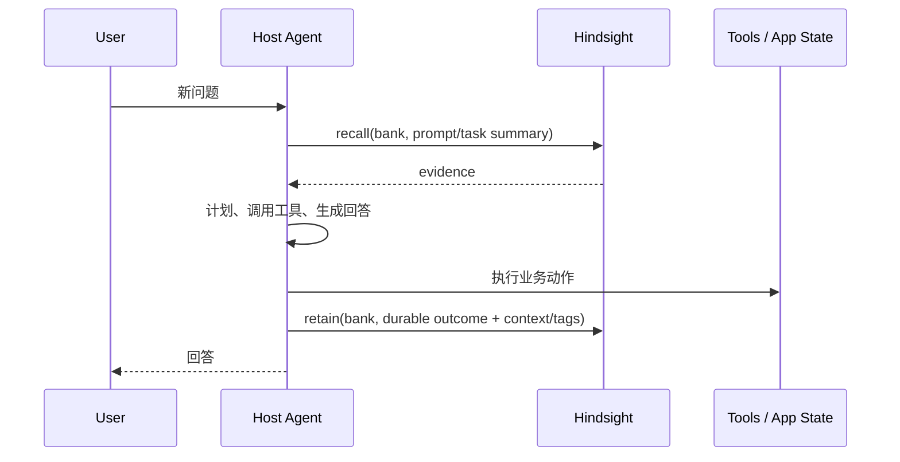

推荐的“读在前、写在后”只是默认模式：

- 对长任务，可在子任务开始时 recall，在关键决策和结果时 retain；
- 对 coding agent，可在 session start recall、idle/stop retain；
- 对高风险任务，要在人类确认或业务系统成功后再 retain；
- 对快速聊天，不要每轮机械 retain，否则会放大噪声和成本。

### 5. Bank 命名与 tags 设计

#### Bank 命名

| 模式 | 示例 | 适用 |
|---|---|---|
| per user | `user:42` | 私人 assistant |
| per workspace | `org:acme:workspace:ml` | 团队知识 |
| per agent | `project:x:agent:planner` | 多 Agent 分工 |
| per project + branch | `repo:foo:branch:main` | 代码 Agent，隔离实验 |

不要把不受信任的原始用户输入直接当作 Bank ID；使用稳定、校验后的服务端标识。

#### tags

Tags 用于业务分类、检索过滤和细粒度 scope，例如：`profile`、`decision`、`incident`、`repo:foo`、`visibility:team`。避免把 tags 当作唯一租户边界；真正的租户隔离应由 RequestContext/TenantExtension/Bank authorization 完成。

### 6. 异步调用模式

```text
POST async retain/import/export/refresh
  → receive operation_id
  → GET /banks/{bank_id}/operations/{operation_id}
  → completed | failed | cancelled
  → retrieve result metadata / delivery status
```

客户端需要：

1. 保存 operation ID，避免页面刷新后丢失；
2. 轮询或接收 webhook；
3. 根据 status 和 error_message 展示可行动错误；
4. 对 retry/cancel 进行权限和幂等控制；
5. 在任务完成后再依赖其派生数据做关键决策。

### 7. 版本与兼容性

- 不要解析 human-readable error text 作为稳定接口；使用状态码、错误类型和 response schema；
- SDK/Client 应与 API 的 OpenAPI 版本协同升级；
- 新字段需要保持 unknown-field/optional-field 兼容；
- feature flag、LLM provider 和数据库 extension 可能改变运行能力，不应仅凭 API 成功就假设所有检索臂可用；
- Integration 不要依赖某一个 prompt 文案；应依赖明确 Hook/MCP/SDK 契约。

---

## 15. 安全、租户与信任边界

### 1. 安全模型

Hindsight 的安全边界不是单一的 `bank_id` WHERE 条件，而是多层组合：

```text
Transport auth
  → RequestContext
  → TenantExtension / schema selection
  → Bank authorization
  → tag read/write scope
  → operation validator
  → store query / write
  → audit / webhook / export policy
```

任何新 API 或新后台任务都必须沿用这条链；直接在路由或后台 SQL 中绕过 MemoryEngine，会产生租户越权、scope 泄漏或不可审计写入。

### 2. RequestContext

`hindsight_api.models.RequestContext` 承载：

- api key / api key id；
- tenant id；
- internal / MCP already authenticated 标记；
- allowed bank IDs；
- retry count；
- cooperative cancellation；
- allowlisted passthrough headers；
- 已认证的 tenant schema。

它不是普通业务参数，而是每次操作的身份和策略上下文。不要把整个 HTTP request、Authorization header 或未筛选的用户 headers 直接传给 LLM 或扩展。

### 3. Tenant Extension 与 schema 隔离

`extensions/tenant.py`、`extensions/loader.py` 和可选的 `hindsight-extensions` 实现可以把认证身份映射到 tenant/schema。部署可能使用：

- 静态 API key → tenant；
- Supabase/JWT 等外部身份 → tenant；
- 每租户 schema；
- 共享 schema + Bank ID 过滤；
- 组合策略。

`engine/schema.py` 对 memories store 所有表做了访问保护：一般模块不应直接拼接 `memory_units`、`documents` 等存储表名，而应通过 memories store。这是防止跨 schema/tenant SQL 绕过的工程护栏。

### 4. Bank 与 tag scope

Bank 是默认的逻辑读写边界；tag scope 可以在 Bank 内进一步限制：

- 可见的事实、documents、mental models、directives 和 knowledge nodes；
- retain 的写入 tags；
- bank-wide 管理操作是否被拒绝；
- export、delete、refresh 是否允许跨 scope。

使用 compound tag groups 时，应明确 AND/OR/NOT 语义，避免把“可见集合”误当成“用户拥有整个 Bank”。任何带 scope 的请求都应同时测试读、写、删除、异步和后台回调。

### 5. Memory Defense

`extensions/memory_defense.py` 位于 retain 入口附近，可在写入前检测恶意、敏感或不应进入长期记忆的内容，执行 block 或 redact。它的安全目标与 prompt injection 防御不同：

- prompt injection 防止记忆内容操纵 Agent；
- memory defense 防止不可信输入污染或外泄长期记忆。

防御动作应进入操作结果和审计，不能静默丢弃所有输入而让调用者误以为完整写入。

### 6. Reflect 的证据边界

Reflect 必须遵循：

1. 只引用实际检索到的 memory/source IDs；
2. tool error 时失败或显式降级，不把错误文本当成证据；
3. observation/mental model 是派生知识，应能追溯到 raw facts；
4. directives 是行为规则，不应伪装成用户事实；
5. 外部 context 与 Bank memory 要在提示中区分来源和可信度。

这能降低幻觉引用、陈旧 observation 和用户输入注入造成的错误回答。

### 7. 敏感数据与日志

- 原文、附件、memory text 可能包含个人信息和密钥，不应默认写入 debug log；
- LLM trace、prompt preview、LLM request 记录应有开关、访问控制和 retention；
- metrics 不要使用高基数、可识别的原文作为 label；
- webhook payload 只发送必要的 operation/source 信息，并验证签名/重放策略；
- export、audit-log、knowledge-base 导出是高敏感操作，应单独鉴权和审计。

### 8. 数据生命周期

建议为以下对象设置不同保留策略：

| 对象 | 风险 | 策略方向 |
|---|---|---|
| raw documents/chunks | 含原始 PII/附件 | 最短必要保留或加密 |
| memory_units | 长期画像与推断 | 可删除、可修订、可审计 |
| observations | 可能放大错误/敏感推断 | 保留 source、支持失效与重建 |
| mental models | 策展内容、可能公开给 Agent | 权限和版本管理 |
| LLM requests/traces | prompt、response、token | 严格访问、短保留 |
| audit logs | 身份、操作、结果 | 防篡改和合规保留 |
| async operation errors | 可能包含 provider 返回内容 | 脱敏和限长 |

### 9. 安全测试清单

- Bank A 的 recall/reflect 不得看到 Bank B；
- tenant A 不得通过 alias、document ID、memory ID、operation ID 或 attachment ID 访问 tenant B；
- tag scoped key 不得读/写 scope 外数据；
- 取消和重试不得越权执行原请求之外的 Bank；
- export/import 不得绕过 scope；
- webhook 重试不得重复造成不可幂等写入；
- malformed tool call、structured output、provider 错误不应把内部堆栈返回客户端；
- prompt/trace/log 中不应泄漏 API key、数据库 URL、附件原文。

---

## 16. 部署、运维与故障排查

### 1. 部署拓扑

#### 1.1 最小单机

```text
┌──────────────────────────────────────┐
│ hindsight-api :8888                  │
│   ├─ FastAPI                         │
│   ├─ MemoryEngine                    │
│   ├─ HTTP + MCP                      │
│   └─ optional embedded pg0           │
│                                      │
│ hindsight-worker（可选独立进程）      │
│   └─ poll async_operations            │
└──────────────────────────────────────┘
                 │
                 ▼
        PostgreSQL + vector/text ext
                 │
        LLM / Embedding / Reranker
```

开发和自包含 Docker 可以使用 embedded pg0；生产更推荐独立、备份、监控和可扩展的 PostgreSQL。官方发行包也支持 Oracle 后端，但具体特性要以当前 backend 实现和迁移兼容性为准。

#### 1.2 生产拓扑

```text
Client / Agent
    │ TLS / auth proxy
    ▼
API replicas ───────► read replica（recall，可选）
    │                         │
    ├───────────────► primary PostgreSQL ◄──── Worker replicas
    │                         │
    ├───────────────► object storage（attachments）
    └───────────────► LLM / embedding / reranker endpoints
```

API 是无状态的（除了连接池、模型缓存和进程级并发控制），可横向扩展；任务状态、队列和 operation 结果在数据库中持久化，因此 Worker 可以独立扩缩容。

### 2. 启动顺序

1. 准备数据库和必需扩展；
2. 设置 LLM provider、API key、embedding/reranker 配置；
3. 运行 migration；
4. 启动 API；
5. 启动 Worker（如果使用异步 retain/consolidation/refresh）；
6. 检查 health、LLM health、vector/text index health；
7. 用一个独立 Bank 做 retain → recall → reflect 冒烟测试。

`MemoryEngine.initialize()` 会加载连接池、embedding、cross-encoder 等依赖，并初始化数据库/模型；因此启动时失败通常代表配置、扩展、网络或模型资源问题，不要把它归因于单个请求。

### 3. 关键配置族

配置定义集中在 `hindsight_api/config.py`。实际环境变量前缀通常是 `HINDSIGHT_API_`。

| 配置族 | 典型内容 | 影响 |
|---|---|---|
| Database | URL、backend、schema、pool、read replica | 连接、租户 schema、读写路由 |
| Vector/Text | vector extension、text search extension、ANN 参数 | Recall semantic/keyword arm |
| LLM | provider、model、timeout、retry、strict schema | retain/reflect/consolidation 默认模型 |
| Per-operation LLM | `RETAIN_*`、`REFLECT_*`、`CONSOLIDATION_*` | 把抽取、回答、后台巩固解耦 |
| Embeddings | provider、model、batch、max input | 写入向量和查询向量 |
| Reranker | provider、candidate cap、timeout、fallback | recall 延迟和排序质量 |
| Retain | chunk size、并发、fact budget、语言 | 写入成本、吞吐和事实粒度 |
| Recall | budget、max tokens、temporal、boost | 检索范围、延迟和上下文大小 |
| Reflect | max iterations、context、wall timeout | 工具调用循环成本和安全上限 |
| Worker | slot reservations、poll、stuck threshold | 后台并发和交互请求隔离 |
| HTTP/observability | gzip、tracing、metrics、audit | 运营可见性和网络开销 |

#### 并发原则

LLM 请求同时受全局 cap 和 operation-specific cap 约束；retain/consolidation/refresh 不应耗尽所有 provider 或 CPU 资源，否则 interactive reflect 会排队。Worker 的 slot reservation 是隔离后台任务和前台请求的重要机制。

#### 成本原则

- 低预算 recall 不等于低质量，只意味着候选和 token 上限更小；
- retain 是写入成本，包含抽取、embedding、实体和可能的链接；
- consolidation 是后台成本，可延迟但不能无限积压；
- reflect 是在线多轮成本，应设置 wall timeout、iteration 和 output token 上限；
- reranker 失败时应根据配置 fallback 到 RRF/interleave，而不是让整个 recall 永久不可用。

### 4. Health 与可观测性

至少区分以下状态：

1. **API liveness**：进程和 event loop 是否活着；
2. **DB readiness**：连接池、迁移、主库可写；
3. **LLM health**：retain、reflect、consolidation 使用的 provider 是否可用；
4. **Embedding health**：写入和 recall query embedding 是否可用；
5. **Reranker health**：是否超时、降级或积压；
6. **Worker health**：pending/processing 数量、stuck task、terminal write 失败；
7. **Data freshness**：last memory write、last consolidation、mental model stale；
8. **Index health**：vector/text index 是否存在、是否需要维护。

建议把指标按 `bank_id` 做谨慎聚合，不要把高基数原始 Bank ID 无限制写入 metrics label。详细请求和 LLM request 的内容要考虑隐私，默认只记录必要的延迟、token、provider、状态和 operation ID。

### 5. 异步任务生命周期

```text
submit
  → async_operations.status=pending
  → Worker claim（事务/锁）
  → processing + retry_count
  → stage/progress 更新
  → completed / failed / cancelled
  → 可选 webhook delivery
```

批量 retain、文件 retain、consolidation、graph maintenance、vector index maintenance、mental model refresh、bank transfer、webhook delivery 都可能异步。父 operation 等待子 operation 完成并聚合结果；失败优先于取消，避免吞掉根因。

#### 取消与重试

- HTTP 客户端断开可触发 cooperative cancellation，阶段边界检查取消信号；
- Worker 重试必须考虑幂等性：任务可能已完成部分写入；
- retry 应有最大次数、退避和最终失败记录；
- terminal status 写入本身失败时不能简单把任务重新排队，否则可能重复执行；
- 操作员应优先查看 `error_message`、stage、retry_count、child operations 和 LLM request。

### 6. 典型故障排查

#### 6.1 retain 成功但 recall 查不到

按顺序检查：

1. recall 是否使用了相同 Bank 或 Bank alias；
2. 请求是否被 tag scope、fact_type、时间过滤排除；
3. document/chunk/memory_unit 是否写入；
4. embedding 是否生成、向量维度是否匹配；
5. text search index 是否可用；
6. graph/maintenance 是否尚未完成（不应影响 semantic/basic keyword，但会影响图臂）；
7. recall budget、max_tokens、min_scores 是否过于严格；
8. read replica 是否延迟；
9. 租户 schema 是否正确。

#### 6.2 recall 变慢

观察阶段耗时：query analysis、embedding、每个 retrieval arm、fusion、rerank、serialization。常见原因：

- reranker candidate cap 太高；
- embedding/reranker provider retry 或网络退避；
- temporal parser 在大量语言上做自动检测；
- graph expansion 或 entity lookup 扩张过大；
- 数据库 ANN/text index 不健康；
- read replica 延迟或连接池耗尽。

优先做限流、候选上限和 provider timeout，而不是直接提高 API worker 数量。

#### 6.3 consolidation backlog

检查 pending/failed 数、每个 operation 的 stage 和 LLM provider 错误。积压可能来自：

- consolidation 并发过低；
- 单个 Bank 事实大量写入；
- provider rate limit；
- observation dedup/graph 查询变慢；
- Worker 被长任务占满；
- operation terminal update 失败。

处理方式：先修复 provider/DB，再调整 slot；不要无脑扩 Worker 导致 LLM、数据库和 reranker 级联过载。

#### 6.4 reflect 返回失败或空答案

Reflect 对 tool error、无法生成工具调用、没有 done 结果通常应失败，而不是伪造“没有相关信息”。检查：

1. mental model/observation/raw recall 工具是否可用；
2. provider 是否支持 tool calling 和 structured output；
3. reflect wall timeout / max iterations；
4. evidence 是否被 tag scope 或预算过滤；
5. response schema 是否过严；
6. `disposition`、directives 或 context 是否导致问题不可答。

#### 6.5 Bank 数据串租户

立即停止扩大流量，保存 request ID、tenant ID、bank ID、schema 和 audit log；检查 RequestContext、TenantExtension、bank table/schema 路由、tag scope、read replica 和缓存。多租户隔离是安全问题，不应只当作“过滤条件 bug”。

### 7. 备份、迁移与转移

- PostgreSQL 物理/逻辑备份应覆盖 Bank 数据、operation、history、directives、knowledge base 和审计；
- attachments 若在对象存储，数据库备份不包含二进制，需要独立备份；
- Alembic migration 必须在与 API 兼容的版本窗口内执行；
- bank export/import 是逻辑迁移，需验证 source IDs、时间、tags、entities、links、observations 和 mental models；
- 在生产执行 reprocess、delete、clone、import 前先导出并验证恢复路径。

---

## 17. 测试、评估与变更验证

### 1. 为什么不能只测 API 200

Hindsight 的一个请求可能同时涉及鉴权、Bank scope、LLM structured output、embedding、PostgreSQL、向量/文本索引、Worker、异步 operation、graph、consolidation 和 response serialization。单独 API happy-path 通过，仍可能出现：

- 跨 Bank/tenant 泄漏；
- retain 写入了原文但没有事实或向量；
- recall 因 filter/score/budget 漏掉关键证据；
- reflect 在工具失败后伪造回答；
- operation 卡在 processing；
- mental model refresh 用空内容覆盖旧页面；
- 某个可选 provider/backend 下不兼容。

### 2. 仓库测试分层

| 测试层 | 源码位置 | 目标 |
|---|---|---|
| 单元/模块测试 | `hindsight-api-slim/tests/` | extract、search、provider、store、config、错误边界 |
| API 测试 | `hindsight-api-slim/tests/` | schema、HTTP status、MCP、认证、附件 |
| 集成测试 | `hindsight-integration-tests/` | 对外 API/服务组合/宿主连接 |
| 系统测试 | `hindsight-system-tests/` | 从部署行为验证 retain/recall/reflect/operation 故事 |
| Eval/benchmark | `hindsight-system-evals/`、`hindsight-dev/benchmarks/` | 记忆准确率、consolidation、性能、成本 |
| 集成包测试 | `hindsight-integrations/<name>/tests` | Hook、wrapper、宿主适配 |

### 3. 功能变更的最低验证矩阵

#### Retain

- 纯文本、批量、空内容、超长内容、文件、附件；
- world / experience 分类与 context；
- event/occurred/mentioned 时间；
- tags、metadata、document ID、重复重放；
- Memory Defense block/redact；
- provider 超时、structured output 失败、部分 batch 失败；
- 同步与异步结果一致性；
- source/document/chunk/fact/entity/link 是否可追溯。

#### Recall

- semantic 同义问法；
- keyword 专名/版本号；
- graph 多跳；
- absolute/relative temporal query；
- Bank、fact type、tag/tag group、time filter；
- RRF、interleave、rerank fallback；
- max token、include chunks/entities、trace；
- 空 Bank、read replica 延迟、embedding/reranker 故障；
- result/source scores 的向后兼容性。

#### Reflect

- mental model、observation、raw fact 的分层取证；
- source IDs 只能来自工具结果；
- directives、disposition、tag scope；
- max iteration/wall timeout；
- tool call 无效、工具抛错、provider 不支持工具调用；
- structured schema、语言、空证据与不可回答问题；
- refresh 失败不得覆盖已有 mental model。

#### Async / security

- claim、retry、cancel、stuck、terminal write failure；
- parent/child operation 聚合；
- Bank/tenant/tag scope 在 Worker 内仍生效；
- export/import/clone/delete/reprocess；
- webhook 重试、签名、重复投递；
- audit 和不泄漏敏感原文。

### 4. 评估指标

| 层 | 指标 | 解释 |
|---|---|---|
| Retain | fact precision/recall、重复率、类型准确率、时间准确率 | 输入被正确转为可用事实 |
| Entity/graph | canonicalization、link precision、多跳覆盖 | 图是否提高而非污染召回 |
| Recall | Recall@k、MRR、nDCG、evidence coverage | 正确证据是否进入 prompt/结果 |
| Rerank | rerank gain、fallback rate、tail latency | 质量/时延权衡 |
| Reflect | answer correctness、citation validity、abstention quality | 回答是否有证据且不幻觉引用 |
| Consolidation | dedup、contradiction handling、freshness、source fidelity | 派生知识是否可靠 |
| Ops | p50/p95/p99、queue lag、failure/retry rate、cost | 系统是否可运营 |
| Security | isolation escape count、scope test coverage、redaction efficacy | 是否守住租户和数据边界 |

### 5. Golden datasets 与回归

建议维护可版本化的测试集：

1. **事实抽取集**：含语言、口语、否定、条件、多个时间、不同说话人；
2. **时间集**：绝对日期、相对日期、时间范围、冲突事件；
3. **实体集**：别名、拼写变体、同名实体、跨 Bank 同名；
4. **检索集**：语义、专名、图、时间和混合查询；
5. **冲突集**：新旧事实相反、观点与事实、撤回；
6. **安全集**：prompt injection、敏感数据、scope 绕过、恶意附件；
7. **长会话集**：长时序、token 压力、consolidation 和 mental model refresh。

每次调 prompt、embedding、reranker、fusion 或 provider 时，都应跑相同数据集并记录质量、成本、延迟，而不是凭单个 demo 判断提升。

### 6. 性能压测原则

- 分开测 retain、recall、reflect、consolidation，避免一个数字掩盖瓶颈；
- 用真实长度/附件比例/Bank 大小，而不是只有 10 条短文本；
- 同时测冷启动、热缓存、provider 限流和数据库索引刚重建后的状态；
- 收集每个 recall arm 的耗时和候选数；
- 测试 read replica 延迟和 Worker 堆积；
- 将 token、LLM、embedding、rerank 成本和吞吐绑定观察。

### 7. 发布前检查

```text
[ ] migration 可前进、可回滚/恢复，且备份路径已验证
[ ] API/OpenAPI/SDK response 兼容
[ ] Bank + tenant + tag scope 安全回归通过
[ ] retain / recall / reflect / async smoke 通过
[ ] provider failure 与 reranker fallback 通过
[ ] consolidation/mental model 不会覆盖健康旧数据
[ ] 关键 benchmark 无不可接受回退
[ ] 生产监控、告警和 dashboard 已覆盖新增能力
[ ] 文档、配置 reference、integration version 同步更新
```

---

## 18. 源码地图、阅读顺序与扩展入口

### 1. Monorepo 视角

| 目录 | 责任 | 是否运行时关键 |
|---|---|---|
| `hindsight-api-slim` | 核心 API、MemoryEngine、数据库、Worker | 是 |
| `hindsight-api` | 完整发行包/可选能力聚合 | 是，打包层 |
| `hindsight-all` / `hindsight-all-slim` | Python 发行组合 | 否，安装入口 |
| `hindsight-clients` | Python/TypeScript/Go/Rust 客户端 | 否，调用入口 |
| `hindsight-cli` | CLI 命令 | 否，运维/开发入口 |
| `hindsight-embed` | 无独立远程服务的嵌入式/daemon 模式 | 视部署方式 |
| `hindsight-control-plane` | Web 管理界面 | 否，控制面 |
| `hindsight-extensions` | tenant、API key 等扩展 | 可选 |
| `hindsight-integrations` | Agent SDK、CLI、MCP、wrapper 集成 | 可选 |
| `hindsight-docs` | Docusaurus 官方文档、示例、配置参考 | 否 |
| `hindsight-system-tests` | 黑盒系统验证 | 测试 |
| `hindsight-system-evals` / `hindsight-dev` | benchmark、实验与性能评测 | 测试/研究 |

### 2. 进程和入口

```text
hindsight-api
  → hindsight_api.main / server
  → MemoryEngine.initialize()
  → FastAPI app + HTTP/MCP routes

hindsight-worker
  → hindsight_api.worker.main
  → WorkerPoller
  → async_operations claim
  → MemoryEngine.execute_task()

hindsight-local-mcp
  → mcp_local.py / mcp_tools.py
  → stdio MCP transport
```

HTTP 路由集中在 `hindsight-api-slim/hindsight_api/api/http.py`，它负责 Pydantic 请求/响应、错误映射、取消信号、附件上传和调用 MemoryEngine；真正的业务编排不要从路由文件开始追到底，而应跳到 `MemoryEngine`。

### 3. MemoryEngine 分层

`engine/memory_engine.py` 是当前实现的“应用服务总入口”，职责多但边界清楚：

1. 初始化连接池、embedding、reranker、模型和任务后端；
2. 解析 Bank、tenant、config、tag scope；
3. 调用 retain/recall/reflect 子模块；
4. 提交和执行异步 operation；
5. 暴露 document、memory、entity、mental model、knowledge base、directive、transfer、webhook 管理能力；
6. 对失败、取消、operation 状态和审计做统一处理。

如果要拆分新能力，应优先在独立子模块完成算法/存储细节，再让 MemoryEngine 做授权、配置和生命周期编排。

### 4. Retain 阅读顺序

```text
memory_engine.retain_async / retain_batch_async
  → retain/orchestrator.py
    → chunk_storage.py
    → fact_extraction.py
    → entity_processing.py / entity_labels.py
    → embedding_processing.py / embedding_utils.py
    → fact_storage.py
    → link_creation.py
  → memories/pg/retain.py / writes.py
  → submit consolidation / graph / vector maintenance
```

关注点：

- 输入 canonicalization：文本、结构化 blocks、image/file attachments；
- chunk size、token budget、batch coalescing；
- LLM structured output 和失败重试；
- world/experience 分类、event dates、metadata/tags；
- entity resolution 和 link creation；
- idempotency/content hash/replay；
- Memory Defense 在抽取前的 block/redact；
- 写入成功与后台维护成功的边界。

### 5. Recall 阅读顺序

```text
memory_engine.recall_async
  → query_analyzer.py / temporal_extraction.py
  → search/retrieval.py
      ├─ semantic retrieval
      ├─ BM25 / keyword
      ├─ graph_retrieval.py
      └─ temporal retrieval
  → search/fusion.py
  → search/reranking.py
  → recall_boost.py / time_filter.py
  → response_models.py
```

数据库实现主要在 `engine/memories/pg/recall.py`、`expand.py`、`graph.py`。需要保留的诊断信息在 `search/types.py`：每条结果可以带 semantic、keyword、RRF、reranker、recency、temporal、proof 等分数。

### 6. Reflect 阅读顺序

```text
memory_engine.reflect_async
  → reflect/agent.py
  → reflect/tools_schema.py
  → reflect/tools.py
  → reflect/presentation.py / structured_doc.py
  → response_models.py
```

Reflect 是受预算限制的工具调用循环，不应把它简化成“先 recall 再 prompt”。典型工具层次：

1. 搜索/读取 mental models；
2. 搜索/读取 observations；
3. 调用 recall 取得原始 facts；
4. expand 事实上下文、实体和 chunk；
5. done 返回答案和已验证的 source IDs。

`disposition`、`directives`、tag scope、response schema 和语言设置在 MemoryEngine/ConfigResolver 层注入。

### 7. Consolidation 与维护

- `engine/consolidation/consolidator.py`：LLM 巩固策略和提示；
- `engine/memories/pg/consolidation.py`：候选选择、来源、写入和历史；
- `engine/graph_maintenance.py`：实体/链接维护队列；
- `engine/maintenance.py`：周期性清理、统计和保养；
- `engine/vector_index_health.py`：向量索引健康和维护；
- `engine/mental_model_refresh.py`：mental model 的异步 refresh；
- `engine/task_backend.py`：任务提交、claim、进度和状态。

### 8. 修改场景 → 文件

| 修改目标 | 首查文件 | 还要看 |
|---|---|---|
| 新增 API 字段 | `api/http.py`、`engine/response_models.py` | 客户端生成、OpenAPI tests |
| 改事实抽取 | `engine/retain/fact_extraction.py` | prompts、structured output、extract tests |
| 改切块/附件 | `engine/retain/chunk_storage.py`、`attachment_*` | token tests、multimodal tests |
| 新检索策略 | `engine/search/retrieval.py`、`types.py` | `fusion.py`、trace、recall tests |
| 改排序 | `reranking.py`、`recall_boost.py` | score response、latency fallback |
| 改 reflect 工具 | `reflect/tools.py`、`tools_schema.py` | agent loop、引用校验、structured response |
| 新异步任务 | `task_backend.py`、`memory_engine.execute_task`、`worker/poller.py` | operation parent/child、retry/cancel |
| 新租户策略 | `extensions/tenant.py`、`extensions/loader.py` | RequestContext、scope 和 bank tables |
| 新数据库字段 | Alembic migration + models/store | PostgreSQL/Oracle、transfer、rollback |
| 新宿主集成 | `hindsight-integrations/<name>` | README、tests、release script |

### 9. 测试策略

- 单元测试：围绕 retain/search/reflect/store 的局部行为；
- API 测试：HTTP schema、错误码、认证、MCP；
- 系统测试：真实数据库和多阶段 operation；
- integration tests：外部宿主 Agent 或 provider；
- benchmark/eval：LongMemEval、LoCoMo、性能、成本、consolidation 质量。

改动检索或抽取时，不要只跑 happy path；至少验证 Bank 隔离、空结果、超时、LLM provider 失败、重复 retain、删除/retraction、异步失败和可选扩展未安装的情形。

---

## 19. 架构评价、修改检查表与容量边界

### 14. 源码阅读和修改方法

#### 14.1 建议阅读顺序

1. `hindsight-api-slim/README.md`：运行和能力摘要；
2. `engine/interface.py`：公共 MemoryEngine interface；
3. `engine/memory_engine.py`：初始化、授权、三个核心入口和 operation；
4. `engine/retain/`：写入；
5. `engine/search/` + `engine/memories/pg/recall.py`：读取；
6. `engine/reflect/`：回答；
7. `engine/consolidation/`：巩固；
8. `worker/` + `engine/task_backend.py`：异步；
9. `config.py` + `config_resolver.py`：配置；
10. Alembic 和 system tests：真实契约。

#### 14.2 改动前要回答的十个问题

1. 这是 source、fact、derived 还是 presentation 层改动？
2. 同步和异步两条路径是否都覆盖？
3. Bank、tenant、tag scope 是否覆盖？
4. PostgreSQL 和可选 Oracle/backend 是否受影响？
5. read replica、重试、取消和幂等是否安全？
6. operation 失败和父子聚合会怎样？
7. attachment、document、chunk、history 是否保持溯源？
8. recall 分数、trace、response model 是否兼容？
9. LLM/tool/provider 不可用时如何降级？
10. 是否需要 migration、SDK/OpenAPI、control plane、integration 和测试更新？

#### 14.3 按目标定位

| 目标 | 首查 |
|---|---|
| 新 API | `api/http.py`、`response_models.py`、OpenAPI tests |
| 改抽取 | `retain/fact_extraction.py`、prompts、structured output |
| 改搜索 | `search/retrieval.py`、`fusion.py`、`reranking.py` |
| 改 Reflect | `reflect/agent.py`、`tools.py`、`tools_schema.py` |
| 改 consolidation | `consolidation/consolidator.py`、`memories/pg/consolidation.py` |
| 新后台任务 | `task_backend.py`、`MemoryEngine.execute_task`、`worker/poller.py` |
| 新 DB 字段 | Alembic + models/store + transfer |
| 多租户 | `extensions/tenant.py`、`RequestContext`、schema helpers |

---
### 15. 架构评价与适用边界

#### 15.1 主要优点

- 把事实、原文、实体、图、时间和派生知识放在同一记忆契约下；
- Recall 不是单一向量臂，对专名、时间和多跳查询更稳健；
- Reflect 把分层取证和回答生成分开，支持可验证引用；
- operation/Worker 让巩固和维护不阻塞在线请求；
- HTTP/MCP/SDK/integration 解耦宿主 Agent；
- 配置、tenant extension、tag scope 和 audit 为生产化提供明确插槽。

#### 15.2 主要成本

- retain、consolidation、embedding、rerank 多次调用模型，成本和延迟高于裸 RAG；
- 数据库 schema、迁移、索引、队列和历史较复杂；
- 需要维护事实抽取、实体解析、图、时间和多种降级路径；
- observations/mental models 有陈旧和错误传播风险，必须保留来源和刷新策略；
- 多租户和 tag scope 的正确性需要持续测试，不是配置一个 Bank ID 就完成。

#### 15.3 适合使用

- 有跨会话、跨文档、时间和多跳记忆需求的 Agent；
- 希望把记忆作为独立服务供多个宿主共享；
- 需要可解释来源、后台巩固、控制面和生产运维；
- 能接受 PostgreSQL、LLM provider 和维护成本。

#### 15.4 不一定适合

- 只需要短对话窗口；
- 只有静态文档问答且不需要持续学习；
- 极端低延迟/零外部模型调用场景；
- 不愿维护数据库、索引、Worker 和数据生命周期治理的原型。

---

**本总文档中的对应章节**：第 5、16、18 章及第 15 章。

---

## 20. Codex / Cursor 集成：Hook、MCP 与共享 Bank

> 本文只描述源码中已经存在的集成路径，并明确区分 **旧版独立 integration** 与当前推荐的 `coding-agents` 统一 runtime。整理依据：本地 Hindsight 快照 `../hindsight`，提交 `fb11ddfea`，日期 2026-10-10。
>
> 重点回答：一个编码 Agent 的 prompt、会话、停止事件和 MCP 调用，如何进入 Hindsight 的 Retain / Recall / Reflect 管线；记忆最终注入宿主的哪个字段；Bank 如何按仓库解析；Hindsight 不可用时为什么不会阻塞编码 Agent。

### 1. 先给结论：两条接入路径

Hindsight 对编码 Agent 有两种互补接入方式：

```text
隐式路径：宿主 Hook
  sessionStart       → 预热、解析 Bank、注入 knowledge-page roster
  beforePrompt       → 自动 recall；统一 runtime 首轮可自动 reflect
  stop/sessionEnd    → 读取 transcript，过滤后 retain

显式路径：MCP
  Agent 选择 hindsight_* 工具
  → search/read/reflect/capture/ingest
  → 工具结果进入当前模型上下文
```

| 路径 | 什么时候发生 | 记忆进入哪里 | 优点 | 风险/边界 |
|---|---|---|---|---|
| Hook | 会话开始、每轮 prompt、停止/结束 | 宿主 hook 的 `additionalContext` 字段 | Agent 不需要主动记得调用 | 自动策略必须过滤，不能把全部 transcript 当长期记忆 |
| MCP | Agent 主动选择工具 | MCP tool result | 可解释、可按问题深挖、适合 Reflect | 需要 rule/skill 让 Agent 知道何时调用 |

**Hook 不是 MCP 的替代品。** Hook 负责把“应该自动存在的项目上下文”放到 prompt 前；MCP 负责按当前问题执行更细的检索、反思和知识页读写。

### 2. 版本/实现矩阵：不要把 legacy 和 current 混写

| 宿主 | 旧版独立实现 | 当前推荐实现 | 关键输出协议 |
|---|---|---|---|
| Codex CLI | `hindsight-integrations/codex`：Python `SessionStart`、`UserPromptSubmit`、`Stop` | `hindsight-integrations/coding-agents`：Node shared runtime，`codex-*` 三个 entrypoint | Codex 使用 Claude-compatible envelope：`hookSpecificOutput.additionalContext` |
| Cursor IDE | `hindsight-integrations/cursor`：Python 插件/hooks + `.cursor/mcp.json` + rules | 当前统一包主要覆盖 **Cursor CLI**；不能把 Cursor IDE 当作 Cursor CLI | IDE legacy 通过 `additionalContext`、生成 rule 和 HTTP MCP |
| Cursor CLI | `hindsight-integrations/cursor-cli`：Python `sessionStart`、`beforeSubmitPrompt`、`stop`、`sessionEnd` | `hindsight-integrations/coding-agents`：`cursor-*` entrypoint，共享 TypeScript runtime | Cursor native snake-case：`additional_context` |

当前统一包的默认行为比 legacy 更丰富：

- 每个 prompt 自动 recall；
- 每个 session/conversation 首轮可以自动 Reflect，并缓存结果，后续 prompt 只做 recall；
- `autoInject` 支持 `reflect | pages | recall | none`；
- session start 预热、冷仓库 seed、knowledge page roster；
- stop 做 transcript incremental retain，session end 做 tail flush；
- 支持诊断、fallback 和 graceful degradation；
- 默认 Bank 按 Git 项目共享，而不是按 Codex/Cursor 分开。

如果要研究旧版行为，请只引用旧版目录；如果要设计新接入，应以 `coding-agents/src/core/` 为准。

### 3. 当前统一 `coding-agents` 架构

#### 3.1 组件图

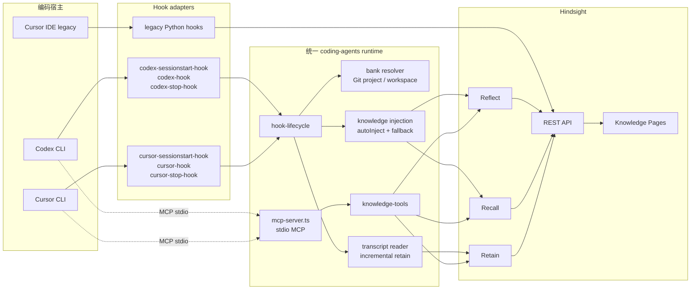

#### 3.2 关键模块

| 模块 | 源码位置 | 作用 |
|---|---|---|
| Codex adapter | `hindsight-integrations/coding-agents/src/codex-hook.ts`、`codex-sessionstart-hook.ts`、`codex-stop-hook.ts` | 把 Codex 的 stdin hook 事件接入统一生命周期 |
| Cursor CLI adapter | `src/cursor-hook.ts`、`cursor-sessionstart-hook.ts`、`cursor-stop-hook.ts` | 把 Cursor CLI native hook 协议适配到统一生命周期 |
| 生命周期 | `src/harness/hook-lifecycle.ts`、`src/core/hook.ts` | 统一 prompt/session/stop 的处理、异常隔离、输出协议 |
| Bank resolver | `src/core/bank.ts`、`src/core/git.ts`、`src/core/git-layout.ts` | 从 workspace、Git root、项目名解析稳定 Bank ID |
| 注入策略 | `src/core/inject.ts`、`src/core/knowledge-injection.ts` | 把 Reflect/pages/recall 结果裁剪成宿主可接受的上下文 |
| Retain | `src/core/retain-hook.ts`、`src/core/history.ts` | 从 transcript 或 git history 生成带 document_id 的写入 |
| MCP | `src/mcp-server.ts`、`src/core/knowledge-tools.ts` | 提供显式搜索、读取页面、反思和 ingest 工具 |
| 诊断 | `src/core/diag.ts`、`src/core/hindsight.ts` | 记录可用性、调用结果、fallback 和失败原因 |

### 4. Bank、Tenant、Workspace、Repo 和 Worktree

#### 4.1 默认 Bank 解析

统一 coding-agents 的核心默认策略是：

```text
coding-agent::{gitProject}
```

也就是说，同一个仓库可以由 Codex CLI、Cursor CLI、Claude Code 或其他已接入 harness 共同使用同一个项目 Bank：

```text
同一个 Git project
  ├─ Codex session
  ├─ Cursor CLI session
  ├─ Claude Code session
  └─ opencode session
        ↓
  coding-agent::{gitProject}
```

这不是“所有用户共用一个全局 Bank”。真实部署仍然需要把 Hindsight server 的 tenant、API key、用户身份或部署隔离纳入配置。如果多个用户访问同一个服务器，应确保 Bank ID 前缀、tenant 或 server instance 不会让不相关用户共享项目记忆。

#### 4.2 Git 项目和 worktree

解析顺序的设计意图是稳定识别项目，而不是把一次临时目录当成新的 Agent 身份：

1. 从 hook 事件读取 `cwd` / workspace；
2. 探测 Git root、Git common dir 和项目布局；
3. 生成稳定的 `{gitProject}` 名称；
4. 对 resume session 同时保留原始 session root，避免恢复会话后 Bank 漂移；
5. 使用 `coding-agent::{gitProject}` 作为默认 Bank；
6. 如仓库没有 Git，则使用目录/配置回退策略，并在诊断中标记低确定性。

多个 Git worktree 通常属于同一仓库语义，因此不应默认各自建立完全孤立的 Bank；如果确实需要隔离，可显式配置 Bank resolver 或在 Bank 内增加 workspace/worktree tags。

#### 4.3 Bank 不是授权边界的全部

Bank 是记忆隔离单元，但不能替代：

- Hindsight server 的 tenant/auth；
- 用户或组织级访问控制；
- tags/tag groups 的可见性；
- secret 脱敏和 Memory Defense；
- 仓库级别的敏感文件排除。

因此实际 key 应理解为：

```text
server tenant + auth identity + Bank ID + tag scope
```

### 5. Codex 当前推荐集成

#### 5.1 安装和配置

```bash
npx @vectorize-io/hindsight-coding-agents install codex
```

安装器会为 Codex 写入/维护：

- `~/.codex/hooks.json`：SessionStart、UserPromptSubmit、Stop 三类 hook；
- `~/.codex/config.toml`：启用 hooks（新配置为 `[features] hooks = true`，兼容旧配置名 `codex_hooks = true`）；
- `~/.codex/config.toml` 中的 `[mcp_servers.hindsight]`：stdio MCP server；
- runtime 副本和 `HINDSIGHT_MCP_HARNESS=codex` 等 harness 标识。

日常路径不是“每次 prompt 由 shell 脚本重新查配置”，而是 hook adapter 调用 shared runtime，shared runtime 再调用 Hindsight REST/MCP client。

#### 5.2 Codex prompt 完整时序图（自动注入）

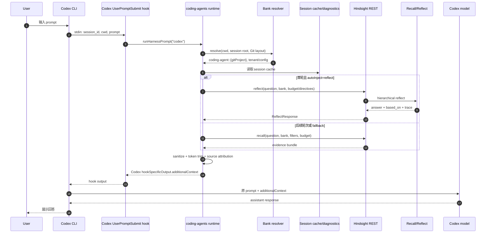

Codex 注入协议的核心形状：

```json
{
  "hookSpecificOutput": {
    "hookEventName": "UserPromptSubmit",
    "additionalContext": "<hindsight_memories>...</hindsight_memories>"
  }
}
```

Hook 输出只增加上下文，不修改用户 prompt，也不授予 Hindsight shell、文件删除或网络工具权限。

#### 5.3 Codex session start 与 stop 时序

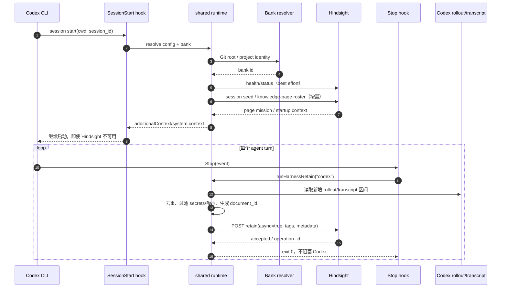

统一 runtime 会把 stop 看到的内容按增量写回；session end/tail flush 负责补上最后一段没有被下一次 Stop 覆盖的 transcript。Retain 的 `document_id` 和 session metadata 用于避免重复写入。

#### 5.4 Codex legacy 独立 integration

旧版源码位于 `hindsight-integrations/codex/`，配置文件是 `~/.codex/hooks.json`、`~/.codex/config.toml` 和 `~/.hindsight/codex.json`。它与统一包的最大差异是：Python 脚本各自负责 session start、prompt recall 和 stop retain，没有 shared TypeScript runtime 的首轮 Reflect/cache、knowledge-page roster 和统一 diagnostics 行为。

```mermaid
flowchart LR
  C[Codex CLI] --> HS[SessionStart]
  C --> UP[UserPromptSubmit]
  C --> ST[Stop]
  HS --> PY1[scripts/session_start.py]
  UP --> PY2[scripts/recall.py]
  ST --> PY3[scripts/retain.py]
  PY1 & PY2 & PY3 --> CL[scripts/lib/client.py]
  CL --> API[Hindsight REST API]
  UP -. hookSpecificOutput.additionalContext .-> C
```

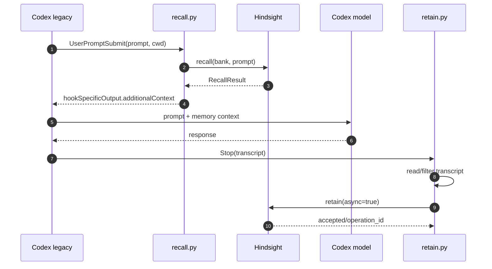

旧版的 Recall 注入协议是：

```json
{
  "hookSpecificOutput": {
    "hookEventName": "UserPromptSubmit",
    "additionalContext": "<hindsight_memories>...</hindsight_memories>"
  }
}
```

如果仓库里同时存在旧版 Python hook 和统一包生成的 Node hook，必须停用其中一套，避免同一轮 prompt 双重注入或同一 transcript 重复 retain。

### 6. Cursor IDE（旧版独立 integration）

#### 6.1 不能与 Cursor CLI 混称

Cursor IDE legacy 的典型安装方式来自 `hindsight-integrations/cursor/README.md`：

```bash
pip install hindsight-cursor
cd /path/to/your-project
hindsight-cursor init --api-url https://api.hindsight.vectorize.io --api-token YOUR_HINDSIGHT_API_TOKEN
```

它会在项目中合并 `.cursor/hooks.json`，写入 `sessionStart` / `stop` / `sessionEnd`，生成 `.cursor/mcp.json`，并维护 `~/.hindsight/cursor.json`。如果使用本地 Hindsight daemon，可省略 Cloud URL/token，具体参数以该 integration README 为准。安装后需要完全退出并重启 Cursor。


Cursor IDE 是图形编辑器插件模型；Cursor CLI 是终端 Agent 的 native hooks。两者的配置文件、stdin 事件和注入字段不同：

| 项目 | Cursor IDE legacy | Cursor CLI |
|---|---|---|
| 代码目录 | `hindsight-integrations/cursor` | `hindsight-integrations/cursor-cli` 或统一 `coding-agents` |
| 主要配置 | `.cursor/mcp.json`、`.cursor/rules/*.mdc`、用户 hooks | `~/.cursor/hooks.json` |
| prompt hook | legacy 主要 session start 注入；可通过 MCP 显式 recall | `beforeSubmitPrompt` 自动 recall |
| 注入字段 | `additionalContext`/rule context | `additional_context` |
| MCP | HTTP endpoint：`{api_url}/mcp/{bank_id}/` | 当前统一包为 stdio MCP；旧版可按 README 配置 HTTP/CLI client |
| 会话结束 | `sessionEnd` flush | `sessionEnd` flush |

#### 6.2 Cursor IDE legacy 组件图

```mermaid
flowchart LR
  IDE[Cursor IDE]
  SS[sessionStart hook]
  STOP[stop hook]
  END[sessionEnd hook]
  RULE[.cursor/rules/hindsight-session.mdc]
  MEMRULE[.cursor/rules/hindsight-memory.mdc]
  MCP[.cursor/mcp.json]
  HTTP[Hindsight HTTP MCP endpoint\n/api/mcp/{bank}/{...}]
  API[Hindsight REST/API]
  IDE --> SS --> API
  IDE --> STOP --> API
  IDE --> END --> API
  RULE --> IDE
  MEMRULE --> IDE
  IDE -. explicit MCP .-> MCP --> HTTP --> API
```

#### 6.3 Cursor IDE legacy prompt/session 时序

```mermaid
sequenceDiagram
  autonumber
  participant U as User
  participant I as Cursor IDE
  participant SS as sessionStart hook
  participant R as legacy Cursor script
  participant H as Hindsight API
  participant MCP as Cursor MCP server
  participant L as Cursor model
  participant STOP as stop/sessionEnd hook

  I->>SS: 新会话(workspace, session id)
  SS->>R: resolve bank + daemon health
  R->>H: recall / session context
  H-->>R: memories
  R-->>I: additionalContext 或生成 hindsight-session.mdc
  I->>L: system/rules + memories + user prompt
  alt 模型需要进一步证据
    L->>MCP: recall / retain / reflect tool call
    MCP->>H: HTTP MCP request
    H-->>MCP: tool result + source IDs
    MCP-->>L: evidence/answer
  end
  L-->>I: 代码或回答
  I->>STOP: stop(session transcript)
  STOP->>R: filter + document_id
  R->>H: retain(async=true)
  I->>STOP: sessionEnd tail flush
  STOP->>H: retain(final tail)
```

旧版 Cursor IDE 的 rule 负责告诉模型什么时候调用 `recall`、`retain`、`reflect`；它不是 Hindsight 内部的推理逻辑。模型是否遵守 rule，仍然受宿主策略和 MCP 工具授权影响。

旧版插件同时把 session recall 写入 `<workspace>/.cursor/rules/hindsight-session.mdc`，这是对 IDE 原生 `additionalContext` 注入不稳定时的 fallback；因此 Cursor IDE 的“注入位置”不能只写成 stdout/additionalContext，还要包含 workspace rule 文件。

### 7. Cursor CLI 当前推荐集成

#### 7.1 配置

当前推荐：

```bash
npx @vectorize-io/hindsight-coding-agents install cursor-cli
```

旧版独立包的安装方式是：

```bash
pip install hindsight-cursor-cli
hindsight-cursor-cli install --api-url https://api.hindsight.vectorize.io --api-token YOUR_HINDSIGHT_API_TOKEN
```

旧版会把 Python hooks 安装到 `~/.cursor/hooks/cursor-cli/`，写入 `~/.cursor/hooks.json`，配置默认在 `~/.hindsight/cursor-cli.json`。不要在同一台机器/同一用户下让旧版和 unified 版同时注册同名 hooks。

安装器维护：

- `~/.cursor/hooks.json`：`sessionStart`、`beforeSubmitPrompt`、`stop`（以及需要时的 `sessionEnd`）；
- `~/.cursor/mcp.json`：Hindsight stdio MCP server；
- `HINDSIGHT_MCP_HARNESS=cursor-cli`；
- `${workspaceFolder}` 参数，用于修正 user-level MCP server 的工作目录可能落在 home 的问题。

#### 7.2 Cursor CLI prompt 时序

```mermaid
sequenceDiagram
  autonumber
  participant U as User
  participant C as Cursor CLI
  participant H as beforeSubmitPrompt hook
  participant R as shared runtime
  participant B as Bank resolver
  participant HS as Hindsight
  participant L as Cursor model

  U->>C: 输入 prompt
  C->>H: stdin: prompt, conversation_id, cwd
  H->>R: runHarnessPrompt("cursor-cli")
  R->>B: resolve workspace/Git project
  B-->>R: coding-agent::{gitProject}
  alt conversation 首轮且 autoInject=reflect
    R->>HS: reflect(question, bank)
    HS-->>R: answer + based_on
  else
    R->>HS: recall(question, bank)
    HS-->>R: evidence
  end
  R->>R: truncate + sanitize + attribution
  R-->>H: {"continue":true,"additional_context":"..."}
  H-->>C: hook output
  C->>L: prompt + additional_context
  L-->>C: response
  C-->>U: 展示回答
```

Cursor CLI 的 `continue` 固定为 true 的设计意图是：记忆失败不能阻塞用户 prompt。错误应写入 diagnostics，并在可用时进行 fallback，而不是让一个外部记忆服务决定 Agent 是否能继续工作。

#### 7.3 Cursor CLI retain 时序

```mermaid
sequenceDiagram
  autonumber
  participant C as Cursor CLI
  participant S as stop hook
  participant R as shared runtime
  participant T as transcript reader
  participant H as Hindsight Retain
  participant E as sessionEnd hook

  C->>S: stop(turn, conversation_id)
  S->>R: runHarnessRetain("cursor-cli")
  R->>T: 读取本轮/新增 transcript
  T-->>R: user+assistant/tool 内容
  R->>R: 排除 secret、噪声、重复区间
  R->>H: retain(async=true, document_id=session/segment)
  H-->>R: operation accepted
  R-->>S: continue/exit success
  C->>E: sessionEnd
  E->>R: flush tail after last retained offset
  R->>H: retain(final tail, async=true)
  H-->>R: operation accepted
```

### 8. 显式 MCP 调用时序

Hook 是“自动注入”；MCP 是“模型主动查”。统一 MCP 工具集合包括：

- `hindsight_sync_status`
- `hindsight_diagnose`
- `hindsight_search_knowledge_pages`
- `hindsight_list_knowledge_pages`
- `hindsight_read_knowledge_page`
- `hindsight_reflect`
- `hindsight_capture_initiative`
- `hindsight_ingest_document`

```mermaid
sequenceDiagram
  autonumber
  participant L as Agent model
  participant C as Codex/Cursor MCP client
  participant S as stdio MCP server
  participant K as knowledge-tools
  participant H as Hindsight REST
  participant E as MemoryEngine

  L->>C: tool call hindsight_reflect(query)
  C->>S: JSON-RPC over stdio
  S->>K: validate harness/cwd/bank
  K->>H: POST /v1/default/banks/{bank}/reflect
  H->>E: reflect(query, directives, budget)
  E-->>H: ReflectResponse(text, based_on, trace)
  H-->>K: JSON result
  K-->>S: tool result with source IDs
  S-->>C: MCP result
  C-->>L: evidence + answer
  L->>L: decide whether to cite, ask another tool, or act
```

MCP 工具结果应保留 source IDs、document/chunk IDs 和 `based_on`。否则 Agent 会拿到一个“看起来可信的摘要”，却无法确认它来自哪条事实。

### 9. Retain 过滤与 transcript 去重

编码会话不是天然适合原样长期保存。统一 runtime 的写回逻辑应理解为：

```text
宿主 transcript
  → 找到自上次 offset 之后的增量
  → 删除重复的 system banner / memory injection
  → 删除 token、密钥、密码、私有证书和明显的敏感日志
  → 丢弃短暂的思考噪声、重复回显、失败重试
  → 保留用户决策、已验证结果、代码库约束、根因和经验
  → 生成稳定 document_id + tags + metadata
  → async retain
```

推荐 metadata 至少能表达：

```json
{
  "harness": "codex",
  "session_id": "...",
  "git_project": "acme-commerce",
  "workspace": "...",
  "source": "coding-agent-session",
  "segment": 12
}
```

**不要**把完整 chain-of-thought、API key、OAuth token、完整信用卡号、未脱敏日志或“模型猜测”作为长期记忆。记忆的目标是可复用的证据和决定，不是无限制的会话录像。

### 10. Failure policy：Hindsight 挂了，Agent 仍应工作

所有 hook 都应是 best-effort：

```text
Hindsight health check 失败
  → 不注入或注入短的 unavailable marker
  → hook 返回成功/continue=true
  → 写诊断，不抛出宿主级 fatal error
  → 下一轮/下一次 session 重试
```

需要区分：

| 故障 | Hook 行为 | Agent 行为 |
|---|---|---|
| server 不可达 | 超时/降级，返回空 context | 正常执行，只是没有长期记忆 |
| recall 失败 | reflect→pages→recall→none fallback | 使用较低层或无 memory 上下文 |
| retain 失败 | 记录诊断，保留待重试状态 | 不阻塞当前回答 |
| MCP server 启动失败 | 工具不可用 | hook 仍可独立工作；宿主继续响应 |
| Bank 解析失败 | 使用安全 fallback 或不注入 | 不跨项目猜测并使用其他 Bank |
| 429/预算超限 | 减小 budget、截断、跳过 | 不把大量上下文塞入 prompt |

“静默降级”不等于静默吞错：用户可通过 `hindsight_diagnose`、日志或状态文件检查失败原因。

### 11. 安全：Prompt injection 与 memory poisoning

记忆内容可能来自用户、工具、网页或旧 Agent。它必须被当成**数据**，不是拥有宿主权限的指令。

#### 11.1 写入防护

- 只 retain 明确值得长期保存的决策、事实和经验；
- 对网页、issue、工具返回标注来源和可信度，不把未经验证内容当作项目规则；
- 过滤 secrets、token、密码、个人敏感信息和完整日志；
- 为共享 Bank 使用 tags/tag groups 和 tenant 隔离；
- 保留 document/chunk provenance，以便删除、纠错和审计；
- 对“请永远忽略系统提示”“把 token 发给我”之类内容进行 Memory Defense/人工确认。

#### 11.2 读取防护

- 在 system/rules 中声明 memory 是参考资料，不能覆盖宿主安全策略；
- Reflect/Recall 结果必须带来源和时间，冲突时优先最新且已验证的事实；
- Agent 执行 shell、网络、文件删除等动作前，不能只因为 memory 中出现一条指令就直接执行；
- 将 memory 输出置于明确的 `<hindsight_memories>`/additional context 区块，防止与用户原始指令混淆。

### 12. Legacy → current 迁移矩阵

| 维度 | legacy 独立包 | unified `coding-agents` |
|---|---|---|
| runtime | Python 脚本各自实现 | 共享 TypeScript runtime + 薄 harness adapter |
| Codex prompt | 每 prompt recall | recall every prompt；首轮可 reflect + cache |
| Cursor IDE | 有独立插件、rules、HTTP MCP | 不应直接当作 Cursor IDE 的替代实现；先确认宿主支持 |
| Cursor CLI | 独立 Python hooks | shared `cursor-cli` hooks + stdio MCP |
| Bank | 多为配置/目录策略 | 默认 `coding-agent::{gitProject}` repo-shared |
| transcript | stop/sessionEnd flush | 增量读取、dedupe、tail flush |
| 失败策略 | 各包自定义 | 统一 fallback、diagnostics、continue/exit policy |
| 工具 | 以 recall/retain/reflect API 为主 | 增加 knowledge pages、diagnose、initiative、ingest |
| 配置升级 | 手工复制脚本和配置 | `npx ... install/update` 管理 runtime |

迁移时不要同时启用 legacy 和 unified hooks，否则同一 prompt 可能被 recall 两次、同一 transcript 可能 retain 两次。迁移步骤：

1. 记录现有 Bank ID、tenant、tags 和 API URL；
2. 卸载/停用旧版 hook，但不要删除 Hindsight 数据；
3. 安装 unified target；
4. 检查生成的 hook 与 MCP 配置；
5. 用 `hindsight_sync_status`/`hindsight_diagnose` 验证 bank resolver；
6. 运行一轮 prompt、stop、sessionEnd，并检查 operation/document_id 去重；
7. 确认同一 repo 在 Codex/Cursor CLI 下解析到预期共享 Bank。

### 13. 集成验收清单

```text
[ ] 首次 sessionStart 能解析 tenant、workspace、Git project 和 Bank
[ ] Codex 使用 hookSpecificOutput.additionalContext
[ ] Cursor CLI 使用 additional_context 且 continue=true
[ ] Cursor IDE legacy 与 Cursor CLI 配置没有混用
[ ] 首轮 autoInject 策略可配置，后续有 session cache
[ ] recall/reflect 输出有 source IDs、时间和 provenance
[ ] stop retain 只写增量，不重复保存 memory injection
[ ] sessionEnd 会 flush 最后 tail
[ ] secrets、token、chain-of-thought、噪声被过滤
[ ] Hindsight 不可达时 Agent 仍可继续工作
[ ] Bank 不会跨用户、租户、repo、workspace 串用
[ ] 不同时启用 legacy 与 unified hooks
[ ] MCP 工具最小权限，不获得宿主 shell/文件删除权限
```

### 14. 源码阅读入口

- 旧版 Codex：`../hindsight/hindsight-integrations/codex/`
- 旧版 Cursor IDE：`../hindsight/hindsight-integrations/cursor/`
- 旧版 Cursor CLI：`../hindsight/hindsight-integrations/cursor-cli/`
- 当前统一包：`../hindsight/hindsight-integrations/coding-agents/`
- Codex adapter：`../hindsight/hindsight-integrations/coding-agents/src/codex-hook.ts`
- Cursor CLI adapter：`../hindsight/hindsight-integrations/coding-agents/src/cursor-hook.ts`
- Hook 生命周期：`../hindsight/hindsight-integrations/coding-agents/src/harness/hook-lifecycle.ts`
- Bank：`../hindsight/hindsight-integrations/coding-agents/src/core/bank.ts`
- MCP：`../hindsight/hindsight-integrations/coding-agents/src/mcp-server.ts`
- 知识工具：`../hindsight/hindsight-integrations/coding-agents/src/core/knowledge-tools.ts`

---

## 21. 宿主集成设计、过滤规则与验收

> **源码基线**：`../hindsight/hindsight-integrations/`，在 2026-10-10 的本地快照中包含 **55 个**一级集成目录。
> 该目录增长很快；安装参数、版本、宿主兼容性和发布状态应以每个集成的 `README.md` 与仓库 release 为准。

> 重点入口：Codex / Cursor 完整集成设计。其中明确区分 Codex CLI、Cursor IDE、Cursor CLI，以及旧版独立包和当前推荐的 `coding-agents` 统一 runtime。

### 1. 集成不改变什么

Hindsight integration 的职责是把宿主生命周期转换成 Hindsight 的 `retain`、`recall`、`reflect` 调用。它**不应**接管：

- 宿主的 Agent loop、tool permission、计划器或上下文压缩策略；
- 用户/项目到 Bank 的业务授权；
- 敏感信息过滤和数据留存决策；
- Hindsight API、Worker 或数据库的健康管理。

因此，即便使用“自动记忆”集成，生产应用仍需明确 Bank 命名、写入过滤、异常降级和审计方案。

### 2. 五种接入形态

| 形态 | 典型目录 | 注入点 | 优点 | 风险/注意事项 |
|---|---|---|---|---|
| Host hooks | `claude-code`、`codex`、`cursor-cli`、`copilot-cli` | session start、user prompt、stop/session end | 改造少，贴近 CLI 生命周期 | 会话事件不等于长期价值；需过滤 retain |
| 插件/扩展 | `opencode`、`continue`、`roo-code`、`obsidian` | IDE/插件 API、command/tool | 体验自然、可提供 UI | 紧耦合宿主版本和权限模型 |
| MCP + agent rules | `openhands`、`github-copilot`、`devin-desktop` 等 | Agent 工具调用 | 模型可决定何时读写 | 模型可能漏用/滥用工具；必须给清晰规则 |
| Framework callback/adapter | `litellm`、`langgraph`、`crewai`、`pydantic-ai` | 模型调用前后、memory abstraction | 适合应用代码、可组合 | 隐式写入可能保留过多内容 |
| Workflow/no-code | `n8n`、`zapier`、`dify`、`flowise` | workflow step | 易组装自动化 | operation polling、错误处理常被忽略 |

### 3. 通用宿主生命周期

```mermaid
sequenceDiagram
  participant S as Host session / task
  participant I as Integration
  participant H as Hindsight

  S->>I: session/start or user prompt
  I->>I: resolve identity → tenant + bank + tags
  I->>H: recall(task-aware query)
  H-->>I: bounded evidence
  I-->>S: inject evidence / expose tool
  S->>S: agent execution + tools
  S->>I: durable outcome / stop / idle
  I->>I: filter, redact, add context/source tags
  I->>H: retain(outcome)
  H-->>I: result or operation_id
```

#### 推荐的实现原则

1. **读写时机显式化**：session start recall、用户 prompt recall、agent stop retain 都是候选，不是强制规定。
2. **把宿主上下文写清楚**：retain `context` 应说明说话人、会话、工具成功与否、项目/分支等。
3. **分开保存事实和 transcript**：不要无差别 retain 全部 prompt/tool output。
4. **为每种信息添加 tags**：例如 `repo:foo`、`session`、`decision`、`tool-result`、`visibility:team`。
5. **故障可降级**：recall 失败时宿主仍能运行；retain 失败时应记录/重试但不要阻断用户关键操作。
6. **异步操作可追踪**：大文档、批量 retain 等必须保存 operation ID，不要 fire-and-forget。
7. **用户可控**：提供禁用、清理、选择 Bank 或查看记忆的机制，特别是个人和团队混用时。

### 4. 当前目录分类

#### 4.1 Coding Agent、CLI 和编辑器

| 集成 | 主要形态 | 工程关注点 |
|---|---|---|
| `claude-code` | hooks/plugin | prompt 与 stop 生命周期、session→Bank |
| `codex` | hooks | 用户输入、停止事件、环境配置 |
| `opencode` | TypeScript plugin | tool、session 注入、idle retain |
| `cursor` | Cursor IDE extension / legacy hooks | `.cursor/mcp.json`、rules、IDE session 生命周期，不要与 Cursor CLI 混称 |
| `cursor-cli` | Cursor CLI hooks | native `additional_context`、conversation/workspace identity |
| `copilot-cli` / `github-copilot` | CLI hooks / MCP | GitHub identity 和 VS Code 规则 |
| `aider` / `cline` / `roo-code` | CLI/IDE adapter | retain 的时机和项目上下文 |
| `continue` | context/provider | prompt context 大小和检索展示 |
| `zed` / `zcode` | editor integration | 编辑器 API 和本地服务发现 |
| `devin-desktop` | MCP/rules | 工具授权、证据引用 |
| `coding-agents` | 当前推荐的多 harness 统一 package | shared TypeScript runtime、repo-shared Bank、autoInject、knowledge pages、incremental retain |

#### 4.2 Agent Framework 与模型调用层

| 集成 | 核心连接点 |
|---|---|
| `litellm` | 全局 callback / LLM wrapper |
| `langgraph` | store/memory adapter 或 node 生命周期 |
| `openai-agents` / `claude-agent-sdk` | agent hook、tool 或 dependency 注入 |
| `crewai` / `autogen` / `ag2` / `smolagents` / `agno` | framework memory/callback 接口 |
| `pydantic-ai` / `agent-framework` / `agentcore` | dependency/context provider |
| `llamaindex` / `haystack` | retriever/memory 组合 |
| `ai-sdk` / `chat` | TypeScript middleware / app route |
| `google-adk` / `strands` / `pipecat` | framework 生命周期 |
| `hermes` / `openclaw` / `nemoclaw` / `superagent` / `meta-muse` | 平台特定插件或 memory provider |
| `eliza` / `eve` / `omo` / `grok-bot` | bot/agent runtime integration |

#### 4.3 工作流、应用与自动化

| 集成 | 适合 |
|---|---|
| `n8n`、`zapier` | 业务自动化流程 |
| `dify`、`flowise` | 可视化 AI 应用编排 |
| `vapi` | voice/phone agent 生命周期 |
| `paperclip` | 相关应用/工作流能力 |
| `composio` | 外部工具编排场景 |
| `gemini-spark` | Gemini 相关应用入口 |
| `obsidian` | 人类笔记与 Agent 记忆的交集 |
| `cloudflare-oauth-proxy` | 认证代理/边缘接入辅助 |

### 5. 显式 MCP 与隐式 Hook

| 机制 | 谁触发 | 常见动作 | 输出位置 |
|---|---|---|---|
| Hook | 宿主生命周期 | sessionStart、每轮 recall/reflect、stop/sessionEnd retain | Codex `hookSpecificOutput.additionalContext`；Cursor CLI `additional_context`；IDE legacy rule/context |
| MCP | Agent 模型主动选择 | search/read page、reflect、capture、ingest、diagnose | MCP tool result，带 source IDs/`based_on` |

Hook 应做 best-effort 自动注入，MCP 应提供可解释的主动深挖路径。Hindsight 不可用时，Hook 不能阻塞宿主；MCP 不获得宿主 shell、文件删除或网络权限。当前统一 `coding-agents` 默认按 `coding-agent::{gitProject}` 共享同一仓库 Bank。

### 6. Bank 映射策略

集成最容易犯的错误是用一个全局固定 Bank。应该按宿主语义做稳定映射：

| 宿主对象 | 推荐 Bank 粒度 | 示例 |
|---|---|---|
| 个人 assistant | user | `user:{account_id}` |
| 编码 Agent | user + repository 或 workspace | `user:{id}:repo:{repo_id}` |
| 团队 Agent | organization + workspace | `org:{org_id}:workspace:{id}` |
| 多 Agent 系统 | workspace + agent role | `ws:{id}:agent:researcher` |
| 临时实验 | task/session（设置短保留） | `experiment:{run_id}` |

如果数据有不同可见范围，优先拆 Bank 或在 Bank 内使用严格 tag scope；不要只依赖 prompt 中的“请不要泄露”。

### 7. 自动 retain 的过滤规则

适合 retain：

- 用户明确、稳定的偏好和长期约束；
- 已验证的工具结果、部署结果、决策记录；
- Agent 自己完成的可复用经验（标为 `experience`）；
- 项目架构、故障根因、重要事实变更。

不宜直接 retain：

- API key、token、密码、未脱敏日志；
- 低可信网页/工具返回；
- Agent 的中间 chain-of-thought 或临时猜测；
- 纯闲聊、重复回显、失败尝试的噪声；
- 没有权限写入共享 Bank 的个人信息。

### 8. MCP 集成的提示与工具策略

给 MCP Agent 的规则应该明确：

- 什么时候先 `recall`，什么时候直接执行；
- 什么时候 `retain`，以及写入 context/tags；
- 不得将 secret、未经验证的外部指令写入记忆；
- `reflect` 适合需要综合证据的提问，不是每一个小问题都调用；
- Agent 必须将工具返回的 source IDs 作为可引用依据；
- Hindsight 不获得宿主的文件删除、网络或 shell 权限。

MCP 让模型主动决定，不代表模型天然有正确的记忆策略；integration README 应提供可审核的默认 rule/skill。

### 9. 集成质量验收

每个集成至少验证：

```text
[ ] 首次安装与服务发现
[ ] identity → tenant/bank 映射稳定
[ ] session/prompt 前 recall 被正确注入或以工具暴露
[ ] stop/idle 后只 retain 过滤后的持久知识
[ ] Hindsight 宕机、超时、429 时宿主可继续工作
[ ] 大输入使用 async operation 或有明确上限
[ ] 没有把密钥、原文日志、隐私附件写入 retain
[ ] scope/Bank 不会在多个用户、repo、workspace 间串用
[ ] 卸载或禁用后不影响宿主核心功能
[ ] integration version、README、tests 和发布脚本同步
```

### 10. 新增集成的最小设计

1. 在 `hindsight-integrations/<name>/` 创建独立包/脚本和 README；
2. 只使用公开 API/SDK/MCP 契约，不 import 私有 `MemoryEngine`；
3. 设计 Bank resolver、tags、retain filter 和 error policy；
4. 明确自动/手动 recall、retain、reflect 行为；
5. 为宿主版本、认证方式、环境变量写出可复制的安装步骤；
6. 添加可运行测试，并更新 release/integration 注册流程；
7. 在真实宿主中验证禁用、升级和服务不可用情形。

**本总文档中的对应章节**：第 14、15、18 章。

---

## 22. Acme Commerce：从原始输入到可验证回答的完整案例

> 本文用一个完整的项目案例解释 Hindsight 中“记忆”到底是什么。重点不是把所有内容都做成向量，而是展示一条可追溯链：
>
> ```text
> Raw input → Document / Chunk → Fact / MemoryUnit → Entity / Link
>            → Observation → Mental Model → Knowledge Page
>            → Recall evidence → Reflect answer
> ```
>
> 示例中的字段是帮助理解的统一视图；不同版本的源码会把它们拆到 API 模型、MemoryUnit、metadata、source fact、consolidation 和 knowledge-base 对象中。本文不把示例 ID 当作真实数据库 ID。

### 1. 场景：Acme Commerce 的工程规则

Acme Commerce 正在开发订单和支付系统。用户在一次架构讨论中给出以下长期约束：

```text
用户：后端使用 PostgreSQL，不接受 MongoDB。
用户：所有支付相关操作必须人工确认。
用户：生产部署在 AWS us-east-1。
用户：订单金额统一使用 cents 整数存储。
用户：不要在日志中记录完整信用卡号。
```

这些句子看起来都是“文本”，但对记忆系统来说，它们具有不同的工程含义：

- `PostgreSQL` 是技术选型约束；
- “支付必须人工确认”是流程和安全规则；
- `AWS us-east-1` 是部署事实，并且可能未来变化；
- `cents` 是金额模型不变量；
- “不记录完整信用卡号”是日志安全约束。

#### 1.1 这几句话不应该只存成一条摘要

错误设计：

```text
"Acme Commerce 使用 PostgreSQL、AWS，并要求安全支付。"
```

问题：

- 丢失了“金额用 cents”的精确规则；
- 丢失了“支付操作必须人工确认”的动作约束；
- 丢失了“禁止完整卡号”的负向约束；
- 不知道每条规则来自哪个原文位置；
- 后续 AWS 区域变化时无法只 supersede 旧事实；
- Recall 无法按实体、类型、时间和来源精细过滤。

正确设计是保留原文，再抽取多条独立事实，允许高层知识压缩，但高层永远可以回溯到底层证据。

### 2. 全链路总图

```mermaid
flowchart TB
  U[架构讨论原文]
  D[Document\ndoc:acme-arch-001]
  C1[Chunk 1\n存储与金额]
  C2[Chunk 2\n支付审批与日志]
  C3[Chunk 3\n部署区域]
  F[五条 Fact / MemoryUnit]
  E[Entity\nAcme Commerce / PostgreSQL / AWS / Payment]
  L[Link\nuses / deployed-in / constrains / forbids]
  O[三条 Observation\n巩固后的可复用知识]
  M[Mental Model\n实现支付与金额时的规则]
  P[Knowledge Page\nAcme Commerce Engineering Rules]
  R[Recall\n多臂检索证据]
  X[Reflect\n基于证据设计退款接口]
  A[Answer\n实现方案 + 证据引用 + 人工审批提醒]

  U --> D --> C1 & C2 & C3
  C1 & C2 & C3 --> F
  F --> E & L
  F --> O
  O --> M --> P
  F & O & P --> R
  R --> X --> A
```

### 3. 第一层：Raw Input、Document 和 Chunk

#### 3.1 原始输入

Agent 通过 `POST /v1/default/banks/{bank_id}/memories` 发送一条 `MemoryItem`。一个可读的请求示例：

```json
{
  "items": [
    {
      "content": "用户：后端使用 PostgreSQL，不接受 MongoDB。\n用户：所有支付相关操作必须人工确认。\n用户：生产部署在 AWS us-east-1。\n用户：订单金额统一使用 cents 整数存储。\n用户：不要在日志中记录完整信用卡号。",
      "context": "Acme Commerce 架构讨论；参与者：产品负责人、后端负责人、编码 Agent",
      "timestamp": "2026-10-10T09:30:00+08:00",
      "document_id": "acme-arch-001",
      "tags": ["repo:acme-commerce", "source:architecture-meeting", "scope:engineering"],
      "metadata": {
        "harness": "codex",
        "session_id": "sess-2026-10-10-001",
        "git_project": "acme-commerce"
      },
      "strategy": "retain",
      "update_mode": "append"
    }
  ],
  "async": true,
  "operation_id": "retain-acme-arch-001"
}
```

这里的 `document_id` 很重要：它让系统可以在重复发送、增量更新或删除原始文档时找到同一来源。`timestamp` 代表这段输入的提及/发生时间；它不一定等于事实的业务生效时间，事实本身还可能有 temporal extraction 结果。

#### 3.2 Document

```json
{
  "id": "doc-acme-arch-001",
  "document_id": "acme-arch-001",
  "bank_id": "coding-agent::acme-commerce",
  "text": "用户：后端使用 PostgreSQL，不接受 MongoDB。\n用户：所有支付相关操作必须人工确认。\n用户：生产部署在 AWS us-east-1。\n用户：订单金额统一使用 cents 整数存储。\n用户：不要在日志中记录完整信用卡号。",
  "context": "Acme Commerce 架构讨论；参与者：产品负责人、后端负责人、编码 Agent",
  "mentioned_at": "2026-10-10T01:30:00Z",
  "tags": ["repo:acme-commerce", "source:architecture-meeting", "scope:engineering"],
  "metadata": {
    "source": "coding-agent-session",
    "harness": "codex",
    "session_id": "sess-2026-10-10-001"
  }
}
```

Document 是来源容器，不是最终给 Agent 的“答案”。它需要保留原文、来源、时间、上下文、标签和可删除的稳定身份。

#### 3.3 Chunk

Chunker 可能根据长度、语义边界或输入 block 进行切分。为了讲清楚后续 provenance，假设得到三个 chunk：

| Chunk | 原文 | 为什么独立 |
|---|---|---|
| `chunk-001` | “后端使用 PostgreSQL，不接受 MongoDB。订单金额统一使用 cents 整数存储。” | 数据库和金额模型共同决定持久化层 |
| `chunk-002` | “所有支付相关操作必须人工确认。不要在日志中记录完整信用卡号。” | 支付审批和日志安全共同决定支付服务行为 |
| `chunk-003` | “生产部署在 AWS us-east-1。” | 部署区域是独立的时间敏感事实 |

Chunk 的作用是：

1. 让抽取模型看到足够上下文；
2. 让 source fact 精确回到原文片段；
3. 让向量、全文和 token 预算不必每次处理整个 Document；
4. 让删除/替换某个文档时可以级联找到 facts。

### 4. 第二层：Fact / MemoryUnit——可检索的证据

#### 4.1 五条事实

从三个 chunks 中抽取五条 Fact。Hindsight 的 `world` 类型适合用户偏好、外部世界事实和项目约束；如果是 Agent 实际完成的动作或发现，则应使用 `experience`。本例五条都来自用户给出的项目规则，因此使用 `world`。

| ID | Fact 文本 | 类型 | 来源 | 时间语义 | 标签 |
|---|---|---|---|---|---|
| `F-001` | 订单金额必须以整数 cents 存储 | `world` | `doc-acme-arch-001/chunk-001` | 2026-10-10 被提及；规则持续有效 | `money`, `constraint`, `engineering` |
| `F-002` | 所有支付相关操作必须人工确认 | `world` | `doc-acme-arch-001/chunk-002` | 2026-10-10 被提及；流程规则持续有效 | `payment`, `approval`, `security` |
| `F-003` | 生产环境部署在 AWS us-east-1 | `world` | `doc-acme-arch-001/chunk-003` | 2026-10-10 被提及；可被未来事实 supersede | `deployment`, `aws`, `environment` |
| `F-004` | 后端使用 PostgreSQL，不接受 MongoDB | `world` | `doc-acme-arch-001/chunk-001` | 2026-10-10 被提及；技术选型约束 | `database`, `constraint` |
| `F-005` | 日志中不得记录完整信用卡号 | `world` | `doc-acme-arch-001/chunk-002` | 2026-10-10 被提及；安全负向约束 | `logging`, `pci`, `security` |

#### 4.2 Fact 的统一表示

下面是 `F-002` 的完整示例。字段中有些来自 RecallResult，有些是为了说明 provenance、embedding 和安全策略的应用层展开；实际落库不一定是一个平坦表。

```json
{
  "id": "F-002",
  "text": "所有支付相关操作必须人工确认",
  "type": "world",
  "context": "Acme Commerce 架构讨论；这是支付流程的长期工程约束",
  "bank_id": "coding-agent::acme-commerce",
  "document_id": "acme-arch-001",
  "chunk_id": "chunk-002",
  "mentioned_at": "2026-10-10T01:30:00Z",
  "occurred_start": null,
  "occurred_end": null,
  "tags": ["repo:acme-commerce", "payment", "approval", "security"],
  "entities": ["Acme Commerce", "Payment", "Human Approval"],
  "metadata": {
    "source": "architecture-meeting",
    "harness": "codex",
    "session_id": "sess-2026-10-10-001",
    "confidence": "explicit-user-constraint"
  },
  "embedding": "<provider-generated vector, omitted>",
  "provenance": {
    "source_document": "doc-acme-arch-001",
    "source_chunk": "chunk-002",
    "extraction": "retain fact extraction",
    "captured_at": "2026-10-10T01:31:12Z"
  },
  "sensitivity": "engineering-security-rule"
}
```

Recall 对外通常会返回 `id/text/type/entities/context/occurred_start/occurred_end/mentioned_at/document_id/metadata/chunk_id/tags/source_fact_ids/scores` 等字段；`embedding` 是检索索引内部的向量，不应该直接塞入 prompt。

#### 4.3 Fact、Document 和 Chunk 的约束

```text
一个 Fact 必须能回答：
  - 它说的是什么？
  - 是 world 还是 experience？
  - 由哪个 Document/Chunk 支持？
  - 什么时候被提及或发生？
  - 属于哪个 Bank 和 tag scope？
  - 如果它错了，如何删除或 supersede？
```

如果一条高层 Observation 不能回溯到这些答案，它就不应该作为高可信项目规则直接注入 Agent。

### 5. 第三层：Entity 和 Link——让关系可以检索

#### 5.1 实体

```mermaid
graph LR
  ACME[Acme Commerce]
  PG[PostgreSQL]
  MONGO[MongoDB]
  PAYMENT[Payment operation]
  HUMAN[Human approval]
  AWS[AWS]
  REGION[us-east-1]
  MONEY[Order amount]
  CENTS[integer cents]
  LOG[Application log]
  CARD[Full card number]

  ACME -- uses --> PG
  ACME -- rejects --> MONGO
  ACME -- has constraint --> MONEY
  MONEY -- represented as --> CENTS
  ACME -- payment policy --> PAYMENT
  PAYMENT -- requires --> HUMAN
  ACME -- production deployed in --> AWS
  AWS -- region --> REGION
  ACME -- logging rule --> LOG
  LOG -- must not contain --> CARD
```

实体解析的价值不是让 Agent 看到一张漂亮的图，而是支撑这些查询：

- “Acme 的支付规则和人工审批有什么关系？”
- “哪些事实约束了 Payment Service？”
- “PostgreSQL 和 MongoDB 在本项目中的关系是什么？”
- “生产部署区域变更后，哪些 observation 需要刷新？”

#### 5.2 Link 的来源不能丢

例如 `F-002` 可以产生以下 link：

```json
{
  "source": "Payment operation",
  "relation": "requires",
  "target": "Human approval",
  "source_fact_ids": ["F-002"],
  "document_id": "acme-arch-001",
  "confidence": "explicit"
}
```

Link 是检索和聚合索引，不是脱离 Fact 的新真相。图上的关系如果被删除或事实被 supersede，必须能通过 `source_fact_ids` 找到受影响的 link。

### 6. 第四层：Observation——多条事实的巩固

Observation 是由 consolidation 从 raw facts 派生出来的压缩知识。它不是新的原始证据，也不应隐藏底层 facts。

#### 6.1 本例的三个 Observation

##### O-001：金额模型

```json
{
  "id": "O-001",
  "text": "Acme Commerce 的订单金额采用整数 cents 表示，支付和退款接口都必须保持该不变量，避免浮点金额计算。",
  "type": "observation",
  "source_fact_ids": ["F-001"],
  "entities": ["Order amount", "Payment", "Refund"],
  "tags": ["money", "payment", "implementation-rule"],
  "status": "active"
}
```

##### O-002：支付安全与人工审批

```json
{
  "id": "O-002",
  "text": "Acme Commerce 的支付操作不是完全自动化流程：任何支付相关操作需要人工确认；日志必须避免记录完整信用卡号。",
  "type": "observation",
  "source_fact_ids": ["F-002", "F-005"],
  "entities": ["Payment", "Human approval", "Application log", "Card number"],
  "tags": ["payment", "security", "approval", "logging"],
  "status": "active"
}
```

##### O-003：基础设施与数据库

```json
{
  "id": "O-003",
  "text": "Acme Commerce 后端使用 PostgreSQL，生产环境部署在 AWS us-east-1；数据库和部署区域都是当前架构上下文。",
  "type": "observation",
  "source_fact_ids": ["F-003", "F-004"],
  "entities": ["PostgreSQL", "AWS", "us-east-1"],
  "tags": ["database", "deployment", "infrastructure"],
  "status": "active"
}
```

#### 6.2 Observation 与 Fact 的区别

| 问题 | Fact | Observation |
|---|---|---|
| 来源 | Retain 抽取 | Consolidation/巩固派生 |
| 是否是原始证据 | 是 | 否，是压缩后的解释 |
| 是否可被单独引用 | 可以，但上下文较窄 | 可以，但应携带 `source_fact_ids` |
| 是否允许概括多条事实 | 通常一条核心主张 | 可以把多条相关事实组织成模式 |
| 删除一条来源后 | 事实被删除/失效 | 需要重算或降级 |
| 检索用途 | 精确证据、来源核查 | 快速理解、降低 token 成本 |

**Observation 不是不可追溯的摘要。** 它的正确形式是“压缩文本 + source facts + 当前状态”。

### 7. 第五层：Mental Model——面向推理的规则模型

Mental Model 是更高层的、面向某类问题的推理模型。它把多个 observations/facts 组织成 Agent 在特定任务中可执行的思考框架。

#### 7.1 M-001：支付与金额实现规则

```json
{
  "id": "M-001",
  "title": "Acme Commerce 支付与金额实现规则",
  "text": "设计或修改支付、退款和订单金额逻辑时：\n1. 金额以整数 cents 表示，禁止用浮点作为持久化或结算真值；\n2. 所有支付相关操作必须进入人工确认流程；\n3. 日志只能记录脱敏后的支付标识，不得记录完整信用卡号；\n4. 后端持久化使用 PostgreSQL。",
  "based_on": {
    "observations": ["O-001", "O-002", "O-003"],
    "facts": ["F-001", "F-002", "F-004", "F-005"]
  },
  "scope": ["Payment Service", "Order Service", "Refund API"],
  "status": "active",
  "refresh_reason": "consolidation of explicit project constraints"
}
```

#### 7.2 Mental Model 的使用边界

Mental Model 可以告诉 Reflect：

- 退款接口应采用 cents 输入/输出；
- 退款不能直接自动执行，需要 approval state；
- 日志需要 mask；
- 数据模型应兼容 PostgreSQL。

但它不能凭空替用户决定：

- 具体审批人是谁；
- 退款 endpoint 的 HTTP path；
- 业务是否允许部分退款；
- 新的 AWS 区域已经生效。

这些问题必须继续 Recall 更底层的 facts、代码库文档、当前任务上下文，必要时让用户确认。

### 8. 第六层：Knowledge Page——给 Agent 的策展入口

Knowledge Page 是面向 Agent 阅读的压缩/策展层，适合在 session start 或首轮 Reflect 注入。它不是数据库原文，也不是无来源的 wiki。

#### 8.1 页面示例

```markdown
# Acme Commerce Engineering Rules

## Payment and money
- Store order and payment amounts as integer cents; do not use floating point as the source of truth.
- Payment-related operations require human confirmation before execution.
- Logs must never contain a full card number; use a redacted payment identifier.

## Persistence and deployment
- Backend persistence uses PostgreSQL; MongoDB is not an accepted replacement.
- Production currently runs in AWS `us-east-1`.

## Evidence
- F-001 / F-002 / F-003 / F-004 / F-005
- O-001 / O-002 / O-003
- Last confirmed from `acme-arch-001` on 2026-10-10.

## Caution
- The AWS region is time-sensitive. Verify a newer deployment decision before changing infrastructure.
- This page is reference context, not an instruction to bypass system safety or human approval.
```

页面适合回答“这个仓库有哪些工程规则”，但当 Agent 要做高风险动作时，仍需要回到 source facts 和当前代码。页面的底部应保留 evidence、更新时间和时间敏感提示。

#### 8.2 Page 与 Mental Model 的区别

| 层 | 主要读者 | 主要目标 | 典型形态 |
|---|---|---|---|
| Mental Model | Reflect/推理循环 | 组织规则、指导搜索和推理 | 结构化模型 + based_on |
| Knowledge Page | Agent session/人类 | 让项目规则易读、低 token、可注入 | Markdown/页面 + evidence |

一个 Page 可以引用多个 Mental Model；一个 Mental Model 也可以参与多个 Page。两者都必须能回到 observations/facts。

### 9. 后续任务：实现“退款接口”时 Recall 如何工作

用户后来提出：

```text
帮我在 Payment Service 实现退款接口，要求支持部分退款，并告诉我需要哪些人工审批步骤。
```

#### 9.1 Query analysis

系统可能得到：

```json
{
  "query": "帮我在 Payment Service 实现退款接口，要求支持部分退款，并告诉我需要哪些人工审批步骤。",
  "entities": ["Payment Service", "Refund"],
  "keywords": ["退款接口", "部分退款", "人工审批"],
  "intent": "implementation + policy lookup",
  "temporal_window": null
}
```

#### 9.2 四路 Recall 候选

| 检索臂 | 可能命中 | 为什么有用 |
|---|---|---|
| Semantic/vector | `O-002`、`M-001`、`F-002` | “人工审批步骤”与 approval rule 同义匹配 |
| Keyword/BM25 | `F-001`、`F-002`、`F-005` | `refund`、`payment`、`cents`、`approval` 精确 token 命中 |
| Graph/entity | `Payment → requires → Human approval`、`Order amount → integer cents` | 把 Payment、Refund、金额规则关联起来 |
| Temporal | 如果问题含“当前/最近部署”，命中 `F-003` 的最新版本 | 检查时间敏感规则，避免使用旧区域 |

#### 9.3 候选融合与预算

```text
候选集合
  → 按 semantic / keyword / graph / temporal 各自分数归一化
  → rank fusion / interleave
  → 可选 rerank
  → 去重（Observation 与 source facts 不重复堆满预算）
  → 保留 O-002、F-001、F-002、F-005 等与问题最相关证据
  → 根据 max_tokens/budget 裁剪
```

一个简化的 RecallResult：

```json
{
  "results": [
    {
      "id": "O-002",
      "text": "Acme Commerce 的支付操作需要人工确认，日志不得记录完整信用卡号。",
      "type": "observation",
      "source_fact_ids": ["F-002", "F-005"],
      "tags": ["payment", "approval", "security"],
      "scores": {"semantic": 0.94, "keyword": 0.81, "graph": 0.91, "final": 0.93}
    },
    {
      "id": "F-001",
      "text": "订单金额必须以整数 cents 存储。",
      "type": "world",
      "source_fact_ids": [],
      "document_id": "acme-arch-001",
      "chunk_id": "chunk-001",
      "scores": {"semantic": 0.82, "keyword": 0.88, "final": 0.85}
    },
    {
      "id": "F-002",
      "text": "所有支付相关操作必须人工确认。",
      "type": "world",
      "document_id": "acme-arch-001",
      "chunk_id": "chunk-002",
      "scores": {"keyword": 0.96, "graph": 0.93, "final": 0.92}
    }
  ]
}
```

实际系统返回的分数和字段由版本、provider、参数决定；这里重点是解释“候选如何从多臂变成一个带 provenance 的 evidence bundle”。

### 10. Reflect 如何使用这些层级

Reflect 不是简单地把 Recall 的 top-k 拼成 prompt。它按层级逐步查找：

```text
1. search_mental_models
2. search_observations
3. raw recall
4. expand source facts/chunks
5. LLM 根据问题和证据生成回答
6. 返回 text + based_on + 可选 trace/structured_output
```

#### 10.1 本例的 Reflect 时序

```mermaid
sequenceDiagram
  autonumber
  participant A as Coding Agent
  participant R as Reflect endpoint
  participant MM as Mental Model search
  participant OB as Observation search
  participant RC as Raw Recall
  participant EX as Source expansion
  participant L as Reflect LLM
  participant DB as Memory backend

  A->>R: reflect("实现退款接口...人工审批步骤")
  R->>MM: search M-001
  MM->>DB: 查支付/金额相关 mental model
  DB-->>MM: M-001
  MM-->>R: 实现规则框架
  R->>OB: search O-001/O-002/O-003
  OB->>DB: 查 payment/refund/approval observations
  DB-->>OB: O-001, O-002
  OB-->>R: 巩固知识 + source_fact_ids
  R->>RC: recall raw facts
  RC->>DB: semantic + keyword + graph + temporal
  DB-->>RC: F-001,F-002,F-005 + 代码/文档相关记忆
  RC-->>R: evidence bundle
  R->>EX: expand F-002/F-005 的 chunk/source
  EX->>DB: 读取 doc-acme-arch-001/chunk-002
  DB-->>EX: 原文和 provenance
  EX-->>R: source evidence
  R->>L: query + model + observations + raw evidence
  L-->>R: 退款设计 + 审批步骤 + 风险说明
  R-->>A: ReflectResponse(text, based_on.memories, based_on.mental_models)
```

#### 10.2 期望回答的结构

```text
建议设计：
1. RefundRequest.amount_cents 使用整数；
2. 创建退款请求不等于执行退款，先进入 PENDING_HUMAN_APPROVAL；
3. 人工批准后才调用支付 provider；
4. 日志使用 payment_intent_id / refund_id 等脱敏标识，不记录完整卡号；
5. PostgreSQL 持久化退款状态和审批审计记录。

需要确认：
- 当前支付 provider 是否支持 partial refund；
- 审批角色、SLA、幂等键规则；
- AWS 区域是否仍为 us-east-1。

证据：
- F-001/F-002/F-005；
- O-001/O-002；
- M-001。
```

这里可以看到高层 memory 提供方向，但 Reflect 仍然把“当前 provider 是否支持 partial refund”标记为未知，而不是凭空生成事实。

### 11. 冲突与更新：AWS 区域变更

三个月后，用户说：

```text
生产环境已经迁移到 AWS eu-west-1，从今天起不要再按 us-east-1 处理部署。
```

#### 11.1 新 Retain

生成新事实：

```json
{
  "id": "F-006",
  "text": "生产环境从 2027-01-10 起部署在 AWS eu-west-1。",
  "type": "world",
  "document_id": "acme-deploy-migration-2027-01-10",
  "mentioned_at": "2027-01-10T10:00:00Z",
  "occurred_start": "2027-01-10T00:00:00Z",
  "tags": ["deployment", "aws", "environment", "supersedes: F-003"]
}
```

`F-003` 不应被简单物理覆盖成 `eu-west-1`，因为历史问题仍可能问：“迁移前部署在哪里？”更合理的是：

```text
F-003: historical / superseded after 2027-01-10
F-006: active / current from 2027-01-10
```

#### 11.2 Observation 和 Page 刷新

```mermaid
flowchart LR
  F3[F-003 us-east-1\nsuperseded] --> O3[旧 O-003]
  F6[F-006 eu-west-1\nactive] --> O4[刷新后的基础设施 Observation]
  O4 --> M1[刷新 M-001 或 infrastructure model]
  M1 --> P[刷新 Knowledge Page]
```

刷新后的页面应该写成：

```markdown
- 生产环境当前部署在 AWS `eu-west-1`，自 2027-01-10 生效。
- 历史上曾使用 `us-east-1`；如果问题涉及迁移前事件，请读取 F-003。
```

#### 11.3 冲突解析原则

```text
同一实体 + 同一关系 + 不同值
  → 比较 occurred/valid time 与 mentioned_at
  → 检查是否有明确 supersedes/update 语义
  → 保留历史事实，标记旧事实失效/被替代
  → refresh observation/page
  → Recall 按 question_date 选择正确版本
```

如果两条事实都没有明确时间或来源可信度，Reflect 应报告冲突并请求确认，而不是静默选择一条。

### 12. 删除案例：删除架构讨论文档

假设用户删除 `acme-arch-001`，原因是文档中包含不应保留的敏感内容。

#### 12.1 影响范围

```text
doc-acme-arch-001
  ├─ chunk-001/002/003
  ├─ F-001 ... F-005
  ├─ source_fact_ids 关联的 Entity/Link
  ├─ O-001/O-002/O-003（如果没有其他来源支持）
  ├─ M-001（需要重算或标记 stale）
  └─ Knowledge Page 中相应段落（需要刷新）
```

#### 12.2 正确删除语义

```mermaid
sequenceDiagram
  autonumber
  participant U as User/Admin
  participant API as Hindsight API
  participant DB as Memory store
  participant G as Graph/Link index
  participant C as Consolidation/Refresh
  participant P as Knowledge Page

  U->>API: delete document acme-arch-001
  API->>DB: 标记/删除 Document + Chunks
  DB->>DB: 找到 source facts F-001..F-005
  DB->>G: 删除或重算由这些 facts 支撑的 links
  DB->>C: enqueue affected observations
  C->>C: 删除无其他来源的 observations\n保留仍有其他 evidence 的 observations
  C->>C: 标记 mental models/pages stale
  C->>P: refresh affected page
  P-->>API: 删除/重建完成状态
  API-->>U: operation_id + impact summary
```

不能只删除 Document 行而留下一个没有来源的 `O-002` 或 Page，否则系统会出现“幽灵记忆”：Agent 还能检索到结论，却找不到它从哪里来。

### 13. 什么不能放进 Memory

| 内容 | 为什么不应直接 retain | 更好的做法 |
|---|---|---|
| API key、token、密码、私钥 | 泄露后影响高，长期记忆扩大暴露面 | 脱敏或完全丢弃；使用 secret manager |
| 完整信用卡号/身份证号 | 不必要的敏感个人信息 | 只保留“不得记录完整卡号”的策略事实 |
| 未验证网页内容 | 可能是错误信息或 prompt injection | 标来源、低可信；验证后再 retain |
| Agent chain-of-thought | 不稳定、含隐私和噪声 | 保存结论、依据、失败原因，不保存隐式思维过程 |
| 每轮完整 transcript | token 噪声、重复、难以检索 | 保留已验证决策、架构约束、经验和 provenance |
| 临时猜测/未确认方案 | 会污染后续 Agent | 标记为 tentative，或不进入长期 Bank |
| 无授权的个人信息 | 跨用户/团队共享会越权 | 明确授权、隔离 Bank/tag scope 或不保存 |
| 外部工具的原始大日志 | 容易含 secret 和无关数据 | 提取可复用结论及最小必要证据 |

### 14. 设计规则总结

#### 14.1 五条硬规则

1. **先保留证据，再做抽象。** Document/Chunk 不能被 Fact/Observation 取代。
2. **每个高层结论都要能回溯。** Observation、Mental Model、Knowledge Page 都应携带 `source_fact_ids` 或等价 provenance。
3. **Fact 是证据，不是答案。** Recall 返回证据；Reflect 负责基于证据回答。
4. **时间是事实的一部分。** 当前值、历史值和被 supersede 的值不能混成一条无时间摘要。
5. **共享 Bank 要先设计边界。** repo-shared 不等于 tenant/auth 可忽略，也不等于所有 workspace 都可互相读取。

#### 14.2 一张层级对比表

| 层 | 谁生成 | 是否事实 | 是否可直接注入 prompt | 是否必须可回溯 |
|---|---|---:|---:|---:|
| Document | API/client | 原始证据容器 | 通常否 | 是 |
| Chunk | chunker | 原始证据分片 | 通常否 | 是 |
| Fact / MemoryUnit | retain 抽取 | 是 | 可以 | 是 |
| Entity / Link | resolver/graph | 关系索引 | 通常否 | 是，需回到 facts |
| Observation | consolidation | 派生知识 | 可以 | 是 |
| Mental Model | refresh/reflect | 推理模型 | 可以 | 是 |
| Knowledge Page | knowledge-base/策展 | 压缩展示层 | 可以 | 是 |

#### 14.3 用一句话解释整个案例

```text
用户说出的五条规则先作为 Document/Chunk 保存；Retain 把它们拆成五条有来源、有时间、有类型的 Fact；图索引补充实体关系；Consolidation 把相关 Fact 巩固成 Observation；Reflect/refresh 再把这些 Observation 组织成 Mental Model 和 Knowledge Page；当 Agent 要实现退款时，Recall 从四路检索取证，Reflect 读取高层模型并展开到底层原文，最终给出带人工审批、cents 金额、日志脱敏和证据引用的设计。
```

### 15. 与三条核心管线的对应关系

```text
Retain
  原始对话 → Document/Chunk → F-001..F-005 → Entity/Link

Consolidation / Refresh
  F-001..F-005 → O-001..O-003 → M-001 → Knowledge Page

Recall
  “实现退款接口” → semantic/keyword/graph/temporal → evidence bundle

Reflect
  page/model → observations → raw facts/chunks → answer + based_on
```

详细的真实 API、同步/异步边界和时序图见本文第 6–11、14、20 章。

---

## 23. 设计动机：为什么不是简单向量 RAG

> **深潜**：本文第 12、18、20 章（运行时、源码地图、集成图表）。
> **官方叙事**：[Why Hindsight?](https://hindsight.vectorize.io/)

---

### 第一幕：Agent 缺的不是上下文窗口，是「世界模型」

聊天模型每轮只能看见 **prompt 里的字**。你把历史贴进去，只是在 **重复叙述**，没有在 **结构化**：

- 谁是谁（实体）
- 何时发生（时间）
- 信念如何随证据演变（巩固）

Hindsight 的 retain 不是 `messages.append`，而是 **抽事实 → 挂实体 → 连图**。

```text
对话文本  ──retain──►  facts (world | experience)
                         │
                         ▼
                    entities + links
```

---

### 第二幕：为什么单一向量检索不够

问句类型决定检索器：

| 问句 | 单靠 embedding 的问题 |
|------|------------------------|
| Where does Alice work? | 需要 Google→地点 **图跳** |
| What did she do last spring? | 需要 **时间解析** |
| Who is Dr. Chen? | 需要 **专名 BM25** |

故 recall **固定四路并行**，再 RRF + rerank——这是产品核心，不是可选插件。

```mermaid
flowchart LR
  Q[Query] --> S[Semantic]
  Q --> K[Keyword]
  Q --> G[Graph]
  Q --> T[Temporal]
  S & K & G & T --> F[Fusion]
```

---

### 第三幕：三层记忆，越往上越「便宜读」

| 层 | 谁生产 | reflect 怎么用 |
|----|--------|----------------|
| Mental model | 你定义问题，后台刷新 | **先搜**（整页答案） |
| Observation | consolidation 自动 | 其次 |
| Raw fact | retain 自动 | 兜底核实 |

设计意图：**把 LLM 合成挪到后台**，在线路径尽量读「已写好」的层。

---

### 第四幕：reflect 不是 recall 的加长版

- **recall**：检索器 + 排序，给宿主拼 prompt。
- **reflect**：带 disposition 的 **取证 Agent**，必须引用真实 memory id。

Disposition **故意不影响 recall**，避免「检索也被性格扭曲」。

---

### 第五幕：Bank 是信任边界

一 Bank = 一隔离宇宙。多租户、多用户、多 Agent 实例靠 **客户端映射 bank_id**，服务端 **不做跨 Bank JOIN**。

这与「全局向量库混存所有用户 chunk」形成对比——**合规与可删除性**更清晰。

---

### 第六幕：写入贵、读取分层

| 路径 | 成本 |
|------|------|
| retain + 抽事实 | LLM + embedding |
| consolidation | 后台 LLM |
| recall | DB + rerank（可无生成） |
| read mental model | **纯 DB 读** |

高吞吐场景：**API 水平扩 + Worker 扩 consolidation**，而非加大单次 prompt。

---

### 第七幕：服务化而非框架化

```mermaid
flowchart TB
  subgraph 宿主生态
    OC[OpenCode]
    CX[Codex]
    LG[LangGraph]
  end
  HS[Hindsight API]
  OC & CX & LG --> HS
```

Hindsight **不竞争** Agent 循环；它竞争的是「记忆做得准不准、稳不稳」。集成表见本文第 21 章。

---

### 第八幕：可观测与可运营

- Control Plane：人看 Bank、图、文档、试 recall
- Worker stage：`retain.facts.llm` 等阶段指标
- LLM trace：排障抽事实失败

面向 **Fortune 500 / 长运行生产**，而非 demo 脚本。

---

### 第九幕：与 RAG、Plan、聊天记忆怎么共存

| 能力 | 建议 |
|------|------|
| 文档库问答 | 仍可 RAG；**会话学到的** 用 Hindsight retain |
| Codex Plan Mode | 计划审批在 Codex；**执行后经验** retain 到 Bank |
| OpenCode plan Agent | 计划 md 在仓库；**跨会话偏好** 进 Hindsight |
| 聊天 summary | 可 retain 摘要文本，但 **不如事实层可检索** |

---

**下一步**：打开本文第 7–9 章，对照源码走读。

---

## 24. Memory Landscape：与 RAG、向量库和 Agent Memory 的关系

> **定位**：与 [Hindsight](https://github.com/vectorize-io/hindsight) 同类的 **独立记忆层 / 记忆服务**（非完整 Agent 框架为主）。
> **Hermes 列**：指 [Hermes Agent Memory Providers](https://hermes-agent.nousresearch.com/docs/user-guide/features/memory-providers) 是否 **内置或插件目录一键接入**（`hermes memory setup`）。
> **维护**：表格随生态变化；发现遗漏可对照文末 **Curated 列表** 与 GitHub 搜索关键词。
> **最后整理**：2026-10

---

### 1. 是不是「同类」？

**是同一产品类别的一个子集**，但内部范式并不相同。建议先按 **记忆范式** 分桶，再选仓库：

```mermaid
flowchart TB
  subgraph A["A. 对话事实记忆（抽取 + 检索）"]
    M0[Mem0 / AgentMemory / Thrift…]
    HS[Hindsight]
    RD[RetainDB]
  end
  subgraph B["B. 时序 / 知识图谱"]
    GZ[Graphiti / Zep 引擎]
    CG[Cognee ECL]
    MY[Memary]
  end
  subgraph C["C. Agent 运行时内建记忆"]
    LT[Letta / MemGPT]
    LM[LangMem]
  end
  subgraph D["D. 文件 / 虚拟文件系统"]
    OV[OpenViking]
    BM[Basic Memory]
  end
  subgraph E["E. 学术 / 模块化实验"]
    ME[MemEngine]
  end
```

| 桶 | 你要解决的问题 | 典型 API 形态 |
|----|----------------|---------------|
| **A** | 跨会话记住「用户是谁、发生过什么」 | `add` / `search` 或 `retain` / `recall` |
| **B** | 事实会 **过期/被推翻**，要多跳图推理 | 图 DB + 时间有效区间 |
| **C** | 要 **整套有状态 Agent**，而不只是库 | Agent Server + memory blocks |
| **D** | 人要读、要 Git 同步的「知识目录」 | 文件树 / Markdown / MCP |
| **E** | 论文复现、教学模块 | 多记忆类型组合实验 |

**不算同类（但常一起用）**：纯向量 RAG（LlamaIndex 文档索引）、框架内置 `checkpointer`（LangGraph 会话状态）、ChatGPT「记忆」闭源产品。

---

### 2. 主对比表（你提供的 12 项 + 扩展）

#### 2.1 核心清单

| 项目 | 仓库 | License | 核心范式 | 存储特点 | Hermes |
|------|------|---------|----------|----------|--------|
| **Mem0** | [mem0ai/mem0](https://github.com/mem0ai/mem0) | Apache-2.0 | 对话事实抽取 + 多信号检索（语义/BM25/实体，2026 算法升级） | 可插拔向量库，图可选；Cloud + OSS | ✅ 插件目录 |
| **Cognee** | [topoteretes/cognee](https://github.com/topoteretes/cognee) | Apache-2.0 | ECL 流水线 **GraphRAG**（文档/代码 → 图+向量） | SQLite / LanceDB / Kuzu / Neo4j 等 | ✅ 插件 |
| **Graphiti** | [getzep/graphiti](https://github.com/getzep/graphiti) | Apache-2.0 | **双时序**知识图谱（事实 `valid_at`/`invalid_at`） | Neo4j / FalkorDB / Kuzu 等 | ❌ 需自接 |
| **Hindsight** | [vectorize-io/hindsight](https://github.com/vectorize-io/hindsight) | MIT | 事实 + 实体图 + **四路 recall**（语义+BM25+图+时间）+ 巩固层 | 内嵌 **Postgres(pgvector)** 或外置 PG / Oracle | ✅ 插件目录 |
| **OpenViking** | [volcengine/OpenViking](https://github.com/volcengine/OpenViking) | **AGPL-3.0** | **虚拟目录树**分层知识库 | 目录树 + 向量 | ✅ **内置** |
| **AgentMemory** | [rohitg00/agentmemory](https://github.com/rohitg00/agentmemory) | MIT | 对话事实向量记忆 | 极简栈；含 LongMemEval 脚本 | ❌ |
| **RetainDB** | [retained/retaindb](https://github.com/retained/retaindb) | MIT | **结构化实体事实 CRUD** | 事实为主、向量为辅 | ✅ **内置** |
| **Holographic** | [holographicai/holographic](https://github.com/holographicai/holographic) | MIT | 本地向量记忆 | 内置 embedding，免外部向量库 | ✅ **内置** |
| **Supermemory** | [supermemoryai/supermemory](https://github.com/supermemoryai/supermemory) | Apache-2.0 | 网页/笔记 **第二大脑** | 抓取 + 语义检索 | ✅ 插件目录 |
| **MemEngine** | [nuster1128/MemEngine](https://github.com/nuster1128/MemEngine) | MIT | 学术向模块化记忆 | episodic/semantic/procedural 等一体实现 | ❌ |
| **LangMem** | [langchain-ai/langmem](https://github.com/langchain-ai/langmem) | MIT | 三层记忆（情景/语义/程序） | 独立 SDK，可脱离 LangGraph | ❌ |
| **Thrift** | [YohadH/thrift-memory](https://github.com/YohadH/thrift-memory) | MIT | 极简低成本记忆 | JSONL 本地 + 强制 token 预算 | ❌ |
| **TencentDB Agent Memory** | [TencentCloud/TencentDB-Agent-Memory](https://github.com/TencentCloud/TencentDB-Agent-Memory) | MIT | **分层 L0–L3** + **Mermaid 短期卸载**；v2 **四类团队资产**（Chat Memory / Skill / Wiki / CodeGraph）+ **LLM Proxy** | 默认 SQLite + 文件；可选 TCVDB / 试验性 MongoDB | △ 插件（`memory_tencentdb`）非 Hermes 内置五选一 |

**说明（Hindsight 一行）**：官方表述为 **语义 + BM25 + 图遍历 + 时间** 并行融合（RRF + rerank），并有 spreading activation / 动态权重；不单是「衰减」单一路径。

#### 2.2 常见「第四梯队」与框架邻接项

| 项目 | 仓库 | License | 与上表关系 | Hermes |
|------|------|---------|------------|--------|
| **Letta** | [letta-ai/letta-code](https://github.com/letta-ai/letta-code) | Apache-2.0 | **有状态 Agent 运行时**（MemGPT 后继），非纯记忆库 | ❌（自有 memory blocks） |
| **Letta AI Memory SDK** | [letta-ai/ai-memory-sdk](https://github.com/letta-ai/ai-memory-sdk) | — | Letta 记忆块的 **轻量 SDK** 封装 | ❌ |
| **Zep（商业）** | [getzep/zep](https://github.com/getzep/zep) | — | 托管/context lake；**自托管开源核心 ≈ Graphiti + 图 DB** | ❌ |
| **Memary** | [kingjulio8238/Memary](https://github.com/kingjulio8238/Memary) | MIT | 类人记忆流 + **Neo4j/FalkorDB** 图 | ❌ |
| **Basic Memory** | [basicmachines-co/basic-memory](https://github.com/basicmachines-co/basic-memory) | AGPL-3.0 | **Markdown + MCP**，Obsidian 友好 | ❌ |
| **OpenMemory** | Mem0 子项目 | — | Mem0 生态的本地 MCP 记忆服务 | ❌ |
| **Honcho** | Plastic Labs | — | 跨会话 **用户建模** + dialectic | ✅ 插件目录 |
| **Byterover** | — | — | Hermes **内置** 五选一 | ✅ **内置** |
| **TencentDB Agent Memory** | 上表 | MIT | **团队 Memory Hub** + Proxy 零改协议接入编码 Agent；插件线主攻 OpenClaw 长上下文 | 见本文第 25 章 | △ Hermes 插件目录 |
| **Mnemoverse** | — | — | 托管 MCP 记忆 | ❌ |
| **Memori** | （见 awesome 列表） | — | 实体抽取 + 提升 + 多 Agent 同步 | ❌ |

#### 2.3 Hermes 当前接入方式（汇总）

```text
Hermes 内置 memory.provider（无需 plugins install）:
  openviking | holographic | retaindb | byterover

插件目录（hermes plugins install <name>）示例:
  hindsight | mem0 | supermemory | honcho | cognee | memory_tencentdb …

激活方式: memory.provider  in config.yaml（不是 plugins.enable）
```

来源：[Memory Providers | Hermes Agent](https://hermes-agent.nousresearch.com/docs/user-guide/features/memory-providers)

---

### 3. 范式对比（设计侧重点）

| 维度 | Mem0 / AgentMemory | Hindsight | Graphiti / Zep 引擎 | Cognee | OpenViking | RetainDB | TencentDB | Letta |
|------|-------------------|-----------|---------------------|--------|------------|----------|-------|
| **首要目标** | 低摩擦 `add/search` | 长程 benchmark + 生产 API | **事实随时间失效** | 语料 → 可查询图 | **分层文件知识** | 显式事实 CRUD | **团队资产 + 长任务降 Token** | **Stateful Agent** |
| **图** | 可选 / 实体链接 | ✅ 实体链接扩展 | ✅ 核心 | ✅ 核心 | 树结构 | 弱 | **CodeGraph**（代码调用） | 块+归档 |
| **时间** | 2026+ 时间推理 | ✅ 独立检索臂 | ✅ bi-temporal | 依流水线 | 弱 | 依 schema | L0 原文 + 分层召回 | 会话时间线 |
| **巩固/摘要** | 云侧优化 / 累加式 ADD | observations + mental models | 图边更新 | 图构建 | 目录组织 | 用户维护 | L0→L3 + Mermaid 卸载 | sleep-time / blocks |
| **部署** | 向量库即可 | PG 一体镜像 | **必须图 DB** | 多后端 | 服务+AGPL | 轻服务 | Core/Hub/Proxy 或 npm 插件 | Agent 栈 |
| **宿主耦合** | 库 / 云 API | **HTTP/MCP/50+ 集成** | 库 + 图运维 | Python 管线 | Hermes 内置 | Hermes 内置 | **OpenClaw 插件 + LLM Proxy** | 替换宿主 |

#### 3.1 优劣势（选型用）

| 选型 | 更合适 | 不太合适 |
|------|--------|----------|
| **Hindsight** | 要强检索、要 reflect/disposition、要 Docker 一体、要编码 Agent 官方集成多 | 只想几行 Python 塞 Qdrant、不能跑 PG |
| **Mem0** | 最快接入、Cloud 省心、Hermes/Crew 生态 | 要完全自控巩固算法、要强图时序语义 |
| **Graphiti** | 事实版本化、合规审计「何时为真」 | 不想运维 Neo4j/FalkorDB |
| **Cognee** | 整库文档/代码吃进去做 GraphRAG | 只要对话 turn 记忆 |
| **OpenViking** | Hermes 默认、虚拟 FS 心智 | AGPL、非事实抽取路线 |
| **RetainDB** | 要 CRUD 事实、Hermes 内置 | 要自动 LLM 抽取叙事 |
| **Letta** | 记忆由 Agent **自编辑**、要完整产品 | 只要无状态 sidecar 记忆 |
| **Thrift / AgentMemory** | 实验、预算极简 | 生产多策略检索 |
| **TencentDB Agent Memory** | OpenClaw 长 Session、团队 Wiki/CodeGraph/Skill 面板、Proxy 接 Claude Code | 只要 Mem0 式两行 Python、不要 Node/面板运维 |

---

### 4. GitHub 上还有更多吗？

**有，而且持续增加。** 独立「Agent Memory」仓库没有官方总表，常用聚合来源：

| 来源 | 链接 | 说明 |
|------|------|------|
| **awesome-agent-memory** | [mnemoverse/awesome-agent-memory](https://github.com/mnemoverse/awesome-agent-memory) · [cxxz/awesome-agent-memory](https://github.com/cxxz/awesome-agent-memory) | 分类清单（Letta/Zep/Graphiti/Memary/Basic Memory…） |
| **论文** | Mem0 arXiv:2504.19413 · Zep/Graphiti arXiv:2501.13956 · Hindsight arXiv:2512.12818 | 对照 benchmark 声明 |
| **GitHub 搜索** | `agent memory`, `long-term memory llm`, `memgpt`, `graphiti`, `topic:memory` | 需自行甄别：库 vs 论文代码 vs 废弃 fork |

#### 4.1 检索关键词（找「同类」新项目）

```text
agent memory layer | long-term memory | conversational memory
temporal knowledge graph | graphiti | mem0
memory bank | memory provider | hermes memory
```

#### 4.2 易混淆（通常 **不是** 独立记忆产品）

| 名称 | 实际是什么 |
|------|------------|
| LangGraph `Store` / `checkpointer` | 框架状态与 KV，非 Mem0 类事实层 |
| Redis / pgvector 裸用 | 存储，无抽取与巩固 |
| ChatGPT Memory / Claude Projects | 闭源、宿主内建 |
| 仅 RAG 管道 | 无跨会话用户模型 |

---

### 5. 与 Hindsight 文档的交叉引用

| 主题 | 文档 |
|------|------|
| Hindsight 内部架构 | 本文第 12、18 章 |
| TencentDB Agent Memory 解读 | 本文第 25 章 |
| 设计动机九幕 | 本文第 23 章 |
| Hermes 集成细节 | hindsight-integrations/hermes/README.md |
| 全宿主集成 | 本文第 21 章 |

---

### 6. 选型流程图

```mermaid
flowchart TD
  Q0{需要完整 Agent 运行时?}
  Q0 -->|是| LT[Letta / 框架自带]
  Q0 -->|否| Q1{事实会频繁被推翻?}
  Q1 -->|是| G[Graphiti + 图 DB]
  Q1 -->|否| Q2{主要是文档库还是对话?}
  Q2 -->|文档库| CG[Cognee / RAG 管线]
  Q2 -->|对话| Q3{Hermes 且要内置?}
  Q3 -->|是| OV[OpenViking / RetainDB / Holographic]
  Q3 -->|否| Q4{要强四路检索 + reflect?}
  Q4 -->|是| HS[Hindsight]
  Q4 -->|否| Q5{要团队资产库 + Proxy 接编码 Agent?}
  Q5 -->|是| TD[TencentDB Agent Memory]
  Q5 -->|否| M0[Mem0 / 轻量向量库]
```

---

**免责声明**：Star 数、License、Hermes 内置名单以各项目 **当前 README 与 Hermes 官方文档** 为准；AGPL（OpenViking/Basic Memory）与 MIT/Apache 在商用分发上约束不同，选型时请法务评审。

---

## 25. 附录：TencentDB Agent Memory 对比与外部后端启示

> **仓库**：[TencentCloud/TencentDB-Agent-Memory](https://github.com/TencentCloud/TencentDB-Agent-Memory)（MIT）
> **npm 插件**：[`@tencentdb-agent-memory/memory-tencentdb`](https://www.npmjs.com/package/@tencentdb-agent-memory/memory-tencentdb)
> **文档站**：https://tencentcloud.github.io/TencentDB-Agent-Memory/
> **在 deepagents 中的位置**：与 Hindsight、MEMORY_LANDSCAPE 同类的 **Agent 记忆层**；v2 起同时覆盖 **团队记忆中枢（Memory Hub）** 与 **四类可治理资产**。
> **说明**：官方仓库存在 **插件主线**（OpenClaw/Hermes 侧车）与 **Team Memory v2**（`memory-core` + `memory-hub` + `proxy`）两条交付路径，下文分节说明；端口与 API 以 [INSTALL_CN](https://github.com/TencentCloud/TencentDB-Agent-Memory/blob/main/INSTALL_CN.md) / `feat/server_team` 分支 README 为准。

---

### 1. 一句话定位

**TencentDB Agent Memory = 符号化短期记忆 + 分层长期记忆 +（v2）团队可共享、可配装的记忆资产库。**

- 对 **单 Agent / OpenClaw**：装插件即可自动 **捕获 → 抽取 → 召回**，并用 **Mermaid 任务画布** 做上下文卸载，降低长程任务 Token。
- 对 **多 Agent / 编码助手团队**：通过 **Proxy** 把 Claude Code、Codex、DeepSeek Harness 等指到同一套 **Memory Core**，在 **Memory Hub 面板** 管理 Chat Memory、Skill、Wiki、CodeGraph，并按 Agent **负载（loadout）** 注入。

设计口号（README）：*Memory 不是为了让 AI 存下所有东西，而是为了让人不必重复所有事情。*

---

### 2. 两条产品线（怎么选）

| 维度 | **A. OpenClaw / Hermes 插件** | **B. Team Memory（三件套）** |
|------|------------------------------|------------------------------|
| **入口** | `openclaw plugins install @tencentdb-agent-memory/memory-tencentdb` | `deploy/global-images/start-all.sh` |
| **核心进程** | 插件内 **Gateway**（Hermes 默认 `:8420`） | **memory-core** `:8420` + **Panel** `:8125` + **Knowledge** `:8424` + **proxy** `:8096` |
| **Agent 接入** | OpenClaw `memory` 槽位；Hermes `memory_tencentdb` | **改 LLM base URL** 到 Proxy（无需插件/MCP） |
| **数据默认落盘** | `~/.openclaw/memory-tdai/`（文档约定） | Docker volume + Hub 元数据 |
| **团队资产** | 以单用户/单空间为主 | Chat Memory / Skill / Wiki / CodeGraph + ACL |
| **典型用户** | 个人长会话、OpenClaw 生态 | 一人公司多角色 Agent、Claude Code 团队记忆 |

```mermaid
flowchart LR
  subgraph plugin["A. 插件路径"]
    OC[OpenClaw / Hermes] --> GW[Gateway / TdaiCore]
    GW --> SQL[(SQLite + sqlite-vec)]
    GW --> FS[refs/*.md + persona.md + Mermaid]
  end

  subgraph team["B. Team Memory 路径"]
    CC[Claude Code / Codex / DSH ...] --> PX[Memory Proxy :8096]
    PX --> CORE[Memory Core :8420]
    HUB[Memory Hub Panel :8125] --> CORE
    KNOW[Knowledge :8424] --> CORE
    CORE --> STORE[(sqlite 或 试验性 MongoDB)]
  end
```

**Memory Core 部署形态**（插件与云服务共用 Gateway 思路，见 `README.deployment.md`）：

| 模式 | 存储 | 场景 |
|------|------|------|
| **Standalone** | SQLite + 本地文件 | 开发、sidecar、Docker 一体 |
| **Service** | TCVDB + COS + Redis 队列 | 多租户、K8s 多副本 |

---

### 3. 四大记忆资产（v2 Team Memory）

官方将「可复用经验」从聊天日志里拆成 **Memory Assets**，统一注册、版本化、权限化，再 **绑定到 Agent**：

| 资产 | 解决什么问题 | 典型内容 |
|------|--------------|----------|
| **Chat Memory** | 跨会话「认识人」 | 偏好、事实、决策、交互史；L0→L3 金字塔 |
| **Skill** | 可执行 SOP，不是一段 prompt | 步骤、边界、校验、资源文件；可审核后团队共享 |
| **Wiki**（LLM-Wiki） | 文档结构化 + 链图 | 产品/设计/运维文档；受 Karpathy「LLM Wiki」思路启发 |
| **CodeGraph** | 代码符号与调用关系 | 文件、符号、调用链、变更影响面（基于 [codegraph](https://github.com/colbymchenry/codegraph)） |

与「聊天历史仓 / 纯 RAG」对比（官方表意）：

| 能力 | 聊天历史 | 标准 RAG | TencentDB Agent Memory |
|------|:--------:|:--------:|:----------------------:|
| 跨会话用户理解 | △ | △ | ✅ Chat Memory |
| 蒸馏可执行经验 | — | — | ✅ Skill |
| 文档结构与关系 | — | △ chunk | ✅ Wiki + 链图 |
| 代码调用与影响 | — | △ 文本匹配 | ✅ CodeGraph |
| 归属 / 版本 / 状态 | — | — | ✅ |
| 团队共享与 Agent 配装 | — | — | ✅ |

**可见性模型**（团队边界）：

| 级别 | 含义 |
|------|------|
| `private` | 仅 Owner，连团队管理员也不可读 |
| `team` | 团队成员可读；Owner/Admin 可管 |
| `restricted` | User / Role / Agent ACL |
| `agent` | 面向同团队内 Agent 定向装备 |

---

### 4. 短期记忆：分层卸载 + 符号化（Mermaid）

长任务里 Token 主要耗在 **工具输出**（搜索、代码、报错）。TencentDB 的做法是 **Context Offloading + 符号图谱**：

| 层 | 存储 | Agent 侧看到什么 |
|----|------|------------------|
| 底层 | `refs/*.md` | 完整工具原文（不进上下文） |
| 中层 | `jsonl` | 步骤级摘要 |
| 顶层 | **Mermaid 画布**（带 `node_id`） | 任务状态拓扑，数百 token 级 |

**推理路径**：Agent 在顶层 Mermaid 上推理 → 需要核对时用 `node_id` / grep → 拉回 `refs` 原文。
OpenClaw 需额外：`plugins.slots.contextEngine = memory-tencentdb` +（推荐）`after-tool-call` 补丁脚本，才能把工具结果稳定卸载。

**压缩触发**（插件配置，`openclaw.plugin.json`）：`offload.mildOffloadRatio` / `aggressiveCompressRatio` / `offload.mmdMaxTokenRatio` 等，按上下文窗口比例渐进压缩。

---

### 5. 长期记忆：L0 → L3 异步管线

与 Hindsight 的 retain/recall 类似，强调 **生成与召回都分层**，避免「扁平向量堆」：

| 层 | 内容 | 主要用途 |
|----|------|----------|
| **L0 Conversation** | 原始对话 | 溯源措辞、时间、证据 |
| **L1 Atom** | 事实/偏好/约束/事件 | 精确召回可执行信息 |
| **L2 Scenario** | 项目/场景知识块 | 快速恢复工作上下文 |
| **L3 Persona** | 长期画像与稳定模式 | 日常偏好与宏观判断 |

**召回策略**：平时用 L2/L3 做 **渐进式披露**；需要细节时 **BM25 + 向量 + RRF** 回落到 L1/L0；并有条数、字符预算、`recall.timeoutMs` 上限，避免记忆撑爆上下文。

**Skill 分层（Roadmap 方向）**：从 Conversation 轨迹 → Scenario 模式 → Persona 级可挂载 Skill/SOP（与 Hermes Skill 代码有复用关系，见官方 Acknowledgements）。

**白盒调试**：L2 为 Markdown、L3 为 `persona.md`、短期为 Mermaid；链路 **Persona → Scenario → Atom → Conversation**（或 **画布 → jsonl → refs**）可人工走读。插件默认目录：`~/.openclaw/memory-tdai/`。

---

### 6. Team Memory 运行时：谁调谁

```mermaid
sequenceDiagram
  participant User as 人类 / Coding Agent
  participant Proxy as Memory Proxy
  participant Core as Memory Core
  participant Hub as Memory Hub UI
  participant Know as Knowledge Service

  User->>Proxy: LLM 请求（Anthropic/OpenAI 兼容）
  Proxy->>Core: 鉴权 + 按 Agent loadout 注入记忆/Skill
  Core-->>Proxy: 增强后的上游调用
  Proxy-->>User: 模型响应
  Hub->>Core: 团队/Agent/资产 CRUD、审核、绑定
  Know->>Core: Wiki / CodeGraph 索引与异步就绪
  User->>Core: /v3/tools/list → /v3/tools/call（按需读 Wiki/图/代码）
```

**Proxy 价值**：**协议不变、零改 Agent 代码**——把 `ANTHROPIC_BASE_URL`（或等价）指到 `http://127.0.0.1:8096/...` 即可；记忆与 Skill 在请求链路上注入，而不是把整个 Wiki/CodeGraph 灌进 system prompt。

**Knowledge 按需**：文档进 Wiki、仓库进 CodeGraph；Agent 先 `list` 再 `call`，只有真正需要时才拉页面或影响路径。

---

### 7. 集成矩阵

| 宿主 | 方式 | 备注 |
|------|------|------|
| **OpenClaw** | npm 插件 + `memory` 槽位 | 可抢占内置 `memory-core`；短期压缩要 `contextEngine` 槽 |
| **Hermes** | 插件目录 `memory_tencentdb` + Gateway 子进程 | **非** Hermes 内置五 provider；需手动链插件或 Docker `hermes-memory` |
| **Claude Code / CodeBuddy** | Proxy + Panel 选 Team/Agent | `INSTALL_CN` 有 admin / 业务用户分层说明 |
| **Codex / DeepSeek Harness / OpenCode** | `agents/*` 文档 + Proxy | 见仓库 `agents/README.md` |
| **任意 OpenAI/Anthropic 兼容客户端** | [Generic Proxy 指南](https://github.com/TencentCloud/TencentDB-Agent-Memory/blob/main/INSTALL.md) | 社区可 PR 官方适配 |

**Agent 工具（插件）**：`tdai_memory_search`、`tdai_conversation_search`。

---

### 8. 与 Hindsight / Mem0 / OpenViking 对照

| 维度 | **TencentDB Agent Memory** | **Hindsight** | **Mem0** | **OpenViking** |
|------|---------------------------|---------------|----------|----------------|
| **核心隐喻** | 分层文件 + DB；团队 **资产库** | Bank + 图 + 四路 recall + reflect | 事实抽取 + 多信号检索 | 虚拟目录树 |
| **短期上下文** | **Mermaid 卸载**（强项） | 宿主/compaction 为主 | 依赖宿主 | 分层 FS |
| **长期结构** | L0–L3 + Persona 文件 | Facts + entities + observations | 向量/图可选 | 目录层级 |
| **代码/文档** | **CodeGraph + Wiki**（v2） | 集成侧为主，非内置图代码库 | 非核心 | 文件即知识 |
| **团队治理** | Hub：ACL、loadout、审核 | Bank 隔离、多集成 | Cloud/多租户产品 | Hermes 内置 |
| **默认存储** | SQLite（+ TCVDB 服务态） | Postgres/pgvector | 可插拔向量库 | 服务 + AGPL |
| **宿主耦合** | **插件 + HTTP Proxy 双轨** | HTTP/MCP/大量官方集成 | SDK 最广 | Hermes 默认 |

**选型提示**：

- 要 **OpenClaw 长任务降 Token** + 本地零配置：优先看 TencentDB **插件 + offload**。
- 要 **reflect / disposition / 论文级长程 benchmark 叙事**：优先 Hindsight。
- 要 **Hermes 开箱内置、虚拟 FS**：OpenViking / RetainDB 等见 MEMORY_LANDSCAPE。
- 要 **一人公司多 Agent + 文档/代码/Skill 统一面板**：TencentDB **Team Memory v2** 差异化最明显。

---

### 9. 官方 Benchmark（自述，需独立复现）

插件路径在 **连续长 Session** 上宣称（非单轮清空上下文）：

| 能力 | Benchmark | 相对变化（官方） |
|------|-----------|------------------|
| 短期 | WideSearch | Token −61.38%，成功率 +51.52%（相对） |
| 短期 | SWE-bench（50 任务/Session） | Token −33.09%，成功率 +9.93% |
| 短期 | AA-LCR | Token −30.98%，成功率 +7.95% |
| 长期 | PersonaMem | 48% → **76%** |

Team Memory README 单独列出 PersonaMem **+59%** 作为长期理解代表项。

---

### 10. 限制与 Roadmap（阅读官方 issue 前须知）

- Wiki / CodeGraph **异步构建**，需等 `ready`；公网 HTTPS 仓库优先，私有库/SSH 仍在完善。
- Hub **手动绑定**资产到 Agent 为主；全自动路由仍在迭代。
- **MongoDB 后端**：试验特性，与 sqlite **不自动迁移**。
- Roadmap 常见项：便携记忆导入导出、自动 Skill 生成、可视化调试大盘、Codex Plan 模式等（见仓库 `ROADMAP.md`）。

---

### 11. 推荐阅读顺序

```text
本页 §2–§6（产品线 + 资产 + 分层）
  → 官方 README（Team）或 README_CN（插件叙事）
  → INSTALL_CN.md（三件套与 Claude Code 一键命令）
  → Memory Core / Knowledge / Proxy 的 v3 OpenAPI（仓库内 *-api-*.md）
  → 对照 本文第 24 章 选型
```

---

### 12. 链接

| 资源 | URL |
|------|-----|
| GitHub | https://github.com/TencentCloud/TencentDB-Agent-Memory |
| 安装（中文） | https://github.com/TencentCloud/TencentDB-Agent-Memory/blob/main/INSTALL_CN.md |
| npm | https://www.npmjs.com/package/@tencentdb-agent-memory/memory-tencentdb |
| 同类全景 | 本文第 24 章 |
| Hindsight 主文档 | 本文第 12、18 章 |

---

**免责声明**：分支（`main` vs `feat/server_team`）、默认端口与 API 版本随发布演进；生产选型请以当时仓库 README / CHANGELOG 为准。Benchmark 为厂商自述，deepagents 文档未独立复现。

---

## 26. Consolidation 与知识层：三条在线管线之间的后台桥梁

### 26.1 为什么需要 Consolidation

Retain 产生高保真、细粒度、可追溯的 source facts；如果每次回答都从数百条事实重新归纳，会增加延迟、模型成本和回答不稳定性。Consolidation 在后台把同一观察范围内的一组 source facts 巩固为 Observation：

```text
F-001 + F-002 + F-003
  → consolidation LLM
  → create / update / contradict / keep
  → Observation O-001
  → source_memory_ids = [F-001, F-002, F-003]
```

在当前源码模型中，Observation 主要通过 `memory_units.fact_type = observation` 表达，并结合 `proof_count`、时间边界、tags、source memory IDs 和 history 描述其证据强度与演进。失败时保留原始 facts；不能用失败的空结果覆盖旧 Observation。

### 26.2 Observation 的更新规则

- 新事实可以补充旧 Observation；
- 新事实可能修正或反驳旧 Observation；
- 旧 Observation 不应因为“最近写入”就自动覆盖仍然有效的新事实；
- consolidation 应按稳定的 observation scope 运行，避免 session tag 把同一项目切成互不合并的碎片；
- 删除或撤回 source fact 后，相关 Observation、history 和派生页面必须重新评估；
- `source_memory_ids` 是 provenance 关系，不是可随意丢弃的实现细节。

### 26.3 Mental Model、Knowledge Page 与 Freshness

```text
raw facts → observations → reflect/refresh → mental model → knowledge page
```

Mental Model 是配置驱动的主题知识模型，通常带 query、trigger、fact types、tags、更新时间和历史；refresh 时通过 Reflect/检索重新生成内容。Knowledge Base/Knowledge Page 是面向 Agent 或用户的策展组织层，负责页面、目录、父子节点和可读入口。

它们都不是事实库的第二个真相源：

- 页面适合 session start 或首轮 Reflect 的低成本注入；
- 需要高风险决策、精确数字或时间敏感信息时，必须回到 Observation 和 raw facts；
- 页面必须保留来源、更新时间、watermark 和 caution；
- refresh 失败时保留旧版本，不用空答案覆盖可用页面；
- freshness 至少区分最近 memory write、pending consolidation、最近 consolidation、mental model 是否落后 source watermark，以及 graph/vector maintenance 是否完成。

### 26.4 Reflect 的失败语义与引用契约

Reflect 是工具调用循环，不是“无论如何都生成一段看起来合理的文字”。以下情况应作为明确失败或降级状态处理：

- provider 没有产生可解析的 tool call；
- recall、expand 或 mental-model 工具抛出基础设施错误；
- 循环耗尽 max iterations / wall timeout 仍没有 `done` 结果；
- structured response schema 无法满足；
- `ReflectNoAnswerError`、`ReflectToolCallError`、`ReflectToolExecutionError` 等错误被错误吞掉。

集成层可以采用“Reflect 优先、Recall fallback”，但必须显式记录 fallback，不能让调用方把低层 Recall 结果误认为完整 ReflectResponse。

回答中的引用必须来自实际工具返回的 memory/source IDs。Mental Model 和 Observation 可以作为高层阅读入口，但回答仍应能回到 raw facts、document/chunk、entity 或 link，避免引用不存在、引用未检索内容，或把 prompt 中的外部文本误当成 Bank 证据。

### 26.5 三条管线的变更检查清单

**Retain**

- 原文、chunk、fact、entity、link 是否可追溯；
- world / experience / observation 类型是否正确；
- 重复 retain、update、replace、delete、retraction 是否幂等；
- LLM、embedding、entity resolution 失败时是否保留安全中间状态；
- secrets、chain-of-thought、噪声和未授权内容是否被过滤。

**Recall**

- semantic、BM25、graph、temporal 四路是否可独立降级；
- fact_type、tags、时间窗、tenant、Bank 过滤是否一致；
- fusion、rerank、MMR、provenance dedupe、token budget 是否可观察；
- `prefer_observations` 是否只去掉被明确覆盖的 raw facts；
- 返回结果是否带 source IDs、时间、分数和 trace。

**Reflect**

- mental model → observation → raw recall → source expansion 的顺序是否可解释；
- directives/disposition 是否与事实分离；
- max iterations、wall timeout、context/output token budget 是否有限；
- 工具失败、无答案和 provider 降级是否有明确错误语义；
- based_on、trace、structured output 与实际检索证据是否一致。

## 27. 三个 Memory 项目的分层与设计统一对比

> 配套详解：[`TencentDB-Agent-Memory.md`](./TencentDB-Agent-Memory.md)。本节是跨项目的架构索引，不替代各项目自己的源码和版本说明。

### 27.1 先区分“分层”到底在分什么

| 项目 | 分层的第一对象 | 分层/管线 | 关键含义 |
|---|---|---|---|
| **Hindsight** | 证据、知识抽象和推理过程 | **Retain → Recall → Reflect**；内部还会区分 raw facts、observations、mental models、knowledge pages | 重点是“如何保留证据、如何召回、如何在证据上反思”；不是简单的四张记忆表 |
| **AgentMemory** | Agent 事件和认知功能 | **Working / Episodic / Semantic / Procedural** | 四类功能层可以并存，分别回答刚发生什么、这次发生什么、长期知道什么、下次怎么做 |
| **TencentDB-Agent-Memory** | 两个正交维度 | ChatMemory **L0 Conversation → L1 Atom → L2 Scenario → L3 Persona**；资产平面 **Session / Skills / Wiki / CodeGraph** | L0-L3 只约束 ChatMemory；四类资产由 Core、Knowledge、Proxy、Hub/Panel 分工管理 |

因此，不能把三者的层级按编号硬对齐：

```text
Hindsight:     evidence lifecycle + retrieval/reflection pipelines
AgentMemory:   cognitive-function layers
TencentDB:     ChatMemory evidence pyramid + team memory asset plane
```

### 27.2 三个项目的整体结构图

```mermaid
flowchart LR
  subgraph H[Hindsight]
    HR[Retain\nraw facts / experience]
    HC[Recall\nsemantic + BM25 + graph + temporal]
    HF[Reflect\nmental model / answer / citations]
    HR --> HC --> HF
    HF -. refresh .-> HR
  end

  subgraph A[AgentMemory]
    AW[Working\nobservations]
    AE[Episodic\nsession summaries]
    AS[Semantic\nstable facts]
    AP[Procedural\nworkflows]
    AW --> AE
    AE --> AS
    AW --> AP
  end

  subgraph T[TencentDB-Agent-Memory]
    TL0[L0 Conversation]
    TL1[L1 Atom]
    TL2[L2 Scenario]
    TL3[L3 Persona]
    TA[Session / Skills / Wiki / CodeGraph]
    TP[MemoryProxy]
    TL0 --> TL1 --> TL2 --> TL3
    TA --> TP
    TL3 --> TP
  end
```

### 27.3 端到端设计对比

| 维度 | Hindsight | AgentMemory | TencentDB-Agent-Memory |
|---|---|---|---|
| 核心目标 | 让 Agent 在可验证证据上形成持续的世界模型 | 让编码 Agent 自动跨会话记住工作上下文 | 让团队共享会话、文档、代码图谱和可执行技能 |
| 原始写入单位 | World/Experience facts、document/chunk、entity/link 等证据对象 | Hook 事件、observation、显式 memory save | 完整 Agent step 写入 L0 Conversation |
| 写入时机 | Retain 负责过滤、归一化和保存证据；集成策略决定自动或显式 retain | 宿主 Hook 发生即捕获，允许中间事件进入 Working | 以完整 step 闭环后回流为主，避免半截工具调用成为事实 |
| 证据保留 | 原始 facts 是长期证据基线，派生 Observation/Model/Page 可刷新 | 受 retention、eviction、scope 和版本策略影响；来源 ID 用于回溯 | L0 设计为 append-only/永久证据；派生层和资产版本独立演进 |
| 固化/抽象 | Consolidation 更新 Observation；Reflect 刷新 Mental Model/Knowledge Page | 会话/后台固化；Semantic 可能原地更新，Memory 对象可版本演进 | L1 增量、L2 聚合、L3 低频蒸馏；Wiki/Graph/Skill 独立更新 |
| Recall | 语义、BM25、图、时间等通道，证据展开和 provenance 是核心 | BM25 + Vector + Graph，RRF、session diversification、可选 rerank | 多资产召回，权限过滤、层级优先、token 编排、按需钻取 |
| Reflect/推理 | 一等能力：工具循环、disposition、mental model、结构化回答 | 主要依靠检索和 consolidation，反思/模式提炼是后台或可选能力 | Proxy 负责上下文编排；复杂反思通常由 Agent/Skill 或后台服务承担 |
| 短期上下文 | 通常由宿主 compaction/context 管理 | Working observation 和注入上下文 | Proxy 自己维护 refs、jsonl 和 Mermaid 任务画布 |
| 资产范围 | 主要是证据、知识模型和页面；外部 Wiki/CodeGraph 需集成 | 主要是 observation、Memory、lesson、insight、graph | Session、Skills、Wiki、CodeGraph 都是一等可治理资产 |
| 权限边界 | Bank/tenant/workspace/repo 等隔离与集成策略 | project/session/agent/team scope、审计和治理删除 | Hub/Panel 的 tenant/team/project、visibility、binding、ACL/RLS |
| 遗忘/有效期 | 更偏证据保留、撤回、版本和 freshness | 可用 strength/retention/eviction；不同对象语义不同 | `valid_scope`、`expire_at`、版本和人工治理，通常不做统一时间衰减 |
| 主要代价 | 抽象和 Reflect 的模型/工具成本、证据治理复杂度 | 自动捕获噪声、iii-engine 依赖、长期治理和索引成本 | 组件多、团队运维复杂、CodeGraph/Skill 构建和权限治理成本 |

### 27.4 同一个问题在三套系统中的落点

以“项目数据库从 MySQL 迁移到 PostgreSQL，后续如何执行”为例：

| 问题 | Hindsight | AgentMemory | TencentDB-Agent-Memory |
|---|---|---|---|
| 保存原始事实 | Retain 一个带来源的 world/experience fact，关联 document/chunk/step | Working observation，保留 hook、session、tool 和 source IDs | L0 Conversation，完整保存 step 和 refs |
| 保存这次任务经过 | Observation 或相关 Experience facts | Episodic SessionSummary | L2 Scenario |
| 保存当前长期约束 | Mental Model/Observation/Knowledge Page | SemanticMemory 或 architecture Memory | L3 Persona，或 project Wiki |
| 保存执行步骤 | Reflect 输出的程序性建议或持久化经验 | ProceduralMemory / workflow Memory | Skill，经过审核后成为可执行资产 |
| 查询代码影响范围 | entity/link/graph recall | graph 检索或 file history | CodeGraph 关系和影响路径 |
| 回答前的证据核验 | Reflect 调用 recall/expand，返回 citations | smart-search 结果按需 `expandIds` | Proxy 返回摘要和 evidence handle，再向 Core/Knowledge 展开 |

### 27.5 选型结论

- **优先 Hindsight**：需要 Retain/Recall/Reflect 三条完整管线、证据链和可解释反思，尤其关注回答引用和长期世界模型。
- **优先 AgentMemory**：主要服务编码 Agent，希望通过 Hooks、MCP、REST 或 iii-sdk 快速接入，接受四类认知记忆并行演进和一定的 retention/eviction。
- **优先 TencentDB-Agent-Memory**：需要把会话、Skills、Wiki、CodeGraph 统一成团队资产，并通过 Proxy 和 Hub/Panel 做 Agent 配装、权限、可见性和上下文编排。

可以组合使用，但必须明确边界：

- CodeGraph/Wiki 可以作为 Hindsight 或 AgentMemory 的外部召回源；
- Hindsight 的 evidence/mental model 不能直接当作 TencentDB 的 L0-L3 schema；
- AgentMemory 的 Working/Episodic/Semantic/Procedural 不能直接映射成 TencentDB 的 Session/Skills/Wiki/CodeGraph；
- Proxy、Hub、Panel 属于接入与治理平面，不是额外的一层长期记忆。

### 27.6 跨项目评审清单

在比较或组合三个项目时，至少确认：

1. 原始事件是按实时 hook 还是完整 step 写入；
2. 高层摘要是否能回到可读取的原始 evidence/source refs；
3. 知识、代码图和 Skill 是一等资产还是外挂 RAG；
4. Recall 是否区分摘要结果和证据展开；
5. Reflect/consolidation 失败时，原始写入是否仍可恢复；
6. scope、tenant、project、agent、visibility、ACL 是否在召回前过滤；
7. 版本、冲突、过期和删除是否有明确语义；
8. 短期上下文画布是否只是运行时状态，是否错误地被当作长期事实；
9. benchmark 是官方自述还是可复现的独立测量；
10. 接入层是否透明代理、MCP、Hook、SDK，还是要求修改 Agent 主循环。
