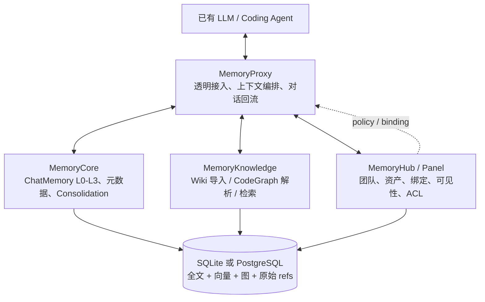
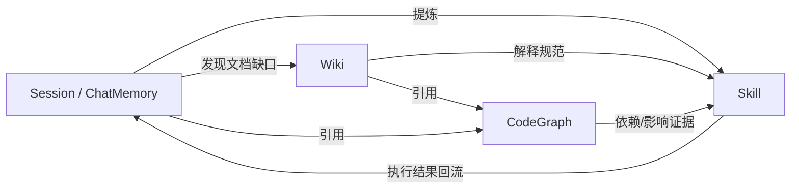
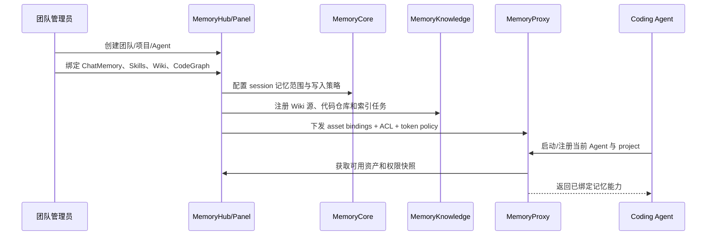
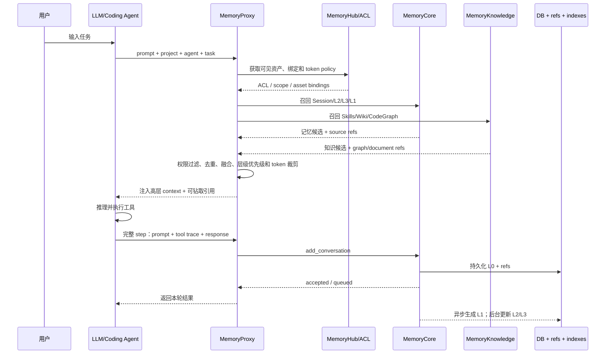
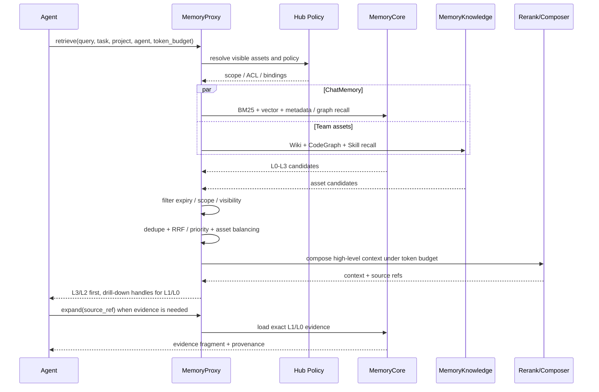
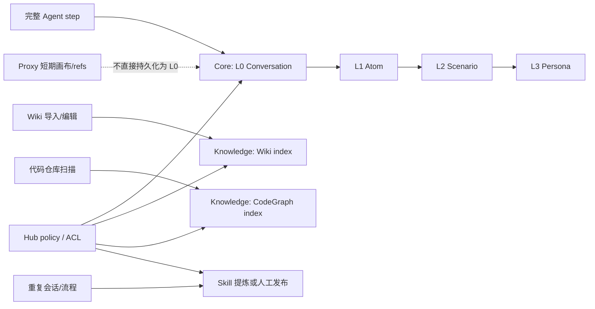

# TencentDB-Agent-Memory：四类记忆资产与透明接入架构

> **仓库**：[TencentCloud/TencentDB-Agent-Memory](https://github.com/TencentCloud/TencentDB-Agent-Memory)
> **文档定位**：本文从源码/仓库材料中整理 TencentDB-Agent-Memory 的记忆模型、运行时组件、集成方式和与 AgentMemory、Hindsight 的设计差异。
> **重要边界**：本文把“记忆内容的分层”和“系统组件的分层”分开描述。L0-L3 是 ChatMemory 的证据链；Session、Skills、Wiki、CodeGraph 是四类可治理资产；MemoryCore、MemoryKnowledge、MemoryProxy、MemoryHub/Panel 是服务职责，不是四个额外的记忆层。

## 目录

1. [先给结论：两个正交维度](#1-先给结论两个正交维度)
2. [系统定位与总体架构](#2-系统定位与总体架构)
3. [ChatMemory 的 L0-L3 证据分层](#3-chatmemory-的-l0-l3-证据分层)
4. [四类记忆资产](#4-四类记忆资产)
5. [四个核心组件为什么属于 Memory](#5-四个核心组件为什么属于-memory)
6. [完整运行时与集成时序](#6-完整运行时与集成时序)
7. [Recall：渐进式披露与多资产召回](#7-recall渐进式披露与多资产召回)
8. [短期工作记忆与水位压缩](#8-短期工作记忆与水位压缩)
9. [Consolidation、上报与生命周期](#9-consolidation上报与生命周期)
10. [存储、接口和接入方式](#10-存储接口和接入方式)
11. [四类资产的权限与治理](#11-四类资产的权限与治理)
12. [与 AgentMemory、Hindsight 的统一对比](#12-与-agentmemoryhindsight-的统一对比)
13. [优点、风险与适用边界](#13-优点风险与适用边界)
14. [源码/实现核对清单](#14-源码实现核对清单)

---

## 1. 先给结论：两个正交维度

TencentDB-Agent-Memory 的“奇怪”之处，实际上来自它把两个问题放在同一个 Memory 产品中解决：

### 1.1 维度 A：ChatMemory 的证据分层

这是回答“同一段 Agent 经历如何逐步沉淀”的纵向链路：

```text
L0 Conversation
  -> L1 Atom
  -> L2 Scenario
  -> L3 Persona
```

- **L0**：完整、可回放、可追溯的原始对话和工具 trace。
- **L1**：从单轮/单步事件提取的原子事实、偏好、约束、决策和发现。
- **L2**：按任务、项目或主题聚合的场景块，通常是人可读的 Markdown。
- **L3**：跨场景蒸馏出的稳定画像、长期规范和全局约束。

它是“内容/证据的生命周期”，只适用于 ChatMemory，不代表 Skills、Wiki、CodeGraph 也必须经过 L0-L3。

### 1.2 维度 B：四类记忆资产

这是回答“系统要长期管理哪些可复用资产”的横向平面：

| 资产 | 主要回答的问题 | 典型内容 | 是否走 ChatMemory L0-L3 |
|---|---|---|---|
| **Session / ChatMemory** | 发生过什么？为什么这样决策？ | 会话、工具调用、决策、错误和证据 | 是 |
| **Skills** | 下次应该怎么做？ | SOP、检查项、故障处理、可执行技能 | 否；可由 ChatMemory 派生，也可人工维护 |
| **Wiki** | 团队长期知道什么？ | PRD、架构文档、运维手册、知识片段 | 否；独立导入、切片、版本和检索 |
| **CodeGraph** | 代码实体如何关联？ | 文件、符号、调用链、依赖、影响范围 | 否；独立解析和图索引 |

> **核心结论**：ChatMemory 是一种资产，不是整个系统的同义词。MemoryKnowledge 管的是 Wiki/CodeGraph，Skills 是程序化资产，MemoryHub/Panel 管元数据和治理，MemoryProxy 管运行时编排。

---

## 2. 系统定位与总体架构

TencentDB-Agent-Memory 面向企业级编码和运维 Agent，目标不是只保存聊天记录，而是形成一个可被多个 Agent 共享的记忆资产平台：

1. 保存完整交互证据，支持从高层结论回到原始记录；
2. 把当前任务的上下文压缩成可持续工作的短期状态；
3. 把会话、技能、文档和代码知识统一纳入召回；
4. 通过团队、项目、可见性和 ACL 控制资产共享；
5. 对已有 LLM/编码 Agent 提供尽量透明的注入和对话回流。



### 2.1 组件职责总表

| 组件 | 负责什么 | 不负责什么 | 对应资产/状态 |
|---|---|---|---|
| **MemoryCore** | 会话写入、L0-L3 固化、ChatMemory 元数据、证据链 | 不负责代码仓库全量解析，不负责团队 UI/ACL 中心 | Session / ChatMemory |
| **MemoryKnowledge** | Wiki 文档处理、CodeGraph 构建、知识检索和引用 | 不把所有知识强行压成会话 L0-L3 | Wiki、CodeGraph |
| **MemoryProxy** | 对 Agent 透明接入；召回、排序、token 编排；短期画布和 refs；完整 step 回流 | 不作为长期事实的唯一真相源，不替代 Core 的持久化 | Working context、injection、return path |
| **MemoryHub / Panel** | 团队、项目、资产目录、绑定关系、可见性、ACL、管理界面 | 不负责每轮 LLM 摘要，也不替代检索引擎 | Skills、资产元数据、权限策略 |

### 2.2 为什么这些组件都属于 Memory

“Memory”不只等于一个 `memories` 表。一个可用的企业记忆系统至少包含：

- **记忆内容**：会话、事实、文档、代码关系、SOP；
- **记忆形成**：从原始事件提取、聚合、版本化；
- **记忆使用**：在正确的 Agent、任务和 token budget 下召回并注入；
- **记忆治理**：谁拥有、谁可以读、绑定哪个项目、何时失效、如何审计。

因此：

- MemoryCore 是“记忆形成与证据内核”；
- MemoryKnowledge 是“语义知识资产层”；
- MemoryProxy 是“记忆使用时的运行时工作层”；
- MemoryHub/Panel 是“记忆的元数据、权限和资产治理层”。

它们共同构成完整闭环，而不是把数据库、网关和后台管理误称为记忆层。

---

## 3. ChatMemory 的 L0-L3 证据分层

### 3.1 L0 Conversation：原始证据

L0 保存完整 Agent step：用户输入、Agent 回复、工具选择、工具参数、工具返回、错误和大文本 refs。L0 的价值是可回放和可审计，不是直接全部塞进 prompt。

```text
refs/task_migrate_001.md
[10:00] User: 将业务库从 MySQL 迁移至 PostgreSQL，业务不能中断。
[10:02] Agent: 调用 db_check，检查字符集和存储过程。
[10:05] Tool: 发现 utf8mb4 数据及部分不兼容存储过程。
[10:10] Agent: 采用改写存储过程、分阶段灰度切换的方案。
```

### 3.2 L1 Atom：最小可引用事实

L1 从完整 step 增量提取结构化原子：

```json
{
  "id": "atom_001",
  "task_id": "migrate_001",
  "statement": "业务 MySQL 数据库计划迁移到 PostgreSQL，要求业务不中断。",
  "source_ref": ["L0:task_migrate_001"],
  "valid_scope": ["project:db-migrate"],
  "expire_at": null,
  "importance": 0.8,
  "visibility": "project"
}
```

L1 是检索和引用的主要细粒度单位。它不应丢失来源，也不应把互相冲突的事实静默覆盖。

### 3.3 L2 Scenario：任务/主题场景块

```markdown
# Scenario: MySQL -> PostgreSQL Migration

目标：业务不停服完成数据库迁移。

已确认：
- 业务库存在 utf8mb4 数据；
- PostgreSQL 默认字符集可以承载 4 字节字符；
- 部分旧存储过程语法不兼容。

方案：先改写存储过程，再做灰度双写和回滚演练。

证据：
- L1:atom_001
- L1:atom_002
- L0:task_migrate_001
```

L2 是“这次任务/这个主题的完整上下文”，适合在 Agent 需要理解背景时按需加载。它不是 L0 的替代品。

### 3.4 L3 Persona：长期稳定约束

```markdown
# Persona: project-db-migrate

- 生产数据库变更必须支持灰度和回滚。
- 迁移任务优先验证字符集、存储过程兼容性和停机窗口。
- 关键决策必须记录证据引用。

Sources:
- L2:migrate_scenario_001
- L2:migrate_scenario_004
```

L3 变化频率最低，适合 SessionStart 或任务初始化时注入。它描述长期规范/画像，不应该携带整段原始日志。

### 3.5 L0-L3 的关键契约

| 契约 | 设计要求 |
|---|---|
| 可逆性 | 高层对象必须能通过 source refs 向下找到 L1/L0；不能用摘要替代唯一证据 |
| 更新 | L1/L2/L3 可以更新、过期或冲突；更新派生层不能修改 L0 |
| 作用域 | `valid_scope` 至少区分租户、团队、项目、任务和 Agent |
| 可见性 | `private`、`project`、`team` 等可见性在召回前过滤 |
| 时间 | 使用 `expire_at` 和版本状态治理有效性，不等同于自动遗忘 |

---

## 4. 四类记忆资产

### 4.1 Session / ChatMemory

这是“发生过什么”的资产，主链路是 L0-L3。它携带任务、项目、Agent、时间、来源、可见性和证据引用，既可用于回放，也可生成后续 Skill、Wiki 更新或项目画像。

### 4.2 Skills

Skills 是“下次怎么做”的程序化记忆：

```yaml
name: mysql-to-postgres-migration-check
trigger: 修改生产数据库迁移方案前
steps:
  - 检查字符集与排序规则
  - 扫描存储过程和 SQL 方言差异
  - 设计双写、灰度和回滚
  - 执行压测并记录证据
inputs:
  - project
  - schema-dump
sources:
  - session:migrate_001
  - wiki:db-migration-guide
  - codegraph:db/adapter
visibility: project
```

Skill 可以人工编写，也可以从重复的 Session/ChatMemory 模式中提炼。它应当可版本化、可测试、可绑定到团队或项目，不能只看作一段自然语言摘要。

### 4.3 Wiki

Wiki 是人类维护或导入的语义知识资产：PRD、设计规范、运维手册、故障知识、FAQ 和项目说明。Wiki 通常具有文档版本、章节、引用、标签和权限，不应在每次会话 Consolidation 时被重写成 Persona。

### 4.4 CodeGraph

CodeGraph 是代码实体及其关系资产：仓库、文件、模块、类、函数、调用链、依赖、影响范围和提交关系。它可以为“修改这个函数会影响什么”提供图遍历答案，不能仅用一个向量 chunk 代替。

### 4.5 资产之间的引用关系



资产之间可以互相引用，但不应互相覆盖：

- Session 的历史证据不因生成 Skill 而消失；
- Wiki 更新不自动伪造一条历史会话；
- CodeGraph 重建不等于修改项目 Persona；
- Skill 执行结果应回流成新的 Session 证据，形成闭环。

---

## 5. 四个核心组件为什么属于 Memory

### 5.1 MemoryCore：记忆形成和长期证据内核

MemoryCore 接收完整 step，写入 L0，并异步生成 L1、定时聚合 L2、低频蒸馏 L3。它决定：

- 什么是原始证据；
- 哪些字段可以被派生；
- 派生对象如何引用来源；
- 冲突、过期和版本如何表达。

### 5.2 MemoryKnowledge：独立语义资产的知识层

MemoryKnowledge 处理 Wiki 和 CodeGraph，因为这两类资产的形成方式不是“会话结束后做摘要”：

- Wiki 来源通常是文档导入、人工编辑、版本同步和章节切片；
- CodeGraph 来源通常是代码扫描、AST/符号解析、依赖分析和增量更新；
- 两者都需要自己的版本、索引、实体关系和引用模型。

把它们放进 MemoryKnowledge，意味着它们和 ChatMemory 一样可以被统一召回、引用和治理，但不意味着它们共享 L0-L3 的生成流水线。

### 5.3 MemoryProxy：透明接入和工作记忆编排层

MemoryProxy 位于 Agent 和记忆后端之间，典型职责是：

1. 识别当前 Agent、项目、任务、团队和 token budget；
2. 调用 Core、Knowledge 和 Hub 的策略/检索接口；
3. 融合 Session、Skill、Wiki、CodeGraph 结果；
4. 将高层摘要注入 prompt，需要时提供向下钻取工具；
5. 监控上下文水位，维护短期画布和 refs；
6. 在完整 Agent step 结束后，将对话回流到 Core。

它不是简单反向代理。它是“记忆如何进入当前推理上下文”的策略执行点。

### 5.4 MemoryHub / Panel：资产治理和元记忆层

MemoryHub 是团队和资产的控制平面，Panel 是其管理界面/运维界面。两者负责：

- 团队、租户、项目和 Agent 的组织关系；
- Session、Skill、Wiki、CodeGraph 的目录和归属；
- 资产绑定：哪个 Agent/项目可以使用哪些资产；
- `private/project/team` 可见性；
- ACL、RLS、审计、版本和发布状态；
- Skill 的激活、禁用、试运行和审核。

这些元数据决定“什么记忆对谁可见”，因此属于 Memory 的治理语义，而不是普通外围后台。

---

## 6. 完整运行时与集成时序

### 6.1 首次接入和配置时序



### 6.2 一轮对话的完整时序



### 6.3 为什么要“完整 step 回流”

TencentDB-Agent-Memory 的核心上报单位不是孤立的 `PreToolUse` 事件，而是闭环完成的一轮 step：

```text
用户输入
  -> Agent 选择工具
  -> 工具执行并返回
  -> Agent 生成本轮回复
  -> Proxy / SDK add_conversation
  -> Core 写入 L0
```

这样做可以避免把尚未执行的工具调用误当成事实，也让 L0 具备完整上下文。但代价是：Agent 崩溃或 Proxy 在 step 结束前断开时，需要额外的本地 spool/retry 或宿主回放机制，否则这一个未闭环 step 不会进入 ChatMemory。

---

## 7. Recall：渐进式披露与多资产召回

### 7.1 召回流程



### 7.2 排序和渐进式披露

建议把返回结果分成两种：

- **Context hit**：已经压缩的 L3/L2、Skill 摘要、Wiki 章节摘要、CodeGraph 关系摘要，直接用于 prompt；
- **Evidence handle**：指向 L1/L0、原始文档段落或代码实体的引用，需要核验时再展开。

一个合理的优先级不是“所有结果按同一个分数混排”，而是：

1. 先过滤不可见、过期和 scope 不匹配的资产；
2. 在每类资产内部按关键词、向量、图关系和更新时间召回；
3. 对高层摘要、Skill 触发匹配、CodeGraph 结构关系给予不同业务权重；
4. 进行去重和跨资产平衡，避免 Wiki 或 Session 单独占满窗口；
5. 用 token budget 输出摘要，保留可展开引用。

> 原文材料提到 RRF、层级优先级和 token 预算；具体权重、是否使用 CrossEncoder、四类资产是否共享同一索引，应以实际部署版本和源码实现为准，不能仅凭架构图推断。

---

## 8. 短期工作记忆与水位压缩

短期上下文不是 L0-L3 长期资产，而是 Proxy 为“当前任务窗口”维护的运行时状态：

```text
原始工具输出 -> refs/*.md
              -> step jsonl 摘要
              -> Mermaid 任务画布
              -> 注入 Agent 当前上下文
```

### 8.1 水位策略

| 上下文水位 | 动作 | 是否改变长期 ChatMemory |
|---:|---|---|
| 约 60% | 用 step 摘要替换长文本；原文卸载到 refs | 否，除非完整 step 最终回流 Core |
| 约 80% | 折叠已完成分支，更新 Mermaid 任务画布 | 否 |
| 约 95% | 清理无关旧消息，保留当前分支和恢复引用 | 否 |

### 8.2 画布的边界

Mermaid 画布描述“当前任务状态”，不是长期事实库。它可能随着任务推进而被重写；需要审计时应读取 refs/L0，而不是把画布当作唯一证据。画布压缩失败时，Proxy 应保留原始上下文或降级为文本摘要，不能让错误图形覆盖唯一状态。

---

## 9. Consolidation、上报与生命周期

### 9.1 两条独立管线



### 9.2 触发与失败边界

| 管线 | 输入 | 触发 | 失败时保留什么 |
|---|---|---|---|
| L0 写入 | 完整 step | Proxy/SDK 回流 | 已写入的 L0；未闭环 step 依赖 spool/replay |
| L1 提取 | L0 | 异步/增量 | L0 不受影响，可重试 |
| L2 聚合 | 多个相关 L1 | 后台任务 | L1 和 L0 保留 |
| L3 蒸馏 | 多个 L2 | 低频后台 | L2/L1/L0 保留 |
| Wiki | 文档源 | 导入/编辑/同步 | 旧版本可保留，索引可重建 |
| CodeGraph | 代码仓库 | 扫描/增量更新 | 旧快照与源码可保留 |
| Skill | 人工或模式提炼 | 发布/审核/版本化 | 历史版本和来源保留 |

### 9.3 冲突、过期和遗忘

- L0 原始记录是证据基线，不应被高层摘要覆盖；
- L1-L3 可以标记冲突、过期和版本，不应静默删除冲突候选；
- `valid_scope`、`expire_at`、`importance`、`visibility` 决定派生记忆是否可用；
- 该设计重点是证据保留和显式有效期，不是 Ebbinghaus 式自动 strength decay；
- Wiki、CodeGraph、Skill 更像可版本化资产，不应假定与 ChatMemory 共享同一条衰减曲线。

---

## 10. 存储、接口和接入方式

### 10.1 存储形态

材料中描述了两种部署形态：

| 部署 | 关系/全文 | 向量 | 图 | 适用 |
|---|---|---|---|---|
| 本地单机 | SQLite | sqlite-vec | 能力受限或不启用 | 试用、开发、轻量场景 |
| 生产/团队 | PostgreSQL | pgvector | Apache AGE | 多租户、RLS、团队资产和图关系 |

原始大文本可以放在 refs 文件中，数据库保存元数据、引用和索引；L2/L3 使用 Markdown 有利于审计和人工修改。实际部署仍需以仓库版本的 compose/config/迁移脚本为准。

### 10.2 Team Memory 组件部署形态

现有 Team Memory 资料中常见的服务拆分如下；端口属于部署约定，必须以目标分支的 compose、启动脚本和配置文件为准：

| 服务 | 资料中常见端口 | 主要职责 |
|---|---:|---|
| MemoryCore | `8420` | ChatMemory 写入、L0-L3 固化和核心 API |
| MemoryKnowledge | `8424` | Wiki / CodeGraph 导入、索引和知识 API |
| MemoryProxy | `8096` | OpenAI/Anthropic 兼容代理、召回编排和对话回流 |
| MemoryHub/Panel | `8125` | 团队、资产、绑定和 ACL 管理界面 |

单 Agent/OpenClaw/Hermes 插件路径可以把 Gateway 和本地 SQLite/refs 集成在一起；Team Memory 路径则把 Core、Knowledge、Proxy 和 Panel 分开部署。两者共享“捕获、召回、回流”的设计目标，但进程边界、API 版本和持久化能力可能不同，不能把插件路径的默认行为直接套到 Team Memory 服务。

### 10.3 对外接口

| 接口 | 作用 |
|---|---|
| `add_conversation` | 上报完整 step，写入 L0 |
| `memory_retrieve` | 召回多层记忆和团队资产 |
| provenance/expand | 从高层结果展开 L1/L0 或文档/代码证据 |
| 资产 API | 管理 Wiki、CodeGraph、Skill、Session |
| Hub/Panel API | 团队、绑定、ACL、可见性和发布状态 |

### 10.4 接入方式

- **MemoryProxy**：透明网关，适合不希望修改 Agent 主循环的已有 LLM/编码 Agent；
- **OpenClaw/Hermes 等插件**：在宿主生命周期中调用 Proxy/API；
- **自研 Agent SDK**：在每轮 `retrieve -> run -> add_conversation` 中显式接入；
- **管理端**：通过 MemoryHub/Panel 配置团队、项目和资产绑定。

自研 Agent 的最小接入伪代码：

```python
memory = MemoryClient(proxy_url="http://memory-proxy")

context = memory.retrieve(
    query=user_prompt,
    project="db-migrate",
    agent_id="migration-agent",
    task_id=task_id,
    token_budget=2000,
)

answer, trace = agent.run(user_prompt, context=context)

memory.add_conversation(
    task_id=task_id,
    user_prompt=user_prompt,
    tool_trace=trace.tools,
    assistant_response=answer,
    scope="project:db-migrate",
)
```

### 10.5 注意：组件名不等于已验证的公开 API

本文使用 `MemoryCore`、`MemoryKnowledge`、`MemoryProxy`、`MemoryHub/Panel` 来表达系统职责边界。具体 HTTP 路径、SDK 包名、部署方式、鉴权字段和接口名称必须以目标仓库当前代码为准；不要仅根据本文伪代码生成生产集成。

---

## 11. 四类资产的权限与治理

四类资产可以复用同一套治理模型，但权限对象和生命周期不同：

| 资产 | 典型 owner | 典型 scope | 版本策略 | 主要风险 |
|---|---|---|---|---|
| Session/ChatMemory | Agent/用户/项目 | task/project/team | L0 append-only；L1-L3 派生版本 | 泄露用户输入和工具输出 |
| Skill | 团队/项目 | project/team | 草稿、审核、发布、回滚 | 未审核 SOP 被自动执行 |
| Wiki | 团队/项目 | project/team | 文档版本、归档、审批 | 过期规范污染召回 |
| CodeGraph | 仓库/团队 | repo/project/team | commit/snapshot 增量 | 代码权限和旧图快照 |

### 11.1 召回前的权限顺序

```text
identity -> tenant/team -> project binding -> asset visibility -> ACL/RLS
         -> valid_scope / expire_at -> retrieval -> token composition
```

权限过滤必须早于上下文拼装。不能先把团队全部资产召回后，再靠 prompt 文字要求模型“不要看私有内容”。

### 11.2 发布和回流

- Skill 需要审核/发布后才进入默认召回；
- Wiki/CodeGraph 更新后应重建相关索引，并保留旧版本引用；
- Skill 执行的输入、结果和失败应回流成新的 Session/L0 证据；
- Panel 的人工修改应记录操作者、时间、版本和原因。

---

## 12. 与 AgentMemory、Hindsight 的统一对比

### 12.1 三个项目不是同一个“分层”

| 项目 | 主要分层对象 | 主要分层方式 |
|---|---|---|
| **AgentMemory** | 事件、会话摘要、语义事实、过程记忆 | Working / Episodic / Semantic / Procedural 四类并行功能层 |
| **Hindsight** | 原始证据、Experience/World/抽象心智模型 | Retain / Recall / Reflect 三条管线；证据和抽象层逐级关联 |
| **TencentDB-Agent-Memory** | ChatMemory + Wiki + CodeGraph + Skills | L0-L3 是 ChatMemory 的证据层；四类资产在其外形成资产平面 |

### 12.2 架构维度对比

| 维度 | AgentMemory | Hindsight | TencentDB-Agent-Memory |
|---|---|---|---|
| 核心目标 | 编码 Agent 自动捕获、跨会话召回和共享 | 保真证据、持续抽象、可审计反思 | 企业团队的会话记忆 + 知识资产 + 透明接入 |
| 原始上报 | Hook 事件发生即捕获，允许中间事件 | 更强调完整事实/step 后写入 | 完整 Agent step 闭环后写入 L0 |
| 内容分层 | 四类功能记忆可并存 | Retain 保存证据，Reflect 生成抽象 | ChatMemory L0-L3，自有资产不强行过层 |
| 记忆资产 | 主要围绕 observation/Memory/lesson/graph | 以证据链和抽象知识为主 | Session、Skills、Wiki、CodeGraph 一等公民 |
| 短期工作层 | Working observation + context injection | 由运行时/检索上下文实现，重点不在任务画布 | Proxy Mermaid 画布、jsonl、refs，独立于 L0-L3 |
| 召回 | BM25 + Vector + Graph，RRF、session diversification，可选 rerank | 多通道召回与重排，强调证据下钻 | 多资产召回，层级优先、权限过滤、token 编排和渐进披露 |
| 固化 | 事件/会话驱动，Semantic 可能原地更新，Memory 可版本演进 | 增量归纳与反思，保留证据链 | L0 -> L1 -> L2 -> L3；Wiki/CodeGraph/Skill 独立更新 |
| 溯源 | 来源 ID、部分版本链；受 retention 策略影响 | 证据链是核心能力 | L0 永久证据、Markdown/refs、资产版本和引用 |
| 遗忘 | 可有 strength/retention/eviction | 更偏保留原始证据和版本 | 显式 `expire_at`/scope/版本，通常不做时间衰减 |
| 权限 | scope、agent/team sharing、审计 | 以具体部署权限模型为准 | Hub/Panel + visibility + ACL/RLS 是一等能力 |
| 接入 | Hooks + MCP + REST + iii-sdk | retain/recall/reflect 接口和 Agent 集成 | MemoryProxy、插件、SDK、Hub 配置 |
| 系统形态 | 记忆服务侧车 | 记忆内核/管线 | 记忆平台：Core + Knowledge + Proxy + Hub/Panel |

### 12.3 如何选择

- 需要快速给 Claude/Codex/Cursor 等编码 Agent 加上自动记忆：优先看 **AgentMemory**；
- 需要清晰的 Retain/Recall/Reflect 证据管线、持续反思和强溯源：优先看 **Hindsight**；
- 需要团队共享的会话、Wiki、代码图谱和 SOP，并希望已有 Agent 透明接入：优先看 **TencentDB-Agent-Memory**。

三者可以组合，但要明确边界：例如 CodeGraph/Wiki 可以作为 AgentMemory 或 Hindsight 的外部知识源；不能把外部知识导入后就声称它自动拥有对方完整的固化、ACL 和版本语义。

---

## 13. 优点、风险与适用边界

### 13.1 优点

1. L0 原始证据与高层抽象分离，支持渐进式披露和审计；
2. Session、Skills、Wiki、CodeGraph 覆盖“发生过什么、知道什么、怎么做、代码如何关联”；
3. Proxy 让既有 Agent 可以低改造接入，并统一控制 token budget；
4. Hub/Panel 把团队、项目、可见性、绑定和 ACL 变成显式数据，而不是 prompt 约定；
5. 本地单机和 PostgreSQL/向量/图生产形态兼容，便于从原型扩展到团队系统。

### 13.2 风险与短板

1. 组件多，Core、Knowledge、Proxy、Hub 的部署、版本和故障边界复杂；
2. 本地 SQLite 形态与生产 PostgreSQL/pgvector/AGE 形态能力可能不完全一致；
3. CodeGraph 大仓库解析会带来 CPU、内存和增量更新成本；
4. L2/L3 后台蒸馏有延迟，不能假设新事实立即反映到 Persona；
5. Mermaid 画布依赖压缩逻辑，图状态错误时必须保留 refs/L0 作为恢复源；
6. Skill 自动提炼和自动执行存在错误 SOP、权限越界和版本发布风险；
7. L0 永久保存带来隐私、删除请求、存储增长和合规治理压力；
8. 多资产融合如果没有严格的 scope、ACL、版本和引用过滤，容易出现跨项目污染。

### 13.3 适用场景

- 数据库运维、研发工程和企业知识型 Agent；
- 多 Agent 团队共享项目资产；
- 需要保留完整交互证据、支持审计和回放的任务；
- 长任务上下文容易爆炸、需要画布和 refs 卸载的场景。

不适合：只需要极简短期聊天记忆、资源极小、不能承担 PostgreSQL/图/资产治理复杂度，或明确要求自动遗忘全部旧证据的场景。

---

## 14. 源码/实现核对清单

阅读或接入仓库时，建议按以下顺序核对，不要只依赖架构图：

1. **入口和部署**：CLI、Docker Compose、环境变量、数据库迁移和默认端口；
2. **Core**：`add_conversation`、L0 schema、L1 提取、L2/L3 任务和 provenance；
3. **Knowledge**：Wiki 导入/切片、CodeGraph parser/indexer、Skill schema；
4. **Proxy**：retrieve、token budget、短期画布、refs、step 回流和失败重试；
5. **Hub/Panel**：团队、项目、资产绑定、visibility、ACL/RLS、审计和发布流程；
6. **Recall**：关键词/向量/图三路是否真实启用，RRF/层级优先级/重排的真实顺序；
7. **生命周期**：L0 是否 append-only、派生层如何冲突/过期、资产如何版本和删除；
8. **测试**：跨项目隔离、权限越界、断线回流、重复 step、CodeGraph 增量和 Skill 回滚。

> 结论应以仓库当前源码和配置为准。本文的伪代码、Mermaid 图和 JSON 用于解释数据边界，不等于稳定的公开 SDK 签名。
