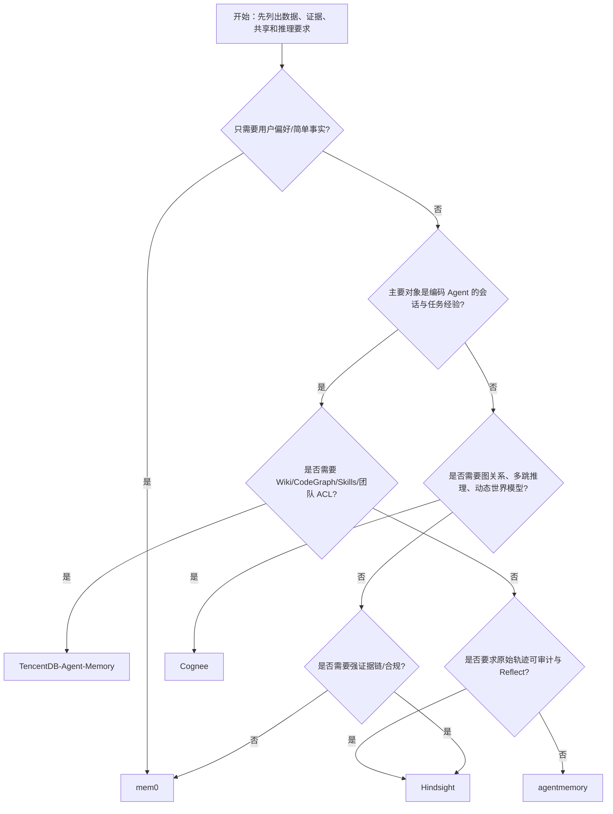
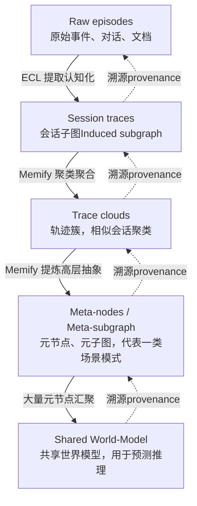
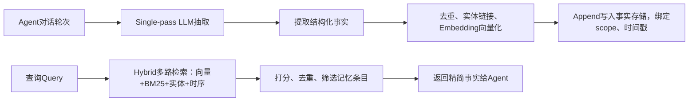
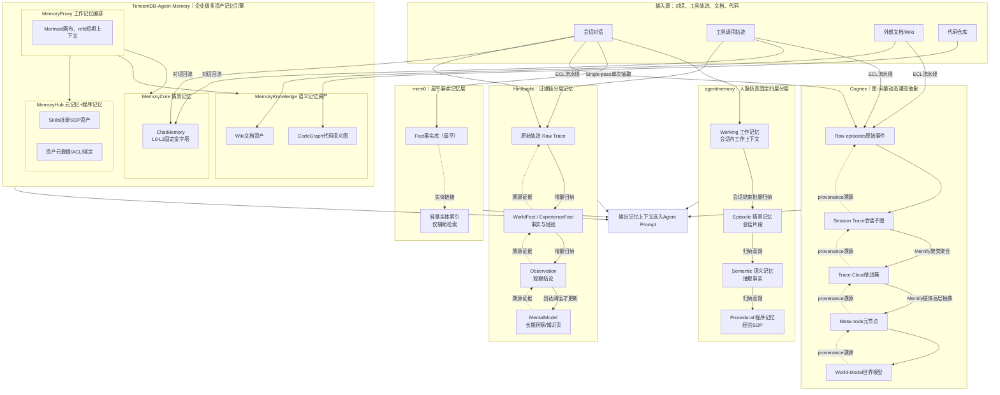

# Agent Memory 项目选型与设计对比总览

> 本文把 **Cognee、mem0、agentmemory、Hindsight、TencentDB-Agent-Memory** 放在同一个决策框架中比较。
> 目标不是给出“最强的一个项目”，而是回答：**我需要哪一种记忆、哪些数据是一等资产、证据要保存到什么程度、系统复杂度是否值得，以及多个项目如何组合。**
>
> 文档分为两部分：前半部分是面向架构决策的结论、模型、矩阵和落地清单；后半部分保留并整理原有 Cognee、mem0 设计说明及五方统一对比，避免因为重排而丢失细节。
>
> **事实边界**：下文的“设计定位”用于架构比较。尤其 Cognee 的动态世界模型、Meta-node 等内容应理解为设计理念/能力方向；落地前仍需以目标版本源码、部署组件和 benchmark 复核。性能数字若来自项目方，应按“厂商自述、待复现”处理。

## 1. 先给结论：如何选型

| 你的第一诉求 | 首选 | 为什么 | 不要误选 |
| --- | --- | --- | --- |
| 只想记住用户偏好、简单事实，尽快接入 | **mem0** | 扁平事实、scope 隔离、接入轻，适合外挂在任意 Agent 前后 | 它不是完整会话审计库，也不是任务上下文管理器 |
| 编码 Agent 跨会话记住工作习惯、任务经验 | **agentmemory** | Working / Episodic / Semantic / Procedural 认知功能分层，适合会话型 Agent | 不要把它当成 Wiki、CodeGraph 或企业资产控制平面 |
| 工具轨迹必须可回溯、可解释、可审计，并需要 Reflect | **Hindsight** | Retain / Recall / Reflect 形成证据优先的长期记忆管线 | 不要期待它原生管理 Wiki、CodeGraph、Skills 资产 |
| 需要实体关系、多跳推理、动态聚类和世界模型 | **Cognee** | 图与向量是同一记忆本体，Memify 使高层抽象动态涌现 | 轻量偏好记忆不值得承担图数据库和持续固化成本 |
| 企业团队要统一管理会话、Wiki、CodeGraph、Skills、可见性和 ACL | **TencentDB-Agent-Memory** | MemoryCore / MemoryKnowledge / MemoryProxy / MemoryHub 覆盖资产、上下文和治理 | 单用户小应用通常会觉得过重 |

**一句话判断**：

- 事实优先 → **mem0**；
- 认知功能分层 → **agentmemory**；
- 证据链和反思审计 → **Hindsight**；
- 图推理和世界模型 → **Cognee**；
- 企业复合资产与权限治理 → **TencentDB-Agent-Memory**。

## 2. 先定义需求：你到底需要哪一种 Memory

选型前不要先问“哪个项目功能最多”，而要按以下问题拆解需求：

1. **记什么**：用户偏好和事实、完整会话、工具调用轨迹、文档、代码关系、可执行 Skill，还是以上全部？
2. **保留什么证据**：只保留抽取后的事实，还是必须保存原始输入、工具参数、工具输出、时间和版本？
3. **如何抽象**：扁平事实、认知功能层、固定证据抽象、动态知识图，还是证据层与资产平面并存？
4. **如何召回**：语义相似度、关键词、实体链接、图遍历、按时间/重要性排序，还是“先高层结论、再展开证据”？
5. **短期上下文谁负责**：应用自己维护，还是需要 Working memory、token 水位、refs 卸载、任务画布和自动回流？
6. **共享边界是什么**：单用户、单 Agent、项目、团队、租户；是否需要可见性、ACL、审批和发布？
7. **如何遗忘**：检索降权、过期、软删除、硬删除、按用户/项目撤销，还是保留不可变审计证据？
8. **可以承受什么成本**：在线 LLM 抽取、异步归纳、embedding、图存储、后台聚类、运维和数据迁移成本。

### 2.1 需求维度与项目映射

| 需求维度 | 适合的设计 | 最匹配项目 |
| --- | --- | --- |
| 用户偏好、简单约束 | 扁平事实 + 新鲜度/重要性排序 | mem0 |
| Agent 的当前任务上下文 | Working memory + 任务状态 | agentmemory；TencentDB 的 MemoryProxy |
| 跨会话任务经历 | 情景记忆或原始轨迹 | agentmemory；Hindsight |
| 可验证事实和长期洞察 | 原始证据 → 观察 → 心智模型 | Hindsight |
| 文档、实体、关系、多跳路径 | 图 + 向量统一本体 | Cognee |
| Wiki、代码图、Skill 作为可治理资产 | 资产平面 + 知识解析 + ACL | TencentDB-Agent-Memory |
| 动态归纳世界模型 | Trace 聚类 + Meta-node + World-model | Cognee |
| 高合规审计 | 不可变原始证据 + provenance + citations | Hindsight；TencentDB |

### 2.2 三种“分层”不能混为一谈

这五个项目说的“层”不是同一个维度：

- **agentmemory**：认知功能层——Working、Episodic、Semantic、Procedural，回答“记忆发挥什么功能”。
- **Hindsight**：证据抽象层——WorldFact / ExperienceFact、Observation、MentalModel，回答“从原始证据抽象到什么程度”，核心是 Retain / Recall / Reflect。
- **TencentDB-Agent-Memory**：ChatMemory 证据金字塔 L0 Conversation → L1 Atom → L2 Scenario → L3 Persona，另有 Session、Skills、Wiki、CodeGraph 四类资产平面，回答“记忆证据和企业资产如何治理”。
- **Cognee**：动态结构层——Raw episode → Session trace → Trace cloud → Meta-node → World-model，回答“从数据中动态涌现什么关系和高层模式”。
- **mem0**：事实对象层——抽取并存储 Fact，主要靠 scope、时间、重要性、实体和检索信号组织，不提供固定多层金字塔。

因此不能简单说“谁的 L3 更高”或把五套系统的层级直接互换。

### 2.3 用三条完整管线判断是否匹配

把“记忆”拆成三条链路，能够避免只看一个检索接口做错选型：

| 管线 | 要回答的问题 | 典型步骤 | 最匹配的项目 |
| --- | --- | --- | --- |
| **写入/固化（Retain 或 Consolidation）** | 新对话、工具轨迹、文档如何变成可长期使用的记忆？ | 原始输入 → 抽取/规范化 → 事实、事件、图或分层摘要 → provenance | mem0（单次事实抽取）、agentmemory（会话结束归纳）、Hindsight（证据抽象）、Cognee（ECL + Memify）、TencentDB（L0-L3 + 资产解析） |
| **检索/编排（Recall）** | 当前请求需要哪些记忆，按什么范围和顺序注入？ | scope 过滤 → 关键词/向量/实体/图检索 → 去重/排序 → 证据展开 → 上下文预算 | mem0 的 hybrid retrieval、agentmemory 的多路召回、Hindsight 的 Recall、Cognee 的图-向量检索、TencentDB 的 Proxy 编排 |
| **反思/消费（Reflect）** | 如何把召回结果变成可解释的结论、行动或下一轮记忆？ | 召回候选 → LLM 归纳/推理 → citations 或结构化输出 → 必要时回写 | Hindsight 的 Reflect 最明确；Cognee 偏 World-model 推理；TencentDB 偏资产/Agent 编排；其他项目通常由应用层完成 |

> **选型原则**：如果只需要“记住一个事实”，选轻量写入和检索；如果需要“解释为什么这样回答”，必须把原始证据、来源和消费阶段一起纳入设计；如果需要“让团队共享并治理资产”，要选有资产平面和权限控制的系统。

## 3. 关联详细文档

本文件是选型总览，不替代各项目的源码对齐文档：

- [Hindsight 完整核心技术文档](./Hindsight 分层记忆系统 完整核心技术文档（终版）.md)：Retain / Recall / Reflect、分层实体、时序图和接口。
- [TencentDB-Agent-Memory 设计文档](./TencentDB-Agent-Memory.md)：L0-L3 ChatMemory、四类资产、MemoryCore / Knowledge / Proxy / Hub。
- [agentmemory 架构文档](../agent-memory/ARCHITECTURE.md) 与 [记忆分层文档](../agent-memory/MEMORY_LAYERS.md)：源码对齐的四类认知功能层。

## 4. 五个项目的一句话定位

1. **mem0**：最轻量的事实记忆层，把对话提炼成可检索事实。
2. **agentmemory**：以人脑认知功能为启发的会话记忆系统，强调工作、情景、语义和程序记忆的协同。
3. **Hindsight**：Retain / Recall / Reflect 驱动的证据优先记忆系统，强调原始轨迹、溯源、观察结论和长期心智模型。
4. **Cognee**：图—向量混合记忆本体，通过 ECL 和 Memify 将轨迹聚合为动态 Meta-node 和 World-model。
5. **TencentDB-Agent-Memory**：面向团队和企业 Agent 的复合记忆平台，把 ChatMemory、Skills、Wiki、CodeGraph 作为一等资产，并通过 Proxy/Hub 治理接入与权限。

## 5. 选型决策树



> 决策树是“首选入口”，不是禁止组合的单选题。例如，企业系统可以用 TencentDB 做控制平面，用 Cognee 做知识图推理；编码 Agent 可以用 agentmemory 做认知记忆，再用 CodeGraph 提供代码关系。

## 6. 场景化选型矩阵

| 场景 | 首选 | 备选/组合 | 关键原因 |
| --- | --- | --- | --- |
| 个人聊天、用户偏好 | mem0 | agentmemory | 事实简单、接入成本低 |
| 客服/个性化助手 | mem0 | Hindsight | 需要事实记忆；高风险回答再加证据链 |
| Codex/Cursor/Claude 类编码 Agent 的跨会话习惯 | agentmemory | Hindsight + CodeGraph | 前者偏任务经验，后者补审计，CodeGraph 补代码关系 |
| 金融、医疗、生产运维审计 | Hindsight | TencentDB | 保留原始轨迹、证据回溯和引用；团队资产多时用 TencentDB |
| 团队研发知识中台 | TencentDB-Agent-Memory | TencentDB + Cognee | Wiki/CodeGraph/Skills/ACL 是一等能力，复杂关系推理再引入 Cognee |
| 代码影响分析、依赖追踪 | TencentDB 的 CodeGraph | Cognee | CodeGraph 是代码资产平面；跨文档/跨轨迹多跳可交给 Cognee |
| 多跳知识问答、动态世界模型 | Cognee | Hindsight + 外部图 | 图本体、Trace cloud 和 Meta-node 更匹配 |
| 超长任务上下文、任务画布 | TencentDB 的 MemoryProxy | agentmemory + 应用层压缩 | Proxy 可维护 refs、JSONL、Mermaid 画布和 token 水位 |
| Skill/SOP 管理与发布 | TencentDB 的 Skills | Hindsight + 外部 Skill registry | 需要版本、绑定、可见性和 ACL 时选择资产平台 |
| 快速 POC 或只想加一层记忆 | mem0 | agentmemory | 先验证召回价值，避免过早引入图和治理平台 |
| 动态沉淀跨项目经验 | Cognee | Hindsight | Meta-node/World-model 偏探索和预测；Hindsight 偏可核验 |

## 7. 不是单选：推荐的组合架构

### 7.1 轻量事实 + 外部知识检索

```text
Agent → mem0（用户事实/偏好）
      → 外部 RAG（Wiki/文档）
      → 应用层短期上下文
```

适合个人助手和快速 POC。必须明确：mem0 的事实与外部 RAG 的文档是两套数据源，不能把文档引用误当成用户记忆。

### 7.2 编码 Agent 记忆 + 代码图

```text
Codex/Cursor/IDE Hook
        ├─ agentmemory：Working/Episodic/Semantic/Procedural
        └─ CodeGraph：符号、调用、依赖、变更影响
                     ↓
              Agent 上下文编排层
```

适合需要“记住这个仓库怎么工作”的编码 Agent。需要另外规定代码图刷新、分支/commit scope 和记忆删除责任。

### 7.3 证据优先 + Wiki/CodeGraph

```text
Agent 轨迹 → Hindsight Retain → Recall/Reflect → 带 citations 的回答
                         ↑
                 Wiki / CodeGraph 外部检索
```

适合合规场景。Hindsight 负责任务证据；外部知识源负责文档和代码；回答中要区分“任务经历”“外部事实”和“推断”。

### 7.4 企业统一控制平面

```text
MemoryProxy（接入、短期上下文、回流）
              ↓
MemoryHub/Panel（团队、项目、绑定、visibility、ACL、审核）
       ├── MemoryCore：ChatMemory L0-L3
       └── MemoryKnowledge：Wiki / CodeGraph
              + Skills 资产
```

TencentDB-Agent-Memory 更适合做统一资产和权限边界；Cognee 或 Hindsight 可作为特定知识推理/证据服务，而不是再各自成为新的权限源。

### 7.5 组合时必须先约定的治理规则

- **唯一事实源**：同一条用户偏好/项目约束到底由谁写入、谁判定最新、谁负责冲突解决。
- **provenance 贯穿**：跨系统复制时传递 `source_id`、版本、时间、scope 和原始链接。
- **scope 不混用**：user、agent、session、project、team、tenant 分别建模，不能只靠一串字符串含糊隔离。
- **删除责任**：用户撤回或项目删除时，主存储、向量索引、图索引、缓存和派生摘要都要有清理策略。
- **读写回路防重复**：A 的 recall 结果不要被 B 当成新事实再次写入；给导入/派生内容标记来源和幂等键。
- **失败降级**：图服务、embedding、LLM 抽取或异步 consolidation 失败时，Agent 是否仍能使用原始上下文和基础检索。

## 8. 评估与落地检查清单

### 8.1 功能和质量

- [ ] Recall@K、Precision@K、MRR、NDCG：事实是否召回、顺序是否正确。
- [ ] 证据完整性：能否从答案回到原始消息、工具输入/输出、文档版本或代码 commit。
- [ ] 冲突处理：新旧偏好、不同 Agent、不同项目的冲突是否显式标记。
- [ ] scope 隔离：越权查询、跨用户泄漏、跨项目污染是否有测试。
- [ ] 去重与会话多样性：同一 session 的重复片段是否挤占结果。
- [ ] 删除与合规：硬删除、软删除、过期、撤回和审计保留期是否能分别满足。

### 8.2 成本和运行

- [ ] 在线写入延迟与异步固化延迟分别是多少。
- [ ] 每轮抽取、embedding、聚类、Reflect 的 LLM/token 成本。
- [ ] 长任务的 prompt token、水位、压缩比例和恢复时间。
- [ ] 存储依赖：向量库、图数据库、PostgreSQL、对象存储和队列是否必须同时部署。
- [ ] provider 降级、重试、幂等和回放机制是否完整。
- [ ] 多租户扩容、备份恢复、索引重建和版本迁移是否可运维。

### 8.3 评审结论模板

```text
场景/租户：
一等资产：
必须保留的证据：
短期上下文责任方：
召回指标与离线数据集：
写入/归纳延迟预算：
删除与合规策略：
首选项目：
选择理由：
明确不采用的能力及后续补件：
```

## 9. 详细设计与原始内容整理

### 9.1 Cognee：图—向量一体化、动态世界模型

> 以下保留原有 Cognee 设计理念与记忆模型内容；本节不把宣传性能力误写成源码已验证事实。

>
> 核心定位：**图‑向量混合原生记忆引擎**，记忆不是一堆文本块的归档，而是一套可以持续进化、可以做推理的结构化知识系统。
> 核心理念来源：认知科学 + 知识工程；反对把记忆等价于 “增强检索 RAG”，记忆本身是 Agent 的基础计算层。

#### 9.1.1 顶层核心设计哲学

1. **记忆是 Compound（复合增长），而不是 Accumulate（单纯堆积）**
   普通记忆系统：不断追加原始记录，数据量无限膨胀，检索越来越慢、噪声越来越多。
   Cognee 理念：记忆不能只做存储，还要做持续维护。随使用不断做**Memify 记忆固化维护**：强化高频重要关联、修剪低价值节点、从大量重复轨迹提炼高层抽象元结构；在保留溯源链路前提下压缩记忆，避免记忆体系自身 “重量过载”。

>
> 重点：压缩不等于丢弃原始证据，高层抽象节点保留 provenance 溯源，能够回溯底层原始输入。

2. **图‑向量双基底，统一一套记忆本体**

- 向量：负责模糊语义、相似度召回；
- 知识图：负责实体、关系、事件时序、多跳推理；
  二者**不是两套独立索引，是同一套记忆实体的两种表达**；每一个图谱节点同时绑定 embedding 向量，检索可以自由在语义相似度和图遍历之间切换。

3. **原始输入与高层抽象分层演进：Trace → 元节点 → 世界模型 World‑Model**

>
> 一套自底向上的**递进抽象链，不是静态固定的 4 层 / 3 层硬编码分层**。
> 区别于 agentmemory 的认知功能层、Hindsight 的证据抽象管线和 TencentDB-Agent-Memory 的 ChatMemory/资产分层：Cognee 的高层结构是**动态聚合生成出来**的，数据越多抽象层级越可能浮现。

抽象递进链条：

1. **Raw episodes 原始事件**：原始对话、工具轨迹、文档片段，原始输入，完整保留。
2. **Session traces 会话轨迹**：把一次会话全部观测、动作、结果，封装为一条会话子图（induced subgraph）。
3. **Trace clouds 轨迹簇**：把一批语义、模式相似的多条会话轨迹做聚类。
4. **Meta‑nodes 元节点 / Meta‑subgraph 元子图**：从轨迹簇提炼出来的高层抽象；代表一类场景、一类模式，而不是单条独立事件。
5. **Shared world‑model 共享世界模型**：大量元节点汇聚形成，用于预测未来情景、指导 Agent 行为，**不止用于检索，还用于预测推理**。

>
> 关键点：分层不是写死配置；随着输入数据增加，系统自动向上聚合生成更高阶 Meta 节点。

4. **Provenance 溯源一等公民**
   所有高层元节点、推导得到的新关系，全部记录来源 provenance，可以反向回溯到原始 Raw episodes；抽象结论可以核验原始证据，高层修改不会篡改底层原始数据。
5. **四大原语：remember /recall/improve /forget**
   把记忆全部行为收敛到 4 个基础语义原语，屏蔽底层图、向量、关系细节，向上给 Agent 提供极简语义接口：

- `remember`：写入记忆（原始事件入库，进入 ECL 流水线）
- `recall`：多路混合召回记忆
- `improve`：触发 memify 固化，做记忆聚合、提炼元节点、更新关系权重
- `forget`：支持粒度可控遗忘，可以单条、数据集、用户维度做遗忘 / 降权，不是简单硬删除。

6. **ECL 流水线（Extract‑Cognify‑Load）记忆编码流水线**
   所有外部输入（对话、文档、工具轨迹）统一经过 ECL 流水线，把非结构化原始素材，转换成「图实体‑关系 + 向量」双重表示，再存入统一记忆本体。

>
> Extract 抽取 → Cognify 认知化（实体识别、关系抽取、冲突检测、事实规范化） → Load 加载入库。
> 这是记忆的编码入口；不管输入是会话还是文档，使用同一套编码逻辑。

7. **支持多 Agent 共享记忆本体**
   记忆本体是可多 Agent 共用的知识库；不同 Agent 可以消费同一套 Meta‑node、世界模型，经验跨 Agent 流转，而不是每个 Agent 各自一套隔离记忆。同时支持租户隔离能力，可做数据域隔离。

#### 9.1.2 关键概念拆解

##### 9.1.2.1 Memify（记忆固化维护）

>
> 类比其他系统的 Consolidation，但设计目标不一样。

- agentmemory：SessionEnd 一次性批量归纳；
- Hindsight：增量生成 Observation / MentalModel 等固定抽象类型；
- TencentDB‑Agent‑Memory：ChatMemory 内部固定 L0‑L3 金字塔；
- **Cognee Memify：动态维护整张知识图谱**。
  行为包括：

1. 根据访问频率，**提升高频实体 / 边权重，衰减低价值连接**；
2. 聚类相似 trace，自动生成 Meta‑node 高层抽象；
3. 检测冲突事实，标记矛盾；
4. 修剪收益很低的图谱节点、边；

>
> Memify 可以手动触发，也可以后台周期性自动运行；**没有固定输出哪些层级，根据现有数据自动生成抽象结构**。

##### 9.1.2.2 Trace（会话轨迹）

一次 Agent 完整交互会话，被建模为一张**诱导子图 induced subgraph**。
不只是文本日志，是结构化子图：包含观测实体、动作实体、输出结果实体、彼此之间的边。后续聚类、提炼元节点全部基于 Trace 子图做聚合。

##### 9.1.2.3 Meta-node 元节点

不是人工预定义，是 Memify 聚类聚合产出。

>
> Meta‑node 代表一类重复出现的模式、一类场景；它不是单条事实，是大量历史轨迹的压缩抽象，同时携带全部 provenance 指向底层多条 trace。
> Meta‑node 进一步汇聚形成 World‑Model 世界模型，**目标不止回答过去发生了什么，还用于预测接下来可能发生什么**，这是 Cognee 非常独特的点，记忆用于预测推理，不仅仅是检索召回。

##### 9.1.2.4 混合检索范式

检索同时跑三类能力：

1. 向量语义相似度检索；
2. 知识图谱多跳遍历、关系查询；
3. 元节点高层抽象优先召回，必要下钻到底层原始 trace/raw episode。
   没有单一固定融合算法，提供多种检索模式，业务按需选择。

#### 9.1.3 Cognee 与其他记忆体系的关键理念差异

| 系统 | 分层模型本质 | 抽象生成方式 | 记忆核心目标 |
| --- | --- | --- | --- |
| agentmemory | 预先固定四层功能分层 Working/Episodic/Semantic/Procedural | 会话结束批量 LLM 归纳，层级固定 | 仿真人脑记忆，做 Agent 会话记忆，带遗忘衰减 |
| Hindsight | WorldFact / ExperienceFact → Observation → MentalModel 证据抽象链 | 增量生成固定抽象类型，MentalModel 有更新阈值 | 证据保真、可审计溯源，生产业务 |
| TencentDB‑Agent‑Memory | 固定资产分类：ChatMemory (L0‑L3)/Wiki/CodeGraph/Skills；模块预先划分 | 会话记忆固定金字塔，Wiki/CodeGraph 外部导入 | 企业团队复合资产记忆，会话 + 文档 + 代码 + 技能一等公民 |
| Cognee | Raw‑Trace‑TraceCloud‑Meta‑WorldModel，动态浮现抽象，**没有硬编码固定层级** | Memify 流水线动态聚类聚合；输入越多，高层元节点自动浮现 | 图‑向量混合记忆；记忆不止检索，还用于预测式世界模型推理 |

>
> 重要区分：
> agentmemory、Hindsight 和 TencentDB-Agent-Memory 都有预定义的核心分类或抽象边界，数据按规则进入对应结构。
> Cognee：**底层原始记录固定，高层抽象是系统跑 Memify 之后自动涌现出来，不预先写死层级数量**。

#### 9.1.4 设计带来的取舍

✅ 设计优势

1. 图‑向量原生一体，擅长跨事件、跨文档多跳关系推理；
2. 动态涌现高层抽象，不需要人为定义每一层结构；记忆随数据规模自适应；
3. Provenance 完整溯源，高层抽象可以下钻原始事件；
4. Memify 持续图谱维护，对抗记忆无限膨胀；支持可控的 forget 降权 / 修剪；
5. 记忆不止做检索，目标构建可预测的 World‑Model，记忆服务 Agent 推理预测；
6. 统一 ECL 流水线，对话、文档、工具轨迹一套编码流程；支持多 Agent 共享同一记忆本体。

⚠️ 设计固有短板（由设计理念带来）

1. 没有静态固定分层；对于工程调试、文档化理解，抽象结构是动态变化，对人不够直观；
2. Memify 动态聚类聚合计算开销比较重，大规模数据下资源消耗高；
3. Meta‑node 元节点自动生成质量强依赖 LLM 与聚类效果，有可能产生错误抽象；
4. 整体架构偏向复杂，轻量简单聊天场景会过度设计。

#### 9.1.5 Mermaid：Cognee 记忆动态抽象链





>
> 备注：Cognee 不会强制必须全部生成到 World‑Model；数据量小的时候，只存在 Raw episodes + traces，不会产生 Meta‑node，抽象层级按需浮现。
>
### 9.2 mem0：轻量事实记忆层

> 以下保留原有 mem0 设计理念与流水线内容。

>
> 一句话核心定位：**轻量、可插拔、面向用户 / Agent 事实记忆层**。
> 设计目标：给任意 LLM/Agent 外挂跨会话长期记忆，**核心抽象是「记忆 = 结构化事实」**，而不是分层金字塔，也不是完整世界模型。
> 核心哲学：**记忆不是会话日志归档，而是从对话里提取出来的独立事实单元；追求最小集成成本，优先解决「记住用户偏好、历史事实」**。

#### 9.2.1 顶层设计理念

1. **记忆是一等公民对象，不是文本块**
   原始对话消息 ≠ 记忆。
   输入是对话轮次，通过 LLM 做**单次抽取 single-pass extraction**，把对话提炼成独立、简短的事实条目（fact）：用户偏好、历史决策、约束、个人信息。

>
> 例子：
> 用户：我偏好使用 Postgres，不要 MySQL
> 提取记忆：用户项目优先使用 Postgres，规避 MySQL。
> 原始对话日志**默认不做全量持久保存**（和 TencentDB、Cognee 完全不同，后者保留原始证据）；mem0 的核心存储物是提取后的事实，原始消息不是记忆主载体。

2. **Append-only 追加只读原则（不原地覆盖旧事实）**
   不直接修改 / 删除旧记忆。
   当事实发生变更（用户改偏好），**新增一条新事实记录，新旧两条全部保留，附带时间戳**。
   检索阶段靠排序算法（新度、重要性、相关性），优先选出最新有效事实，而不是覆写抹除历史。
   目的：保留时间线，支持时序推理，规避 “更新事实把历史证据直接冲掉” 的风险。
3. **Scope 隔离模型：靠 ID 做记忆空间划分，而非预定义资产类型**
   用多维度标识隔离记忆：`user_id / agent_id / run_id(会话)/app_id(租户)`。
   每一条事实绑定 scope 标签，检索时先做 scope 过滤。

>
> 关键差异：**mem0 没有预先定义四类资产（ChatMemory/Wiki/CodeGraph/Skills），也没有固定 L0-L3 金字塔分层**。
> 它可以支持实体关联、简易图，但 Wiki、代码图、技能 SOP 不属于 mem0 原生一等资产，需要业务侧自己外挂 RAG。

4. **多路混合召回（Multi-signal retrieval）**
   检索融合 4 种信号，打分合并：

- 向量语义相似度
- BM25 关键词检索
- 实体关联匹配（entity linking，事实绑定实体，提升召回精度）
- 时序 / 新鲜度信号（recency）
  返回精简的少量事实，控制 token 开销，不返回完整对话长文本。

>
> 可选记忆衰减 Memory Decay：降低长期低访问记忆权重，模拟遗忘；属于检索排序层面，不是底层数据删除。

5. **极简可插拔：作为独立中间层，不侵入 Agent 运行时**
   定位是独立的 memory layer，放在 Agent 业务代码与大模型之间。
   API 极简：`add(对话)`写入记忆，`search(query)`召回记忆。
   **不自带短期上下文管理、任务画布、任务状态压缩**；短期窗口（工作记忆）交给 Agent 应用层自己维护。

>
> 对比 TencentDB：TencentDB 把短期 Mermaid 画布内置在 MemoryProxy；mem0 完全不管理会话内短期上下文。

6. **实体链接（Entity Store），轻量图关联（可选）**
   每个事实会抽取实体，事实和实体之间建立关联。
   检索时可以按实体关联召回相关记忆。
   ⚠️ 注意：mem0 的实体图是**辅助检索的轻量实体索引**；**不是 Cognee 那种整张基于会话子图构建的知识图谱**。Cognee 以图为基础本体；mem0 的图只是事实记忆的增强附件。

#### 9.2.2 流水线：Single-pass 单次抽取





- 每一轮对话，**只处理一次抽取**，不需要后台持续循环做 Consolidation/Memify。
- 没有后台定时任务持续聚类、提炼高层元节点。
- 没有自动向上涌现更高阶抽象；事实就是事实，**不存在自动生成的场景块、画像层**。

>
> 这点是 mem0 和 Cognee 最大分水岭：
> Cognee：原始轨迹 → 自动聚类 → Meta-node → WorldModel（持续自我进化）
> mem0：对话 → 一次性提取事实，事实平层存储，**没有自动向上提炼高层抽象的流水线**。

#### 9.2.3 记忆模型：扁平事实库，无固定层级

mem0**不存在硬编码的多层金字塔**。
所有记忆都是平的事实条目，用元数据（时间、重要性、scope、实体）区分，不会自动聚合生成场景、画像。

>
> 可以人工构造用户画像，但**不是系统自动蒸馏出来的原生层级**。
> 认知视角：mem0 重点解决**语义记忆、个体偏好记忆**；情景记忆（完整任务轨迹）不是它的核心设计目标。

#### 9.2.4 设计取舍

✅ 优势

1. **上手成本极低**，几行代码即可接入，框架无关，可直接外挂到任意 Agent；同时支持自托管 + 托管云版本。
2. 事实抽取后存储体量小，token 开销低；适合个人助手、用户个性化对话场景。
3. Append-only 设计，时序清晰，不会原地覆盖历史。
4. 多信号混合召回，实体链接减少无关噪声。
5. 轻量，依赖简单，不需要同时部署图引擎 + 向量库的重型组件。

⚠️ 短板（来自设计思想本身）

1. **不默认保存原始对话证据**：主存储是提取后的事实；如果 LLM 抽取事实出错，缺少底层原始日志用于审计核验。这点和 TencentDB、Cognee 完全相反。
2. **没有自动高层抽象能力**，不会自动聚合场景、提炼跨任务画像；跨任务、长周期复杂项目的沉淀能力弱。
3. **没有原生 Wiki、CodeGraph、Skills 一等资产**；文档、代码知识必须业务侧自己外挂 RAG，不属于 mem0 记忆体系。
4. **不管理任务内短期工作记忆**，没有水位压缩、任务画布；长任务上下文爆炸问题要业务自己解决。
5. 实体图能力比较浅，不擅长复杂多跳因果推理，适合偏好 / 事实类简单查询，不适合深度知识推理。

#### 9.2.5 四者核心理念极简对比（mem0 / Cognee / TencentDB-Agent-Memory / agentmemory）

| 系统 | 记忆本体 | 抽象生成方式 | 核心定位 | 原始证据保存 | 原生资产 |
| --- | --- | --- | --- | --- | --- |
| mem0 | 扁平结构化事实条目 | 单次抽取，**无自动高层抽象** | 轻量外挂记忆层，重点记住用户偏好 | **默认不保存原始对话为主存储** | 仅事实记忆；Wiki/CodeGraph/Skills 需要外挂 |
| Cognee | 图 + 向量一体记忆本体；Trace 子图 | Memify 持续聚类，高层 Meta-node**动态涌现** | 自进化图记忆，可构建世界模型 | 保留原始 episode 溯源 | 对话、文档统一进入图本体 |
| TencentDB-Agent-Memory | 四类资产分离；ChatMemory 内置 L0-L3 金字塔 | ChatMemory 固定分层；Wiki/CodeGraph 外部导入 | 企业团队复合资产记忆引擎，会话 + 文档 + 代码 + 技能一等公民 | L0 永久保留原始证据 | ChatMemory、Wiki、CodeGraph、Skills 四大原生资产 |
| agentmemory | 四层固定认知记忆分层（Working / 情景 / 语义 / 程序） | 会话结束 LLM 批量归纳，层级固定 | 仿真人脑分层记忆，带遗忘衰减 | 保留原始会话 | 会话记忆为主 |

#### 9.2.6 适用场景

✅ 适合：

- 个性化对话助手、客服 Agent；核心需求：记住用户偏好、个人信息、历史简单事实；
- 快速原型，不想引入重型存储组件；需要轻量可插拔记忆层。

❌ 不适合：

- 需要严格审计、完整原始交互证据链；
- 多 Agent 团队协同，沉淀项目文档、代码图、可复用 SOP 技能；
- 需要自动提炼跨场景高层抽象、做复杂多跳知识推理。


## 10. 五大系统统一架构与能力对比（原有对比内容）

agentmemory / mem0 / Cognee / TencentDB‑Agent‑Memory / **Hindsight**





### 10.1 核心维度对比表

| 对比维度 | agentmemory | mem0 | Cognee | TencentDB‑Agent‑Memory | Hindsight |
| --- | --- | --- | --- | --- | --- |
| **记忆本体模型** | 固定 4 层认知分层：Working / Episodic / Semantic / Procedural | 扁平**Fact 事实条目**为主；轻量实体索引做辅助 | **图 + 向量双基底本体**；一切建模为子图 / 节点关系 | **四类一等记忆资产**：ChatMemory、Wiki、CodeGraph、Skills；模块拆分 Core/Knowledge/Proxy/Hub | **WorldFact / ExperienceFact / Observation / MentalModel 证据抽象链**；以证据溯源为核心 |
| **高层抽象生成** | 会话结束，**LLM 批量归纳**；层级硬编码固定 | 仅单次抽取事实，**无自动高层抽象** | Memify 后台持续聚类；Meta‑node、World‑Model**动态涌现，层级不写死** | ChatMemory 内部固定 L0‑L3 金字塔；Wiki/CodeGraph/Skills 外部导入，不自动互相聚合 | **增量逐层向上归纳**；MentalModel 仅在满足更新阈值时刷新；层级预定义但名称以实现为准 |
| **原始证据保存** | 保留原始会话记录 | **默认不以原始对话为主存储，只存抽取事实** | 完整保留 Raw episodes，所有高层节点带 provenance 溯源 | ChatMemory L0 永久完整保存原始交互，可审计溯源 | 底层原始轨迹永久保存，**所有上层抽象都可以回退到原始证据**，强审计优先 |
| **核心流水线** | 会话结束触发 Consolidation 抽取 | Single‑pass 单次抽取对话生成事实 | ECL (Extract‑Cognify‑Load)+ 后台 Memify 持续维护图谱 | Consolidation 仅处理 ChatMemory；Wiki/CodeGraph 独立解析流水线；Proxy 做多路召回编排 | 增量归纳流水线；每新增任务轨迹逐层向上更新，MentalModel 做节流，避免频繁重算 |
| **图能力** | 无原生图，纯文本分层记忆 | 轻量实体链接索引，非知识图谱 | **原生知识图谱本体**，支持子图、多跳推理 | CodeGraph 独立代码关系图；会话记忆不做全图建模 | **无原生图引擎**；纯文本证据分层结构，向量检索为主 |
| **工作记忆（短期上下文）** | 内置 Working 内存层 | **完全交给业务层实现，框架不处理** | Trace 子图承载会话状态，无专门画布组件 | MemoryProxy 内置 Mermaid 任务画布、水位控制、refs 文件卸载 | 不内置短期上下文压缩；短期窗口交由 Agent 应用管理 |
| **多租户 / 团队协作** | 弱，单 Agent 视角 | scope (user_id/agent_id) 隔离；无资产 ACL 体系 | 支持多 Agent 共享记忆本体、租户域隔离 | 完整 MemoryHub：四级可见性、ACL、资产绑定、团队项目管理 | 面向单 Agent 任务证据链；多 Agent 共享 / 团队资产不是原生设计目标 |
| **原生一等资产** | 会话记忆为主，外部知识需外挂 RAG | 只有事实记忆，Wiki / 代码 / Skills 全部业务外挂 | 对话、文档统一进入图本体；技能需要上层构建 | ChatMemory、Wiki、CodeGraph、Skills 全部框架原生一等资产 | **只有任务证据链（WorldFact / ExperienceFact / Observation / MentalModel）**；Wiki / 代码 / Skills 需要外部外挂 RAG |
| **遗忘机制** | 模拟人脑衰减，记忆强度衰减 | 检索层面做权重衰减，不删除底层数据 | `forget`支持降权、修剪图谱节点，可控粒度 | 无内置自动遗忘；依靠 expire_at、可见性、ACL、外部归档策略 | 无自动遗忘；原始证据永久保留；可人工归档 / 过滤检索结果 |
| **部署复杂度** | 轻‑中等 | 轻量，依赖少 | 重，向量库 + 图数据库 | 重，PostgreSQL+pgvector+ApacheAGE | 中等，向量库为主，无需图数据库 |
| **核心定位** | 仿真人脑分层记忆，单机 Agent | 轻量可插拔事实记忆层，快速外挂 Agent | 自进化图记忆引擎，面向推理、世界模型 | 企业团队协作记忆中台，研发 / DB 运维 Agent 场景 | **面向生产环境 Agent 的证据留存 + 分层摘要记忆**；核心诉求：可审计、可追溯、减少 prompt token |

### 10.2 Hindsight 核心理念小结

>
> Hindsight 是**证据优先的固定四类抽象体系**。
> 底层保存完整 Agent 轨迹（工具调用、输入输出）；逐层向上提炼 WorldFact / ExperienceFact → Observation → MentalModel。
> **MentalModel 不会每次都重算，设置更新阈值，只有积累足够新信息才更新高层洞察**，控制 LLM 成本；所有高层摘要都能向下溯源原始证据，主打生产场景下的可审计、可校验。
> 关键区分对比：
>
>
> - 和 agentmemory：agentmemory 模仿人脑记忆分类；Hindsight 按**证据的抽象程度**分层，不是认知类型。
> - 和 TencentDB：TencentDB 有 Wiki/CodeGraph/Skills 一等资产；Hindsight 只做 Agent 任务轨迹这条证据链，外部知识要外挂。
> - 和 Cognee：Cognee 高层抽象可动态涌现；Hindsight 的证据抽象类型和生成管线是预先定义的。

### 10.3 五大系统选型快速判断

- 快速原型、记住用户偏好 → **mem0**
- 体验人脑认知分层、单机 Agent 研究 → **agentmemory**
- 生产环境，Agent 任务轨迹必须可审计溯源，不需要代码 / Wiki 原生资产 → **Hindsight**
- 需要多跳推理、构建 Agent 世界模型，能接受高算力开销 → **Cognee**
- 企业多 Agent 团队、代码 + 文档 + 会话协同、强权限审计 → **TencentDB‑Agent‑Memory**