# Microsoft Agent Framework 源码深读与后端运行模型（2026）

> 本文是对现有三卷文档的**追加式源码校准层**：不替换原有叙述，而是以当前本地源码为证据，补足执行边界、状态所有权、后端并发和失败语义。核对日期：2026-10-15。源码基线：本地 `agent-framework` HEAD `056a0d4f50dc641c2cd0e7def94b694b2ead6e24`，Python 元包版本 `1.21.0`（不是在线最新版声明）；核心代码位于 `python/packages/core/agent_framework/`。
>
> 标记约定：**[源码]** 可由文件/符号直接核对；**[推论]** 是由多个实现组合出的运行模型；**[建议]** 是部署或文档维护建议。

## 目录

- [1. 源码地图与阅读方法](#1-源码地图与阅读方法)
- [2. 全局架构：定义、状态、执行、协议](#2-全局架构定义状态执行协议)
- [3. Agent.run 的真实边界](#3-agentrun-的真实边界)
- [4. SessionContext 与历史持久化](#4-sessioncontext-与历史持久化)
- [5. Tool Loop、审批与防重放](#5-tool-loop审批与防重放)
- [6. ResponseStream 的消费契约](#6-responsestream-的消费契约)
- [7. Workflow Runner 与 checkpoint](#7-workflow-runner-与-checkpoint)
- [8. Harness：把基础设施装配成产品循环](#8-harness把基础设施装配成产品循环)
- [9. Hosting 后端：框架不等于 Web 服务](#9-hosting-后端框架不等于-web-服务)
- [10. 并发、租户与安全边界](#10-并发租户与安全边界)
- [11. 源码解读索引](#11-源码解读索引)
- [12. 设计结论](#12-设计结论)
- [附录 A：API 与历史文档漂移](#附录-aapi-与历史文档漂移校准)
- [附录 B：资源与子 Agent 隔离](#附录-b资源生命周期与子-agent-状态隔离)
- [附录 C：源码链接](#附录-c可点击的源码证据)

## 1. 源码地图与阅读方法

### 1.1 包级地图

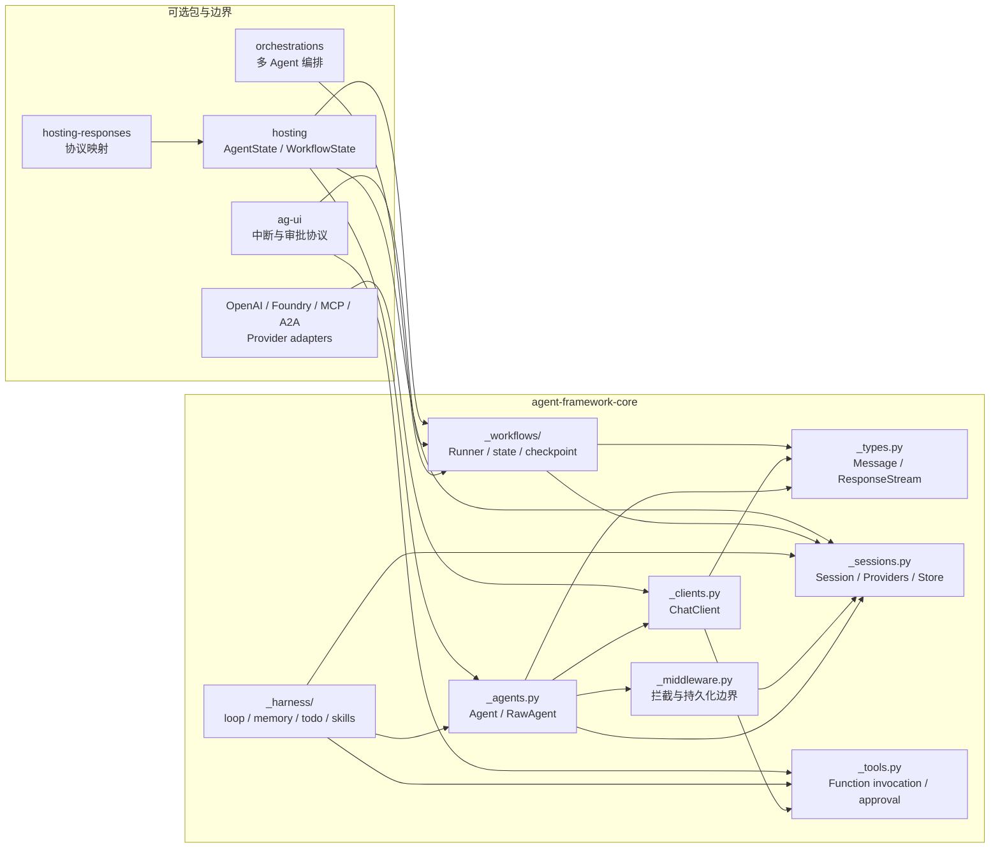

**[源码]** core 的公共根导出是惰性的；增加或移动公共 API 时，`__init__.py`、`__init__.pyi`、惰性导出表和 `__all__` 必须同步。**[建议]** 读源码时先从 `_agents.py` 的调用边界进入，再沿 `SessionContext → ChatClient → ResponseStream` 展开；不要把 provider 包当成 Agent 的内部实现。

### 1.2 四种不同的“状态”

| 状态 | 载体 | 所有者 | 生命周期 | 能否直接当作会话授权 |
|---|---|---|---|---|
| Agent 定义 | `Agent` / `RawAgent` | 应用进程 | 配置生命周期 | 否 |
| 对话延续 | `AgentSession` | 应用或 `SessionStore` | 多次 run | 否，需租户鉴权 |
| 服务端句柄 | `service_session_id` | 模型服务/provider | 服务端策略决定 | 否，是不透明续接句柄 |
| 工作流恢复 | `WorkflowCheckpoint` | `CheckpointStorage` | superstep 链 | 否，需校验 workflow/tenant |

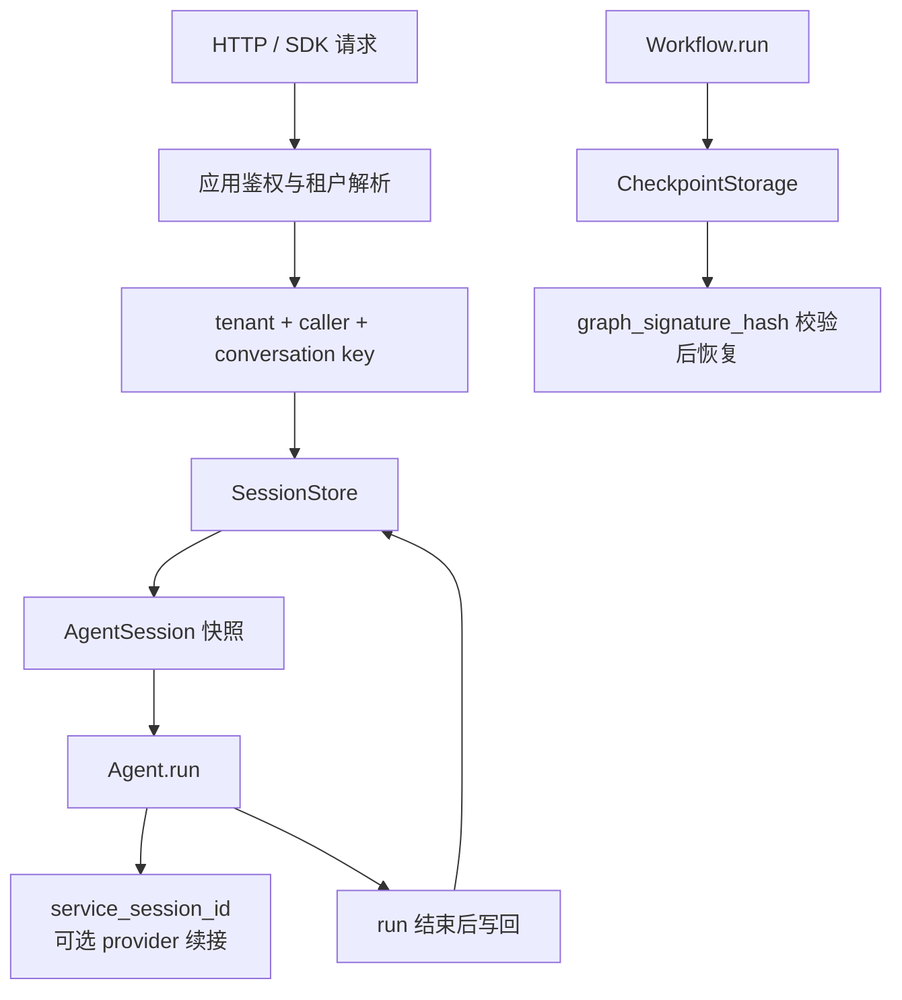

**关键边界**：`AgentSession` 是轻量状态容器，不持有 provider 实例；`SessionStore` 只负责读写快照，不替应用做授权、TTL、跨进程 single-writer 或租户隔离。

## 2. 全局架构：定义、状态、执行、协议

### 2.1 从一次请求到响应

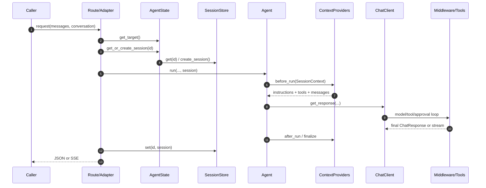

这个图是逻辑路径，不意味着所有入口都经过 `AgentState`；直接 SDK 调用可跳过 Hosting 层，Workflow 则走另一条 runner/checkpoint 路径。

### 2.2 依赖方向

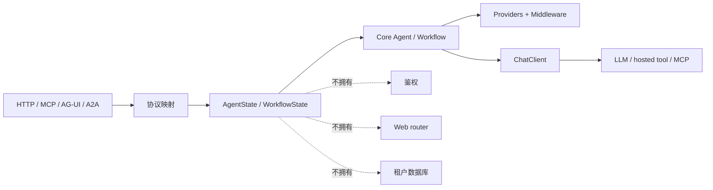

**[源码]** `hosting` 的 docstring 明确不拥有 routes、middleware、protocol dispatch、native SDK calls；这正是后端集成最容易误读的地方。

## 3. Agent.run 的真实边界

### 3.1 `RawAgent.run` 做什么

`RawAgent.run` 负责创建 run identity、准备上下文、调用 client、把响应解析成 AgentResponse；它**不等于**完整的产品级循环。工具循环来自 chat client/function invocation 层；Harness 的多轮 judge/feedback 循环来自 middleware。

```python
# 伪代码，按 _agents.py 的真实阶段压缩展示；不是可复制 API
async def run_once(agent, messages, session):
    run_id = object()                 # 标记本次 run 的动态范围
    adopt_persistence_gate(run_id)
    with run_identity_scope(run_id):
        context = await agent._prepare_run_context(...)
        raw = await agent._call_chat_client(context, stream=False)
        response = await agent._parse_non_streaming_response(context, raw)
        # parse 内部会更新 service_session_id，并运行 after providers
        return response
```

### 3.2 Provider 管道的两个重要分支

`_prepare_session_and_messages` 会复制默认 options，建立 `SessionContext`，按 forward order 执行 `before_run`，再合并 provider 注入的 tools/instructions。若启用 `require_per_service_call_history_persistence`，HistoryProvider 的 once-per-run 加载会被跳过，历史由 per-service-call middleware 管理。

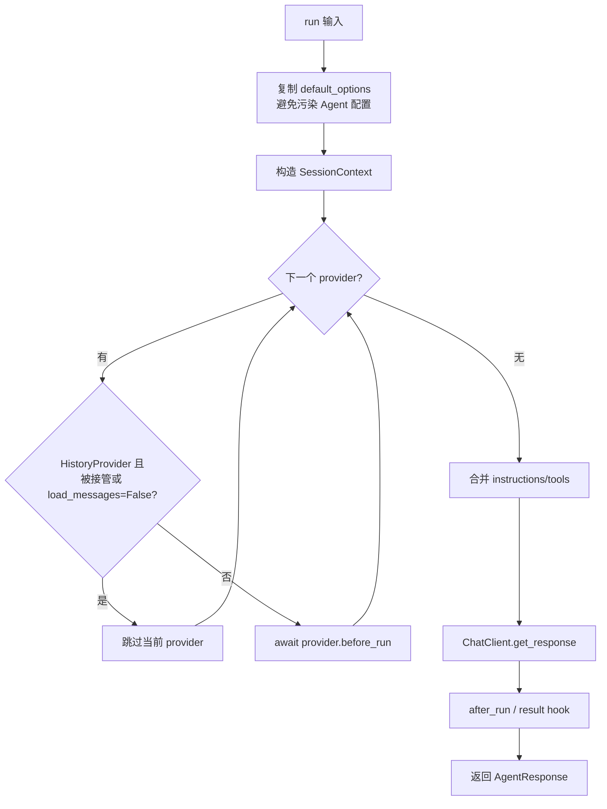

**[推论]** provider 顺序是语义的一部分：历史、compaction、skills、memory、安全标签等 provider 若改变顺序，最终 prompt 和工具集合就可能改变。**[建议]** 文档或产品扩展应记录 provider 顺序，而不是只列出 provider 名称。

### 3.3 service session 的双轨语义

非流式解析从 `ChatResponse.conversation_id` 更新 `AgentSession.service_session_id`；流式路径从 raw update 中提取 conversation id，并在最终化时更新。不能把 `response_id` 自动当成服务会话句柄；源码注释明确指出某些 API 的 response id 不能用于 function-call continuation。

## 4. SessionContext 与历史持久化

### 4.1 SessionStore 的复制语义

`SessionStore.get()` 返回 deep copy；`AgentState.get_or_create_session()` 对同一 session id 使用进程内 `asyncio.Lock`，创建后再返回工作副本。这样可以避免一次 run 直接修改 store 内对象，但不解决跨进程并发。

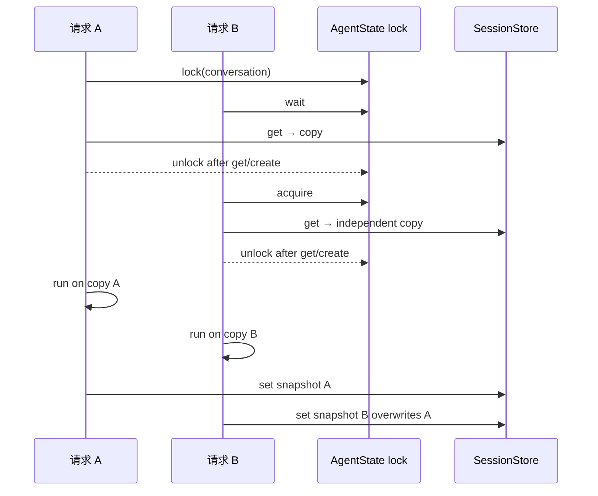

注意：这只保护 `get_or_create_session` 的取出阶段；Hosting 示例在 run 期间没有由 `AgentState` 自动持有 single-writer 锁，且源码注释明确说明同一 conversation 的并发推进由应用负责。

### 4.2 FileSessionStore 的真实保证

- JSON 或 MessagePack 快照；
- 临时同目录文件 + `os.replace`，避免读到半写文件；
- 单进程文件操作锁；
- 跨进程 writer 是 last-writer-wins；
- session id 做路径编码和 resolved-path 校验；
- 明文存储，不是密钥库，也不自带租户授权。

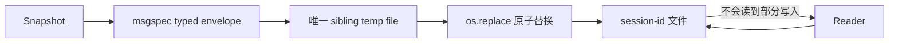

### 4.3 历史与服务端历史不是一回事

| 模式 | `AgentSession.state` | outgoing messages | provider 句柄 |
|---|---|---|---|
| 本地历史 | HistoryProvider 保存 messages | 本地拼装 | 通常为空 |
| 服务端历史 | 可只保存少量控制状态 | 由服务端 conversation 续接 | `service_session_id` |
| Harness | 历史 + compaction + todo/memory 等 provider | 每次 service call 可能重新装配 | 由 client 决定 |

## 5. Tool Loop、审批与防重放

### 5.1 工具调用的安全状态机

AG-UI `ApprovalLifecycle` 把一个 server-owned approval occurrence 建模为 `pending → claimed → executing → settled`，也可能进入 `rejected / cancelled / expired / indeterminate`。其中 `indeterminate` 不可直接当成可安全重试的成功或失败；它表示是否执行无法证明，安全窗口内应保留权威。

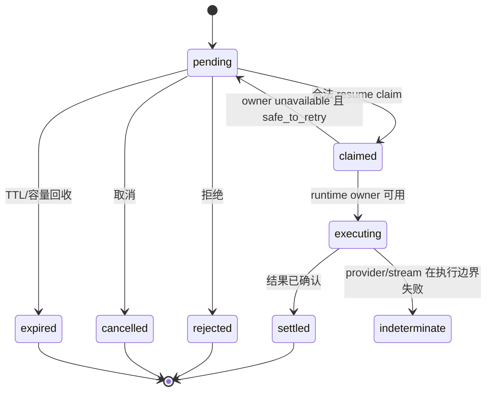

### 5.2 为什么 occurrence id 比 call id 更可靠

函数调用 id 是 Agent Framework 的 occurrence identity；provider 的 call id 可能在不同服务、重放或历史中复用。审批绑定需带 generation、scope、owner 等权威上下文；“名称相同”不构成同一调用。

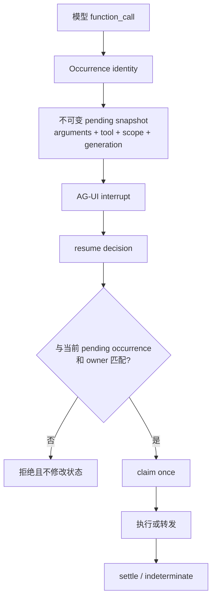

### 5.3 工具循环的失败分类

- **拒绝/取消**：工具不得执行；取消重放应保持幂等完成。
- **已批准但执行 owner 消失**：只有明确 `safe_to_retry` 才能释放 claim；否则保留 pending/indeterminate。
- **并行 batch 中一个 fatal failure**：取消尚未启动的 sibling，在服务托管 continuation 场景按规范执行额外 settlement 请求（`tool_choice="none"`），补齐 dangling call 的错误结果；非服务托管场景不应凭空增加一次请求。取消是协作式的，不能回滚已发生的外部副作用。
- **历史 replay**：只恢复结果，不恢复审批权；审批控制消息不能再次变成执行授权。

这些语义由 `docs/specs/004-python-function-calling-loop.md` 的 scenario matrix 与 AG-UI 测试共同约束；旧文档若只写“approval gate”而不写状态机，无法指导后端实现。

## 6. ResponseStream 的消费契约

### 6.1 流不是“返回一个 async generator”这么简单

`ResponseStream.__anext__` 启动 content pipeline；正常结束会 `_finish_consumption()`；异常（含 `CancelledError`）先执行 error hook，再在 finally 里 close；`close()` 是幂等的，会关闭嵌套 stream 和 cleanup hooks。`get_final_response()` 会消费/汇总 updates，并按 inner→outer 顺序执行 finalizer/result hooks。

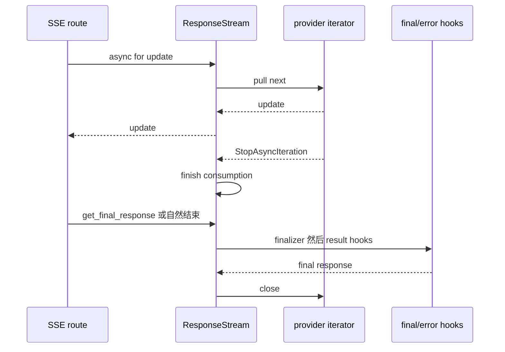

### 6.2 后端必须消费到最终化

Hosting Responses 示例在 SSE 生成器结束后才把 session 写回 store；因为流式 `agent.run` 只有在消费/最终化时才可靠地更新 session。若客户端断开，route 需要明确决定：关闭 stream、是否持久化已知状态、是否把执行标为 indeterminate。不能把“已经返回了几个 token”当作 run 已成功提交。

## 7. Workflow Runner 与 checkpoint

### 7.1 superstep 不是普通消息循环

`RunnerImpl.run_until_convergence()` 每轮创建 iteration task，同时等待 event；iteration 完成后才递增 iteration、commit state、创建 checkpoint，再检查是否还有 message。若 iteration 失败，pending state discard；事件仍先被 drain，以便上层观察失败。

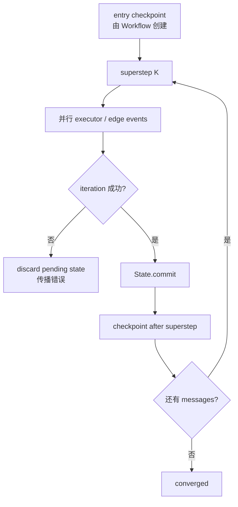

### 7.2 checkpoint 的内容与恢复约束

`WorkflowCheckpoint` 包含 `workflow_name`、`graph_signature_hash`、消息、已提交 state、executor state、edge runner state、pending request-info events、iteration_count 和 lineage。`iteration_count` 不是全局唯一顺序；人机协同时应按 `previous_checkpoint_id` 链和 timestamp 判断顺序。

恢复流程先清理旧 state，再导入 checkpoint、恢复 executor/edge/context，并标记 resumed；文件存储对路径做 containment 校验，类型反序列化受 allow-list 限制。**[建议]** 生产系统把 checkpoint id 当作不透明资源标识，不以“持有 id”代替授权；在业务层绑定 tenant/user/workflow definition。

### 7.3 失败窗口：commit 不等于外部事务提交

| 失败位置 | 已知状态 | 不能推导的结论 | 应用策略（建议） |
|---|---|---|---|
| executor 调用外部 API 后失败 | runner discard 暂存 state | 外部 API 已被撤销 | 幂等键、补偿或查询外部结果 |
| `State.commit()` 后 checkpoint save 失败 | 内存 state 已提交，checkpoint 可能未保存 | 整个 superstep 已持久化 | 明确保存失败的终止和恢复策略 |
| SSE 已发部分输出后取消 | 调用者观察到增量 | run 已成功、session 已持久化 | close/cleanup，区分审批执行的未知结果 |
| stable conversation 两个 writer 并行 | 各自有独立 working copy | copy 隔离等于写冲突隔离 | load→run→save single-writer 或 CAS |
| 后台 task 正在执行时重启 | Python task 不再运行 | 外部系统副作用也已取消 | durable 任务记录与恢复决策 |

`os.replace` 避免“半个文件可见”，不自动等于跨文件/跨进程事务，也不应推导为断电耐久性承诺。FileCheckpointStorage 的类型限制用于收窄反序列化面，不意味着可以接受未授权 caller 上传任意 checkpoint；持久化目录和注册类型仍是可信边界。

### 7.4 Workflow 与 AgentSession 的对照

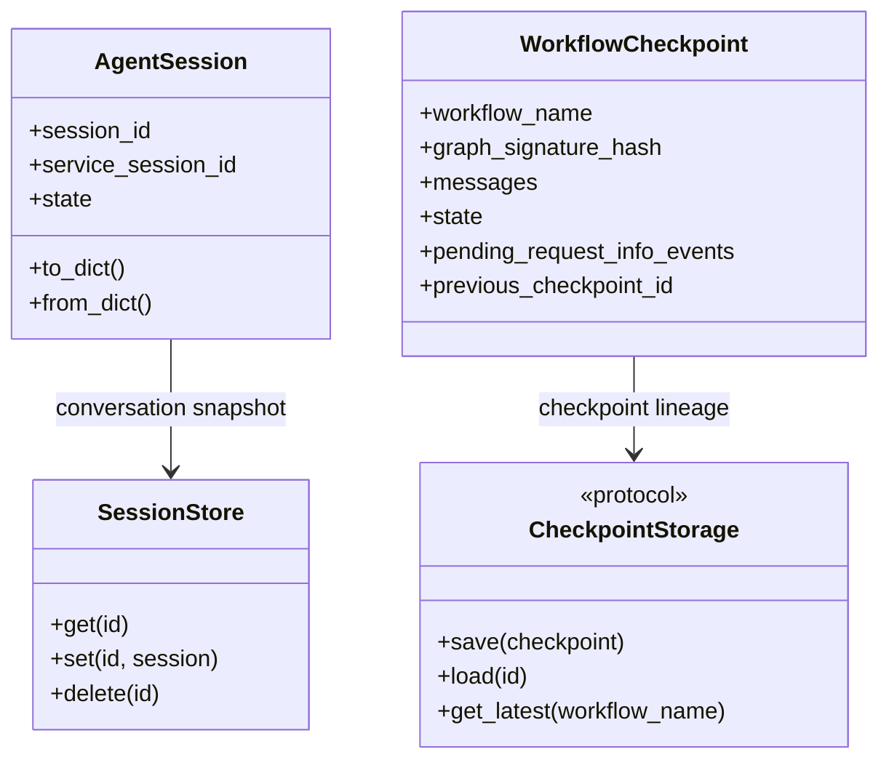

## 8. Harness：把基础设施装配成产品循环

### 8.1 `create_harness_agent` 的装配职责

Harness factory 将 history、compaction、todo、mode、memory、skills 等 providers 组装到 Agent，并默认加入 ToolApprovalMiddleware 和 MessageInjectionMiddleware；仅配置 `loop_should_continue` 时才加入 AgentLoopMiddleware；同时设置 per-service-call history persistence。它是“产品运行时装配器”，不是另一种 Agent 基类。

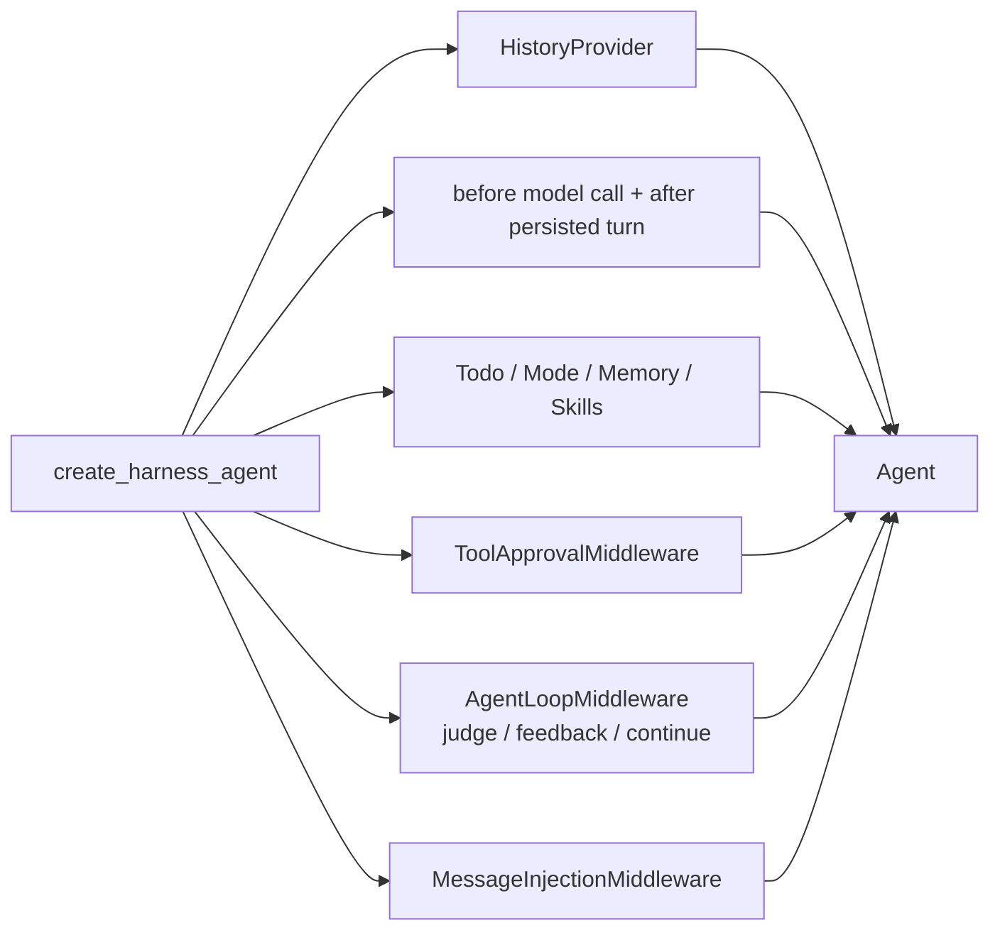

Compaction 的 before phase 在 `BaseChatClient.get_response` 内、每次 model call 发生；after phase 由 `CompactionProvider.after_run` 对已持久化历史执行。若只看 provider 列表而不看执行层，会误以为 before compaction 是普通 `before_run`。

### 8.2 三种循环的 stop 条件不要混用

| 循环 | 驱动源 | 正常停点 | 容易误读 |
|---|---|---|---|
| Function invocation | 模型 function calls | 最终响应、审批/Host pause、预算限制 | `max_iterations` 计模型 roundtrip，不等于用户 turn |
| `AgentLoopMiddleware` | continue/judge/next_message | stop predicate、上限、pending approval 逃逸 | 不应吞掉审批后继续自行执行 |
| Workflow runner | graph messages | 消息收敛或等待输入、iteration 上限 | checkpoint iteration 不等于 LLM 轮数 |

### 8.3 后台子 Agent

`BackgroundAgentsProvider` 为每个父 session 管理 runtime，子任务有独立 session 并发运行；`release_session` 可取消 in-flight tasks，并以 bounded timeout 防止宿主驱逐被卡死。生产后端需要在进程退出、租户注销和 session TTL 到期时安排 release；否则可能留存 task/runtime。这里的进程内 asyncio task 不等于可跨重启恢复的 durable job。

## 9. Hosting 后端：框架不等于 Web 服务

### 9.1 官方 sample 的责任切割

Responses sample 的路线明确分为：

1. `responses_to_run`：解析协议 payload；
2. 应用过滤允许的 options，不能直接信任 caller tools/tool_choice；
3. `AgentState` 解析目标并取得 session；
4. `target.run` 执行；
5. `responses_from_run` / `responses_from_streaming_run` 做协议映射；
6. run 完成/stream finalized 后写回 session。

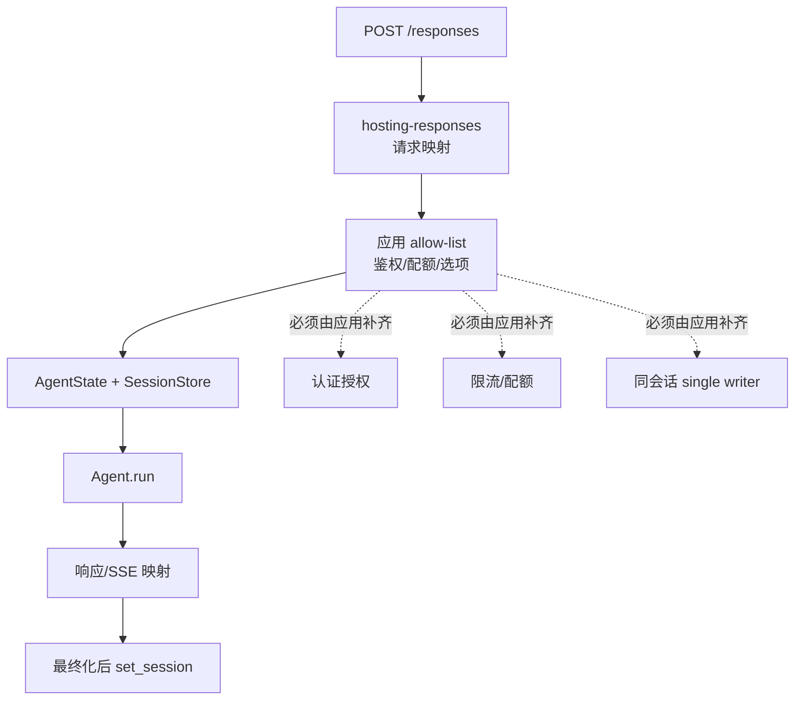

### 9.2 后端最小生产清单

- 会话 id 与 tenant/user 绑定，不能只靠 opaque id；
- 同一 conversation single-writer，或采用版本号/CAS，避免 last-writer-wins 丢 turn；
- stream 断连、进程重启、provider 超时分别定义状态；
- session/checkpoint 加密或至少限制文件权限；
- caller options/tools 做 allow-list；
- approval resume 校验 scope、generation、occurrence；
- 记录 trace id、run id、session id（不要默认记录 prompt/PII）；
- 对跨进程 SessionStore、CheckpointStorage 使用真正共享后端；
- 对异步 background tasks 在 shutdown/eviction 处理 cancellation。

## 10. 并发、租户与安全边界

### 10.1 能力矩阵

| 能力 | Core | Hosting | 应用后端 |
|---|---|---|---|
| 本地 session snapshot | ✓ | 复用 | 选择持久化介质 |
| 单进程取出锁 | ✓/AgentState | ✓ | 不足以做分布式锁 |
| 跨进程一致写 | ✗ | ✗ | Redis/DB/CAS/队列 |
| 鉴权/租户 | ✗ | ✗ | 必须实现 |
| 工具审批语义 | ✓ | 协议适配 | 授权入口与策略 |
| HTTP 路由 | ✗ | ✗ | FastAPI/ASP.NET 等 |
| 观测/告警 | 提供 hooks | 可接入 | 生产落地 |

### 10.2 设计上的“最小可信边界”

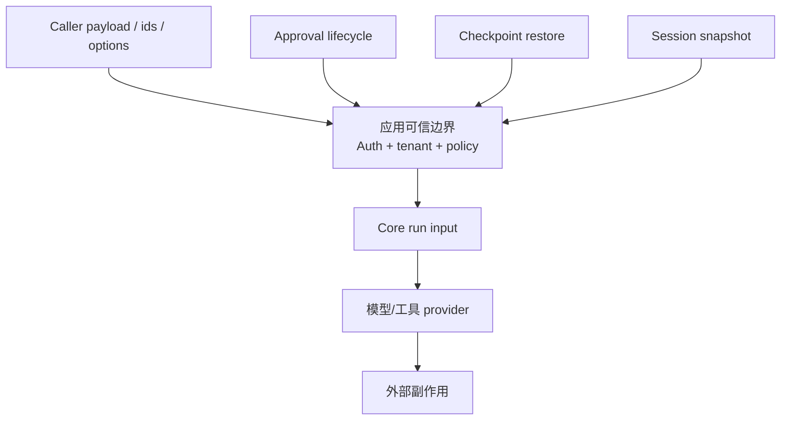

**[推论]** “框架提供防重放算法”不等于“应用已授权调用者恢复该审批”；授权仍需在 route/service 层完成。

## 11. 源码解读索引

| 主题 | 源码位置 | 关注点 |
|---|---|---|
| Agent 入口 | `python/packages/core/agent_framework/_agents.py` | `RawAgent.run`、`_prepare_session_and_messages`、stream finalize |
| Session | `.../_sessions.py` | `AgentSession`、`SessionStore`、`FileSessionStore`、providers |
| 工具审批 | `.../_tools.py`、`packages/ag-ui/.../_approval_lifecycle.py` | occurrence、pending、settlement |
| Stream | `.../_types.py` | `ResponseStream.__anext__`、`close`、`get_final_response` |
| Workflow | `.../_workflows/_runner.py` | superstep、commit/discard、事件 drain |
| Checkpoint | `.../_workflows/_checkpoint.py` | lineage、graph signature、文件安全 |
| Harness | `.../_harness/_agent.py`、`_loop.py`、`_background_agents.py` | 装配、judge loop、后台 task |
| Hosting | `packages/hosting/.../_state.py` | target resolution、session copy、边界声明 |
| Responses | `packages/hosting-responses/.../_parsing.py` | 协议映射、SSE 输出 |
| 运行规范 | `agent-framework/docs/specs/004-python-function-calling-loop.md` | scenario matrix、coverage gap、验证命令 |

## 12. 设计结论

1. 本次核对的 Python MAF 核心抽象不是一个“大循环”，而是 **Agent 定义 + Context Provider 管线 + ChatClient/Tool Loop + Session 快照**。
2. Workflow 的正确心智模型是 **superstep + committed state + checkpoint lineage**，不是把 Agent loop 换个名字。
3. Stream 的成功边界在 finalization，不在首 token；后端持久化必须与消费生命周期一致。
4. 审批的安全核心是 occurrence/generation/owner/settlement，而不是一个 boolean `approved`。
5. `SessionStore`、`FileCheckpointStorage` 都是可替换存储抽象，但不会替应用完成认证、分布式一致性和租户隔离。
6. 当前最值得补入所有二次集成文档的内容是：**状态所有权表、并发模型、失败/取消矩阵、协议层责任清单**。


## 附录 A：API 与历史文档漂移校准

旧文档作为历史说明完整保留；以下以本次源码为准，避免复制旧示例时误用：

| 原文/历史说法 | 当前源码核对 | 阅读方式 |
|---|---|---|
| `run_stream()` | Python 当前主入口 `run(..., stream=True)` 返回 `ResponseStream` | 不把历史命名写入新示例 |
| `_agents.py` 的固定行号 | 当前 `RawAgent.run`、`_prepare_run_context` 已因功能演进位移 | 以符号搜索为准，不把旧行号当证据 |
| `SessionStore` 位于 hosting `_state.py` | 当前 core `_sessions.py` 定义，hosting 导入复用 | 区分定义处与使用处 |
| 九幕导读中的 `RunItem` | 本次主链核对使用 `AgentResponseUpdate`、`ChatResponseUpdate`、`WorkflowEvent` | 不把跨框架类比当成当前 Python 类型 |
| `./decisions/`、原 `examples/mytest/debug_quick.py` 导航 | 当前目标文档目录没有 `decisions/`；旧命令不能据此视为可运行 | 保留旧链接，但用源码现存 `python/samples/04-hosting/` 与本轮索引定位 |

这里只校准实际核对过的入口；没有宣称所有旧代码片段都已逐条执行。

## 附录 B：资源生命周期与子 Agent 状态隔离

`RawAgent.open()` 进入 chat client 与 MCP 工具的 async context；部分打开失败时会释放已进入的资源。`async with agent` 委托 open/close。其生命周期与单次 `run` 不同：常驻服务不应每 token 或每个工具调用都重建客户端，但也不能在进程结束时依赖 GC 释放连接。

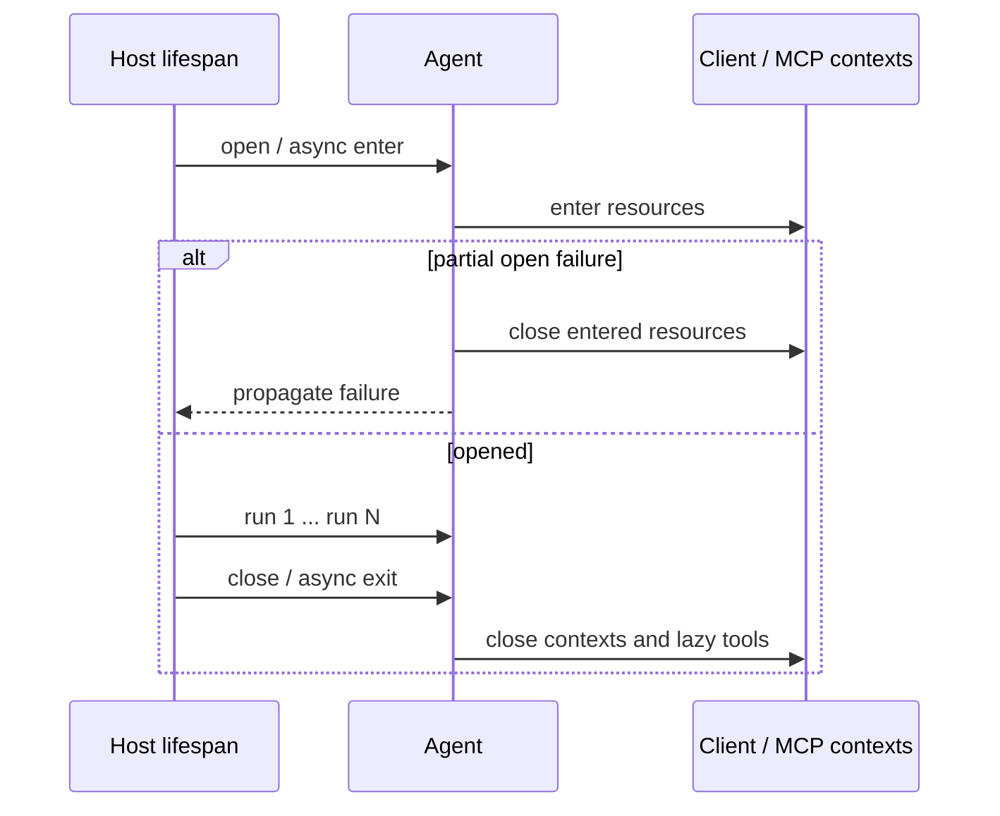

`as_tool(propagate_session=True)` 不是父子无条件共享一份 session：父子 agent/client 通过 `service_session_state_keys` 声明服务拥有的 continuation 键，传播时隔离这些句柄，普通应用 state 才参与传播。自定义 loop 对非空共享 session 需显式提供 `FunctionInvocationContext.parent_service_session_state_keys`，缺少权威声明时 fail closed。其目的不是禁止跨 Agent 状态共享，而是防止把父服务会话句柄泄漏给子服务，或把子服务续接句柄覆盖父会话。

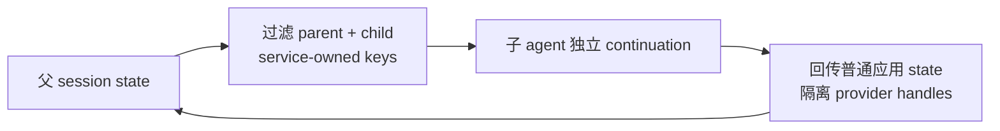


## 附录 C：可点击的源码证据

下列链接按当前兄弟仓库布局解析；移动文档仓库后需重新映射。

| 证据主题 | 实际源码 |
|---|---|
| Agent 运行 | [python/packages/core/agent_framework/_agents.py](../../../agent-framework/python/packages/core/agent_framework/_agents.py) |
| Session/History/Store | [python/packages/core/agent_framework/_sessions.py](../../../agent-framework/python/packages/core/agent_framework/_sessions.py) |
| ResponseStream | [python/packages/core/agent_framework/_types.py](../../../agent-framework/python/packages/core/agent_framework/_types.py) |
| 工具循环 | [python/packages/core/agent_framework/_tools.py](../../../agent-framework/python/packages/core/agent_framework/_tools.py) |
| Harness factory | [python/packages/core/agent_framework/_harness/_agent.py](../../../agent-framework/python/packages/core/agent_framework/_harness/_agent.py) |
| Harness loop | [python/packages/core/agent_framework/_harness/_loop.py](../../../agent-framework/python/packages/core/agent_framework/_harness/_loop.py) |
| 后台 Agent | [python/packages/core/agent_framework/_harness/_background_agents.py](../../../agent-framework/python/packages/core/agent_framework/_harness/_background_agents.py) |
| Workflow Runner | [python/packages/core/agent_framework/_workflows/_runner.py](../../../agent-framework/python/packages/core/agent_framework/_workflows/_runner.py) |
| Checkpoint | [python/packages/core/agent_framework/_workflows/_checkpoint.py](../../../agent-framework/python/packages/core/agent_framework/_workflows/_checkpoint.py) |
| Hosting state | [python/packages/hosting/agent_framework_hosting/_state.py](../../../agent-framework/python/packages/hosting/agent_framework_hosting/_state.py) |
| Responses 映射 | [python/packages/hosting-responses/agent_framework_hosting_responses/_parsing.py](../../../agent-framework/python/packages/hosting-responses/agent_framework_hosting_responses/_parsing.py) |
| AG-UI 审批 | [python/packages/ag-ui/agent_framework_ag_ui/_approval_lifecycle.py](../../../agent-framework/python/packages/ag-ui/agent_framework_ag_ui/_approval_lifecycle.py) |
| HTTP 示例 | [python/samples/04-hosting/af-hosting/local_responses/app.py](../../../agent-framework/python/samples/04-hosting/af-hosting/local_responses/app.py) |
| 工具循环规范 | [docs/specs/004-python-function-calling-loop.md](../../../agent-framework/docs/specs/004-python-function-calling-loop.md) |
