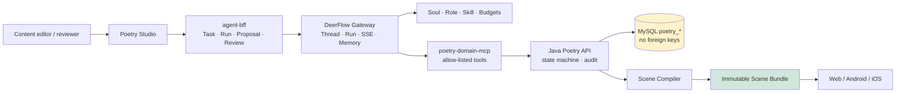

# Architecture · Poetry Agent Platform

## System purpose

This repository is the authoring-side Agent platform for 诗词时空. It creates controlled editorial work, evidence-backed DRAFT candidates, human-review records and agent-run audit trails. It does **not** serve the student experience or own published poetry facts.

## Trust boundaries

### Enforcement layers

| Layer | Enforces |
|---|---|
| BFF | authenticated editorial workflow, task/run/proposal/review states |
| DeerFlow profile | role separation, skill instructions, budgets, MCP selection |
| Poetry Domain MCP | no database access; fixed tool surface; DRAFT-only input validation |
| Java Poetry API | authoritative state transition, content validation, audit, idempotency |
| Scene Compiler | publish eligibility and immutable Bundle construction |

Soul and Skills guide behavior; they are not authorization. Java API, MCP internal authentication, and MCP tool availability are the security boundaries.

## Service ownership

| Service | Owns | Does not own |
|---|---|---|
| `agent-bff` | operational task/run/review records | poetry works, text, citations, publishing |
| `poetry-domain-mcp` | API translation and strict tool availability | database access, truth judgement |
| DeerFlow | agent execution, checkpoints, event delivery | domain facts and release state |
| Java Poetry API | `poetry_*` fact/change state and audit | LLM planning |
| Scene Compiler | Bundle compilation eligibility | editorial research or source verification |

## Current persistence plan

V008 makes the BFF stateless: Studio task/run/mandate/profile/runtime/event state is persisted through the Java-side, foreign-key-free `poetry_agent_*` domain records. BFF reads and writes this state only through the Poetry Domain MCP control bridge, never directly to MySQL. The currently materialized entities are `poetry_agent_run`, `poetry_agent_task`, `poetry_agent_mandate`, `poetry_agent_proposal`, `poetry_agent_review`, `poetry_agent_tool_receipt`, `poetry_agent_event`, `poetry_agent_profile_version`, and `poetry_agent_compile_request`; assignments remain an explicit future extension rather than an invented table.

No foreign keys are permitted. Integrity is implemented by service checks, immutable IDs, idempotency keys, unique indexes, state machines and scheduled audit SQL.

## Extensibility rule

新增开源 Agent、Skill、Tool、MCP 或中间件时，必须经过 Adapter First 准入：固定版本、来源与许可证记录、最小权限 allow-list、可观测性、禁用开关和回滚策略。任何中间件都不得绕过 MCP/Java Poetry API 直接访问 MySQL 或取得发布权限。完整原则见 `docs/agent-platform-engineering-principles.md`。
